# Epsil — complete documentation

# Introduction - Compute Engine

Source: https://epsil.dev/compute-engine/

<HeroImage path="/img/hand-gears.jpg" >
# Compute Engine
</HeroImage>

<Intro>
A JavaScript library for symbolic computing and numeric evaluation of 
mathematical expressions.
</Intro>

<GraphPaperBanner />


<div style={{height:"1rem"}}></div>

```live
console.log(evaluate("e^{i\\pi}"));
```

```live
console.log(expand("(a+b)^2"));
```


```live
console.log(simplify(
  "(sin(alpha)**2 + cos(alpha)**2) * (x**2 + 2*x + 1) / (x + 1)"
));
```


The **Compute Engine** is for educators, students, scientists, and engineers 
who need to run technical computing apps in browsers or server-side 
JavaScript environments like Node.js.


The Compute Engine manipulates math expressions represented with 
the <a href="math-json/">MathJSON format</a>.

The expression \\(x^2 + 2x + 1\\) is represented in MathJSON as:

```json
["Add", ["Power", "x", 2], ["Multiply", 2, "x"], 1]
```


The Compute Engine can:
- <a href="/compute-engine/guides/latex-syntax/">**parse** and **serialize**</a> expressions from and to LaTeX.
- <a href="/compute-engine/guides/simplify/">**simplify**</a> symbolic expressions
- evaluate expressions <a href="/compute-engine/guides/evaluate/">**symbolically**</a>
  or <a href="/compute-engine/guides/numeric-evaluation/">**numerically**</a>
- solve equations, calculate derivatives and integrals, and perform other
  <a href="/compute-engine/reference/calculus/">**calculus**</a> operations
- <a href="/compute-engine/guides/compiling/">**compile**</a> expressions to JavaScript

## Free Functions

For common operations, use the free functions — no setup required:

```live
console.log(simplify("x+x+1"));
console.log(evaluate("2^{11} - 1"));
console.log(N("\\frac{1}{3}"));
```

| Function                               | Purpose                                                        |
| :------------------------------------- | :------------------------------------------------------------- |
| `evaluate(expr \| latex)`                | Evaluate an expression or LaTeX input symbolically.            |
| `N(expr \| latex)`                       | Numerically evaluate an expression or LaTeX input.             |
| `simplify(expr \| latex)`                | Simplify an expression or LaTeX input.                         |
| `assign(id, value)` / `assign(record)` | Assign one symbol value or many at once.                       |
| `expand(expr \| latex)`                  | Expand distributively at the top level (`Expression \| null`). |
| `expandAll(expr \| latex)`               | Expand distributively recursively (`Expression \| null`).      |
| `factor(expr \| latex)`                  | Factor an expression.                                          |
| `solve(expr \| latex, vars?)`            | Solve equations/systems (returns solve result variants).       |
| `compile(expr \| latex, options?)`       | Compile to a target language with `CompilationResult`.         |
| `parse(latex)`                         | Parse a LaTeX string into an `Expression`.                     |

You can use either regular LaTeX strings or a looser syntax similar
to ASCIIMath or Typst:

```live
console.log(N("(1+sqrt(5))/2"));
```

:::info[Note]

These functions use a shared `ComputeEngine` instance created on first call.
Use `getDefaultEngine()` to configure it.
:::


<ReadMore path="/compute-engine/demo/" >
Try the **interactive demo** now<Icon name="chevron-right-bold" />
</ReadMore>


## Getting Started

**To load the Compute Engine module from the jsdelivr CDN**, use a `<script>` tag with the
`type="module"` attribute and an `import` statement.

```html
<script type="module">
  import { evaluate } from "https://esm.run/@cortex-js/compute-engine";

  console.log(evaluate("e^{i\\pi}"));
  // ➔ "-1"
</script>
```

Alternatively, you can use the **unpkg** CDN:

```js
import { ComputeEngine } from 
  "https://unpkg.com/@cortex-js/compute-engine?module";
```

**To find a Compute Engine that the page has already loaded**, without
importing it yourself, read the global slot
`Symbol.for("io.cortexjs.compute-engine")`. This is for a component, such as a
web component in its own bundle, that must work with a copy of the Compute
Engine loaded by the page. When the main entry point
(`@cortex-js/compute-engine`) loads, it stores an object in this slot:

```js
const global = globalThis[Symbol.for("io.cortexjs.compute-engine")];
if (global?.ComputeEngine) {
  const ce = new global.ComputeEngine();
  console.log(global.version, ce.parse("1+1").evaluate().toString());
}
```

The object holds `ComputeEngine` (the class), `version`, `LatexSyntax`,
`LATEX_DICTIONARY`, `compile`, the type guards (`isExpression`, `isNumber`,
`isSymbol`, `isFunction`, `isString`, `isCharacter`, `isTensor`,
`isDictionary`, `isObject`, `isCollection`, `isIndexedCollection`), and the
helpers `numericValue` and `sym`. Its TypeScript type is
`ComputeEngineGlobal`. The type guards test the structure of an expression,
so they work on an expression made by another copy of the bundle.

The contract is additive: a later version can add a member, but a member keeps
its meaning and is not removed. Test each member before you use it, since an
older version can lack a newer one. When several copies load, the last one to
load owns the slot. The main entry point and the Epsil entry point
(`/epsil`) store it; `/core` and the other entry points do not.


## MathJSON Standard Library

The **MathJSON Standard Library** is a collection of functions and symbols that are
available by default.

<div className="symbols-table" style={{"--first-col-width":"21ch"}}>

| Topic|     |
| :-------- | :---- |
| [Arithmetic](/compute-engine/reference/arithmetic/)                 | `Add` `Multiply` `Power` `Exp` `Log` `ExponentialE` `ImaginaryUnit`... |
| [Calculus](/compute-engine/reference/calculus/)                     | `D` `Derivative` `Integrate`...                                                |
| [Collections](/compute-engine/reference/collections/)               | `List` `Reverse` `Filter`...                                           |
| [Complex](/compute-engine/reference/complex/)                       | `Real` `Conjugate`, `ComplexRoots`...                                  |
| [Control Structures](/compute-engine/reference/control-structures/) | `If` `Block` `Loop` ...                                          |
| [Core](/compute-engine/reference/core/)                             | `Declare` `Assign` `Error` `LatexString`...                       |
| [Functions](/compute-engine/reference/functions/)                   | `Function` `Apply` `Return` ...                                        |
| [Logic](/compute-engine/reference/logic/)                           | `And` `Or` `Not` `True` `False` ...                            |
| [Sets](/compute-engine/reference/sets/)                             | `Union` `Intersection` `EmptySet` `RealNumbers` `Integers`  ...                                  |
| [Special Functions](/compute-engine/reference/special-functions/)   | `Gamma` `Factorial`...                                                 |
| [Statistics](/compute-engine/reference/statistics/)                 | `StandardDeviation` `Mean` `Erf`...                                    |
| [Strings and Text](/compute-engine/reference/strings/)              | `Text` `Annotated`...                                                 |
| [Trigonometry](/compute-engine/reference/trigonometry/)             | `Pi` `Cos` `Sin` `Tan`...                                              |

</div>


<ReadMore path="/compute-engine/standard-library/" >
Read more about the **MathJSON Standard Library**<Icon name="chevron-right-bold" />
</ReadMore>

You can add your own definitions to the built-in definitions from the MathJSON Standard Library.

<ReadMore path="/compute-engine/guides/augmenting/" >
Read more about **Extending the MathJSON Standard Library**<Icon name="chevron-right-bold" />
</ReadMore>

If you use a custom LaTeX syntax, such as macros, you can add your own 
definitions to the LaTeX dictionary, which defines how to parse and serialize 
LaTeX to MathJSON.

<ReadMore path="/compute-engine/guides/latex-syntax/" >
Read more about **Parsing and Serializing LaTeX**<Icon name="chevron-right-bold" />
</ReadMore>


:::info[Note]
In this guide, the `ce.` prefix in `ce.expr()` or `ce.parse()` indicates
that the function is a method of the `ComputeEngine` class.

Use `getDefaultEngine()` to access the shared `ComputeEngine` instance used by the free functions, or create your own instance with `new ComputeEngine()`.

The `expr.` prefix in `expr.evaluate()` or `expr.simplify()` indicates that the
function is a method of the `Expression` class.

**To create a new expression** use `expr = ce.parse()` or `expr = ce.expr()`

:::

---

# Compute Engine Demo

Source: https://epsil.dev/compute-engine/demo/

import Mathfield from '@site/src/components/Mathfield';
import { useEffect, useState } from 'react';
import { clsx } from 'clsx';
import CodePlayground from '@site/src/components/CodePlayground';
import ConsoleMarkup from '@site/src/components/ConsoleMarkup';
import ErrorBoundary from '@site/src/components/ErrorBoundary';

export function ToggleButton ({toggle, className, style}) {
return <button 
  className={clsx(className, "toggle")} 
  style={style}
  onClick={() => toggle()}>
    <svg xmlns="http://www.w3.org/2000/svg" viewBox="0 0 512 512"><path fill="currentColor" d="M256 48a208 208 0 1 1 0 416 208 208 0 1 1 0-416zm0 464A256 256 0 1 0 256 0a256 256 0 1 0 0 512zM216 336H192v48h24 80 24V336H296h-8V248 224H264 216 192v48h24 24v64H216zm72-144V128H224v64h64z"/></svg>
  </button>;
}

export function InfoSection({ label, children, secondary }) {
  const [visible, setVisible] = useState(false);
  return (
    <div className="info-section">
      {label && <div className="label">{label}</div>}
      <div class="info-section-row">
        {children}
        {secondary && <ToggleButton className={visible ? "is-on" : ""} toggle={()=>{setVisible(!visible)}}/>}
      </div>
      {visible && secondary}
    </div>
  );
}

export function Console({children}) {
  return <pre className="info-section-console">{children}</pre>;
}


export function ExampleSelector({ onSelect, index }) {  
  const examples = [
    { 
      latex: "\\frac{165}{315}",
      json: '["Divide", 165, 315]', 
      preamble: `To create a expression from a MathJSON expression, 
use the \`ce.expr()\` function.

By default expressions are put in canonical form. 
The canonical form of fractions is their reduced form.`,
      template: "as-json"
    },

    { 
      latex: 'e^{i\\pi}', 
      preamble: `To create a expression from a LaTeX string, 
use the \`ce.parse()\` function.

The \`expr.N()\` function evaluates the expression numerically, 
including complex numbers.`,
      template: "N"
    },

    { 
      latex: '\\sqrt{6\\sum_{n=1}^{\\infty} \\frac{1}{n^2}}', 
      preamble: 'Evaluate a sum',
      template: 'eval-async'
    },

    {
      latex: '2\\prod_{n=1}^{\\infty} \\frac{4n^2}{4n^2-1}',
      preamble: 'Evaluate a product',
      template: 'eval-async'
    },

    {
      latex: '\\sum_{n=1}^{b} n^2',
      preamble: `Simplify a sum with symbolic bounds to a closed-form formula.
The sum of squares simplifies to b(b+1)(2b+1)/6.`,
      template: 'simplify'
    },

    {
      latex: '\\prod_{n=1}^{b} n',
      preamble: `Simplify a product with symbolic bounds.
The product of consecutive integers simplifies to factorial.`,
      template: 'simplify'
    },

    {
      latex: '\\mathrm{Expand}((a+b)^5)', 
      preamble: `Symbolically expand an expression.
Use the \`latex\` property to get the result in LaTeX format.`,
      template: 'eval-string'
    },

    { 
      label: 'Rational',
      json: '["Rational", "Pi"]', 
      preamble: `The \`Rational\` function with a single argument
approximates a number as a rational.`
    },

    { 
      latex: '\\cos\\left(\\frac{\\pi}{6}\\right)',
      preamble: 'Exact trigonometric values',
      template: 'eval-string'
    },

    {
      latex: '\\sin(30\\degree)',
      preamble: 'Use degrees unit in trig functions',
      template: 'eval-string'
    },

    {
      latex: '(1,2,3)+(3,5,6)',
      preamble: 'Vector addition with element-wise operations',
      template: 'eval-string'
    },

    {
      json: '["MatrixMultiply", ["List", ["List", 1, 2], ["List", 3, 4]], ["List", ["List", 5, 6], ["List", 7, 8]]]',
      label: 'Matrix Multiply',
      preamble: 'Matrix multiplication using MatrixMultiply function',
      template: 'as-json'
    },

    {
      latex: `\\begin{cases}
0 & n =  0\\\\
1 & n =  1\\\\
n^2+1 & n \\geq 2
\\end{cases}`,
      label: "Piecewise"
    },

    { 
      latex: '\\lfloor \\pi \\rfloor = \\lceil \\exponentialE \\rceil', 
      preamble: "Evaluate boolean expressions",
      template: "eval-string"
    },

    {
      latex: '(x = \\pi) + 2',
      label: "Errors",
      preamble: 'Syntax errors are represented as \`Error\` functions'
    },

    {
      latex: 'F_{10}',
      label: "Fibonacci",
      preamble: `Define sequences using LaTeX assignment notation.
Base cases and recurrence are automatically detected.
Generate terms and compute sums over sequences.`,
      template: "sequence"
    }
  ];

  useEffect(() => { onSelect(examples[index], index)}, []);

return (
    <div className="example-cells">{
      examples.map((x, i) => {
        return (
          <div 
            key={x.label ?? x.latex ?? x.json}
            className={clsx("example-cell", {"active": i === index} )} 
            onClick={() => onSelect(x, i)}
          >
            {x.label ? x.label: `$$${x.latex}$$`}
          </div>
        );
      })
    }
    </div>
  );
}

export function ComputeEngineDemo() {

const TEMPLATES = {
  evaluate: `$0
const expr = $1;
console.info(expr.evaluate().json);
`,
  "as-json": `$0
const expr = $1;
console.info(expr.json);
`,
  "eval-string": `$0
const expr = $1;
console.info(expr.evaluate());
`,
  "eval-latex": `$0
const expr = $1;
console.info(expr.evaluate().latex);
`,
  N: `$0
const expr = $1;
console.info(expr.N());
`,
  "eval-async": `$0
const expr = $1;
expr.evaluateAsync().then(result => console.info(result));
`,
  "simplify": `$0
const expr = $1;
console.info(expr.simplify());
`,
  "sequence": `$0
// Define Fibonacci sequence via LaTeX assignments
ce.parse('F_0 := 0').evaluate();
ce.parse('F_1 := 1').evaluate();
ce.parse('F_n := F_{n-1} + F_{n-2}').evaluate();

// Evaluate specific terms
console.info('F_10 =', ce.parse('F_{10}').evaluate().value);
console.info('F_20 =', ce.parse('F_{20}').evaluate().value);

// Generate a list of terms
const terms = ce.getSequenceTerms('F', 0, 10);
console.info('First 11 terms:', terms.map(t => t.value).join(', '));

// Sum over sequence terms
const sum = ce.parse('\\\\sum_{k=0}^{10} F_k').evaluate();
console.info('Sum of F_0 to F_10 =', sum.value);
`

};


  let [index, setIndex] = useState(0);
  let [value, setValue] = useState('');

  const handleSelect = (example, exampleIndex) => {
    let code = TEMPLATES[example.template] ??  TEMPLATES["evaluate"];
    
    if (example.preamble) {
      const lines = example.preamble.split('\n');
      const preamble = lines.map(x => `// ${x}`).join('\n') + '\n';

      code = code.replace('$0', preamble);
    } else {
      code = code.replace('$0', '');
    }

    // Prioritize JSON over LaTeX if we have both. The LaTeX will be used
    // as a label.
    if (example.json) {
      code = code.replace("$1", `ce.expr(${example.json})`);
    } else if (example.latex) {
      if (example.latex.includes('\n')) {
        const escaped = example.latex.replace(/\\/g, '\\\\');
        code = code.replace('$1', `ce.parse(\`${escaped}\`)` );
      } else {
        code = code.replace('$1', `ce.parse(${JSON.stringify(example.latex)})`);
      }
    }  

    if (!('ComputeEngine' in window)) {
      setValue(`// 😕 The Compute Engine could not be loaded.
// Check your network connection or try again later.`);
    } else {
      setValue(code);
    }
    setIndex(exampleIndex);
  };

  return (
    <div className="flex flex-col items-center">
      <ErrorBoundary>
        <ExampleSelector onSelect={handleSelect} index={index}/>
        <ErrorBoundary>
          <CodePlayground js={value} />
        </ErrorBoundary>
      </ErrorBoundary>
    </div>
  );
}

# Compute Engine Demo

<style>{`
.example-cells {
  display: flex;
  flex-wrap: nowrap;
  justify-content: flex-start;
  gap: .5em;
  width: 100%;
  overflow: auto hidden;
  margin-bottom: 1rem;
  border-radius: 16px;
  border: 1px solid var(--neutral-700);
  padding: 16px;
  background-color: var(--neutral-900);

  font-size: 1em;

  box-shadow: inset 2px 2px 4px 0px var(--neutral-800),
              inset -2px -2px 4px 0px var(--neutral-800);
}


.example-cell {
  display: flex;
  align-items: center;
  justify-content: center;
  padding: .25rem 0.5rem;
  margin: 0;
  min-width: fit-content;

  white-space: nowrap;
  overflow: hidden;
  text-align: center;

  border: 1px solid var(--callout-border-color);
  background-color: var(--neutral-1000);
  border-radius: 8px;
  color: var(--primary-color-dark);
  cursor: pointer;
  scale: 1;
  transition: scale 0.2s;
}

[data-theme="dark"] .example-cell {
  background-color: var(--neutral-800);
  color: var(--neutral-400);
}


.example-cell.active {
  color: white;
  background-color: var(--primary-color);
  border-color: var(--primary-color-dark);
}

.example-cell.active:hover {
  color: white;
  background-color: var(--primary-color);
  border-color: var(--primary-color-dark);
  scale: 1.1;
  transition: scale 0.2s;
}

.example-cell:hover {
  color: var(--neutral-100);
  background-color: var(--callout-background);
  border-color: var(--primary-color);
  scale: 1.1;
  transition: scale 0.2s;
}

.example-cell:active {
  color: var(--neutral-900);
  background: var(--primary-color);
  border-color: var(--primary-color-dark);
}

[data-theme="dark"] .example-cell:active {
  color: var(--neutral-200);

}

.info-section {
  margin-top: 1em;
  padding: 0;
  border-radius: 8px;
}

.info-section .label {
  font-size: 1.25em;
  margin-bottom: 0.5em;
  font-weight: bold;
  padding: 0;
}

button.toggle {
  display: flex;
  align-items: center;
  appearance: none;
  border: none;
  background: none;
  border-radius: 4px;
  width: 36px;
  height: 36px;
  color: #777;
  margin-left: 8px;
  color: var(--primary-color-dark);
}
button.toggle:hover,
button.toggle:active {
  background: var(--primary-color-light);
  color: var(--primary-color-dark);
}
button.toggle.is-on {
  color: #fff;
  background: var(--primary-color);
}

button.toggle svg {
  width: 24px;
  height: 24px;
}

.info-section-row {
  margin: 0;
  margin-top: 0.5em;
  display: flex;
  align-items: center;
  justify-content: space-between;
  width: 100%;
}


`}</style>


<ComputeEngineDemo/>

---

# Expressions

Source: https://epsil.dev/compute-engine/guides/expressions/

<Intro>
The Compute Engine produces and manipulates
[symbolic expressions](<https://en.wikipedia.org/wiki/Expression_(mathematics)>)
such as numbers, constants, variables and functions.
</Intro>

In the Compute Engine, expressions are represented internally using the
[MathJSON format](/math-json/).

They are wrapped in a JavaScript object, an instance of the `Expression` class.

Unlike the plain data types used by JSON, `Expression` objects allow an IDE, such
as **Visual Studio Code (VS Code)**, to provide hints in the editor regarding the
methods and properties available.

Expressions can be created from a LaTeX string or from a raw MathJSON
expression.

When using the Epsil language frontend, `%` is the infix `Mod` operator and a
postfix `!` is `Factorial`:

```text
a % b       // Mod(a, b)
n!          // Factorial(n)
```

The postfix `!` must immediately follow its operand. Prefix `!x` remains
logical `Not`, and `x != y` remains `NotEqual`. Epsil also supports chained
collection indexing: `m[2][1]` is equivalent to `m[2, 1]`.

## Creating Expressions

**To create a Expression from a LaTeX string** use the `parse()` or `ce.parse()`
function. You would use `ce.parse()` if you want to use a custom instance of 
the `ComputeEngine` class.

```js
const expr = parse("3 + x + y");
console.log(expr.operator);
// ➔ "Add"

console.log(expr.json);
// ➔ ["Add", "x", "y", 3]
```


**To create an `Expression` object from a MathJSON expression** use the `ce.expr()`
method.

The input of `ce.expr()` can be:
- a [MathJSON expression](/math-json/)
- an `Expression` (in which case it is returned as-is)
- an `ExpressionInput`, that is a MathJSON expression with some of its
  subexpressions already represented as `Expression` values.

The result is an `Expression` object.

```js
let expr = ce.expr(1.729e3);
console.log(expr.re);
// ➔ 1729

console.log(expr.isPositive);
// ➔ true

expr = ce.expr({ num: "+Infinity" });
console.log(expr.latex);
// ➔ "\infty"

expr = ce.expr(["Add", 3, "x"]);
console.log(expr.operator);
// ➔ "Add"
```

## Canonical Expressions

The **canonical form** of an expression is a conventional way of writing an
expression.

For example, the canonical form of a fraction is a reduced
rational number, written as a tuple of two integers, such that the GCD of the
numerator and denominator is 1, and the denominator is positive.

```live
const expr = ce.parse("\\frac{30}{-50}");
console.log(expr.json);
// ➔ ["Rational", -3, 5]
```

The canonical form of a rational with a denominator of 1 is an integer.

```js
const expr = ce.parse("\\frac{17}{1}");
console.log(expr);
// ➔ 17
```

**To determine if a non-canonical expression is a reduced (canonical) rational 
number** check that the GCD of the numerator and denominator is 1.

```js example
const input = ce.parse("\\frac{30}{50}", {form: 'raw'});
console.info(ce.expr(
  ["GCD", ["NumeratorDenominator", input]]
).evaluate().valueOf() === 1);
// ➔ false
```


The canonical form of an addition or multiplication will have its arguments
ordered in a canonical way.

```js
const expr = ce.parse("2+x+\\pi+\\sqrt2+1");
console.log(expr.json);
// ➔ ["Add", "Pi", ["Sqrt", 2], "x", 1, 2]
```

<ReadMore path="/compute-engine/guides/canonical-form/" > 
Read more about the **Canonical Form** <Icon name="chevron-right-bold" />
</ReadMore>

By default, `ce.expr()` and `ce.parse()` produce a canonical expression.

**To get a non-canonical expression instead**, use
`ce.expr(expr, {form: 'raw'})` or `ce.parse(latex, {form: 'raw'})`.

When using `ce.parse()`, the non-canonical form sticks closer to the original 
LaTeX input. When using `ce.expr()`, the non-canonical form matches the
input MathJSON.

```js
const latex = "\\frac{30}{-50}";

ce.parse(latex);
// canonical form ➔ ["Rational", -3, 5]

ce.parse(latex, { form: 'raw' });
// non-canonical form ➔ ["Divide", 30, -50]

ce.expr(["Divide", 30, -50], { form: 'raw' });
// non-canonical form ➔ ["Divide", 30, -50]
```

**To obtain the canonical representation of a non-canonical expression** use
`expr.canonical`.

A non-canonical expression may include errors as a result of parsing from LaTeX,
if the LaTeX input contained LaTeX syntax errors.

A canonical expression may include additional errors compared to a non-canonical
expression, for example `["Divide", 2, 5, 6]` (three arguments instead of two),
`["Add", 2, "True"]` (mismatched argument type, expected a number but got a
boolean).

The canonical form of an expression which is not valid will include one or more
`["Error"]` expressions indicating the nature of the problem.

**To check if an expression contains errors** use `expr.isValid`. The `expr.errors`
property returns a list of all the `["Error"]` subexpressions.


When doing this check on a canonical expression it takes into consideration not
only possible syntax errors, but also semantic errors (incorrect number or
type of arguments, etc...).


## String Representation

The `expr.toString()` method returns an [AsciiMath](https://asciimath.org/) string representation of the expression.

```live
let expr = ce.parse("3x^2+\\sqrt{2}");
console.log(expr.toString());
```

When used in a context where a string is expected, the `expr.toString()` method
is called automatically.

```live
let expr = ce.parse("3x^2+\\sqrt{2}");
console.log(expr);
```

**To output an AsciiMath representation of the expression to the console** use
`expr.print()`.

```live
let expr = ce.parse("\\frac{1+\\sqrt{5}}{2}");
expr.print();
```

**To obtain a LaTeX representation of the expression** use `expr.latex` or
`expr.toLatex()` for additional formatting options.

```live
let expr = ce.parse("3x^2+\\sqrt{2}");
console.log(expr.latex);
```


## Unboxing

**To access the MathJSON expression of a expression as plain JSON** use
the `expr.json` property. This property is an "unboxed" version of the
expression.

```js
const expr = ce.expr(["Add", 3, "x"]);
console.log(expr.json);
// ➔ ["Add", 3, "x"]
```

**To customize the format of the MathJSON expression returned by `expr.json`**
use the `ce.toMathJson()` method.

Use this option to control:

- which metadata, if any, should be included
- whether to use shorthand notation
- to exclude some functions

See [JsonSerializationOptions](/compute-engine/api#jsonserializationoptions)
for more info about the formatting options available.

```live
const expr = ce.parse("2 + \\frac{q}{p}");
console.log("expr.json:", expr.json);

console.log("expr.toMathJson():", expr.toMathJson({
  exclude: ["Divide"], // Don't use `Divide` functions,
  // use `Multiply`/`Power` instead
  shorthands: [], // Don't use any shorthands
}));
```


## Mutability

Unless otherwise specified, expressions are immutable.

The functions that manipulate Expressions, such as `expr.simplify()`,
`expr.evaluate()`, `expr.N()` return a new Expression, without modifying
`expr`.

However, the properties of the expression may change, since some of them may
depend on contextual information which can change over time.

For example, `ce.expr('n').isPositive` may return `undefined` if nothing is known 
about the symbol `n`. But if an assumption about the symbol is made later, or a value
assigned to it, then `ce.expr('n').isPositive` may take a different value.

```js
const expr = ce.expr("n");
console.log(expr.isPositive);
// ➔ undefined

ce.assume(ce.parse("n > 0"));
console.log(expr.isPositive);
// ➔ true
```

What doesn't change is the fact that `expr` represents the symbol `"n"`.

## Pure Expressions

A pure expression is an expression that produces no side effect (doesn't change
the state of the Compute Engine) and always evaluates to the same value when the same
arguments are applied to it.

The `Sin` function is pure: it evaluates to the same value when the
same arguments are applied to it.

On the other hand, the `Random` function is not pure: by
its nature it evaluates to a different value on every evaluation.

Numbers, symbols and strings are pure.

### Effects

Being impure is not a single thing: an expression is impure because it carries
one or more **effects**. There are nine of them — `console`, `entropy`,
`environment`, `fs_read`, `fs_write`, `network`, `random`, `scope` and `time`.
`Random` carries `random` (it draws from the ambient random stream); `Assign`,
`Declare` and `Assume` carry `scope` (they mutate a binding that outlives the
call). An expression with no effects is pure. Effects can also be declared as
part of a function's type — see
[Effect Specifiers](/compute-engine/guides/types/#effect-specifiers).

**To check if an expression is pure** use `expr.isPure`.

**To find out *which* effects it carries** use `expr.effects`: `undefined` when
there are none, `'any'` when the effects are not known, otherwise the labels in
alphabetical order. It reports what evaluating the expression **does**, not
what the value it produces **can do** if you later invoke it — a symbol bound
to a drawing function has no effects, because evaluating it just yields the
function. The latent effects of a callable live on its type, as
`expr.type.effects`.

```js
ce.parse("1 + x^2").effects;                     // ➔ undefined
ce.box(["Random"]).effects;                      // ➔ ["random"]
ce.box(["Assign", "q", 1]).effects;              // ➔ ["scope"]

ce.assign("rf", ce.box(["Function", ["Random"], "x"]));
ce.box("rf").effects;                            // ➔ undefined (producing)
ce.box("rf").type.effects;                       // ➔ ["random"] (invoking)
ce.box(["Map", "rf", ["List", 1, 2]]).effects;   // ➔ ["random"]
```

### Purity Is Computed, Not Looked Up

The effects of a function expression are not simply "the operator's effects
plus every operand's effects". They are computed by looking at what the
expression will actually *do*, following symbols through their current
bindings. Four consequences are worth knowing:

- **Held content contributes nothing.** `Hold` never evaluates its operand, so
  `Hold(Random())` is pure. The draw resurfaces where the content is forced:
  `ReleaseHold(Hold(Random()))` is impure.

- **A frame discharges what it delimits.** `WithRandomSeed(42, Random())` is
  pure. The frame absorbs the draws inside it, and the whole block genuinely
  replays identically on re-evaluation — which is exactly what purity claims.
  (Two `Random()` calls *within* one frame still return different values; that
  is the frame's stream advancing, not an effect escaping.) A `scope` write is
  not discharged: `WithRandomSeed(42, Block(Assign(x, 1), Random()))` is
  impure.

- **A function literal is pure; its arrow carries the effect.** `x |-> Random()`
  is pure — building the function draws nothing. The effect lives on its type,
  `(unknown) random -> number`, and fires when the function is applied.

- **Callbacks are resolved through their bindings.** `Map(f, xs)` is pure
  exactly when `f` is. If `f` is currently bound to a drawing function, the
  whole expression is impure; reassign `f` to a pure function and it becomes
  pure.

```js
ce.box(["Hold", ["Random"]]).isPure;                  // ➔ true
ce.box(["WithRandomSeed", 42, ["Random"]]).isPure;    // ➔ true
ce.box(["Function", ["Random"], "x"]).isPure;         // ➔ true

ce.assign("f", ce.box(["Function", ["Random"], "x"]));
ce.box(["Map", "f", ["List", 1, 2, 3]]).isPure;       // ➔ false

ce.assign("f", ce.box(["Function", ["Multiply", "x", 2], "x"]));
ce.box(["Map", "f", ["List", 1, 2, 3]]).isPure;       // ➔ true
```

## Checking the Kind of Expression

To identify if an expression is a number literal, a symbol, a function expression
or a string, use **type guards**. Type guards narrow the type of the expression
and provide type-safe access to properties specific to that expression type:

<div className="symbols-table first-column-header" style={{"--first-col-width":"18ch"}}>

| Kind           | Type Guard                  |
| :------------- | :---------------------------------- |
| **Number Literal**     | `isNumber(expr)`              |
| **Function Expression**   | `isFunction(expr)` or `isFunction(expr, 'Add')`  |
| **Symbol**     | `isSymbol(expr)` or `isSymbol(expr, 'Pi')`  |
| **String**     | `isString(expr)`         |

</div>

After using a type guard, you can safely access properties specific to that type:

```js
import { isNumber, isSymbol, isFunction } from '@cortex-js/compute-engine';

const expr = ce.parse("3.14");

// Check if it's a number and access its numeric value
if (isNumber(expr)) {
  console.log(expr.numericValue);  // Type-safe access
  console.log(expr.isNumberLiteral); // Always true for number literals
}

// Check if it's a symbol and access its name
const sym = ce.parse("x");
if (isSymbol(sym)) {
  console.log(sym.symbol);  // Type-safe access to symbol name
}

// Check for a specific symbol in one step
if (isSymbol(sym, 'Pi')) {
  // sym is the Pi symbol
}

// Check if it's a function and access its operands
const fn = ce.parse("2 + 3");
if (isFunction(fn)) {
  console.log(fn.operator);  // "Add"
  console.log(fn.ops.length); // 2
  console.log(fn.op1, fn.op2); // Access first and second operands
}

// Check for a specific operator in one step
if (isFunction(fn, 'Add')) {
  // fn is a function expression with operator "Add"
  console.log(fn.op1, fn.op2);
}
```

For convenience, use the `sym()` and `numericValue()` helpers to skip
explicit type checking:

```js
import { sym, numericValue } from '@cortex-js/compute-engine';

const expr = ce.parse("Pi");
if (sym(expr) === 'Pi') {
  // This is the Pi symbol
}

// Extract the numeric value of an expression, or undefined if not a number literal
const val = numericValue(ce.parse("3.14"));  // number | NumericValue | undefined
```

### The Shape of an Expression Before Evaluation

Two properties of an expression tell different things about a collection:

- `expr.isCollection` (and `expr.count`, `expr.each()`, `expr.at()`) tells
  whether a collection value is present that can be walked **now**.
- `expr.staticShape` tells which collection shape the expression
  **promises**. It is `{ indexed, count, elementType }`, or `undefined` when
  the expression promises no collection. It reads a call or a symbol from its
  type, without evaluating it. For a collection value it reads the
  collection's own `count`: for a lazy view over a computed source, such as
  `Join(f(1), [4])` or a `Filter`, that count evaluates the source, which
  calls `f` or runs the filter's function once per element.

A call of a function that returns a list has no value before it is evaluated,
but its type gives its shape:

```js
ce.assign('f', ce.parse('n \\mapsto [n, n+1, n+2, \\frac{n}{2}]'));
const call = ce.parse('f(3)');

call.isCollection;
// ➔ false
call.count;
// ➔ undefined
call.staticShape;
// ➔ { indexed: true, count: 4, elementType: 'rational' }
call.evaluate().toString();
// ➔ [3,4,5,3/2]

ce.declare('g', '(integer) -> list<real>');
ce.parse('g(3)').staticShape;
// ➔ { indexed: true, count: undefined, elementType: 'real' }

ce.parse('\\sin(x)').staticShape;
// ➔ undefined
```

A symbol declared with a collection type and no value (`L: vector<2>`) gives
its declared shape. A call of a name that was never declared gives
`undefined`: its type is a guess, not a promise. An `If` with an else branch
whose branches are collections gives the shape they agree on.

The elements still come from the value: when the value does not have the
declared type, `each()` can give another number of elements than
`staticShape.count`.

## Accessing the Value of an Expression

**To access the expression as a MathJSON expression** use
`expr.json`. To access the evaluated value as MathJSON, evaluate first:
`expr.evaluate().json`.

**To access the value of an expression as a JavaScript primitive** use
`expr.valueOf()`. The result is a JavaScript primitive, such as a number, string or
boolean. When converting to a number, the result may have lost precision if the
original expression had more than 15 digits of precision.


**To access the value of an expression as a JavaScript number** use
`expr.re`. The result is the real part of the number, as a JavaScript number, 
or `NaN` if the expression is not a number. Use `expr.im` to get the imaginary part.

In general, expressions need to be evaluated before they can be converted to a
JavaScript primitive. For example, `ce.parse("2 + 3").valueOf()` will return
`"2 + 3"`, while `ce.parse("2 + 3").evaluate().valueOf()` will return `5`.

If the expression is a number literal or a symbol with a numeric value, the
`expr.value` property will return the value of the expression as `Expression`
or `undefined` if the expression is not a number.


## Errors

Sometimes, things go wrong.

If a expression is not valid, the `expr.isValid` property will be set to
`false`, and the `expr.errors` property will contain a list of all the
`["Error"]` subexpressions.

When something goes wrong the Compute Engine uses an
`["Error", <cause>, <location>]` expression.


The `<cause>` argument provides details about the nature of the problem. This
can be either a string or an `["ErrorCode"]` expression if there are additional
arguments to the error.

For example if the problem is that an argument of a function expression is a
boolean when a number was expected, an expression such as
`["Error", ["ErrorCode", "'incompatible-type'", "'number'", "'boolean'"]]` could
be returned.

The `<location>` argument indicates the context of the error. This can be a
`["Latex"]` expression when the problem occurred while parsing a LaTeX string,
or another expression if the problem was detected later.

### Parsing Errors

When parsing a LaTeX expression, the Compute Engine uses the **maximum effort**
doctrine. That is, even partially complete expressions are parsed, and as much
of the input as possible is reflected in the MathJSON result.

If required operands are missing (the denominator of a fraction, for example), a
`["Error", ""missing""]` error expression is inserted where the missing operand
should have been.

Problems that occur while parsing a LaTeX string will usually indicate a LaTeX
syntax error or typo: missing `}`, mistyped command name, etc...

### Semantic Errors

Some errors are not caught until an expression is bound, that is until an
attempt is made to associate its symbols to definitions.
This could include errors such as missing or mismatched arguments.

Some errors that could be considered LaTeX syntax errors may not surface until
binding occurs.

For example `\frac{1}{2=x}` (instead of `\frac{1}{2}=x`) will be parsed as
`["Divide", 1, ["Equal", 2, x]]`. The fact that the second argument of the
`"Divide"` function is a boolean and not a number will not be detected until the
definition for `"Divide"` has been located.

Name binding is done lazily, not upon boxing. To force the binding to occur,
request the canonical version of the expression.

**To check if an expression includes an `["Error"]` subexpression** check the
`expr.isValid` property.

**To get the list of all the `["Error"]` subexpression** use the `expr.errors`
property.

<div className="symbols-table first-column-header"  style={{"--first-col-width":"26ch"}}>

| Error Code                     | Meaning                                                                                                          |
| :----------------------------- | :--------------------------------------------------------------------------------------------------------------- |
| `syntax-error`                 | the parsing could not continue                                                                                   |
| `missing`                      | an expression was expected                                                                                       |
| `unexpected-argument`          | too many arguments provided                                                                                      |
| `expected-argument`            | not enough arguments provided                                                                                    |
| `expected-expression`          | an expression was expected inside an enclosure (parentheses)                                                     |
| `assignment-to-list-element`   | `d["x"] := v` with a string index, `L[k] := v` in a `let` statement or a `where` item, and `n_{k} := v` outside a block are not supported; `L[k] := v` alone is `L := ReplaceAt(L, k, v)`, and gives this error at evaluation when `L` has no value |
| `assignment-to-library-function` | `a+b := v`, `\sin(x) := v` and `N_n := v` are not supported: the assignment would replace a function of a library; declare the name first with `ce.declare()` to replace it |
| `expected-set-builder-separator` | a set builder `\{x \| …\}` uses a bar as the separator; write `\mid` or `:` instead                            |
| `unexpected-command`           | the command is unknown, or not applicable in the current parsing context                                         |
| `unexpected-token`             | the character does not apply to the current parsing context                                                      |
| `incompatible-type`          | the type of the provided argument does not match the expected type                                                         |
| `invalid-symbol`           | the symbol cannot be used (see [MathJSON Symbols](/math-json/#symbols))                                      |
| `expected-closing-delimiter`   | a closing `}` was expected, but is missing                                                                       |
| `unexpected-closing-delimiter` | a closing `}` was encountered, but not expected                                                                  |
| `expected-environment-name`    | the name of an environment should be provided with a `\begin` or `\end` command                                  |
| `unknown-environment`          | the environment name provided cannot be parsed                                                                   |
| `unbalanced-environment`       | the named used with the `\begin` and `\end` commands should match                                                |
| `unexpected-operator`          | the operator does not apply to the current parsing context. Could be an infix or postfix operator without a rhs. |
| `unexpected-digit`             | the string included some characters outside of the range of expected digits                                      |
| `expected-string-argument`     | the argument was expected to be a string                                                                         |
| `unexpected-base`              | the base is outside of the expected range (2..36)                                                                |
| `iteration-limit-exceeded`     | a loop has reached the maximum iteration limit                                                                   |

</div>

```ts
console.log(ce.parse("\\oops").json);
// ➔ ["Error", ["ErrorCode","'unexpected-command'","'\\oops'"], ["Latex","'\\oops'"]

console.log(ce.parse("\\oops{bar}+2").json);
// ➔  ["Add",
//        ["Error",
//          ["ErrorCode","'unexpected-command'","'\\oops'"],
//          ["Latex","'\\oops{bar}'"]
//        ],
//        2
//    ]

console.log(ce.parse("\\begin{oops}\\end{oops}").json);
// ➔ ["Error",["ErrorCode","'unknown-environment'",""oops""],["Latex","'\\\\begin{oops}\\\\end{oops}'"]

console.log(ce.parse("1+\\sqrt").json);
// ➔ ["Add", 1 ,["Sqrt", ["Error", ""missing""]]]

console.log(ce.parse("1+\\frac{2}").json);
// ➔ ["Add", 1, ["Divide", 2, ["Error",""missing""]]]

console.log(ce.parse("1+(2=2)+2").json);
// ➔ ["Add", 1, ["Delimiter", ["Equal", 2, 2]]]

console.log(ce.parse("1+(2=2)+3").canonical.json);
// ➔ ["Add",
//      1,
//      ["Error",
//          ["ErrorCode", "'incompatible-domain'", "Numbers", "Booleans"],
//          ["Delimiter", ["Equal", 2, 2]]
//      ],
//      3
//    ]

console.log(ce.parse("\\times 3").json);
// ➔ ["Sequence", ["Error", ["ErrorCode", "'unexpected-operator'", "'\\times'"], ["Latex","'\\times'"]], 3]

console.log(ce.parse("x__+1").json);
// ➔ ["Add", ["Subscript", "x", ["Error","'syntax-error'", ["Latex","'_'"]]], 1]

console.log(ce.parse("x_{a").json);
// ➔ ["Subscript", "x", ["Error", "'expected-closing-delimiter'", ["Latex","'{a'"]]]


console.log(ce.parse("x@2").json);
// ➔ ["Sequence", "x", ["Error", ["ErrorCode", "'unexpected-token'", "'@'"], ["Latex", "'@2'"]]]
```

---

# Evaluation of Expressions

Source: https://epsil.dev/compute-engine/guides/evaluate/

# Evaluation

<Intro>
Evaluating an expression is the process of determining the value of the
expression. This involves looking up the definitions of symbols and functions,
evaluating the arguments of functions, and applying the function to the
arguments.
</Intro>

## Evaluation Methods

**To evaluate an expression**, use the `evaluate()` function.

```live
// String expression
console.log(evaluate("3^2"));

// Expression object
const expr = parse("2 + 2");
console.log(evaluate(expr));
```


:::info[Note]
The `expr.value` property does not evaluate the expression. If the expression
is a literal, it returns the literal value. If the expression is a symbol, it
looks up the symbol in the current scope and returns its value.
:::

```live
parse("x").value = 314;
console.info(parse('42').value)
console.info(parse('x').value)
console.info(parse('2 + 2').value)
```

The `N()` function provides a numeric evaluation of its argument.

```live
console.log(evaluate("2\\pi"));
console.log(N("2\\pi"));
```

:::info[Note]
The `N()` and `evaluate()` functions are shorthands for the `expr.N()` and 
`expr.evaluate()` methods. They use a common shared compute engine instance.

The `expr.N()` method is a shorthand for `expr.evaluate({numericApproximation: true})`.
:::


### Compilation

An expression can be evaluated by compiling it to JavaScript using the `compile()` function.
The result includes a `run` function that can be called to evaluate the expression.


```live
// import { compile } from '@cortex-js/compute-engine';
const result = compile('2\\pi');
console.log(result.success ? 'compiled' : 'fallback');
console.log(result.run?.());
```


<ReadMore path="/compute-engine/guides/compiling/" > 
Read more about **compiling expressions** <Icon name="chevron-right-bold" />
</ReadMore>

## Asynchronous Evaluation

Some computations can be time-consuming. For example, computing a very large
factorial. To prevent the browser from freezing, the Compute Engine can
perform some operations asynchronously.

**To perform an asynchronous evaluation**, use the `expr.evaluateAsync()` method.

```js
try {
  const fact = parse('(70!)!');
  const factResult = await fact.evaluateAsync();
  console.log(factResult);
} catch (e) {
  console.error(e);
}
```

The `expr.evaluateAsync()` method returns a `Promise` that resolves to the result
of the evaluation. It accepts the same `numericApproximation` options as `expr.evaluate()`.

Several `evaluateAsync()` calls can run at the same time on one engine. Each
evaluation keeps the scopes it opens (the index of a `Sum`, the locals of a
`Block`) to itself, so two sums over the same index name evaluated together do
not see each other's index. One engine per concurrent evaluation is not
necessary.

```js
const a = ce.parse('\\sum_{k=1}^{100000} k').evaluateAsync();
const b = ce.parse('\\sum_{k=1}^{1000} k^2').evaluateAsync();
await Promise.all([a, b]);
// ➔ [5000050000, 333833500]
```

It is also possible to interrupt an evaluation, for example by providing the user
with a pause/cancel button.

**To make an evaluation interruptible**, use an `AbortController`
object and a `signal`.

For example, to interrupt an evaluation after 500ms:

```js
const abort = new AbortController();
const signal = abort.signal;
setTimeout(() => abort.abort(), 500);
try {
  const fact = parse('(70!)!');
  const factResult = await fact.evaluateAsync({ signal });
  console.log(factResult);
} catch (e) {
  console.error(e);
}
```

```live
:::html
<div class="stack">
  <div class="row">
    <button id="evaluate-button">Evaluate</button>
    <button id="cancel-button" disabled>Cancel</button>
  </div>

  <div id="output"></div>
</div>
:::js
const abort = new AbortController();

document.getElementById('cancel-button').addEventListener('click', 
  () => abort.abort()
);

document.getElementById('evaluate-button').addEventListener('click', async () => {
  try {
    document.getElementById('evaluate-button').disabled = true;
    document.getElementById('cancel-button').disabled = false;

    const fact = ce.parse('(70!)!');
    const factResult = await fact.evaluateAsync({ signal: abort.signal });
    document.getElementById('output').textContent = factResult.toString();
    
    document.getElementById('evaluate-button').disabled = false;
    document.getElementById('cancel-button').disabled = true;
  } catch (e) {
    document.getElementById('evaluate-button').disabled = false;
    document.getElementById('cancel-button').disabled = true;
    console.error(e);
  }
});

```


**To set a time limit for an operation**, wrap it in a span with
`ce.withTimeLimit(limit, fn)`. The `limit` is either a number of milliseconds
or an object `{ ms, label }`; everything evaluated inside the callback shares
one deadline.

```js
try {
  const fact = ce.parse('(70!)!');
  const result = ce.withTimeLimit({ ms: 1000, label: 'my-app:eval' }, () =>
    fact.evaluate()
  );
  console.log(result);
} catch (e) {
  console.error(e);
}
```

Spans nest by taking the tighter deadline, and a `CancellationError` reports
which span's budget expired through its `attribution` and `spans` fields. See
the [Execution Constraints](/compute-engine/guides/execution-constraints/)
guide for the full model, including the iteration and recursion budgets.
(The former `ce.timeLimit` property has been removed — spans are the only
way to arm a deadline.)

When an operation is canceled either because of a timeout or an abort, a
`CancellationError` is thrown. The class can be imported from the package
to distinguish cancellations from other errors:

```js
import { CancellationError } from "@cortex-js/compute-engine";
```

The time limit is respected by long-running operations including iteration
over large or infinite collections, big operators (`Sum`, `Product`,
`Reduce`), number-theoretic functions (`Factorial`, `Totient`, `Sigma0`…),
and numeric limit extraction (`Limit`, `NLimit`).

Numerical integration is an exception: rather than throwing, Monte Carlo
integration (`NIntegrate`) returns the estimate computed from the samples
taken so far, with a correspondingly larger error bound.


## Errors

An [`["Error"]`](/compute-engine/reference/core/#error) is a **value**, and it
propagates along the ordinary value path. If an operand that a function
evaluates strictly turns out to be an error, the whole expression evaluates to
that error — not to a frozen expression wrapped around it. The propagated
error carries an `["ErrorTrace"]` breadcrumb recording the operators it passed
through, so the failure site is still recoverable.

```ts
console.log(ce.parse('\\ln(\\text{a}) + 2').evaluate().json);
// ➔ ["Error",
//      ["ErrorCode", "'incompatible-type'", "'number'", "'string'"],
//      "'a'",
//      ["ErrorTrace", ["ErrorFrame", "'Ln'", 1], ["ErrorFrame", "'Add'", 1]]]
```

A **collection** is the exception: an error among its elements stays in place,
because a collection containing an error is still a well-formed collection.

An operand that is never evaluated cannot propagate anything. In a selection —
`["If"]`, `["Which"]` — or behind a short-circuit operator — `["And"]`,
`["Or"]` — the branch that is not taken is **dead code**, and an error inside it
never reaches the value:

```ts
console.log(ce.box(['If', 'True', 5, ['Divide', 'x']]).evaluate().json);
// ➔ 5
```

The diagnostic is not lost, only unevaluated: the boxed expression still holds
`["If", "True", 5, ["Divide", "x", ["Error", "'missing'"]]]`, so a tool that
walks the expression still reports it.

Errors do not spread past the tools that inspect them. `Type` reports
`"error"`, [`IsError`](/compute-engine/reference/core/#iserror) answers
`True`/`False`, and
[`Match`](/compute-engine/reference/control-structures/#match) decides on an
error subject — an `["Error", ...]` case destructures it, which is how a
failure is rescued.

`NaN` is **not** an error. It is an ordinary IEEE numeric value — it has its
own type, `nan`, under `number` — so it does not propagate this way: a
function applied to `NaN` runs and receives it, and is free to inspect it.

`NaN` is also **inexact**, so the exactness contract sends it down the numeric
branch: a numeric function of `NaN` numericizes under plain `evaluate()`,
without waiting for `.N()`, and the result is `NaN`.

```ts
console.log(ce.box(['Sin', NaN]).evaluate().json);
// ➔ "NaN"

console.log(ce.parse('\\ln(2)').evaluate().json);
// ➔ ["Ln", 2]      — an exact argument stays symbolic
```

A float operand makes the result a float, also when the value is a whole
number: the exact `0` divided by a float is the float `0.0`, and a float
exponent is kept.

```ts
console.log(ce.parse('0/2.5').evaluate().json);
// ➔ {"num": "0.0"}

console.log(ce.parse('3x^{2.0}').evaluate().json);
// ➔ ["Multiply", 3, ["Power", "x", {"num": "2.0"}]]   — not 3x^2
```


## Lexical Scopes and Evaluation Contexts

The Compute Engine supports
[lexical scoping](<https://en.wikipedia.org/wiki/Scope_(computer_science)>).

A **lexical scope** is a region of the code where a symbol is defined. 
Each scope has its own bindings table, which is a
mapping of symbols to their definitions. The definition includes the type
of the symbol, whether it is a constant and other properties.


An **evaluation context** is a snapshot of the current state of the Compute 
Engine. It includes the values of all symbols currently in scope and 
a chain of lexical scopes.

Evaluation contexts are arranged in a stack, with the current (top-most) 
evaluation context available with `ce.context`.

Evaluation contexts are created automatically, for example when a new scope is
created, or each time a recursive function is called.

Some functions may create their own scope. These functions have the `scoped`
flag set to `true`. For example, the `Block` function creates a new scope
when it is called: any declarations made in the block are only visible within the
block. Similarly, the `Sum` function creates a new scope so that the index
variable is not visible outside the sum.

### Binding

**[Name Binding](https://en.wikipedia.org/wiki/Name_binding) is the process of
associating a symbol with a definition.**

Name Binding should not be confused with **value binding** which is the process
of associating a **value** to a symbol.


To bind a symbol to a definition, the Compute Engine looks up the bindings table
of the current scope. If the symbol is not found in the table, the parent 
scope is searched, and so on until a definition is found.

If no definition is found, the symbol is not declared: it stays unbound, and
it is bound again each time the expression is evaluated, so it reads a
definition made later. Its type in the expression is the type that its uses
there require (`number` for the `x` of `x + 1`), or `unknown`. `ce.infer()`
declares such symbols with those types.

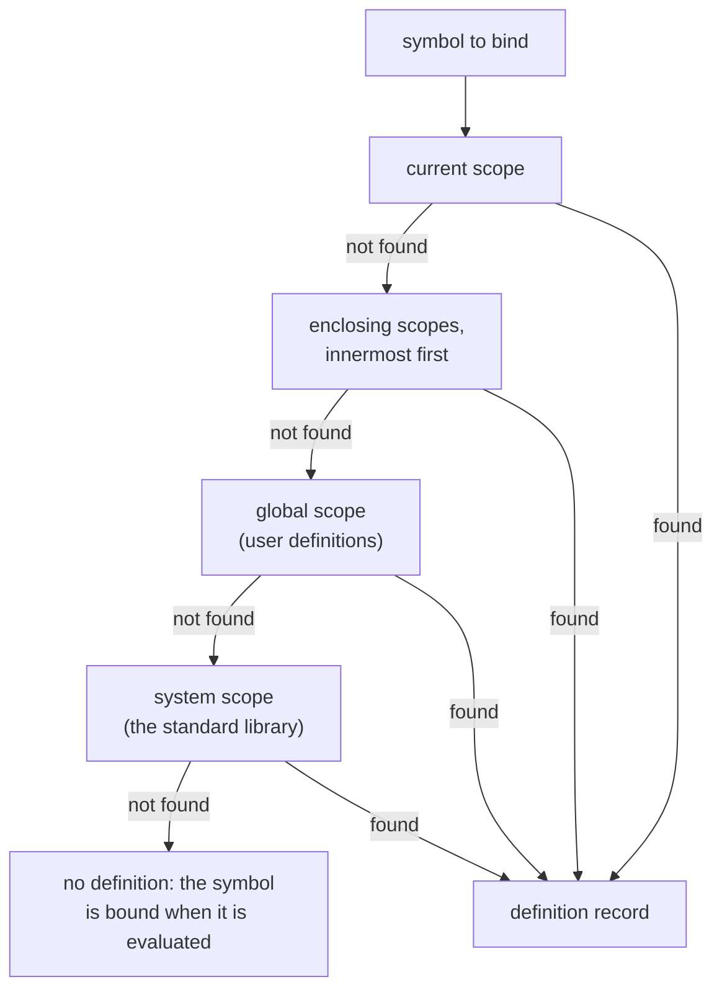

If the symbol is found, the definition record is used to evaluate the
expression. 

The definition record contains information about the symbol, such as its
type, whether it is a constant, and how to evaluate it.

There are two kind of definition records:
1. **Value Definition Record**: This record contains information about the
   symbol, such as its type and whether it is a constant.
2. **Operator Definition Record**: This record contains information about the
   operator, such as its signature and how to evaluate it.

Name binding is done during canonicalization. If name binding failed, the
`isValid` property of the expression is `false`.

**To get a list of the errors in an expression** use the `expr.errors` property.

<ReadMore path="/compute-engine/guides/expressions/#errors" > Read more about the
<strong>errors</strong> <Icon name="chevron-right-bold" /></ReadMore>

### Bound Variables and Assigned Values

Some operators **bind** a variable of their own: `D`, `Integrate`, `Limit`,
`Sum`, `Product`, `Solve`, and `Function` (its parameters), among others. The
variable such an operator binds is a **pure symbol** — only its declared type
and any in-scope assumptions apply. A **value** assigned to a same-named symbol
does **not** apply to it, and the variable stays symbolic in the result.

```js
ce.assign('x', 5);
ce.parse('\\frac{d}{dx} x^2').evaluate().print();
// ➔ 2x        (not 10 — the bound "x" ignores its assigned value)

ce.parse('\\int x^2 \\,dx').evaluate().print();
// ➔ x^3/3     (not 125/3)
```

Every **other** symbol in the expression is **free**: its value always applies
under evaluation. So with `a := 3` as well, `\frac{d}{dx}(a\,x^2)` is `6x` —
the free `a` resolves, the bound `x` does not.

To use an assumption instead of a value (which *does* inform simplification and
solving), use `ce.assume()` rather than `ce.assign()`.

### Temporary Values

`ce.withValues(values, fn)` gives symbols a value only while `fn` runs. When
`fn` returns or throws, each symbol gets back its earlier value and type.
While `fn` runs, every expression reads the values: an expression created
before the call, an expression created inside `fn`, and the body of a stored
function.

```js
ce.declare('a', 'real');
const expr = ce.parse('a + 1');
ce.withValues({ a: 3 }, () => expr.evaluate()).print();
// ➔ 4
expr.evaluate().print();
// ➔ a + 1

ce.parse('f(x) := x + a').evaluate();
ce.withValues({ a: 1 }, () => ce.parse('f(2)').evaluate()).print();
// ➔ 3
```

A value is checked as `ce.assign()` checks it: a value that the declared type
of the symbol does not admit throws. The value `undefined` gives the symbol no
value while `fn` runs, but a value that an assumption gives
(`ce.assume(ce.parse('a = 3'))`) still applies. A constant, a symbol bound to a
function definition, a value that is a function, and a value that `ce.assign()`
refuses throw before any symbol gets a value.

`ce.withValues()` can be called during an evaluation, for example in the
`evaluate` handler of an operator.
`fn` must be synchronous: the earlier values are put back when `fn` returns,
before a promise that it returns settles.

When putting back an earlier value fails, the error is thrown after every
other value is put back. If `fn` threw too, `ce.withValues()` throws an
`AggregateError`: its `errors` are the error of `fn` and the error of the
restore, in this order, and its `cause` is the error of `fn`.

### Function Calls Are Bound Lexically

A function call resolves its head (`f` in `f(3)`) through the binding the name
had where the call was created, in the same way a symbol is bound to its
definition during canonicalization. Declaring another function of the same
name in a scope that is current when the call is evaluated does not redirect
the call. Assigning a new function to the **original** binding does: a call
reads the function that its binding holds when it runs.

```js
ce.assign('f', ce.parse('x \\mapsto 2x'));
const call = ce.parse('f(3)');

ce.pushScope();
ce.declare('f', 'function');
ce.assign('f', ce.parse('x \\mapsto 100x'));
call.evaluate().print();
// ➔ 6      (the call keeps the binding it was created with)
ce.popScope();

ce.assign('f', ce.parse('x \\mapsto 3x'));
call.evaluate().print();
// ➔ 9      (the original binding now holds another function)
```

A call written before its function is defined is a **forward reference**. It
waits for a definition of the name in its own scope chain: evaluated while
the name has no value, it stays symbolic; evaluated after the definition, it
applies the function.

The scope chain is the scope the call was written in and the scopes around
it. A function of the same name that a scope pushed later declares is not
called. To call it, parse the expression in that scope:

```js
const call = ce.parse('h(2) + 1');
call.evaluate().print();
// ➔ 1 + h(2)   ("h" has no definition yet)

ce.assign('h', ce.parse('t \\mapsto 10t'));
call.evaluate().print();
// ➔ 21

ce.pushScope();
ce.declare('h', 'function');
ce.assign('h', ce.parse('t \\mapsto t + 1000'));
call.evaluate().print();
// ➔ 21         (the call reads the scope it was written in)
ce.parse('h(2) + 1').evaluate().print();
// ➔ 1003       (written in the pushed scope)
ce.popScope();
```

Compiled code calls the same function as the evaluation.

A function passed by name as a callback follows the same rule: written
before the function is defined, it reads the definition of the scope it was
written in, and with no definition there it stays symbolic.

```js
const squares = ce.parse('\\operatorname{Map}(h, [1, 2])');
ce.function('ListFrom', [squares]).evaluate().print();
// ➔ [h(1),h(2)]

ce.assign('h', ce.parse('t \\mapsto t^2'));
ce.function('ListFrom', [squares]).evaluate().print();
// ➔ [1,4]

ce.pushScope();
ce.declare('h', 'function');
ce.assign('h', ce.parse('t \\mapsto 100'));
ce.function('ListFrom', [squares]).evaluate().print();
// ➔ [1,4]      (the callback reads the scope it was written in)
ce.popScope();
```

A function whose body calls a function that is not defined yet gets its
result type and its effects again when that function is defined: with
`honest := () ↦ later()` and then `later := () ↦ Random()`, `honest` is
typed `() random -> real`.

Within one evaluation, the symbolic result of such a call is a value: it is
not resolved again when the name is assigned later in the same evaluation.
So with `h` declared by `ce.declare('h', 'function')` (an assignment in a
branch of an `If` to a name that no scope declares is the error
`assignment-to-undeclared-variable`),
`Sum(Block(If(k = 2, h := z ↦ 2z), h(k)), k, 1, 3)` is `10 + h(1)`: the
term `h(1)` was computed while `h` had no value, and the assignment at
`k = 2` does not reach it. A later evaluation resolves the stored result
again:

```js
const call = ce.parse('g(3)');
const result = call.evaluate();
// ➔ g(3)   ("g" has no definition yet)

ce.assign('g', ce.parse('x \\mapsto x^2'));
call.evaluate().print();
// ➔ 9
result.evaluate().print();
// ➔ 9      (a later evaluation resolves the stored result)
```

In a `Block`, a `DefineFunction` statement (the Epsil `function g(k) { … }`)
declares a local variable that holds the function. A call before the
statement is the error `read-before-declaration`. An `Assign` of a function
literal takes effect when it runs. A `Block`
evaluated directly by the host is a program: each of its statements is an
evaluation of its own, so a result stored by one statement is resolved again
when a later statement reads it.

### Default Scopes

The Compute Engine has a set of default scopes that are used to look up
symbols. These scopes are created automatically when the Compute Engine
is initialized. The default scopes include the **system** scope, and the **global** scope.

The **system** scope contains the definitions of all the built-in functions and
operators. The **global** scope is initially empty, but can be used to
store user-defined functions and symbols.

The **global** scope is the default scope used when the Compute Engine is
initialized.

Additional scopes can be created using the `ce.pushScope()` method.


### Creating New Scopes

**To add a new scope** use `ce.pushScope()`.

```ts
ce.assign('x', 100); // "x" is defined in the current scope
ce.pushScope();
ce.declare('x', 'integer'); // "x" is defined in the new scope
ce.assign('x', 500);
console.log(ce.expr('x').evaluate()); // 500
ce.popScope();
console.log(ce.expr('x').evaluate()); // 100
```

Without the `ce.declare()`, `ce.assign('x', 500)` in the new scope writes the
`x` of the outer scope, and `x` is `500` after the `ce.popScope()` too.

**To exit a scope** use `ce.popScope()`.

The names of an expression boxed after the `ce.popScope()` resolve in the
scopes that remain. An expression boxed while the scope was current keeps the
definitions of that scope.

### An Expression Reads the Scope It Was Boxed In

An expression resolves each name from the scope it was boxed in, for its type
and for its value. The scope that is current when the expression is evaluated
plays no part. A declaration made later in the scope the expression was boxed
in, or in one of its parents, is read; a declaration in a scope pushed after
the expression was boxed is not. To read the current scope, bind the
expression again with `ce.rebind()`:

```ts
ce.assign('x', 100);
const e = ce.expr(['Add', 'x', 1]);
ce.pushScope();
ce.declare('x', 'integer');
ce.assign('x', 500);
console.log(e.evaluate()); // 101
console.log(ce.rebind(e).evaluate()); // 501
const inner = ce.expr(['Add', 'x', 1]);
ce.popScope();
console.log(inner.evaluate()); // 501: it keeps the definitions of the popped scope
console.log(e.evaluate()); // 101
```


## Evaluation Loop

:::info

This is an advanced topic. You don't need to know the details of how the
evaluation loop works, unless you're interested in extending the standard
library and providing your own function definitions.

:::

Each symbol is **bound** to a definition within a **lexical scope** during 
canonicalization. This usually happens when calling `ce.expr()` or `ce.parse()`, 
or if accessing the `.canonical` property of a
non-canonical expression.

When a function is evaluated, the following steps are followed:

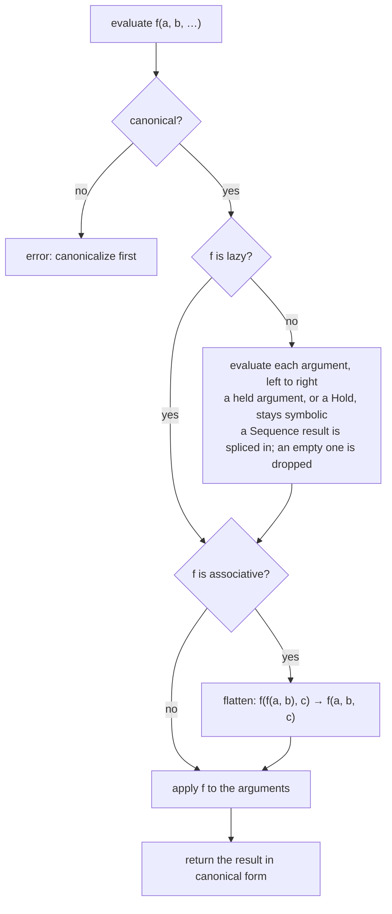

1. If the expression is not canonical, it cannot be evaluated and an error is
   thrown. The expression must be canonicalized first.

2. Each argument of the function are evaluated, left to right, unless the 
   function has a `lazy` flag. If the function is lazy, the arguments are not
   evaluated.

   1. An argument can be **held**, in which case it is not evaluated. Held
      arguments can be useful when you need to pass a symbolic expression to a
      function. If it wasn't held, the result of evaluating the expression would
      be used, not the symbolic expression.

      Alternatively, using the `Hold` function will prevent its argument from
      being evaluated. Conversely, the `ReleaseHold` function will force an
      evaluation.

   2. If an argument is a `["Sequence"]` expression, treat each argument of the
      sequence expression as if it was an argument of the function. If the
      sequence is empty, ignore the argument.

3. If the function is associative, flatten its arguments as necessary. \\[
   f(f(a, b), c) \to f(a, b, c) \\]

4. Apply the function to the arguments

5. Return the result in canonical form.

---

# Symbolic Computing

Source: https://epsil.dev/compute-engine/guides/symbolic-computing/

<Intro>
The Compute Engine essentially performs computation by applying
rewriting rules to a MathJSON expression.
</Intro>


There are three common transformations that can be applied to an expression:

<div className="symbols-table first-column-header" style={{"--first-col-width":"16ch"}}>

| Transformation    |                                                                                                                                                                        |
| :---------------- | :--------------------------------------------------------------------------------------------------------------------------------------------------------------------- |
| `expr.simplify()` | Eliminate constants and common sub-expressions. Use available assumptions to determine which rules are applicable. Limit calculations to exact results. Does not substitute assigned symbol values (that is `evaluate()`'s job). |
| `expr.evaluate()` | Calculate the exact value of an expression. Replace symbols with their value.                                               |
| `expr.N()`        | Calculate a numeric approximation of an expression using floating point numbers.                                                                                       |

</div>

A key difference between `expr.evaluate()` and `expr.N()` is that the former
will use the exact value of symbols, while the latter will use their numeric
approximation. An exact value is a rational number, an integer, the square root
of an integer and some constants such as \\(\pi\\) or \\(e\\). A numeric
approximation is a floating point number.


<div className="first-column-header">

|       &nbsp; |           `expr.simplify()`           |           `expr.evaluate()`           |              `expr.N()`               |
| :---------------------------- | :-----------------------------------: | :-----------------------------------: | :-----------------------------------: |
| Use assumptions on symbols    | <Icon name="circle-check" color="green-700"/> | | |
| Substitute assigned symbol values | | <Icon name="circle-check" color="green-700"/> | <Icon name="circle-check" color="green-700"/> |
| Exact calculations            | <Icon name="circle-check" color="green-700"/> | <Icon name="circle-check" color="green-700"/> |                                       |
| Floating-point approximations |                                       |                                       | <Icon name="circle-check" color="green-700"/> |

</div>


<ReadMore path="/compute-engine/guides/simplify/" > Read more about
<strong>Simplify</strong> <Icon name="chevron-right-bold" /></ReadMore>

<ReadMore path="/compute-engine/guides/evaluate/" > Read more about
<strong>Evaluate</strong> <Icon name="chevron-right-bold" /></ReadMore>

<ReadMore path="/compute-engine/guides/numeric-evaluation/" > Read more about
<strong>Numerical Evaluation</strong> <Icon name="chevron-right-bold" /></ReadMore>

Other operations can be performed on an expression: comparing it to a pattern,
replacing part of it, and applying conditional rewrite rules.

```live show-line-numbers
const expr = ce.parse('3x^2 + 2x^2 + x + 5');
console.log(expr, '=', expr.simplify());
```

## Comparing Expressions

There are three tiers of comparison, from the strictest and cheapest to the
most powerful and most expensive:

<div className="symbols-table first-column-header" style={{"--first-col-width":"16ch"}}>

| Tier | Method | Operator | Notation | Answers |
| :--- | :--- | :--- | :--- | :--- |
| Syntactic | `isSame()` | `Same` | `===`, `≣` (Epsil) | Always `True` or `False` |
| Arithmetic | `isEqual()` | `Equal` | `=`, `==` (Epsil) | `True`, `False`, or undetermined |
| Identity | `isIdenticallyEqual()` | `IdenticallyEqual` | `\equiv`, `≡` | `True`, `False`, or undetermined |

</div>

Each tier answers a different question: "are these the same expression?",
"do these have the same value?", and "are these the same function of their
free variables?".

The operator, its LaTeX/Epsil notation and its JavaScript method share the
same semantics at each tier.

### Syntactic Equality: `isSame()`

Syntactic equality (or structural equality) considers the **symbolic structure** used
to represent an expression. 

The symbolic structure of an expression is the tree of symbols and functions
that make up the expression.

For example, the symbolic structure of \\(2 + 1\\) is a sum of two terms, 
the first term is the number `2` and the second term is the number `1`.

The symbolic structure of \\(3\\) is a number `3`.

The symbolic structure of \\(2 + 1\\) and \\(3\\) are different, even though
they represent the same mathematical object.

The `lhs.isSame(rhs)` function returns true if `lhs` and `rhs` are structurally
exactly identical, that is each sub-expression is recursively identical in `lhs`
and `rhs`. The argument can be an `Expression` or a JavaScript primitive
(`number`, `bigint`, `boolean`, `string`).

This is a fast, exact check — no evaluation is performed, and the answer is
always `true` or `false`, never undetermined.

`isSame()` is **strictly syntactic**: it compares the expressions as written
(in canonical form) and never substitutes the value of a symbol. If `x` has
been assigned the value `5`, `ce.symbol('x').isSame(5)` is `false` — one
expression is a symbol, the other a number. Use `isEqual()` to compare values.

Two symbols, or two function calls, with the same name are the same only when
they denote the same definition. A call `Sqrt(y)` boxed before a user
function `Sqrt` is declared in a scope is a call of the library square root; a
call `Sqrt(y)` boxed in that scope is a call of the user function. The two are
not `isSame`:

```js
const L = ce.box(['Sqrt', 'y']);
ce.pushScope();
ce.declare('Sqrt', 'function');
ce.assign('Sqrt', ce.box(['Function', ['Add', 'x', 100], 'x']));
const U = ce.box(['Sqrt', 'y']);
console.log(L.isSame(U));
// ➔ false
ce.popScope();
```

Two calls of a library function are `isSame`, also when they come from two
engines.

- \\( x + x \\) and \\( 2x \\) are not structurally equal, one is a sum of two
  terms, the other a product
- \\( (x + 1)^2 \\) and \\( x^2 + 2x + 1 \\) are not structurally equal, one is a
  power of a sum, the other a sum of terms.


```live show-line-numbers
const a = ce.parse('x + x');
const b = ce.parse('2x');
console.log('isSame?', a.isSame(b));
```


By default, when parsing or boxing an expression, they are put in canonical
form. For example, fractions are automatically reduced to their simplest form,
and arguments are sorted in a standard way.

The expressions \\( \\frac{1}{10} \\) and \\( \\frac{2}{20} \\) are
structurally equal because they get put into a canonical form when parsed,
in which the fractions are reduced.

Similarly, \\( x^2 - 3x + 4 \\) and \\( 4 - 3x + x^2 \\) are structurally equal
(`isSame` returns true) because the arguments of the sum are sorted in a standard 
way.

**To compare two expressions without canonicalizing them**, parse or box 
them with the `canonical` option set to `false`.

```live show-line-numbers mark-javascript-line="5-6"
const a = ce.parse('\\frac{1}{10}');
const b = ce.parse('\\frac{2}{20}');
console.log('Canonical isSame?', a.isSame(b));

const aPrime = ce.parse('\\frac{1}{10}', {form: 'raw'});
const bPrime = ce.parse('\\frac{2}{20}', {form: 'raw'});
console.log('Non-canonical isSame?', aPrime.isSame(bPrime));
```


In some cases you may want to compare two expressions with a weak form 
of canonicalization, for example to ignore the order of the arguments of a sum.

You can achieve this by comparing the expressions in their canonical order:

```json example
ce.expr(["CanonicalForm", ["Add", 1, "x"], "Order"]).isSame(
  ["CanonicalForm", ["Add", "x", 1], "Order"]
)
```


### Arithmetic Equality: `isEqual()`

The `lhs.isEqual(rhs)` function answers "do these two expressions have the same
value?". It is the JavaScript counterpart of the `=` operator (`==` in Epsil).

The comparison is deliberately **cheap and predictable**:

1. Both operands are evaluated (so assigned symbol values are substituted).
2. If the results are structurally identical, they are equal.
3. Otherwise, if both results are exact numbers (integers, rationals, or
   rational multiples of a square root), they are compared exactly.
4. Otherwise, if the difference between them has no unknowns, it is evaluated
   numerically: they are equal if the absolute value of the difference is less
   than `ce.tolerance`.
5. Otherwise the answer is `undefined`.

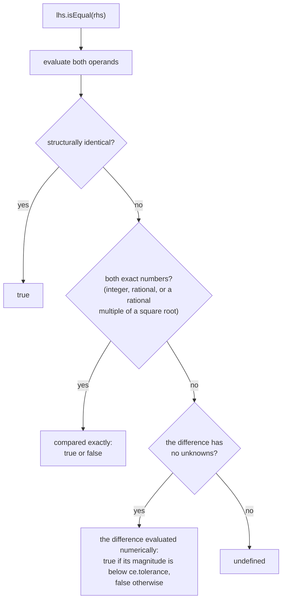

The tolerance is used only when a floating point number is involved. Two exact
numbers are equal only if they have the same value, however close they are:

```live
console.log(ce.parse('\\frac{1}{3} = \\frac{3333333333333}{10^{13}}').evaluate());
// ➔ False

console.log(ce.parse('\\frac{1}{10} = 0.1').evaluate());
// ➔ True
```

The order comparisons (`isLess()`, `isGreater()`, …, and the `<`, `>`, `\le`,
`\ge` operators) follow the same rule, so for two exact numbers exactly one of
$a < b$, $a = b$ and $a > b$ is true.

No expansion, no simplification and no sampling is attempted. In particular,
`isEqual()` does **not** attempt to prove a symbolic identity: the expressions
\\( (x+1)^2 \\) and \\( x^2 + 2x + 1 \\) have the same value for every \\( x
\\), but `isEqual()` returns `undefined` for them. Use
[`isIdenticallyEqual()`](#identity-isidenticallyequal) for that question.

Note that unlike `expr.isSame()`, `expr.isEqual()` can return `true`, `false` or
`undefined`. The latter value indicates that there is not enough information to
determine if the two expressions have the same value.

The corresponding `Equal` expression is **inert** when the answer is
`undefined`: it stays unevaluated, since \\( x = y \\) is a *condition*, not a
claim that is false until proven. This is what makes an equation usable as an
argument to `Solve`.

```live show-line-numbers
const a = ce.parse('1 + 2');
const b = ce.parse('3');
console.log('isEqual?', a.isEqual(b));

// Undetermined: the `Equal` expression stays unevaluated
console.log(ce.parse('x = y').evaluate());
```

Following IEEE 754, `NaN` is not equal to anything, including itself: `NaN =
NaN` is `False`, and so is the comparison of two collections that contain it,
`["Equal", ["List", "NaN"], ["List", "NaN"]]`. Only the syntactic tier reports
those as identical (`["Same", "NaN", "NaN"]` is `True`). A pole has no value
either: `1/0 = 1/0` is `False`. A value with no order decides an ordered
comparison as `False`: `0 < \frac{1}{0}`, `0 < i` and `0 < \ln(-1)` are
`False`, so a piecewise on such a comparison takes its next branch
(`\{1/0 > 0: 1, 0\}` is `0`), as it does for `NaN`. Equality of complex
numbers keeps its meaning (`i = i` is `True`), `\ne` is unchanged
(`1/0 \ne 0` is `True`), and a free symbol leaves the comparison unevaluated.

### Identity: `isIdenticallyEqual()`

Comparing two arbitrary symbolic expressions is a hard problem. In fact,
[Richardson's Theorem](https://en.wikipedia.org/wiki/Richardson%27s_theorem)
proves that it is impossible in general to determine if two symbolic
expressions are identical.

However, there are many cases where it is possible to decide it in practice.
The `lhs.isIdenticallyEqual(rhs)` function asks whether `lhs` and `rhs` are the
same function of their free variables, that is whether they have the same value
for **every** value of those variables. It is the JavaScript counterpart of the
`IdenticallyEqual` operator, written \\( \\equiv \\) in LaTeX.

```live show-line-numbers
console.log(ce.parse('(x+1)^2').isIdenticallyEqual(ce.parse('x^2+2x+1')));
console.log(ce.parse('\\sin^2 x + \\cos^2 x \\equiv 1').evaluate());
```

Like `isEqual()`, it is three-valued: `true`, `false` or `undefined` when the
question could not be settled, in which case an `IdenticallyEqual` expression
stays unevaluated. A `false` requires a definite disagreement of values:
expressions that merely differ at the sampled points, such as \\( x \\) and
\\( x + 1 \\), are `undefined`, since an assumption could still constrain them
to be equal.

:::warning[Stochastic verdicts]
To settle an identity, this tier uses symbolic transformations (expansion and
simplification) **and** numerical sampling: the two expressions are evaluated
at a number of pseudo-random points. A `true` answer obtained by sampling is
therefore a very strong indication, not a formal proof. This is the only tier
that can answer from sampling; `isSame()` and `isEqual()` never do.
:::


### Smart Comparison: `is()`

The `lhs.is(rhs)` method provides a convenient middle ground between `isSame()`
and `isEqual()`. It first tries an exact structural check (like `isSame()`), and
if that fails and the expression is **constant** (no free variables), it
evaluates numerically and compares within `engine.tolerance`.

This is useful when checking whether an expression evaluates to a known value
without the overhead of a full `isEqual()` call:

```live show-line-numbers
console.log(ce.parse('\\cos(\\frac{\\pi}{2})').is(0));   // true
console.log(ce.parse('\\sin(\\pi)').is(0));               // true
console.log(ce.parse('\\cos(0)').is(1));                  // true
console.log(ce.number(1e-17).is(0));                      // false (literal)
console.log(ce.parse('x + 1').is(1));                     // false (not constant)
```

For **literal numbers** (created with `ce.number()`), `is()` behaves identically
to `isSame()` — no tolerance is applied. Tolerance only kicks in for expressions
that require evaluation, such as `\sin(\pi)`.


### Other Comparisons

<div>

|                                          |                                        |
| :--------------------------------------- | :------------------------------------- |
| `lhs === rhs`                            | If true, same box expression instances |
| `lhs.isSame(rhs)`                        | Syntactic equality (fast, exact, no evaluation). Accepts primitives. |
| `lhs.is(rhs)`                            | Smart check: structural first, then numeric evaluation fallback for constant expressions (within `engine.tolerance`). For literal numbers, same as `isSame()`. |
| `lhs.isEqual(rhs)`                       | Arithmetic equality (evaluation, then an exact compare of exact numbers or a tolerance compare). May return `undefined`. |
| `lhs.isIdenticallyEqual(rhs)`            | Identity in all free variables (expansion, simplification, sampling). May return `undefined`. |
| `lhs.match(rhs) !== null`                | Pattern match                          |
| `ce.expr(["Equal", lhs, rhs]).evaluate()` | Synonym for `lhs.isEqual(rhs)`                |
| `ce.expr(["IdenticallyEqual", lhs, rhs]).evaluate()` | Synonym for `lhs.isIdenticallyEqual(rhs)` |
| `ce.expr(["IsSame", lhs, rhs]).evaluate()` | Synonym for `lhs.isSame(rhs)`, comparing the operands as written (they are not canonicalized) |
| `ce.expr(["Same", lhs, rhs]).evaluate()`  | Synonym for `lhs.isSame(rhs)` (Epsil `===`). Always decides. |

</div>

:::info[Choosing the Right Comparison]
- Use **`isSame()`** when you know the exact expression you're comparing against
  (e.g., checking if an operand is `0` or `1` in a simplification rule).
- Use **`is()`** when the expression might need evaluation to reveal its value
  (e.g., checking user input like `\cos(\pi/2)` against `0`).
- Use **`isEqual()`** to compare values, including expressions that must be
  evaluated first.
- Use **`isIdenticallyEqual()`** to check a symbolic identity, i.e. an equality
  that must hold for every value of the free variables.
:::

## Replacing a Symbol in an Expression

**To replace a symbol in an expression** use the `subs()` function.

The argument of the `subs()` function is an object literal. Each key/value 
pair is a symbol and the value to be substituted with. The value can be either
a number or a expression.

```live show-line-numbers mark-javascript-line="4"

let expr = ce.parse('\\sqrt{\\frac{1}{x+1}}');
console.log(expr.json);

expr = expr.subs({x: 3});

console.log("Substitute x -> 3\n", expr.json);
console.log("Numerical Evaluation:", expr.N());
```

A substitution replaces the **free** occurrences of a symbol. A name bound by
an operator is not replaced where that operator binds it: the index of a
`Sum`, the parameter of a function literal, the variable of a definite
integral, a local of a `Block`. So `j + \sum_{j=1}^{3} j` with `j` replaced by
`10` is `10 + \sum_{j=1}^{3} j`.

The variable of a derivative, of a series or of an indefinite integral is free
in the result (the derivative of `x^2` is a function of `x`), so it is
replaced, and the result is the value at that point rather than a derivative
of a number: `\frac{d}{dx}x^2` with `x` replaced by `3` is
`\left.\left(\frac{d}{dx}x^2\right)\right|_{x=3}` (an `EvaluateAt`
expression), which evaluates to `6`. The replacement of any other symbol is
put inside the derivative before it is computed.

## Other Symbolic Manipulation

There are a number of operations that can be performed on an expression:

- creating an expression from a raw MathJSON expression or from a LaTeX string
- simplifying an expression
- evaluating an expression
- applying a substitution to an expression
- applying conditional rewrite rules to an expression
- checking if an expression matches a pattern
- checking if an expression is a number, a symbol, a function, etc...
- checking if an expression is zero, positive, negative, etc...
- checking if an expression is an integer, a rational, etc...
- and more...

We've introduced some of these operations in this guide, but there are many more
that are available.

<ReadMore path="/compute-engine/guides/expressions/" > Read more about
<strong>Expressions</strong>, their properties and methods <Icon name="chevron-right-bold" /></ReadMore>

**To check if an expression matches a pattern**, apply a substitution to some
elements in an expression or apply conditional rewriting rules to an expression.

<ReadMore path="/compute-engine/guides/patterns-and-rules/" > Read more about
<strong>Patterns and Rules</strong> for these operations <Icon name="chevron-right-bold" /></ReadMore>

---

# Numeric Evaluation

Source: https://epsil.dev/compute-engine/guides/numeric-evaluation/

<Intro>
To obtain an exact numeric evaluation of an expression use `expr.evaluate()`. 
To obtain a numeric approximation use `expr.N()`.
</Intro>

## Parse + Numeric Free Function

For the common "parse then numeric approximation" flow, use the `N()` free
function:

```live
// import { N } from '@cortex-js/compute-engine';
console.log(N("\\sqrt{2}"));
```

The `N()` free function accepts either a LaTeX string or an `Expression`.
It uses a shared `ComputeEngine` instance created on first call.


## Exact Evaluation

An evaluation with `expr.evaluate()` preserves **exact values**.

Exact values are:

<div className="symbols-table no-header" style={{"--first-col-width":"25ch"}}>

| Type                         | Examples                                      |
|------------------------------|-----------------------------------------------|
| Integers       | $42$, $-1234$                        |
| Rationals       | $\nicefrac{3}{4}$, $-\nicefrac{11}{7}$                       |
| Square Roots of Integers     | $\sqrt{2}$, $-3\sqrt{5}$                       |
| Constants                    | $e$ (`ExponentialE`), $\pi$ (`Pi`)            |

</div>

A number literal is exact or a float by the way it is written. A literal with
no fraction part and no negative exponent is an exact integer: `1e3` is the
exact `1000`. A literal with a fraction part is a float, also when the fraction
is zero (`1.0`, `1.5e3`), and so is a literal with a negative exponent
(`1e-3`).

```live
console.log(parse('1/3 + 1/4').evaluate());

console.log(parse('\\sqrt{2} + \\sqrt{3} + \\sqrt{75}').evaluate());
```


## Numeric Approximation

**To force the evaluation of an expression to be a numeric approximation**, use `expr.N()`.

```live
console.log(parse('1/3 + 1/4').N());
console.log(parse('\\sqrt{2} + \\sqrt{3} + \\sqrt{75}').N());
```


When using `expr.evaluate()`, if one of the arguments is not an exact value 
the expression is automatically evaluated as a **numeric approximation**.

```live
console.log(parse('1/3 + 1/4 + 1.24').evaluate());
```

An integer function of an exact integer argument gives the exact integer
under `expr.N()` too, because an approximation of the argument would change
the answer: `DigitSum`, `Binomial`, `Factorial`, `Fibonacci`, `Mod`, `GCD`,
`LCM` and the integer predicates (`IsPrime`, `IsEven`, …) read an exact
operand as written. Only an inexact (float) operand is read as a float.

```js
ce.box(['DigitSum', ['Power', 2, 1000]]).N();
// ➔ 1366  (the same as evaluate())

ce.box(['GCD', ['Power', 2, 100], ['Power', 6, 50]]).N();
// ➔ 1125899906842624  (2^50)

ce.box(['IsPrime', ['Subtract', ['Power', 2, 89], 1]]).N();
// ➔ True
```

### Infinity and NaN

The two non-finite results fall on opposite sides of the exactness rule above,
which is why they behave differently under `evaluate()`.

$\pm\infty$ **is an exact value.** A function of an infinity is therefore
treated like a function of any other exact argument: if there is a closed form
it is used, and if there is not, the expression stays symbolic rather than
numericizing.

```live
console.log(ce.parse('\\mathrm{Erf}(\\infty)').evaluate());
// ➔ 1

console.log(ce.parse('\\sin(\\infty)').evaluate());
// ➔ sin(+oo)
```

There is no inexact infinity. At machine precision, a float that is too large
for a double, such as `1.0e800`, becomes $+\infty$, and that infinity is exact
(`isExact` is `true`) like any other. At arbitrary precision the same literal
stays a finite number.

`NaN` **is not an exact value.** It is the argument that triggers the automatic
numeric approximation, so any numeric function of `NaN` evaluates to `NaN` —
under plain `evaluate()`, not only under `N()`. There is no exact value to hold
on to:

```live
console.log(ce.parse('\\sin(\\operatorname{NaN})').evaluate());
// ➔ NaN
```

Note that this is a statement about *values*, not about types. In the type
system the bare numeric types — `integer`, `rational`, `real`, `complex` —
denote **finite** values only, so neither an infinity nor `NaN` inhabits them.
Both are still `number`.

<ReadMore path="/compute-engine/guides/types/" >Read more about **the numeric
types** <Icon name="chevron-right-bold" /></ReadMore>

## Angular Units

When a trigonometric function is given a unitless value, the Compute Engine
interprets it using the current angular unit. Set it with `ce.angularUnit`
(default: `"rad"`).

Valid values: `"rad"`, `"deg"`, `"grad"`, `"turn"`.

```live
ce.angularUnit = "deg";
console.log(ce.parse("\\cos 60").N());
// ➔ 0.5
```

The angular unit applies to the trigonometric functions (`Sin`…`Csc`,
`Haversine`), whose argument is an angle, and to the inverse trigonometric
functions (`Arcsin`…`Arccsc`, `Arctan2`, `InverseHaversine`), whose result is
an angle — in degree mode `\arcsin(1)` evaluates to the exact value `90`.
Hyperbolic functions and their inverses are **not** affected: their argument
is a dimensionless number, not an angle.

Compiled functions honor the angular unit as well: with
`ce.angularUnit = "deg"`, `ce.compile("\\sin(x)")` returns a function that
interprets `x` in degrees, matching `evaluate()`.

The symbolic integrator follows the angular unit as well. With
`ce.angularUnit = "deg"`, `\int_0^{180} \sin x\,dx` evaluates to `360/\pi`
and `\int \sin x\,dx` to `-(180/\pi)\cos x`. An integral with no
trigonometric function, such as `\int_0^1 \frac{dx}{1 + x^2} = \pi/4`, has the
same value in every unit. The same holds with the integration rules library
loaded, and for the closed form the JavaScript target compiles for a definite
integral.

## Rounding Ties

`Round` rounds a number to the nearest integer. A value exactly halfway
between two integers (a tie) is rounded with the rule of `ce.roundingTies`
(default: `"away-from-zero"`).

| Rule | `Round(2.5)` | `Round(3.5)` | `Round(-2.5)` | Used by |
| :--- | :---: | :---: | :---: | :--- |
| `"away-from-zero"` | `3` | `4` | `-3` | the default |
| `"to-even"` | `2` | `4` | `-2` | IEEE 754, Python, NumPy, Mathematica |
| `"toward-zero"` | `2` | `3` | `-2` | |
| `"toward-positive-infinity"` | `3` | `4` | `-2` | JavaScript `Math.round` |
| `"toward-negative-infinity"` | `2` | `3` | `-3` | |

```live
ce.roundingTies = "to-even";
console.log(ce.parse("\\operatorname{round}(2.5)").evaluate());
// ➔ 2
```

The rule applies at every precision, to an exact rational (`Round(5/2)`), and
to the step form `Round(x, step)`, which rounds to the nearest multiple of the
step: with `"to-even"`, `Round(0.125, 1/100)` is `3/25`. A value that is not a tie is not
affected.

Compiled functions honor the rule as well: the code is made with the rule in
effect when the expression is compiled, and a function compiled before a
change keeps its rule.

`Remainder` does not use this rule: its quotient is always rounded with a tie
toward `+∞`.

## JavaScript Interoperability

The result of `expr.evaluate()` and `expr.N()` is a expression. 

The `numericValue` property of this expression is either a machine number 
(a JavaScript `number`), a `NumericValue` object or `null` if the expression 
is not a number.


While a `NumericValue` object can represent arbitrary precision numbers, for 
use with JavaScript, a reduced precision approximation can be accessed using
the `re` (for the real part of the number) and `im` (for the imaginary part)
properties.

```js
const expr = parse('1/3 + 1/4');
console.log(expr.N().re);
// ➔ 0.5833333333333334
```

Another way to obtain a JavaScript compatible representation of an expression
is to use the `valueOf()` method of the expression.

```js
const expr = parse('1/3 + 1/4');
console.log(expr.N().valueOf());
// ➔ 0.5833333333333334
```

The `valueOf()` method of a expression can be used in JavaScript
expressions.

```live
const expr = parse('1/3 + 1/4');
console.log(expr.N().valueOf() + 1);
```

Unlike the `.re` property, `valueOf()` can also return a `boolean` or a
`string`, depending on the value of the expression.


**To get an `Expression` number literal from a JavaScript number**, use `ce.expr()` or `ce.number()`.

```live
const expr = box(1.5);
console.log(expr.valueOf());
```


## Numeric Precision

The number of significant digits used in numeric calculations is controlled
by the `ce.precision` property of the `ComputeEngine` instance.

```live
ce.precision = 30;
console.log(ce.parse('\\pi').N().json);
```

The default precision is 21.

**To set the precision to the default value**, use `ce.precision = "auto"`.

**To request a specific precision for a single evaluation**, use the `N`
function with a precision argument: `["N", expr, digits]`.

```live
console.log(ce.box(['N', 'Pi', 50]).evaluate().toString());
```

The value is computed with the requested digits plus a few guard digits, then
rounded to the requested digits. The working precision of the engine
(`ce.precision`) does not change: after `ce.box(['N', 'Pi', 30]).evaluate()`,
`ce.precision` is still `21`. A later operation on the result is computed at the
working precision, so `["Add", ["N", "Pi", 30], 1]` evaluates to
`4.14159265358979323846`. The reference page for
[`N`](/compute-engine/reference/core/#n) describes the precision and accuracy
goals `["N", expr, ["List", p, a]]`.

:::info[Each engine has its own precision]
The precision of an engine applies to the computations of that engine only.
Engines with different precisions can be used in the same program:

```js
const a = new ComputeEngine();
a.precision = 60;
const b = new ComputeEngine();
b.precision = 21;
a.parse('\\sqrt{2}').N().toString();
// ➔ 1.41421356237309504880168872420969807856967187537694807317668
b.parse('\\sqrt{2}').N().toString();
// ➔ 1.4142135623730950488
```
:::


### Machine Precision

If the precision is 15 or less, the Compute Engine uses a
[64-bit binary floating point format](https://en.wikipedia.org/wiki/IEEE_754)
for its internal calculations.

This format is implemented in hardware and well suited to do fast computations.
It uses a fixed amount of memory and represents significant digits in base-2 with
about 15 digits of precision and with a minimum value of $ \pm5\times 10^{-324} $ and a maximum value of $ \pm1.7976931348623157\times 10^{+308} $

**To change the precision to machine precision**, use
`ce.precision = "machine"`.


With this precision, some calculations that have a value very close to 0 
may return 0 and some calculations that have a value greater than the 
maximum value representable by a machine number may return $ \pm\infty $.

:::warning
Some numeric evaluations using machine numbers cannot produce exact
results.

```ts
ce.precision = 'machine';
console.log(ce.parse('0.1 + 0.2').N().json);
// ➔ "0.30000000000000004"
```

While $ 0.1 $ and $ 0.2 $ look like "round numbers" in base-10, they can
only be represented by an approximation in base-2, which introduces cascading
errors when manipulating them.

<ReadMore path="https://docs.oracle.com/cd/E19957-01/806-3568/ncg_goldberg.html" >
Read **"What Every Computer Scientist Should Know About Floating-Point
Arithmetic"** by David Goldberg <Icon name="chevron-right-bold" />
</ReadMore>

:::


### Arbitrary Precision

If `ce.precision` is greater than 15, numbers are represented as bignum numbers,
a string of base-10 digits and an exponent.

Bignum numbers have a minimum value of $ \pm 10^{-9\,000\,000\,000\,000\,000} $ and a maximum value of $ \pm9.99999\ldots \times 10^{+9\,000\,000\,000\,000\,000} $.


```ts
ce.precision = 21;
console.log(ce.parse('0.1 + 0.2').N().json);
// ➔ "0.3"
```

Trigonometric operations are accurate for precision up to 1,000.

### Serialization and Precision

The `precision` property controls how computations are performed. It also
affects how results are displayed:

- **`.latex`** and **`.toString()`** round numeric output to `ce.precision`
  significant digits. This hides noise digits that arise from internal
  rounding in division and transcendental functions.
- **`.json`** and **`toJSON()`** emit the full unrounded value for lossless
  data interchange. Use `expr.toMathJson({ digits: 'auto' })` to get
  precision-rounded MathJSON output.

**To explicitly control digits in MathJSON output**, use
`expr.toMathJson()` with the `digits` option:

```ts
expr.toMathJson({ digits: 'auto' });            // rounded to ce.precision
expr.toMathJson({ digits: 'max' });             // all digits (default)
expr.toMathJson({ digits: { fractional: 5 } }); // 5 fractional digits
expr.toMathJson({ digits: { significant: 5 } }); // 5 significant digits
```

A float keeps its digits in MathJSON, also when they repeat: the float
`1.0/3` serializes as `"0.333333333333333333333"`. A number string with a
repetend in parentheses (`"0.(3)"`) is an exact rational, so writing a float
that way would make `ce.box()` read it back as the exact `1/3`. To mark the
repeating digits of a float, use `expr.toMathJson({ repeatingDecimal: true })`.

When the precision is greater than 15, the return value of `expr.N().json` may
be a MathJSON number with a `num` string containing all available digits:

```json example
{
  "num": "3.14159265358979323846264338327950288419716939937510"
}
```

:::info[Note]
The `.json` output may contain more digits than `ce.precision` because
some arithmetic operations (addition, subtraction, multiplication) are exact
and preserve all digits. Digits beyond the working precision are not
guaranteed to be accurate. For display purposes, use `.latex` or
`.toString()` which automatically round to the working precision.
:::


## Repeated Evaluation

**To repeatedly evaluate an expression** use `ce.assign()` to change the value
of variables. `ce.assign()` changes the value associated with one or more
variables in the current scope.

`ce.assign()` accepts booleans, numbers, bigints, expressions, or
functions. Use `undefined` to clear a value.

```live
const expr = ce.parse("3x^2+4x+2");

for (let x = 0; x < 1; x += 0.01) {
  ce.assign('x', x);
  console.log(`f(${x}) = ${expr.evaluate()}`);
}
```

You can also use `expr.subs()`, but this will create a brand new expression on
each iteration, and will be much slower.

```live
const expr = ce.parse("3x^2+4x+2");

for (let x = 0; x < 1; x += 0.01) {
  console.log(`f(${x}) = ${expr.subs({ x }).evaluate()}`);
}
```

**To reset a variable to be unbound to a value** use `ce.assign()`

```live
ce.assign("x", undefined);

console.log(ce.parse("3x^2+4x+2").N());
// ➔ "3x^2+4x+2"
```

**To change the value of a variable** set its `value` property:

```ts
ce.symbol("x").value = 5;

ce.symbol("x").value = undefined;
```


## Compiling

If performance is important, the expression can be compiled to a JavaScript
function.

**To get a compiled version of an expression** use the `compile()` function:

```js
import { compile } from '@cortex-js/compute-engine';

const result = compile("3x^2+4x+2");
for (const x = 0; x < 1; x += 0.01) console.log(result.run({ x }));
```

:::info[Note]
The syntax `{x}` is a shortcut for `{"x": x}`, in other words it defines an
argument named `"x"` (which is used in the definition of the expression `expr`) 
with the value of the JavaScript variable `x` (which is used in the for loop).
:::

This will usually result in a much faster evaluation than using `expr.N()` but
this approach has some limitations.

<ReadMore path="/compute-engine/guides/compiling/" > Read more about **Compiling
Expressions to JavaScript** <Icon name="chevron-right-bold" /></ReadMore>

## Simplifying Before Evaluating

**When using `expr.N()`, no rewriting of the expression is done before it is
evaluated.**

Because of the limitations of machine numbers, this may produce surprising
results.

For example:

```js
ce.precision = "machine";
const x = ce.parse("0.1 + 0.2").N();
console.log(ce.expr(["Subtract", x, x]).N());
// ➔ 2.7755575615628914e-17
```

However, the result of $ x - x $ from `ce.simplify()` is $ 0 $ since the
simplification is done symbolically, before any floating point calculations are
made.

```js
const x = ce.parse('0.1 + 0.2').N();
console.log(ce.parse('x - x').simplify());
// ➔ 0
```

In some cases, it may be advantageous to invoke `expr.simplify()` before using
`expr.N()`.

## Tolerance

Two numbers that are sufficiently close to each other are considered equal.

**To control how close two numbers have to be before they are considered
equal**, set the `tolerance` property of a `ComputeEngine` instance.

By default, the tolerance is $ 10^{-10} $.

The tolerance is accounted for by the `Chop` function to determine when to
replace a number of a small magnitude with 0 (the float `0.0` for a float
operand: `Chop(1e-12)` is `0.0`). A second
operand gives another tolerance for one call: `Chop(x, 0.01)`.

It is also used when doing some comparison to zero: a number whose absolute
value is smaller than the tolerance will be considered equal to 0.

Two numbers whose difference is smaller than the tolerance are considered
equal. This applies only when a floating point number is involved: two exact
numbers (integers, rationals, or rational multiples of a square root) are
compared exactly, so $\frac{1}{3}$ and $\frac{3333333333333}{10^{13}}$ are not
equal, while $\frac{1}{10}$ and $0.1$ are.

The tolerance is an absolute value, and it does not change with the precision:
at 40 digits, two values that differ by $10^{-12}$ still compare as equal. A
tolerance you set is kept when the precision changes.

**To make the tolerance follow the precision**, set it to `"auto"`. The
tolerance is then $10^{-(\text{precision} - 2)}$, two digits short of the
working precision, and it is recomputed at each precision change: $10^{-19}$ at
the default 21 digits, $10^{-38}$ at 40 digits. This mode is meant for
big-decimal work: a value computed in machine floats (about 16 digits) then
compares as different from its exact value.

```js
const ce = new ComputeEngine({ precision: 40, tolerance: "auto" });
ce.tolerance; // 1e-38
ce.precision = 50;
ce.tolerance; // 1e-48
```

## Numeric Functions

The topics below from the
[MathJSON Standard Library](/compute-engine/standard-library/) can provide numeric
evaluations for their numeric functions:

<div className="symbols-table" style={{"--first-col-width":"16ch"}}>

| Topic                                                             | Symbols/Functions                                                      |
| :---------------------------------------------------------------- | :--------------------------------------------------------------------- |
| [Arithmetic](/compute-engine/reference/arithmetic/)               | `Add` `Multiply` `Power` `Exp` `Log` `ExponentialE` `ImaginaryUnit`... |
| [Calculus](/compute-engine/reference/calculus/)                   | `Derivative` `Integrate`...                                                |
| [Complex](/compute-engine/reference/complex/)                     | `Real` `Conjugate`, `ComplexRoots`...                                  |
| [Special Functions](/compute-engine/reference/special-functions/) | `Gamma` `Factorial`...                                                 |
| [Statistics](/compute-engine/reference/statistics/)               | `StandardDeviation` `Mean` `Erf`...                                    |
| [Trigonometry](/compute-engine/reference/trigonometry/)           | `Pi` `Cos` `Sin` `Tan`...                                              |

</div>

---

# Execution Constraints

Source: https://epsil.dev/compute-engine/guides/execution-constraints/

# Execution Constraints

Some innocuous-looking expressions can take a very long time — or forever —
to evaluate: a sum over a huge range, a number-theory function applied to a
large integer, a limit that fails to converge, or a loop that never
terminates.

To keep evaluation responsive, the Compute Engine offers two kinds of
bounds: a **time budget**, expressed as a span, and **iteration/recursion
budgets**, expressed as counts.

## Time Budgets: Spans

A time budget is a **span**: a region of code you run with an explicit
deadline. Everything evaluated inside the span shares one deadline; when it is
exceeded, the evaluation in progress throws a `CancellationError` with
`cause: "timeout"`.

```js
import { ComputeEngine, CancellationError } from "@cortex-js/compute-engine";

const ce = new ComputeEngine();

try {
  ce.withTimeLimit({ ms: 500, label: "my-app:eval" }, () =>
    ce.parse("\\sum_{i=1}^{100000000} \\sqrt{i}").evaluate()
  );
} catch (err) {
  if (err instanceof CancellationError && err.cause === "timeout")
    console.log("Evaluation exceeded its time budget");
}
```

`withTimeLimit(limit, fn)` runs `fn` and returns its value. The `limit` is
either a number of milliseconds, or an object `{ ms, label }`. The object form
is preferred for new code: the `label` reads before the callback, and it is
what lets you attribute a timeout later (see below).

The contract is **at most** `ms` milliseconds:

> Runs `fn` with **at most** `ms` milliseconds. A tighter deadline may already
> be in effect from an enclosing span, in which case that one preempts this
> limit. Use the `label` and the `attribution` field on `CancellationError` to
> determine which limit fired.

Work performed **outside** any span is not time-bounded. A consumer that wants
a blanket bound wraps its entry point in a single span — one line at the
boundary — rather than relying on an implicit global limit.

### Nesting: the tighter deadline wins

Spans nest. When you enter a span inside another, the effective deadline is the
**minimum** of the two — a span can only shorten the budget, never extend it.
This means an inner span can never defeat a bound its caller set:

```js
ce.withTimeLimit({ ms: 100, label: "outer" }, () =>
  // Even though this asks for 5000ms, the enclosing 100ms deadline preempts it.
  ce.withTimeLimit({ ms: 5000, label: "inner" }, () =>
    ce.parse("\\sum_{i=1}^{100000000} \\sqrt{i}").evaluate()
  )
);
```

Labels are for **attribution only**, never for control: a label cannot buy a
span more time than its enclosing budget allows.

### Attribution: whose budget expired?

When several spans are active, a `CancellationError` tells you which one owned
the deadline that fired:

<div className="symbols-table">

| Property | Description |
| :--- | :--- |
| `err.cause` | `"timeout"` for a time-budget breach |
| `err.attribution` | The `label` of the span whose deadline fired (`undefined` for an unlabelled span) |
| `err.spans` | All active span labels, outermost first |

</div>

`attribution` answers the practical question "was this **my** budget or my
**caller's**?" — compare it directly against the label you passed. Because
nesting takes the tighter deadline, the span that fires is the tighter one:

```js
try {
  ce.withTimeLimit({ ms: 100, label: "outer" }, () =>
    ce.withTimeLimit({ ms: 5000, label: "inner" }, () =>
      ce.parse("\\sum_{i=1}^{100000000} \\sqrt{i}").evaluate()
    )
  );
} catch (err) {
  if (err instanceof CancellationError) {
    console.log(err.attribution); // ➔ "outer"  (the tighter, enclosing budget)
    console.log(err.spans);       // ➔ ["outer", "inner"]
  }
}
```

Here the outer 100ms budget preempts the inner 5000ms request, so
`attribution` is `"outer"`. Had the inner span been the tighter one,
`attribution` would be `"inner"`. Code catching the error inside the `inner`
span can therefore tell "my own sub-budget expired — degrade gracefully" from
"my caller's budget expired — propagate".

The numeric form `withTimeLimit(500, fn)` stays valid and produces an
**unlabelled** span: any timeout it owns has `attribution: undefined` and does
not appear in `spans`. Supply a label only when you can act on it.

### Step budgets

`ce.withStepBudget({ steps, label }, fn)` runs `fn` with at most `steps` steps
of engine work. A step is one of the engine's cancellation checks. The count
for one computation on one engine state is the same on every machine, so a
step budget stops at the same point whatever the speed or the load of the
machine. It is an opaque unit, not a cost, and it is not comparable across
engine versions: tune the budget by measuring, and keep a `withTimeLimit` span
outside it. A spent budget throws a `CancellationError` with
`cause: "step-budget"` and the span's `label` as its `attribution`.

### Reading the state of the current span

The engine checks its deadline only inside its own work (evaluation,
canonicalization). Two read-only properties tell your own code where the
current span stands:

<div className="symbols-table">

| Property | Description |
| :--- | :--- |
| `ce.timeRemaining` | Milliseconds left before the earliest deadline of the active spans, `0` or less once it has passed. `Infinity` when no active span has a time limit (outside any span, or in a step budget with no time limit around it). A spent step budget does not change it. |
| `ce.stepBudgetSpent` | `true` when a step budget of the current span, or of an enclosing one, is spent. Always `false` outside any span. |
| `ce.stepsLeft` | The steps left in the budget of the innermost `withStepBudget` span, negative once it is spent; `undefined` when no step budget is active. Inside the span, `steps - ce.stepsLeft` is the number of steps used, and `ce.stepsLeft < 0` tells that this span's budget, not an enclosing one, is spent. |

</div>

Both properties describe the span that is active in the current synchronous
code. Code that runs after an `await` is outside the span, even when the
`await` is inside the `withTimeLimit` callback: it reads `Infinity` and
`false`.

A loop of your own that runs inside a span, and does work the engine does not
see (walking expressions, building a list), reads `ce.timeRemaining` to stop
on time:

```js
ce.withTimeLimit({ ms: 50, label: "my-app:layout" }, () => {
  for (const item of items) {
    if (ce.timeRemaining <= 0) break;
    layOut(item);
  }
});
```

When a budget is spent, code between the throw and the end of the span can
catch the `CancellationError` and return a value anyway. That value is
partial. Before you store a value computed in the span in a cache, read
`ce.stepBudgetSpent`, so that the cache does not keep a partial value.

### `ce.timeLimit` has been removed

Earlier versions armed a global, implicit deadline around every
`evaluate()`/`simplify()` through the `ce.timeLimit` property (default 2000ms).
Its scope was never well-defined — "the current evaluation" is not a region you
can point at — and a span silently overrode it with no indication in the API.

`ce.timeLimit` was deprecated in the previous minor release and is now
**removed**. There is no implicit deadline anymore: an `evaluate()` outside a
span runs unbounded, and `withTimeLimit()` spans are the only way to arm one.
If you relied on the old 2000ms ambient default, wrap the work you want
bounded in a span:

```js
// Before (no longer compiles)
ce.timeLimit = 500;
const r = expr.evaluate();

// After
const r = ce.withTimeLimit({ ms: 500, label: "my-app:eval" }, () =>
  expr.evaluate()
);
```

For a blanket bound, this is a single wrap at your application's entry point.

**Numerical integration is special.** Monte Carlo integration (`NIntegrate`,
or `N()` on an `Integrate` expression) does not throw when it runs out of time.
Instead it returns the estimate computed from the samples taken so far, with a
correspondingly larger error bound: a partial estimate is more useful than no
answer.

## Iteration and Recursion Budgets

Time is not the only way a computation can run away. Two count-based budgets
bound structural growth independently of the clock:

<div className="symbols-table">

| Property | Default | Description |
| :--- | :--- | :--- |
| `ce.iterationLimit` | 1 024 | Maximum iterations of a looping control structure (`Loop`, `Comprehension`, `While`, `FixedPoint`) and of collection iteration |
| `ce.recursionLimit` | 1 024 | Maximum depth of user-function recursion |

</div>

When the iteration limit is exceeded, a `CancellationError` with cause
`"iteration-limit-exceeded"` is thrown:

```js
ce.iterationLimit = 10_000;

// A loop over a billion elements: aborts after 10,000 iterations
ce.box(["Loop", ["Add", "i", 1], ["Element", "i", ["Range", 1, 1e9]]]).evaluate();
// ➔ throws CancellationError, cause: "iteration-limit-exceeded"
```

When user-function recursion exceeds `ce.recursionLimit`, a `CancellationError`
with cause `"recursion-depth-exceeded"` is thrown instead.

Setting `ce.iterationLimit` to `0` or a negative value disables the iteration
limit; a span (if any) still applies.

The built-in symbolic integrator and the variation-of-parameters step of
`DSolve` each have a fixed budget of 100,000 steps. The budget counts each
step of the search, the simplification rules tried included, so the result is
the same on every machine. When the budget is spent, the result is the
unevaluated `Integrate` or `DSolve` expression; no error is thrown. A
`withTimeLimit()` span of the caller still applies, and its expiry reaches the
caller.

An Epsil program has no iteration limit. The first time an engine runs a
program (`executeEpsil`, or the `epsil` command), the default limit is removed,
and it stays removed for every later evaluation on that engine, Epsil or not,
so that a lazy collection a program returns can be read in full. A limit you
assign to `ce.iterationLimit` yourself is kept, and it applies to Epsil
programs too. A host that shares one engine between Epsil and other evaluation,
and wants the cap for the latter, assigns `ce.iterationLimit` after the program
has run.

## Asynchronous Evaluation

For long-running computations, `evaluateAsync()` evaluates without blocking the
event loop and accepts an `AbortSignal` so a caller can request cancellation:

```js
const controller = new AbortController();

// Request cancellation if the evaluation is still running after one second
setTimeout(() => controller.abort("user-canceled"), 1000);

try {
  const result = await expr.evaluateAsync({ signal: controller.signal });
  console.log(result.toString());
} catch (err) {
  if (err instanceof CancellationError) console.log("Canceled:", err.cause);
}
```

Be aware of what async cancellation can and cannot do today:

- **Cooperative, not preemptive.** An `abort()` is honored only at the points
  where the engine checks the signal. Today those checks are reached by
  `Loop`, `Factorial`, `Sum` and `Product`; other operators run their
  synchronous evaluation to completion and cannot be interrupted by a signal.
- **A synchronous tight loop blocks delivery.** JavaScript is
  single-threaded. If an uninterruptible operator is spinning, the
  `abort()` callback cannot even run until it yields, so cancellation may be
  delayed indefinitely or never observed for that call.
- **Not a runaway guard.** For untrusted or genuinely unbounded work, an
  `AbortSignal` is not sufficient protection. Bounding such work reliably
  requires isolating it in a Web Worker or a separate process that you can
  terminate from the outside.

For most work, a time span (`withTimeLimit`) and the iteration/recursion
budgets are the appropriate bounds; reach for async cancellation when you need
a user-facing "cancel" affordance on the interruptible operators above.

---

# Canonical Form

Source: https://epsil.dev/compute-engine/guides/canonical-form/

<Intro>
Many mathematical objects can be represented by several equivalent expressions.
A **canonical form** is a unique representation of an object that is chosen as the
standard representation.
</Intro>

For example, the expressions in each row below represent the same mathematical
object:

<div className="equal-width-columns">

|              |                              |                         |
| :----------: | :--------------------------: | :---------------------: |
| \\(215.3465\\) | \\(2.15346\operatorname\{e\}2\\) | \\(2.15346 \times 10^2\\) |
|  \\(1 - x\\)   |          \\(-x + 1\\)          |      \\(1 + (-x)\\)       |
| \\(-2x^\{-1\}\\) |       \\(-\frac\{2\}\{x\}\\)       |    \\(\frac\{-2\}\{x\}\\)     |

</div>

The Compute Engine stores expressions internally in a canonical form to make
it easier to work with symbolic expressions.

The canonical form is intended to be “stable”, that is it does not depend on 
the values of non-constant symbols or on assumptions about a symbol or 
expression.

The type of symbols *can* be used during canonicalization of expressions 
referencing the symbol, as the type can only be narrowed later and thus would 
not change the result of the canonicalization. The value of variables 
(non-constant symbols) is never used during canonicalization as 
it could be changed later.

```js
ce.assign("x", -2);
console.info(ce.parse("\\frac{10}{x}").json);
// ➔ ["Rational", 10, "x"]
// and not `["Rational", -10, ["Negate", "x"]]` or `5`
```

Future versions of the Compute Engine could have different canonical forms, 
however a given version of the Compute Engine will always produce the same
canonical form for a given expression, given the same type information about 
symbols and the same dictionary.

**To check if an expression is canonical** use `expr.isCanonical`.

**To obtain the canonical representation of a non-canonical expression**, use
the `expr.canonical` property.

If the expression is already canonical, `expr.canonical` immediately returns
`expr`.

The return value of `expr.simplify()`, `expr.evaluate()` and `expr.N()` are 
canonical expressions.

The `ce.expr()` and `ce.parse()` functions return a canonical expression by
default, which is the desirable behavior in most cases.

**To get a non-canonical version of an expression** use
of `ce.parse(s, {form: 'raw'})` or `ce.expr(expr, {form: 'raw'})`.

You can further customize the canonical form of an expression by using the
[`["CanonicalForm"]`](/compute-engine/reference/core/#canonicalform) function 
or by specifying the form you want to use. See [below](#custom-canonical-forms) for more details.

The non-canonical version will be closer to the literal LaTeX input, which may
be desirable to compare a "raw" user input with an expected answer.

```js
console.info(ce.parse('\\frac{30}{-50}').json);
// ➔ ["Rational", -3, 5]
// The canonical version moves the sign to the numerator 
// and reduces the numerator and denominator

console.info(ce.parse('\\frac{30}{-50}', { form: 'raw' }).json);
// ➔ ["Divide", 30, -50]
// The non-canonical version does not change the arguments,
// so this is interpreted as a regular fraction ("Divide"), 
// not as a rational number.
```

The value of `expr.json` (the plain JSON representation of an expression) may 
not be in canonical form: some "sugaring" is applied to the internal 
representation before being returned, for example `["Power", "x", 2]` is
returned as `["Square", "x"]`.

**To customize how an expression is serialized to plain JSON** use
`expr.toMathJson()`.

```js
const expr = ce.parse("\\frac{3}{5}");
console.log(expr.toMathJson());
// ➔ ["Rational", 3, 5]

console.log(expr.toMathJson({ exclude: ["Rational"] }));
// ➔ ["Divide", 3, 5]
// We have excluded `["Rational"]` expressions, so it 
// is interpreted as a division instead.
```


```js
const expr = ce.parse("\\frac{10}{30}", { form: 'raw' });
console.log(expr.json);
// ➔ ["Divide", 10, 30]

console.log(expr.isCanonical);
// ➔ false

console.log(expr.canonical.json);
// ➔ ["Rational", 1, 3]
```

## Canonical Form and Validity

The canonical form of an expression may not be **valid**. A canonical expression
may include `["Error"]` expressions, for example, indicating missing arguments,
excess arguments, or arguments of the wrong type.

For example the canonical form of `["Ln"]` is `["Ln", ["Error", "'missing'"]]`
and it is not a valid expression.

**To check if an expression is valid** use `expr.isValid`.

**To get a list of errors in an expression** use `expr.errors`.

```js
const expr = ce.parse("Ln");
console.log(expr.json);
// ➔ ["Ln", ["Error", "'missing'"]]
// The canonical form of `Ln` is not valid

console.log(expr.isCanonical);
// ➔ true

console.log(expr.isValid);
// ➔ false

console.log(expr.errors);
// ➔ [["Error", "'missing'"]]
```

## Canonical Form Transformations

The canonical form used by the Compute Engine follows common conventions. 
However, it is not always "the simplest" way to represent an expression.

Calculating the canonical form of an expression involves applying some 
rewriting rules to an expression to put sums, products, numbers, roots, 
etc... in canonical form. In that sense, it is similar to simplifying an 
expression with `expr.simplify()`, but it is more conservative in the 
transformations it applies.

Below is a list of some of the transformations applied to obtain the canonical
form:

- **Literal Numbers**
  - Rationals are reduced, e.g. $ \frac{6}{4} \to \frac{3}{2}$
  - The denominator of rationals is made positive, e.g. $\frac{5}{-11} \to \frac{-5}{11}$
  - A rational with a denominator of 1 is replaced with the numerator, e.g.
    $\frac{19}{1} \to 19$
  - Complex numbers with no imaginary component are replaced with the real component
- `Add`
  - Literal 0 is removed
  - Exact numeric operands are folded: integers, rationals, and radicals are
    summed together, e.g. \\(2 + x + 5 \to x + 7\\), 
    $\frac{1}{3} + x + \frac{2}{3} \to x + 1$, 
    $\sqrt{2} + x + \sqrt{2} \to x + 2\sqrt{2}$.
    Machine floats (e.g. $1.5$) are not folded.
  - Sum of a literal and the product of a literal with the imaginary unit are
    replaced with a complex number.
  - Associativity is applied
  - Arguments are sorted
- `Multiply`
  - Literal $1$ is removed
  - Exact numeric operands are folded: integers, rationals, and radicals are
    multiplied together, e.g. \\(2 \times x \times 5 \to 10x\\), $\frac{1}{2} \times x \times 2 \to x$. 
    Machine floats (e.g. $1.5$) are not folded.
  - Product of a literal and the imaginary unit are replaced with a complex
    number.
  - Literal -1 multiplied by an expression is replaced with the negation of the
    expression.
  - Signs are simplified: $(-x)(-y)$ -> $xy$
  - Associativity is applied
  - Arguments are sorted
- `Negate`
  - Literal numbers are negated
  - Negate of a negation is removed
- `Power`
  - \\((x^n)^m \to x^\{nm\}\\)
  - \\(x^\{\tilde\infty\} \to \operatorname\{NaN\}\\)
  - \\(x^0 \to 1\\)
  - \\(x^1 \to x\\)
  - \\((-1)^\{-1\} \to -1\\) (and \\(1^\{-1\} \to 1\\))
  - \\((\pm\infty)^\{-1\} \to 0\\)
  - \\(0^\{\infty\} \to 0\\)
  - \\((\pm 1)^\{\pm \infty\} \to \operatorname\{NaN\}\\)
  - \\(\infty^\{\infty\} \to \tilde\infty\\)
  - \\(\infty^\{-\infty\} \to 0\\)
  - \\((-\infty)^\{\infty\} \to \tilde\infty\\)
  - \\((-\infty)^\{-\infty\} \to 0\\)
- `Square`: `["Power", "x", 2]` \\(\to\\) `["Square", "x"]`
- `Sqrt`: `["Sqrt", "x"]` \\(\to\\)`["Power", "x", "Half"]`
- `Root`:  `["Root", "x", 3]` \\(\to\\) `["Power", "x", ["Rational", 1, 3]]`
- `Subtract`
  - Replaced with addition, e.g. `["Subtract", "a", "b"]` \\(\to\\) `["Add", ["Negate", "b"], "a"]`
- Other functions:
  - Simplified if idempotent: \\( f(f(x)) \to f(x) \\)
  - Simplified if an involution: \\( f(f(x)) \to x \\)
  - Simplified if associative: \\( f(a, f(b, c)) \to f(a, b, c) \\)


## Custom Canonical Forms

The full canonical form of an expression is not always the most convenient
representation for a given application. For example, if you want to check
the answers from a quiz, you may want to compare the user input with a
canonical form that is closer to the user input.

**To get the non-canonical form**, use `ce.expr(expr, { form: 'raw' })` or
`ce.parse(s, { form: 'raw' })`.

```live
console.log(ce.parse("2(0+x\\times x-1)", {form: 'raw'}).json);
```

**To get the full canonical form**, use `ce.expr(expr, { form: 'canonical' })` or
`ce.parse(s, { form: 'canonical' })`. The `form` option can be omitted
as it defaults to `'canonical'`.

```live
console.log(ce.parse("2(0+x\\times x-1)", {form: 'canonical'}).json);

console.log(ce.parse("2(0+x\\times x-1)").json);
```

**To get a custom canonical form of an expression**, use the
[`["CanonicalForm"]`](/compute-engine/reference/core/#canonicalform) function 
or specify the form you want to use with the `form` option of `ce.expr()`
and `ce.parse()`.


**To order the arguments in a canonical order**, use `ce.expr(expr, { form: "Order" })` or `ce.parse(s, { form: "Order" })`.

```live
console.log(ce.parse("0+1+x+2+\\sqrt{5}", 
  {form: "Order"}
));
```

Note in particular that the `0` is preserved in the expression, which is not
the case in the full canonical form.

There are other forms that can be used to customize the canonical form of an
expression. See the documentation of
[`["CanonicalForm"]`](/compute-engine/reference/core/#canonicalform) for more details.

For example:

```live
const latex = "3(2+x)";
console.log(ce.parse(latex, {form: 'raw'}));

console.log(ce.parse(latex, {form: ["InvisibleOperator"]}));

console.log(ce.parse(latex,
  {form: ["InvisibleOperator", "Add", "Order", ]}
));
```

## Canonical Form Pipeline

When you specify a list of canonical forms (e.g., `["Number", "Power", "Divide"]`),
the forms are applied in the specified order. Each form recursively transforms
sub-expressions that match its type.

Some forms have dependencies on other forms:

- The **Divide** form internally applies the **Power** form to its operands
  before calling `canonicalDivide`. This is because division canonicalization
  benefits from having power expressions already normalized.

- All forms apply **symbol canonicalization** first (constant symbols with
  `holdUntil: 'never'` are substituted with their values).

The result of partial canonicalization is a **structural** expression, not a
fully canonical one. This means:

- `expr.isCanonical` returns `false`
- `expr.isStructural` returns `true`
- Calling `expr.canonical` will perform full canonicalization
- The expression can be used in arithmetic operations (`.add()`, `.mul()`, etc.)

The order in which forms are specified matters. For example, applying `"Number"`
before `"Power"` ensures that numeric literals are resolved before power
simplifications are attempted.

## Comparing Expressions Structurally

In some applications — for example checking that a student used the right
*method* to solve a problem — you want to compare expressions by structure
rather than by value. The expression \\(3 \times 2 + 1\\) should be equivalent
to \\(1 + 2 \times 3\\) (same operations, different order), but **not** to
\\(7\\) (the numeric result) or \\(6 + 1\\) (different operations).

Use `form: ['Flatten', 'Order']` with `isSame()` for this:

```live
const a = ce.parse('3\\times2+1', { form: ['Flatten', 'Order'] });
const b = ce.parse('1+2\\times3', { form: ['Flatten', 'Order'] });
const c = ce.parse('1+(3\\times2)', { form: ['Flatten', 'Order'] });
const d = ce.parse('7', { form: ['Flatten', 'Order'] });

console.log(a.isSame(b)); // ➔ true  (commutativity)
console.log(a.isSame(c)); // ➔ true  (parentheses ignored)
console.log(a.isSame(d)); // ➔ false (different structure)
```

This partial canonicalization:

- **`Flatten`**: removes parentheses (Delimiters) and flattens associative
  operations like \\(a + (b + c) \to a + b + c\\)
- **`Order`**: sorts commutative operands into a consistent order so that
  \\(a + b\\) and \\(b + a\\) have the same structure

Unlike the full canonical form, it does **not** evaluate numeric expressions:
\\(3 \times 2\\) stays as `["Multiply", 2, 3]` rather than being folded to `6`.

You can combine this with `isIdenticallyEqual()` to give differentiated
feedback:

```js
const goodAnswer = ce.parse(answerLatex, { form: ['Flatten', 'Order'] });
const input = ce.parse(inputLatex, { form: ['Flatten', 'Order'] });

if (goodAnswer.isSame(input)) {
  // Correct method — structurally equivalent
} else if (goodAnswer.isIdenticallyEqual(input)) {
  // Right answer but wrong method
} else {
  // Incorrect
}
```

Use `isIdenticallyEqual()` rather than `isEqual()` when the answer may contain
unknowns: `isEqual()` compares values and returns `undefined` for a symbolic
identity such as \\( (x+1)^2 \\) versus \\( x^2 + 2x + 1 \\), while
`isIdenticallyEqual()` establishes it. See
[Comparing Expressions](/compute-engine/guides/symbolic-computing/#comparing-expressions).

If you only need binding (so that operator definitions are available and
arithmetic methods like `.add()` and `.mul()` work) without any normalization,
use `form: 'structural'`. This preserves the original operand order and
structure.

## Custom Transformations

You can define your own transformations to apply to an expression to
obtain a custom form. The `expr.map()` method visits every sub-expression,
which is useful for structural transforms:

```js
import { isFunction } from '@cortex-js/compute-engine';

// Remove all Delimiter wrappers (parentheses)
const deparenthesize = (expr) =>
  expr.map((e) => (isFunction(e, 'Delimiter') ? e.op1 : e));

const expr1 = ce.parse('3+4\\times2', { form: 'raw' });
const expr2 = ce.parse('3+(4\\times(2))', { form: 'raw' });
console.log(deparenthesize(expr1).isSame(deparenthesize(expr2)));
// ➔ true
```

---

# Symbols

Source: https://epsil.dev/compute-engine/guides/symbols/

<Intro>
A **symbol** is a named object in the Compute Engine. It has a type and may 
hold a value. A symbol without a value represents a mathematical unknown in 
an expression.
</Intro>

**To change the value or type of a symbol**, use the `value` and `type`
properties of the symbol.

A symbol does not have to be declared before it can be used. The type of an
undeclared symbol in an expression is the type that its use in that expression
requires, and the type of a symbol with a value is inferred from its value.
Otherwise the type is `unknown`.

```live show-line-numbers
const n = ce.expr("n");
n.value = 5;
console.log("n =", n.value.toString(), ":", n.type);
```

**To get a list of all the symbols in an expression** use `expr.symbols`. This
includes all symbols, even those bound by scoping constructs like `Sum` or
`Product`.

**To get only the free variables** (symbols that are not constants, operators, or
bound by a scoping construct), use `expr.unknowns` or `expr.freeVariables`.

<ReadMore path="/compute-engine/guides/augmenting/" >
Read more about **adding definitions** for symbols and functions<Icon name="chevron-right-bold" />
</ReadMore>

## Scope

Symbols are defined within a **lexical scope**.

<ReadMore path="/compute-engine/guides/evaluate/#lexical-scopes-and-evaluation-contexts" >
Read more about **scopes**<Icon name="chevron-right-bold" /> 
</ReadMore>

## Unknowns and Constants

A symbol that has been declared, but has no values associated with it, is said
to be an **unknown**. Use `expr.unknowns` or `expr.freeVariables` to get the
list of unknowns in an expression. Symbols that are bound by scoping constructs
(e.g., the index variable `k` in `\sum_{k=0}^{10} k \cdot x`) are excluded.

A symbol whose value cannot be changed is a **constant**. Constants are
identified by a special flag in their definition.

**To check if a symbol is a constant**, use the `expr.isConstant` property.

```js
console.log(ce.expr("x").isConstant);
// ➔ false

console.log(ce.expr("Pi").isConstant);
// ➔ true
```
:::warning

The value of constants may depend on settings of the Compute Engine. For
example, the value of `Pi` is determined based on the value of the `precision`
property. The values of constants in scope when the `precision` setting is
changed will be updated.

:::

```js
ce.precision = 4;
const smallPi = ce.expr("Pi"); // π with 4 digits
console.log(smallPi.latex);
// ➔ 3.1415

ce.precision = 10;
const bigPi = ce.expr("Pi"); // π with 10 digits
console.log(bigPi.latex);
// ➔ 3.1415926535

ce.precision = 100; // Future computations will be done with 100 digits

console.log("pi = ", smallPi, "=", bigPi);
// ➔ pi  = 3.1415 = 3.1415926535
```

## Using `i` or `e` as a Variable Name

`i` is the imaginary unit and `e` is Euler's number. Both are constants, and
both are substituted during canonicalization — so a formula that uses one as an
ordinary variable, most often as a list index, quietly computes with the
constant instead:

```js
console.log(ce.parse("A_{i,j}").json);
// ➔ ["Subscript", "A", ["Sequence", ["Complex", 0, 1], "j"]]
```

The index became $\imaginaryI$. Nothing errors; an indexed access built this
way simply yields `NaN`.

**To use one of these names as a variable, declare it before parsing anything
that mentions it.** A declaration shadows the constant for that scope:

```js
ce.declare("i", "integer");

console.log(ce.parse("A_{i,j}").json);
// ➔ ["Subscript", "A", ["Sequence", "i", "j"]]

ce.assign("L", ce.box(["List", 10, 20, 30]));
ce.assign("i", 2);
console.log(ce.parse("L_i").evaluate().toString());
// ➔ 20
console.log(ce.parse("L[i]").evaluate().toString());
// ➔ 20
```

Four things are worth knowing before you do this:

- **Declare before parsing.** An expression parsed before the declaration has
  already had the constant substituted, and declaring afterwards does not
  change it. Declare at engine setup.
- **Prefer `integer` for an index.** `integer` rejects a fractional value at
  assignment; a symbol declared `unknown` accepts `i = 1.5` and passes the
  fractional index through to the access with no diagnostic.
- **Arithmetic with that name changes meaning in that scope**, and only there:
  with `i` declared and set to 2, `2i` is `4`, not the complex number. The
  dedicated spelling still works — `\imaginaryI` (and `\mathrm{i}`) always
  parses as the imaginary unit — and serialization is unaffected, because a
  complex value is written as `\imaginaryI`, never as a bare `i`. A complex
  result therefore survives a serialize-and-reparse round trip.
- **Bound variables are unaffected.** `\sum_{i=1}^{3} i` is `6` whether or not
  `i` is declared: a binder introduces its own index.

Declaring `e` follows the same rules but costs more, because it takes
$e^{x}$ with it. Write exponentials as `\exp(x)` instead — it canonicalizes to
`["Power", "ExponentialE", "x"]`, referring to the constant directly, so it is
unaffected by a variable named `e`.

To limit either declaration to part of a computation, declare it inside a
scope (see [Scope](#scope)); the constant is restored when the scope is
exited.

## Undeclared Symbols

Parsing or boxing an expression does not declare its symbols. A symbol with
no definition has no value, so it is an **unknown**, and it is evaluated with
the definition that the symbol has when the expression is evaluated.

```js
const symbol = ce.expr("m"); // m for mystery
console.log(symbol.type);
// ➔ "unknown"
console.log(ce.lookupDefinition("m"));
// ➔ undefined

ce.assign("m", 5);
console.log(ce.symbol("m").type);
// ➔ "integer"
```

The inferred type is `integer`: the numeric types are finite by default, so
`integer` promises a finite whole number.

The type that the uses of a symbol require is kept with the expression. The
`x` of `x + 1` has the type `number`, but the expression declares nothing, so
another expression does not read that type:

```js
const expr = ce.parse("x + 1");
console.log(expr.op1.type.toString());
// ➔ "number"
console.log(ce.box("x").type.toString());
// ➔ "unknown"
```

**To declare the symbols of some expressions with the types that their uses
require**, use `ce.infer()`. It declares each symbol that has no declared type
in the scope where a declaration of the name would go, marked as inferred, and
returns what it declared and what it skipped:

```js
const a = ce.parse("x + 1");
const b = ce.parse("x > 1");
ce.infer([a, b]);
// ➔ { declared: [{ name: "x", type: number, … }], skipped: [] }
console.log(ce.box("x").type.toString());
// ➔ "number"
```

The order of the expressions does not change the result. A symbol whose uses
conflict is not declared and is reported in `skipped`, with the reason
`"conflict"`: in `x + 1` and `x(3)`, `x` is a number and a function. The
other reasons are `"untyped"` (no use requires a type), `"defined"` (the
symbol has a declared type) and `"out-of-scope"`.

```js
ce.declare("g", "real");
ce.infer([ce.box(["List", "g", "q"])]);
// ➔ { declared: [],
//     skipped: [{ name: "g", reason: "defined", … },
//               { name: "q", reason: "untyped", … }] }
```

A symbol declared with the type `unknown` has no declared type: `ce.infer()`
gives it the type that its uses require.

```js
ce.declare("u", "unknown");
ce.infer([ce.parse("u + 1")]);
// ➔ { declared: [{ name: "u", type: number, … }], skipped: [] }
```

An expression reads a declaration made after it was created: after
`ce.declare("x", "string")`, the `x` of `expr` above has the type `string`.

An inferred type can be adjusted later as further information is provided.
However, if the type is provided in the declaration, the type cannot be
changed later.


## Forgetting a Symbol

**To _reset_ what is known about a symbol** use the `ce.forget()` function.

The `ce.forget()` function will remove any
[assumptions](/compute-engine/guides/assumptions) associated with a symbol, and
remove its value. However, the symbol will remain declared, since other
expressions may depend on it.

**To forget about a specific symbol**, pass the name of the symbol as an
argument to `ce.forget()`.

**To forget about all the symbols in the current scope**, use `ce.forget()`
without any arguments.

:::info[Note]
Note that only symbols in the current scope are forgotten. If assumptions about
the symbol existed in a previous scope, those assumptions will be in effect when
returning to the previous scope.
:::

## Temporary Names

A program sometimes needs a name of its own: a dummy variable, the parameter
of a function it builds, an input or a helper function it adds to a
compilation. The name must not be a name that the expressions at hand already
use.

**To get such a name**, use `ce.temporaryName()`. It returns
`<hint>_tmp<n>`, with `n` the smallest number such that the name has no
definition visible from the current scope and is not in the expressions or
the names given after the hint.

```js
ce.temporaryName('t');
// ➔ "t_tmp1"

const expr = ce.parse('t_{tmp1} + x');
ce.temporaryName('t', expr);
// ➔ "t_tmp2"

const a = ce.temporaryName('p');
ce.temporaryName('p', a);
// ➔ "p_tmp2"
```

The result is the name of an ordinary symbol. Declare it, assign it, or use it
as the parameter of a function, as any other name:

```js
const u = ce.temporaryName('u');
ce.declare(u, 'real');

ce.temporaryName('u');
// ➔ "u_tmp2"
```

The function keeps no state and declares nothing. Pass it every expression
that the name will be combined with, and the names you got earlier and have
not declared yet: a name that an expression only uses, without a declaration,
is seen only when that expression or that name is passed.

A name that ends with `_tmp` and a positive integer is reserved for
`ce.temporaryName()`. To get the hint back from a name, remove that suffix.

---

# Custom Functions and Symbols

Source: https://epsil.dev/compute-engine/guides/augmenting/

The [MathJSON Standard Library](/compute-engine/standard-library/) is a
collection of definitions for **symbols** such as `Pi`, `Add`,
`Sin`, `Power`, `List`, etc...

In this guide we discuss how to augment the MathJSON Standard Library with your
own symbols.

<ReadMore path="/compute-engine/guides/latex-syntax/#customizing-the-latex-dictionary" >
You may also be interested in **augmenting the LaTeX dictionary** which defines
how LaTeX is parsed from and serialized to MathJSON. 


This is useful if you want to add support for custom LaTeX macros that you'd 
like to parse to MathJSON. <Icon name="chevron-right-bold" />
</ReadMore>

## Introduction

When a symbol such as `Pi` or `Sin` is encountered in an expression, the 
Compute Engine will look up its definition in the set of known 
symbols, including the Standard Library.

### Undeclared Symbols

If a matching definition is found, it will be bound to the symbol and 
used later to evaluate the expression.

If no definition is found, the symbol is not declared. It stays unbound
until the expression is evaluated, and it reads the definition that the symbol
has then. Its type in the expression is the type that its uses there require,
or `unknown`. `ce.infer()` declares such symbols with those types.

<ReadMore path="/compute-engine/guides/types" >
Learn more about **types**.<Icon name="chevron-right-bold" />
</ReadMore>

To provide a more explicit definition for the symbol, you can [define it
using a LaTeX](#definitions-using-latex) expression, or an [explicit declaration](#explicit-declarations) using the `ce.declare()` method.

### Declarations are Scoped

The declaration of a symbol is done within a **lexical scope**. A scope 
is a hierarchical collection of definitions.

<ReadMore path="/compute-engine/guides/evaluate/#lexical-scopes-and-evaluation-contexts" >
Read more about **scopes** <Icon name="chevron-right-bold" />
</ReadMore>


## Definitions Using LaTeX

The simplest way to define a new symbol is to use LaTeX. 

For example, to define a new symbol $m$ with a value of $42$, use the
following LaTeX expression:

```js
ce.parse("m := 42").evaluate();
console.log(ce.parse("m").value);
// ➔ 42
```

**Note**: the assignment expression must be evaluated to take effect.

To define a new function $f$ that multiplies its argument by $2$, use
the following LaTeX expression:

```js
ce.parse("f(x) := 2x").evaluate();
console.log(ce.parse("f(3)").evaluate());
// ➔ 6
```


The `\mapsto` operator is an alternative syntax to define a function:

```js
ce.parse("f := x \\mapsto 2x").evaluate();
console.log(ce.parse("f(3)").evaluate());
// ➔ 6
```

**To define multiletter symbols**, use the `\operatorname{}` command:

```js
console.log(ce.parse('\\operatorname{double}(x) := 2x').evaluate());
console.log(ce.parse('\\operatorname{double}(3)').evaluate());
// ➔ 6
```

**Note**: you can also use the `\mathrm{}` or `\mathit{}` commands to wrap
multiletter symbols.

The LaTeX identifiers are mapped to MathJSON symbols. For example,
the LaTeX `\operatorname{double}` is mapped to the MathJSON symbol `double`.

```js
console.info(ce.parse('\\operatorname{double}(3)').json);
// ➔ ["double", 3]
```

## When Is the Value Captured?

An assignment evaluates its right-hand side **eagerly**, when the assignment
itself is evaluated. Any symbol that has a value at that moment is replaced by
its value, permanently:

```js
ce.parse("p := 1").evaluate();
ce.parse("a := p + 5").evaluate(); // a is 6: the value of p was captured
ce.parse("p := 2").evaluate();     // changing p has no effect on a
console.log(ce.parse("a").evaluate());
// ➔ 6
```

A symbol that has **no value** at that moment is an unknown: it remains in the
stored value as a symbol. The value of `a` below is the expression $p + 5$,
and evaluating `a` evaluates that expression — so `p` resolves to whatever its
value is **at evaluation time**:

```js
ce.parse("a := p + 5").evaluate(); // p is unknown: a is the expression p + 5
ce.parse("p := 2").evaluate();
console.log(ce.parse("a").evaluate());
// ➔ 7
```

The stored value itself never changes; what changes is the result of
evaluating it. This is the usual convention in computer algebra systems (it
matches `Set`, i.e. `=`, in Mathematica): defining a symbol in terms of an
unknown means the symbol's value _is_ that symbolic expression. There is no
way to "snapshot" an unknown other than as the symbol itself.

**Assigning a symbol to another symbol captures its current value — it does
not create an alias.**

```js
ce.parse("a := p + 5").evaluate();
ce.parse("b := a").evaluate();   // b is the expression p + 5, not a reference to a
ce.parse("p := 1").evaluate();
ce.parse("a := 100").evaluate(); // no effect on b
console.log(ce.parse("b").evaluate());
// ➔ 6
```

**Self-referential and mutually referential values are allowed.** Because
assignment is eager, a cycle can end up baked into a stored value: evaluating
the right-hand side of `q := p + 1` when `p` is already `q + 1` stores the
self-referential expression $q + 2$ as the value of `q`. Evaluating a symbol
whose value refers back to itself — directly or through other symbols —
returns the stored expression rather than recursing:

```js
ce.parse("s := s + 1").evaluate();
console.log(ce.parse("s").evaluate());
// ➔ s + 1
```

**To store an expression as inert data**, without capturing or resolving
anything, wrap it in `Hold`: the value of the symbol is then the held
expression itself, which stays unchanged under evaluation.

```js
ce.assign("a", ce.box(["Hold", ["Add", "p", 5]]));
ce.parse("p := 2").evaluate();
console.log(ce.parse("a").evaluate());
// ➔ Hold(p + 5)
```

**To resolve a held expression**, apply `ReleaseHold`, which removes one
layer of `Hold` and evaluates the result:

```js
console.log(ce.box(["ReleaseHold", "a"]).evaluate());
// ➔ 7
```

## Explicit Declarations

**To have more control over the definition of a symbol** use
the `ce.declare()` method.

When declaring a symbol, you can specify the type of the symbol, its value
and other properties.

```js
// Declaring a symbol "m"
ce.declare("m",  "integer");

// Declaring a function "f"
ce.declare("f", {
  signature: "(number) -> number",
  evaluate: ce.parse("x \\mapsto 2x"),
});
```

### Declaring a Symbol

**To declare a symbol** use the `ce.declare()` method with the name of the
symbol as the first argument and a type as the second argument.

```js
ce.declare("n", "integer");
```

<ReadMore path="/compute-engine/guides/types" >The type specifies the 
valid values of the symbol. For example, `boolean`, `integer`, `rational`, `function`, `string`, etc. Learn more about **types**.<Icon name="chevron-right-bold" /></ReadMore>

Alternatively, you can provide an object literal with the additional properties
`value`, `type`, `isConstant`, and more.

```js
ce.declare("m", {
  type: "integer",
  value: 42,
});
```

If you do not provide a `type` property for a symbol, the type will be
inferred from the value of the symbol. If no type and no value are
provided, the type of the symbol will be `unknown`.


As a shorthand, a symbol can be declared by assigning it a value using `ce.assign()`:

```js
ce.assign("m", 42);
```

If the symbol was not previously defined, this is equivalent to:

```js
ce.declare("m", { value: 42 });
```

Alternatively, you can set the value of a symbol using the `value` property:

```js
ce.expr("m").value = 42;
```

**To prevent the value of a symbol from being changed**, set the `isConstant`
property to `true`:

```js
ce.declare("m_e", {
  value: 9.1e-31,
  isConstant: true,
});
```

### Declaring a Macro

A symbol with a value keeps the meaning that its value had where it was
defined: in `f(x) = A + 1`, an `A` defined as `x^2 + y^2` reads the global `x`,
not the parameter of `f`.

A **macro** is the other kind of name. It has no value and no type of its own.
Wherever the name is written, the engine puts the body of the macro in its
place when it boxes the expression. The names of the body then mean what they
mean at that place: a parameter or an index of the surrounding expression
binds them.

**To declare a macro** use `ce.declare()` with a `macro` property. Its value is
the body, as MathJSON.

```js
ce.declare("A", { macro: ["Add", ["Power", "x", 2], ["Power", "y", 2]] });

ce.parse("A + 1").json;
// ➔ ["Add", ["Power", "x", 2], ["Power", "y", 2], 1]

ce.assign("f", ce.parse("x \\mapsto A + 1"));
ce.parse("f(3)").evaluate().latex;
// ➔ "y^2+10": the `x` of the macro is the parameter of `f`

ce.declare("B", { macro: ["Multiply", "k", "x"] });
ce.parse("\\sum_{k=1}^{3} B").evaluate().json;
// ➔ ["Multiply", 6, "x"]: the `k` of the macro is the index of the sum
```

The expanded expression is an ordinary expression: `ce.box(["D", "A", "x"])`
evaluates to `2x`, and compiled code contains the body, not the name.

A function is not a macro: the body of `f` above is expanded once, when `f` is
defined, and a call of `f` never takes a name from its caller.

The rules:

- **Declare a macro before the expressions that use it.** An expression that
  was boxed earlier keeps the name, which has no value:

  ```js
  const early = ce.parse("C + 1");
  ce.declare("C", { macro: ["Power", "x", 2] });
  early.evaluate().json;             // ➔ ["Add", "C", 1]
  ce.parse("C + 1").evaluate().json; // ➔ ["Add", ["Power", "x", 2], 1]
  ```

- **A macro is declared once in a scope and has no value to assign.** A second
  `ce.declare()` of the name in the same scope and `ce.assign()` both throw. To
  change a macro, declare your macros again in a new scope and box the
  expressions again.
- **A parameter, an index or a local variable of the same name hides the
  macro.** With a macro named `k`, `\sum_{k=1}^{3} k` is still `6`.
- **A position that takes a name is not expanded**: a parameter, an index, the
  variable of `D` or `Solve`, the target of an assignment.
- **A macro can use another macro.** A macro that uses itself gives the error
  `macro-cycle` in place of the name.
- **The raw form keeps the name**: `ce.parse("A + 1", { form: "raw" }).json` is
  `["Add", "A", 1]`. The canonical and the structural form expand it. A symbol
  made with `ce.symbol("A")` is not expanded.
- **Nothing is expanded during an evaluation.** An expression that is boxed
  while `evaluate()`, `simplify()` or `compile()` runs (for example in a
  callback) keeps the name. `Hold(A)` keeps the name, also when it is released.
- **A macro has no parameters.** `A(x+1)` in LaTeX is a product.

**To know whether a name can be a macro** read `ce.macroNames`, the set of the
names that were declared as a macro on the engine, in any scope:

```js
ce.macroNames.size;      // ➔ 0 on an engine with no macro
ce.declare("A", { macro: ["Add", ["Power", "x", 2], ["Power", "y", 2]] });
ce.macroNames.has("A");  // ➔ true
ce.macroNames.has("x");  // ➔ false
```

The set never shrinks: a name stays in it after the scope of its declaration is
popped. A name that is not in the set is not a macro in any scope; for a name
that is in the set, `ce.lookupDefinition(name)` gives the definition that the
current scope reads.

`ce.lookupDefinition("A").value.macro` is the body of a macro.


### Declaring a Function

**To declare a function**, associate an `evaluate` handler, which 
is the body of the function, with a symbol.

```js
ce.declare("double", { 
  evaluate: ce.parse("x \\mapsto 2x") 
});
```

:::caution[Caution]
The first argument of `declare()` is a MathJSON symbol, not a LaTeX command.
For example, use `double` instead of `\operatorname{double}`.
:::

The evaluate handler can be either a MathJSON expression as above or 
a JavaScript function. A name is declared once per scope, so to change the
definition above, pass the fields to change with `{ extend: true }` (see
below).

```js
ce.declare("double", { evaluate: ([x]) => x.mul(2) }, { extend: true });
```

The signature of the `evaluate` handler is `(args[], options)`, where:

- `args`: an array of the arguments that have been applied to the function. Each
  argument is a expression. The array may be empty if there are no
  arguments.
- `options`: an object literal which includes an `engine` property that is the
  Compute Engine instance that is evaluating the expression, a `numericApproximation` property that is true if the result should be a numeric approximation, an `expression` property that is the expression being evaluated, and a `precision` property with the number of significant digits requested: inside `N(x, p)` it is `p`, also when `p` is lower than `ce.precision`; under `.N()` it is `ce.precision`; in an exact evaluation it is `undefined`.

Since `args` is an array, you can use destructuring to get the arguments:

```js
ce.declare("double", { evaluate: (args) => args[0].mul(2) }, { extend: true });

// or
ce.declare("double", { evaluate: ([x]) => x.mul(2) }, { extend: true });
```

**A handler must not evaluate the expression that contains its call**, for
example an expression that your code keeps in a variable. The engine does not
detect this, and the result is not specified. With `evaluateAsync()`, the
promise never settles:

```js
let node;
ce.declare("g", {
  signature: "() -> integer",
  pure: true,
  evaluateAsync: async () => {
    await node.evaluateAsync();   // Do not do this
    return ce.number(5);
  },
});
node = ce.box(["Reverse", ["List", 1, ["g"]]]);
await node.evaluateAsync();
// ➔ never settles
```

The nested call waits for the evaluation of `node` that is in progress, and
that evaluation waits for the handler. When `g` is not declared `pure`, each
nested call starts a new evaluation of `node`, which calls the handler again,
without end.

**A name is declared once per scope.** Declaring it again throws
`The symbol "double" is already declared in this scope`. This also applies
when the first declaration had no `signature`: an `evaluate` handler alone, a
flag such as `lazy`, or a description is enough to make the name taken. To
change an existing definition, pass a patch with only the fields to change and
the option `{ extend: true }`:

```js
// On a new engine, the first declaration of the name
ce.declare("double", { evaluate: ([x]) => x.mul(2) });

// Throws: The symbol "double" is already declared in this scope
ce.declare("double", { evaluate: ([x]) => x.mul(3) });

// Replaces the definition with one that has the new handler
ce.declare("double", { evaluate: ([x]) => x.mul(3) }, { extend: true });
```

An extension applies only to expressions boxed or parsed after it. It makes a
new definition, and an expression that was boxed before keeps the definition
it was bound to, including an expression stored as the value of a symbol:

```js
ce.declare("double", { evaluate: ([x]) => x.mul(2) });
const before = ce.box(["double", 3]);
ce.assign("v", ce.box(["double", 3]));

ce.declare("double", { evaluate: ([x]) => x.mul(3) }, { extend: true });

before.evaluate();                    // ➔ 6: boxed before the extension
ce.box("v").evaluate();               // ➔ 6: stored before the extension
ce.box(["double", 3]).evaluate();     // ➔ 9: boxed after the extension
```

To use the new definition, box or parse the expression again after the
extension.

A patch that changes a flag of a library operator keeps the library handlers
that do not depend on that flag. Removing `commutative` from `Add` or
`Multiply` (`ce.declare("Add", { commutative: false }, { extend: true })`)
removes the library ordering handler, so the canonical form keeps the operand
order (`b + a` stays `b + a`). But the library `evaluate` handler of `Add` and
`Multiply` collects like terms, and it still reorders a symbolic sum: supply
your own `evaluate` handler in the same patch if the order must also be kept
when the expression is evaluated.

A name first seen in use, such as `f` in `ce.parse("f(x)")`, is not declared
yet and can be defined with `ce.declare("f", {...})`. See
[Overloading Functions](#overloading-functions) for the fields a patch can
carry.

### The `expression` option

The `expression` option is the canonical expression node being evaluated. Its
operands (`expression.ops`, `expression.op1`, ...) are the **raw** arguments:
canonical and bound, but not yet evaluated. The `args` array, by contrast,
holds the **evaluated** arguments — and when `numericApproximation` is true,
those have already been turned into floating point numbers. When your handler
needs to know something about an argument that evaluation destroys — above all
whether it was *exact* — `expression` is where to look. Treat it as read-only.

The `Power` operator uses it to pick the right branch for a negative base. The
convention is that a rational exponent `p/q` in lowest terms with an **odd**
`q` has a real value — `(-8)^(2/3) = 4` — while everything else takes the
principal complex value. Under `.N()` the exponent reaches the handler as a
double, from which `p/q` can only be guessed back; reading it from
`expression.op2` instead keeps the exact terms, so `.N()`, the type and the
compiled code all decide the same branch.

`expression` is optional: a handler called outside the evaluation driver may
not receive one, so guard for `undefined` and fall back to what `args` tells
you. The operand accessors `op1`/`op2`/`ops` and the number properties such as
`isExact` live on narrowed interfaces, so reach them through the `isFunction()`
and `isNumber()` guards — the same narrowing the `Power` handler uses.

**`expression.ops[i]` is not always the provenance of `args[i]`.** The
evaluated arguments are produced by a pass that reindexes them: it flattens an
**associative** operator (`f(a, f(b, c))` arrives as three arguments, one more
than the node has), it unwraps `ReleaseHold` (so `expression.ops[i]` is the
wrapper rather than what was evaluated), and it drops an argument whose
evaluation yields nothing. The positional correspondence holds only for a
non-associative operator with no `ReleaseHold` and no dropped argument. If your
handler indexes into `expression.ops`, treat
`expression.ops.length !== args.length` as "no provenance available" and fall
back.

**On a `lazy: true` operator the contrast does not exist**: held operands are
passed through untouched, so `args` is raw and held as well. Such a handler
must canonicalize each held operand it consumes — on the `ce.box()` and
`ce.parse()` routes the held operands are not even canonical.

```js
import { isFunction, isNumber } from "@cortex-js/compute-engine";

ce.declare("IsExactArgument", {
  signature: "(number) -> boolean",
  evaluate: ([x], { expression, engine }) => {
    // `x` may have been numericized; the raw operand never is.
    const raw =
      expression !== undefined && isFunction(expression) ? expression.op1 : x;
    return isNumber(raw) && raw.isExact ? engine.True : engine.False;
  },
});

ce.box(["IsExactArgument", ["Rational", 1, 3]]).N();  // → True
ce.box(["IsExactArgument", 0.3333]).N();              // → False
```

In addition to the `evaluate` handler the function definition can include
a `signature` type that describes the arguments and return value of the
function.

```js
ce.declare("double", {
  signature: "(number) -> number",
  description: "Multiply a number by two",
  keywords: ["twice", "doubling"],
  evaluate: ([x]) => x.mul(2),
}, { extend: true });
```

An argument of the signature can have a default value, for example
`"(x: number, factor: number = 2) -> number"`. A call that leaves out the
argument gets the default value when it is made canonical, so the `evaluate`
handler always receives every argument. The default fills only an argument
that the call leaves out: an absent value that the call supplies (`Missing`,
`NaN`) is passed as the argument. The default is a constant: a number, a
boolean, a string, `[]`, `{}`, or a constant symbol. See
[Default Values](/compute-engine/guides/types/#default-values).

The optional `description` and `keywords` properties make a definition easier
to discover with `ce.searchDefinitions()`. The search includes definition
names, descriptions, synonyms, keywords, and associated LaTeX commands:

```js
ce.searchDefinitions("average");
// ➔ [{ id: "Mean", kind: "function" }, ...]

ce.searchDefinitions("doubling", { limit: 5 });
// ➔ [{ id: "double", kind: "function" }]
```

The optional `limit` setting limits the number of results and defaults to `10`.
Pass a returned `id` to `ce.lookupDefinition(id)` to inspect the complete
definition.

A definition can give its own derivative with the `derivative` key. The value
is an array with one function literal for each argument (each literal takes all
the arguments as parameters), or a handler
`(ops, { engine, argument }) => Expression | undefined` that returns the
partial derivative with respect to argument number `argument` at `ops`. `D`
applies the chain rule. A partial derivative that the key does not give stays
symbolic.

```js
ce.declare("Sq", {
  signature: "(number) -> number",
  evaluate: ([x]) => (isNumber(x) ? x.mul(x) : undefined),
  derivative: [["Function", ["Multiply", 2, "x"], "x"]],
});

ce.box(["D", ["Sq", "x"], "x"]).evaluate();                // ➔ 2x
ce.box(["D", ["Sq", ["Power", "x", 2]], "x"]).evaluate();  // ➔ 4x^3
```

See `FunctionDefinition` for more details on the other handlers and
properties that can be provided when defining a function.

### Validating custom canonical handlers

A custom `canonical` handler participates in expression construction before an
`evaluate` handler runs. It must not assume that signature validation has
already produced every missing-argument or incompatible-type error needed by
the function.

For required operands, check arity first and return an expression containing
the appropriate `engine.error("missing")` placeholders. For operands whose
shape or type the handler consumes directly, validate them before reading
specialized fields. Preserve the original head in the returned error
expression so serialization, diagnostics, and later evaluation still identify
the failed call.

Keep validation at the narrowest layer that knows the contract:

- Express ordinary arity and type requirements in the function signature.
- Validate structural preconditions needed specifically by `canonical` inside
  that handler.
- Validate value-dependent conditions, such as a positive evaluated integer,
  in `evaluate`.
- Add tests for no arguments, each missing required argument, wrong types, and
  the valid boundary cases.

This separation avoids both silently accepting malformed calls and evaluating
operands merely to canonicalize their syntax.

### Deriving the Result Type of an Operator

The `signature` of an operator states its result type once, for every call.
When the result type depends on the operands — the sum of two integers is an
integer, the norm of a point whose components are lists is a list — the
definition can add a `type` handler. The handler receives one **operand
descriptor** per operand, never the operand expression itself, and returns a
type (a `Type`, a type string, or `undefined` to keep the signature's result).

```js
ce.declare("Halve", {
  signature: "(number) -> number",
  type: ([x]) => {
    // The descriptor's `type` is the operand's type; a number literal's
    // type carries its value (`21`), so a literal is exact here.
    if (x.facts.finite !== true) return "number";
    return x.facts.sgn === "zero" ? "0" : "real";
  },
  evaluate: ([x]) => x.div(2),
});
```

A descriptor has three parts:

- `type` — the operand's type.
- `facts` — a small set of three-valued facts (`true`, `false`, or
  `undefined` for "not known"): `finite`, `sgn`, `closed` (no free
  variables), `collection`, `finiteCollection`, `indexed`, a static `shape`
  and the `elementType` the operand's own collection handler proves.
- `structureOf()` — an on-demand structural view: a `symbol` (with its name
  and whether its type was inferred), a `string`, a `number` (with its exact
  rational terms when it has them), an `application` (its head and child
  descriptors), a `function-literal` (parameters and body), a `tuple` or a
  `list-literal` (with element descriptors).

The second argument is a context with a read-only view of the engine
(`engine.type()`, `engine.lookupDefinition()`, `engine.tolerance`) and
`derive(operator, operands)`, which returns the type of applying an operator
to descriptors you build yourself — the way to type the body of a mapping
literal over a collection's element type.

Because a handler never holds an expression, it cannot declare, canonicalize,
or evaluate anything while deriving a type, and the engine's type caches stay
valid. Under test a handler that writes engine state throws.

### Declaring a Value Kind: Values with Their Own Arithmetic

Some values are not numbers, but they take part in arithmetic with their own
rules: an element of a finite field, a residue class, a measurement with an
uncertainty. A **value kind** lets an operator that constructs such values
give their arithmetic to the engine. Two declarations make a kind:

- a **kind type**, the type of the values;
- an operator, the **head** that constructs the values, declared with an
  `arithmetic` field and with the kind type as its result type.

The number rules are wrong for most kinds. In GF(8), `x + x` is `0`, not
`2x`; for a measurement, `x - x` has an uncertainty and is not `0`. So the
engine keeps the number rules away from any expression that holds a value of
a kind: canonicalization, `evaluate()` and `simplify()` do not apply
`x - x = 0`, `x/x = 1` or like terms to it. Only the hooks of the kind
combine its values.

#### The kind type

A kind type is one of:

- a **kind primitive**, a type name that the library defines: `residue`,
  the type of a residue class, `measurement`, the type of a
  `Measurement(value, error)`, and `quantity`, the type of a
  `Quantity(magnitude, unit)` (see
  [Measurements and Quantities](#measurements-and-quantities));
- a **nominal type whose definition is exactly `value`**, declared with
  `{ mint: false }`. This is the form you use for a kind of your own:

```js
ce.declareType("gf8", "value", { mint: false });
```

A kind type is a subtype of `value` and of `expression`, so a parameter typed
`value`, `expression` or `any` accepts its values: `List`, `Hold`, `Equal`,
and a symbol declared `value` can hold one. A kind type is disjoint from
every other type except `value`, `expression`, `any` and `unknown`: a value
of type `gf8` is never a number, a string or a collection, and a symbol
declared `gf8` refuses a number.

By default, `ce.declareType()` also declares a constructor of the same name
(see [Type Constructors](/compute-engine/guides/types/#type-constructors)).
A kind has its own head as its constructor, so its type must be declared
with `{ mint: false }`: a minted `gf8(…)` would be a second head of the type
with no arithmetic. The engine refuses an `arithmetic` field whose result
type was declared without `{ mint: false }`.

#### A complete example: GF(8)

GF(8) is the field with 8 elements. An element is a polynomial of degree
less than 3 over GF(2), held here as a 3-bit number: the sum of two elements
is the bitwise XOR of their numbers, and the product is the product of the
polynomials modulo $x^3 + x + 1$.

```js
// The product of two elements of GF(8), each held as a 3-bit number:
// polynomials over GF(2), reduced modulo x³ + x + 1.
function gfMul(a, b) {
  let r = 0;
  for (let i = 0; i < 3; i++) if (b & (1 << i)) r ^= a << i;
  for (let i = 4; i >= 3; i--) if (r & (1 << i)) r ^= 0b1011 << (i - 3);
  return r;
}

// The number of a `GF8(k)` value, or `undefined` for any other expression
const gf = (x) =>
  x.operator === "GF8" && Number.isInteger(x.op1.re) ? x.op1.re & 7 : undefined;

// Combine every `GF8` operand of a sum or a product into one fold
function fold(ops, engine, step, unit) {
  const operands = [];
  ops.evaluated.forEach((x, i) => {
    if (gf(x) !== undefined) operands.push(i);
  });
  if (operands.length < 2) return undefined;
  const k = operands.reduce((acc, i) => step(acc, gf(ops.evaluated[i])), unit);
  return [{ value: engine.function("GF8", [k]), operands }];
}

ce.declareType("gf8", "value", { mint: false });

ce.declare("GF8", {
  signature: "(integer) -> gf8",
  arithmetic: {
    add: (ops, { engine }) => fold(ops, engine, (a, b) => a ^ b, 0),
    multiply: (ops, { engine }) => fold(ops, engine, gfMul, 1),
    // In characteristic 2, -x is x
    negate: (x) => (gf(x.evaluated) !== undefined ? x.evaluated : undefined),
    divide: (a, b, { engine }) => {
      const [x, y] = [gf(a.evaluated), gf(b.evaluated)];
      if (x === undefined || y === undefined || y === 0) return undefined;
      let inverse = 1;
      while (gfMul(y, inverse) !== 1) inverse += 1;
      return engine.function("GF8", [gfMul(x, inverse)]);
    },
    power: (base, exponent, { engine }) => {
      const x = gf(base.evaluated);
      const n = exponent.exact();
      if (x === undefined || n.isInteger !== true || n.isNonNegative !== true)
        return undefined;
      let r = 1;
      for (let i = 0; i < n.re; i++) r = gfMul(r, x);
      return engine.function("GF8", [r]);
    },
  },
});
```

With these declarations:

```js
ce.box(["Add", ["GF8", 3], ["GF8", 5]]).evaluate();       // ➔ GF8(6)
ce.box(["Multiply", ["GF8", 3], ["GF8", 5]]).evaluate();  // ➔ GF8(4)
ce.box(["Subtract", ["GF8", 3], ["GF8", 3]]).evaluate();  // ➔ GF8(0)
ce.box(["Divide", ["GF8", 3], ["GF8", 5]]).evaluate();    // ➔ GF8(6)
ce.box(["Power", ["GF8", 3], 2]).evaluate();              // ➔ GF8(5)
ce.box(["Add", "x", ["GF8", 1], ["GF8", 2]]).evaluate();  // ➔ x + GF8(3)

// `divide` declines a zero divisor, and `power` an exponent of 1/2:
// the expression stays as it is
ce.box(["Divide", ["GF8", 3], ["GF8", 0]]).evaluate();    // ➔ GF8(3) / GF8(0)
ce.box(["Sqrt", ["GF8", 3]]).evaluate();                  // ➔ sqrt(GF8(3))

// A list of values is a list of the kind type
ce.box(["List", ["GF8", 1], ["GF8", 2]]).type;            // ➔ list<gf8^2>

// No other operator accepts a value of the kind
ce.box(["Sin", ["GF8", 3]]).isValid;                      // ➔ false
```

A symbol declared with the kind type is protected before it has a value:

```js
ce.declare("g", "gf8");
ce.box(["Subtract", "g", "g"]).simplify();  // ➔ g - g
ce.box(["Divide", "g", "g"]).simplify();    // ➔ g / g
```

A symbol declared `value`, or not declared, can be a number, and the number
rules apply to it: `w/w` is `1`. Declare a symbol that will hold a value of
a kind with the kind type.

Two values of a kind written next to each other are a product, as two
numbers are: `\operatorname{GF8}(3)\operatorname{GF8}(5)` parses to
`GF8(3) · GF8(5)`.

#### The hooks

The `arithmetic` field is an `ArithmeticDefinition`. Every hook is optional.
A hook that answers `undefined` declines, and the expression stays as it is.

| Hook | Called for | Answers |
| :--- | :--- | :--- |
| `add(ops, context)` | a sum (`Add`, `Subtract`) with a value of the kind | a list of folds |
| `multiply(ops, context)` | a product with a value of the kind | a list of folds |
| `negate(x, context)` | `-x` | an expression |
| `divide(a, b, context)` | `a / b` | an expression |
| `power(base, exponent, context)` | `base ^ exponent`; also `Sqrt(x)` (exponent `1/2`), `Root(x, n)` (exponent `1/n`), `Square(x)` (exponent `2`) | an expression |
| `compare(a, b, context)` | the comparisons, `Max`, `Min`, `ElementMax`, `ElementMin`, `Sort`, `Clamp` | `-1`, `0`, `1`, `'<='`, `'>='`, `'unordered'` or `undefined` |
| `extremum(which, ops, context)` | `Max`, `Min`, `ElementMax`, `ElementMin`, `Clamp`, before `compare` | an expression |
| `apply(operator, ops, context)` | another operator that accepted the value as a number (see `admittedAs`) | an expression |

Three optional fields describe a value of the kind:

- `isExact(value)` answers whether `value` is exact. Without `isExact`, every
  value of the kind is exact. The library `Measurement` answers `false` for every value,
  and `Quantity` answers whether the magnitude is exact.
- `isNaN(value)` answers whether `value` stands for no value, as the number
  `NaN` does. Such a value follows the rule of `NaN`: `Max`, `Min`,
  `ElementMax`, `ElementMin` and `Clamp` give `NaN`, it has no order
  (`Less` and `Greater` are `False`), and it is equal to no value, itself
  included (`Equal` is `False`, `NotEqual` is `True`). The `compare` hook
  is not called for it. Without `isNaN`, no value of the kind is `NaN`. The
  library `Measurement` answers `true` for a `NaN` nominal, and `Quantity`
  for a `NaN` magnitude: `Max(Quantity(NaN, m), 2 m)` is `NaN`.
- `numericValue(value)` gives the number that `value` stands for, for a kind
  whose values stand for a number. The numeric accessors of the value read
  it: `re`, `im`, `bignumRe`, `bignumIm` and `valueOf()`. The library
  `Measurement` gives its nominal, so `Measurement(2.5, 0.1).re` is `2.5`.
  Without `numericValue`, or when it answers `undefined`, `re` is `NaN`. The
  fact queries (`isPositive`, `sgn`, `isInteger`, `isFinite`, …) do not read
  it: they are `undefined` for every value of a kind, so that no canonical
  rule of the numbers applies to it.

**The operands.** `add`, `multiply` and `apply` receive the operands as a
`KindOperands` object:

- `ops.evaluated[i]` is the evaluated operand `i`;
- `ops.written[i]` is the operand as it was written before evaluation, or
  `undefined` for a value that the fold of another kind made. Under
  `simplify()`, it is the operand as it was written before the
  simplification of the operands, so it is the same on the three routes
  (`evaluate()`, `.N()`, `simplify()`). A kind whose
  rule depends on how a term was written reads it here: `a - b` is
  canonically `Add(a, Negate(b))`, and the position of the `Negate` term
  follows the canonical order, so search for it;
- `ops.exact(i)` is the exact value of operand `i`. Outside `.N()` it is
  `ops.evaluated[i]`. Under `.N()` it is the operand evaluated without the
  numeric approximation, when this does not run a side effect again. A kind
  whose values are exact reads `exact(i)` so that `(c + 1/3).N()` stays exact;
- `ops.elements(i)`, at an operator whose parameter is a collection (`Mean`),
  is the list of the elements of operand `i`, enumerated once by the engine.
  It is `undefined` for an operand that is not a collection, and for a
  collection that the engine did not enumerate: one larger than
  `engine.maxCollectionSize`, one of unknown or infinite size, or one whose
  element type cannot hold a value of a kind.

`negate`, `divide`, `power` and `compare` receive each operand as a
`KindOperand`, with the fields `evaluated`, `written` and `exact()`.

**A payload that is costly to read.** The hooks of a kind receive the kind
value as a call of its head, so a hook that reads a costly payload reads it
again at each operation. `decodedPayload(expr, decode)` runs `decode` once
for each boxed expression and returns the stored result after that; boxed
expressions are immutable, so the result never needs to be refreshed.
Define `decode` once (at the top level of a module), not as a closure in the
call: `const { lo, hi } = decodedPayload(x, decodeEnclosure)`. The function
is exported by the package:
`import { decodedPayload } from "@cortex-js/compute-engine"`.

The `context` has three fields:

- `engine`;
- `numericApproximation`, which is `true` under `.N()`. The hook makes its
  own result numeric under `.N()`: a kind whose values are exact computes
  the exact value anyway, and a kind whose values hold a float returns the
  numeric form. The engine does not apply `.N()` to the result of a hook;
- `tolerance`, for the `compare` hook only. When the caller compares within
  a tolerance, it is that tolerance: `.is()` gives its `tolerance` argument,
  or `engine.tolerance` when the call has none. For every other comparison
  (the relational operators, `isEqual()`, `isLess()`, `Max`, `Min`, `Sort`,
  …) it is `undefined`, and the hook applies its own rule: usually, two
  exact values are compared exactly and a float within `engine.tolerance`.

**Folds.** `add` and `multiply` answer a list of **folds**. A fold
(`KindFold`) names the operands it combined, by their index in
`ops.evaluated`, and the value they make: `{ value, operands: [0, 2] }`. A
hook can answer several folds (one for each modulus, one for each
dimension), and must not name an operand twice. A fold can name an operand
of another kind only to make it part of its own value. The value of a fold
can be a value of another kind or a number. An empty list folds nothing.

**How a sum is evaluated.** For a sum (a product is the same):

1. The operands are evaluated.
2. The kinds of the operands are listed in the order of their first
   occurrence, by the head of each value.
3. Each kind, in that order, gets one call of its `add` hook, with the
   operands that are left: the operands that no fold took, and the values
   that the folds of the kinds before it made. Each fold replaces the
   operands it names. A kind is not called a second time: a hook that must
   repeat its rule until nothing changes does so before it answers.
4. The operands that hold no value of a kind, and the folds whose value is
   a number, are added as an ordinary sum. The other operands (the values of
   a kind, and the symbols declared with a kind type) are placed beside that
   sum, with no other change: like terms are not collected with them, and a
   zero or an infinity does not absorb them.

So `x + x + GF8(1) + GF8(2)` is `2x + GF8(3)`.

`negate`, `divide` and `power` are called for the first kind among the
operands whose hook answers. When no hook answers, the expression stays as
it is.

**Rules for a hook.**

- The operands of `add` and `multiply` are in canonical order: the canonical
  form sorts a sum and a product. So `multiply` must be commutative. A kind
  whose product is not commutative (quaternions, matrices) cannot be
  declared with this field.
- A hook can make and evaluate expressions with `engine`, including
  expressions with values of another kind; the engine then calls the hooks
  of that kind. A hook must not call `.simplify()`: this can cause an
  infinite recursion.
- An error thrown by a hook is not caught, as for an `evaluate` handler.
- A fold that names an operand index that does not exist, or names an
  operand twice, is an error in the definition of the kind, and the engine
  throws.
- A kind that gives `add` must also give `negate`, because `a - b` is
  `Add(a, Negate(b))`: without `negate`, a difference is never folded. The
  engine refuses the declaration otherwise.

**The methods.** `.add()`, `.mul()`, `.div()` and `.pow()` call the same
hooks: `ce.box(["GF8", 3]).mul(ce.box(["GF8", 5]))` is `GF8(4)`. These
methods do not evaluate their operands, so a hook receives what the caller
built. `.neg()` does not call `negate`: `GF8(3).neg()` is `-GF8(3)`, and
`Negate(GF8(3))` calls `negate` when it is evaluated. So `a.sub(b)` gives
`add` the operands `a` and `Negate(b)`: the `GF8` hooks above do not read a
`Negate(…)` operand, and `GF8(3).sub(GF8(3))` stays `-GF8(3) + GF8(3)`, while
`["Subtract", ["GF8", 3], ["GF8", 3]]` evaluates to `GF8(0)`. A kind whose
`add` reads a `Negate(…)` operand folds `a.sub(b)` too (`ResidueClass` does).

#### Where a value of a kind is accepted

A kind type is not a number type, so a parameter typed with a number type
does not accept a value of a kind by subtyping. A value of a kind is
accepted:

1. **At the arithmetic operators**, when a head of the kind type gives the
   hook that the operator calls: `Add` and `Subtract` need `add`, `Multiply`
   needs `multiply`, `Negate` needs `negate`, `Divide` needs `divide`, and
   `Power`, `Sqrt`, `Root` and `Square` need `power`. A kind without
   `power` is refused by `Square(x)`. The rule also applies to the elements
   of a collection: with `L: list<gf8>`, `L + L` adds the lists element by
   element.
2. **At a parameter that names the kind type or accepts `value`**: a
   parameter typed `gf8`, `value`, `expression`, `any` or `unknown`. The
   operator runs its own handler, which sees the value as it is: `List`,
   `Hold`, `Equal`, `Max`, the comparisons.
3. **As a number**, when the kind type says so with `admittedAs`:
   - `"none"` (the default): no other parameter accepts it;
   - `"real"`: every parameter that accepts a `real` accepts it (`real`,
     `number`, `complex`, `complex | infinity`). A parameter typed `integer`
     or a range of numbers does not;
   - `"number"`: every parameter that accepts a `number` or a `real` accepts
     it. Use it for a kind whose values can be complex.

   Admission as a number is not subtyping: `umeasurement` is not a subtype
   of `real`, and a symbol declared `real` refuses a value of the kind.

**A function with a body** (a function literal, or a `ce.declare()` with a
MathJSON or LaTeX body) accepts a value of a kind only when its parameter
names the kind type, or is typed `value`, `any` or `unknown`: the third rule
above does not apply to it. The body was canonicalized with the declared
type of its parameter, and the canonical form of `x/x` is `1` for a
parameter typed `real`, so the body cannot be used for a value of a kind.
With `f: (real) -> real`, `f(UserMeasurement(2, 0.1))` is an
`incompatible-type` error. Declare the parameter `real | umeasurement`
instead. An untyped parameter (`unknown`) accepts the value, but the body
may already have changed `x/x` to `1`.

The element of a collection of values of a kind has the kind type, so the
variable of `Map`, `Sum` and the other operators that bind a variable over
such a collection has it too, and its body is protected:
mapping `z ↦ z/z` over `[GF8(3), GF8(5)]` divides each element by itself
through `divide` and gives `[GF8(1), GF8(1)]`.

An expression is checked when it is boxed. An expression boxed before the
head of the kind was declared is not checked again: with `r: gf8` declared
before `GF8`, `r + 1` boxed before `GF8` is an `incompatible-type` error,
and stays one.

#### Comparisons

A kind that has an order gives `compare`. It answers:

- `-1`, `0` or `1`, the order of the two values;
- `'unordered'` when the two values are known but have no order, as a
  complex number has none. The library `Measurement` answers it for a
  nominal that is complex or `NaN`. The four order operators (`Less`,
  `LessEqual`, `Greater`, `GreaterEqual`) then answer `False`, as they do
  for a complex number; `Equal` and `NotEqual` ask the `eq` handler of the
  operator definition of each head; `Max`, `Min` and `Sort` stay
  unevaluated;
- `'<='` when the first value is less than or equal to the second, and the
  hook cannot say which: two intervals that touch, such as
  `Enclosure(0, 1)` and `Enclosure(1, 2)`, hold reals that are in this
  order, and they may hold the same real `1`. `LessEqual` then answers
  `True` and `Greater` answers `False`; `Less` and `GreaterEqual` stay
  unevaluated; `Equal` and `NotEqual` ask the `eq` handlers. `'>='` is the
  mirror answer. `Sort`, and `Max` and `Min` without an `extremum` hook,
  need a total order, and read these two answers as `undefined`;
- `undefined` when the two values cannot be compared (a value of another
  kind, a symbol).

A kind whose values can overlap gives `extremum(which, ops, context)` too.
`Max`, `Min`, `ElementMax`, `ElementMin` and `Clamp` ask it BEFORE they
order the operands with `compare`, for two operands at a time (`which` is
`'max'` or `'min'`; `ops` is a `KindOperands` object). The hook can answer a
value that is not one of the operands. When it answers `undefined`, or when
the kind has no `extremum`, the engine orders the operands with `compare`.
For example, the maximum of two intervals is the interval of the larger
ends:

```js
ce.declareType("ivl", "value", { mint: false });

// The endpoints of an `Ivl(lo, hi)`, or of a number read as a point
const ends = (x) =>
  x.operator === "Ivl" ? [x.op1.re, x.op2.re] : x.isNumberLiteral ? [x.re, x.re] : undefined;

ce.declare("Ivl", {
  signature: "(real, real) -> ivl",
  arithmetic: {
    admittedAs: "real",
    compare: (a, b) => {
      const [x, y] = [ends(a.evaluated), ends(b.evaluated)];
      if (!x || !y) return undefined;
      if (x[1] < y[0]) return -1;
      if (x[0] > y[1]) return 1;
      if (x[1] === y[0]) return "<=";
      if (x[0] === y[1]) return ">=";
      return undefined;
    },
    extremum: (which, ops, { engine }) => {
      const xs = ops.evaluated.map(ends);
      if (xs.some((x) => !x)) return undefined;
      const pick = which === "max" ? Math.max : Math.min;
      return engine.function("Ivl", [
        engine.number(pick(...xs.map((x) => x[0]))),
        engine.number(pick(...xs.map((x) => x[1]))),
      ]);
    },
  },
});

ce.box(["LessEqual", ["Ivl", 0, 1], ["Ivl", 1, 2]]).evaluate(); // ➔ True
ce.box(["Less", ["Ivl", 0, 1], ["Ivl", 1, 2]]).evaluate();      // ➔ unevaluated
ce.box(["Max", ["Ivl", 0, 2], ["Ivl", 1, 3]]).evaluate();       // ➔ Ivl(1, 3)
```

One order is used for every comparison: the six relational operators,
`Max`, `Min`, `ElementMax`, `ElementMin`, `Sort`, `Clamp`, and the methods
`isEqual()`, `isLess()`, `isGreater()` and the others. `Max` and `Min` keep
the first operand of a tie, and `Clamp(x, lo, hi)` returns `x` when `x` is
equal to a bound.

- A comparison of the same expression on both sides is decided first, for
  every kind: `a < a` is `False` and `a ≤ a` is `True`.
- An order comparison (`Less`, …) that is not decided stays unevaluated.
- `Equal` and `NotEqual` use `compare` when it answers. If not, they use the
  `eq` handler of the operator definition of each head, if there is one.
  If no head has an `eq` handler: two values whose types are disjoint are not
  equal (`GF8(1) == "abc"` is `False`), two identical values are equal, and
  any other pair stays unevaluated. So, for a kind without `compare`,
  `GF8(1) == GF8(2)` stays unevaluated: the engine does not know that the two
  values are different elements of the field, and an answer of `False` would
  be wrong for a kind whose values can be equal without being identical.
- A kind without `compare` has no order: `GF8(1) < GF8(2)` stays unevaluated
  (typed `boolean`), and `Max(GF8(1), GF8(2))` is an `incompatible-type`
  error.
- `.is()` uses the `Equal` rule for a value of a kind that has `compare`, and
  `.isSame()` otherwise. `compare` receives the tolerance of `.is()` in
  `context.tolerance`: the `tolerance` argument of the call, or
  `engine.tolerance`.

#### Other operators: `apply`

An operator is an **apply site** for a kind when a value of the kind is one
of its operands only because of `admittedAs` (the third rule above), and the
operator has an `evaluate` handler and is not lazy. At an apply site, the
engine calls the `apply` hook of the kind in place of the `evaluate` handler
of the operator. When `apply` answers `undefined`, the expression stays
unevaluated. When the kind has no `apply`, the handler of the operator runs
and sees the value as it is.

An operator that accepts the kind by its type (its parameter names the kind
type, or is `value` or `any`) is never an apply site: its handler runs. Nor
are the arithmetic operators and the comparisons, which use the other hooks.

A function applied to a collection is applied to each element, so `apply`
is called for each element: `Sin([U1, U2])` is a list of two results of
`apply`. At an operator whose parameter is a collection (`Mean`), `apply`
receives the collection, and `ops.elements(i)` gives its elements.

The numeric facts of a value of a kind (`isPositive`, `sgn`, `isInteger`,
…) are `undefined`, and `re` is `NaN` unless the kind gives `numericValue`.
So the canonical rules that read them do not apply, and only `apply`
decides.

The example below is a measurement: a nominal value and a standard
uncertainty, propagated to first order. It is accepted as a number
(`admittedAs: "number"`), has an order (`compare`, by the nominal value),
and gives `apply` for the functions whose derivative it knows.

```js
// A measurement `UserMeasurement(value, sigma)`: a nominal value and a
// standard uncertainty. A number operand has an uncertainty of 0.
const parts = (x) =>
  x.operator === "UserMeasurement"
    ? { value: x.op1, sigma: x.op2 }
    : x.isNumberLiteral
      ? { value: x, sigma: x.engine.Zero }
      : undefined;

const make = (engine, value, sigma, numericApproximation) =>
  engine.function("UserMeasurement", [
    value.evaluate({ numericApproximation }),
    sigma.evaluate({ numericApproximation }),
  ]);

// √(a² + b²)
const quadrature = (engine, a, b) =>
  engine.function("Sqrt", [
    engine.function("Add", [
      engine.function("Square", [a]),
      engine.function("Square", [b]),
    ]),
  ]);

// Combine every measurement and number operand of a sum or a product into
// one fold, when at least one of them is a measurement
function fold(ops, { engine, numericApproximation }, step) {
  const operands = [];
  ops.evaluated.forEach((x, i) => {
    if (parts(x)) operands.push(i);
  });
  if (operands.length < 2) return undefined;
  if (!operands.some((i) => ops.evaluated[i].operator === "UserMeasurement"))
    return undefined;
  const p = operands
    .map((i) => parts(ops.evaluated[i]))
    .reduce((a, b) => step(a, b, engine));
  return [
    { value: make(engine, p.value, p.sigma, numericApproximation), operands },
  ];
}

// The derivatives of the functions that this kind propagates an error through
const DERIVATIVE = {
  Sin: (x) => ["Cos", x],
  Cos: (x) => ["Negate", ["Sin", x]],
  Exp: (x) => ["Exp", x],
};

ce.declareType("umeasurement", "value", { mint: false });

ce.declare("UserMeasurement", {
  signature: "(number, real) -> umeasurement",
  arithmetic: {
    admittedAs: "number",

    // A sum: the nominal values add, the uncertainties add in quadrature
    add: (ops, context) =>
      fold(ops, context, (a, b, engine) => ({
        value: engine.function("Add", [a.value, b.value]),
        sigma: quadrature(engine, a.sigma, b.sigma),
      })),

    // A product: the first-order propagation of two independent errors
    multiply: (ops, context) =>
      fold(ops, context, (a, b, engine) => ({
        value: engine.function("Multiply", [a.value, b.value]),
        sigma: quadrature(
          engine,
          engine.function("Multiply", [b.value, a.sigma]),
          engine.function("Multiply", [a.value, b.sigma])
        ),
      })),

    negate: (x, { engine, numericApproximation }) => {
      const p = parts(x.evaluated);
      if (!p) return undefined;
      const value = engine.function("Negate", [p.value]);
      return make(engine, value, p.sigma, numericApproximation);
    },

    // The order of the nominal values
    compare: (a, b) => {
      const [x, y] = [parts(a.exact())?.value, parts(b.exact())?.value];
      if (!x?.isNumberLiteral || !y?.isNumberLiteral) return undefined;
      if (x.isEqual(y) === true) return 0;
      const less = x.isLess(y);
      return less === undefined ? undefined : less ? -1 : 1;
    },

    // Every other operator that accepted the value as a number
    apply: (operator, ops, { engine, numericApproximation }) => {
      if (ops.evaluated.length !== 1) return undefined;
      const p = parts(ops.exact(0));
      if (!p) return undefined;
      // A function whose value jumps uses the exact nominal value
      if (operator === "Floor" || operator === "Ceil" || operator === "Round") {
        const value = engine.function(operator, [p.value]);
        return make(engine, value, p.sigma, numericApproximation);
      }
      const d = DERIVATIVE[operator];
      if (!d) return undefined; // The expression stays unevaluated
      const sigma = engine.function("Multiply", [
        engine.function("Abs", [engine.box(d(p.value))]),
        p.sigma,
      ]);
      const value = engine.function(operator, [p.value]);
      return make(engine, value, sigma, numericApproximation);
    },
  },
});
```

With these declarations, and `U` for `["UserMeasurement", 2, 0.1]`:

```js
ce.box(["Add", U, ["UserMeasurement", 3, 0.2]]).evaluate();
// ➔ UserMeasurement(5, 0.2236…)
ce.box(["Subtract", U, U]).simplify();
// ➔ UserMeasurement(0, 0.1414…): the two errors are independent
ce.box(["Multiply", 2, U]).evaluate();
// ➔ UserMeasurement(4, 0.2)
ce.box(["Sin", U]).evaluate();
// ➔ UserMeasurement(sin(2), 0.0416…), through `apply`
ce.box(["Floor", ["UserMeasurement", 2.5, 0.1]]).evaluate();
// ➔ UserMeasurement(2, 0.1)
ce.box(["Sin", ["List", U, ["UserMeasurement", 1, 0.1]]]).evaluate();
// ➔ [UserMeasurement(sin(2), 0.0416…), UserMeasurement(sin(1), 0.0540…)]
ce.box(["Tan", U]).evaluate();
// ➔ tan(UserMeasurement(2, 0.1)): `apply` does not know `Tan`
ce.box(["Less", U, 3]).evaluate();   // ➔ True
ce.box(["Equal", U, 2]).evaluate();  // ➔ True
ce.box(["Max", U, ["UserMeasurement", 3, 0.5]]).evaluate();
// ➔ UserMeasurement(3, 0.5)
```

`Sqrt(U)` and `Square(U)` are `incompatible-type` errors, because this kind
has no `power` hook (first rule above).

An operator of your own declared over `real` with an `evaluate` handler is
an apply site too. With `h: (real) -> real`, `h(U)` calls `apply`, which does
not know `h`, so `h(U)` stays unevaluated. An operator that handles the kind
itself names the kind type in its parameter: with
`h2: (real | umeasurement) -> real | umeasurement`, the handler of `h2` runs.

#### Result types

The type of an expression with a value of a kind is found without
evaluating it. For an arithmetic operator, an apply site, or an operator
that names the kind type in a parameter, the default type is the kind type:
`x + GF8(1)` is typed `gf8`, `Sin(U)` is typed `umeasurement`, and
`GF8(3) · (1, 2)` is a `tuple<gf8, gf8>`. An operand that may hold a number
keeps the number arm: with `u: real | umeasurement`, `-u` is typed
`real | umeasurement`. An operator whose result type is not a number type
keeps it: `Less(U, 3)` is a `boolean`. `Max` and `Min` with a kind that has
`compare` are typed with the union of the types of their operands:
`Max(U, 3)` can be `3` or a `umeasurement`.

A kind whose hooks can give another type gives `resultType`. It receives
the name of the operator and the types of the operands (without their
shapes: a `list<uq^2>` operand is seen as `uq`), and answers a type, a type
string, or `undefined` for the default. The operator is `"Add"` for a sum
or a difference, and `"Power"` for `Sqrt`, `Root` and `Square`, with the
type of the exponent among the operand types. For example, a quantity whose
quotient by a quantity of the same unit is a number:

```js
ce.declareType("uq", "value", { mint: false });
ce.declare("Q", {
  signature: "(real, string) -> uq",
  arithmetic: {
    divide: (a, b, { engine }) => {
      const [x, y] = [a.evaluated, b.evaluated];
      if (x.operator !== "Q" || y.operator !== "Q") return undefined;
      if (x.op2.string !== y.op2.string) return undefined;
      return engine.number(x.op1.re / y.op1.re);
    },
    resultType: (operator) => (operator === "Divide" ? "number | uq" : undefined),
  },
});

ce.box(["Divide", ["Q", 6, "'m'"], ["Q", 3, "'m'"]]).type;  // ➔ number | uq
ce.box(["Divide", ["Q", 6, "'m'"], ["Q", 3, "'m'"]]).evaluate();  // ➔ 2
```

#### Fields that belong to the kind type

A symbol declared with a kind type has no head to ask, so three fields
belong to the kind TYPE, not to the head: `admittedAs`, `resultType` and
`compile.type`. Several heads can have the same kind type (the library
`ResidueClass` and your own head that returns `residue`). The heads of one
kind type that are declared at the same time must agree on these fields: a
head gives the same value or leaves the field out, and then uses the value
that another head gave. `admittedAs` is compared by value; `resultType` and
`compile.type` are compared by identity, so two heads share one function
or object. The engine refuses a declaration that does not agree.

The other fields (`add`, `multiply`, `negate`, `divide`, `power`, `compare`,
`apply` and `compile.value`) belong to the head. A value calls the hooks of
its own head: `MyMod(2, 4) + ResidueClass(1, 4)` stays as it is, because
each head folds only its own values.

#### The declaration checks

`ce.declare()` refuses an `arithmetic` field, with an error that names the
rule, when:

- the result type of an arm of the signature is not a kind type. It can be
  a kind type, a union of kind types, or one of these with the arms `nan`,
  `missing`, `nothing` or `error`. `-> residue | integer` is refused: the
  engine would keep the number rules away from every integer;
- the result type is a nominal type that is defined as anything other than
  exactly `value`, that has type parameters (`gf<7>`), that is defined as
  another nominal type, or that was declared without `{ mint: false }`;
- the field gives `add` but not `negate`;
- the fields of the kind type do not agree with another head of the type;
- the kind type is a library kind type (`residue`) and the field gives a
  `resultType` or a `compile.type` that the library left out, or another
  `admittedAs`. Such a field would change the arithmetic of every value and
  every symbol of the library type.

After a kind is declared, its type can be declared again only as a nominal
type defined as exactly `value`, with no type parameters and with
`{ mint: false }` (a `DeclareType` statement that runs again); any other
declaration of that type name is refused.

#### Scopes

The kind types are engine-wide, as all types are. The hooks belong to the
operator definition: a head declared with a kind in a nested scope keeps
its hooks for its values after the scope is popped, and a head of the same
name declared in another scope with other hooks does not change the values
of the first one. When a head is declared again without `arithmetic`, its
values have no hooks any more; its kind type remains a kind type, so its
values and symbols are still protected from the number rules.

#### Compiling a value of a kind

By default, `compile()` declines an expression that holds a value of a kind,
on every target: the number rules must never compute `c - c` as `0`. An
expression that may hold a number or a value of a kind (a parameter typed
`number | gf8`) compiles as a number.

A kind type can give a compiled representation with `compile` in its
`arithmetic` field (an `ArithmeticCompile`). `compile.type` belongs to the
kind type; `compile.value` gives the source of a literal value of the head.
Each hook receives `context.language` and answers `undefined` for a target
it does not support:

```js
ce.declare("GF8", {
  signature: "(integer) -> gf8",
  arithmetic: {
    // … the hooks of the example above …
    compile: {
      // The representation of the type `gf8`: `{ gf8: k }` in JavaScript
      type: {
        lowered: ({ language }) =>
          language === "javascript" ? "gf8" : undefined,
        add: (args, compile, { language }) =>
          language === "javascript"
            ? `({ gf8: ${args.map((x) => `(${compile(x)}).gf8`).join(" ^ ")} })`
            : undefined,
        // The check of a value passed for a symbol of type `gf8`
        entry: (value) => Number.isInteger(value?.gf8),
      },
      // A literal `GF8(k)`
      value: (expr) => `({ gf8: ${expr.op1.re & 7} })`,
    },
  },
});

ce.declare("g", "gf8");
const f = compile(ce.parse("g + \\operatorname{GF8}(2)"), { to: "javascript" });
f.run({ g: { gf8: 1 } });  // ➔ { gf8: 3 }
f.run({ g: 1 });           // ➔ throws: the entry check refused the value
f.freeSymbolTypes.g;       // ➔ { type: "gf8", lowered: "gf8", … }
f.valueKinds;              // ➔ ["gf8"]
```

The fields of `compile.type`:

- `lowered(context)`: the name of the representation on the target, as
  `freeSymbolTypes[…].lowered` reports it. The name must not be one that the
  JavaScript runner reads as a number, a complex number or a list
  (`number`, `real`, `integer`, `complex`, `array`, `list`, `point`,
  `color`): a result of a kind is returned as the code makes it, and the
  host would read it wrongly;
- `add(args, compile, context)` and `multiply(…)`: a sum and a product with
  an operand of the kind. A number operand beside a value of the kind is
  the hook's to convert;
- `apply(operator, args, compile, context)`: the other arithmetic operators,
  the comparisons and the other operators with an operand of the kind. The
  structural operators (`If`, `Block`, `List`, `Tuple`, `Assign`, `Hold`, a
  call of a user function) do not call it: they pass the representation as
  it is;
- `entry(value, context)`: the check of a host value given for a symbol of
  the kind type, when the compiled code runs;
- `shippable` and `hostNames`: see below.

An operation that the contract does not define declines with a message
that names the kind type: with the contract above, `g · GF8(2)` declines
because there is no `multiply`.

Limits:

- An expression that holds a collection of values of a kind (`L + L` with
  `L: list<gf8>`, or `[GF8(1), GF8(2)]`) declines on every target: `entry`
  and `lowered` describe one value, not a collection.
- Code compiled with a kind contract cannot be stored and loaded again with
  `createJavaScriptRuntime().load()`: the `entry` check is a function of the
  host that compiled the code, and stored code cannot carry it. Run it with
  the `run()` of the compilation result. `CompilationResult.valueKinds` names
  the kind types of the code, and `entryPlan.kinds` the symbols that need an
  `entry` check.
- The result is `shippable` (it can be sent to a worker of the kernel pool
  as text) only when the contract of every kind in the code says
  `shippable: true`, lists no `hostNames`, and no input of the code is a
  value of a kind (its `entry` check could not run in the worker).
- Of the library kinds, only `Enclosure` gives a `compile` contract, for
  the `interval-js` target (see [Enclosures](#enclosures)). An expression
  with a residue class, a measurement or a quantity declines on every
  target.

#### Residue classes

A residue class, an element of $\mathbb{Z}/n\mathbb{Z}$, is the library kind
of the type `residue`: `ResidueClass(k, n)` declares its arithmetic with this
field, with `admittedAs: "none"` and no `compare` (classes have no order:
`ResidueClass(1, 5) < ResidueClass(2, 5)` stays unevaluated, and `Max` of
two classes is an error).

A head of your own can return `residue` too, and give its own arithmetic.
For example, a head for the classes of $\mathbb{Z}/n\mathbb{Z}$ whose `add`
and `multiply` give one fold for each modulus:

```js
ce.declare("MyMod", {
  signature: "(integer, integer) -> residue",
  arithmetic: {
    add: (ops, { engine }) => {
      /* group the `MyMod` operands by modulus; one fold for each modulus */
    },
    multiply: (ops, { engine }) => {
      /* the same, for a product */
    },
    negate: (x, { engine }) => {
      /* the class of -k */
    },
  },
});
```

`x + MyMod(2, 4) + MyMod(1, 4)` is then `x + MyMod(3, 4)`, and
`MyMod(2, 4) - MyMod(2, 4)` is `MyMod(0, 4)`. The rules of the type
`residue` apply to `MyMod`: `admittedAs` is `"none"`, and a head of your own
cannot give `residue` a `resultType` or a `compile.type`.

Do not extend `Add` or `Multiply` with an `evaluate` handler and
`{ extend: true }` to give a kind its arithmetic: that replaces the library
handler for the whole engine, and `x + x + 1 + 2` then stops combining to
`2x + 3`.

A `type` handler is not used for the protection from the number rules: an
operator whose values are of a kind declares the kind type in its
signature, even when it has a `type` handler.

#### Measurements and Quantities

`Measurement` and `Quantity` are two more library kinds. Use them as models
for a kind of your own: each one uses the hooks above, and nothing else.

**`Measurement(value, error)`** has the kind type `measurement`. It is a
nominal value with a standard uncertainty.

- It is accepted where a number is accepted (`admittedAs: "number"`), so
  `Sin`, `Floor`, `Hypot` and `Mean` accept it and call its `apply` hook.
  `apply` computes the value of the operator at the nominal, and
  propagates the uncertainty to first order: `f(a) ± |f′(a)|·σ`, and
  `√(Σ |∂f/∂xᵢ|²·σᵢ²)` for several uncertain operands. It uses the modulus
  of each partial derivative, so a complex nominal propagates by the same
  rule.
- A propagated uncertainty of 0 gives the bare value: `Cos(0 ± 0.1)` is
  `1`, and `Floor(2.5 ± 0.1)` is `2`. So the kind declares the result type
  `number | measurement` (`resultType`) for the operators where this can
  occur.
- `apply` answers `undefined`, and the call stays unevaluated, when the
  propagation has no answer: an infinite value or slope at the nominal
  (`Sqrt(0 ± 0.1)`, `Arcsin(1 ± 0.1)`), a jump of a step function within one
  σ of the nominal (`Floor(2.95 ± 0.1)`), an operator whose derivative the
  engine does not know (`Zeta`, a user operator `h: (real) -> real`), and
  an operator that uses an operand more than once in its formula
  (`Binomial`, `Determinant`).
- A complex nominal at a parameter that is real (`Floor`, `Mod`, `Hypot`)
  is an `incompatible-type` error when the call is evaluated, not when it is
  boxed: the type `measurement` does not tell a real nominal from a complex
  one.
- `compare` orders two measurements by their nominals, and answers
  `'unordered'` for a complex nominal. `isExact` answers `false`, and
  `numericValue` gives the nominal, so `Measurement(2.5, 0.1).re` is `2.5`.
- The uncertainties of two occurrences of one measurement are independent:
  `M − M` is `0 ± 0.141` for `M = 1 ± 0.1`, and `Sin(M)^2 + Cos(M)^2`
  simplifies to `1 ± 0.13`.

**`Quantity(magnitude, unit)`** has the kind type `quantity`. It is a value
with a physical unit.

- It is accepted only at the arithmetic operators, the comparisons, the
  operators that name `quantity` in their parameter type and the operators
  with a `value` parameter (`admittedAs: "none"`). The 24 trigonometric
  functions and `Abs` name `quantity`: `Sin(30 deg)` is `1/2`, and
  `Abs(-2 m)` is `2 m`. Every other operator refuses a quantity:
  `Floor(2 m)` and `Mean([2 m, 4 m])` are `incompatible-type` errors.
- `add` makes one fold for each physical dimension, in the unit with the
  largest scale: `x + 2 m + 30 cm + 4 s` is `x + 2.3 m + 4 s`. `resultType`
  answers `number | quantity` for `Multiply`, `Divide` and `Power`, since a
  product whose unit has no dimension is a plain number (`6 m / 3 m` is
  `2`).
- `compare` converts the two values to the finer of their units, and
  compares the magnitudes there; two values of different dimensions have no
  order.
- The value of a physical constant (`SpeedOfLight`) is a quantity.

**Reading how a term was written.** A temperature with an offset (`degC`,
`degF`) shows why a hook reads `ops.written[i]`. A difference of two
temperatures is a temperature interval: `20 degC − 5 degC` is `15 K`. A sum
of two temperatures adds their absolute values: `20 degC + 5 degC` is
`571.3 K`. The negation `−(5 degC)` is not the temperature `−5 degC`, so the
`negate` hook of `Quantity` declines a temperature with an offset, and the
term stays `Negate(5 degC)`. The `add` hook then reads the sign of each term
from the operand as it was written. A kind of your own can do the same:

```js
// A temperature in degrees Celsius. A difference of two temperatures is a
// number of kelvins.
const isCelsius = (x) => x?.operator === "Celsius";

ce.declareType("celsius", "value", { mint: false });
ce.declare("Celsius", {
  signature: "(real) -> celsius",
  arithmetic: {
    // The negation of a temperature is not a temperature: decline, so that
    // the term of a difference stays `Negate(Celsius(…))` on every route
    // (`evaluate()`, `simplify()`, `.N()`)
    negate: () => undefined,

    // Fold `a - b`: `Add(a, Negate(b))`, in canonical order
    add: (ops, { engine, numericApproximation }) => {
      const plus = [];
      const minus = [];
      ops.evaluated.forEach((x, i) => {
        const w = ops.written[i] ?? x;
        if (w.operator === "Negate" && isCelsius(w.op1))
          minus.push({ i, t: w.op1 });
        else if (isCelsius(w)) plus.push({ i, t: w });
      });
      if (plus.length !== 1 || minus.length !== 1) return undefined;
      const value = engine
        .function("Subtract", [plus[0].t.op1, minus[0].t.op1])
        .evaluate({ numericApproximation });
      return [{ value, operands: [plus[0].i, minus[0].i] }];
    },
  },
});

ce.box(["Subtract", ["Celsius", 20], ["Celsius", 5]]).evaluate();
// ➔ 15
ce.box(["Add", "x", ["Subtract", ["Celsius", 20], ["Celsius", 5]]]).evaluate();
// ➔ x + 15
ce.box(["Negate", ["Celsius", 5]]).evaluate();
// ➔ -Celsius(5)
ce.box(["Add", ["Celsius", 20], ["Celsius", 5]]).evaluate();
// ➔ Celsius(5) + Celsius(20): this hook does not fold a sum
```

When `negate` gives a value for such a term, the sum receives that value in
`ops.evaluated[i]`, and `ops.written[i]` still holds `Negate(…)`. This is
the same under `evaluate()`, `.N()` and `simplify()`: `simplify()` gives
the hook the term as it was written before the simplification of the
operands. So a kind whose `negate` gives `Celsius(−t)` also folds
`Celsius(20) − Celsius(5)` to `15` on the three routes.

#### Enclosures

`Enclosure(lo, hi)` is one more library kind, with the kind type
`enclosure`. It is a closed interval that holds ONE real number: the value
is somewhere in `[lo, hi]`. It is not the set `Interval(lo, hi)`:
`Abs(Enclosure(-1, 2))` is `Enclosure(0, 2)`, while `Abs` of the set is
its cardinality. Its LaTeX is `\mathrm{Enclosure}(a, b)`.

```js
ce.box(["Add", ["Enclosure", 0, 1], ["Enclosure", ["Rational", 1, 3], 2]]).evaluate();
// ➔ Enclosure(1/3, 3)
ce.box(["Sin", ["Enclosure", 0, "Pi"]]).evaluate();
// ➔ Enclosure(0, 1)
ce.box(["Sin", ["Enclosure", 0, 1]]).evaluate();
// ➔ Enclosure(0, sin(1))
ce.box(["Sin", ["Enclosure", 0, 1]]).N();
// ➔ Enclosure(0, 0.8414709848078966)
ce.box(["Divide", 1, ["Enclosure", 0, 1]]).evaluate();
// ➔ Enclosure(1, +oo)
ce.box(["Ln", ["Enclosure", -2, -1]]).evaluate();
// ➔ NaN: the image is empty
```

- **The endpoints.** The canonical form orders them (`Enclosure(2, 1)` is
  `Enclosure(1, 2)`), and reads one operand as a point (`Enclosure(3)` is
  `Enclosure(3, 3)`) or converts a set `Interval` (`Enclosure(Interval(0,
  1))` is `Enclosure(0, 1)`). An endpoint can be a number, `+oo`, `-oo`, or
  an exact constant such as `Pi` or `Sin(1)`; an endpoint with a free
  variable (`Enclosure(a, 2)`) is kept, and the hooks leave such a value
  unevaluated until `a` has a value. A `NaN` endpoint, the same infinity
  twice and an empty set give the indeterminate value. An endpoint that is
  complex, or is a value of a kind, is an `incompatible-type` error.
- **It is accepted where a real is accepted** (`admittedAs: "real"`): every
  numeric function with a `real` parameter is an apply site, and `apply`
  gives the image of the function over the interval, with the critical
  points of the function (`Sin`, `Cos`, `Tan`, `Abs`, `Gamma`, …) and its
  poles: a pole inside gives the whole line `Enclosure(-oo, +oo)`, a pole
  or a domain boundary at an endpoint a half-line, and a domain that the
  interval does not reach the indeterminate value. The trigonometric
  functions read the angle in `ce.angularUnit`. An operator that the hook
  does not know (`Factorial`) stays unevaluated.
- **Exact and numeric endpoints.** Under `evaluate()`, when the endpoints are
  exact, the result has exact endpoints. Under `.N()`, or with a float
  endpoint, the endpoints are converted to machine doubles OUTWARD (the
  largest double below `lo`, the smallest double above `hi`), and the
  interval library of the engine computes the image:
  `Enclosure(0, Pi).N()` is `Enclosure(0, 3.1415926535897936)`. The
  endpoints are doubles at every `ce.precision`. They are rigorous for the
  rational operations (`+`, `−`, `×`, `/`, integer powers, `Abs`, the step
  functions); for the transcendental functions the outward step is the
  smallest move, and can miss the true value by one unit in the last place.
- **Two operands are independent.** `Enclosure(1, 2) − Enclosure(1, 2)` is
  `Enclosure(-1, 1)`, not `0`: the two intervals may hold two different
  reals.
- **The order.** `compare` answers `-1` or `1` for two intervals that do not
  overlap, `'<='` or `'>='` for two intervals that touch, and `undefined`
  for two intervals that overlap: `Enclosure(0, 1) < Enclosure(2, 3)` is
  `True`, `Enclosure(0, 1) <= Enclosure(1, 2)` is `True`, and
  `Enclosure(0, 2) < Enclosure(1, 3)` stays unevaluated. `Enclosure(1, 1) =
  1` is `True`. The `extremum` hook gives the interval of the larger (or
  smaller) ends: `Max(Enclosure(0, 2), Enclosure(1, 3))` is
  `Enclosure(1, 3)`.
- **The result types.** The image of `Sin`, `Cos`, `Abs` and the other
  functions whose image is never empty is typed `enclosure`; a sum or a
  product is `enclosure` when no operand can be infinite (`x + 1` with
  `x: enclosure`), and `enclosure | nan` otherwise; every other operator is
  `enclosure | nan`, because its image can be empty.

**An example of a kind that compiles.** `Enclosure` gives a `compile`
contract for the `interval-js` target, and none for the other targets,
which decline it. An enclosure is the `{ lo, hi }` interval of that
target, and the hooks emit, for each operation, the same function of the
interval library that `.N()` calls, so the compiled code and `.N()` give
the same doubles:

```js
ce.declare("x", "enclosure");
const f = compile(ce.parse("\\sin(x) + 1"), { to: "interval-js" });
f.freeSymbolTypes.x;           // ➔ { type: "enclosure", lowered: "interval", … }
f.run({ x: { lo: 0, hi: 1 } }); // ➔ { kind: "interval", value: { lo: 1, hi: 1.841470984807897 } }
f.run({ x: { lo: 1, hi: 0 } }); // ➔ throws: the entry check refused the value
compile(ce.parse("x + 1"), { to: "javascript", fallback: false });
// ➔ throws: Could not compile an expression that holds a value of the kind
//   type 'enclosure' to target 'javascript'
```

The runner checks the value of each input whose type can hold an
enclosure, before the code runs: a record `{ lo, hi }` with `lo <= hi`, no
`NaN` and not the same infinity twice, or a finite number (a point).
`broadcast()` and `broadcastAsync()` check every cell before the loop. A
compiled comparison answers `'true'`, `'false'` or `'maybe'`; it compares
doubles exactly (without the engine tolerance), and it has no information
about identical operands (`c <= c` is `'maybe'` for an interval that is not
a point, where the interpreter answers `True`). An operator that the
interpreter leaves unevaluated declines, and with `fallback: true` the
compilation throws instead of running the interpreter, because the fallback
of this target would give a number to `x`. The code cannot be loaded again
from its stored form, and an input typed `list<enclosure>` declines.

### Declaring a Protocol

A **protocol** names a set of functions that a type must implement. A type
**conforms** to the protocol by giving an implementation of each function,
and a call of the function then dispatches on the type of its first
argument. Protocols are how a generic function says what it needs of its
arguments without naming a type: "anything that can be compared", "anything
that has a floor".

`ce.declareProtocol()` declares the requirements. Each function takes the
conforming type, written `Self`, as its first parameter:

```js
ce.declareProtocol("PartialOrder", {
  functions: { compare: "(self: Self, other: Self) -> integer" },
});
```

`ce.declareProtocolImplementation()` makes a type conform, with one
JavaScript callback per function. The callbacks receive boxed expressions and
return a value the engine boxes:

```js
ce.declareType("Money", "tuple<cents: integer>");

ce.declareProtocolImplementation("Money", "PartialOrder", {
  functions: {
    compare: (a, b) => a.ops[0].re - b.ops[0].re,
  },
});

const money = (cents) => ce.box(["Money", cents]);
ce.box(["compare", money(250), money(100)]).evaluate().toString();
// ➔ "150"
```

The callbacks are trusted like any host handler: the engine checks that every
required function is given and that no unknown one is, but it cannot check
the callbacks against the signatures. A second implementation of the same
protocol for the same type throws (`protocol-implementation-duplicate`).

`ce.conformsTo(type, protocol)` answers whether a type conforms, without
calling anything. A conformance declared for a type holds for its subtypes:
with an implementation for `number`, `ce.conformsTo("integer", "PartialOrder")`
is `true`.

#### Requiring conformance in a signature

A generic function requires conformance with the `is` slot of a `where`
clause. A call whose argument does not conform is rejected with
`protocol-constraint-unsatisfied`:

```js
ce.declare("smallest", {
  signature: "(a: T, b: T) -> T where T is PartialOrder",
  evaluate: ([a, b]) =>
    ce.box(["compare", a, b]).evaluate().re <= 0 ? a : b,
});

ce.box(["smallest", money(250), money(100)]).evaluate().toString();
// ➔ "Money(100)"
```

#### Extending a protocol

A protocol can **extend** others. It then has every requirement of its
parents plus its own, and a type that conforms to it conforms to every
parent. The parents must be declared first:

```js
ce.declareProtocol(
  "FloorOrder",
  { functions: { floor: "(self: Self) -> integer" } },
  { extends: ["PartialOrder"] },
);

ce.declareProtocolImplementation("Money", "FloorOrder", {
  functions: {
    compare: (a, b) => a.ops[0].re - b.ops[0].re,
    floor: (a) => Math.floor(a.ops[0].re / 100),
  },
});

ce.conformsTo("Money", "PartialOrder"); // ➔ true
ce.box(["floor", money(250)]).evaluate().toString(); // ➔ "2"
```

One implementation block supplies the inherited functions too; an inherited
function that is left out is `protocol-implementation-missing`, unless the
type already conforms to that parent. A member name is declared by one
protocol of a hierarchy: a protocol cannot declare a function that a parent
declares, and it cannot extend two parents that both declare a function of the
same name. A protocol never loses a parent once declared.

<ReadMore path="https://epsil.dev/protocols/" >
Protocols are also declared in **Epsil**, with `protocol … { … }`,
`type … is …` and `protocol A extends B, C`. The Epsil page describes the
diagnostics, properties and conditional conformance. <Icon name="chevron-right-bold" />
</ReadMore>

### Declaring the Effects of a Function

If your function does something besides returning a value — draws a random
number, writes a symbol, calls the network, prints — say so. The Compute Engine
uses that information to decide what it may cache, share or re-evaluate, and a
function that quietly lies about it will produce stale results.

**To declare effects**, use the `effects` property, an array of labels (or the
string `'any'` for "unknown effects"):

```js
ce.assign("lastId", 0);

ce.declare("nextId", {
  signature: "() -> integer",
  effects: ["scope"],
  evaluate: (_ops, { engine }) => {
    const n = engine.box("lastId").evaluate().re + 1;
    engine.assign("lastId", n);
    return engine.number(n);
  },
});

ce.lookupDefinition("nextId").operator.signature.toString();
// ➔ "() scope -> integer"

ce.box(["nextId"]).evaluate();  // ➔ 1
ce.box(["nextId"]).evaluate();  // ➔ 2
```

Equivalently, write the effects directly in the signature string, in the slot
between the argument list and the arrow:

```js
ce.declare("now", {
  signature: "() time -> number",
  evaluate: (_ops, { engine }) => engine.number(Date.now()),
});

ce.box(["now"]).isPure;
// ➔ false
```

The nine labels and the `any` and `pure` keywords are described in
[Effect Specifiers](/compute-engine/guides/types/#effect-specifiers).

The older `pure` and `drawsRandom` flags are still accepted as shorthand —
`drawsRandom: true` is `effects: ["random"]`, and a bare `pure: false` means
`effects: 'any'` — and both are now *derived* from the effect set rather than
stored separately. Declarations that contradict themselves are rejected at
registration rather than resolved silently:

```js
ce.declare("bad", { signature: "(number) -> number", pure: true, drawsRandom: true });
// ➔ throws: the 'pure' and 'drawsRandom' flags are contradictory

ce.declare("bad", { signature: "(number) random -> number", pure: true });
// ➔ throws: the declared effects and the 'pure'/'drawsRandom' flags disagree
```

**Caching.** The engine can keep the value of an operator and use it again:
when an expression uses the same subexpression in several places, and when a
function is applied again to the same arguments. For an operator that you
declare (with `ce.declare()`, in a library passed to the constructor, or with
`ce.loadLibrary()`), and for a JavaScript function that you assign with
`ce.assign()`, this happens only when you state its purity: `pure: true`,
`effects: []`, or the `pure` keyword in the signature
(`"(number) pure -> number"`). `drawsRandom: false` alone does not state
purity. An operator that states nothing is evaluated at each occurrence, and
no result computed while its handler ran is kept. The same rule applies to the
collection handlers of such an operator, to a `subscriptEvaluate` handler, and
to the JavaScript callbacks of a protocol implementation.

State `pure: true` only when the result depends on nothing but the operands. A
handler that reads the value of a symbol by name, keeps its own state, or
reads the clock must not state it:

```js
let n = 0;
ce.declare("Count", { signature: "() -> integer", evaluate: () => ce.number(++n) });
const c = ce.function("Count", []);
ce.function("List", [c, c, c]).evaluate();
// ➔ [1, 2, 3]: not cached, each occurrence is evaluated

ce.declare("Twice", {
  signature: "(number) -> number",
  pure: true,
  evaluate: ([x]) => x.mul(2),
});
// Cached: the value of a Twice(x) that appears several times in an
// expression can be reused instead of calling the handler again.
```

For a function defined by a body rather than a JavaScript handler, effects are
**inferred** from the body unless you state them. Stating them makes them a
contract: every body later assigned to that symbol must stay within the
declared set, or the assignment fails with an `incompatible-type` error. See
[Inferred and Declared Effects](/compute-engine/guides/types/#inferred-and-declared-effects).

**To require an effect-free argument**, give the parameter a function signature
with a bare arrow — `signature: "((any) -> number, real, real) -> real"` says
"the first argument must be a pure callback", and it is checked when the
operator is applied.

Alternatively, an `evaluate` handler can inspect its operands at run time and
decline. Which property to read depends on what the handler will do with the
operand — the difference between *invoking* a value and *evaluating* an
expression:

- **A callback the handler will invoke**: read `op.type.effects`, the latent
  set on the operand's arrow. It resolves through symbol bindings, so a symbol
  bound to a drawing function reports `["random"]`. The value is `undefined`
  (no effects), `[]` (declared pure), `'any'` (unknown), or the labels.

```js
ce.declare("sampleWith", {
  signature: "(function, integer) -> number",
  evaluate: ([f, n], { engine }) => {
    const latent = f.type.effects;
    if (latent === "any" || (latent !== undefined && latent.length > 0))
      return engine.error([
        "incompatible-type",
        "a pure callback",
        `a callback with ${latent === "any" ? "unknown" : latent} effects`,
      ]);
    let sum = 0;
    for (let i = 1; i <= n.re; i++)
      sum += engine.function("Apply", [f, i]).N().re;
    return engine.number(sum);
  },
});

ce.box(["sampleWith", ["Function", ["Multiply", "x", 2], "x"], 3]).evaluate();
// ➔ 12

ce.box(["sampleWith", ["Function", ["Random"], "x"], 3]).evaluate();
// ➔ ["Error", ["ErrorCode", "'incompatible-type'", "'a pure callback'",
//                 "'a callback with random effects'"]]
```

- **A held expression the handler will evaluate**: read `expr.effects`, the
  effects of evaluating it. (`expr.isPure` is the boolean summary of the same
  answer; `effects` says *which*, so the error message can name them.)

```js
ce.declare("assertPure", {
  signature: "(any) -> any",
  lazy: true,
  evaluate: ([body], { engine }) => {
    const effects = body.canonical.effects;
    if (effects === undefined) return body.canonical.evaluate();
    return engine.error([
      "incompatible-type",
      "a pure operand",
      `an operand with ${effects === "any" ? "unknown" : effects} effects`,
    ]);
  },
});

ce.box(["assertPure", ["Add", 1, 2]]).evaluate();
// ➔ 3

ce.box(["assertPure", ["Assign", "q", 1]]).evaluate();
// ➔ ["Error", ["ErrorCode", "'incompatible-type'", "'a pure operand'",
//                 "'an operand with scope effects'"]]
```

### Host Capabilities: Redirecting and Denying Console I/O

Some operators reach outside the engine. `Print` writes to the console and
`Input` reads a line from the terminal or from the browser's `prompt()` dialog.
They do not call the host directly: they use a **handler** that the engine
holds in `ce.effects`, and your application can replace that handler or deny it.

**To redirect console output and supply input**, assign a `console` handler:

```js
const lines = [];

ce.effects = {
  console: {
    log: (line) => lines.push(line),
    readLine: (prompt) => "Ada",
  },
};

ce.box(["Print", "'Hello'", ["Add", 1, 2]]).evaluate();
// lines ➔ ["Hello 3"]

ce.box(["Input", "'Name? '"]).evaluate();
// ➔ "Ada"
```

`log(line)` receives each printed line, without a trailing newline.
`readLine(prompt)` is synchronous and returns one of three things:

- a string: the line that was read;
- `null`: end of input, or the user canceled. `Input` evaluates to `Nothing`;
- `undefined`: this host has no interactive input. `Input` stays unevaluated.

The registry is per engine, and an assignment is a complete description:
`ce.effects = {}` puts the default handler back.

**To deny a capability**, set its handler to `null`. The operator then
evaluates to an error value and does not reach the host. It does not throw.

```js
ce.effects = { console: null };

ce.box(["Print", "'secret'"]).evaluate();
// ➔ ["Error", ["ErrorCode", "'capability-denied'", "'console'"]]
```

**To make a change for one block of code only**, use `ce.withEffects()`. The
previous handlers come back when the callback returns or throws, and, when the
callback returns a promise, when that promise settles. This is how to evaluate
an expression you do not trust:

```js
const result = ce.withEffects({ console: null }, () => expr.evaluate());
```

Calls nest: a capability that an inner call does not mention keeps the handler
of the outer call.

Each evaluation uses the handlers that were installed **when it started**.
Assigning `ce.effects` while an evaluation runs does not change that
evaluation, and a `withEffects()` call made for one asynchronous evaluation does
not change another one that is suspended on the same engine. One consequence to
know: while the promise of an asynchronous `withEffects()` callback is pending,
its handlers are the installed ones, so an unrelated evaluation that *starts*
during that time also uses them.

**To use a capability in your own operator**, declare the effect label in the
signature and read the handler from the `options` argument of the `evaluate`
handler — not from `ce.effects`, so that your operator follows the rule above:

```js
ce.declare("Warn", {
  signature: "(string) console -> nothing",
  evaluate: ([message], { engine, effects }) => {
    if (effects.console === null)
      return engine.error(["capability-denied", "console"]);
    effects.console.log("warning: " + message.string);
    return engine.Nothing;
  },
});
```

An `evaluateAsync` handler that starts nested evaluations must hand the
handlers on: pass the `options` it received to `evaluateAsync()`. To change
one option, copy the others — `op.evaluateAsync({ ...options,
numericApproximation: true })` — and do not build the object from nothing.

The `options` also carry the scopes of the evaluation, for example the scope
of the index of an enclosing `Sum`. The engine installs them only while the
evaluation's own synchronous code runs, because other code can run on the
engine while a handler is suspended. Before the first `await` of an
`evaluateAsync` handler they are in place. After it, synchronous work that
reads the scope (canonicalizing a held operand with `x.canonical`,
`ce.box()`, `ce.parse()`, `evaluate()`, `ce.assign()`) must run inside
`ce.withEvaluationContext(options, fn)`:

```js
evaluateAsync: async ([x], options) => {
  await somethingSlow();
  return ce.withEvaluationContext(options, () => x.canonical).evaluateAsync(options);
},
```

Outside it, an index of an enclosing `Sum` stays symbolic, and a global
symbol with its name is declared. A nested `evaluateAsync(options)` call does
not need it.

**The `entropy` handler** is the unseeded source of randomness: an object with
one method, `random()`, that returns a uniform number in `[0, 1)`
(`Math.random` by default). `RandomExpression` draws from it, and so does every
random operator — `Random`, `RandomShuffle`, `RandomChoice`, `RandomPrime`, the
Monte-Carlo estimators — when it is evaluated **outside** a `WithRandomSeed`
frame. Inside a frame the draws come from the seeded stream and the handler is
not consulted. A constant handler makes unframed random results reproducible in
a test; `entropy: null` makes each unframed random operator evaluate to a
`capability-denied` error value that names the operator:

```js
ce.effects = { entropy: { random: () => 0.25 } };
ce.box(["Random"]).evaluate();
// ➔ 0.25

ce.effects = { entropy: null };
ce.box(["Random"]).evaluate();
// ➔ ["Error", ["ErrorCode", "'capability-denied'", "'entropy'"], "'Random'"]

ce.box(["WithRandomSeed", 42, ["Random"]]).evaluate();
// ➔ 0.7367300395263549   (seeded: the handler is not used)
```

A compiled function draws from the same handler, but a denied handler makes it
throw a `CapabilityDeniedError` at run time: compiled code has no error-value
channel.

Only `console` and `entropy` have a handler today. The other capability labels
(`network`, `fs_read`, `fs_write`, `time`, `environment`) will get one together
with the first library operator that needs it.

### Declaring the Role of Each Operand

By default, an operator evaluates each of its operands before its `evaluate`
handler runs, and a `lazy` operator evaluates none of them. The `operands`
handler of a definition gives a **role** to each operand instead: it receives
the operands of an application and returns one role per operand, in operand
order. A position that the returned array leaves out has the default role:
`value` for an operator that is not lazy, `raw` for a lazy operator.

| Role | The operand is |
| :--- | :--- |
| `{ kind: "value" }` | a value: canonicalized, checked against the signature, and evaluated before the `evaluate` handler runs. In a `lazy` operator the operand is kept as written, and a bare `N` or `D` there is a variable, not the library operator. |
| `{ kind: "held" }` | a value that the `evaluate` handler receives canonical but not evaluated, so that it can read the operand as written. The operand is checked against the signature and broadcast over a list as a `value` is. Not valid on a `lazy` operator. |
| `{ kind: "statement" }` | a statement that the operator runs zero, one or several times (a loop body, a branch). An `Assign` or a `Declare` is valid there. The operand is canonicalized as a branch of an `If` is, and it is not evaluated before the handler. |
| `{ kind: "raw" }` | kept as written, not canonicalized and not evaluated. Valid only on a `lazy` operator. |
| `{ kind: "opaque" }` | kept as written, and an `Assign` or a `Declare` in it is valid (the expression of `Hold`). Valid only on a `lazy` operator. |
| `{ kind: "bound", type? }` | a symbol that is a bound variable of the operator (the variable of `D`). See [Declaring an Operator that Binds a Variable](#declaring-an-operator-that-binds-a-variable). |
| `{ kind: "clause", type? }` | an indexing set, such as `Limits(k, 1, 10)` or `Element(k, S)`, whose index is a bound variable of the operator (the clauses of `Sum`). See [Declaring an Operator that Binds a Variable](#declaring-an-operator-that-binds-a-variable). |

An `Assign` or a `Declare` operand at a `value`, `held`, `raw`, `bound`
or `clause` position is the error `assignment-in-operand`: an assignment is a
statement, not a value.

The roles should depend only on the number of operands and on their
positions. When the operator is declared, the engine also calls the handler
with zero to three `Nothing` operands, so that a role that is not valid for
the operator is refused then: the handler must have no side effects.

For example, `Do(body, n)` runs a statement `n` times. The count is a value,
and the body is a statement:

```js
ce.declare("Do", {
  signature: "(expression, integer) -> nothing",
  operands: () => [{ kind: "statement" }, { kind: "value" }],
  evaluate: ([body, n], { engine }) => {
    for (let i = 0; i < n.re; i++) body.evaluate();
    return engine.Nothing;
  },
});

ce.box([
  "Block",
  ["Declare", "s", "'unknown'", 0],
  ["Do", ["Assign", "s", ["Add", "s", 1]], 5],
  "s",
]).evaluate();
// ➔ 5
```

The body of `Do` is a branch: the engine cannot know how many times the
operator runs it, so a `Declare` there is the error
`declaration-below-statement`. An assignment never declares a variable: an
assignment of a name that no enclosing scope declares is an error:

```js
ce.box(["Do", ["Assign", "t", 1], 3]);
// ➔ ["Do", ["Error", ["ErrorCode", "'assignment-to-undeclared-variable'", "'t'"]], 3]
```

A `held` operand lets a handler read an operand before it is evaluated, while
the operator keeps the checks of an operator that is not lazy: the signature,
the result type and the broadcast. This `ModP` computes `Fibonacci(n) mod p`
without the value of `Fibonacci(n)`, which has more than 200,000 digits for
`n = 10^6`:

```js
ce.declare("ModP", {
  signature: "(integer, integer) -> integer",
  operands: () => [{ kind: "held" }, { kind: "value" }],
  evaluate: ([x, p], { engine }) => {
    if (x.operator === "Fibonacci") {
      const n = x.op1.evaluate().re;
      const m = p.re;
      let [a, b] = [0, 1];
      for (let i = 0; i < n; i++) [a, b] = [b, (a + b) % m];
      return engine.number(a);
    }
    return engine.function("Mod", [x.evaluate(), p]).evaluate();
  },
});

ce.box(["ModP", ["Fibonacci", ["Power", 10, 6]], 1000]).evaluate();
// ➔ 875
ce.box(["ModP", ["Multiply", 3, 4], 5]).evaluate();
// ➔ 2
ce.box(["ModP", "'a'", 3]);
// ➔ ["ModP", ["Error", ["ErrorCode", "'incompatible-type'", "'integer'", "'string'"], "'a'"], 3]
```

### Declaring an Operator that Binds a Variable

Some operators own a **bound variable**: the `k` of a summation, the `x` of a
derivative or an integral. A bound variable is not an ordinary argument — it
must be a *new* variable belonging to the operator, shadowing any same-named
symbol outside it, and it must stay symbolic even if a symbol of the same name
has a value.

**To declare a binder**, give the operands that hold its bound variables the
role `bound` or `clause` in the [`operands` handler](#declaring-the-role-of-each-operand).
The engine then gives the operator its own scope, declares those variables in
it before your operands are canonicalized, and makes every occurrence in the
other operands refer to that binding — consistently across the LaTeX,
MathJSON, and `ce.function()` routes.

- `{ kind: "bound", type? }` — the operand is a symbol that is a bound
  variable (like the variables of `D`, or the expansion variable of
  `Series`). An operand that is not a symbol declares nothing. As for `D`,
  the variable stays a free variable of the expression: the value of
  `D(x^2, x)` is a function of `x`.
- `{ kind: "clause", type? }` — the operand is an indexing set whose index is
  a bound variable: `["Limits", "k", 1, 10]`, `["Element", "k", collection]`
  (`["Element", ["Tuple", "p", "q"], pairs]` binds both `p` and `q`), a tuple
  `["Tuple", "k", 1, 10]`, or a symbol (like the clauses of `Sum`,
  `Product`, `Integrate` or a comprehension). Consecutive `clause` operands
  are read as the clauses of `Sum`: in `["MySum", body, "k", 1, "n"]`, the
  operands after `k` are its bounds, so `k` is bound and `n` is not.

The optional `type` is the type of the variable (`unknown` when it is left
out). For a `clause`, it applies to the index of a range such as `Limits`,
narrowed to the range when the bounds are integer literals:
`["Limits", "k", 1, 10]` with `type: "integer"` declares `k` as
`integer<1..10>`. The index of an `Element` clause does not take `type`: it
is `integer<1..16>` for `["Element", "k", ["Range", 1, 16]]`, and otherwise
an inferred `unknown`. The index of a clause is not a free variable of the
expression.

For example, an operator that computes the maximum of an expression over an
indexing set:

```js
import { ComputeEngine } from "@cortex-js/compute-engine";

const ce = new ComputeEngine();

ce.declare("MaxOver", {
  lazy: true,
  // The body is kept as written; the second operand is an indexing set
  // whose index is the bound variable.
  operands: () => [{ kind: "raw" }, { kind: "clause" }],
  signature: "(expression, expression) -> number",
  evaluate: (ops, { engine }) => {
    // A lazy operator receives its operands unevaluated: canonicalize
    // the ones you consume.
    const body = ops[0].canonical;
    const elem = ops[1].canonical; // Element(k, collection)
    const k = elem.op1.symbol;
    const coll = elem.op2.evaluate();
    let best;
    for (const v of coll.each()) {
      const val = body.subs({ [k]: v }).evaluate().re;
      if (best === undefined || val > best) best = val;
    }
    return best === undefined ? undefined : engine.number(best);
  },
});
```

The engine guarantees the binding behavior without further work in the
handler. Even with a same-named global that has a value, the bound variable is
the operator's own:

```js
ce.parse("k := 100").evaluate();

const e = ce.box([
  "MaxOver",
  ["Subtract", ["Multiply", "k", 6], ["Power", "k", 2]],
  ["Element", "k", ["List", 1, 2, 3, 4, 5]],
]);
console.log(e.evaluate());
// ➔ 9        (max of 6k - k² over {1…5}, at k = 3 — not affected by k := 100)
console.log(ce.parse("k").evaluate());
// ➔ 100      (the global k is untouched)
```

A few notes:

- The engine finds that an operator is a binder when the operator is
  declared, from the calls of the `operands` handler with zero to three
  `Nothing` operands. A handler that gives one role per position
  (`(ops) => ops.map((_, i) => i === 0 ? { kind: "raw" } : { kind: "clause" })`)
  or a fixed array does so. A `bound` or `clause` role that the handler
  gives only for the operands of an application is an error.
- `scoped: true` means "this operator has a scope, but no syntactic bound
  variables" — appropriate for `Block`-like operators whose scope holds
  declarations. The `scoped` flag is a boolean: a function as its value
  throws an error.
- A `statement` operand of a binder is canonicalized in the scope of the
  operator, so an assignment of the bound variable there writes the bound
  variable, not a same-named global.
- With multiple indexing clauses, **later clauses see earlier bindings**: a
  collection expression in clause 2 may reference the index of clause 1, and a
  collection in clause 1 that mentions the *name* of clause 2's index refers
  to the enclosing scope, not the later clause.
- A parameter or index named after a library constant (`Pi`, `e`, `i`) is
  bound like any other variable inside the operator; the constant is
  unaffected outside it.

**To define a function without specifying a body for it**, specify
the signature of the function as the second argument of `ce.declare()` or
use the `"function"` type.

```js
ce.declare("triple", "function");
```


Functions that do not have an evaluate handler or a function literal as a 
value remain unchanged when evaluated.

You can set the body of the function later using `ce.assign()`:


When using `ce.assign()` to define a function, the value can be a JavaScript
function, a MathJSON expression or a LaTeX expression.

```js
ce.assign("double", ([x]) => x.mul(2));

ce.assign("double", ["Function", ["Multiply", "x", 2], "x"]);

ce.assign("double",ce.parse("x \\mapsto 2x"));
```

If the function literal declares the types of its parameters (and, optionally,
its return value), the assigned function is given that typed signature, and in
strict mode its arguments are checked at each call:

```js
ce.assign("double", ["Function",
  ["Typed", ["Multiply", "x", 2], "'integer'"],
  ["Typed", "x", "'integer'"]]);
// double now has the signature (x: integer) -> integer
```

A function assignment may refer to the function being defined; a separate
declaration is not required for recursion:

```js
ce.parse("factorial(n) := n \\cdot factorial(n-1)").evaluate();
```

Numeric evaluation also continues through user-defined functions. For example,
after `f(x) := x/3`, `f(2).evaluate()` is the exact value `2/3`, while
`f(2).N()` is its numeric approximation. The approximation is evaluated in the
function's own lexical scope.


<ReadMore path="/compute-engine/reference/functions/" >
Learn more about the standard operator to manipulate **functions**. <Icon name="chevron-right-bold" />
</ReadMore>

### Declaring a Sequence with Subscript Evaluation

Mathematical sequences like Fibonacci numbers ($F_n$), indexed coefficients
($a_n$), or matrix elements ($M_{i,j}$) are commonly written using subscript
notation. You can define custom evaluation logic for subscripted symbols using
the `subscriptEvaluate` handler.

```js
// Define a sequence of squares: S_n = n²
ce.declare("S", {
  subscriptEvaluate: (subscript, { engine }) => {
    const n = subscript.re;
    if (!Number.isInteger(n) || n < 0) return undefined;
    return engine.number(n * n);
  },
});

ce.parse("S_{5}").evaluate();   // → 25
ce.parse("S_3").evaluate();     // → 9
ce.parse("S_n").evaluate();     // → stays as Subscript(S, n)
```

The `subscriptEvaluate` handler receives:
- `subscript`: the subscript expression (already evaluated)
- `options`: an object with `engine` (the ComputeEngine) and `numericApproximation`
  (true when called from `.N()`)

**Return `undefined`** to keep the expression symbolic. This is useful when the
subscript contains unknowns or is outside the valid range.

```js
// Fibonacci sequence with memoization
const fibMemo = new Map();
const fib = (n) => {
  if (n <= 1) return n;
  if (fibMemo.has(n)) return fibMemo.get(n);
  const result = fib(n - 1) + fib(n - 2);
  fibMemo.set(n, result);
  return result;
};

ce.declare("F", {
  subscriptEvaluate: (subscript, { engine }) => {
    const n = subscript.re;
    if (!Number.isInteger(n) || n < 0) return undefined;
    return engine.number(fib(n));
  },
});

ce.parse("F_{10}").evaluate();  // → 55
ce.parse("F_n").evaluate();     // → Subscript(F, n) - stays symbolic
```

**Multi-index subscripts** (like matrix elements) receive the subscript as a
`Tuple` expression:

```js
import { isFunction } from '@cortex-js/compute-engine';

const matrix = [[1,2,3], [4,5,6], [7,8,9]];

ce.declare("M", {
  subscriptEvaluate: (subscript, { engine }) => {
    if (isFunction(subscript, "Tuple")) {
      const [i, j] = subscript.ops;
      const row = matrix[i.re - 1];  // 1-indexed
      if (row && row[j.re - 1] !== undefined) {
        return engine.number(row[j.re - 1]);
      }
    }
    return undefined;
  },
});

ce.parse("M_{2,3}").evaluate();  // → 6
```

Subscripted expressions with `subscriptEvaluate` have type `number` and can be
used in arithmetic:

```js
ce.parse("S_{5} + S_{3}").evaluate();  // → 34 (25 + 9)
ce.parse("2 * F_{10}").evaluate();     // → 110 (2 × 55)
```

### Declarative Sequence Definitions

For common mathematical sequences defined by recurrence relations, the
`declareSequence()` method provides a simpler declarative API:

```js
// Fibonacci sequence: F_n = F_{n-1} + F_{n-2}, with F_0 = 0, F_1 = 1
ce.declareSequence('F', {
  base: { 0: 0, 1: 1 },
  recurrence: 'F_{n-1} + F_{n-2}',
});

ce.parse('F_{10}').evaluate();  // → 55
ce.parse('F_{20}').evaluate();  // → 6765
```

The `SequenceDefinition` object accepts:

| Property | Type | Description |
|----------|------|-------------|
| `base` | `Record<number, number \| Expression>` | **Required.** Base cases as index → value mapping |
| `recurrence` | `string \| Expression` | **Required.** Recurrence relation (LaTeX string or expression) |
| `variable` | `string` | Index variable name (default: `'n'`) |
| `memoize` | `boolean` | Cache computed values (default: `true`) |
| `domain` | `{ min?: number, max?: number }` | Valid index range |

**Examples:**

```js
// Arithmetic sequence: a_n = a_{n-1} + 2
ce.declareSequence('A', {
  base: { 0: 1 },
  recurrence: 'A_{n-1} + 2',
});
ce.parse('A_{5}').evaluate();  // → 11

// Factorial via recurrence: n! = n × (n-1)!
ce.declareSequence('H', {
  base: { 0: 1 },
  recurrence: 'n \\cdot H_{n-1}',
});
ce.parse('H_{5}').evaluate();  // → 120

// Triangular numbers: T_n = T_{n-1} + n
ce.declareSequence('T', {
  base: { 0: 0 },
  recurrence: 'T_{n-1} + n',
});
ce.parse('T_{5}').evaluate();  // → 15

// Using a custom index variable
ce.declareSequence('W', {
  variable: 'k',
  base: { 0: 1 },
  recurrence: 'W_{k-1} + k',
});
ce.parse('W_{5}').evaluate();  // → 16

// With domain constraints (only valid for n ≥ 1)
ce.declareSequence('X', {
  base: { 1: 1 },
  recurrence: 'X_{n-1} + 1',
  domain: { min: 1 },
});
ce.parse('X_{5}').evaluate();  // → 5
ce.parse('X_{0}').evaluate();  // → stays symbolic (outside domain)
```

**Symbolic behavior:** When the subscript is symbolic or non-integer, the
expression stays symbolic:

```js
ce.parse('F_k').evaluate();     // → Subscript(F, k) - stays symbolic
ce.parse('F_{1.5}').evaluate(); // → Subscript(F, 1.5) - stays symbolic
```

**Memoization:** By default, computed values are cached for efficiency. This is
especially important for sequences like Fibonacci that have exponential
complexity without memoization:

```js
// Fast even for large indices thanks to memoization
ce.parse('F_{30}').evaluate();  // → 832040 (computed quickly)
```

To disable memoization (e.g., for memory-constrained environments):

```js
ce.declareSequence('O', {
  base: { 0: 1 },
  recurrence: 'O_{n-1} + 1',
  memoize: false,
});
```

### LaTeX-Based Sequence Definitions

Sequences can also be defined using natural LaTeX assignment notation. This is
especially useful in interactive environments or when working with mathematical
notation directly:

```js
// Arithmetic sequence via LaTeX
ce.parse('L_0 := 1').evaluate();
ce.parse('L_n := L_{n-1} + 2').evaluate();
ce.parse('L_{5}').evaluate();  // → 11

// Fibonacci via LaTeX
ce.parse('F_0 := 0').evaluate();
ce.parse('F_1 := 1').evaluate();
ce.parse('F_n := F_{n-1} + F_{n-2}').evaluate();
ce.parse('F_{10}').evaluate();  // → 55

// Factorial via LaTeX
ce.parse('T_0 := 1').evaluate();
ce.parse('T_n := n \\cdot T_{n-1}').evaluate();
ce.parse('T_{5}').evaluate();  // → 120
```

**Library names:** The name of the sequence cannot be the name of a library
function, such as `N`, `D` or `\Gamma`. The recurrence
`N_n := N_{n-1} + 1` is the syntax error `assignment-to-library-function`,
because the sequence would replace the function `N` for the whole engine. Use
another letter, or declare the name first:

```js
ce.declare('N', 'unknown');
ce.parse('N_0 := 1').evaluate();
ce.parse('N_n := N_{n-1} + 1').evaluate();
ce.parse('N_{3}').evaluate();  // → 4
```

**Order independence:** Base cases and recurrence can be defined in any order.
The sequence is finalized when both a base case and a recurrence relation are
present:

```js
// Recurrence first, then base case
ce.parse('K_n := K_{n-1} + 1').evaluate();
ce.parse('K_0 := 0').evaluate();  // Sequence finalized here
ce.parse('K_{5}').evaluate();  // → 5
```

**How it works:** The system detects sequence definitions by checking if the
right-hand side contains self-references (like `L_{n-1}` when defining `L_n`).
Assignments without self-references are treated as function definitions instead:

```js
// This defines a function f(x) = x², not a sequence
ce.parse('f_x := x^2').evaluate();
ce.parse('f_{3}').evaluate();  // → 9
```

### Sequence Status and Introspection

You can query the status of sequence definitions and inspect defined sequences:

```js
// Check if a sequence is fully defined
ce.parse('F_0 := 0').evaluate();
ce.getSequenceStatus('F');
// → { status: 'pending', hasBase: true, hasRecurrence: false, baseIndices: [0] }

ce.parse('F_n := F_{n-1} + F_{n-2}').evaluate();
ce.getSequenceStatus('F');
// → { status: 'complete', hasBase: true, hasRecurrence: true, baseIndices: [0] }

// For non-sequences:
ce.getSequenceStatus('x');
// → { status: 'not-a-sequence', hasBase: false, hasRecurrence: false }
```

**Introspection methods** let you examine and manage defined sequences:

```js
// Get detailed information about a sequence
ce.getSequence('F');
// → { name: 'F', variable: 'n', baseIndices: [0, 1], memoize: true, cacheSize: 5 }

// List all defined sequences
ce.listSequences();  // → ['F', 'A', 'T']

// Check if a symbol is a sequence
ce.isSequence('F');  // → true
ce.isSequence('x');  // → false

// Manage memoization cache
ce.getSequenceCache('F');  // → Map { 2 => 1, 3 => 2, 5 => 5, ... }
ce.clearSequenceCache('F');  // Clear cache for specific sequence
ce.clearSequenceCache();     // Clear all sequence caches
```

`getSequenceCache()` holds the exact terms only, with the index as the key.
The terms that `.N()` computes are kept apart, one set for each precision;
`clearSequenceCache()` clears both.

### Generating Sequence Terms

Generate a list of sequence terms with `getSequenceTerms()`:

```js
ce.declareSequence('F', {
  base: { 0: 0, 1: 1 },
  recurrence: 'F_{n-1} + F_{n-2}',
});

// Get terms from index 0 to 10 (inclusive)
ce.getSequenceTerms('F', 0, 10);
// → [0, 1, 1, 2, 3, 5, 8, 13, 21, 34, 55]

// With a step parameter (every other term)
ce.getSequenceTerms('F', 0, 10, 2);
// → [0, 1, 3, 8, 21, 55]

// Starting from a non-zero index
ce.getSequenceTerms('F', 5, 10);
// → [5, 8, 13, 21, 34, 55]
```

### Sum and Product over Sequences

`Sum` and `Product` work seamlessly with user-defined sequences:

```js
ce.declareSequence('F', {
  base: { 0: 0, 1: 1 },
  recurrence: 'F_{n-1} + F_{n-2}',
});

// Sum of Fibonacci terms from k=0 to 10
ce.parse('\\sum_{k=0}^{10} F_k').evaluate();  // → 143

// Product over sequence terms
ce.declareSequence('A', {
  base: { 1: 1 },
  recurrence: 'A_{n-1} + 1',
});
ce.parse('\\prod_{k=1}^{5} A_k').evaluate();  // → 120 (factorial)
```

### OEIS Integration

The [Online Encyclopedia of Integer Sequences (OEIS)](https://oeis.org) contains
over 350,000 integer sequences. You can look up sequences and verify your
definitions against known mathematical sequences:

```js
// Look up a sequence by its terms
const results = await ce.lookupOEIS([0, 1, 1, 2, 3, 5, 8, 13]);
// → [{ id: 'A000045', name: 'Fibonacci numbers', terms: [...], url: '...' }]

// Each result contains:
// - id: OEIS sequence ID (e.g., 'A000045')
// - name: Sequence description
// - terms: First several terms
// - formula: Formula if available
// - url: Link to OEIS page
```

**Verify your sequences** against OEIS:

```js
ce.declareSequence('F', {
  base: { 0: 0, 1: 1 },
  recurrence: 'F_{n-1} + F_{n-2}',
});

const result = await ce.checkSequenceOEIS('F', 10);
// → {
//     matches: [{ id: 'A000045', name: 'Fibonacci numbers', ... }],
//     terms: [0, 1, 1, 2, 3, 5, 8, 13, 21, 34]
//   }

if (result.matches.length > 0) {
  console.log(`Your sequence matches ${result.matches[0].name}!`);
}
```

**Options:**

```js
// Limit number of results
await ce.lookupOEIS([1, 2, 3, 4, 5], { maxResults: 3 });

// Set timeout (in milliseconds)
await ce.lookupOEIS([1, 2, 3, 4, 5], { timeout: 5000 });
```

> **Note:** OEIS lookups require network access to oeis.org.

## Overloading Functions

**Overloading** is the ability to define multiple functions with the same name.

**To overload a function**, use the `ce.declare()` methods.

For example, to overload the `Sqrt` function to return `NaN` for
non-real numbers, use the following code:

```js
const originalSqrtDefinition = ce.expr('Sqrt').operatorDefinition!;
ce.declare('Sqrt', {
  ...originalSqrtDefinition,
  evaluate: (x, options) => {
    const y = originalSqrtDefinition.evaluate!(x, options);
    return y?.isExtendedReal === false ? ce.NaN : y;
  },
});

ce.parse('\\sqrt{-2.5}').evaluate();     // ➔ NaN
ce.parse('\\sqrt{\\sin x}').evaluate();  // ➔ sqrt(sin(x))
```

`isExtendedReal` is the test for "lies on the real line", and it accepts
$\pm\infty$ along with the finite reals; only a value with a non-zero imaginary
part, or `NaN`, fails it. For a symbolic result such as `sqrt(sin(x))` it is
`undefined`, neither `true` nor `false`, so the guard compares with `false`:
a plain truth test would turn every symbolic result into `NaN`. Use `isFinite`
instead when the guard must also exclude the infinities — but note that
`isFinite` accepts a finite *complex* value, so it is not a substitute here.
An argument whose square root is reduced at canonicalization (`\sqrt{-4}` is
`2i`) does not reach the `evaluate` handler.

A redeclaration that replaces a handler, as `evaluate` above, is a user
definition. `compile()` cannot lower it as the library `Sqrt`: it reports
`success: false` and `run()` uses the interpreter. `D` differentiates it as an
unknown function. A copy that keeps the library handlers is still the library
operator for differentiation and compilation: after
`ce.declare('Sqrt', { ...ce.expr('Sqrt').operatorDefinition, description: '…' })`,
`compile(ce.parse('\\sqrt{\\sin x}'))` succeeds and
`D(sqrt(sin(x)), x)` is `cos(x) / (2sqrt(sin(x)))`. The rule: a definition of
a library name is the library operator when its `evaluate`, `canonical`,
`compile`, `derivative` and `evaluateAsync` handlers are the same function
objects as the library's, and its `lazy` and `broadcastable` flags have the
same values.

A copy declared under another name keeps that name. After
`const { name, ...sin } = ce.lookupDefinition('Sin').operator; ce.declare('MySin', sin)`,
`ce.box(['MySin', 'x']).evaluate()` is `MySin(x)`, and `MySin(π)` is `0`.

**To change part of a definition**, pass `{ extend: true }` as the third
argument of `ce.declare()`. The engine builds a new definition from the visible
one and the fields of the patch. A field the patch does not name keeps its
value. A field the patch names replaces the old value. This works for a name
declared in the same scope, where a plain `ce.declare()` throws, and for a
standard operator.

```js
// Widen the signature and keep the evaluate handler
ce.declare("SetMinus", { signature: "(value, value*) -> set" }, { extend: true });

ce.box(["SetMinus", ["Set", 1, 2, 3], ["Set", 2]]).evaluate();  // ➔ {1, 3}
ce.box(["SetMinus", 5, 2]);                                     // ➔ valid

// Add a description and keep every handler: D still differentiates Sin
ce.declare("Sin", { description: "The sine" }, { extend: true });
ce.box(["D", ["Sin", "x"], "x"]).evaluate();                    // ➔ cos(x)
```

The patch can carry any field of the definition: `signature`, `evaluate`,
`description`, `keywords`, `lazy`, … The field `addSignature` adds an overload
instead of replacing the signature: the signature becomes `old & new`. The new
signature must be a subtype of the old one, so that every call that was valid
stays valid; otherwise the call throws. With
`ce.declare("SetMinus", { addSignature: "(integer, integer) -> set" }, { extend: true })`,
the signature is `((set<any>, value*) -> set) & ((integer, integer) -> set)`.
It is an error to extend a name with no operator definition, a name declared as
a value, or a function defined by clauses. An expression boxed before the
extension keeps the old definition. The third argument can also be
`{ scope, extend }`; a scope alone as the third argument works as before.

The standard functions are in a `system` scope, so a new declaration in the
`global` scope or a child scope replaces the original declaration.


## Multi-Clause Function Definitions

**To define a function by cases** — separate definitions for particular
argument values, plus a general fallback — use the `DefineFunction`
operator. Unlike `Assign`, which replaces a binding wholesale,
`DefineFunction` **accumulates**: each statement adds a *clause*, and a
call dispatches to the most specific clause admitting its arguments
(declaration order only breaks ties between equally specific clauses).

```js
ce.box(['DefineFunction', 'fib',
  ['Function', 0, ['Typed', 'z', { str: '0' }]]]).evaluate();
ce.box(['DefineFunction', 'fib',
  ['Function', 1, ['Typed', 'o', { str: '1' }]]]).evaluate();
ce.box(['DefineFunction', 'fib',
  ['Function',
    ['Add', ['fib', ['Subtract', 'n', 1]], ['fib', ['Subtract', 'n', 2]]],
    ['Typed', 'n', { str: 'integer' }]]]).evaluate();

console.log(ce.box(['fib', 10]).evaluate().toString());
// ➔ 55
```

A parameter constrained to a single value (`{ str: '0' }` above) uses a
**value type**: the clause admits exactly that value. In Epsil, literal
parameters provide the same thing directly: `fib(0) = 0`.

The clause rules:

- A new clause with the **same parameter types** replaces the earlier
  clause in place (so re-running an edited definition behaves as
  expected); any other parameter list appends a clause.
- A plain assignment (`Assign`, `ce.assign()`) still **replaces the whole
  binding**, clauses and all.
- If a symbolic argument leaves dispatch undecided — a more specific
  clause *might* apply once the value is known — the call stays inert
  (symbolic) rather than committing to a fallback.
- If the evaluated arguments match **no** clause, the call is a
  `no-matching-clause` error value.
- Effects must be uniform across clauses: there is one effect row per
  function. An explicit specifier on one clause establishes the row;
  another clause's explicit specifier must agree, or the definition is
  rejected with `incompatible-clause-effects`.

**To inspect the clause set**, use `About`: it lists one line per clause
in declaration order, and annotates overlapping equal-specificity clauses
and clauses made unreachable by more specific ones covering their whole
(finite) domain.

**To define a function whose arguments are not evaluated** — the user-function
counterpart of an operator definition's `lazy` flag — pass the attribute
`{hold: True}` as `DefineFunction`'s third operand (in Epsil, the `hold`
prefix: `hold f(e) = Head(e)`). The arguments are bound to the parameters as
written, canonical and bound in the caller's scope but unevaluated; reading a
parameter in the body evaluates the argument there, and a structural operator
(`Head`, `Tail`, `Hold`) sees the expression itself. A hold definition is
installed as a `lazy` operator and is single-clause: a second clause, or a
value-typed (literal) parameter, is refused.

```js
ce.assign('a', 3);
ce.box(['DefineFunction', 'f',
  ['Function', ['Head', 'e'], 'e'],
  { dict: { hold: 'True' } }]).evaluate();
console.log(ce.box(['f', ['Add', 'a', 1]]).evaluate().toString());
// ➔ Add            (without the attribute: Integer — f receives 4)
```

The same attributes dictionary carries the other definition attributes:

- `bind: ["i"]` — with `hold`, the named parameters are **bound variables**:
  the call must pass a symbol there, and the parameter is substituted by that
  symbol in the body (`hold mySum(body, bind i, n) = Sum(body, i, 1, n)`),
  the definition being installed as a binder (the operand role `bound` at
  each such position), so the call declares the symbol in its own scope like
  `Sum` does.
- `commutative`, `associative`, `idempotent`, `involution` — the operator
  flags of the same names, applied when a call is canonicalized. An
  associative function is binary; a flattened n-ary call is folded pairwise.
  Not with `hold`.
- `description: "…"` — the definition's description (`About`, editor
  hovers); in Epsil this is the doc comment written before the definition.


## Defining Multiple Functions and Symbols

**To define multiple functions and symbols**, use the `ce.declare()` method
with a dictionary of definitions.

:::info[Note]
The keys to `ce.declare()` (`m`, `f`, etc...) are MathJSON
symbols, not LaTeX commands. For example, if you have a symbol `α`, use
`alpha`, not `\alpha` 
:::

```js
ce.declare({
  m: { type: "number", value: 5 },
  f: { type: "function" },
  g: { type: "function" },
  Smallfrac: {
    signature: "(number, number) -> number",
    evaluate: ([x,y]) => x.div(y),
  },
});
```

**To assign multiple functions and symbols**, use the `ce.assign()` method with
a dictionary of values.

```js
ce.assign({
  "m": 10,
  "f": ce.parse("x \\mapsto x^2 + x + 41"),
  "g": ce.parse("t \\mapsto t^3 + t^2 + 17"),
});
```

## Loading a Library

A set of definitions can be packaged as a **library**: an object with a `name`,
a `definitions` dictionary (the same entries as `ce.declare()` takes), and an
optional `requires` list with the names of the libraries it depends on.

**To load a library when the engine is created**, give it in the `libraries`
constructor option. **To load a library on a running engine**, call
`ce.loadLibrary(library)`. The definitions go in the global scope, as with
`ce.declare()`, and an expression boxed before the call uses them.

```js
ce.box(["Sq", 3]).evaluate();  // ➔ Sq(3)

ce.loadLibrary({
  name: "mine",
  definitions: {
    Sq: {
      signature: "(number) -> number",
      evaluate: ["Function", ["Square", "x"], "x"],
    },
  },
});

ce.box(["Sq", 3]).evaluate();  // ➔ 9
```

Each library in `requires` must already be loaded. The call throws, and
declares nothing, for a library name that is already loaded, a missing required
library, a standard library, or a definition that is invalid, repeated, or
already declared in the global scope.

`ce.libraryOf(name)` returns the name of the library that defines `name`:
`"trigonometry"` for `Sin`, the `name` of a loaded library for one of its
definitions, and `undefined` for a name declared with `ce.declare()` or a name
nothing defines.

```js
ce.libraryOf("Sq");   // ➔ "mine"
ce.libraryOf("Sin");  // ➔ "trigonometry"
```

---

# Parsing and Serializing LaTeX

Source: https://epsil.dev/compute-engine/guides/latex-syntax/

<Intro>
The Compute Engine manipulates MathJSON expressions. It can also convert LaTeX strings to
MathJSON expressions (**parsing**) and output MathJSON expressions as LaTeX
string (**serializing**)
</Intro>

:::info[Note]
In this documentation, functions such as `ce.expr()` and `ce.parse()` require a
`ComputeEngine` instance which is denoted by a `ce.` prefix.<br/>Functions that
apply to an expression, such as `expr.simplify()` are denoted with an
`expr.` prefix.
:::

**To create a new instance of the Compute Engine**, use the
`new ComputeEngine()` constructor. When using the full package, LaTeX support
is included automatically.

```javascript
import { ComputeEngine } from '@cortex-js/compute-engine';
const ce = new ComputeEngine();
```

If you are using only the `core` sub-path, inject a `LatexSyntax` instance to
enable LaTeX parsing and serialization:

```javascript
import { ComputeEngine } from '@cortex-js/compute-engine/core';
import { LatexSyntax } from '@cortex-js/compute-engine/latex-syntax';

const ce = new ComputeEngine({ latexSyntax: new LatexSyntax() });
```

Without a `LatexSyntax`, calling `ce.parse()`, `.latex`, or `.toLatex()` will
throw an error. MathJSON operations (`ce.expr()`, `.json`, `.evaluate()`, etc.)
work without it.

<hr/>

**To input math using an interactive mathfield**, use the [Mathfield](https://mathlive.io/mathfield/) library.

A `<math-field>` DOM element works like a `<textarea>` in HTML, but for
math. It provides its content as a LaTeX string, ready to be used with the 
Compute Engine.

<ReadMore path="https://mathlive.io/mathfield/" >
  Read more about the **mathfield element**<Icon name="chevron-right-bold" />
</ReadMore>

All the mathfields on the page share a Compute Engine instance, which is
available as `MathfieldElement.computeEngine`.

```javascript
const ce = MathfieldElement.computeEngine;
```

You can associate a customized compute engine with the mathfields in the
document:

```js
const ce = new ComputeEngine();
MathfieldElement.computeEngine = ce;
const mf = document.querySelector("math-field");
console.log(mf.expression.json);
```

<hr/>

**To parse a LaTeX string as a MathJSON expression**, call the `ce.parse()`
function.

```javascript
console.log(ce.parse("5x + 1").json);
// ➔  ["Add", ["Multiply", 5, "x"], 1]
```

By default, `ce.parse()` returns a
[canonical expression](/compute-engine/guides/canonical-form/). To get a
non-canonical expression instead, use the `{form: 'raw'}` option: The
non-canonical form is closer to the literal LaTeX input.

```js
ce.parse("\\frac{7}{-4}").json;
// ➔  ["Rational", -7, 4]

ce.parse("\\frac{7}{-4}", { form: 'raw' }).json;
// ➔  ["Divide", 7, -4]
```

## The Compute Engine Natural Parser

Unlike a programming language, mathematical notation is surprisingly ambiguous
and full of idiosyncrasies. Mathematicians frequently invent new notations, or
have their own preferences to represent even common concepts.


The Compute Engine Natural Parser interprets expressions using the notation you
are already familiar with. Write as you would on a blackboard, and get back a
semantic representation as an expression ready to be processed.

| LaTeX | MathJSON      |
| :--- | :--- |
| <big>$$ \sin 3t + \cos 2t $$ </big><br/>`\sin 3t + \cos 2t`     | `["Add", ["Sin", ["Multiply", 3, "t"]], ["Cos", ["Multiply", 2, "t"]]]` |
| <big>$$ \int \frac{dx}{x} $$</big><br/>`\int \frac{dx}{x}`     | `["Integrate", ["Divide", 1, "x"], "x"]`                                |
| <big>$$ 123.4(567) $$ </big><br/>`123.4(567)` | `["Rational", 45679, 370]`   |
| <big>$$ 123.4\overline{567} $$ </big><br/>`123.4\overline{567}` | `["Rational", 45679, 370]`  |
| <big>$$ \vert a+\vert b\vert+c\vert $$ </big><br/>`\|a+\|b\|+c\| `   | `["Abs", ["Add", "a", ["Abs", "b"], "c"]]` |
| <big>$$ \vert\vert a\vert\vert+\vert b\vert $$ </big><br/>`\|\|a\|\|+\|b\|`   | `["Add", ["Norm", "a"], ["Abs", "b"]]` |

The Compute Engine Natural Parser will apply maximum effort to parse the input
string as LaTeX, even if it includes errors. If errors are encountered, the
resulting expression will have its `expr.isValid` property set to `false`. An
`["Error"]` expression will be produced where a problem was encountered. To get
the list of all the errors in an expression, use `expr.errors` which will return
an array of `["Error"]` expressions.

Common LaTeX variations are also accepted even when not strictly necessary. For
example, a one-sided delimiter group written with a TeX *null delimiter* —
`\sin\left(x\right.` — parses the same as a closed `\sin\left(x\right)` group.

<ReadMore path="/compute-engine/guides/expressions/#errors" > 
Read more about the **errors** that can be returned. <Icon name="chevron-right-bold" />
</ReadMore>

### Symbol Types and Ambiguous Applications

The meaning of `f(x)` depends on what `f` represents. Declare known symbols
before parsing expressions that use them:

```js
ce.declare('f', '(real) -> real');
ce.declare('a', 'real');
ce.declare('L', 'list<real>');

ce.parse('f(x)').json;   // ["f", "x"]
ce.parse('a(x+1)').json; // ["Multiply", "a", ["Add", "x", 1]]
```

A name written in parentheses is a factor, not the head of a function
application: `(k)(x - 1)` is `k·(x - 1)`, `(a)(b)` is `a·b` and `(k)(x, y)` is
`k·(x, y)`. Only a name that the library or a declaration defines as a function
keeps the application reading: `(\sin)(x)` is `sin(x)`, and `(f)(3)` is `f(3)`
when `f` is declared a function. A function type that the engine only inferred
(`ce.infer()` of an `f(x)`) does not count.

```js
ce.parse('(k)(x-1)').json;  // ["Multiply", "k", ["Add", "x", -1]]
ce.parse('(\\sin)(x)').json; // ["Sin", "x"]
ce.parse('(f)(3)^2').json;  // ["Power", ["f", 3], 2], with f declared as above
```

Declarations also affect subscript parsing: a subscript can index a known
collection rather than form a new symbol name. If a host discovers types after
an initial parse, it should reparse the authored source under the final
declarations. Reboxing an already chosen MathJSON structure cannot recover the
original ambiguity.

Use `resolveSymbol(name)` to supply facts held outside the engine:

```js
ce.latexOptions = {
  ...ce.latexOptions,
  resolveSymbol: (name) => name === 'g' ? { type: 'function' } : undefined,
};
```

Explicit declarations and lexical parameters take precedence, including an
explicit `unknown` declaration. Inferred, unassigned guesses can yield to the
handler. Answers must be stable within a parse. The returned boxed expression
retains these facts for deferred canonicalization without declaring them in the
caller's scope; exporting only its MathJSON does not export that type environment.

Use `resolveApplication(context)` for a notation policy that varies by
occurrence. It runs only when declarations and symbol facts have not settled the
parenthesized head. Return `'apply'`, `'multiply'`, or `undefined` to keep the
engine's default reading:

```js
const raw = ce.parse('u(x+1)', {
  form: 'raw',
  resolveApplication: ({ head }) => head === 'u' ? 'multiply' : undefined,
});
raw.canonical.json; // ["Multiply", "u", ["Add", "x", 1]]
```

The context contains the head, parsed arguments, source offsets, and enclosing
operators with one-based operand indices. A host can therefore distinguish a
complete definition head from an occurrence inside its body. Offsets refer to
the normalized LaTeX input. Explicit application decisions are encoded in raw
MathJSON and survive later canonicalization or JSON transport; they do not
declare the symbol. Both handlers can be set per parse or on `ce.latexOptions`.

### Geometry Notation

Geometry commands parse to **inert structural heads**: they capture the notation
without prescribing a computation, so they evaluate to themselves.

| LaTeX | MathJSON |
| :--- | :--- |
| `AB \parallel CD` | `["Parallel", ["Multiply", "A", "B"], ["Multiply", "C", "D"]]` |
| `AB \perp CD`     | `["Perpendicular", ["Multiply", "A", "B"], ["Multiply", "C", "D"]]` |
| `\angle ABC`      | `["Angle", "A", "B", "C"]` |
| `\varangle ABC`   | `["Angle", "A", "B", "C"]` |
| `\triangle ABC`   | `["Triangle", "A", "B", "C"]` |
| `\operatorname{polygon}(A, B, \ldots)` | `["Polygon", "A", "B", …]` |
| `\widehat{AB}`    | `["Arc", "A", "B"]` |

### Notation Changes

Two parsing rules changed recently and may affect existing input:

- **`\parallel`** is now the geometric relation `Parallel` (as shown above),
  consistent with `\perp` → `Perpendicular`. For logical disjunction, use `\lor`
  or `\vee`, which parse to `Or` (unchanged).
- **`\rightarrow`** is now the mapping arrow `To` (matching `\to`), so
  `f: \mathbb{R} \rightarrow \mathbb{R}` reads as a function signature. For
  logical implication, use `\Rightarrow`, `\implies` or `\Longrightarrow`, which
  parse to `Implies` (unchanged).

```javascript
ce.parse("x \\rightarrow y").json;
// ➔ ["To", "x", "y"]

ce.parse("P \\implies Q").json;
// ➔ ["Implies", "P", "Q"]
```

### Based Numerals

A numeral with an **integer-literal subscript base**, e.g. `10111_2` or
`2748_{16}`, parses to a numeric [`BaseForm`](/compute-engine/reference/strings/#baseform),
so arithmetic on based numerals works:

```javascript
ce.parse("10111_2").json;
// ➔ ["BaseForm", 23, 2]

ce.parse("1011_2 \\cdot 101_2").evaluate();
// ➔ 55
```

The guard is strict: every digit must be valid for the base (`19_2` stays an
inert `Subscript`), and a subscripted symbol (`x_2`) is unchanged. A **symbol**
subscript base (e.g. `161_b`) parses to `BaseForm` of the digit polynomial in
that base, so base equations solve symbolically. See
[`BaseForm`](/compute-engine/reference/strings/#baseform) for details.

### Repeating Decimals

A repeating-decimal literal — vinculum (`0.\overline{3}`), dots
(`0.\overset{.}{1}4285\overset{.}{7}`), parenthetical (`1.54(2345)`), or arc
(`0.\wideparen{142857}`) notation — boxes directly to the exact `Rational` it
represents:

```javascript
ce.parse("0.\\overline{3}").json;
// ➔ ["Rational", 1, 3]

ce.parse("1.54(2345)").json;
// ➔ ["Rational", 1542191, 999900]
```

The MathJSON shorthand `{num: "0.(3)"}` is handled the same way.

### Elliptical Notation

An `Add` or `Multiply` written with an **ellipsis** (`\dots`, which parses to the
`ContinuationPlaceholder` symbol) is a notational pattern, not an arithmetic one.
It keeps its operands in source order, and `evaluate()`, `N()`, and `simplify()`
return it unchanged — no numeric terms are folded across the ellipsis:

```javascript
ce.parse("1 + 2 + \\dots + n").json;
// ➔ ["Add", 1, 2, "ContinuationPlaceholder", "n"]

ce.parse("2 \\cdot 4 \\cdot \\dots \\cdot 2n").json;
// ➔ ["Multiply", 2, 4, "ContinuationPlaceholder", ["Multiply", 2, "n"]]
```

Subtraction-spelled ellipses (`1 - 2 + 4 - \dots + x`) stay inert too, and such
products round-trip through LaTeX (an explicit `\times` is emitted around the
ellipsis). To turn elliptical notation into a formal `Sum` or `Product`, use the
[`Interpret`](/compute-engine/reference/arithmetic/#interpret) operator. A
sequence written with braces, `\{a_n\}_{n=1}^{\infty}`, parses to the inert
[`IndexedSequence`](/compute-engine/reference/collections/#indexedsequence) head.

### Notation Recoveries

The parser applies maximum effort to recover common notation that would
otherwise error:

| LaTeX | MathJSON | Note |
| :--- | :--- | :--- |
| `13^{\text{th}}` | `13` | Ordinal superscripts (`st`/`nd`/`rd`/`th`) devolve to the base number |
| `x^{}`, `x_{}`, `\alpha_{}` | `x`, `x`, `alpha` | Empty scripts are dropped |
| `1{,}000` | `1000` | The `{,}` thin-separator thousands idiom (between digits) |
| `\cancel{x}`, `\bcancel{x}`, `\xcancel{x}` | `x` | Unwrap to their body |
| `\cancelto{4}{72}` | `4` | Parses to the replacement value |
| `d \not= 0` | `["NotEqual", "d", 0]` | `\not`-prefixed relations compose into the negated relation |
| `a \not\in B` | `["NotElement", "a", "B"]` | |
| `a \not\le b` | `["Not", ["LessEqual", "a", "b"]]` | Relations without a dedicated negated head wrap in `Not(…)` |
| `\pmod{7}` | `["Mod", …, 7]` | Standalone `\pmod` places the modulus as the second argument of `Mod` |
| `\sin a'` | `["Sin", ["Prime", "a"]]` | Primed variables type-check as arguments |

A bare `\equiv` (or the `≡` character) parses as
[`IdenticallyEqual`](/compute-engine/reference/core/#identicallyequal); it is a
congruence, `Congruent`, only when followed by `\pmod n`. `\not\equiv`
(optionally with a trailing `\pmod n`) negates a congruence, and a
chain of congruence steps such as
`3^{27}\equiv 3^7\pmod{100}\equiv 87\pmod{100}` folds into a conjunction of the
adjacent steps.

Note that when a European `decimalSeparator: '{,}'` is configured, that
convention takes precedence, so `3{,}14` parses as `3.14` in that mode.

## Subscripts and Superscripts

The superscript and subscript functions below are inert: they evaluate to
themselves.

<div className="symbols-table first-column-header">

| Function      |                  | Description                                                    |
| :------------ | :--------------- | :------------------------------------------------------------- |
| `Subminus`    | $$ x_- $$      |                                                                |
| `Subplus`     | $$ x_+$$       |                                                                |
| `Subscript`   | $$ x_{n} $$    | See below for details on subscript handling.                   |
| `Substar`     | $$ x_*$$       |                                                                |
| `Superdagger` | $$ x^\dagger$$ |                                                                |
| `Superminus`  | $$ x^-$$       |                                                                |
| `Superplus`   | $$ x^+$$       |                                                                |
| `Superstar`   | $$ x^*$$       | When the argument is a complex number, indicate the conjugate. |

</div>

### Subscript Handling

When a symbol has a subscript, the Compute Engine uses the symbol's declared
type to determine how to interpret the subscript.

#### Subscripts on Regular Symbols

For symbols that are not declared as collections, simple subscripts become
part of the symbol name:

| LaTeX | Result | Notes |
| :---- | :----- | :---- |
| `A_1` | `A_1` | Numeric subscript becomes part of symbol name |
| `A_{n}` | `A_n` | Single-letter subscript becomes part of symbol name |
| `A_{max}` | `A_max` | Multi-letter subscript becomes part of symbol name |
| `x_{ij}` | `x_ij` | Common for matrix indices |
| `T_{max}` | `T_max` | Common for named subscripts |

Complex subscripts (containing operators, commas, or parentheses) create
`Subscript` expressions that can be used in arithmetic:

| LaTeX | Result | Notes |
| :---- | :----- | :---- |
| `a_{n+1}` | `["Subscript", "a", ["Add", "n", 1]]` | Expression subscript |
| `a_{n,m}` | `["Subscript", "a", ["Sequence", "n", "m"]]` | Multi-index |
| `A_{(n+1)}` | `["Subscript", "A", ["Add", "n", 1]]` | Parentheses indicate expression |
| `A_{(n)}` | `["Subscript", "A", ["Delimiter", "n"]]` | The index is the value of `n`, not the name `n` |
| `A_{n+0}` | `["Subscript", "A", ["Delimiter", "n"]]` | The canonical form of the index is the symbol `n` |
| `A_{(3)}` | `A_3` | The canonical form of the index is a number |

The index is in canonical form, so a free `i` is the imaginary unit:
`A_{i+1}` holds `["Complex", 1, 1]`. Declare `i` to use it as a variable.

`A_{(n)}` keeps its parentheses because `["Subscript", "A", "n"]` is the
compound symbol `A_n`. When you read the index of this form with `.op2`, you
get `Delimiter(n)`, and its value is the value of `n`.

In the body of a sum or a product, a subscript that is the index is read by
value: `\sum_{n=1}^{3} A_{n}` and `\sum_{n=1}^{3} A_{(n)}` both give
`A_1+A_2+A_3`, and the canonical term is
`["Subscript", "A", ["Delimiter", "n"]]` in both. The same applies to the
variable of a comprehension over integers. The variable of `D` or `Integrate`
is not an index: in `["D", ["Subscript", "c", "x"], "x"]`, `c_x` is a compound
symbol. A compound symbol that you declared or assigned stays that symbol:
after `ce.assign("A_n", 5)`, `\sum_{n=1}^{3} A_{n}` gives `15`. The name of a
function in a call also stays one name: `\sum_{k=1}^{2} f_k(x)` gives
`2f_k(x)`.

A product index is written in parentheses, `A_{(mn)}`, because `A_{mn}` is the
compound symbol `A_mn`.

These `Subscript` expressions can be used in arithmetic operations:

```javascript
ce.parse('a_{n+1} + 1');   // → ["Add", ["Subscript", "a", ...], 1]
ce.parse('2 * a_{n+1}');   // → ["Multiply", 2, ["Subscript", "a", ...]]
```

#### Subscripts on Collection-Typed Symbols

When a symbol is declared as a collection type (`list`, `tuple`, `matrix`, etc.),
**all subscripts** are converted to [`At()`](/compute-engine/reference/collections/#at)
indexing operations:

```javascript
ce.declare('v', 'list<number>');
ce.parse('v_n');      // → ["At", "v", "n"]
ce.parse('v_{n+1}');  // → ["At", "v", ["Add", "n", 1]]
ce.parse('v_{i,j}');  // → ["At", "v", ["Tuple", "i", "j"]]
```

The type of the resulting `At()` expression is inferred from the collection's
element type. For example, if `v` is declared as `list<number>`, then `v_n`
has type `number` and can be used in arithmetic:

```javascript
ce.declare('v', 'list<number>');
ce.parse('v_n + 1');      // → ["Add", ["At", "v", "n"], 1]
ce.parse('2 * v_{n+1}');  // → ["Multiply", 2, ["At", "v", ...]]
```

This behavior allows natural mathematical notation for sequences and arrays
while maintaining type safety.

#### Custom Subscript Evaluation

For mathematical sequences like Fibonacci numbers ($F_n$) or indexed coefficients
($a_n$), you can define a custom `subscriptEvaluate` handler that evaluates
subscripted expressions:

```javascript
ce.declare('F', {
  subscriptEvaluate: (subscript, { engine }) => {
    const n = subscript.re;
    if (!Number.isInteger(n) || n < 0) return undefined;
    // Calculate Fibonacci...
    return engine.number(fibValue);
  },
});

ce.parse('F_{10}').evaluate();  // → 55
ce.parse('F_5').evaluate();     // → 5
ce.parse('F_n').evaluate();     // → stays as Subscript(F, n)
```

Both simple subscripts (`F_5`) and complex subscripts (`F_{10}`) are kept as
`Subscript` expressions when the base symbol has a `subscriptEvaluate` handler.
This allows the handler to be called during evaluation.

The handler should return `undefined` when the subscript is symbolic or outside
the valid domain, causing the expression to remain unevaluated.

Subscripted expressions with `subscriptEvaluate` have type `number` and can be
used in arithmetic operations:

```javascript
ce.parse('F_{5} + F_{3}').evaluate();  // → 8 (5 + 3)
```

<ReadMore path="/compute-engine/guides/augmenting/#declaring-a-sequence-with-subscript-evaluation" >
Learn more about **declaring sequences with subscript evaluation**. <Icon name="chevron-right-bold" />
</ReadMore>

#### Styled Subscripts

To apply a specific style to a subscript (italic, bold, etc.), use the
appropriate LaTeX command:

| LaTeX | Result | Notes |
| :---- | :----- | :---- |
| `A_{\mathit{max}}` | `A_max_italic` | Italic subscript |
| `A_{\mathbf{max}}` | `A_max_bold` | Bold subscript |
| `A_{\mathrm{max}}` | `A_max` | Upright (roman) subscript |

The style suffix (`_italic`, `_bold`, etc.) becomes part of the symbol name,
allowing you to distinguish between differently styled versions of the same
subscript if needed.

#### Bracket Notation for Indexing

Regardless of the symbol's type, you can use bracket notation to explicitly
create an `At` indexing expression:

| LaTeX | Result | Notes |
| :---- | :----- | :---- |
| `v[n]` | `["At", "v", "n"]` | Explicit indexing |
| `A[i,j]` | `["At", "A", "i", "j"]` | Multi-dimensional indexing |

This is useful when you want to index into a symbol without declaring its type,
or when you need to be explicit about the indexing operation.

## Serializing to LaTeX

**To serialize an expression to a LaTeX string**, read the `expr.latex`
property.

```javascript
console.log(ce.expr(["Add", ["Power", "x", 3], 2]).latex);
// ➔  "x^3 + 2"
```

## Control Structure Keywords

The Compute Engine parser recognizes a set of keywords (`if`, `then`, `else`,
`for`, `where`, `and`, `or`, `for all`, …) that express control structures and
logic in LaTeX.

Each keyword can be written three equivalent ways:

- **`\keyword{if}`** — the preferred form. It keeps the input in math mode and
  renders with the symmetric spacing expected of a keyword.
- **`\text{if}`** — the conventional form. It switches to text mode, which is
  awkward to enter inside a formula.
- **`\operatorname{if}`** (or `\mathrm{if}`) — the operator-name spelling, with
  the tighter spacing used for function names.

All three parse to the same expression and may be mixed freely. Multi-word
keywords are written as a single token, e.g. `\keyword{for all}` or
`\keyword{such that}`.

:::info[Note]
`\keyword{...}` requires the rendering environment (such as MathLive) to define
the `\keyword` command. `\text{...}` and `\operatorname{...}` render everywhere.
All three are always accepted on input.
:::

### Inline Conditionals

Use the `if`, `then`, and `else` keywords:

```live
console.log(ce.parse("\\keyword{if} x > 0 \\keyword{then} x \\keyword{else} -x").json);
// ➔ ["If", ["Less", 0, "x"], "x", ["Negate", "x"]]
```

The canonical form writes `x > 0` as `["Less", 0, "x"]`; the `["Greater", "x", 0]`
spelling appears only with `{canonical: false}`.

The `else` branch is optional: `\keyword{if} x > 0 \keyword{then} x` parses to
`["If", ["Less", 0, "x"], "x"]`. When it is omitted and the condition is false,
no branch is selected and the result is the absent value of the branch: `NaN`
for a number, a point of `NaN` coordinates for a point, and `Missing` — the
marker for a value the expression never supplied — for any other value. Test
for it with `IsMissing` or supply a value with
`Coalesce` (`??`) before computing on it: compiled code carries the marker to
those operators, but what any other operator makes of it (`Missing + 1`,
`Missing > 0`) is not specified there; see
[Caveats of compiled code](/compute-engine/guides/compiling/#values-that-are-absent).

### Local Bindings with `where`

The `where` keyword binds variables to values in an expression:

```live
console.log(ce.parse("a + b \\keyword{where} a \\coloneq 1, b \\coloneq 2").json);
// ➔ ["Block", ["Declare", "a", "'unknown'", 1],
//             ["Declare", "b", "'unknown'", 2],
//             ["Add", "a", "b"]]
```

Each binding declares its name with a value. A binding is a statement, so it
cannot be an operand: `f(a \coloneq 2)` is the error `assignment-in-operand`,
and `a \coloneq b \coloneq 1` is the syntax error `chained-assignment`. Write
two statements instead. A binding declares a new name, so a list element is not
a binding: `L[k] \coloneq 5` in a `where` item is the syntax error
`assignment-to-list-element`.

A target that is a function of a library, such as `a + b \coloneq 5`,
`\sin(x) \coloneq 5` or `N(x) \coloneq x + 1`, is the syntax error
`assignment-to-library-function`: the assignment would change every later use of
the function. To replace a library function, declare the name first, with
`ce.declare('N', 'function')`. A value that is not a function is a variable:
`N \coloneq 5` gives `5`.

A subscript on a library function is the same error when the assignment would
define the function or a sequence with its name: `N_n \coloneq n + 1` and the
recurrence `N_n \coloneq N_{n-1} + 1`. A term of a sequence alone
(`N_0 \coloneq 1`) stays valid, and so does a local with such a name in a block:
`N_n \coloneq 5; N_n + 1` gives `6`.

### Loops

Use the `for`, `from`, `to`, and `do` keywords:

```live
console.log(ce.parse("\\keyword{for} i \\keyword{from} 1 \\keyword{to} 10 \\keyword{do} i^2").json);
// ➔ ["Loop", ["Power", "i", 2], ["Element", "i", ["Range", 1, 10]]]
```

### Semicolon Blocks

Semicolons separate statements in a block. When any statement is an assignment,
the result is wrapped in a `Block`. The first assignment of a name is its
declaration, and it has a value:

```live
console.log(ce.parse("x \\coloneq 3; x^2 + 1").json);
// ➔ ["Block", ["Declare", "x", "'unknown'", 3],
//             ["Add", ["Power", "x", 2], 1]]
```

A block that ends with an assignment has the value `Nothing`: end the block
with the name. The first assignment of a name must be at the level of the
block. In a branch of an `If`, in a loop body or in a case of a `Match`, an
assignment is an `Assign`, which never declares a name: when no scope declares
the name, it is the error `assignment-to-undeclared-variable`. Assign a value
to the name before the branch. A use of a name before its declaration is the
error
`read-before-declaration`. A later assignment must keep the type of the local
(a number can become another number, not a string); otherwise it is the error
`assignment-type-mismatch`.

An assignment to a list element, `L[k] \coloneq v`, gives the list a new value
with the element replaced: it is `Assign(L, ReplaceAt(L, k, v))`. It does not
declare a local, so it changes the list that is in scope:

```live
console.log(ce.parse("L \\coloneq [10, 20, 30]; L[2] \\coloneq 5; L").json);
// ➔ ["Block", ["Declare", "L", "'unknown'", ["List", 10, 20, 30]],
//             ["Assign", "L", ["ReplaceAt", "L", 2, 5]],
//             "L"]

console.log(ce.parse("L \\coloneq [10, 20, 30]; L[2] \\coloneq 5; L").evaluate().json);
// ➔ ["List", 10, 5, 30]
```

A matrix element is `M[j, i] \coloneq v` or `M[j][i] \coloneq v`, which is
`Assign(M, ReplaceAt(M, j, i, v))`. Lists have value semantics: after
`A \coloneq L`, the assignment `L[1] \coloneq 5` does not change `A`. A string
index (`d["x"] \coloneq 5`) is the syntax error `assignment-to-list-element`,
because `ReplaceAt` refuses a string index, and a list that is a function of a
library (`N[1] \coloneq 5`) is the syntax error `assignment-to-library-function`.

A write that cannot give a list is an error, and the variable keeps its value.
An index that is zero, not an integer or past the end is the error
`out-of-range`:

```live
console.log(ce.parse("L \\coloneq [10, 20, 30]; L[5] \\coloneq 1; L").evaluate().json);
// ➔ ["Error", ["ErrorCode", "'out-of-range'", "'an index in 1..3 or -3..-1'", "'5'"]]
```

A variable with no value as the target is the error
`assignment-to-list-element`, and a number as the target is the error
`incompatible-type` that `ReplaceAt` gives. A string or a tuple is written as
`ReplaceAt` writes it, and gives a list. An index with no
numeric value (`L[k] \coloneq 5` with `k` unknown) leaves the write
unevaluated, and `L` holds it.

The subscript spelling of an element is not an assignment to the list: in a
block, `n_{1} \coloneq 7` declares the local `n_1`, also when `n` is a list,
and `n_{1}[1] \coloneq 9` changes that local. Outside a block,
`n_{1} \coloneq 7` is the syntax error `assignment-to-list-element`: write
`n[1] \coloneq 7` to change the list `n`.

<ReadMore path="/compute-engine/reference/control-structures/" >
Read more about the **control structure** operators.
</ReadMore>

## Alternate Syntax

The parser accepts several alternate forms in addition to the preferred LaTeX
constructs documented above. They cover dot-style component access,
restriction predicates, list-range ellipsis, and trailing for-comprehensions.

Each alternate form lowers to an existing AST head — the parser absorbs the
syntactic variation; downstream evaluation, simplification, and compilation
operate on a single shape.

### Component Access

Use `.` to extract a component of a tuple, a member of a list, or a property
of a complex number. The accepted member names map to existing semantic
heads at parse time (no generic accessor head is introduced).

```live
console.log(ce.parse("p.x").json);
// ➔ ["First", "p"]

console.log(ce.parse("L.\\operatorname{count}").json);
// ➔ ["Length", "L"]

console.log(ce.parse("z.\\operatorname{re}").json);
// ➔ ["Real", "z"]
```

Recognized members: `x`, `y`, `z` (→ `First`, `Second`, `Third`); `real`,
`re` (→ `Real`); `imag`, `im` (→ `Imaginary`); `count` (→ `Length`);
`total` (→ `Sum`); `max` (→ `Max`); `min` (→ `Min`).

Two surface forms are accepted: bare-letter (`p.x`) and operator-name
(`L.\operatorname{count}` or `L.\max`). `\mathrm{...}` is not accepted as
a member name.

Component access composes with chained access, function calls, and other
postfix operators:

```live
console.log(ce.parse("p.x.\\operatorname{real}").json);
// ➔ ["Real", ["First", "p"]]
```

**Disambiguation from decimal points.** After an integer or a complete
decimal, a `.` followed by a letter or `\operatorname{...}` is component
access, not a decimal continuation:

```live
console.log(ce.parse("1.x").json);
// ➔ ["First", 1]

console.log(ce.parse("1.5.x").json);
// ➔ ["First", 1.5]
```

`First(1)` is a legal AST shape — evaluation produces an `Error` expression
since `1` is not a collection.

#### Round-tripping with `dotNotation`

By default the serializer emits the standard function-call form
(`\operatorname{First}(p)`). To preserve the dot-notation form in output —
useful when the source was authored with dot notation — enable the `dotNotation`
serialization option:

```ts
const ce = new ComputeEngine();
ce.latexOptions = { dotNotation: true };

ce.parse('p.x').toLatex();           // ➔ "p.x"
ce.parse('L.\\operatorname{count}').toLatex(); // ➔ "L.\\operatorname{count}"
```

Per-call override is also supported:

```ts
ce.expr(['First', 'p']).toLatex({ dotNotation: true }); // ➔ "p.x"
```

Multi-operand forms (e.g. `Sum` with an index range) are never emitted as dot
notation — only arity-1 forms are affected.

### Restriction Braces

Trailing `\{cond\}` after an expression masks the value by a predicate. This
parses to a single-branch `["If", cond, expr]`:

```live
console.log(ce.parse("f(x)\\left\\{0 < x < 2\\right\\}").json);
// ➔ ["If", ["Less", 0, "x", 2], ["f", "x"]]
```

When `cond` evaluates to `True`, the expression evaluates to `expr`; when
`False`, to the absent value of `expr`: `NaN` for a number, a point of `NaN`
coordinates for a point, and `Missing` for any other value. An undecided predicate holds the expression
unevaluated. Discharge an absent value with `IsMissing` or `Coalesce`
before computing on it when the expression is compiled.

The restriction applies to the whole of the smallest group that holds it:
the whole statement (a relation included), one side of `\to`, the body of
`for` or `where`, one comma item, the content of a delimiter or of a LaTeX
argument, a piecewise condition or arm, the body of a big operator, or one
operand of a logical connective.

```live
console.log(ce.parse("y=x^2\\{x>0\\}").json);
// ➔ ["If", ["Less", 0, "x"], ["Equal", "y", ["Power", "x", 2]]]
```

Stacked restrictions in one group merge into a single `If` with an `And`
condition, in written order:

```live
console.log(ce.parse("x\\left\\{x>0\\right\\}\\left\\{x<10\\right\\}").json);
// ➔ ["If", ["And", ["Less", 0, "x"], ["Less", "x", 10]], "x"]
```

A condition alone in braces, with no expression before it, is the value 1
where the condition holds: `\{x>1\}` is `["If", ["Less", 1, "x"], 1]`.
Standalone `\{1, 2, 3\}` continues to parse as a `Set` literal.

The serializer does not write the brace: a single-branch `If` is written
with `where`, for example `x^2\text{ where }0\lt x`.

### List Ranges

Inside list literals, an ellipsis (`...`, `\ldots`, or `\dots`) produces
a `Range`:

```live
console.log(ce.parse("\\left[1...9\\right]").json);
// ➔ ["Range", 1, 9]

console.log(ce.parse("\\left[1, 3, \\ldots, 9\\right]").json);
// ➔ ["Range", 1, 9, 2]   (step inferred from 3 - 1 = 2)

console.log(ce.parse("\\left[0, 0.1, 0.2, \\ldots, 1\\right]").json);
// ➔ ["Range", 0, 1, 0.1]   (float step, tolerance-validated)
```

Intermediate samples are validated against the inferred step within
`ce.tolerance` — `0.1 + 0.1 ≠ 0.2` exactly but is accepted within tolerance.
Inconsistent samples produce a parse error.

Outside list literals, the ellipsis tokens continue to parse as the
`ContinuationPlaceholder` symbol.

### For-Comprehensions

A trailing `\operatorname{for}` clause produces a list comprehension —
the variadic form of `Loop`:

```live
console.log(
  ce.parse("(x, y) \\operatorname{for} x = \\left[1...2\\right], y = \\left[1...2\\right]").json
);
// ➔ ["Loop",
//      ["Tuple", "x", "y"],
//      ["Element", "x", ["Range", 1, 2]],
//      ["Element", "y", ["Range", 1, 2]]]
```

Multiple bindings iterate as nested loops. Later bindings see earlier ones
in scope, so a clause's collection can depend on a name bound by an earlier
clause:

```live
console.log(
  ce.parse("(x, y) \\operatorname{for} x = \\left[1...3\\right], y = \\left[1...x\\right]").json
);
// Evaluating this Loop produces 6 tuples: (1,1), (2,1), (2,2), (3,1), (3,2), (3,3)
```

`\operatorname{for}` binds looser than `,` and `=`, so the body expression
is parsed before the keyword fires. Bound names do not leak into the
enclosing scope.

<ReadMore path="/compute-engine/reference/control-structures/" >
Read more about the `Loop` operator and restrictions in the **control structures** reference.
</ReadMore>

## Customizing Parsing

The LaTeX parsing can be customized by providing a `ParseLatexOptions` object as
the second argument to the `ce.parse()` function.

### Customizing the Parsing of Numbers

See the [Number Formatting](#number-formatting) section for details on how to
customize the parsing of numbers. Most of the same options are available for
parsing as for serialization.

### Other Parsing Options

| Key | Description |
| :--- | :--- |
| `strict` | When `true`, parse conventional LaTeX syntax. When `false`, also accept the Compute Engine's loose input forms, including bare function names such as `sin(x)`, `sqrt(x)`, `mod(x, 2)`, `pow(x, 2)`, `trunc(x)`, `sgn(x)` and `Re(z)`; the operators `*`, `**`, `÷`, `=<` and `<>`; `+-` and `-+` for `\pm` and `\mp` when the two signs touch; the words `in` and `infinity`; parenthesized superscripts/subscripts; and an unbraced subscript or exponent read as one operand (`x_max` is `x_{max}`, `e^-x` is `e^{-x}`, `x^pi` is `x^{\pi}`). Loose mode is intended for interactive input similar to ASCIIMath or Typst; it is not a separate expression language. **Default:** `true`. |
| `skipSpace` | If `true`, ignore space characters in a math zone. Default is `true`. |
| `parseNumbers` | When parsing a decimal number, e.g. `3.1415`:<br/>- `"auto"` or `"decimal"`: if a decimal number, parse it as an approximate   decimal number with a whole part and a fractional part<br/> - `"rational"`: if a decimal number, parse it as an exact rational number with a numerator  and a denominator. If not a decimal number, parse it as a regular number.<br/>- `"never"`: do not parse numbers, instead return each token making up the number (minus sign, digits, decimal marker, etc...).<br/><br/> **Note**: a repeating-decimal literal (e.g. `1.33(333)` or `0.\overline{3}`) always boxes to the exact `Rational` it represents, regardless of this setting. **Default**: `"auto"`|
| `preserveLatex` | If `true`, the expression will be decorated with the LaTeX fragments corresponding to each element of the expression. The top-level expression, that is the one returned by `parse()`, will include the verbatim LaTeX input that was parsed. The sub-expressions may contain a slightly different LaTeX, for example with consecutive spaces replaced by one, with comments removed, and with some low-level LaTeX commands replaced, for example `\egroup` and `\bgroup`. **Default:** `false` |
| `diagnostics` | When `true` and `strict` is `false`, the result has a `parseDiagnostics` array. Each entry reports a reading choice that has a second common reading, with a code that starts with `ambiguous-`, the source span (`start`, `end`) and a `detail` object. The reading does not change. Codes include `ambiguous-digit-groups` (`2 3` is read as `23`), `ambiguous-letter-run` (`eps` is read as `e·p·s`), `ambiguous-denominator` (`1/2x` is read as `1/(2x)`), `ambiguous-exponent-end` (`x^2y` is read as `x^2·y`), `ambiguous-implicit-subscript` (`x2` is read as `x_2`), `ambiguous-function-argument` (`sin x y` is read as `sin(x·y)`), `ambiguous-constant-name` (`e = 1.6e-19`), `ambiguous-log-base` (`log(x, 2)`) and `ambiguous-sign` (`x = ±1`). For example, `ce.parse('y = 2 3', { strict: false, diagnostics: true }).parseDiagnostics` is `[{ code: "ambiguous-digit-groups", start: 4, end: 7, detail: { digits: "23" } }]`. In strict mode the array is empty. **Default:** `false` |
| `onAmbiguity` | `"report"` keeps the reading and reports the diagnostic when `diagnostics` is `true`. `"error"` replaces the smallest expression that holds the source span of each `ambiguous-*` diagnostic by an `Error` node whose code is the diagnostic code and whose argument is the source text: `ce.parse('y = 2 3', { strict: false, onAmbiguity: 'error' }).json` is `["Equal", "y", ["Error", "'ambiguous-digit-groups'", ["LatexString", "'2 3'"]]]`. It works without `diagnostics: true`. In strict mode the option has no effect. **Default:** `"report"` |

```js
ce.parse('x + 0.5', { parseNumbers: "rational" }).print();
// ➔ x + 1/2
```

#### `getSymbolType`

This handler is invoked when the parser encounters a symbol
that has not yet been declared.

The `symbol` argument is a [valid symbol](/math-json/#symbols).

The handler should return the type of the symbol.


```live
console.info(ce.parse("f(x)", {
  getSymbolType: (symbol) => {
    if (symbol === "f") {
      return "function";
    }
    return "unknown";
  },
}).json);
```

#### `parseUnexpectedToken`

This handler is invoked when the parser encounters a token that it does not
know how to handle.

The `lhs` argument is the previous token, if any.

The handler can access the unexpected token with `parser.peek`. If
it is a token that should be recognized, the handler can consume it
by calling `parser.nextToken()`.

The handler should return an expression or `null` if the token is not
recognized.

```live
console.info(ce.parse("3\\frac{1}{\\foo}", {
  parseUnexpectedToken: (lhs, parser) => {
    if (parser.peek === '\\foo') {
      parser.nextToken();
      return "foo";
    }
    return null;
  },
}).json);
```

## Customizing Serialization

While `expr.latex` provides a simple, default serialization to LaTeX, it may not
always be the most suitable for your needs.

**To customize the serialization to LaTeX**, use the `expr.toLatex()` method.

The argument of the `expr.toLatex()` method is a `SerializeLatexOptions` object
that can be used to customize the serialization. The keys are explained in the
sections below.

### Number Formatting

| Key | Description |
| :--- | :--- |
| `digits` | How many digits to display, and how they are counted. Use `"auto"` (round to the evaluation precision), `"max"` (all available digits), `{ significant: n }` (round to `n` significant figures), or `{ fractional: n }` (`n` digits after the decimal point). Default is `"auto"`. See [Significant Figures and Decimal Places](#significant-figures-and-decimal-places) below. |
| `notation` | The notation to use for numbers. Use `"auto"`, `"scientific"`, `"engineering"`, or `"adaptiveScientific"`. The `"adaptiveScientific"` mode uses scientific notation but avoids exponents within the range specified by `avoidExponentsInRange`. Default is `"auto"`. |
| `avoidExponentsInRange` | A tuple of two values representing a range of exponents. If the exponent for the number is within this range, a decimal notation is used. Otherwise, the number is displayed with an exponent. Default is `[-6, 20]`. |
| `digitGroupSeparator` | The LaTeX string used to separate groups of digits, for example thousands. Default is `"\,"`. To turn off group separators, set to `""`. If a string tuple is provided, the first string is used to group digits in the whole part and the second string to group digits in the fractional part. |
| `digitGroupSize` | The number of digits in a group. If set to `"lakh"` the digits are in groups of 2, except for the last group which has 3 digits. If a tuple is provided, the first element is used for the whole part and the second element for the fractional part. Default is `3`. |
| `exponentProduct` | A LaTeX string inserted before an exponent, if necessary. Default is `"\cdot"`. |
| `beginExponentMarker` | A LaTeX string used as template to format an exponent. Default value is `"10^{"`. |
| `endExponentMarker` | A LaTeX string used as template to format an exponent. Default value is `"}"`. |
| `truncationMarker` | When parsing, a LaTeX string after the fractional digits that marks a number written with fewer digits than it has (`3.1415\ldots`). The serializer does not write it: use `digits` to choose how many digits are written. Default is `"\ldots"`. |
| `repeatingDecimal` | The decoration around repeating digits. Valid values are `"auto"`, `"vinculum"`, `"dots"`, `"parentheses"`,  `"arc"` and `"none"`. Default is `"auto"`. |

#### Notation Modes Comparison

The following table shows how different numbers are serialized with each notation mode (using default `avoidExponentsInRange` of `[-6, 20]`):

| Value | `"auto"` | `"scientific"` | `"engineering"` | `"adaptiveScientific"` |
| :---- | :------- | :------------- | :-------------- | :--------------------- |
| 0.000001234 | $0.000\,001\,234$ | $1.234 \cdot 10^{-6}$ | $1.234 \cdot 10^{-6}$ | $0.000\,001\,234$ |
| 0.0000001234 | $1.234 \cdot 10^{-7}$ | $1.234 \cdot 10^{-7}$ | $123.4 \cdot 10^{-9}$ | $1.234 \cdot 10^{-7}$ |
| 3.14159 | $3.141\,59$ | $3.141\,59 \cdot 10^{0}$ | $3.141\,59 \cdot 10^{0}$ | $3.141\,59$ |
| 1234.5 | $1\,234.5$ | $1.234\,5 \cdot 10^{3}$ | $1.234\,5 \cdot 10^{3}$ | $1\,234.5$ |
| 12345678 | $12\,345\,678$ | $1.234\,567\,8 \cdot 10^{7}$ | $12.345\,678 \cdot 10^{6}$ | $12\,345\,678$ |
| 1e21 | $1 \cdot 10^{21}$ | $1 \cdot 10^{21}$ | $1 \cdot 10^{21}$ | $1 \cdot 10^{21}$ |

- **`"auto"`**: Uses decimal notation within `avoidExponentsInRange`, otherwise scientific notation. The decision is based on the number's natural string representation.
- **`"scientific"`**: Always uses scientific notation with one digit before the decimal point. Ignores `avoidExponentsInRange`.
- **`"engineering"`**: Uses scientific notation with exponents that are multiples of 3.
- **`"adaptiveScientific"`**: Normalizes to scientific notation first, then falls back to decimal if the exponent is within `avoidExponentsInRange`.

#### Difference between `"auto"` and `"adaptiveScientific"`

With the default `avoidExponentsInRange` of `[-6, 20]`, `"auto"` and `"adaptiveScientific"` produce similar results. The difference becomes apparent with a custom range.

With `avoidExponentsInRange: [-2, 2]`:

| Value | `"auto"` | `"adaptiveScientific"` |
| :---- | :------- | :--------------------- |
| 0.05 | $0.05$ | $0.05$ |
| 0.005 | $0.005$ | $5 \cdot 10^{-3}$ |
| 50 | $50$ | $50$ |
| 5000 | $5\,000$ | $5 \cdot 10^{3}$ |
| 1234.5 | $1\,234.5$ | $1.234\,5 \cdot 10^{3}$ |

The key difference: `"adaptiveScientific"` always computes the scientific notation exponent first, then decides whether to display it. `"auto"` bases its decision on how JavaScript naturally represents the number, which may not have an exponent for moderately-sized values.

```live
console.log(ce.parse("\\pi").N().toLatex({
    digits: { fractional: 6 },
}));
```


```live
console.log(ce.expr(700).toLatex({
  notation: "scientific",
  avoidExponentsInRange: null,
  exponentProduct: "\\times"
}));
// ➔ "7\times10^{2}"

console.log(ce.expr(123456.789).toLatex({
  notation: "scientific",
  avoidExponentsInRange: null,
  exponentProduct: "\\times",
}));
// ➔ "1.234\,567\,89\times10^{5}"
```

### Significant Figures and Decimal Places

The `digits` option controls how many digits of a number are **displayed**. This
is a formatting choice only — it does not change the stored value or the
precision of computation.

| Value | Description |
| :--- | :--- |
| `"auto"` | Round to the engine's evaluation precision (the default). |
| `"max"` | Show all available digits, without rounding. |
| `{ significant: n }` | Round to `n` significant figures. |
| `{ fractional: n }` | Show `n` digits after the decimal point. |

```live
console.log(ce.parse("\\pi").N().toLatex({ digits: { significant: 3 } }));
// ➔ "3.14"

console.log(ce.parse("\\pi").N().toLatex({ digits: { fractional: 2 } }));
// ➔ "3.14"

console.log(ce.parse("2.71828").toLatex({ digits: { significant: 3 } }));
// ➔ "2.72"
```

A few things to note:

- **Rounding is independent of notation.** `digits` only decides which digits
  survive; whether the result is shown in fixed or scientific notation is still
  governed by `notation` and `avoidExponentsInRange`. For example, `1500` at two
  significant figures stays `1500` in fixed notation (ambiguous by convention) —
  set `notation: "scientific"` for an unambiguous `1.5 \cdot 10^{3}`.

- **`{ significant: n }` does not round exact values.** Exact integers,
  rationals, and radicals are displayed in full — only inexact (floating-point)
  values are rounded to `n` significant figures. `{ fractional: n }` applies to
  all values.

```live
console.log(ce.parse("123456").toLatex({ digits: { significant: 3 } }));
// ➔ "123\,456"  (exact integer — displayed in full, not rounded; \, is the
//                digit-group separator, rendered as a thin space)

console.log(ce.parse("\\frac{1}{3}").toLatex({ digits: { significant: 3 } }));
// ➔ "\frac{1}{3}"  (exact rational — displayed as a fraction)
```

The `digits` option is also available on `expr.toMathJson()` and (for the plain
string form) is honored by `expr.toString()`.

### Customizing the Decimal Separator

The world is
[about evenly split](https://en.wikipedia.org/wiki/Decimal_separator#/media/File:DecimalSeparator.svg)
between using a dot or a comma as a decimal marker.

By default, the ComputeEngine is configured to use a dot, i.e. $ 3.1415 $.

**To use a comma as a decimal marker**, set the `decimalSeparator` option:

```live
console.log(ce.expr(3.141).toLatex({ 
    decimalSeparator: "{,}"
}));
```

Note that in LaTeX, in order to get the correct spacing around the comma, it
must be surrounded by curly brackets.


### Special Numbers and Symbols

| Key | Description |
| :--- | :--- |
| `positiveInfinity` | The LaTeX string used to represent positive infinity. Default is `"\infty"` $ \infty $. |
| `negativeInfinity` | The LaTeX string used to represent negative infinity. Default is `"-\infty"` $ -\infty $. |
| `imaginaryUnit` | The LaTeX string used to represent the imaginary unit symbol, in complex numbers too. Default is `"\imaginaryI"` $ \imaginaryI $ |
| `exponentialE` | The LaTeX string used to represent `ExponentialE` and the base of `Exp`. With `exponentialE: "e"`, `["Exp", "x"]` is written `e^{x}`. Default is `"\exponentialE"` $ \exponentialE $ |
| `notANumber` | The LaTeX string to represent the number NaN. Default value is `"\operatorname{NaN}"` $ \operatorname{NaN} $. |
| `prettify` | If `true`, the output will be formatted to be more human-readable. Default is `false`. |
| `invisibleMultiply` | A LaTeX string to use as an invisible multiply operator between expressions. Use `"\cdot"` to use a $ \cdot $. Default is `""`. |
| `invisiblePlus` | A LaTeX string to use as an invisible plus operator between expressions, for example with mixed numbers. Leave it empty to join the main number and the fraction. Use `"+"` to insert an explicit $ + $ operator between them. Default is `""`. |
| `multiply` | A LaTeX string to use as a multiply operator between expressions. Use `"\cdot"` to use a $ \cdot $. Default is `"\times"` $ \times $. |
| `missingSymbol` | A LaTeX string to use when a symbol is missing. Default is `"\placeholder{}"` $ \placeholder{} $. |
| `dmsFormat` | When `true`, serialize angle quantities in degrees-minutes-seconds format (e.g., `9°30'`). When `false` (default), use decimal degrees. |
| `angleNormalization` | Normalize angles during serialization. `"none"` (default): no normalization. `"0...360"`: normalize to $[0, 360)$. `"-180...180"`: normalize to $[-180, 180]$. |

```live
console.log(parse("3\\frac{1}{4}").toLatex({ 
    invisiblePlus: "+"
}));
```

### Customizing the Serialization Style

In addition, the keys `applyFunctionStyle`, `groupStyle`, `powerStyle`, 
`rootStyle`, `fractionStyle`, `logicStyle` and `numericSetStyle` 
can be used to customize the serialization of specific types of expressions.


For example, a group can be indicated by simple parentheses, or by a 
`\left...\right` command. A fraction can be indicated by a 
`\frac{}{}` command or by a `{}{}^{-1}`.

The Compute Engine includes some built-in defaults, but they can be customized
as desired. These style options are functions that take an expression fragment
and return a string indicating the desired style.


For example to always represent fractions with a solidus (forward slash) use:

```live
console.log(parse("\\frac{3}{5}").toLatex({
  fractionStyle: () => "quotient"
}));

console.log(parse("\\frac{3}{5}").toLatex({
  fractionStyle: () => "inline-solidus"
}));

```

The style option handler has two arguments:

- the expression fragment being styled
- the depth/level of the expression in the overall expression

For example, to serialize fractions deeper than level 0 as
an inline solidus:

```live

console.log(parse("\\frac{a}{b}+\\sqrt{\\frac{c}{d}}").toLatex({
  fractionStyle: (expr, level) =>
     level > 0 ? "inline-solidus" : "quotient"
}));
```

#### Function Application

**To customize the serialization of function application**, use the
`applyFunctionStyle` style option handler.

```live
console.log(parse("\\sin x").toLatex({
  applyFunctionStyle: () => "big"
}));
```


|   |                     |                       |
| :------------ | :------------------- | :--------------------- |
| `"paren"`     | `\sin(x)`            | $$\sin(x)$$            |
| `"leftright"` | `\sin\left(x\right)` | $$\sin\left(x\right)$$ |
| `"big"`       | `\sin\bigl(x\bigr)`  | $$\sin\bigl(x\bigr)$$  |
| `"none"`      | `\sin x`             | $$\sin x$$             |

#### Group

**To customize the serialization of groups**, use the `groupStyle` style option
handler.

```live
console.log(parse("(a+b)", {form: 'raw'}).toLatex({
  groupStyle: () => "big"
}));
```

|               |                     |                       |
| :------------ | :------------------ | :-------------------- |
| `"paren"`     | `x(a+b)`            | $$x(a+b)$$            |
| `"leftright"` | `x\left(a+b\right)` | $$x\left(a+b\right)$$ |
| `"big"`       | `x\bigl(a+b\bigr)`  | $$x\bigl(a+b\bigr)$$  |
| `"none"`      | `x a+b`             | $$ x a+b$$            |

#### Root

**To customize how roots are serialized**, use the `rootStyle` style option
handler.

```live
console.log(parse("\\sqrt{2}").toLatex({
  rootStyle: () => "solidus"
}));
```

|              |     |     |
| :----------- | :-- | :-- |
| `"radical"`  |     |     |
| `"quotient"` |     |     |
| `"solidus"`  |     |     |

#### Fraction

**To customize how fractions are serialized**, use the `fractionStyle` style
option handler.

```live
console.log(parse("\\frac{3}{5}").toLatex({
  fractionStyle: () => "nice-solidus"
}));
```

|                    |     |     |
| :----------------- | :-- | :-- |
| `"quotient"`       |     |     |
| `"inline-solidus"` |     |     |
| `"nice-solidus"`   |     |     |
| `"reciprocal"`     |     |     |
| `"factor"`         |     |     |

#### Logic

**To customize how logic expressions are serialized**, use the `logicStyle` style
option handler.

```live
console.log(parse("p\\land q").toLatex({
  logicStyle: () => "word"
}));
```

|                    |                    |                      |
| :----------------- | :----------------- | :------------------- |
| `"word"`           | `a \text{ and } b` | $$a \text{ and } b$$ |
| `"boolean"`        |                    |                      |
| `"uppercase-word"` | `p \text{ AND } q`  | $ p \text{ AND } q $                     |
| `"punctuation"`    |                    |                      |

#### Control Structure Keywords

**To customize how control structure keywords** (`if`/`then`/`else`, `for`,
`break`, `return`, …) **are serialized**, use the `keywordStyle` option.

```live
console.log(parse("\\keyword{if} x > 0 \\keyword{then} 1 \\keyword{else} 0").toLatex({
  keywordStyle: "keyword"
}));
```

| Value             |                                       |
| :---------------- | :------------------------------------ |
| `"text"` (default) | `\text{if } x \text{ then } 1 …`     |
| `"keyword"`        | `\keyword{if} x \keyword{then} 1 …`  |
| `"operatorname"`   | `\operatorname{if} x …`              |

#### Power

**To customize how powers are serialized**, use the `powerStyle` style option
handler.

```live
console.log(parse("x^2").toLatex({
  powerStyle: () => "solidus"
}));
```

|              |     |     |
| :----------- | :-- | :-- |
| `"root"`     |     |     |
| `"solidus"`  |     |     |
| `"quotient"` |     |     |

#### Numeric Sets

**To customize how numeric sets are serialized**, use the `numericSetStyle` style
option handler.

```live
console.log(parse("x \\in \\Z").toLatex({
  numericSetStyle: () => "interval"
}));
```

|                 |     |     |
| :-------------- | :-- | :-- |
| `"compact"`     |     |     |
| `"regular"`     |     |     |
| `"interval"`    |     |     |
| `"set-builder"` |     |     |

## Customizing the LaTeX Dictionary

The <a href ="/math-json/">MathJSON format</a> is independent of any source or
target language (LaTeX, MathASCII, Python, etc...) or of any specific
interpretation of the symbols used in a MathJSON expression (`"Pi"`,
`"Sin"`, etc...).

A **LaTeX dictionary** defines how a MathJSON expression can be expressed as a
LaTeX string (**serialization**) or constructed from a LaTeX string
(**parsing**).

The Compute Engine includes a default LaTeX dictionary to parse and serialize
common math expressions.

It includes definitions such as:

- "_The `Power` function is represented as "`x^{n}`"_"
- "_The `Divide` function is represented as "`\frac{x}{y}`"_".

Note that the dictionary will include LaTeX commands as triggers. LaTeX commands
are usually prefixed with a backslash, such as `\frac` or `\pm`. It will also
reference MathJSON symbols. MathJSON symbols are usually capitalized,
such as `Divide` or `PlusMinus` and are not prefixed with a backslash.


**To extend the LaTeX syntax**, create a `LatexSyntax` instance with a custom
dictionary and pass it to the `ComputeEngine` constructor.

The simplest way to add a custom LaTeX command for a function is to provide
a declarative entry with `name`, `kind`, and a trigger. No custom `parse`
handler is needed:

```js
import { ComputeEngine } from '@cortex-js/compute-engine';
import { LatexSyntax, LATEX_DICTIONARY } from '@cortex-js/compute-engine/latex-syntax';

const syntax = new LatexSyntax({
  dictionary: [
    ...LATEX_DICTIONARY,
    {
      name: "triple",
      kind: "function",
      latexTrigger: "\\triple",
      // "implicit" so that \triple{x}, \triple(x), and \triple x all work
      arguments: "implicit",
      serialize: "\\triple",
    },
  ],
});

const ce = new ComputeEngine({ latexSyntax: syntax });

ce.parse("\\triple{5}").json;
// ➔ ["triple", 5]
```

If the function has already been declared with `ce.declare()`, parsing and
evaluating work together:

```js
ce.declare("triple", {
  signature: "number -> number",
  evaluate: ([x]) => x.mul(3),
});

ce.parse("\\triple{5}").evaluate().json;
// ➔ 15
```

For **multi-character names** that don't need their own LaTeX command, use
`symbolTrigger` instead of `latexTrigger`. This matches
`\operatorname{name}` and `\mathrm{name}` automatically:

```js
const syntax = new LatexSyntax({
  dictionary: [
    ...LATEX_DICTIONARY,
    {
      kind: "function",
      symbolTrigger: "double",
      parse: "double",
    },
  ],
});
const ce = new ComputeEngine({ latexSyntax: syntax });

ce.parse("\\operatorname{double}(5)").json;
// ➔ ["double", 5]
```

For more complex parsing — for example when a command takes multiple
LaTeX group arguments — use a custom `parse` handler:

```live
const syntax = new LatexSyntax({
  dictionary: [
    // Include all the entries from the default dictionary...
    ...LATEX_DICTIONARY,
    // ...and add the `\smoll{}{}` command
    {
      // The parse handler below will be invoked when this LaTeX command
      // is encountered
      latexTrigger: '\\smoll',
      parse: (parser) => {
        // We're expecting two arguments, so we're calling
        // `parseGroup()` twice. If `parseGroup()` returns `null`,
        // we assume that the argument is missing.
        return [
          "Divide",
          parser.parseGroup() ?? ["Error", "'missing'"],
          parser.parseGroup() ?? ["Error", "'missing'"],
        ];
      },
    },
  ],
});
const ce = new ComputeEngine({ latexSyntax: syntax });

console.log(ce.parse('\\smoll{1}{5}').json);
// The "Divide" get represented as a "Rational" by default when
// both arguments are integers.
// ➔ ["Rational", 1, 5]
```


**To override an existing entry**, create a new dictionary array that includes
the default entries and add your own entry at the end.

Entries at the end of the array will override earlier entries. When parsing
an expression, the first entry (starting at the bottom) whose trigger
matches is selected.

```js
const syntax = new LatexSyntax({
  dictionary: [
    ...LATEX_DICTIONARY,
    // The entry below will override the default entry for the `\times` command
    {
      latexTrigger: ['\\times'],
      name: 'CrossProduct',
      kind: 'infix',
      associativity: 'none',
      precedence: 390,
    },
  ],
});
const ce = new ComputeEngine({ latexSyntax: syntax });
```

:::tip
Individual domain dictionaries are also available as named exports:
`ARITHMETIC_DICTIONARY`, `CALCULUS_DICTIONARY`, `TRIGONOMETRY_DICTIONARY`, etc.
Use these to build a minimal dictionary with only the domains you need.
:::

The `precedence` property is used to determine the order of operations when parsing
expressions, but it does not impact whether an entry is used for parsing. Only the 
`latexTrigger` or `symbolTrigger` properties are used to determine if an entry
is used for parsing.

Note that `latexTrigger` can be an array of tokens. However, the tokens
are not interpreted as alternatives. The array is treated as a sequence of tokens
that must be matched in order.

### LaTeX Dictionary Entries

Each entry in the LaTeX dictionary is an object with the following properties:

- `kind`

  The kind of expression associated with this entry. 
  
  Valid values are `prefix`, `postfix`, `infix`, `expression`, `function`, `symbol`,
  `environment` and `matchfix`. 
  
  If not provided, the default is `expression`.
  
  The meaning of the values and how to use them is explained below.

  Note that it is possible to provide multiple entries with the same `latexTrigger`
  or `symbolTrigger` but with different `kind` properties. For example, the
  `+` operator is both an `infix` (binary) and a `prefix` (unary) operator.

- `latexTrigger`

  A LaTeX fragment that will trigger the entry. For example, `^{+}` or `\mathbb{D}`.

- `symbolTrigger`

  A string, usually wrapped in a LaTeX command, that will trigger the entry. 
  
  For example, if `symbolTrigger` is `floor`, the LaTeX
  command `\mathrm{floor}` or `\operatorname{floor}` will trigger the entry.

  Only one of `latexTrigger` or `symbolTrigger` should be provided. 
  
  If `kind`  is `"environment"`, only `symbolTrigger` is valid, and it 
  represents the name of the environment.
  
  If kind is `matchfix`, both `openTrigger` and `closeTrigger` must be provided instead.

- `parse`

  A handler that will be invoked when the trigger is encountered in the
  LaTeX input. 
  
  It will be passed a `parser` object that can be used to parse the
  input. 
  
  The `parse` handler is invoked when the preconditions for the entry are met. 
  For example, an `infix` entry will only be invoked if the trigger is 
  encountered in the LaTeX input and there is a left-hand side to the operator.
  
  The signature of the `parse` handler will vary depending on the `kind`. 
  For example, for an entry of kind `infix` the left-hand side argument
  will be passed to the `parse` handler. See below for more info about parsing
  for each `kind`.

  The `parse` handler should return a MathJSON expression or `null` if the
  expression is not recognized. When `null` is returned, the Compute Engine
  Natural Parser will backtrack and attempt to find another handler that matches
  the current token. If there can be no ambiguity and the expression is not
  recognized, the `parse` handler should return an `["Error"]` expression. In
  general, it is better to return `null` and let the Compute Engine Natural
  Parser attempt to find another handler that matches the current token.
  If none is found, an `["Error"]` expression will be returned.


- `serialize`

  A handler that will be invoked when the `expr.latex` property is
  read. It will be passed a `Serializer` object that can be used to serialize
  the expression. The `serialize` handler should return a LaTeX string. See
  below for more info about serialization.

  If a `serialize` handler is provided, the `name` property must be provided as
  well.

- `name`
  
  The name of the MathJSON symbol associated with this entry.
  
  If provided, a default `parse` handler will be used that is equivalent to:
  `parse: name`.

  It is possible to have multiple definitions with the same triggers, but the
  `name` property must be unique. The record with the `name` property will be used
  to serialize the expression. A `serialize` handler is invalid if the `name`
  property is not provided.
  
  The `name` property must be unique. However, multiple entries
  can have different triggers that produce the same expression. This is useful
  for synonyms, such as `\operatorname{floor}` and `\lfloor`...`\rfloor`.

- `standaloneSymbol`

  Set it to `true` when the LaTeX of this entry, written with no operands,
  reads back as the symbol `name`. This is the case for a constant (`\pi`), a
  set (`\emptyset`) and a function command (`\sin`).

  When it is not `true`, a symbol with no operands is written
  `\mathrm{Name}`, and the `serialize` handler of the entry is not used for
  it. See [Serializing a Symbol](#serializing-a-symbol).

  **Default**: `false`

#### Expressions

The most general type of entry is one of kind `expression`. If no `kind`
property is provided, the kind is assumed to be `expression`.

For entries of kind `expression` the `parse` handler is invoked when the trigger
is encountered in the LaTeX input. The `parse` handler is passed a `parser`
object that can be used to parse the input.

The kind `expression` is suitable for a simple symbol, for example a
mathematical constant. It can also be used for more complex constructs, such as
to parse a series of tokens representing an integral expression. In this case,
the `parse` handler would be responsible for parsing the entire expression and
would use the `parser` object to parse the tokens.

If the tokens are not recognized, the `parse` handler should return `null` and
the parser will continue to look for another handler that matches the current
token.

#### Functions

The `function` kind is a special case of `expression` where the expression is a
function, possibly using multi-character symbols, as in
`\operatorname{concat}`. 

Unlike an `expression` entry, after the `parse` handler is invoked, the 
parser will look for a pair of parentheses to parse the arguments of the 
function and apply them to the function.

The parse handler should return the symbol corresponding to the function,
such as `Concatenate`. As a shortcut, the `parse` handler can be provided as an
Expression. For example:

```javascript
{
  kind: "function",
  symbolTrigger: "concat",
  parse: "Concatenate"
}
```

#### Operators: prefix, infix, postfix

The `prefix`, `infix` and `postfix` kinds are used for operators.

Entries for `prefix`, `infix` and `postfix` operators must include a
`precedence` property. The `precedence` property is a number that indicates the
precedence of the operator. The higher the number, the higher the precedence,
that is the more "binding" the operator is.

For example, the `precedence` of the `Add` operator is 275
(`ADDITION_PRECEDENCE`), while the `precedence` of the `Multiply` operator is
390 (`MULTIPLICATION_PRECEDENCE`).

In `1 + 2 * 3`, the `Multiply` operator has a **higher** precedence than the
`Add` operator, so it is applied first.

The precedence range is an integer from 0 to 1000.

Here are some rough ranges for the precedence:

- 800: prefix and postfix operators: `\lnot` etc...
  - `POSTFIX_PRECEDENCE` = 810: `!`, `'`
- 700: some arithmetic operators
  - `EXPONENTIATION_PRECEDENCE` = 700: `^`
- 600: some binary operators
  - `DIVISION_PRECEDENCE` = 600: `\div`
- 300: some logic and arithmetic operators: `\land`, `\lor` etc...
  - `MULTIPLICATION_PRECEDENCE` = 390: `\times`
- 200: arithmetic operators, inequalities:
  - `ADDITION_PRECEDENCE` = 275: `+` `-`
  - `ARROW_PRECEDENCE` = 270: `\to` `\rightarrow`
  - `ASSIGNMENT_PRECEDENCE` = 260: `:=`
  - `COMPARISON_PRECEDENCE` = 245: `\lt` `\gt`
  - 241: `\leq`
- 0: `,`, `;`, etc...

The `infix` kind is used for binary operators (operators with a left-hand-side
and right-hand-side). 

The `parse` handler will be passed a `parser` object and
the left-hand side of the operator, for `postfix` and `infix` operators. 

The `parser` object can be used to parse the right-hand side of the expression.

```javascript
{
  kind: "infix",
  latexTrigger: '\\oplus',
  precedence: ADDITION_PRECEDENCE,
  parse: (parser, lhs) => {
    return ["Concatenate", lhs, parser.parseExpression()];
  },
}
```

The `prefix` kind is used for unary operators. 

The `parse` handler will be passed a `parser` object. 


```javascript
{
  kind: "prefix",
  latexTrigger: '\\neg',
  precedence: ADDITION_PRECEDENCE,
  parse: (parser, lhs) => {
    return ["Negate", lhs];
  },
}
```

The `postfix` kind is used for postfix operators. The `parse` handler will be
passed a `parser` object and the left-hand side of the operator.

```javascript
{
  kind: "postfix",
  latexTrigger: '\\!',
  parse: (parser, lhs) => {
    return ["Factorial", lhs];
  },
}
```

#### Environment

The `environment` kind is used for LaTeX environments. 

The `symbolTrigger property in that case is the name of the environment. 

The `parse` handler wil be passed a `parser` object. The `parseTabular()` 
method can be used to parse the rows and columns of the environment. It 
returns a two dimensional array of expressions. 

The `parse` handler should return a MathJSON expression.

```javascript
{
  kind: "environment",
  symbolTrigger: "matrix",
  parse: (parser) => {
    const content = parser.parseTabular();
    return ["Matrix", ["List", content.map(row => ["List", row.map(cell => cell)])]];
  },
}
```

#### Matchfix

The `matchfix` kind is used for LaTeX commands that are used to enclose an
expression. 

The `openTrigger` and `closeTrigger` indicate the LaTeX commands
that enclose the expression. The `parse` handler is passed a `parser` object and
the "body" (the expression between the open and close delimiters). The `parse`
handler should return a MathJSON expression.

```javascript
{
  kind: "matchfix",
  openTrigger: '\\lvert',
  closeTrigger: '\\rvert',
  parse: (parser, body) => {
    return ["Abs", body];
  },
}
```

### Parsing

When parsing a LaTeX string, the first step is to tokenize the string according
to the LaTeX syntax. For example, the input string `\frac{ab}{10}` will result
in the tokens `["\\frac", "{", "a", "b", "}", "{", "1", "0", "}"]`. 

Note that each LaTeX command is a single token, but that digits and ordinary 
letters are each separate tokens.

The `parse` handler is invoked when the trigger is encountered in the LaTeX
token strings.

A common case is to return from the parse handler a MathJSON symbol.

For example, let's say you wanted to map the LaTeX command `\div` to the
MathJSON `Divide` symbol. You would write:

```javascript
{
  latexTrigger: '\\div',
  parse: (parser) => {
    return "Divide";
  },
}
```

As a shortcut, you can also write:

```javascript
{
  latexTrigger: '\\div',
  parse: () => "Divide"
}
```

Or even more succintly:

```javascript
{
  latexTrigger: '\\div',
  parse: "Divide"
}
```

The LaTeX `\div(1, 2)` would then produce the MathJSON expression
`["Divide", 1, 2]`. Note that the arguments are provided as comma-separated,
parenthesized expressions, not as LaTeX arguments in curly brackets.

If you need to parse some more complex LaTeX syntax, you can use the `parser`
argument of the `parse` handler. The `parser` object has numerous methods to
help you parse the LaTeX string:

- `parser.peek` is the current token.
- `parser.index` is the index of the current token. If backtracking is
  necessary, it is possible to set the index to a previous value.
- `parser.nextToken()` returns the next token and advances the index.
- `parser.skipSpace()` in LaTeX math mode, skip over "space" which includes
  space tokens, and empty groups `{}`. Whether space tokens are skipped or not
  depends on the `skipSpace` option.
- `parser.skipVisualSpace()` skip over "visual space" which includes space
  tokens, empty groups `{}`, and commands such as `\,` and `\!`.
- `parser.match(token: LatexToken)` return true if the next token matches the
  argument, or `null` otherwise.
- `parser.matchAll(tokens)` return true if the next tokens match the argument,
  an array of tokens, or `null` otherwise.
- `parser.matchAny(tokens: LatexToken[])` return the next token if it matches
  any of the token in the argument or `null` otherwise.
- `parser.matchChar()` return the next token if it is a plain character (e.g.
  "a", '+'...), or the character corresponding to a hex literal (^^ and ^^^^) or
  the `\char` and `\unicode` commands
- `parser.parseGroup()` return an expression if the next token is a group begin
  token `{` followed by a sequence of LaTeX tokens until a group end token `}`
  is encountered, or `null` otherwise.
- `parser.parseToken()` return an expression if the next token can be parsed as
  a MathJSON expression, or `null` otherwise. This is useful when the argument
  of a LaTeX command can be a single token, for example for `\sqrt5`. Some, but
  not all, LaTeX commands accept a single token as an argument.
- `parser.parseOptionalGroup()` return an expression if the next token is an
  optional group begin token `[` followed by a sequence of LaTeX tokens until an
  optional group end token `]` is encountered, or `null` otherwise.
- `parser.parseExpression()` return an expression if the next tokens can be
  parsed as a MathJSON expression, or `null` otherwise. After this call, there
  may be some tokens left to parse.
- `parser.parseArguments()` return an array of expressions if the next tokens
  can be parsed as a sequence of MathJSON expressions separated by a comma, or
  `null` otherwise. This is useful to parse the argument of a function. For
  example with `f(x, y, z)`, the arguments would be `[x, y, z]`.

If the `parse()` handler returns `null`, the parser will continue to look for
another handler that matches the current token.

Note there is a pattern in the names of the methods of the parser. The `match`
prefix means that the method will return the next token if it matches the
argument, or `null` otherwise. These methods are more primitive. The `parse`
prefix indicates that the method will return a MathJSON expression or `null`.

The most common usage is to call `parser.parseGroup()` to parse a group of
tokens as an argument to a LaTeX command.

For example:

```javascript
{
  latexTrigger: '\\div',
  parse: (parser) => {
    return ["Divide", parser.parseGroup(), parser.parseGroup()];
  },
}
```

In this case, the LaTeX input `\div{1}{2}` would produce the MathJSON expression
`["Divide", 1, 2]` (note the use of the curly brackets, rather than the
parentheses in the LaTeX input).

If we wanted instead to treat the `\div` command as a binary operator, we could
write:

```javascript
{
  latexTrigger: '\\div',
  kind: "infix",
  parse: (parser, lhs) => {
    return ["Divide", lhs, parser.parseExpression()];
  },
}
```

By using the `kind: "infix"` option, the parser will automatically insert the
left-hand side of the operator as the first argument to the `parse` handler.

### Binding a Name in a Custom Entry

A custom entry that declares a name — a `with` clause, a loop form — reads
its binder with `parser.binderSymbol()` and rewrites the body with
`parser.rebindSubscripts()`, not with `parser.parseSymbol()`.

The reason is the reading of a subscripted name. When `n` is declared as a
list, `n_{0}` is the element access `At(n, 0)` everywhere, except in a
binder position, where it is the new name `n_0`: the index of a sum, the
variable of a comprehension, a local of a `where` clause. The built-in
binders use the two methods below for that, and a custom entry needs them
too, because `parseSymbol()` cannot read `n_{0}` as a new name when `n` is a
list.

- `parser.binderSymbol(expr)` gives the name that `expr` declares in a
  binder position: a symbol is its own name, the `At(n, 0)` that the symbol
  parser made from `n_{0}` is `"n_0"`, and any other expression gives
  `null`.
- `parser.rebindSubscripts(expr, names)` replaces, in `expr`, each such
  element access whose name is in `names` with the name. A body that was
  parsed before the clause (the left-hand side of an infix entry) is
  rewritten the same way.

```javascript
// `expr \operatorname{with} a = v_1, b = v_2` parses to
// `Block(Declare(a, "unknown", v_1), Declare(b, "unknown", v_2), expr)`
{
  symbolTrigger: "with",
  kind: "infix",
  associativity: "none",
  precedence: 21,
  parse: (parser, lhs, until) => {
    const terminator = {
      minPrec: 21,
      condition: (p) => {
        if (until.condition?.(p)) return true;
        const saved = p.index;
        p.skipVisualSpace();
        const isComma = p.peek === ",";
        p.index = saved;
        return isComma;
      },
    };
    const names = new Set();
    const block = [];
    do {
      parser.skipVisualSpace();
      // The binding is read as an expression: with `n` a list, the
      // left-hand side of `n_{0} = 2` is `At(n, 0)`, which
      // `binderSymbol()` reads as the new name `n_0`.
      let binding = parser.parseExpression(terminator);
      if (binding === null || binding[0] !== "Equal") return null;
      binding = parser.rebindSubscripts(binding, names);
      const name = parser.binderSymbol(binding[1]);
      if (name === null) return null;
      names.add(name);
      block.push(["Declare", name, "unknown", binding[2]]);
      parser.skipVisualSpace();
    } while (parser.match(","));
    if (block.length === 0) return null;
    // The body was parsed before the clause: its `n_{0}` is `At(n, 0)`
    // until it is rebound to the local.
    block.push(parser.rebindSubscripts(lhs, names));
    return ["Block", ...block];
  },
}
```

With this entry and `n` declared `list<number>`,
`n_{0}+1\operatorname{with}n_{0}=2` parses to
`["Block", ["Declare", "n_0", "unknown", 2], ["Add", "n_0", 1]]`
and evaluates to `3`; `n_{1}` outside the clause is still the first element
of `n`.

### Serializing

When serializing a MathJSON expression to a LaTeX string, the `serialize()`
handler is invoked. You must specify a `name` property to associate the
serialization handler with a MathJSON symbol.

```javascript
{
  name: "Concatenate",
  latexTrigger: "\\oplus",
  serialize: (serializer, expr) =>
    "\\oplus" + serializer.wrapArguments(expr),
  evaluate: (ce, args) => {
    const { isNumber } = ce;
    let result = '';
    for (const arg of args) {
      if (!isNumber(arg)) return null;
      const val = arg.numericValue;
      if (ce.isComplex(val) || Array.isArray(val)) return null;
      if (ce.isBignum(val)) {
        if (!val.isInteger() || val.isNegative()) return null;
        result += val.toString();
      } else if (typeof val === "number") {
        if (!Number.isInteger(val) || val < 0) return null;
        result += val.toString();
      }
    }
    return ce.parse(result);
  },
}
```

In the example above, the LaTeX command `\oplus` is associated with the
`Concatenate` function. The `serialize()` handler will be invoked when the
`expr.latex` property is read.

Note that we did not provide a `parse()` handler: if a `name` property is
provided, a default `parse` handler will be used that is equivalent to:
`parse: name`.

It is possible to have multiple definitions with the same triggers, but the
`name` property must be unique. The record with the `name` property will be used
to serialize the expression. A `serialize` handler is invalid if the `name`
property is not provided.

#### Serializing a Symbol

An entry is used to serialize a symbol with no operands only when it sets
`standaloneSymbol: true`. This applies to a constant such as `Pi`, and to an
operator used as a value, such as the `Sin` in `["Map", "xs", "Sin"]`.

The reason is that most entries describe a notation that needs operands. With
no operands, the entry for `Factorial` gives `!` and the entry for `Abs` gives
`\vert\vert`, and these do not read back as the symbol. So the default is the
spelling that always reads back: `\mathrm{Name}`.

```js
const syntax = new LatexSyntax({
  dictionary: [
    ...LATEX_DICTIONARY,
    { name: "PlasticRatio", latexTrigger: "\\rho", standaloneSymbol: true },
  ],
});
const ce = new ComputeEngine({ latexSyntax: syntax });

ce.parse("\\rho + 1").json;
// ➔ ["Add", "PlasticRatio", 1]

ce.parse("\\rho + 1").latex;
// ➔ \rho+1
```

Without `standaloneSymbol: true`, `\rho` is still parsed as `PlasticRatio`,
but the symbol is written `\mathrm{PlasticRatio}`.

**To change the LaTeX of a symbol of the default dictionary**, remove its
entry and add your own. The `name` of an entry must be unique, so the default
entry is filtered out. For example, the constant `EulerGamma` is written
`\operatorname{EulerGamma}` by default, because `\gamma` is often a variable.
To write it `\gamma`:

```js
const syntax = new LatexSyntax({
  dictionary: [
    ...LATEX_DICTIONARY.filter((entry) => entry.name !== "EulerGamma"),
    { name: "EulerGamma", latexTrigger: "\\gamma", standaloneSymbol: true },
  ],
});
const ce = new ComputeEngine({ latexSyntax: syntax });

ce.expr(["Add", "EulerGamma", 1]).latex;
// ➔ 1+\gamma

ce.parse("\\gamma + 1").json;
// ➔ ["Add", 1, "EulerGamma"]
```

The five number symbols whose spelling is a serialization option
(`positiveInfinity`, `negativeInfinity`, `notANumber`, `imaginaryUnit` and
`exponentialE`) do not need the flag.

**To add entries to a running engine**, call `ce.latexSyntax.addEntries(entries)`.
The next parse or serialization uses them. The default dictionary and the array
given as the `dictionary` option are not modified. An engine created without the
`latexSyntax` option has its own `LatexSyntax`, so the entries apply to that
engine only; a `LatexSyntax` instance given to several engines is shared, and
the entries apply to all of them.

```js
ce.declare("Sq", "(number) -> number");
ce.box(["Sq", 3]).latex;
// ➔ \mathrm{Sq}(3)

ce.latexSyntax.addEntries([
  { name: "Sq", kind: "function", latexTrigger: "\\operatorname{sq}" },
]);

ce.box(["Sq", 3]).latex;
// ➔ \operatorname{sq}(3)

ce.parse("\\operatorname{sq}(3)").json;
// ➔ ["Sq", 3]
```

## Using a New Function with a Mathfield

You may also want to use your new function with a mathfield.

First you need to define a LaTeX macro so that the mathfield knows how to render
this command. Let's define the `\smallfrac` macro.

```js
const mfe = document.querySelector("math-field");

mfe.macros = {
  ...mfe.macros,
  smallfrac: {
    args: 2,
    def: "{}^{#1}\\!\\!/\\!{}_{#2}",
  },
};
```

The content of the `def` property is a LaTeX fragment that will be used to
render the `\\smallfrac` command.

The `#1` token in `def` is a reference to the first argument and `#2` to the
second one.

You may also want to define an inline shortcut to make it easier to input the
command.

With the code below, we define a shortcut "smallfrac".

When typed, the shortcut is replaced with the associated LaTeX.

The `#@` token represents the argument to the left of the shortcut, and the `#?`
token represents a placeholder to be filled by the user.

```js
mfe.inlineShortcuts = {
  ...mfe.inlineShortcuts,
  smallfrac: "\\smallfrac{#@}{#?}",
};
```

<ReadMore path="https://mathlive.io/mathfield/guides/shortcuts/" > 
Learn more about **Key Bindings and Inline Shortcuts**<Icon name="chevron-right-bold" />
</ReadMore>

You can now parse the input from a mathfield using:

```js
console.log(ce.parse(mfe.value).json);
```

Alternatively, the customized compute engine can be associated with the
mathfields in the document:

```js
MathfieldElement.computeEngine = ce;
console.log(mfe.getValue("math-json"));
```

---

# Types

Source: https://epsil.dev/compute-engine/guides/types/

<Intro>
In the Compute Engine, the **type** of an expression is the set of the 
possible values of that expression.
</Intro>

The Compute Engine uses a type system to ensure that operations are 
performed on the correct types of values. 

A type is represented by a **type expression**, which is a string with 
a specific syntax. 

A type expression is either a **primitive type** represented by an identifier
such as `"integer"` or `"boolean"` or a **constructed type**.


For example:

- `"integer"`
- `"boolean"`
- `"matrix<3x3>"`
- `"integer & !0"`
- `"(integer, integer) -> number"`
- `"(distance: integer+) -> tuple<x: integer, y: integer>"`


**To check the type of an expression**, use the `expr.type` property.

```js live
console.log(ce.parse("3.14").type);
```

The type of a number literal is its **literal type** — `3.14` here, the
most precise claim about that one value (see [Literal Type](#literal-type)).
A literal type belongs to the literal node only: a type built from the
literal, such as the type of a tuple or list that holds it, carries the
literal's tier instead (see [Literal Types Are Not Stored](#literal-types-are-not-stored)).

The type of a symbol can be declared explicitly, or it can be inferred from 
the context in which it is used, such as the value that is assigned to it
or the operation that is performed on it. A type inferred from an operation
belongs to the expression that holds the operation: parsing or boxing an
expression declares no symbol. `ce.infer()` declares the symbols of some
expressions with the types that their uses require (see
[Type Inference](#type-inference)).

**To explicitly declare the type of a symbol**, use the `ce.declare()` function.

```js
ce.declare("n", "integer");
ce.parse("n").type;
// ➔ "integer"
```

Alternatively, to declare the type of a symbol you can evaluate a 
`["Declare"]` expression. A `["Declare"]` expression has a value: without one
it is the error `declaration-without-value`.

```js
ce.expr(["Declare", "n", "'integer'", 0]).evaluate();
ce.parse("n").type;
// ➔ "integer"
```


## Type Hierarchy

The type system is based on the concept of **subtyping**, which allows for
a hierarchy of types, where a type can be a subtype of another type. This
allows for more flexible and expressive type definitions, as well as
better error checking and type inference.

Type A is a **subtype** of type B if all values of type A are also values of type B.
It is also said that type A **matches** type B.

The following diagram shows selected relationships in the current
implementation, in four parts. Each child is a subtype of its parent. It
is an overview, not a complete lattice of parameterized types, unions, and
intersections.

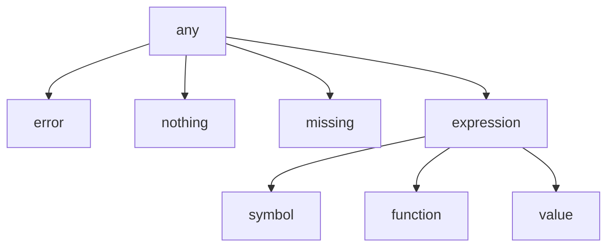

The `value` branch. `residue`, `measurement` and `quantity` are the kind
types (see [Kind Types](#kind-types)):

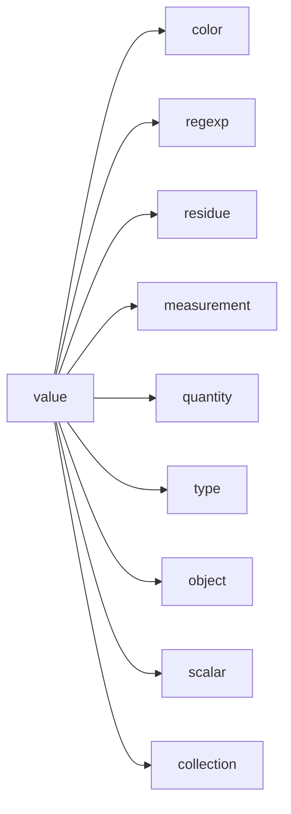

The `scalar` branch:

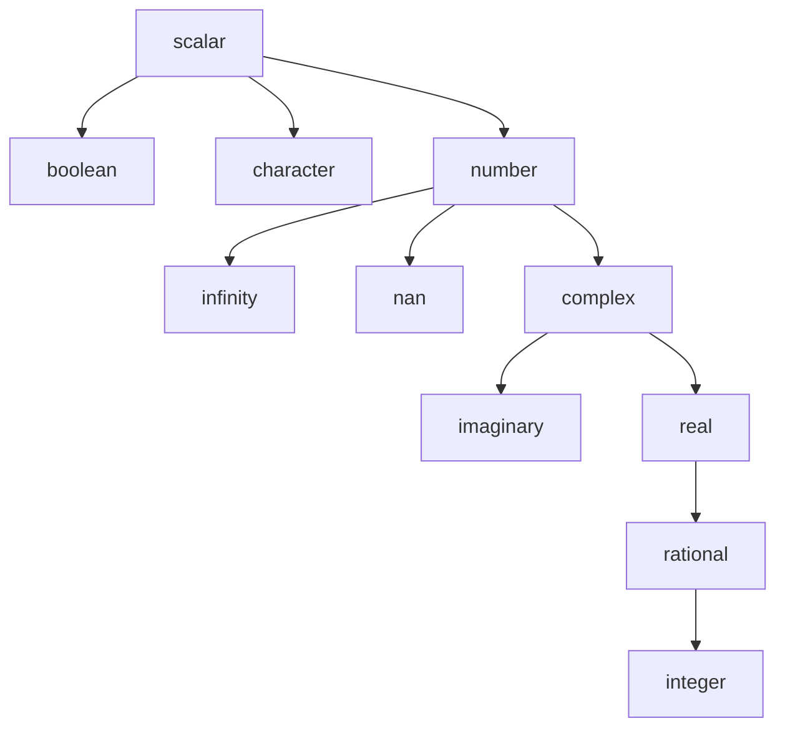

The `collection` branch:

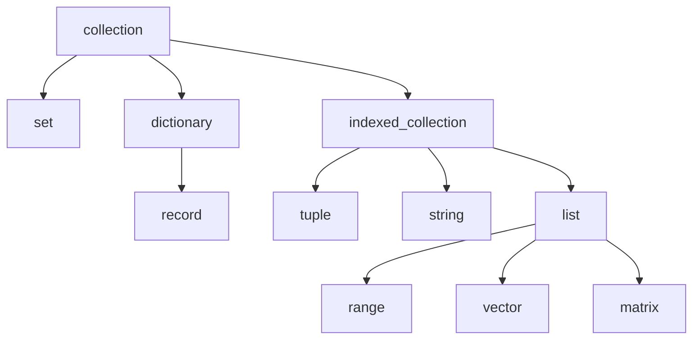

**`never` is the bottom type**, not a sibling of the other types under
`any`. It has no values and is a subtype of every type, including `unknown`,
`missing`, `nothing`, and `error`.

**`unknown` is not in the diagram: it is an inference marker, not a content
type.** It marks a type that is still to be inferred. As a set of values it
restricts nothing, so every type is a subtype of it, `any`, `error` and the
absence markers included, and `any` and `unknown` are mutual subtypes: the
same set of values with two instructions (a contract, a request to infer).
The reverse never holds: `unknown` is a subtype only of `any` and itself,
so an unresolved `unknown` does not establish that an expression is a
number or that it satisfies the `expression` contract. `value`,
`expression`, and `any` are the explicit content contracts.

**Numeric types distinguish finite values from markers and infinities.**
`complex` and its subtypes contain finite numbers. `infinity` and `nan`
are separate subtypes of `number`.

**`vector`, `matrix`, and `tensor` are list spellings**, not separate
primitive types. Bare `vector` and `matrix` specify numeric cells and
rank one or two, respectively. Bare `tensor` is an array of numbers of any
rank (1 or more), so it is not shown as a separate branch.
`range` is a subtype of `list<integer>`.

**Note:** a `string` is an indexed collection of `character` — it sits beside
`list`, `tuple` and `range`, not under `scalar`. A `character` (exactly one
user-perceived character) *is* a scalar, and is a disjoint sibling of
`string`: neither matches the other. `string` is not `list<character>` either;
the two are siblings with the same element type, because joining characters
can merge them (an `e` and a combining acute join into the single character
`é`). See the [Strings reference](/compute-engine/reference/strings/).

This hierarchy allows the Compute Engine to reason about compatibility and subtyping relationships between expressions.

The `unknown` type is a placeholder for an expression whose type has not yet 
been determined, typically during type inference or partial evaluation. It can 
be replaced or refined as more information becomes available. In particular, 
an `unknown` parameter or result slot in a declared function signature does 
not constrain a later definition: the definition's inferred type refines the 
placeholder, so declaring `(unknown) -> unknown` behaves like declaring no 
signature at all.

The following distinctions matter:

- `unknown` restricts nothing: the absence types `nothing` and `missing`,
  the `error` type and `any` are all subtypes of it, as `never` is. A
  content contract is what excludes absence: `expression` and `value`
  exclude the immediate markers. A declared type cannot name `missing`, so
  a position that may hold an absent value is declared `any` or `unknown`,
  or is not declared.
  Call admission is a different question: at an operator parameter, a value
  that may be absent — a lookup with a computed key, such as `xs[i]` — and a
  collection of such values (`list<missing | string>`, an inferred type) are
  accepted where `T` or a collection of `T` is expected; whether an element is
  absent is decided when the program runs.
  With `xs := ["a", "b"]`, `StringJoin(Map(i ↦ xs[i], [1, 2]), "")` is
  `"ab"`, and with the index `5` the result is an `incompatible-type` error
  that names the absent element. A collection whose cells can only be absent
  (`list<missing>`) is refused.
- `unknown` is a placeholder, not a promise. Contrast it with `any`, which is 
  a **contract**: `(any) -> any` — the signature of the identity function — 
  promises a function that accepts every value, and a definition that cannot 
  honor that promise is rejected. Use `unknown` when the type is simply not 
  known yet; use `any` when you mean to accept everything.

Do not confuse the ordinary word “value” with the narrower type `value`.
The current collection contracts distinguish:

| Element annotation | What it accepts |
| --- | --- |
| `list<value>` | Data values, including scalars, collections, objects, and opaque values such as regular expressions; excludes functions and symbolic expressions typed as `symbol` or `expression` |
| `list<expression>` | Data values, functions, and symbolic expressions |
| `list<unknown>` | An explicit request to infer the element type from each assignment; as a set of values the same as bare `list` and `list<any>` |
| `list<any>` | Unrestricted element types, including absence markers and errors; a contract that never moves |

The first two exclude immediate `missing`, `nothing`, and `error`
elements in subtype checks. These are not recursive absence restrictions:
a list containing a missing datum is itself a collection value.

### Naming Constraints for Elements and Arguments

:::info

Element names (used in tuples, records, dictionaries) and function argument names should:

- start with a letter (`U+0041` to `U+005A` or `U+0061` to `U+007A`) or underscore (`U+005F`)
- contain only letters, digits (`U+0030` to `U+0039`), or underscores

Names that don’t follow these rules must be enclosed in backticks.
The backticks are not part of the name, they are used to escape the name.

For example:

``tuple<`1st`: integer, `2nd`: integer, `3rd`: integer>``

``record{`durée`: number, vitesse: number}``

``(`直径`: number) -> number``


If the name contains a backtick or backslash, those characters must be escaped with a backslash:

``record{`name\`with\`backticks\\and\\backslash`: integer}``

The backtick syntax is used instead of quotes to clearly distinguish identifiers from string values, following conventions from languages such as Swift and Kotlin

Element and argument names are stored and compared using Unicode Normalization Form C (NFC).
:::


## Primitive Types

A **primitive type** is a type that is not defined in terms of other types.

The Compute Engine supports the following primitive types:

<div className="symbols-table first-column-header" style={{"--first-col-width":"12ch"}}>

| Type          | Description                                                                                      |
| :-------------- | :----------------------------------------------------------------------------------------------- |
| `any`      | The universal or top type. Every type is a subtype of, and therefore matches, `any` |
| `error` | The type of an **invalid expression**, such as `["Error"]` |
| `nothing`       | The type whose only member is the symbol `Nothing`; the unit type                                             |
| `missing`       | The type whose only member is the symbol `Missing`; a position-preserving absent value. It can be inferred, but a declaration cannot name it |
| `never`       | The type that has no values; the empty type or **bottom type**. It is a subtype of every type, which is why the empty collection — whose elements are drawn from no values at all — types as `list<never>` and is a member of every list type |
| `unknown`       | An inference marker: a type still to be inferred, which each assignment or use refines. As a set of values it restricts nothing (every type is a subtype of it), and it proves no contract (it is a subtype only of `any` and itself). |
| `expression`       | The type of a symbolic expression that represents a mathematical object, such as `["Add", 1, "x"]`, a `symbol`, a `function` or a `value`  |
| `symbol`        | The type of a named object, for example a constant or variable in an expression such as `x` or `alpha` |
| `function`        | The type of a function literal: an expression that applies some arguments to a body to produce a result, such as `["Function", ["Add", "x", 1], "x"]` |
| `value`        | A data value: a scalar, collection, object, color, regular expression, or reified type. Excludes functions and symbolic expressions typed as `symbol` or `expression`. |
| `collection`    | The type of a collection of values: a `list`, a `set`, a `tuple`, a `string`, a `dictionary` or a `record` |
| `indexed_collection`    | The type of a collection of values that can be accessed by an index: a `tuple`, a `range`, a `string`, a `list`, a `vector`, a `matrix` or a `tensor` |
| `range`        | The type of an **index span**: a contiguous, ascending run of 1-based collection indexes, such as `["Range", 2, 5]`. A `Range` has this type only when its bounds are integers, at least 1, ascending and one apart — so `["Range", 1, 10, 2]` (stepped) and `["Range", 5, 2]` (descending) are `indexed_collection<integer>` instead. Not a mathematical interval (see `Interval`) |
| `scalar`        | The type of a single value: a `boolean`, a `character`, or a `number`. A `string` is **not** a scalar — it is an indexed collection of characters |
| `boolean`       | The type of the symbol `True` or `False`|
| `character`     | The type of exactly one user-perceived character (one Unicode grapheme cluster), such as `["CharacterFrom", "'é'"]`. A scalar with no elements, and a disjoint sibling of `string`: a character is not a one-character string, and a string is not a character. A one-character string *literal* does narrow to a character where one is expected |
| `string`        | The type of a string of Unicode characters. `string <: indexed_collection<character>`: a string can be counted, indexed (1-based) and iterated, and its elements are its grapheme clusters. It is **not** `list<character>` — the two are siblings, because joining characters can merge them |
| `number`        | The type of a numeric value |
| `residue`       | The type of a residue class, an element of ℤ/nℤ, such as `["ResidueClass", 2, 5]`. A **kind type** (see [Kind Types](#kind-types)): a `value` that is not a number, disjoint from every other type except `value`, `expression`, `any` and `unknown` |
| `measurement`   | The type of a measurement, a nominal value with a standard uncertainty, such as `["Measurement", 2.5, 0.1]`. A **kind type**, as `residue` is. An operator that accepts a number accepts a measurement, but a symbol declared `real` or `number` does not |
| `quantity`      | The type of a quantity, a value with a physical unit, such as `["Quantity", 2, "m"]`. A **kind type**, as `residue` is. Only the arithmetic operators, the comparisons, the trigonometric functions, `Abs` and the operators with a `value` parameter accept it |

</div>


### Numeric Types

The type `number` represents all numeric values. Below it, the numeric types
are **finite by default**: `complex`, `real`, `rational`, `integer` and
`imaginary` contain only finite values, and the values that are not finite
numbers have types of their own. Every numeric value is a finite number, a
number of infinite magnitude, or the not-a-number marker, and no value is two
of those:

$$\texttt{number} = \texttt{complex} \sqcup \texttt{infinity} \sqcup \texttt{nan}$$

So a declared `real` is a **promise of finiteness**: writing `real` as a
result type says the value is never $\pm\infty$ and never $\mathrm{NaN}$.

<div className="symbols-table first-column-header" style={{"--first-col-width":"17ch"}}>

| Type          | Description                                                                                      |
| :-------------- | :----------------------------------------------------------------------------------------------- |
| `number`       | Any numeric value: a finite number, a number of infinite magnitude, or $\mathrm{NaN}$ |
| `complex`      | A finite complex number, such as $2 + 3i$. The union of `real` and `imaginary` |
| `imaginary`    | A finite complex number with a real part of $0$, such as $3i$ |
| `real`         | A finite real number, such as $-2.5$ |
| `rational`     | A finite number that can be expressed as the quotient of two integers, such as $-\nicefrac{3}{4}$. Includes the integers |
| `integer`      | A finite whole number, such as $42$ |
| `infinity`     | A number of infinite magnitude, in any direction: $+\infty$, $-\infty$, the unsigned $\tilde\infty$ (`ComplexInfinity`), and mixed values such as $\infty + i$. Disjoint from `complex` |
| `nan`          | The not-a-number marker $\mathrm{NaN}$. Its only supertype is `number` |

When you need exactly the signed pair $+\infty$ and $-\infty$ — the values
whose *sign* is promised, which `infinity` does not — write
`signed_infinity`. It is precisely the union of the two value types, and
`+oo | -oo` is an equivalent spelling of the same type; a union
containing both signed infinities prints under the name
(`real | signed_infinity`).

</div>

The extended real line — a real number that may be infinite — has no
one-word name: write it out as `real | +oo | -oo`. Bare `real` does
not admit $\pm\infty$, and `real | infinity` would also admit the unsigned
$\tilde\infty$.

Numeric types can be constrained to a specific range within a lower and upper 
bound

For example `real< -1.0..1.0 >` is the type of real numbers between $-1.0$ and $1.0$, inclusive.

An non-finite endpoint can be represented by the symbol `-oo` or `+oo` or
by omitting the endpoint.

For example: `real<..1.0>` is the type of real numbers less than $1.0$, 
and is equivalent to `real< -oo..1.0 >`.

To exclude an endpoint, write the inequality marker `<` next to it:
`real<0<..>` is the type of real numbers greater than $0$ (`0<..` reads
"$0 < x$"), `real<..<1>` the type of real numbers less than $1$, and
`real<0<..<1>` the open interval $0 < x < 1$. A closed endpoint has no
marker: `real<0..<1>` is $0 \le x < 1$.

On the integer tiers an open endpoint normalizes to the next closed one:
`integer<0<..>` is the same type as `integer<1..>`, the integers greater than
or equal to $1$.

Note that `complex` and `imaginary` types do not support ranges, as they are not ordered types.

Here is the type of various numeric values:

| Value               | Type                |
| ------------------: | :------------------ |
| $42$                | `42`                |
| $-3.14$             | `-3.14`             |
| $\nicefrac{1}{2}$   | `rational<0.5..0.5>` |
| $\nicefrac{1}{3}$   | `rational<0.33..0.34>` |
| $\sqrt2$            | `real<1.4..1.5>`     |
| $3i$                | `imaginary`         |
| $2 + 3i$            | `complex`           |
| $-\infty$           | `-oo` (widens to `infinity`) |
| $\tilde\infty$      | `~oo` (widens to `infinity`) |
| $\mathrm{NaN}$      | `NaN` (widens to `nan`) |

A number literal's type is the most precise claim available — its own value
when a machine number holds it exactly, and otherwise its tier decorated
with a range that encloses the value (see 
[Literal Type](#literal-type)). Every one of these types is a subtype of
the tier you would expect: `42` matches `integer`, 
`rational<0.5..0.5>` matches `rational`, `real<1.4..1.5>`
matches `real`, and so on — so code that
asks *"is this an integer?"* with `.matches()` or `.isInteger` is
unaffected by the extra precision.

The last three rows are the values that are *not* finite numbers. They no
longer match `real` or `integer`: since the bare tiers are finite,
`ce.parse("-\\infty").type.matches("real")` is `false`. Ask
`matches("real | +oo | -oo")` when you mean the extended real line.

### Where Ranged Types Come From

A ranged type can appear in four ways:

- **You declare it**: `ce.declare("x", "real<-1..1>")` makes the range a
  contract on `x`.
- **An assumption refines it**: after `ce.assume(ce.parse("y > 0"))`, the
  type of `y` is `(real<0..>) & !0`.
- **An operator derives it**: some operations produce a result that is
  provably sign-constrained, and their type says so — `|x|` for a real `x`
  has type `real<0..>`, and `e^x` has type `(real<0..>) & !0`.
- **A literal carries it**: an exact value that no machine number holds —
  $\nicefrac{1}{3}$, $\sqrt2$, $10^{30}+1$ — is typed by its tier plus a
  compact range that encloses the value, such as `real<1.4..1.5>`
  for $\sqrt2$ (see [Literal Type](#literal-type)). Constants like
  `Pi` and `ExponentialE` declare a value bracket
  (`real<3.141592653589793..3.141592653589794>`), so their sign
  and magnitude are type facts.
- **A binder declares it**: the index of a `Sum`, `Product`, `Loop` or
  comprehension whose bounds are integer literals is declared `integer<a..b>`
  at its binding site, on the parse route (`\sum_{k=1}^{16}`) and on the box
  route (`["Limits", "k", 1, 16]`, `["Element", "k", ["Range", 1, 16]]`)
  alike. The range is used inside the body — `√((k − 0.5)/16)` is real
  there, so `[√((k − 0.5)/16) for k in 1..16]` is a `list<real>` — but a
  comprehension's list keeps the element type without the range:
  `[k for k in 1..16]` is a `list<integer>`.

Ranges are deliberately **not** propagated through arithmetic: the sum of
two values in `real<-1..>` is not itself in `real<-1..>`, so `x + y` falls
back to the bare tier. Carrying bounds through operations is interval
arithmetic, which the type system does not attempt.

The Compute Engine Standard Library includes definitions for sets that
correspond to some numeric types.

<ReadMore path="/compute-engine/reference/sets/" > 
Read more about the **sets** included in the Standard Library <Icon name="chevron-right-bold" />
</ReadMore>

## Collection Types

A collection type represents an expression that contains multiple values, such as a list, a set, or a dictionary.

The Compute Engine supports the following collection types: `set`, `tuple`,
`list` (including `vector`, `matrix` and `tensor`), `record` and `dictionary`.

### Set

A **set** is a non-indexed collection of unique values.

The type of a set is represented by the type expression `set<T>`, where `T` 
is the type of the elements of the set.

```js
ce.parse("\\{5, 7, 9\\}").type
// ➔ "set<integer>"
```

A set can have an infinite number of elements.

### Tuple

A **tuple** is an indexed collection of values, representing a fixed 
number of elements.

The type of a tuple is represented by the type expression `tuple<T1, T2, ...>`, 
where `T1`, `T2`, ... are the types of the elements of the tuple.

```js
ce.parse("(7, 5, 7)").type
// ➔ "tuple<integer, integer, integer>"
```

Each element type is the **tier** of the element, never a literal's own
value type: `(7, 5, 7)` is a `tuple<integer, integer, integer>`, not
`tuple<7, 5, 7>`, and `(\\sqrt2, 1/3)` is `tuple<real, rational>` even though
`ce.parse("\\sqrt2").type` is the enclosure `real<1.4..1.5>`. A component
that is not a literal keeps its own type, ranges included: with `r`
declared `real`, `(|r|, 1)` is `tuple<real<0..>, integer>`.

The elements of a tuple can be named: `tuple<x: integer, y: integer>`. 

If an element is named, all elements must be named and the names must be unique
when compared in Unicode Normalization Form C (NFC).

(See [Naming Constraints for Elements and Arguments](#naming-constraints-for-elements-and-arguments) for rules on element names.)

The elements of a tuple can be accessed with a one-based index or by name.

A tuple of numbers is a **point/vector in ℝⁿ**: arithmetic on it is
componentwise vector arithmetic and produces a tuple, not a list.

```js
ce.parse("(1,2) + (3,4)").evaluate();   // ➔ (4, 6)
ce.parse("3(1,2)").evaluate();          // ➔ (3, 6)
ce.parse("(4,2)/2").evaluate();         // ➔ (2, 1)
```

Adding a scalar to a tuple (`1 + (2,3)`) is an error — a scalar does not
broadcast into a point — as is multiplying two tuples (there is no implicit
dot product). A symbol declared with a tuple type participates in vector
arithmetic symbolically, and its components can be accessed with the
`.x`/`.y`/`.z` member syntax (`P.x` is `First(P)`).


For two tuples to be compatible, each element must have the same type and the
names must match. Element names live in the type, not in the value — no literal
spells them — so the comparison is made between two type expressions:

```js
ce.type("tuple<x: integer, y: integer>")
  .matches("tuple<x: integer, y: integer>");
// ➔ true
ce.type("tuple<x: integer, y: integer>")
  .matches("tuple<a: integer, b: integer>");
// ➔ false
```


### List, Vector, Matrix and Tensor

A **list** is an indexed collection of values, used to represent vectors, 
matrices, and sequences.

The first element of a list is at index 1, the second element is at index 2, and so on.

The type of a list is represented by the type expression `list<T>`, where `T` is the type of the elements of the list.

```js
ce.parse("\\[1, 2, 3\\]").type.toString();
// ➔ "vector<integer^3>"  (a list of 3 integers)
```

The type of a list literal is **honest**: it reports the actual (widened)
element type and the dimensions. Since element types are covariant, the
honest type is a subtype of every broader form — `vector<integer^3>`
matches `vector<3>`, `vector`, `list<number>`, and `list`.

The element type is the **tier** of the elements, never a literal's own
value type: `[0.5, 1]` is a `vector<real^2>`, and `[\\sqrt2, 1/3]` is a
`vector<real^2>` even though each element's own type is an enclosing range.
The same rule types a set (`{\\sqrt2}` is `set<real>`) and a record
(`{x: 1/3}` is `record{x: rational}`).

The **empty list** has no elements, so its element type is the bottom type 
`never`. Covariance then makes it a member of every list type, which is what 
you want — an empty list is a valid list of anything.

```js
ce.parse("\\[\\]").type.toString();
// ➔ "list<never>"

ce.parse("\\[\\]").type.matches("list<integer>");
// ➔ true
```

The shorthand **`list`** admits any list, whatever its elements: as a set
of values it is `list<any>`, and as a declaration it asks inference to
refine the element type from each assignment. The explicit `list<unknown>`
is the same request spelled out. The same convention applies to every bare
element-taking constructor (`set`, `dictionary`, `collection`,
`indexed_collection`) and, for its slots and fields, to bare `tuple` and
`record`.

An explicit **`list<any>`** denotes the same set of values, but as a
declaration it is a contract that never moves: `b: list<any> := [1, 2]`
reports `list<any>`, while `a: list := [1, 2]` reports `list<integer>`. A
list with absent elements (a regex match result using `Missing` for an
unmatched group) fits all three spellings; it does not fit
`list<expression>`, the contract that excludes the immediate markers.

```js
ce.parse("\\[1, 2, 3\\]").type.matches("list");
// ➔ true
```

The shorthand **`vector`** is a list of numbers, equivalent to `list<number>`:
the two types denote the same values, so each matches the other.

```js
ce.parse("\\[1, 2, 3\\]").type.matches("vector");
// ➔ true
```

A **`vector<n>`** is a list of `n` numbers.

```js
ce.parse("\\[1, 2, 3\\]").type.matches("vector<3>");
// ➔ true
```

A **`vector<T^n>`** is a list of `n` elements of type `T`, where `T` is any
type that is not a list (see [Elements and Cells](#elements-and-cells)); it is
the same type as `list<T^n>`. A literal list's
element type is the widened type of its actual elements, so a literal list of
integers matches both the narrow and the broad forms:

```js
ce.parse("\\[1, 2, 3\\]").type.matches("vector<integer^3>");
// ➔ true
ce.parse("\\[1, 2, 3\\]").type.matches("vector<number^3>");
// ➔ true

// A list with a non-integer element widens accordingly:
ce.parse("\\[1, 2.5, 3\\]").type.matches("vector<integer^3>");
// ➔ false  (the widened element type is real)
```

Lists of non-numeric values type honestly too — a list of two colors types
`list<color^2>`, not a numeric vector — so `type.matches("list<color>")` and
similar element-type queries answer correctly. A list with dimensions can hold
values that are not numbers, if they are not lists: `[True, False]` is a
`list<boolean^2>`, and `["a", "b"]` is a `list<string^2>`. The type
`vector<string^2>` is valid too: it is the same type, and it prints as
`list<string^2>`.

Similarly, a **`matrix`** is a list of its rows, and the rows all have the
same length: `matrix<integer>` is a `list<vector<integer>>`.

- The shorthand `matrix` is `matrix<number^?x?>`, a matrix of numbers, of
  rank 2 but of any dimensions. The `?` symbol is a wildcard that matches any
  number of elements.
- `matrix<T>`: A matrix whose cells have the type `T`, of any dimensions.
- `matrix<nxm>`: A matrix of `n` rows and `m` columns (e.g. `matrix<3x3>`)
- `matrix<T^nxm>`: A matrix of `n` rows and `m` columns whose cells have the
  type `T` (e.g. `matrix<integer^3x3>`)

`T` is any type that is not a list: `matrix<boolean^(2x2)>` is a 2×2 array of
booleans. The bare `matrix` has number cells. A list of rows is not always a
matrix: a `list<vector<integer>>` can hold rows of different
lengths, so it does not match `matrix<integer>`. A declaration that must be a
matrix spells `matrix<integer^(2x2)>`. A nested spelling with an outer length,
such as `list<list<integer^2>^2>`, is a parse error, because its cells would
be lists.

A dimension can be `0`: `matrix<integer^(2x0)>` is a matrix of two empty
rows, and `matrix<integer^(0x2)>` is a matrix with no rows and two columns. In a dimension, `0x` always separates a zero-length axis
from the next dimension; it is never a hexadecimal prefix. The empty list
`[]` is a value of every list type whose first axis has length `0`.

And finally, a **`tensor`** is a multi-dimensional array of numbers, of any
rank (1 or more), **`tensor<T>`** is an array of any rank whose cells have
the type `T`, and **`tensor<T^(2x3x4)>`** is an array of that shape. The cells can be values that are not numbers, if they are
not lists: `tensor<boolean>` is an array of booleans of any rank. A vector
and a matrix are tensors: `[[1, 2], [3, 4]]` matches `tensor<integer>`. A
signature that accepts a numeric array of any rank spells `tensor`, not
`list<number>`.

#### Elements and Cells

A list type is read in one of two ways, by its form:

| Form | Spelling | `T` is the type of | Example |
| :--- | :--- | :--- | :--- |
| A list | `list<T>`, `set<T>` | the elements: what indexing returns | `[[1, 2], [3]]` matches `list<list<integer>>`, not `matrix<integer>` |
| A tensor of a known rank | `list<T^n>`, `vector<T>`, `matrix<T>`, `tensor<T^(dims)>` | the cells: the values at the depth of the rank | `[[1, 2], [3, 4]]` is typed `matrix<integer^(2x2)>` |
| A tensor of any rank | `tensor<T>`, `tensor` | the cells | `[1, 2]` and `[[1, 2], [3, 4]]` both match `tensor<integer>` |

The elements of a tensor of rank 1 are its cells; the elements of a matrix are
its rows. So a matrix of integers is a `list<vector<integer>>` and a
`list<list<integer>>`, but it is not a `list<integer>`:

```js
ce.parse("\\[\\[1, 2\\], \\[3, 4\\]\\]").type.matches("list<list<integer>>");
// ➔ true
ce.parse("\\[\\[1, 2\\], \\[3, 4\\]\\]").type.matches("list<integer>");
// ➔ false
ce.parse("\\[\\[1, 2\\], \\[3, 4\\]\\]").type.matches("tensor<integer>");
// ➔ true
```

A list has elements and may have a length; `vector`, `matrix` and `tensor`
have cells, of any type that is not a list, and may have a shape. The bare
names `vector`, `matrix` and `tensor` mean number cells. Two rules follow:

- The cells cannot be lists. The shape is written in one place: two rows of
  three integers are `matrix<integer^(2x3)>`. `list<list<integer^3>^2>`,
  `matrix<list<integer>>` and `tensor<list<integer>>` are not valid types,
  and the error names the spelling to use (`matrix<integer^(2x3)>`). For rows
  of any lengths, write `list<list<integer>>`.
- A `list` has one axis at most, its length: `list<integer^3>` is valid,
  `list<integer^(2x3)>` is not. Write `matrix<integer^(2x3)>` for two axes and
  `tensor<integer^(2x3x4)>` for three or more; the error names that spelling.

Every other cell type is valid with every head: `list<boolean^2>`,
`list<string^2>`, `list<color^2>`, `list<tuple<number, number>^3>`,
`matrix<boolean^(3x3)>`, `matrix<string>` and `tensor<boolean>` are valid
types. A type prints with the head of its rank: `vector<…>` (or `list<…^n>`
when the cells cannot be numbers) for rank 1, `matrix<…>` for rank 2, and
`tensor<…>` for rank 3 or more. A comparison over a 2×2 matrix `M` is typed
`matrix<boolean^(2x2)>`. A matrix of booleans is not a numeric matrix:
`Determinant` refuses it.


### Dictionary and Record

The **dictionary** and **record** types represent a collection of key-value pairs, 
where each key is a non-empty string and each value can be any type. Building a
dictionary with a key that is not a non-empty string — an empty string, a
number, `Nothing` — is an error rather than a silently dropped entry.

A concrete **record value** has a known set of keys, while a **dictionary** can
have keys that are not defined in advance. A record *type* lists the fields a
value must have; it does not forbid additional fields.

A **record** is used to represent objects and structured data with known properties.
A **dictionary** is well suited to represent hash tables or caches.

**Keys** must be unique when compared in NFC form within a dictionary or record. Keys are not ordered.

(See [Naming Constraints for Elements and Arguments](#naming-constraints-for-elements-and-arguments) for rules on key names.)


The type of a **dictionary** is represented by the type expression `dictionary<T>`
where `T` is the type of the values.

The type of a **record** is represented by the type expression `record{K1: T1, K2: T2, ...}`, 
where `K1`, `K2`, ... are the keys and `T1`, `T2`, ... are the types of the values.

For example: `record{red: integer, green: integer, blue: integer}` is a record that
contains three elements with keys `red`, `green` and `blue`, and values of type `integer`.

A record type is **closed**: a value of the type has exactly the keys that the
type lists. A key that a value can leave out is an **optional field**, written
with a `?` after its type: `record{red: integer, green: integer, alpha: real?}`.
A read of an optional field that the value leaves out gives the absent value of
the field type (`Missing`, or `NaN` for a numeric field). A read of a key that
the type does not list is an `unknown-field` error.

**Compatibility:**
- A record type `A` matches a record type `B` when every key of `A` is a key of
  `B`, every key that `B` requires is also required by `A`, and each field type
  of `A` is compatible with the field type of `B`. A record with more fields is
  not a subtype of one with fewer fields: there is no width subtyping. The order
  of the keys does not matter.
- A record without an optional field, or with it, matches the record type with
  the field optional: `record{a: integer}` and `record{a: integer, b: string}`
  match `record{a: integer, b: string?}`.
- A record is compatible with a dictionary `dictionary<T>` if each type `T1`, `T2`, ... is compatible with `T`.
- A program that must accept other keys takes a `dictionary<T>`.


```js
ce.type("record{red: integer, green: integer}")
  .matches("record{red: integer, green: integer}");
// ➔ true

ce.type("record{red: integer, green: integer}")
  .matches("record{red: integer, green: integer, blue: integer}");
// ➔ false

ce.type("record{red: integer, green: integer, blue: integer}")
  .matches("record{red: integer, green: integer}");
// ➔ false

ce.type("record{red: integer, green: integer}")
  .matches("record{red: integer, green: integer, blue: integer?}");
// ➔ true

ce.type("record{red: integer, green: integer, blue: integer}")
  .matches("dictionary<integer>");
// ➔ true
```


The `record` type is compatible with any record, and the `dictionary` type 
is compatible with both records and dictionaries.

```js
ce.type("record{red: integer, green: integer}")
  .matches("record");
// ➔ true

ce.type("record{red: integer, green: integer}")
  .matches("dictionary");
// ➔ true
```


### Collection

The type `collection` represent any collection of values, such as a `list`, 
a `set`, a `tuple`, a `string`, a `record` or a `dictionary`.

The type `collection<T>` is a collection of values of type `T`.

The type `indexed_collection<T>` is an indexed collection of values of type `T`,
such as a `list`, a `tuple`, a `string` (whose elements are `character`s), or 
a `matrix`. It is a subtype of `collection<T>`.

Because `string <: indexed_collection<character>`, a signature or a `where`
constraint written over `collection<T>` or `indexed_collection<T>` accepts
strings. To exclude them, intersect with a negation:
`(T) -> T where T: collection & !string`.

### Broadcastable

The type `broadcastable<T>` represents a value that is either a scalar `T` or
a collection of `T` applied element-wise — the static type of an expression
that may **broadcast** at evaluation. It is the union `T | tensor<T>`: a `T`,
or an array of any rank whose cells are `T`. `T` is a type that cannot hold a
list: a number type, `boolean`, `string`, or a tuple. For
example `broadcastable<number>` is a number or an array of numbers,
`broadcastable<boolean>` is a boolean or an array of booleans (the result of a
comparison over a matrix is a matrix of booleans), and
`broadcastable<tuple<number, number>>` is a point or an array of points.

Arithmetic in the Compute Engine broadcasts over collections at run time:
`2 \cdot [1, 2, 3]` evaluates to `[2, 4, 6]`. When an operand is a visible
collection, the result has a concrete collection type (`vector<3>`,
`list<number>`). But when the collection-ness of an operand is not statically
visible — typically a call to a function whose return type is `unknown` — the
result may be a scalar *or* a list, depending on what the call returns. Such
expressions are typed `broadcastable<T>`:

```js
ce.declare('h', '(number) -> unknown');
ce.parse('2h(x) - 1').type;
// ➔ broadcastable<number>
```

The subtyping rules follow from the meaning "a `T`, or a tensor of `T`":

- `T <: broadcastable<T>` — a scalar is a valid broadcastable value
- `list<T> <: broadcastable<T>`, `vector<n> <: broadcastable<number>`,
  `matrix<integer> <: broadcastable<integer>`, `range <: broadcastable<integer>`
  — every list of `T` is too, and so is every array of cells of type `T`: a
  vector, a matrix, a range, `matrix<boolean^(2x2)>` (a
  `broadcastable<boolean>`)
- A `tuple`, a `string`, a `set` and a value typed only `indexed_collection<T>`
  are **not** subtypes of `broadcastable<T>`. A tuple and a string bind
  atomically (a broadcasting operator applied to a string receives the whole
  string, not its characters), a set is not indexed, and the type
  `indexed_collection<T>` also holds tuples, so it does not say that the value
  is a list
- A list of lists is **not** a `broadcastable<number>`, because its rows can
  have different lengths: `list<list<number>>` does not match
  `broadcastable<number>`, while `matrix<number>` does
- The relation is transitive: whatever is a subtype of `list<T>` is a subtype
  of `broadcastable<T>`
- `broadcastable<S> <: broadcastable<T>` when `S <: T` (covariant)
- `broadcastable<T>` is **not** a subtype of `T` or of `list<T>` — it may be
  either one, so it is neither. It is a subtype of `T | tensor<T>`, and not of
  `T | list<T>`, since a matrix is not a `list<T>`

A `broadcastable<T>` expression can be used anywhere the runtime can resolve
the ambiguity: further arithmetic propagates the type, indexing with `At`
(`(2h(x)-1)[1]`) is valid, with the element type `T | tensor<T>` (a cell, or
a row of a matrix), and compiled JavaScript handles both outcomes with a
single compiled artifact.

The type can also be used in declarations and signatures, e.g.
`ce.declare('b', 'broadcastable<number>')` for a parameter that accepts a
number or an array of numbers of any rank and is processed element-wise.

Note that a bare undeclared symbol does **not** type as broadcastable: in
`2x`, the symbol `x` is inferred to be a number by the arithmetic itself.
Only expressions whose collection-ness genuinely cannot be resolved
statically (function calls with top-typed results, or values declared
`broadcastable`) carry the type.

## Function Signature

A **function signature** is the type of functions literals.

A function signature is represented by the type expression `(T1) -> T2`, where 
`T1` is the type of the input values of the function literal and `T2` is the 
type of the output value, or return type, of the function literal.

### Return Types

If the function does not return a value, the function signature is `(T) -> nothing`.

A function that never returns, has a signature of `(T) -> never`.


### Arguments

The arguments of a function are a sequence of comma-separated types surrounded 
by parentheses, for example `(T1, T2, ...) -> T3`.

If there are no input arguments, the signature is `() -> T`.

For example `() -> integer` is the type of functions that return an integer 
and have no input arguments.

For example `(integer, integer) -> integer` is the type of functions that map two integers to an integer.

### Named Arguments

Optionally, the input arguments can be named, for example: `(x: integer, y: integer) -> integer`.

(See [Naming Constraints for Elements and Arguments](#naming-constraints-for-elements-and-arguments) for rules on argument names.)

For example, `(x: integer) -> integer` is a function that takes a single named argument `x` of type `integer` and returns an `integer`.


### Optional Arguments

A function signature can include **optional arguments**, which are arguments 
that may or may not be provided when calling the function. An optional 
argument is indicated by a question mark immediately after its type.

For example `(integer, integer?) -> integer` indicates a function literal accepting 
one or two integers as input and returning an integer.

If there are any optional arguments, they must be at the end of the argument list.

A function type matches a signature only when it accepts **every call that
signature permits** — its shortest and its longest. A signature with an
optional argument permits two call shapes, so a function taking only one
argument does not match it:

```js
ce.type("(integer) -> number")
  .matches("(integer, integer?) -> number");
// ➔ false  (cannot serve the two-argument call)

ce.type("(integer, integer?) -> number")
  .matches("(integer, integer?) -> number");
// ➔ true
```

### Default Values

A named argument can have a **default value**, written after its type with
`=`: `(x: number, factor: number = 2) -> number`. An argument with a default
value is optional, and it must come after the required arguments. Do not
write `?` together with `=`: `number? = 2` is a syntax error.

A default value is a constant, one of:

- a number, including `-1`, `NaN` and `+oo`
- a string, `true` or `false`
- the empty list `[]` or the empty dictionary `{}`
- a constant symbol:
  - a constant of the standard library, for example `over: set = Integers`
    or `k: real = Pi`;
  - a symbol declared as a constant, for example
    `weights: list<number> = DefaultWeights` after
    `ce.declare("DefaultWeights", { isConstant: true, value: … })`;
  - a symbol that the type of the argument lists, for example
    `mode: symbol<Auto> | symbol<Manual> = Auto`.

The default value is bound where the function is declared, not read where
the function is called. A call that leaves out the argument receives the
default as if the call had written it. A default that names a variable, for
example `k: number = n` with `n` declared without `isConstant: true`, is an error:
`ce.declare()` throws for such a signature, and a function literal with such
a parameter is the error `expected-a-literal-default`. Write a constant, or
pass the argument. For
any other value, declare a constant and use its name as the default.

In compiled code, a default that is a constant of the standard library or a
symbol that the type lists is filled in. A default that names a constant
that you declared is filled in with the value of the constant, read where the
function is declared: after `ce.declare("W0", { isConstant: true, value: 5 })`
and `f := (k = W0) ↦ k + 1`, the compiled `f()` gives `6`. The value must be
a number, a string, a boolean, a list or tuple of such values, or `{}`. For
any other value, and for an Epsil `const` in a program that is compiled
before it runs, the compilation falls back to the interpreter. To compile
such a call, write the value as the default, or pass the argument.

The default value is filled in when the expression is made canonical. A call
that leaves out the argument and a call that supplies the default value are
the same expression, so the `evaluate` handler always receives every
argument:

```js
ce.declare("Scaled", {
  signature: "(x: number, factor: number = 2) -> number",
  evaluate: ([x, factor]) => x.mul(factor),
});

ce.box(["Scaled", 3]).json;         // ➔ ["Scaled", 3, 2]
ce.box(["Scaled", 3]).evaluate();   // ➔ 6
```

The default fills only an argument that the call leaves out. An absent value
that the call supplies, written or computed, is passed as the argument, and
the rules of `Missing` then apply. A default no longer fills a supplied absent
value. To replace an absent argument, write `Coalesce` in the call:

```js
ce.box(["Scaled", 3, "Missing"]).json;                      // ➔ ["Scaled", 3, "Missing"]
ce.box(["Scaled", 3, "Missing"]).evaluate();                // ➔ Missing
ce.box(["Scaled", 3, ["Divide", 0, 0]]).evaluate();         // ➔ NaN
ce.box(["Scaled", 3, ["Coalesce", "Missing", 2]]).evaluate(); // ➔ 6
```

Compiled code follows the same rule: see
[Lambda Expressions](/compute-engine/guides/compiling/#lambda-expressions).

For matching, an argument with a default value is optional: a function type
with a default value matches a signature that does not have the argument,
but not the reverse.

```js
ce.type("(x: integer, k: integer = 1) -> number")
  .matches("(integer) -> number");
// ➔ true

ce.type("(integer) -> number")
  .matches("(x: integer, k: integer = 1) -> number");
// ➔ false
```

Default values are not accepted in an overloaded signature, on a generic
parameter, or in a nested position such as the argument of a function-valued
argument.


### Variadic Arguments

A function signature can include a variable number of arguments, also known as 
**variadic arguments**. 

Variadic arguments are indicated by a `+` or `*` 
immediately after the type of the last argument. The `+` suffix indicates that
the function accepts one or more arguments of that type, while the `*` suffix
indicates that the function accepts zero or more arguments of that type.

For example `(string, integer+) -> integer` is a function that accepts a 
string as a first argument followed by one or more integers and returns an integer.

To indicate that the function accepts a variable number of arguments of any 
type, use `any+` or `any*`.

A variadic signature permits calls of *any* length, so no fixed-arity function
matches one — only another variadic function can:

```js
ce.type("(integer, integer) -> number")
  .matches("(integer, integer+) -> number");
// ➔ false  (cannot serve a call with three or more integers)

ce.type("(integer, integer*) -> number")
  .matches("(integer, integer+) -> number");
// ➔ true   (zero-or-more covers one-or-more)
```

This matters when a function is **stored** under a declared type. The
declaration is a contract: it tells callers which calls are legal, so whatever
is stored must handle all of them, and assigning does not reshape the declared
type. Passing a function as an **argument** to a callback slot is a different
question — see [Function Type](#function-type) below.

If a signature has a variadic argument, it must be the last argument in the list, 
and it cannot be combined with optional arguments.

### Function Type

The type `function` matches any function value — any parameter shape, any
effects. It is a distinct primitive, **not** a shorthand for a signature such
as `(any*) -> unknown`.

Where types are **compared** — `.matches()`, subtyping — a written signature
constrains callbacks contravariantly: its parameter types are a promise about
what callers may pass, so `(number) -> boolean` is not a subtype of
`(unknown) -> boolean`.

Where a function value is passed as an **operand at an arrow-typed parameter
slot**, admission is by **compatibility** instead: the operand is admitted
unless it is provably unusable — not callable at all, unable to accept the
number of arguments the operator supplies, provably disjoint in a parameter
or the result, or violating the slot's effect bound. This is what lets
`CountIf(xs, IsPrime)` work over an integer collection even though
`IsPrime: (number) -> boolean` is no contravariant subtype of the
instantiated slot, and what lets a mixed-type collection map a numeric
function per element. A callback that could never work — a number-only
predicate over a `list<string>`, a predicate that provably returns a
non-boolean — is rejected when the expression is canonicalized, with a
message naming both arrows. (Design ruling:
`docs/plans/2026-08-18-compatibility-admission-callbacks.md`.)

So: spell a callback slot as the arrow it supplies — the collection
operators read `(T) any -> boolean` for a predicate, `(T) any -> unknown`
for a key — and reserve the bare `function` for a slot whose contract the
type language cannot express (`Iterate`'s parametric accumulator,
`Tabulate`'s dimension-dependent arity).

### Effect Specifiers

A function signature can also state the **effects** of calling the function:
what it does besides returning a value. The effects go in a slot between the
argument list and the arrow.

```js
ce.type("(real) random -> real");     // may draw from the random stream
ce.type("(string) network -> string"); // performs host network I/O
ce.type("() scope -> nothing");       // mutates a binding that outlives the call
```

There are nine effect labels, a closed set:

<div className="symbols-table first-column-header" style={{"--first-col-width":"14ch"}}>

| Label | Meaning |
| :------------ | :---------------------------------------------------------- |
| `console` | Emits host console or diagnostic output |
| `entropy` | Unseeded, non-replayable nondeterminism |
| `environment` | Reads host environment data: navigator, locale, environment variables |
| `fs_read` | Reads the host filesystem |
| `fs_write` | Writes the host filesystem |
| `network` | Performs host network I/O |
| `random` | May draw from the ambient seeded random stream |
| `scope` | May mutate a binding that outlives the call |
| `time` | Reads the host clock |

</div>

Several labels may appear in the slot, separated by spaces. They may be written
in any order; the canonical form orders them alphabetically.

```js
ce.type("(string) scope network -> string").toString();
// ➔ "(string) network scope -> string"
```

Two keywords may appear in the slot instead of labels:

- `any` means **unknown effects**. It is the top of the effect ordering: every
  consumer treats it as though every label, present and future, were there. Use
  it for an opaque function that cannot state what it does.
- `pure` means **no effects**, stated explicitly.

An **empty slot also means pure**. `(real) pure -> real` and `(real) -> real`
describe the same set of effects (none) and are interchangeable everywhere a
type is compared, but they are not spelled the same: `pure` is a *statement*,
and it survives serialization so that re-declaring from a serialized signature
keeps the purity contract. An empty slot states nothing, and leaves the effects
to be inferred from the function's body.

```js
ce.type("(real) pure -> real").toString();
// ➔ "(real) pure -> real"

ce.type("(real) -> real").toString();
// ➔ "(real) -> real"
```

The grammar fails closed. An unknown label, a repeated label, or `any` or `pure`
combined with anything else is a type error rather than a silently weakened
contract:

```js
ce.type("(real) rndm -> real");
// ➔ throws: Unknown effect label `rndm`

ce.type("(real) any random -> real");
// ➔ throws: `any` cannot be combined with other effect labels
```

Because argument lists are always parenthesized, the slot is positionally
isolated: an identifier there can only be an effect label, so adding a label in
a future version can never change how an existing type string parses.

#### Effects and Subtyping

Signatures are **covariant** in their effect set: a function that does less is
usable wherever a function that may do more is accepted. So `(real) -> real` is
a subtype of `(real) random -> real`, which is a subtype of `(real) any ->
real`.

In argument position this flips, which is what makes an annotated parameter a
*requirement*. A parameter typed with a bare arrow demands a **pure** callback,
and the check happens at the call boundary like any other argument check:

```js
ce.declare("integ", { signature: "((any) -> number, real, real) -> real" });

ce.box(["integ", ["Function", ["Add", "x", 1], "x"], 0, 1]).isValid;
// ➔ true

ce.box(["integ", ["Function", ["Random"], "x"], 0, 1]).isValid;
// ➔ false  (incompatible-type: "(any) -> number" vs "(unknown) random -> number")
```

To tolerate an effect rather than forbid it, list it: a parameter typed `(any)
random -> number` accepts both a drawing callback and a pure one. An operand
typed `any` fails every bound — a function that will not state its effects
cannot prove their absence.

The `function` primitive is the escape hatch: it is effect-top, so it accepts
any callable whatever its effects. That is why `Map(x |-> Random(), xs)` is
accepted; the effect is not rejected, it is simply carried onto the
application.

#### Inferred and Declared Effects

For a function you define, effects are normally **inferred** from the body, and
re-inferred every time you assign a new body. A bare arrow leaves them on that
inferred track — it declares the parameter and result types without pinning the
effects:

```js
ce.declare("draw", { type: "(number) -> number" });

// Accepted: the body draws from the random stream, and the inferred effects
// are revised to `random`.
ce.assign("draw", ce.box(["Function", ["Add", ["Random"], "n"], "n"]));

// Accepted too: a pure body revises them back.
ce.assign("draw", ce.box(["Function", ["Add", "n", 1], "n"]));
```

**`scope` is the one exception: it is opt-in.** A named definition that states
no effects promises it does not write outside itself, so a body with a *proven*
escaping write — an assignment to an enclosing binding, or an `Assume` — is
refused rather than silently re-stamped. Declare the `scope` effect to allow it:

```js
ce.declare("counter", { type: "number", value: 0 });
ce.declare("fib", { type: "(number) -> number" });

// Refused: the body assigns to the enclosing `counter`.
ce.assign("fib", ce.box(["Function",
  ["Block", ["Assign", "counter", ["Add", "counter", 1]], "n"], "n"]));
// ➔ throws: the body writes outside the function ... which requires
//   declaring the `scope` effect

// Accepted: `scope` opts in.
ce.declare("bump", { type: "(number) scope -> number" });
ce.assign("bump", ce.box(["Function",
  ["Block", ["Assign", "counter", ["Add", "counter", 1]], "n"], "n"]));
```

The same refusal applies when the function is the `value` of a declaration, in
any scope, including a scope from `ce.pushScope()`:
`ce.declare("f", { type: "(number) -> number", value })`, or `{ value }` with no
type, whether `value` is a boxed expression, MathJSON, LaTeX or a function that
returns one. A literal that states its own effects
(`(number) scope -> number` on the literal) is accepted when its body keeps to
them.

A `Declare` statement, which is also a top-level `let` or `const` in Epsil,
gives an `incompatible-type` error value for such a literal when the literal is
written in the statement and the binding is in the global scope or in a scope
from `ce.pushScope()`. A local of a `Block` or of a function body is not refused.

An **anonymous** literal is not gated — it has no annotation surface, and its
arrow carries the inferred `scope` honestly — so a factory that returns a
writing closure still installs under a bare arrow; the `scope` lives on the
inner arrow.

Stating the effects explicitly — a non-empty specifier, or the `pure` keyword —
turns them into a **contract** instead. Every body assigned to the symbol must
stay within it. Over-declaring is allowed (a pure body satisfies a `scope`
contract), but exceeding it is an `incompatible-type` error and the definition
is not installed:

```js
ce.declare("g", { type: "(number) pure -> number" });

ce.box(["Assign", "g", ce.box(["Function",
  ["Block", ["Assign", "counter", ["Add", "counter", 1]], "n"], "n"])]).evaluate();
// ➔ Error(ErrorCode("incompatible-type", "pure effects", "scope effects"))
```

This mirrors how the rest of the type system treats inference: an inferred type
is flexible and revisable, a declared one is enforced.

### Overload Sets

A function that can be called in several different ways is described by an
**intersection** of function signatures. The value inhabits every arm, that is,
it is callable at each of them.

```js
ce.declare("Draw", {
  signature: "((set<real>) -> real) & ((collection) -> any)",
  evaluate: (ops) => {
    /* dispatch on ops at run time */
  },
});

ce.box(["Draw", ["Interval", 0, 1]]).type; // ➔ "real"
ce.box(["Draw", ["List", 1, 2, 3]]).type; // ➔ "any"
ce.box(["Draw", 5]).isValid; // ➔ false
```

Use an intersection (`&`), not a union (`|`). A union would say the value is
callable in *one* of those ways without saying which, so a call site could rely
on none of them individually.

**Parenthesize each arm.** The `->` of a signature binds the loosest of all type
operators: its return type extends as far right as possible and absorbs any
following `&` or `|`. So `(number) -> real & string` is a *single* signature
returning `real & string`, not an intersection of two signatures.

When a call is made, the arm whose parameters accept the arguments is selected.
If several arms accept them, the **most specific** one wins — above,
`Interval(0,1)` is a `set<real>`, and since `set<real>` is a subtype of
`collection` both arms accept it, so the first arm is chosen and the result type
is `real` rather than `any`. When the type of an argument does not decide
which arm applies — the argument is `unknown`, or its type is wider than the
parameter of one arm — the result type is the union of the results of every
arm that can apply. Declaration order does not decide. With
`f: ((integer) -> integer) & ((real) -> string)`, `ce.box(["f", "x"]).type` is
`integer | string` for `x: real` and for an undeclared `x`, while
`ce.box(["f", 3]).type` is `integer`. If no arm accepts the arguments, the call
is an error.

An overload set is a subtype of each of its arms:

```js
ce.type("((number) -> real) & ((string) -> boolean)").matches("(number) -> real");
// ➔ true
```

A symbol declared with an overload set behaves the same way:

```js
ce.declare("f", "((integer) -> integer) & ((string) -> string)");

ce.box(["f", 3]).type; // ➔ "integer"
ce.box(["f", "'a'"]).type; // ➔ "string"
ce.box(["f", true]).isValid; // ➔ false
```

Note that a single `["Function"]` literal usually cannot implement an overload
set: assigning `(x) -> x + 1` to the `f` above is rejected, because that one
body must satisfy both `(integer) -> integer` and `(string) -> string`. Overload
sets are intended for operators whose implementation dispatches on its arguments
at run time.

### Typed Function Literals

A `["Function"]` literal can declare the types of its parameters and its return
value. A parameter is annotated by writing it as `["Typed", _symbol_, _type_]`,
and a return type is ascribed by wrapping the body in a `Typed` expression. The
literal then has a **named function signature** built from these annotations:

```js
ce.box(["Function", ["Add", "x", 1], ["Typed", "x", "'integer'"]]).type;
// ➔ (x: integer) -> integer

ce.box(["Function",
  ["Typed", ["Add", "x", 1], "'integer'"],
  ["Typed", "x", "'integer'"]]).type;
// ➔ (x: integer) -> integer
```

The annotations are **authoritative** (an ascription, not a whole-body type
check): the declared types define the literal's signature directly. In strict
mode, the arguments of a typed literal are checked against the declared
parameter types when the function is applied — a mismatch produces an
`incompatible-type` error. The value the body returns is checked against the
declared return type when it is concrete (a number, a string, a character, a
boolean, or a list or tuple of these): with `g` declared
`(integer) -> integer` and the body `n / 2`, `g(4)` is `2` and `g(5)` is an
`incompatible-type` error. A symbolic value, `Missing`, `Nothing`, `NaN` and
an error pass unchanged; a real float passes under `integer` or `rational`.
Compiled code does not make this check. Assigning a typed literal to a symbol
gives that symbol the annotated signature, including the return type.

A function assigned to a symbol declared with a signature checks each argument
against the declared parameter type when it is called. When an argument has no
value yet and its type does not decide the check, the call stays unevaluated,
and a later evaluation checks the value:

```js
ce.declare("h", "(integer) -> integer");
ce.assign("h", ce.box(["Function", ["Multiply", 2, "k"], "k"]));

const call = ce.box(["h", "m"]).evaluate();
call.json;                 // ➔ ["h", "m"]
ce.assign("m", 1.5);
call.evaluate();           // ➔ incompatible-type error
```

The same rule applies to a parameter annotated on the literal, with
`["Typed", "k", "'integer'"]` as the parameter. A literal applied directly, or
given as a callback, stays as an inert `Apply` of the literal.

Declare the argument to apply the body: with `n` declared `integer`, `h(n)` gives
`2n`. At a parameter that admits every real number (`real`, `number`), the body
is also applied to a symbol with no declared type: with `f` declared
`(real) -> real` and the body `x^2`, `f(x)` gives `x^2`. A later value outside
the parameter type is not checked in that result. An expression whose type does
not fit the parameter stays: `f(x + 1)` stays while `x` has neither a declared
nor an inferred type, because the type of `x + 1` is then `number`.

When a function literal is assigned to a symbol declared with a signature,
the declared result is ascribed to the body. A body whose inferred type is
only wider than the declared result is accepted: `n ↦ n + 1` under
`(integer) -> integer` is inferred `number`. A body whose type has no value in
common with the declared result is refused, as a value of the wrong type is
refused for a declared symbol:

```js
ce.declare("g", "(integer) -> integer");
ce.assign("g", ce.box(["Function", "'hello'", "n"]));
// ➔ throws: the value of type "(n: unknown) -> string" is not compatible
//   with the type "(integer) -> integer"
```

`NaN`, `Missing` and `Nothing` in the type of the body are not part of this
test. A body that gives a collection under a scalar result is accepted when a
parameter can receive a collection whole, because the result can then be the
broadcast of the declared result. A body with a `Return` before its last
statement is not tested.

The return ascription may also be a **full signature carrying effects** — this
is how a definition states its effect contract
(`function roll(n) random -> integer { … }` lowers to a body ascribed
`"(n: unknown) random -> integer"`). Because of that reading, ascribing an
*effect-bearing function type* as a plain **return type** requires grouping
parentheses around it:

```js
// The literal's own contract: `mk` draws from the random stream.
ce.box(["Function", ["Typed", body, "'(real) random -> real'"], "x"]);

// A pure literal whose RETURN VALUE is a drawing function: group the type.
ce.box(["Function", ["Typed", body, "'((real) random -> real)'"], "x"]);
```

The same rule applies in Epsil: write
`function mk(x) -> ((real) random -> real) { … }` for the effectful *return
type*, and `function roll(n) random -> integer { … }` for the definition's own
contract. An effect-free signature never needs the parentheses — it is always
read as a return type.

Two refinements apply to this check. A **collection argument against a scalar
parameter broadcasts**: with `h` declared `(number) -> number`, `h([1, 2, 3])`
— or `h(L + 1)` for a list-valued `L` — is accepted and maps element-wise,
typing as the corresponding vector. And a **collection parameter defers what
it cannot decide**: an argument whose static type neither proves nor refutes
conformance (say, a symbol declared plain `list` passed to a `matrix`
parameter) is accepted provisionally and checked against its actual value
when the operator evaluates; only a provable mismatch (a flat `list<number>`
can never be a matrix) errors immediately at canonicalization.

## Generic Signatures

A signature such as `(list<number>) -> number` pins the types of a function
once and for all. Many functions are not like that: reversing a collection
returns the same kind of collection it was given, and swapping the components
of a tuple returns those components in the other order, whatever they are. A
**generic signature** states such a relation between the argument types and
the result type directly, instead of giving up and returning `unknown`.

A generic signature is a function signature followed by a **quantifier
clause**: the keyword `where`, then a comma-separated list of **type
variables**. The clause always comes last, after the effect specifier and the
return type.

```js
ce.type("(T) -> T where T");                              // identity
ce.type("(tuple<T, U>) -> tuple<U, T> where T, U");       // swap
ce.type("(T) -> T where T: indexed_collection");          // reverse
ce.type("(list<T>, (T) any -> U) -> list<U> where T, U"); // map
```

Any identifier can be a type variable — there is no naming convention — and a
variable is only a variable because the clause declares it. The names are the
author's and they round-trip: `(list<Elem>) -> Elem where Elem` serializes
back with `Elem`, not with a canonical letter.

```js
ce.type("(list<Elem>) -> Elem where Elem").toString();
// ➔ "(list<Elem>) -> Elem where Elem"
```

Because the clause is last, nothing has to terminate it — a bound is a type,
and types extend as far right as they can, which is exactly what the final
position allows: `(T, x: real) -> boolean where T: (real) -> real` reads
without punctuation. A comma starts the *next* variable, and each variable
carries its own bound, so `where T, U: number` binds `T` unbounded and
`U: number` — not both to `number`.

Within a signature, every occurrence of a quantified name is the *same*
variable, including inside a nested signature: in
`(list<T>, (T) any -> U) -> list<U> where T, U` the callback's parameter
type is the list's element type. Note the `any` in the callback's effect slot
— a bare arrow demands a **pure** callback (see
[Effects and Subtyping](#effects-and-subtyping)), so an operator that accepts
arbitrary callbacks must write the effect-top form.

A variable may appear in an argument or result position, in the element
position of a constructed type (`list<T>`, `tuple<T, U>`, `set<T>`,
`collection<T>`, `dictionary<T>`, `broadcastable<T>`, a vector or matrix
element, a record field), inside a nested signature, and in **one arm of a
union**:

```js
ce.type("(T | string) -> list<T> where T"); // T in one arm of a union
ce.type("(list<T> | string) -> T where T");
```

At a call, an argument matched against a union parameter takes exactly one
arm. If it takes the **ground** arm, the argument says nothing about the
variable, and the variable is solved to `never` — the narrowest member of the
family — unless another argument constrains it. If it takes the **open** arm,
that arm is matched as usual, refutation included: a `set<integer>` is not a
`list<T> | string`.

Only **one** arm of a union may mention a variable. With two open arms nothing
at the call site says which arm a value took, so neither variable could be
solved:

```js
ce.type("(T | U) -> tuple<T, U> where T, U");
// ➔ throws: unsupported-variable-position: At most one arm of a union can
//   refer to a type variable, but `T | U` has 2. Nothing at a call site says
//   which arm a value took, so neither variable could be solved
```

A variable may **not** appear in an intersection or a negation. An
intersection is usually a constraint written in the wrong place: constrain a
variable with a **bound** in the clause instead.

```js
ce.type("(T & number) -> T where T");
// ➔ throws: unsupported-variable-position: The type variable `T` cannot
//   appear in an intersection. To constrain a type variable, declare a bound
//   on it instead: `where T: number`

ce.type("(T) -> T where T: number"); // …what that author meant
```

A variable in a **cell position** reads the cells of a tensor, and a
dimension variable reads its length: `(x: list<T^N>) -> T where T, N` and
`(x: vector<T>) -> T where T` bind `T` to the cells of a tensor of rank 1, so
`first([1, 2, 3])` is an `integer`. A matrix has rank 2 and is not a value of
either pattern: `first([[1, 2], [3, 4]])` is an `incompatible-type` error. The
plain `list<T>` is read by its elements, as every list type is (see
[List, Vector, Matrix and Tensor](#list-vector-matrix-and-tensor)): a
matrix is a list of its rows, so `(x: list<T>) -> T where T` applied to
`[[1, 2], [3, 4]]` binds `T` to the row type and the result is a
`vector<integer^2>`.

`where` is a reserved word in type strings: `ce.declareType("where", …)` is
a `reserved-type-name` error.

The prefix spelling `forall T. (T) -> T` was removed in favor of the trailing
clause. A leftover prefix clause is reported with a migration message naming
the replacement rather than a generic syntax error, and `forall` itself is now
an ordinary, declarable type name.

A **type alias** can be parameterized the same way — see
[Generic Type Aliases](#generic-type-aliases).

### Instantiating at the Call Site

Nothing stays generic once it is called. At each call the engine solves the
variables against the types of the actual arguments and substitutes the
solution into the result type, so the type of an application is always
**ground** — no variable ever escapes into an expression's type.

```js
ce.declare("first", {
  signature: "(indexed_collection<T>) -> T where T",
  evaluate: ([xs]) => xs.at(1),
});

ce.box(["first", ["List", 1, 2, 3]]).type; // ➔ "integer"
ce.box(["first", ["List", "'a'", "'b'"]]).type; // ➔ "string"
```

A variable that occurs at several argument positions is solved to the **join**
of what those positions contribute — the narrowest type that covers them all,
the same rule the engine uses elsewhere to type a result from several
operands:

```js
ce.declare("n", "integer");
ce.declare("r", "real");
ce.declare("pick", { signature: "(T, T) -> T where T" });

ce.box(["pick", "n", "n"]).type; // ➔ "integer"
ce.box(["pick", "n", "r"]).type; // ➔ "real"
```

Variables in element positions are solved by matching the argument's structure:

```js
ce.declare("swap", { signature: "(tuple<T, U>) -> tuple<U, T> where T, U" });

ce.box(["swap", ["Tuple", 1, "'a'"]]).type;
// ➔ "tuple<string, integer>"
```

A callback's parameter type is instantiated too, which is what makes an
annotated callback checkable and an unannotated one inferable at the right
type:

```js
ce.declare("keep", {
  signature: "(list<T>, (T) any -> U) -> list<U> where T, U",
});

ce.box(["keep", ["List", 1, 2, 3],
  ["Function", ["Greater", "x", 0], "x"]]).type;
// ➔ "list<boolean>"
```

If no solution satisfies every position, the call is an ordinary
`incompatible-type` error; the expected type reported is the *instantiated*
one, never variable syntax.

### Bounds

A variable can declare an **upper bound** with `T: <type>`. Only argument
types that are a subtype of the bound are accepted, and the variable still
binds the argument's type *verbatim* — so a bounded identity preserves the
argument's kind and its dimensions:

```js
ce.declare("rev", { signature: "(T) -> T where T: indexed_collection" });

ce.box(["rev", ["List", ["List", 1, 2, 3], ["List", 4, 5, 6]]]).type;
// ➔ "matrix<integer^(2x3)>"
```

Violating the bound is an error naming the bound:

```js
ce.box(["rev", ["Set", 1, 2]]).isValid; // ➔ false

ce.box(["rev", ["Set", 1, 2]]).toString();
// ➔ rev(Error(ErrorCode("incompatible-type", "indexed_collection",
//      "set<integer>")))
```

An unbounded variable has no bound: `where T` is shorthand for
`where T: unknown` — "a type to be inferred at each call" — and an
explicitly written `: unknown` is normalized away when the type is
serialized. An explicit `: any` bound admits the same arguments, is a
contract rather than an inference request, and survives serialization. A bound must be a **ground**
type: it cannot mention a variable, its own or another's.

```js
ce.type("(U) -> T where T, U: list<T>");
// ➔ throws: unsupported-variable-position: The bound of the type variable
//   `U` must be a ground type: `list<T>` refers to a type variable
```

Several standard library operators are declared this way — `Identity` is
`(T) -> T where T`, `Reverse` is
`(T) -> T where T: indexed_collection` — so their results are typed from their
arguments:

```js
ce.box(["Reverse", ["List", 1, 2, 3]]).type; // ➔ "vector<integer^3>"
```

`Inverse` is not generic: its signature is `(matrix) -> matrix`, and its type
handler keeps the shape of the argument but gives the entries the type
`rational`, because the inverse of an integer matrix has rational entries.
`MatrixPower` with a negative exponent is typed the same way; a positive
exponent keeps the element type.

```js
ce.box(["Inverse", ["List", ["List", 1, 2], ["List", 3, 4]]]).type;
// ➔ "matrix<rational^(2x2)>"

ce.declare("m", "matrix<integer^(2x2)>");
ce.parse("m^2").type;      // ➔ "matrix<integer^(2x2)>"
ce.parse("m^{-1}").type;   // ➔ "matrix<rational^(2x2)>"
```

A **scalar** bound interacts with broadcasting. On an operator that
broadcasts, a collection argument is admitted against a scalar parameter —
the bound is checked against the scalar base, as it always was — and the
variable binds the argument's **element** type; the call's ordinary broadcast
wrap then puts the argument's shape back on the result. `Conjugate` is
`(T) -> T where T: number`, `Chop` is `(T, real<0..>?) -> T where T: number`,
`Remainder` is
`(T, T) -> T where T: number`:

```js
ce.box(["Conjugate", ["List", 1, 2, 3]]).type;
// ➔ "vector<integer^3>"

ce.box(["Remainder", ["List", ["List", 1, 2], ["List", 3, 4]], 7]).type;
// ➔ "matrix<integer^(2x2)>"
```

Broadcasting maps all the way down to the scalar leaves, so the variable is
bound to a leaf type whatever the argument's rank. Only the kinds a broadcast
actually maps are peeled: a `set` argument is admitted but never mapped
(`Conjugate(Set(1, 2))` stays a `set<integer>`), and a tuple is atomic
(`Conjugate((1, 2))` is a `tuple<integer, integer>`).

### Generic Overload Sets

Each arm of an [overload set](#overload-sets) carries its own clause, and each
arm must be parenthesized:

```js
ce.type("((list<T>) -> T where T) & ((set<T>) -> boolean where T)");
```

The parentheses are load-bearing. `where` binds looser than `&`, so an
unparenthesized clause attaches to the **whole** intersection rather than to
the arm on its left — and an intersection is not something a clause can
quantify. The two `T`s in the parenthesized form are unrelated: a clause
quantifies exactly one arm. A clause nested inside another signature is not
accepted either — quantification is top-level (or arm-level) only.

```js
ce.type("((list<T>) -> T) & ((set<T>) -> boolean) where T");
// ➔ throws: unsupported-variable-position: A `where` clause can only quantify
//   a function signature. To constrain one arm of an overload set,
//   parenthesize it: `((list<T>) -> T where T) & …`

ce.type("(x: ((U) -> U where U)) -> integer");
// ➔ throws: unsupported-variable-position: A `where` clause can only
//   quantify a top-level signature (or one arm of an overload set), not a
//   nested one. Parenthesize a nested clause: `((A) -> B where A, B)`
```

### Generic Declarations and Function Literals

A generic signature can be implemented by an ordinary function body — a
`["Function"]` literal, a `x |-> …` lambda, an Epsil `function` definition —
as long as the clause is stated on the *whole signature*. There are three
spellings.

**The `function f<T>(…)` definition form** (Epsil) puts a **type-parameter
clause** between the name and the parameter list. A parameter may carry a
ground bound, the effect specifier and the return type are unchanged, and the
clause names are usable anywhere in the head:

```plaintext
function f<T>(x: T) -> T { x + x }
function swap<T, U>(x: T, y: U) -> tuple<U, T> { (y, x) }
function g<T: number, U>(x: T, k: (T) any -> U) -> list<U> { [k(x)] }
function tick<T>(x: T) random -> T { x }
function h<T: (real) -> real>(k: T, x: real) -> real { k(x) }
```

A definition may state the same clause with a trailing `where` instead. The
two spellings are synonyms — `function f<T>(…)` is `function f(…) where T` —
and the clause always comes **last**, after the effect specifier and after the
return type, in every definition form:

```plaintext
function f(x: T) -> T where T { x + x }            // block, annotated
function f(x: T) where T { x + x }                 // block, return inferred
function tick(x: T) random -> T where T { x }      // block, with effects
f(x: T) -> T where T = x + x                       // math definition form
```

**One binding site per declaration.** A declaration may carry a `<…>` clause
or a `where` clause, never both: `function f<T>(x: T) -> T where T: number` is
an error, not a bounded `<T: number>`.

**A full-signature annotation** states the polytype where a type is expected
and leaves the body a plain literal. There is no binder slot here, so the
`where` clause is the only spelling:

```plaintext
const f: (x: T) -> T where T = x |-> x
```

```js
ce.box(["Function", ["Add", "x", "x"], "'(x: T) -> T where T'"]).type;
// ➔ "(x: T) -> T where T"
```

**Declare, then assign** — the form to use for a generic **recursive**
function, since the body can only call the symbol once it is declared:

```js
ce.declare("nest", "(x: T, n: integer) -> T where T");
ce.assign("nest", ce.box(["Function",
  ["If", ["LessEqual", "n", 0], "x", ["nest", "x", ["Subtract", "n", 1]]],
  "x", "n"]));

ce.box(["nest", 5, 3]).evaluate().toString(); // ➔ "5"
ce.box(["nest", 5, 3]).type; // ➔ "integer"
ce.box(["nest", "'a'", 2]).type; // ➔ "string"
```

However it is written, the declaration is what every call sees: the arguments
are checked against the clause, the bounds are enforced, and the result type
is the *instantiated* one, exactly as for a generic `evaluate` handler.

**What the body sees.** The clause quantifies the *signature*, not the body.
Inside the body a quantified parameter is an ordinary unannotated parameter:
`x: T` carries no type information there, a bound `T: number` does not make
the body see a `number`, and two parameters sharing `T` are not known to have
the same type. The clause is the **call-site contract**; the body is
canonicalized once, exactly as an untyped literal's is.

For the same reason the clause names scope over the definition's **head**
only — its parameters, its effect specifier and its return type. A body-local
type annotation naming a type variable is an unknown-type error:

```plaintext
function f<T>(x: T) -> T { let y: T = x; y }
// ➔ Unknown type "T"
```

**The result is a trusted ascription.** Nothing verifies that the body
actually returns a value of the argument's type — as with a
[typed function literal](#typed-function-literals), the annotation *is* the
type, it is not a run-time check:

```js
ce.declare("f", "(x: T) -> T where T");
ce.assign("f", ce.box(["Function", 0, "x"]));

ce.box(["f", "'a'"]).type; // ➔ "string"
ce.box(["f", "'a'"]).evaluate().toString(); // ➔ "0"
```

One test is made when the literal is assigned: when each type variable of the
result has a bound, a body whose type has no value in common with the result
read at those bounds is refused, as for a declared ground signature:

```js
ce.declare("f", "(x: T) -> T where T: number");
ce.assign("f", ce.box(["Function", ["Greater", "x", 0], "x"]));
// ➔ throws: the value of type "(x: unknown) -> boolean" is not compatible
//   with the type "(x: T) -> T where T: number"
```

**Reading a polytype return annotation.** A polytype ascribed to the body of a
literal is always the literal's **own** signature — the same reading as an
effect-bearing annotation (see [Typed Function Literals](#typed-function-literals)).
An ungrouped signature is the contract; grouping it makes it an ordinary
*return type* instead:

```js
ce.box(["Function", ["Typed", body, "'(x: number) -> number'"], "x"]).type;
// ➔ "(unknown) -> number"                  (the marker IS the contract)

ce.box(["Function", ["Typed", body, "'((x: number) -> number)'"], "x"]).type;
// ➔ "(unknown) -> (x: number) -> number"   (it RETURNS a function)
```

That grouping escape is not available for a polytype: a literal cannot declare
that it *returns* a generic function, only that it *is* one, so a grouped
`where` clause in the body slot is a signature-marker error.

```js
ce.box(["Function", ["Typed", body, "'(T) -> T where T'"], "x"]).type;
// ➔ "(T) -> T where T"          (the literal is generic)
```

The same holds in Epsil: `function mk(x) -> (T) -> T where T { … }` defines
a generic `mk`.

**Broadcasting.** A generic literal broadcasts like any other function whose
parameters are scalar: a collection argument is mapped, down to the scalar
leaves, and the result carries the argument's shape. Since the variable binds
an *element* (see [Bounds](#bounds)), a result that mentions it is the
per-element answer:

```js
ce.declare("dup", "(x: T) -> tuple<T, T> where T");
ce.assign("dup", ce.box(["Function", ["Tuple", "x", "x"], "x"]));

ce.box(["dup", 5]).type;
// ➔ "tuple<integer, integer>"

ce.box(["dup", ["List", 1, 2]]).type;
// ➔ "list<tuple<integer, integer>>"

ce.box(["dup", ["List", 1, 2]]).evaluate().toString();
// ➔ "[(1, 1),(2, 2)]"

ce.box(["dup", ["List", ["List", 1, 2], ["List", 3, 4]]]).evaluate().toString();
// ➔ "[[(1, 1),(2, 2)],[(3, 3),(4, 4)]]"
```

**Limits.** The first four are rejected, each with its own message:

- **No partial application.** A generic function must be given all of its
  arguments; currying one reports
  `Partial application of a generic function is not supported`. (Solving the
  supplied prefix and pruning the clause is future work.)
- **No generic clause in a multi-clause set**, in either direction: neither a
  second clause added to a generic definition nor a generic clause added to an
  existing one (`generic-clause-unsupported`).
- **No literal body for a generic overload set.** An intersection with a
  generic arm still needs an `evaluate` handler — the same reason a single
  literal cannot implement an ordinary [overload set](#overload-sets).
- **The math definition form does not take a clause.** In Epsil,
  `f<T>(x) = x` is an ordinary expression (`f < T > (x)`, then `= x`), not a
  definition — only the `function` keyword form claims the `<…>` slot.
- **Compilation declines.** A generic function is not compiled — `compile()`
  falls back to the (correct) interpreted evaluation for any expression that
  calls one. A compiled body could not reproduce behavior that depends on the
  parameter types — a collection argument that would broadcast, in
  particular — so the engine declines whole-fn rather than produce a wrong
  value; per-instantiation compilation is future work.

## Literal Type

A **literal type** is a type that represents a single value. 

The value can be:
- a boolean: `true` or `false`
- a number, such as `42`, `-3.14`, or `6.022e23`. A hexadecimal (`0x1F`) or
  binary (`0b101`) integer is also accepted: `0x1F` is the literal type `31`
- a string, such as `"yellow"`, 

Literal types can be used in conjunction with a union to represent a type that 
can be one of multiple values, for example:

- `0 | 1` is the type of values that are either `0` or `1`.
- `"red" | "green" | "blue"` is the type of values that are either of the 
  strings `"red"`, `"green"` or `"blue"`.

### Number Literals Have Literal Types

The type of a number literal **is** its literal type: the most precise
claim the type system can make about it.

```js
console.info(ce.box(42).type);
// ➔ "42"

console.info(ce.box(-3.14).type);
// ➔ "-3.14"
```

A literal type is a subtype of its numeric tier — `42` matches `integer`,
`real`, and `number` — so a literal is accepted anywhere its tier is, with
no conversion and no cast. To check what kind of number an expression is,
use `.matches()` (or the `isInteger`/`isRational`/`isNumber` shortcuts),
never a string comparison of the type's name:

```js
console.info(ce.box(42).type.matches("integer"));
// ➔ true

console.info(String(ce.box(42).type) === "integer");
// ➔ false — the type's *name* is "42"
```

### How a Number Literal Is Typed

Some exact values cannot be spelled as a plain value type. The engine
therefore picks one of three forms:

1. **A machine number holds the value exactly**: the type is that value.
   `ce.box(21).type` is `21`, and `ce.box(0.5).type` is `0.5`.
2. **A machine number holds the value exactly, but the value is an exact
   rational**: the type is the `rational` tier with a **singleton
   range**. $\nicefrac{1}{2}$ has type `rational<0.5..0.5>`. A bare
   value type cannot be used here: the lattice does not class a bare
   numeric value as rational, so `0.5` matches `real` but not `rational`.
3. **No machine number holds the value** — $\nicefrac{1}{3}$, $\sqrt2$,
   $10^{30}+1$: the type is a compact **closed range** on the tier of the
   value. Both bounds are rounded *outward* to two significant digits.

```js
console.info(ce.parse("1/3").type);
// ➔ "rational<0.33..0.34>"

console.info(ce.parse("\\sqrt2").type);
// ➔ "real<1.4..1.5>"

console.info(ce.parse("10^{30}+1").evaluate().type);
// ➔ "integer<9.9e+29..1.1e+30>"
```

The bounds of an enclosing range provably contain the exact value, so the
type never claims a value the literal does not have. The bounds also
exclude zero, which keeps the sign of the literal a type fact, and the
range is never a singleton, so no operation can mistake a bound for the
value itself.

Domain checks read these bounds. The type of $\nicefrac{1}{3}$ proves that
its magnitude is not more than $1$, so its arcsine stays real:

```js
console.info(ce.parse("\\arcsin(1/3)").evaluate().type);
// ➔ "real"
```

When the magnitude of the value is outside the range of normal machine
numbers, no sound compact range exists. The type then falls back to a
claim about the sign only:

```js
console.info(ce.parse("10^{400}").evaluate().type);
// ➔ "(integer<0..>) & !0"
```

### Literal Types Are Not Stored

A literal type belongs to the literal itself. It lives at expression
positions only. Whenever a type is **stored** — inferred for a
declaration, solved for a generic type variable, synthesized for a
collection, derived as the signature of a function literal, or recorded as
the result of an operator — the literal widens to its tier:

```js
ce.assign("k", 42);
console.info(ce.box("k").type);
// ➔ "integer" — inference stores the tier, not the value

ce.declare("identity", "(x: T) -> T where T");
console.info(ce.box(["identity", 5]).type);
// ➔ "integer" — the type variable binds the tier, never `5`

console.info(ce.box(["List", 1, 2, 3]).type);
// ➔ "vector<integer^3>" — cells widen to their tier

console.info(ce.parse("(\\sqrt2, 1/3)").type);
// ➔ "tuple<real, rational>" — components carry their tier, never the
//    enclosing range each literal reports on its own

console.info(ce.box(["Function", 21]).type);
// ➔ "() -> integer" — a derived signature stores the tier
```

This is the same discipline as `const`/`let` literal types in TypeScript:
maximum precision at the expression, a reusable contract in storage.

One place the extra precision is directly useful: type errors name the
offending value. A wrong argument reports "expected `integer`, got `2.5`"
rather than "got `real`".


## Other Constructed Types

Types can be combined to form new types using a **union**, an **intersection**, or a **negation**.

### Union

A **union** is the type of values that are in either of two types.

Unions are useful when a value may be one of several possible types.

The type of a union is represented by the type expression `T1 | T2`, where `T1` and `T2` are the types of the values.

For example, `number | boolean` is the type of values that are numbers or booleans.

### Intersection

An **intersection** is the type of values that are in both of two types.

Intersections are useful when a value must satisfy multiple type constraints at once.
They can be used to model values that meet several structural or semantic requirements.

The type of an intersection is represented by the type expression `T1 & T2`, where `T1` and `T2` are the types of the values.

Intersections are most useful for extending or combining record types.

For example, `record{length: integer} & record{size: integer}` is the type of values 
that are records with both a `length` and a `size` key, that is `record{length: integer, size: integer}`.

An intersection of **function signatures** describes a function that can be
called in several different ways — see [Overload Sets](#overload-sets). Each arm
must be parenthesized, since `->` binds looser than `&`.


### Negation

A **negation** represents values that are excluded from a given type.

This can be useful for excluding special cases such as `0`, `NaN`, or `Infinity`.

A type negation is represented by the type expression `!T`, where `T` is a type.

For example, `!integer` is the type of values that are not integers.

The type `integer & !0` is the type of values that are integers but not `0`.


## Matching Types

Two types can be evaluated for **compatibility**. 

A type `A` matches type `B` if all values of `A` are also values of `B`, that is, if `A` is a subtype of `B`.
Matching is used for type checking and for validating function arguments.

**To check if two types are compatible**, use the `type.matches()` method.

```js
ce.type("integer").matches("number");
// ➔ true

ce.type("number").matches("integer");
// ➔ false

ce.parse("3.14").type.matches("real");
// ➔ true
```
:::warning
Do not check for type compatibility by comparing the type strings directly.

Type strings may represent refined or derived types 
(e.g. `real<0..>` where you expected `real`, or the literal type of a
number), so use 
`.matches()` for compatibility checks instead of strict equality.

```js
ce.parse("3.14").type === "real";
// ➔ false (the type is actually "3.14", the literal type)

ce.parse("3.14").type.matches("real");
// ➔ true
```

:::

### Compatibility of Complex Types

When checking compatibility of complex types, both structure and element types must be considered.

Compatibility of complex types follows specific rules depending on the type of structure, such as records, tuples, or lists.

#### Records

Records are compatible if they have the same keys and the values are compatible.

```js
ce.box({ dict: { red: 1, green: 2 } }).type
  .matches("record{red: integer, green: integer}");
// ➔ true
```

Record types are closed: a record with more keys is **not** compatible with a
record type with fewer keys. A key that a value can leave out is declared as an
optional field.

```js
ce.box({ dict: { red: 1, green: 2, blue: 3 } }).type
  .matches("record{red: integer, green: integer}");
// ➔ false

ce.box({ dict: { red: 1, green: 2 } }).type
  .matches("record{red: integer, green: integer, blue: integer?}");
// ➔ true
```


#### Dictionaries
Dictionaries are compatible if the values are compatible.

```js
ce.box({ dict: { red: 1, green: 2 } }).type
  .matches("dictionary<integer>");
// ➔ true
```

Records are compatible with dictionaries if all the values of the record are 
compatible with the dictionary's value type.

```js
ce.box({ dict: { red: 104, green: 2, blue: 37 } }).type
  .matches("dictionary<integer>");
// ➔ true
ce.box({ dict: { user: { str: "Bob" }, age: 24 } }).type
  .matches("dictionary<integer>");
// ➔ false
```


#### Tuples

Tuples are compatible if they have the same length and the elements are compatible.

```js
ce.parse("(1, 2, 3)").type
  .matches("tuple<integer, integer, integer>");
// ➔ true
```

If the elements of a tuple are named, the names must match.

```js
ce.type("tuple<x: integer, y: integer>")
  .matches("tuple<x: integer, y: integer>");
// ➔ true

ce.type("tuple<x: integer, y: integer>")
  .matches("tuple<a: integer, b: integer>");
// ➔ false
```


#### Lists

Lists are compatible if they have the same length and the elements are compatible.

```js
ce.parse("\\[1, 2, 3\\]").type
  .matches("list<integer>");
// ➔ true
```

#### Function Literals

Function literals are compatible if the input types are compatible and the 
output types are compatible, specifically the output type is covariant and the 
input types are contravariant.


```js
ce.type("(number) -> integer")
  .matches("(integer) -> number");
// ➔ true
```

The name of the arguments of a function signature is not taken into account when
checking for compatibility.

```js
ce.type("(x: integer) -> integer")
  .matches("(integer) -> integer");
// ➔ true
```

### Could a Value Be of a Type?

`matches()` asks whether **every** value of a type is a value of the target. 
That is the right question for type checking, but not for classifying a value 
by its shape — and the two answers differ on **union types**.

A union matches a target only if *every* one of its members does, so a union 
answers `false` even when one of its members is exactly the shape you asked 
about:

```js
ce.type("integer | string").matches("integer");
// ➔ false  (a `string` is not an `integer`)
```

**To check whether a value of a type could be of another type**, use 
`type.couldMatch()`:

```js
ce.type("integer | string").couldMatch("integer");
// ➔ true

// Unions are distributed at every depth, including inside a parameter
ce.type("list<integer | string>").couldMatch("list<integer>");
// ➔ true  (witness: `[1, 2]`)
```

`couldMatch()` is symmetric, and decisive for the composite shapes it models — 
list elements and dimensions, tuple arity and element names, and the element 
type of sets and collections:

```js
ce.type("tuple<number, number>").couldMatch("list<tuple<number, number>>");
// ➔ false  (a point is not a list of points)

ce.type("list<integer>").couldMatch("list<string>");
// ➔ false
```

The `never` type has no values, so nothing could be one — the one place 
`couldMatch()` deliberately differs from `matches()`, for which `never` is a 
subtype of everything. An `unknown` type could be anything: check `isUnknown` 
if you want to treat an inconclusive type as a non-match.

```js
ce.type("never").couldMatch("integer");
// ➔ false   (`ce.type("never").matches("integer")` is `true`)

ce.type("unknown").couldMatch("integer");
// ➔ true
```

**To examine the members of a union**, use `type.unionMembers`. Any other type 
yields a single-element array, so the same code path works for both:

```js
ce.type("integer | string").unionMembers.map((t) => t.toString());
// ➔ ["integer", "string"]

ce.type("integer").unionMembers.map((t) => t.toString());
// ➔ ["integer"]
```

Note that `unionMembers` does not reach a union nested inside a parameter — 
`list<integer | string>` is a single member. Use `couldMatch()`, which handles 
that case directly.

**To check whether two types have no values in common**, use 
`type.isDisjointFrom()`:

```js
ce.type("integer | string").isDisjointFrom("boolean");
// ➔ true

ce.type("integer | string").isDisjointFrom("integer | boolean");
// ➔ false  (they share `integer`)
```

Types are separated by category, so a composite type is disjoint from a 
primitive one and from a composite of another kind — a `list` is not a 
`string`, a `tuple` is not a `list`. (A `record`, however, is NOT disjoint
from a `dictionary`: a record is the named-shape subtype of dictionary in
the type hierarchy, so a record value is a dictionary value.)

```js
ce.type("list<integer>").isDisjointFrom("string");
// ➔ true

ce.type("tuple<number, number>").isDisjointFrom("list<tuple<number, number>>");
// ➔ true
```

:::warning
`isDisjointFrom()` is conservative: when disjointness cannot be established the 
answer is `false`, meaning "these may overlap", never a false claim of 
disjointness.

Because of that, `!isDisjointFrom()` is **not** the same as `couldMatch()` and 
should not be used to classify a value by shape. Two collections whose element 
types cannot coincide are the case to watch:

```js
ce.type("list<integer>").isDisjointFrom("list<string>");
// ➔ false — "may overlap"

ce.type("list<integer>").couldMatch("list<string>");
// ➔ false — the answer you want
```

:::

### Generic Patterns

A [generic signature](#generic-signatures) can be used as a pattern, and the 
two predicates ask different questions about it — deliberately.

`matches()` is an **existential** check: does *some* instantiation of the 
pattern's variables make the subject a subtype? That is what "is this an 
identity function?" usually means:

```js
ce.type("(number) -> number").matches("(T) -> T where T");
// ➔ true  (instantiate `T` as `number`)

ce.type("(integer) -> string").matches("(T) -> T where T");
// ➔ false  (no single `T` is both `integer` and `string`)
```

The instantiation is consistent across every occurrence of a variable, and it 
must satisfy the variable's bound:

```js
ce.type("(list<integer>) -> list<integer>")
  .matches("(T) -> T where T: indexed_collection");
// ➔ true

ce.type("(set<integer>) -> set<integer>")
  .matches("(T) -> T where T: indexed_collection");
// ➔ false  (a `set` is not an `indexed_collection`)
```

`couldMatch()` solves nothing. It reads each occurrence of a variable as its 
declared bound — `any` when the variable is unbounded — with no consistency 
between occurrences. For a signature pattern that reading is decided by the 
parameter position, which is contravariant, so the same identity probe answers 
`false`:

```js
ce.type("(number) -> number").couldMatch("(T) -> T where T");
// ➔ false  (the pattern reads as `(any) -> any`)

ce.type("(number) -> number").couldMatch("(any) -> any");
// ➔ false  (the ground row it reduces to)
```

So ask `matches()` when the *pattern* is generic. `couldMatch()` earns its keep 
on the other side, when a generic type is the **subject** being classified — 
and there the bound is what makes the answer informative. An unbounded variable 
reads as `unknown` and cannot rule anything out:

```js
ce.type("(T) -> T where T").couldMatch("(any) -> string");
// ➔ true  (`T` reads as `unknown`: vacuous)

ce.type("(T) -> T where T: number").couldMatch("(any) -> string");
// ➔ false  (`T` reads as `number`, which is not a `string`)

ce.type("(T) -> T where T: number").couldMatch("(any) -> number");
// ➔ true
```

A generic signature is a function value like any other, so it could be a 
`function`, and a bound is read on the subject side too:

```js
ce.type("(T) -> T where T").couldMatch("function");
// ➔ true

ce.type("(T) -> T where T: indexed_collection")
  .couldMatch("(indexed_collection) -> indexed_collection");
// ➔ true

ce.type("(T) -> T where T")
  .couldMatch("(indexed_collection) -> indexed_collection");
// ➔ false  (`T` reads as `any`, which is not an `indexed_collection`)
```

### Checking the Type of a Numeric Value

The properties `expr.isNumber`, `expr.isInteger` and `expr.isRational` are
shortcuts to check if the type of an expression matches the types
`"number"`, `"integer"` and `"rational"` respectively. The last two tiers
are finite, so $\pm\infty$ and $\mathrm{NaN}$ answer `false` to both while
still answering `true` to `isNumber`.

There is no shortcut for bare `real`. The related property
`expr.isExtendedReal` asks the **extended** question — *is this a point of
the extended real line?* — so it is `true` for a finite real **and** for
$\pm\infty$. It is `false` for $\mathrm{NaN}$, for the unsigned
$\tilde\infty$ and for a number with an imaginary part. It is exactly
`type.matches("real | +oo | -oo")`. To ask the finite question
instead, use `type.matches("real")`, or pair `isExtendedReal` with
`expr.isFinite`.

```js
console.info(ce.expr(3.14).type);
// ➔ "3.14" — a literal's type is its literal type (see Literal Type)

console.info(ce.expr(3.14).type.matches("real")) 
// ➔ true

console.info(ce.expr(3.14).isExtendedReal) 
// ➔ true

console.info(ce.parse("\\infty").isExtendedReal) 
// ➔ true — infinite, but still on the extended real line

console.info(ce.parse("\\infty").type.matches("real")) 
// ➔ false — bare `real` is finite

console.info(ce.expr(3.14).type.matches("integer")) 
// ➔ false

console.info(ce.expr(3.14).isInteger) 
// ➔ false

```

:::info **Renamed: `isReal` is now `isExtendedReal`**

`isExtendedReal` was called `isReal` before the numeric types became
finite by default. The rename is not cosmetic: the old name suggested the
bare `real` tier, but the property has always admitted $\pm\infty$, which
bare `real` no longer does.
:::


## Type Inference

When  an explicit type is not provided for a symbol, the Compute Engine will
attempt to **infer** the type of the symbol based on the context in which it is used.
This process is known as **type inference**.

When assigning a value to an undeclared symbol, the type of the value is
used to infer the type of the symbol.

If the symbol is a constant, the type is used exactly as the type of the symbol.
If the symbol is a variable, the type of the value may be widened to a more general 
type:

<div className="symbols-table" style={{"--first-col-width":"18ch"}}>


| Value Type         | Inferred Symbol Type |
|:--------------------|:----------------------|
| `complex`  <br/> `imaginary`          | `number`            |
| `integer`           | `integer`             |
| `real` <br/> `rational`          | `real`            |
| `infinity`          | `infinity`            |
| `nan`          | `nan`            |

</div>

Examples:

<div className="symbols-table" style={{"--first-col-width":"8ch"}}>

| Value               | Value Type | Inferred Symbol Type |
|:--------------------|:--------------------------|:--------------------------|
| 34                  | `integer` | `integer`                |
| 3.14                | `real` | `real`                   |
| 4i                   | `imaginary` | `number`                   |
| 1/2                  | `rational` | `real`                   |
</div>

```js
ce.assign("n", 34);
ce.expr("n").type;
// ➔ "integer"
```

When a symbol is used in a function expression, the expected type of the
arguments is used to infer the type of the symbol in that expression. The
expression declares nothing: a symbol boxed on its own keeps the type
`unknown` until `ce.infer()` declares it.

```js
ce.declare("f", "(number) -> number");
const expr = ce.expr(["f", "n"]);
expr.op1.type;
// ➔ "number"
ce.expr("n").type;
// ➔ "unknown"

ce.infer([expr]);
ce.expr("n").type;
// ➔ "number"
```

A type that has been inferred can be refined later, for example by
assigning a value of a more specific type to the symbol or by using the
symbol in a context that requires a more specific type.

Use-driven refinement applies to symbols that do **not** hold a value: for
a mathematical unknown, a use *requires* what the symbol must be. Once a
symbol **has been assigned**, its type records what it actually holds —
that is evidence, and a later use is a requirement *checked against* the
evidence rather than a refinement of it:

```js
ce.declare("k", "(integer) -> integer");

// Valueless symbol: the use REQUIRES its type, in this expression
ce.expr(["k", "n"]).op1.type;  // ➔ "integer"

// Assigned symbol: the use CHECKS against the evidence
ce.assign("x", 3.5);       // x: real (widened per the table above)
ce.expr(["k", "x"]);       // ➔ incompatible-type error, at canonicalization
ce.expr("x").type;         // ➔ still "real" — the use did not rewrite it
```

Without this distinction a use could silently overwrite what an assignment
had established, deferring the mismatch to evaluation time.

The same distinction is applied **statically** to a whole Epsil program:
the pre-run check (`epsil check`, and the diagnostics phase of running a
file) tracks the type effect of each top-level declaration and assignment
in order — without evaluating anything — so the program

```
let x
let f: () -> integer
let g: () -> number
let k: (integer) -> integer
x = f()
x = g()
k(x)
```

reports `expected integer, got number at x` as a **static** diagnostic,
before anything runs. Assignment is last-write-wins: swapping the two
assignments makes the program correct, and the check accepts it.

`ce.infer()` combines the requirements of several expressions. Continuing
the example of `f` above:

```js
ce.declare("g", "(integer) -> number");
ce.infer([ce.expr(["g", "n"])]);
ce.expr("n").type;
// ➔ "integer": the inferred "n" has been narrowed
//    from "number" to "integer"
```

### Declared vs Inferred: Contract vs Evidence

For host-created bindings, a type reaches a symbol on one of two tracks,
and they behave differently. Program and Block variables instead use the fixed
initialization contracts described below:

- A **declared** type — written by you, in `ce.declare("a", "list")` or
  `let a: list` — is a **contract**. It never moves: assigning `[1, 2, 3]`
  to `a: list` leaves `a`'s type `list`, even though the value's own type is
  the much more precise `vector<integer^3>`. An assignment that
  violates the contract (`a = 42`) is an `incompatible-type` error.
- An **inferred** type — produced by the engine from evidence — is
  **revisable**. It follows each assignment: after `b = [1, 2, 3]` an
  undeclared `b` types `vector<integer^3>`; after `b = ["x", "y"]` it types
  `list<string^2>`. Inference is never a trap: a new assignment or a new use
  re-infers.

A Program or Block variable has a fixed contract even when its type was inferred.
Preparation uses its initialization without executing it: mutable numeric values
give `number`, lists lose fixed lengths and widen their element types, tuples keep
their arity with widened components, and callable values give `function`. Constants
may retain more precision. An empty unannotated list keeps unknown elements; later
assignments do not infer them. Write `let xs: list<real> = []` when a known element
type is required.

A unique later initialization in the same straight-line sequence before any use
can establish the contract of `let x`; `let x; x = 1` establishes `number` during
preparation but initializes the slot only when the assignment executes. Branches,
loops and called functions are not searched for initialization. Without an explicit
annotation or such an initialization, the type stays `unknown` even after a runtime
write. Reading an uninitialized slot reports `read-before-initialization`.
Assignments check the fixed contract; evaluation and `N()` never revise it.

Deferred initialization inference also stops at a runtime application, either
between the declaration and the proposed initialization or inside its right side.
For example, `let x; x=1` infers `number`, while `let x; x=1+2` keeps `unknown`.
Use `let x=1+2` or an explicit annotation when that precision is needed.

An unannotated function parameter assigned in its body keeps an unknown contract;
its uses and later assigned values do not establish a type. Annotate such a
parameter when compilation needs its shape.

The type of an expression does not depend on the values that its symbols
hold. It depends on their declared or inferred types, and on the values of
constants. With `x` declared `real` and holding 4, `\sqrt{x}` is typed
`complex`, the type for every real `x`, and its value is 2.

A symbol whose value reads other symbols has the type of that value, as the
types of those symbols give it:

```js
ce.assign("y", ce.parse("x + 1"));
ce.expr("y").type;
// ➔ "number"

ce.assign("x", 2);
ce.expr("y").type;
// ➔ "integer": the type of x + 1 for an integer x

ce.assign("x", ce.parse("[1, 2]"));
ce.expr("y").type;
// ➔ "vector<integer^2>"
ce.expr("y").evaluate();
// ➔ [2, 3]

ce.assign("x", ce.parse("[5, 6]"));
ce.expr("y").type;
// ➔ "vector<integer^2>": a new value of the same type changes no type
```

An assignment to a symbol with a declared type accepts a value whose type
**overlaps** the declared type, as a function call accepts such an argument.
The value is then tested each time the symbol is evaluated: a value that is
not of the declared type is an `incompatible-type` error at that read. A
value whose type has no value in common with the declared type, or a value
made only of literals and constants that is not of the declared type, is
still refused when it is assigned.

```js
ce.declare("a", "real");
ce.declare("P", "tuple<real, real>");

// The value is typed tuple<complex, real>: the square root of a negative
// number is imaginary. The type overlaps tuple<real, real>, so the
// assignment is accepted.
ce.assign("P", ce.parse("(\\sqrt{1-a^2}, a)"));

ce.assign("a", 0.6);
ce.box("P").evaluate();
// ➔ (0.8, 0.6)

ce.assign("a", 2);
ce.box("P").evaluate();
// ➔ Error(ErrorCode("incompatible-type", "tuple<real, real>",
//          "tuple<imaginary, integer>"), (sqrt(3)i, 2))

ce.declare("s", "string");
ce.assign("s", ce.parse("a + 1"));
// ➔ throws: The value "a + 1" of type "real" is not compatible with the
//   type "string"
```

Compiled code does not test the value: it reads the symbol as a value of its
declared type, and a value outside that type gives an unspecified result.

For a **bare collection annotation**, the contract is the *constructor*
and the element slot is a placeholder that refines from evidence: `a: list`
holding `[1, 2, 3]` reports `list<integer>` — the element type came
from the assignment, while rank and length stay open (you wrote `list`, so
list-ness of any shape is what you chose). The refinement never hardens:
`a = ["x"]` re-refines to `list<string>`, exactly as an unannotated
variable would re-infer, and `a = 42` is still rejected against the `list`
contract. An *explicit* element type (`list<integer>`, `list<any>`) is a
full contract and never moves. For non-collection loose annotations the
same principle applies at whole-type granularity: `x: unknown` behaves
like no annotation at all, while `x: any` is a fixed contract.

**A declared type describes the present values; `Missing` sits outside
it, as `NaN` sits outside `real`.** A declared type cannot name `missing`
(`string | missing` and `list<string | missing>` are errors: `ce.declare`
throws, and `Typed` and `Declare` give an error expression). An assignment
still accepts the absent value: `s: string` accepts `Missing` (for example
`s := xs[5]` with `xs = ["a", "b"]`) but refuses `5`, and
`xs: list<string>` accepts `["a", Missing]` but refuses `[5, Missing]`.
The absent value is read with `IsMissing` or `Coalesce`; a point whose
coordinates are all `NaN` is absent for them. A `number`
declaration admits `NaN`, the numeric absence marker (`real`, `integer` and
`complex` hold finite values and refuse it; declare `real | nan`), so
`n: number := 3 {a > 0}` binds (a numeric restriction masks to `NaN`).

**A possibly absent value at a contract that excludes absence** (`xs[i]`,
typed `string`, at a `string` parameter) is admitted by the engine and
checked when the call runs. Three discharges exist: a fallback
(`xs[i] ?? "d"`), a guard (`isMissing(v)`, which narrows `v` in the present branch), and the presence assertion
`xs[i]?!` (`AssertPresent`), which returns the value when present and an
`expected-present` error when absent. The assertion's type is the present
part of the operand's type. A library operator whose parameter excludes
absence refuses an absent argument at evaluation with an `incompatible-type`
error naming the parameter, as a user function does for a parameter of another
type; a call with `Missing` at a parameter declared as a number or a point
gives `Missing` without running the body (`((x: integer) ↦ x + 1)(Missing)` is
`Missing`), also when the parameter has a default value: a default fills only
an argument that the call leaves out. Numeric and collection
operators answer `Missing` instead (`Sin(Missing)` and `Reverse(Missing)` are
`Missing`; a comparison is `False`), and operators that own their
absence semantics (`Equal`, `Coalesce`, `IsMissing`) keep their own answers.
`Length(Missing)`, and `Sum`, `Product`, `Max` and `Mean` of a collection with
a `Missing` datum, are `Missing` (an error datum still gives the error). These are the interpreter's answers. Compiled code
guarantees only the three discharges and the accessors
that move an absent value without computing on it (`At`, `First`, `Last`,
`Rest`, `Length`); any other operator over an absent operand gives the
target's own value there (`undefined > 0` is `false` in JavaScript), so a
program that is compiled discharges a possibly absent value before it
computes on it. See
[Values that are absent](/compute-engine/guides/compiling/#values-that-are-absent).

### When Inference Triggers

Inference writes happen at these moments:

1. **Assignment to an undeclared symbol** (or one declared `unknown`): the
   value's type — widened per the table above — becomes the symbol's
   inferred type, and each later assignment re-infers.
2. **Argument positions**: passing an `unknown`-typed symbol to a typed
   parameter requires the parameter's type of the symbol (see the `f(n)`
   examples above). This includes *forwarding* through user functions: in
   `g(c) = pick(c)` where `pick`'s own body indexes its parameter, the
   collection evidence inferred for `pick` propagates to `c`, so `g` binds
   a list argument whole instead of broadcasting over it. A self-call is
   evidence too: when a function calls itself and passes a collection (a
   list literal, a range, a set, a comprehension, a `filter` result) at a
   parameter's position, that parameter takes a whole collection. With
   `f(n, s) = s if n == 0 else f(n - 1, [1, 2])`, `f(1, [0])` is `[1, 2]`
   and the inferred signature is `(unknown, list<any>) -> unknown`. A
   self-call that forwards a parameter unchanged, or passes a scalar, is no
   evidence, so `f(x) = x * 2` still broadcasts: `f([1, 2, 3])` is
   `[2, 4, 6]`. A type inferred as
   a union by one use is narrowed again by another use whose parameter admits
   only some of its members: `ToUpperCase(s)` infers `s` as
   `character | string`, and a `Sort(s)` in the same expression narrows it to
   `string` instead of refusing the call. A *declared* union is checked, not narrowed.
3. **Function-literal bodies**: a bare (unannotated) lambda parameter starts
   as `unknown` and is narrowed by how the body *uses* it — indexing
   (`v[1]`) narrows it to a collection, arithmetic
   infers numeric, boolean use infers `boolean`. The lambda's stored
   signature carries what the body proved and nothing more. While every
   read of the parameter uses a literal index, the parameter is a tuple
   whose component at each index is what that read requires:
   `p => !p[1] if p[2] % 2 == 0 else p[1]` types `p` as
   `tuple<boolean, real>` and accepts `(true, 4)`. When some read uses a
   non-literal index, the parameter is an `indexed_collection` whose element
   type is the union of the read requirements. The inferred tuple is not
   enforced at application, and it is not a point parameter: a list
   argument, a list of points included, is taken whole. With
   `h(v) = v[1] + v[2]`, `h([(1, 2), (3, 4)])` is `(4, 6)`, the first
   point plus the second. To apply `h` to each point, declare the
   parameter: `h(v: tuple<number, number>) = v[1] + v[2]` gives `[3, 7]`.
4. **Uses of an element**: a use of an element taken out of a collection
   refines the collection's *element* type, in the expression that holds
   the use. `xs[1] + 1` makes an undeclared
   `xs` an `indexed_collection<number>`, `xs["a"] + 1` a
   `dictionary<number>`, `First(xs) + 1` an `indexed_collection<number>`,
   and `k(xs[1])` with `k: (integer) -> integer` an
   `indexed_collection<integer>`. A chained access reaches the outer
   collection (`m[1][2] + 1` makes `m` an
   `indexed_collection<indexed_collection<number>>`), and a lambda
   parameter shows the refinement on its arrow: `(v) => v[1] + 1` types
   `(v: tuple<number>) -> number` (a literal index, so a tuple; see item 3). The element
   written is the scalar reading — `number`, exactly as `x + 1` infers a
   bare `x` — and a boolean use commits `boolean` the same way, so a later
   numeric use of that element is an `incompatible-type` error, as it is
   for a scalar after `And(x, B)`. The write is inference: a later
   assignment replaces it, and a *declared* type — a contract such as
   `list<any>`, or the bare placeholder `list` — is never moved by a use.
5. **Declared placeholders refined by definitions**: a declared `unknown`
   *slot* in a function type is a placeholder, not a constraint — assigning
   a body to `f: (unknown) -> unknown` replaces each `unknown` slot with the
   slot the body's inference produced, and the refined signature is what is
   stored. (An explicit `any` slot is the opposite: a contract the body must
   honor.) The refined result is the body's type with the parameters read as
   the literal declares them: a bare parameter is read as `unknown` (item 3)
   when the declared signature types it `any` or `broadcastable<T>`, which are
   declaration-level contracts, not parameter types that are stamped on the
   body. So `f: (any, any) -> unknown` assigned `(a, b) \mapsto a + 10b` reads
   `(any, any) -> number`, the scalar reading of the body, while `f((1, 2),
   (3, 4))` still evaluates to the point `(31, 42)` and the call itself types
   `any`. A declared scalar or collection parameter type IS stamped on the
   parameter before the body is read: `(real | nan) -> unknown` assigned
   `t \mapsto t + 1` reads `-> nan | real`, not `-> number`.

### `unknown` vs `any`, and What a Bare Type Means

The two "loose" types divide the work (see also the primitive-types table):

- **`unknown`** — a type still to be inferred. As a set of values it
  restricts nothing: every type is a subtype of it, `any`, `error` and the
  absence markers included. It proves no contract: it is a subtype only of
  `any` and itself. An `unknown` in a signature slot, in the element slot
  of a collection (`list<unknown>`) or an unbounded `where T` is a
  **placeholder** that later evidence refines. A *value* typed `unknown`
  is a placeholder too: because
  it claims nothing, no declaration can refute it, so assigning it to a
  declared symbol is admitted unchecked — `let xs: list` accepts
  `xs = f(0)` for an `f` with no signature, exactly as a `list` parameter
  accepts the same argument, and neither is re-examined later. A declared
  function *signature* is the exception: it keeps refusing an `unknown`
  value, since admitting one would make the name callable under a contract
  nothing proved.
- **`any`** — the true top type, admitting absence markers as well. An
  explicit `any` is a deliberate, *wider* **contract**: `(any) -> any`
  promises to accept everything; `list<any>` admits a list with absent
  elements and never refines. `any` and `unknown` are mutual subtypes: the
  same set of values, two instructions.

A **bare collection constructor, its `<unknown>` form and its `<any>` form
denote one set of values**: `list`, `list<unknown>` and `list<any>` all
admit any list, and likewise for `set`, `dictionary`, `collection` and
`indexed_collection`. They differ as declarations: the bare name and the
explicit `<unknown>` ask inference to refine the element type from each
assignment, `<any>` is a contract. `list<expression>` and `list<value>`
are the contracts that exclude the immediate markers. Practical
consequences:

```js
ce.type("list<integer>").matches("list");        // ➔ true
ce.type("list").matches("list<any>");            // ➔ true
ce.type("list<any>").matches("list");            // ➔ true
ce.type("list<any>").matches("list<unknown>");   // ➔ true
ce.type("list<integer|missing>").matches("list") // ➔ true
ce.type("list<integer|missing>").matches("list<expression>") // ➔ false
```

If you write your own type tests, ask "is this operand collection-shaped?"
against any of the three spellings (`matches("collection<any>")` or
`matches("collection")`), and ask "does this fit a list of values?" against
`list<expression>` or `list<value>`.

### Which spelling, when

Most code never needs to choose — inference handles the common cases. When
you do write one of the loose spellings, pick by role:

- **Declaring an operator or function that *consumes* a collection?** Spell
  the parameter **`collection<any>`** (or `list<any>`,
  `indexed_collection<any>`, …): "hand me any collection whatsoever and I
  will deal with its contents." A structural operator can always answer its
  question — membership against an element incomparable with the subject is
  simply `False`, an absent slot is handled by the missing-value machinery —
  so its parameter should not reject at the type gate what it can handle at
  run time. This is how the standard library spells its own collection
  parameters (`Element`, `At`, `Take`, …).
- **Annotating *your own* data when you don't yet know the element type?**
  Spell it bare — **`collection`**, **`list`** — or simply leave it off and
  let inference track the values. The bare form says "some collection of
  values, to be determined", which is almost always what you mean about
  your own data.
- **Expecting absent entries in your own data?** A type cannot name
  `missing`. Use `list<any>` to leave the door fully open, or read each
  entry with `IsMissing` or `Coalesce`. Inference still gives a list that
  holds `Missing` the type `list<integer | missing>`.

### Why absence is not part of `expression` (for the curious)

The distinctions above rest on one deliberate choice: a **content contract**
(`expression`, `value`, `number`, `list<integer>`) never includes absence.
`Missing` is not a value a position might turn out to
contain; it is the positioned absence of one. The inference marker
`unknown` is a different kind of thing: it says nothing about the position
yet, so it excludes nothing, and a declaration that uses it is refined by
what is assigned (`xs: list<unknown> := [1, Missing]` reports
`list<integer | missing>`, the hole included). An unresolved type is never
read as evidence either way: a `Tuple` slot or a callback result typed
`unknown` does not prove that it can hold `Nothing`, and it does not prove
that it cannot.

What this buys is that **absence is outside a declared contract**, as `NaN`
is outside `real`. A declaration cannot name `missing`, so a declared symbol
never holds an absent value. A result type can still show an absent case:

- `RangeOf` returns `range | missing` — the not-found case is *in the
  type*, so code that feeds the result to `Slice` is checked against it.
- `[1, Missing]` types as `list<integer | missing>` — the hole is
  visible in the inferred type, which cannot be written in a declaration.
- A parameter or declared symbol genuinely never receives an absent value
  silently.

If `missing` were a subtype of `expression`, every parameter declared with
a content contract would admit `Missing`. The inference marker is where "not
said yet" lives; the contracts are where "said" lives.

## Defining New Types

**To define new types** use the `ce.declareType()` function.
This enables defining domain-specific types that can improve type checking and clarity.
Custom types help document intent and improve code maintainability.

For example, to defines a new type `point` that is a tuple of two 
integers, `x` and `y`:

```js
ce.declareType(
  "point",
  "tuple<x: integer, y: integer>"
);
```

Types are **engine-global**: unlike value bindings, they are not lexically
scoped. A declared type name means the same thing everywhere on the engine,
for the engine's lifetime. Declaring a name that is already declared is an
error (a `DeclareType` statement may replace an earlier `DeclareType`
statement's definition — the notebook re-run flow — but never a host- or
builtin-declared one).

A program can declare its own types with the `["DeclareType"]` operator —
the MathJSON mirror of `ce.declareType()` — or, in Epsil, with the `type`
statement. Because types are global, these statement forms are only valid at
the **top level** of a program: inside a block or a function body they are an
error and declare nothing. The statement comes in two forms:

```plaintext
type point = tuple<x: number, y: number>  // nominal
type alias pair = tuple<number, number>   // structural alias
let p = point(1, 2)
let a: pair = (1, 2)
```

A bare `type` declares a **nominal** type (see below): a new, distinct type
that no structural value inhabits — `let q: point = (1, 2)` is rejected,
since the type of `(1, 2)` is a tuple, not a `point`. Values of a nominal
type come from its **constructor** instead (`point(1, 2)`, see below). It
lowers to `["DeclareType", "point", "'tuple<x: number, y: number>'"]`.

`type alias` declares a **structural alias**: any value matching the
definition is compatible with the type. It lowers to the same operator with
the attributes dictionary `["Dictionary", ["KeyValuePair", "alias",
"True"]]` — the surface mirror of `ce.declareType()`'s `{ alias: true }`
option.

Both forms can take type parameters — `type alias Pair<T> = tuple<T, T>`, see
[Generic Type Aliases](#generic-type-aliases), and
`type tree<T> = tuple<value: T, children: list<tree<T>>>`, see
[Parameterized Nominal Types](#parameterized-nominal-types). They differ in
what an application means: an alias *expands*, a nominal type stays opaque.


### Nominal vs Structural Types

By default, types are nominal, meaning that to be compatible two types must have 
the same name and not just the same structure.

```js
ce.type("tuple<x: integer, y: integer>")
  .matches("point");
// ➔ false
```

**To make a type structural**, use the `ce.declareType()` function with the
`alias` option. Two structural types are compatible if they have the same structure,
regardless of their names.

```js
ce.declareType(
    "pointData", "tuple<x: integer, y: integer>", 
    { alias: true }
);
```

```js
ce.type("tuple<x: integer, y: integer>")
  .matches("pointData");
// ➔ true
```

### Kind Types

A **kind type** is the type of the values of a **value kind**: values that
are not numbers, but that have their own arithmetic, such as an element of a
finite field or a measurement with an uncertainty. The operator that
constructs the values gives that arithmetic with the `arithmetic` field of
its definition (see
[Declaring a Value Kind](/compute-engine/guides/augmenting/#declaring-a-value-kind-values-with-their-own-arithmetic)).

A kind type is one of:

- a primitive type of the library: `residue`, the type of a residue class,
  `measurement`, the type of a `Measurement`, `quantity`, the type of a
  `Quantity`, or `enclosure`, the type of an `Enclosure`;
- a nominal type whose definition is exactly `value`, declared with
  `{ mint: false }`:

```js
ce.declareType("gf8", "value", { mint: false });
```

A nominal type is otherwise opaque (see
[Nominal Types Are Opaque](#nominal-types-are-opaque)). A nominal type
whose definition is exactly `value` has two more rules, which the engine reads
from the definition, before any operator of the kind is declared:

- it is a subtype of `value`, and so of `expression` and `any`. A parameter
  or a symbol typed `value` accepts its values:

```js
ce.type("gf8").matches("value");      // ➔ true
ce.type("gf8").matches("expression"); // ➔ true
ce.type("value").matches("gf8");      // ➔ false
```

- it is disjoint from every other type except `value`, `expression`, `any`
  and `unknown`: a value of type `gf8` is never a number, a string, a
  collection or a value of another kind type. A symbol declared `gf8` refuses
  a number, and `gf8 | integer` is a union, not a number type:

```js
ce.declare("t", "gf8");
ce.assign("t", 2);
// ➔ throws: The value "2" of type "2" is not compatible with the type "gf8"
ce.type("gf8 | integer").matches("number"); // ➔ false
```

These are the rules of `residue`, `measurement`, `quantity` and
`enclosure`. The engine
uses them to keep the number rules away from a value of the kind: `t/t` is
not `1` when `t` has a kind type, and `M - M` is not `0` for a measurement
`M`.

```js
ce.box(["Measurement", 2.5, 0.1]).type;       // ➔ measurement
ce.box(["Quantity", 2, "m"]).type;            // ➔ quantity
ce.type("measurement").matches("real");       // ➔ false
ce.declare("s", "real");
ce.assign("s", ce.box(["Measurement", 2, 0.1]));
// ➔ throws: The value "2.00 ± 0.10" of type "measurement" is not compatible
//   with the type "real"
```

The library kinds differ in where their values are accepted:

- a measurement is accepted wherever a number is accepted (a parameter
  typed `real`, `number` or `complex`), and the result of such an operator
  is typed `number | measurement`: `Floor(2.5 ± 0.1)` is `2`, and
  `Sin(2.5 ± 0.1)` is a measurement. A parameter typed `integer`, or a
  range of numbers, refuses it;
- a quantity is accepted only by the arithmetic operators, the
  comparisons, the operators with a `value` parameter, and the operators
  whose parameter type names `quantity`: the 24 trigonometric functions
  (`(complex | quantity) -> number`) and `Abs`
  (`(complex | infinity | quantity) -> number`). `Abs(-2 m)` is typed
  `quantity`, and `Sin(30 deg)` is typed `number`. `Floor(2 m)` is an
  `incompatible-type` error;
- an enclosure is an interval that holds one real, and it is accepted
  wherever a real is accepted (a parameter typed `real`, `number` or
  `complex`, not `integer`). The result of an operator whose image can be
  empty is typed `enclosure | nan` (`Ln(Enclosure(-2, -1))` is
  indeterminate), and the image of `Sin`, `Cos`, `Abs` and the other
  functions whose image is never empty is typed `enclosure`. Under `.N()`,
  the endpoints of an enclosure are machine doubles, rounded outward,
  whatever `ce.precision` is: `Enclosure(0, Pi).N()` is
  `Enclosure(0, 3.1415926535897936)` also with `ce.precision = 50`.

**Why `{ mint: false }`.** By default, a type declaration also declares a
[constructor](#type-constructors) of the same name. The values of a kind are
made by the operator that declares its arithmetic (`GF8(3)`), so a second
constructor, `gf8(3)`, would make values of the kind that have no
arithmetic. The engine refuses an `arithmetic` field whose result type was
declared without `{ mint: false }`.

`{ mint: false }` has two uses, and they do not conflict. The first is a
kind type: a nominal type defined as exactly `value`, whose head declares
the `arithmetic` field. Only this form can have that field. The second is a
nominal type with another definition, such as
`ce.declareType("perm", "tuple<images: list<integer>>", { mint: false })`,
whose constructor is an operator of the same name that you write and that
checks its arguments. Such a type cannot have an `arithmetic` field unless
you declare it again as a nominal type defined as exactly `value`.

**What is refused.** An operator with an `arithmetic` field must have a kind
type as its result type, optionally with the arms `nan`, `missing`,
`nothing` and `error`. The engine refuses the declaration of the operator
when the result type is a number type, `value`, `any` or another type that
can hold a number, a union such as `residue | integer`, a nominal type
defined as anything other than exactly `value` (`ce.declareType("m",
"integer", { mint: false })`), a nominal type with type parameters, or a
nominal type defined as another nominal type. After an operator is declared
with a kind type, that type name can be declared again only as a nominal
type defined as exactly `value`, without type parameters and with
`{ mint: false }`.

A kind type is not a subtype of `real` or `number`, even for a kind whose
values an operator accepts as numbers (the `admittedAs` option of the
arithmetic). That option changes which operators accept the values, not the
subtype relations: inference never reads a value of a kind as a number.

### Generic Type Aliases

An alias can take **type parameters**, declared in a clause between its name
and its definition. The applied spelling is then usable anywhere a type is
written, and it expands **transparently**: `Pair<integer>` *is*
`tuple<integer, integer>`.

```js
ce.declareType("Pair", "tuple<T, T>", { alias: true, typeParams: ["T"] });

ce.type("Pair<integer>").toString();
// ➔ "tuple<integer, integer>"

ce.box(["Tuple", 1, 2]).type.matches("Pair<integer>"); // ➔ true
```

The parameters may be given as names (each with an optional bound), as
records (`[{ name: "T", bound: "number" }]`), or as a single clause string
(`"T, U: number"`). In Epsil, the same declaration is a `type alias`
statement with a type-parameter clause — the clause a
[generic function definition](#generic-declarations-and-function-literals)
takes:

```plaintext
type alias Pair<T> = tuple<T, T>
let p: Pair<integer> = (1, 2)
```

An argument may be any type, including another application, and an alias may
be applied inside another alias's definition:

```js
ce.type("list<Pair<integer>>").toString();
// ➔ "list<tuple<integer, integer>>"

ce.type("Pair<Pair<integer>>").toString();
// ➔ "tuple<tuple<integer, integer>, tuple<integer, integer>>"

ce.declareType("Wrap", "list<Pair<T>>", { alias: true, typeParams: ["T"] });
ce.type("Wrap<integer>").toString();
// ➔ "list<tuple<integer, integer>>"
```

**Bounds.** A parameter may declare a ground upper bound, exactly as a
[`where` variable](#bounds) does, and the bound is enforced wherever the
alias is applied:

```js
ce.declareType("Keyed", "tuple<string, T>",
  { alias: true, typeParams: ["T: number"] });

ce.type("Keyed<integer>").toString(); // ➔ "tuple<string, integer>"

ce.type("Keyed<string>");
// ➔ throws: generic-alias-bound: The type argument `string` does not
//   satisfy the bound `number` of the parameter `T` of "Keyed"
```

An argument may also be a type **variable** in scope — a `where` clause's
variable, or the enclosing alias's own parameter. Such an argument is
admitted by comparing the two bounds: the variable's own declared bound must
satisfy the parameter's (an unbounded variable is bounded by `any`, which
satisfies only `any`).

```js
ce.type("(Keyed<T>) -> T where T: integer").toString();
// ➔ "(tuple<string, T>) -> T where T: integer"

ce.type("(Keyed<T>) -> T where T");
// ➔ throws: generic-alias-bound: The type argument `T` does not satisfy the
//   bound `number` of the parameter `T` of "Keyed" (an open argument is
//   admitted by its own declared bound, `any`)
```

**Transparency.** The expansion happens when the type is resolved, so nothing
downstream ever meets an applied reference: `.type`, `toString()`,
`matches()` and error messages all show the expansion. The *source* keeps
what was written — an Epsil program round-trips
`let p: Pair<integer> = (1, 2)` verbatim — but the type it denotes displays
as `tuple<integer, integer>`.

**Limits.**

- A generic alias must be **applied**: a bare `Pair`, an empty `Pair<>` and a
  wrong number of arguments are all `generic-alias-arity` errors.
- It may not refer to **itself** (`generic-alias-self-reference`): the
  definition is expanded eagerly, so there is nothing to expand into yet.
  A [recursive type](#recursive-types) is declared without a clause.
- Every parameter must be **used** in the definition
  (`generic-alias-unused-parameter`) — under transparency an unused
  parameter could not affect anything.
- A parameterized **nominal** type takes the same clause, and the arity and
  unused-parameter rules apply to it verbatim. The self-reference rule does
  not: a nominal type is opaque rather than expanded, so its definition may
  refer to itself — and it does mint a constructor. See
  [Parameterized Nominal Types](#parameterized-nominal-types).
- No [constructor](#type-constructors) is declared for a generic alias, and
  the name is not claimed in the value namespace at all: a function of the
  same name is legal, before or after the alias.

Re-running a `type` statement replaces the alias, clause included, but a
dependent alias keeps the definition it **snapshotted** when it was declared
— re-run it too (as re-running a whole notebook cell does) for it to pick up
the new one.

### Type Constructors

Declaring a type also declares a **constructor**: an operator of the same
name that builds values of that type. Like the type itself, the constructor
is global — its lifetime is the type's. This is what makes a nominal type
inhabitable — without it, the type would be a set with no members.

```js
ce.declareType("point", "tuple<x: integer, y: integer>");
ce.expr(["point", 1, 2]).type;
// ➔ "point"
```

The constructor's signature comes from the definition:

- a `tuple` definition gives one argument per element, with the element names
  as parameter names: `point: (x: integer, y: integer) -> point`;
- any other definition gives a single argument:
  `ce.declareType("meters", "number")` gives `meters: (number) -> meters`;
- a `record` definition auto-declares **no** constructor. A record's field
  order is documentation, not semantics, so building one positionally would
  silently depend on it. Record types are inhabited through a **constructor
  function** instead (below).

Arguments are validated against that signature, so `["point", 1]` (too few)
and `["point", "'a'", 2]` (wrong type) produce the usual error values.

#### Constructor Functions

Assigning a **function literal** to a nominal type's name — after the
declaration — installs it as the type's **constructor function**. The body computes the *payload*, a value that must
satisfy the definition; the engine checks it (for a record: exactly the
definition's keys, each field's value against its type) and tags it. This is
the record inhabitation story, and, for any definition, the smart-constructor
idiom (validation, normalization, alternate parameterizations):

```js
ce.declareType("circle", "record{x: number, y: number, r: number}");
ce.assign("circle", ce.box(["Function",
  ["Dictionary",
    ["KeyValuePair", {str: "x"}, "x"],
    ["KeyValuePair", {str: "y"}, "y"],
    ["KeyValuePair", {str: "r"}, "r"]],
  "x", "y", "r"]));

ce.box(["circle", 1, 2, 3]).evaluate().type;
// ➔ "circle"
```

In Epsil the same declaration is
`function circle(x, y, r) { {x -> x, y -> y, r -> r} }`.

The installed operator is an **overload set**: the user's arm plus an
automatic **raw-injection** arm — a single argument that already satisfies
the definition is checked and tagged directly, body skipped. Serialization
emits that raw spelling (`["circle", {payload}]`), so a round trip injects
the payload unchanged and a normalizing constructor's values compare equal
after it. Because the raw arm must win on its own domain, a user arm whose
parameters are not distinguishable from the payload (same arity, overlapping
types — including unannotated parameters against a same-arity definition) is
**rejected at install**; use a different arity or annotate the parameters
with types disjoint from the definition body.

A constructor function may call itself (a recursive normalizer); returning
its own constructed value passes through un-nested. Assigning a function
literal to an **alias** type's name replaces the identity constructor with an
ordinary function — no tagging. Everything else about the constructor guard
is unchanged: assigning a non-function value over any minted constructor
still throws.

A nominal constructor is **inert**: `["point", 1, 2]` evaluates to itself,
and the tag is the value's identity — it survives canonicalization,
serialization (`["point", 1, 2]` is ordinary MathJSON) and storage in a
collection (`[p, q]` has type `list<point^2>`). It is pure, and it introduces
no per-value metadata.

An **alias** declaration mints a checked identity constructor instead: it
validates its arguments against the definition and returns the plain
structural value, so `["pointData", 1, 2]` evaluates to the ordinary tuple
`(1, 2)`. It is a checked-cast spelling, not a tag.

Pass `{ mint: false }` to declare a type without a constructor:

```js
ce.declareType("bare", "number", { mint: false });
ce.operatorInfo("bare");
// ➔ undefined
```

The type of a value kind is declared this way: its values are made by the
operator that declares the arithmetic of the kind, not by a constructor of
the type (see [Kind Types](#kind-types)).

A type declaration claims **both** namespaces — the type name and the value
name — atomically. If the global scope already has a value or operator of
that name, the declaration fails and registers nothing; a system builtin is
shadowed, not conflicted. Re-declaring a type from a `["DeclareType"]`
statement replaces its constructor along with its definition.

### Nominal Types Are Opaque

A value of a nominal type is **not** its representation: `point` is not a
subtype of `tuple<x: integer, y: integer>`, so the operations that consume
the underlying structure reject it, exactly as they would any other operand
of the wrong type.

```js
ce.expr(["First", ["point", 1, 2]]).evaluate();
// ➔ Error(ErrorCode("incompatible-type", "indexed_collection", "point"))

ce.declareType("meters", "number");
ce.expr(["Add", ["meters", 5], 1]).evaluate();
// ➔ Error(ErrorCode("incompatible-type", "number", "meters"))
```

That is the point of a nominal type: a `meters` cannot be added to a bare
number by accident. There are three sanctioned windows back in:

- **field access** — the `Field` operator (`p.x` in Epsil) reads one named
  field through the type's definition when the body has named fields (a
  record body, or a named-tuple body): `ce.box(["Field", p, "'x'"])`. This
  dispatches off the definition's field map and does **not** make the value
  a collection — `First(p)` and `p["x"]` keep rejecting;
- **pattern matching** — in Epsil, `match p { point(x, y) => x + y }`;
- reading the operands of the MathJSON application directly from a host.

A **structural alias** has no such reserve: an alias-typed operand unfolds to
its definition, so `m + 1` with `m: meters` an alias of `number`, or
`First(p)` with `p` an alias of a tuple, work as expected.

Two kinds of nominal types are subtypes of a type that their definition
names: a type defined as an object type is a subtype of `object`, and a type
defined as exactly `value` is a subtype of `value` (a
[kind type](#kind-types)).

### Equality of Nominal Values

Two values built by the same constructor are equal when their arguments are;
values built by different constructors — or a constructed value and a plain
value of the same shape — are not:

```js
ce.declareType("polar", "tuple<r: integer, t: integer>");

ce.expr(["Equal", ["point", 1, 2], ["point", 1, 2]]).evaluate();
// ➔ "True"
ce.expr(["Equal", ["point", 1, 2], ["Tuple", 1, 2]]).evaluate();
// ➔ "False"
ce.expr(["Equal", ["polar", 1, 2], ["point", 1, 2]]).evaluate();
// ➔ "False"
```

### Compiling Nominal Values

Nominal-ness is static information, fully checked before any code is
emitted, so **compilation erases the tag**: a constructor application
compiles exactly where the equivalent plain value compiles, to the same code.
`meters(x)` compiles to the compiled `x`; `point(x, y)` compiles to whatever
a `Tuple` compiles to on that target (a JavaScript pair, a GLSL `vec2`) — and
declines identically where a `Tuple` would. A new type therefore costs
nothing at run time.

### Recursive Types

A recursive type is a type that refers to itself in its definition.

**To use a type before declaring it**, preface it with the `type` keyword in the type expression.

For example, a binary tree can be defined as a tuple of a value and two subtrees:

```js
ce.declareType(
  "tree", 
  "tuple<value: integer, left: type tree, right: type tree>"
);
```

A set of types can be mutually recursive, meaning that they can refer to each other in their definitions.

For example, a definition of a JSON value could be:

```js
ce.declareType("json", `
    missing
  | boolean
  | real
  | string
  | type json_array
  | type json_object
`, { alias: true });
ce.declareType("json_object", "dictionary<json>", { alias: true });
ce.declareType("json_array", "list<json>", { alias: true });
```

When using `type json_array` or `type json_object`, the type is not yet defined, 
but it will be defined later in the code. Using the `type` keyword allows you to use the type
before declaring it. If the referenced type is already defined, the `type` keyword is optional.

The declaration that fulfills a forward reference completes the record the
reference already installed, so every type that mentioned the name resolves
through to the definition. Only an unfulfilled reference can be completed this
way: a name that already has a definition is a redeclaration, and still an
error.

Three details of the definition above are worth spelling out, because a
plausible-looking variant of each does not describe JSON:

- `{ alias: true }` on **every** type in the set. These are structural
  aliases, so a plain list or dictionary *is* a `json`. Declared nominally
  (the default), the types would be opaque — their only inhabitants are
  constructor applications, and `ce.type("list<number>").matches("json")`
  would be `false`.
- `missing`, not `nothing`, for JSON `null`. `Nothing` is the value of an
  empty block or of a statement with no value, and an operator that needs a
  value gives an `incompatible-type` error for it. `Missing` is the absent
  datum: it keeps its position inside an array or as a dictionary value, and
  `IsMissing` and `Coalesce` read it.
- `real`, not `number`. The engine's `number` admits complex and
  non-finite values, so `2 + 3i`, `NaN` and $+\infty$ would all be accepted
  as JSON, and none of them is representable in JSON. Bare `real` is finite
  by definition, so it excludes them with no extra spelling.

The same set can be written as a single self-recursive alias, which needs no
forward references at all:

```js
ce.declareType("json", `
    missing | boolean | real | string
  | list<json> | dictionary<json>
`, { alias: true });
```

### Parameterized Nominal Types

A nominal type can take **type parameters**, declared in the same clause a
[generic alias](#generic-type-aliases) takes. The parameters may be used
anywhere in the definition — including in a **recursive** occurrence of the
type being declared, which is what a generic alias cannot do:

```js
ce.declareType(
  "tree",
  "tuple<value: T, children: list<tree<T>>>",
  { typeParams: ["T"] }
);
```

In Epsil, the same declaration is a `type` statement with a clause:

```plaintext
type tree<T> = tuple<value: T, children: list<tree<T>>>
```

An application is **opaque**: unlike `Pair<integer>`, which *is* the tuple it
expands to, `tree<integer>` is never expanded, and that is exactly what makes
the recursion harmless. `tree<integer>` and `tree<string>` are two distinct
types, related to nothing but other applications of `tree`.

```js
ce.type("tree<integer>").toString();
// ➔ "tree<integer>"     (an alias would show its expansion here)
```

Applying at the wrong arity — including a bare `tree` — is the same
`generic-alias-arity` error a generic alias gives, and a parameter bound
(`{ typeParams: ["T: number"] }`) is enforced the same way.

#### The Constructor

The [constructor](#type-constructors) a `tuple` definition mints is
**quantified**: `tree: (T, list<tree<T>>) -> tree<T> where T`. `T` is
solved at each construction, from the arguments:

```js
ce.expr(["tree", 1, ["List"]]).type;
// ➔ "tree<integer>"
```

Nothing else is new: a `record` definition still mints no constructor and is
inhabited through a [constructor function](#constructor-functions), which may
carry a clause of its own — its variable names are its own and need not match
the type's.

#### Variance

Variance says how two applications of one name relate. Every parameter has a
declared variance, and it is **verified against the definition, never
inferred**:

| Marker | Meaning | Relation |
| --- | --- | --- |
| `out` | covariant (the default) | `tree<integer> <: tree<number>` |
| `in` | contravariant | `sink<number> <: sink<integer>` |
| `inout` | invariant | neither, unless the arguments are the same type |

The marker sits on the parameter — `type tree<out T> = …`, or
`{ typeParams: [{ name: "T", variance: "out" }] }` from a host — and belongs
to the *declaration*: an application never carries one. `sink` above is a
consumer, `type sink<in T> = tuple<accept: (T) -> nothing>`: something that
accepts any number accepts an integer.

**An unannotated parameter means `out`** — it is treated as if `out` had been
written, and run through the same verification. In an immutable value
language the common case is a payload container, and an invariant default
would make `tree<integer>` unusable where a `tree<number>` is expected, which
is the first thing anyone tries:

```js
ce.type("tree<integer>").matches("tree<number>"); // ➔ true
ce.type("tree<number>").matches("tree<integer>"); // ➔ false
```

Because the default is *declared* rather than inferred, a definition whose
parameter is used contravariantly does not silently change the type's
subtyping contract — it is a loud `variance-violation` at the declaration.
Consider a covariant `events`, then an innocent-looking edit that adds a
subscription callback:

```plaintext
type events<T> = tuple<log: list<T>>   // `T` occurs only covariantly

// … a later edit:
type events<T> = tuple<log: list<T>, notify: (T) -> nothing>
```

```js
ce.declareType("events", "tuple<log: list<T>, notify: (T) -> nothing>",
  { typeParams: ["T"] });
// ➔ throws: variance-violation: parameter `T` of `events` is covariant
//   (`out` is the default when no marker is written), but `T` appears in
//   both output (`log`) and input (`notify.(arg 1)`) positions, so it can
//   only be invariant.
//     • declare it `inout`:  type events<inout T> = …
//     • or keep `events` covariant by moving the input occurrence out of
//       the body — e.g. split it off into a type of its own
```

Under inference the edit would quietly re-infer invariance and every caller
that passed an `events<integer>` where an `events<number>` was expected would
break at its *use site*, with nothing at the declaration mentioning variance.
Under the verified default, the author makes the contract change deliberately
— by writing `inout` (or `in`, after splitting the type):

```js
ce.declareType("events", "tuple<log: list<T>, notify: (T) -> nothing>",
  { typeParams: [{ name: "T", variance: "inout" }] });
```

The diagnostic is computed, not guessed: it names the violated variance and
where it came from, the offending occurrences by path, and exactly the
markers that would verify — `in` is never offered for `events`, because
`log: list<T>` would fail it the same way. An `inout` annotation verifies
against any definition: invariance promises nothing, so it is always sound,
just less permissive.

Variance and bounds do not interact — `{ typeParams: [{ name: "T",
variance: "out", bound: "number" }] }` is sound: the bound says which
arguments are admissible, the variance relates two admissible ones.

**A limitation of the non-covariant markers.** A construction solves its
parameters from its arguments alone; an annotation on the binding does not
widen them. For a covariant parameter that is invisible, because the narrower
construction is a subtype of the annotation anyway:

```plaintext
let t: tree<number> = tree(1, [])   // builds a tree<integer>, which IS a tree<number>
```

For an explicitly `inout` or `in` parameter that step is not available, so
such a type can only be constructed at exactly its argument type — a
`box<integer>` is not admissible where a `box<number>` is expected.
Propagating the expected type inward is a future improvement.

#### Reading a Value

[Opacity](#nominal-types-are-opaque) is unchanged, and so are the windows back
in. **Field access** now reads the definition **instantiated at the
application's arguments**:

```js
const t = ce.expr(["tree", 1, ["List"]]);
ce.box(["Field", t, { str: "value" }]).evaluate();
// ➔ 1
```

```plaintext
let t: tree<number> = tree(1, [])
t.value                          // : number
```

**`match` is different**: it binds values, not the annotation's projection, so
each capture comes back at the matched value's *own* type — usually narrower
than the annotation's, since the value knows what it was built from:

```plaintext
let t: tree<number> = tree(1, [])
match t { tree(v, cs) => v }     // v: integer, cs: list<never>
```

The substitution behind field access is one level deep: the nested
`tree<number>` inside `children` stays an unexpanded application, so a
recursive definition costs nothing here either.

#### Compiling

[Compilation erases the tag](#compiling-nominal-values) exactly as it does for
an unparameterized nominal type, at the **instantiated** definition:
`tree<integer>` erases to whatever `tuple<integer, list<…>>` compiles to on
that target, and declines identically where that would. A parameterized type
therefore costs nothing at run time either.

---

# Units and Quantities

Source: https://epsil.dev/compute-engine/guides/units/

<Intro>
The Compute Engine supports physical units and quantities. You can parse LaTeX
expressions with units, perform arithmetic on quantities, convert between units,
and check dimensional compatibility.
</Intro>

## Quick Start

```live
// import { parse, evaluate } from '@cortex-js/compute-engine';

// Parse LaTeX with units
console.log(parse('12\\,\\mathrm{cm}'));

// Arithmetic: add compatible quantities (largest-scale-unit wins)
console.log(evaluate('12\\,\\mathrm{cm} + 1\\,\\mathrm{m}'));

// Convert units
console.log(evaluate(['UnitConvert', ['Quantity', 1500, 'm'], 'km']));
```

## Creating Quantities

A quantity pairs a numeric value with a unit. Use the `Quantity` function in
MathJSON:

```json example
["Quantity", 3.5, "m"]
["Quantity", 100, "km"]
["Quantity", 9.8, ["Divide", "m", ["Power", "s", 2]]]
```

### Simple Units

Simple units use standard SI abbreviations as strings:

```json example
"m", "kg", "s", "A", "K", "mol", "cd"
```

Prefixed units are also single strings:

```json example
"km", "mg", "ns", "GHz", "kN"
```

### Compound Units

Compound units are built with `Multiply`, `Divide`, and `Power`:

```json example
["Divide", "m", "s"]                         // velocity (m/s)
["Divide", "m", ["Power", "s", 2]]           // acceleration (m/s^2)
["Multiply", "kg", "m", ["Power", "s", -2]]  // force (N)
```

### DSL String Shorthand

For convenience, compound units can also be written as strings using a simple
DSL syntax. The string is automatically parsed into the structured form during
canonicalization:

```json example
["Quantity", 9.8, "m/s^2"]
// canonicalizes to:
["Quantity", 9.8, ["Divide", "m", ["Power", "s", 2]]]
```

The DSL supports:
- `/` for division: `m/s`
- `^` for exponents: `s^-2`
- `*` for multiplication: `kg*m`
- `(...)` for grouping: `kg/(m*s^2)`
- SI prefixes: `km/h`

:::info[Note]
`"ms"` is always parsed as the prefixed unit millisecond, not meter times
second. Use `"m*s"` for the product.
:::


## Parsing LaTeX with Units

The engine recognizes units inside `\mathrm{...}` and `\text{...}` when they
appear next to a number:

```live
console.log(parse('5\\,\\mathrm{m}'));

console.log(parse('9.8\\,\\mathrm{m/s^{2}}'));

console.log(parse('3\\,\\text{kg}'));
```

### siunitx Commands

The `siunitx` LaTeX package commands are also supported:

```live
// Modern siunitx
console.log(parse('\\qty{12}{cm}'));
console.log(parse('\\unit{m/s}'));

// Legacy siunitx
console.log(parse('\\SI{5}{kg}'));
console.log(parse('\\si{MHz}'));
```

### English Unit Words

Common measurement words spelled out in `\text{...}` — singular or plural, such
as inches, feet, miles, gallons, pounds, minutes, hours, meters, liters, degrees
— are normalized to their canonical unit symbols at the parse boundary,
including inside compound units:

```live
console.log(parse('18 \\text{ inches}'));
// → ["Quantity", 18, "in"]

console.log(parse('7.5 \\text{ gallons/ft}^3'));
// → ["Quantity", 7.5, ["Divide", "gal", ["Power", "ft", 3]]]
```

An exponent *outside* the text binds to the trailing unit factor, so
`7.5 \text{ gallons/ft}^3` is gallons per **cubic** foot, not `(gal/ft)³`.

Parsing is strictly gated: the whole text must resolve as a unit, so prose like
`9\text{ to }80` is left untouched. There is no `ton(s)` alias — a US short ton
is not the metric tonne `t`, and mapping it would be a silent ~10% error.

### Serialization

Quantities serialize back to LaTeX with a thin space and upright unit:

```live
console.info(parse('5\\,\\mathrm{m}').latex);
// → "5\,\mathrm{m}"

console.info(parse('9.8\\,\\mathrm{m/s^{2}}').latex);
// → "9.8\,\mathrm{m/s^{2}}"
```


## Arithmetic on Quantities

### Addition and Subtraction

Operands must have compatible dimensions. The result is expressed in the unit
with the largest scale factor:

```live
console.log(evaluate(['Add', ['Quantity', 12, 'cm'], ['Quantity', 1, 'm']]));
// → ["Quantity", 1.12, "m"]
```

Adding quantities with incompatible dimensions (e.g., meters + seconds) returns
the expression unevaluated.

### Multiplication and Division

Units combine when multiplying or dividing quantities:

```live
console.log(evaluate(['Multiply', ['Quantity', 5, 'm'], ['Quantity', 3, 's']]));
// → ["Quantity", 15, ["Multiply", "m", "s"]]

console.log(evaluate(['Divide', ['Quantity', 100, 'm'], ['Quantity', 10, 's']]));
// → ["Quantity", 10, ["Divide", "m", "s"]]
```

Compound units **cancel** structurally rather than accumulating. A repeated unit
symbol cancels exactly, with no conversion factor introduced:

```live
console.log(evaluate(['Divide', ['Quantity', 18, 'in'], ['Quantity', 12, ['Divide', 'in', 'ft']]]));
// → ["Quantity", 1.5, "ft"]

console.log(evaluate(['Divide', ['Quantity', 6, 'm'], ['Quantity', 2, 'm']]));
// → 3   (dimensionless)
```

Different units of the same dimension on opposite sides of a fraction bar are
converted and folded into the magnitude, while products of same-dimension units
are left as written:

```live
console.log(evaluate(['Divide',
  ['Multiply', ['Quantity', 10, 'm'], ['Quantity', 1, 's']],
  ['Quantity', 5, 'in']
]));
// → ["Quantity", 78.74015748031496, "s"]

console.log(evaluate(['Multiply', ['Quantity', 2, 'in'], ['Quantity', 3, 'ft']]));
// → ["Quantity", 6, ["Multiply", "ft", "in"]]
```

Simplification to a named derived SI unit still applies afterwards
(`2 N · 3 m` → `["Quantity", 6, "J"]`). Cancellation works with
uncertainty-carrying (measurement) magnitudes as well.

Scalar multiplication works naturally:

```live
console.log(evaluate(['Multiply', 2, ['Quantity', 5, 'kg']]));
// → ["Quantity", 10, "kg"]
```

### Exponentiation

The unit is raised to the power:

```live
console.log(evaluate(['Power', ['Quantity', 3, 'm'], 2]));
// → ["Quantity", 9, ["Power", "m", 2]]
```

## Unit Conversion

Use `UnitConvert` to convert a quantity to a different compatible unit:

```live
console.log(evaluate(['UnitConvert', ['Quantity', 1500, 'm'], 'km']));
// → ["Quantity", 1.5, "km"]

console.log(evaluate(['UnitConvert', ['Quantity', 180, 'deg'], 'rad']));
// → ["Quantity", 3.14159..., "rad"]
```

Compound unit conversion is also supported:

```live
console.log(evaluate(['UnitConvert',
  ['Quantity', 36, ['Divide', 'km', 'h']],
  ['Divide', 'm', 's']
]));
// → ["Quantity", 10, ["Divide", "m", "s"]]
```

### Temperature Conversion

Temperature units (`degC`, `degF`, `K`) use affine conversions that correctly
handle the offset between scales:

```live
console.log(evaluate(['UnitConvert', ['Quantity', 100, 'degC'], 'degF']));
// → ["Quantity", 212, "degF"]

console.log(evaluate(['UnitConvert', ['Quantity', 32, 'degF'], 'degC']));
// → ["Quantity", 0, "degC"]

console.log(evaluate(['UnitConvert', ['Quantity', 0, 'K'], 'degC']));
// → ["Quantity", -273.15, "degC"]
```

Converting incompatible units returns an `Error` expression:

```live
console.log(evaluate(['UnitConvert', ['Quantity', 5, 'm'], 's']));
// → Error
```

## Unit Simplification

`UnitSimplify` reduces a compound unit to a named derived unit when one exists:

```live
console.log(evaluate(['UnitSimplify',
  ['Quantity', 100, ['Multiply', 'kg', 'm', ['Power', 's', -2]]]
]));
// → ["Quantity", 100, "N"]
```

If no simpler named form exists, the quantity is returned unchanged.


## Dimensional Analysis

### Checking Compatibility

Use `IsCompatibleUnit` to test whether two units have the same dimension.
Both simple and compound unit expressions are supported:

```live
console.log(evaluate(['IsCompatibleUnit', 'm', 'km']));
// → True

console.log(evaluate(['IsCompatibleUnit', 'm', 's']));
// → False

console.log(evaluate(['IsCompatibleUnit',
  ['Divide', 'm', 's'],
  ['Divide', 'km', 'h']
]));
// → True
```

### Dimension Vectors

Every unit maps to a 7-element dimension vector over the SI base dimensions:
`[length, mass, time, current, temperature, amount, luminosity]`.

Use `UnitDimension` to retrieve it. Both simple symbols and compound
expressions are supported:

```live
console.log(evaluate(['UnitDimension', 'm']));
// → [1, 0, 0, 0, 0, 0, 0]

console.log(evaluate(['UnitDimension', ['Divide', 'm', ['Power', 's', 2]]]));
// → [1, 0, -2, 0, 0, 0, 0]
```

## Angular Units and Trigonometry

Trigonometric functions accept `Quantity` arguments with angular units. The
angle is automatically converted to radians before evaluation:

```live
console.log(evaluate(['Sin', ['Quantity', 90, 'deg']]));
// → 1

console.log(evaluate(['Cos', ['Quantity', 200, 'grad']]));
// → -1
```

Supported angular units: `deg`, `rad`, `grad`, `turn`, `arcmin`, `arcsec`.

### Degrees-Minutes-Seconds (DMS) Notation

Geographic coordinates and angular measurements are often written in
degrees-minutes-seconds notation. The engine parses DMS notation when
arc-minute (`'`) and arc-second (`"`) symbols appear after a degree symbol:

```live
console.log(parse("9°30'15\""));
// → Add(Quantity(9, deg), Quantity(30, arcmin), Quantity(15, arcsec))

console.log(parse("9°30'"));
// → Add(Quantity(9, deg), Quantity(30, arcmin))
```

The `'` and `"` symbols are only interpreted as arc-minutes and arc-seconds
when they immediately follow a degree value. In other contexts, they retain
their usual meaning (e.g., prime/derivative notation).

DMS expressions canonicalize to a single angle value, so arithmetic works
naturally:

```live
console.log(evaluate("45°30' + 44°30'"));
// → 90°
```


## Physics Constants

The `physics` library (loaded by default) provides physical constants as
`Quantity` expressions:

```live
console.log(evaluate('SpeedOfLight'));
// → ["Quantity", 299792458, ["Divide", "m", "s"]]

console.log(evaluate('PlanckConstant'));
// → ["Quantity", 6.62607015e-34, ["Multiply", "J", "s"]]

console.log(evaluate('StandardGravity'));
// → ["Quantity", 9.80665, ["Divide", "m", ["Power", "s", 2]]]
```

| Symbol              | Value            | Unit   |
| :------------------ | :--------------- | :----- |
| `SpeedOfLight`      | 299792458        | m/s    |
| `PlanckConstant`    | 6.62607015e-34   | J s    |
| `Mu0` (Vacuum permeability) | 1.25663706212e-6 | N/A^2  |
| `StandardGravity`   | 9.80665          | m/s^2  |
| `ElementaryCharge` | 1.602176634e-19  | C      |
| `BoltzmannConstant` | 1.380649e-23   | J/K    |
| `AvogadroConstant` | 6.02214076e23    | mol^-1 |
| `VacuumPermittivity` | 8.8541878128e-12 | F/m |
| `GravitationalConstant` | 6.67430e-11 | m^3/(kg s^2) |
| `StefanBoltzmannConstant` | 5.670374419e-8 | W/(m^2 K^4) |
| `GasConstant`       | 8.314462618      | J/(mol K) |


## Measurements and Uncertainty

A **measurement** is a value with an associated uncertainty (error bar),
written with `\pm`. It parses to a `Measurement` expression:

```live
console.log(ce.parse("5.1 \\pm 0.2").json);
// ➔ ["Measurement", 5.1, 0.2]
```

The uncertainty **propagates through arithmetic** using standard independent,
first-order (quadrature) error propagation:

```live
console.log(ce.parse("(5 \\pm 0.2)(3 \\pm 0.1)").N().toLatex());
// ➔ 15.00 ± 0.78

console.log(ce.parse("\\sqrt{4 \\pm 0.2}").N().toLatex());
// ➔ 2.000 ± 0.050
```

Elementary functions propagate the error too (trigonometric functions respect
the engine's [angular unit](#angular-units-and-trigonometry)):

```live
console.log(ce.parse("\\sin(1 \\pm 0.1)").N().toLatex());
// ➔ 0.841 ± 0.054
```

The inverse trigonometric and hyperbolic functions, `Gamma`, `LogGamma`,
`Erf`, `Erfc` and `Factorial` propagate the uncertainty the same way, with
the derivative of the function: $|f'(a)|\,\sigma$. So do `Mean`, `Median`,
`Variance` and `StandardDeviation` over a list that contains a measurement:

```live
console.log(ce.parse("\\operatorname{mean}([0.7468 \\pm 0.001, 0.5, 0.9])").N().toLatex());
// ➔ 0.71560 ± 0.00033
```

A comparison decides by the nominal value: `0.7468 \pm 0.001 < 1` is `True`.
The extremum operators (`Min`, `Max`, `Clamp`, `Sort`) also order a
measurement by its nominal value, and return the chosen operand as it is,
uncertainty included:

```live
console.log(ce.parse("\\min(0.1, 0.7468 \\pm 0.001)").N().toLatex());
// ➔ 0.1

console.log(ce.parse("\\max(0.1, 0.7468 \\pm 0.001)").N().toLatex());
// ➔ 0.7468 ± 0.0010
```

A step function (`Floor`, `Ceil`, `Round`, `Mod`, `Truncate`) returns the
bare value of the nominal, because its slope is zero almost everywhere:
`\lfloor 0.7468 \pm 0.001 \rfloor` is `0`. At a point where the derivative is
not finite, such as `\arcsin(1 \pm 0.01)`, the bare nominal is returned and
the error bar is dropped. An exact nominal stays exact under `evaluate()`:
`(\sqrt2 \pm 1/10) + 1` evaluates to `1 + \sqrt2 \pm 1/10`.

### Measured Quantities

A measurement can carry a unit. The parenthesized and bare forms are
equivalent — a unit written on either operand of `\pm` scopes over the whole
measurement:

```live
console.log(ce.parse("(5.1 \\pm 0.2)\\,\\mathrm{cm}").json);
// ➔ ["Quantity", ["Measurement", 5.1, 0.2], "cm"]

console.log(ce.parse("5.1 \\pm 0.2\\,\\mathrm{cm}").json);
// ➔ ["Quantity", ["Measurement", 5.1, 0.2], "cm"]
```

To give the value and the error *different* units, write both explicitly
(`5.1\,\mathrm{cm} \pm 2\,\mathrm{mm}`) — that form is kept as written and
the error is converted during propagation.

The uncertainty is carried through quantity arithmetic and unit conversion —
including the unit scaling, so converting `cm` to `m` scales the error as well:

```live
console.log(ce.parse("(5 \\pm 0.2)\\,\\mathrm{cm} + (3 \\pm 0.1)\\,\\mathrm{cm}").N().toLatex());
// ➔ (8.00 ± 0.22) cm

console.log(
  ce.box(["UnitConvert", ce.parse("(5.1 \\pm 0.2)\\,\\mathrm{cm}"), ce.parse("\\mathrm{m}")]).N().toLatex()
);
// ➔ (0.0510 ± 0.0020) m
```

:::info[Note]
Bare `5.1 \pm 0.2\,\mathrm{cm}` (without parentheses) does **not** attach the
unit to the whole measurement — `\pm` binds looser than unit juxtaposition, so
it parses as `Measurement(5.1, 0.2\,\mathrm{cm})`. Use parentheses:
`(5.1 \pm 0.2)\,\mathrm{cm}`.
:::

### Displaying Measurements

By convention the uncertainty is shown to **two significant figures** and the
value is rounded to the same decimal place, so the two are quoted at matching
precision:

```live
console.log(ce.parse("5.134 \\pm 0.021").toLatex());
// ➔ 5.134 ± 0.021

console.log(ce.parse("8 \\pm 0.2236").toLatex());
// ➔ 8.00 ± 0.22
```

Use the `digits` serialization option to change this — `{ significant: n }`
sets the number of significant figures on the uncertainty, `{ fractional: n }`
fixes the number of decimal places, and `"max"` shows the stored value in full.
`.toMathJson()` is always lossless.

```live
console.log(ce.parse("5.134 \\pm 0.021").toLatex({ digits: { significant: 1 } }));
// ➔ 5.13 ± 0.02
```

### Correctness and Limitations

Error propagation is **independent** — it assumes the measurements being
combined are uncorrelated. This is exact when each measured quantity appears
**once** in an expression:

- Combining **distinct** measurements — `A = L·W`, `F = m·a`, `\rho = m/V` — is
  correct.
- A single operation on one measurement — `x^2`, `\sqrt{x}` — is correct.

It **over- or under-estimates** when the *same* measured variable is reused
across an expression (`x·x` written out, `x - x`, `x/(x+1)`), because each
occurrence is treated as independent. For the cases that reduce to a single
occurrence, simplifying first recovers the correct result:

```live
ce.assign("x", ce.parse("5 \\pm 0.2"));
console.log(ce.parse("x + x").simplify().N().toLatex());  // 2x  ➔ 10.00 ± 0.40
```

This is not a general fix (it cannot help `x/(x+1)`, and it is deliberately not
applied automatically). Correlation-aware propagation is a planned future
enhancement.

## Supported Units

### SI Base Units

`m`, `kg`, `s`, `A`, `K`, `mol`, `cd`

### Named Derived SI Units

`Hz`, `N`, `Pa`, `J`, `W`, `C`, `V`, `F`, `ohm`, `S`, `Wb`, `T`, `H`, `lm`,
`lx`, `Bq`, `Gy`, `Sv`, `kat`

### SI Prefixes

All SI prefixes from quetta (10^30) to quecto (10^-30) are supported on base
and named derived units. For example: `km`, `mg`, `GHz`, `kN`, `nA`.

### Non-SI Units

Time: `min`, `h`, `d` | Length: `in`, `ft`, `mi`, `au` |
Mass: `t`, `lb`, `oz`, `Da` | Volume: `L`, `gal` |
Energy: `eV`, `cal`, `kWh` | Pressure: `atm`, `bar` |
Area: `ha` | Temperature: `degC`, `degF` |
Angle: `deg`, `rad`, `grad`, `turn`, `arcmin`, `arcsec` |
Other: `percent`, `ppm`, `dB`, `Np`


<ReadMore path="/compute-engine/reference/units/" >
See the **Units Reference** for the complete list of functions<Icon name="chevron-right-bold" />
</ReadMore>

---

# Simplify

Source: https://epsil.dev/compute-engine/guides/simplify/

<Intro>
A complicated mathematical expression can often be transformed into a form that
is easier to understand.
</Intro>

The `expr.simplify()` function tries expanding, factoring and applying many
other transformations to find a simpler form of a symbolic expression.

Before the transformation rules are applied, the expression is put into a
canonical form.

When a function is simplified, its arguments are simplified as well, unless the
argument is "held". Which arguments are held is specified by the `hold` property
of the function definition. In addition, any argument wrapped with a `Hold`
function will be held, that is, not simplified. Conversely, a held argument
wrapped with a `ReleaseHold` function will not be held, and it will be
simplified.

## Parse + Simplify Free Function

For the common "parse then simplify" flow, use the `simplify()` free function:

```live
// import { simplify } from '@cortex-js/compute-engine';
console.log(simplify("x+x+1"));
```

The `simplify()` free function accepts either a LaTeX string or a
`Expression`. It uses a shared `ComputeEngine` instance created on
first call.

For trigonometric simplification, use `expr.simplify({ strategy: 'fu' })`
on a parsed expression.

## Defining "Simpler"

An expression may be represented by several equivalent forms.

For example \\( (x + 4)(x-5) \\) and \\(x^2 -x -20\\) represent the same
expression.

Determining which is "the simplest" depends on how the complexity is measured.

By default, the complexity of an expression is measured by counting the number
of operations in the expression, and giving an increasing cost to:

- integers with fewer digits
- integers with more digits
- other numeric values
- add, multiply, divide
- subtract and negate
- square root and root
- exp
- power and log
- trigonometric function
- inverse trigonometric function
- hyperbolic functions
- inverse hyperbolic functions
- other functions

**To influence how the complexity of an expression is measured**, set the
`costFunction` property of the compute engine to a function assigning a cost to
an expression.

The cost is applied strictly: a rewrite is kept only if the result does not
cost more than what it replaces. `simplify()` therefore never returns
something more complicated than what you gave it.

Some rewrites are mathematically preferred yet score worse — combining powers
takes \\(2 \cdot 2^x\\) from cost 4 to cost 5. Those do not rely on any
numeric allowance; they are tagged `purpose: 'transform'`, which exempts them
from the cost gate entirely. If you write a rule that should apply regardless
of cost, tag it the same way — see
[Patterns and Rules](/compute-engine/guides/patterns-and-rules/).

Powers with the same base are combined in a product as they are in a quotient,
for a symbol with no assumptions: `ce.parse('x^a x^b').simplify()` is
$x^{a+b}$ and `ce.parse('x^a x^{-a}').simplify()` is $1$. `evaluate()` leaves
$x^a \cdot x^b$ as it is.

## Numeric Simplifications

The `expr.simplify()` function will apply some numeric simplifications, such as
combining small integer and rational values, simplifying division by 1, addition
or subtraction of 0, etc...

It avoids making any simplification that could result in a loss of precision.

For example, \\( 10^{300} + 1\\) cannot be simplified without losing the least
significant digit, so `expr.simplify()` will return the expression unmodified.

## Polynomial Simplifications

For univariate rational expressions (fractions with polynomials in a single
variable), `simplify()` automatically cancels common factors in the numerator
and denominator.

For example:
- $ \frac{x^2 - 1}{x - 1} $ simplifies to $ x + 1 $
- $ \frac{x^3 - x}{x^2 - 1} $ simplifies to $ x $
- $ \frac{x + 1}{x^2 + 3x + 2} $ simplifies to $ \frac{1}{x + 2} $

For more control over polynomial operations, or for multivariate expressions,
use the explicit `Cancel`, `PolynomialGCD`, `PolynomialQuotient`, and
`PolynomialRemainder` functions.

To check if an expression is a polynomial and extract its coefficients, use
`polynomialCoefficients()`:

```javascript
const coeffs = ce.parse('x^3 + 2x + 1').polynomialCoefficients('x');
// ➔ [1, 0, 2, 1]  (descending order: x³, x², x, constant)

// Check if an expression is a polynomial
ce.parse('sin(x)').polynomialCoefficients('x');
// ➔ undefined (not a polynomial)
```

To find the roots of a polynomial, use `polynomialRoots()`:

```javascript
ce.parse('x^2 - 5x + 6').polynomialRoots('x');
// ➔ [2, 3]

ce.parse('x^3 - 6x^2 + 11x - 6').polynomialRoots('x');
// ➔ [1, 2, 3]
```

### Automatic Factoring in Square Roots

When simplifying square root expressions, the engine automatically attempts to
factor the argument to enable further simplification. This handles cases where
the argument is an expanded perfect square.

For example:
- $ \sqrt{x^2 + 2x + 1} $ simplifies to $ |x + 1| $ (recognizes perfect square trinomial)
- $ \sqrt{4x^2 + 12x + 9} $ simplifies to $ |2x + 3| $
- $ \sqrt{a^2 + 2ab + b^2} $ simplifies to $ |a + b| $
- $ \sqrt{a^2 - 2ab + b^2} $ simplifies to $ |a - b| $

```javascript
parse('\\sqrt{x^2 + 2x + 1}').simplify().latex;
// ➔ "|x+1|"

parse('\\sqrt{4x^2 + 12x + 9}').simplify().latex;
// ➔ "|2x+3|"
```

This automatic factoring only occurs within `sqrt()` expressions during
simplification. For explicit factoring of polynomials, use the `Factor` function.

### Explicit Factoring and Expansion

For more control over polynomial form, use `Factor` and `Expand`:

```javascript
// Factor a polynomial
factor('x^2 + 5x + 6').latex;
// ➔ "(x+2)(x+3)"

factor('x^2 - 4').latex;
// ➔ "(x-2)(x+2)"

// Expand a product
expand('(x+1)(x+2)').latex;
// ➔ "x^2+3x+2"
```

The `Factor` function currently supports:
- **Univariate polynomials with rational coefficients**: a complete
  factorization into factors that are irreducible over the rationals, within
  the work limits of the engine, also when no root is rational (e.g.,
  $ x^3 - 6x^2 + 11x - 6 \to (x-1)(x-2)(x-3) $ and
  $ x^4 + 4 \to (x^2-2x+2)(x^2+2x+2) $)
- **Content extraction**: Extracts GCD of integer coefficients first (e.g., $ 6x^2 + 12x + 6 \to 6(x+1)^2 $)
- **Other expressions**: structural methods, such as perfect square trinomials
  $ a^2 \pm 2ab + b^2 \to (a \pm b)^2 $ and differences of squares
  $ a^2 - b^2 \to (a-b)(a+b) $

### Factoring over a Number Field

By default, `Factor` factors over the rational numbers: $ x^2 - 2 $ stays as
it is. A third argument selects a larger coefficient field, the rationals
extended by an algebraic number:

```javascript
ce.parse('\\operatorname{Factor}(x^2-2, x, \\sqrt{2})').evaluate().latex;
// ➔ "(x-\\sqrt{2})(x+\\sqrt{2})"

ce.parse('\\operatorname{Factor}(x^2+1, x, i)').evaluate().latex;
// ➔ "(x-\\imaginaryI)(x+\\imaginaryI)"

ce.parse('\\operatorname{Factor}(x^4+1, x, \\sqrt{2})').evaluate().latex;
// ➔ "(x^2-\\sqrt{2}x+1)(x^2+\\sqrt{2}x+1)"
```

The field can be given by a root of a rational number (`\sqrt{2}`,
`\sqrt[3]{2}`), by `i`, or by an `AlgebraicGenerator` for any other algebraic
number. A request that the engine cannot answer stays unevaluated; it is never
factored over the rationals instead.

### Partial Fraction Decomposition

For decomposing rational expressions into simpler fractions, use `PartialFraction`:

```javascript
evaluate('\\operatorname{PartialFraction}(\\frac{1}{(x+1)(x+2)}, x)').latex;
// ➔ "\\frac{1}{x+1} - \\frac{1}{x+2}"

evaluate('\\operatorname{PartialFraction}(\\frac{3x+5}{(x+1)^2}, x)').latex;
// ➔ "\\frac{3}{x+1} + \\frac{2}{(x+1)^2}"
```

This supports distinct and repeated linear factors, irreducible quadratic factors, and improper fractions (polynomial division is performed first). `Apart` is available as an alias for `PartialFraction`.

When a `Divide` expression has a denominator already in factored form (a product or power), `simplify()` automatically applies partial fraction decomposition if the result is simpler. This means `\frac{1}{(x+1)(x+2)}` is automatically simplified without needing to call `PartialFraction` explicitly.

<ReadMore path="/compute-engine/reference/arithmetic/" > Read more about
<strong>Polynomial Arithmetic</strong> <Icon name="chevron-right-bold" /></ReadMore>

## Sums and Products with a Symbolic Bound

`simplify()` gives the closed form of a sum or a product whose upper bound is a
symbol, as in Mathematica:

```live
ce.parse('\\sum_{k=1}^n 3').simplify().latex;
// ➔ "3n"

ce.parse('\\prod_{k=1}^n 3').simplify().latex;
// ➔ "3^{n}"

ce.parse('\\sum_{k=1}^n k').simplify().latex;
// ➔ "\frac{n^2+n}{2}"
```

The closed form is the value of the sum when \\(n\\) is an integer and
\\( n \ge 0 \\). For another value it can differ from `evaluate()`, which gives
\\(0\\) for the empty sum of a reversed range, and rounds a bound that is not an
integer down:

```live
const sum = ce.parse('\\sum_{k=1}^n 3');
sum.subs({ n: -4 }).evaluate().json;
// ➔ 0
sum.simplify().subs({ n: -4 }).evaluate().json;
// ➔ -12

sum.subs({ n: 2.5 }).evaluate().json;
// ➔ 6
sum.simplify().subs({ n: 2.5 }).evaluate().json;
// ➔ 7.5
```

If \\(n\\) can be negative or not an integer, do not simplify the sum. A bound
that is a number is decided: \\( \sum_\{k=1\}^\{-4\} 3 \\) simplifies to \\(0\\).

## Undefined Points and Lists

`simplify()` can remove the points where an expression has no value. For
example, \\( y + 0 \cdot \frac\{1\}\{t\} \\) simplifies to \\( y \\), which has a
value at \\( t = 0 \\). To keep the undefined points of an expression, do not
simplify it.

An operand that is a list is not a scalar. With `L` declared as a list, a zero
times `L` or over `L` stays as it is, and it gives a list when `L` has a value:

```live
ce.declare('L', 'list<real>');
const expr = ce.box(['Add', ['Multiply', 0, 'L'], 1]).simplify();
ce.assign('L', ce.box(['List', 1, 2, 3]));
expr.evaluate().json;
// ➔ ["List", 1, 1, 1]
```

## Testing an Identity

`simplify()` does not decide every identity: \\( \frac\{x^2\}\{x\} \\) simplifies
to \\( x \\), but \\( \frac\{x^2\}\{x\} - x \\) stays as it is, and so does
\\( x = x \\).

To find that two expressions are equal wherever both are defined, use
`isIdenticallyEqual()`. It compares them at random points. `true` is a very
strong indication, and not a proof. `undefined` means that the identity is not
established.

```live
ce.parse('\\frac{x^2}{x}').isIdenticallyEqual(ce.parse('x'));
// ➔ true
```

Compare the two expressions, and not their difference with `0`: the rounding
error of a difference can make the answer for a true identity `undefined`.

## Using Assumptions

Assumptions are additional information available about some symbols, for example
\\( x > 0 \\) or \\(n \in \N\\).

Some transformations are only applicable if some assumptions can be verified.

For example, if no assumptions about \\(x\\) is available the expression \\(\sqrt\{x^2\}\\) cannot be simplified. However, if an assumption that \\(x \geq 0\\) is available, then the expression can be simplified to \\(x\\).

### Sign-Dependent Simplifications

When assumptions about the sign of a variable are available, several
simplifications become possible:

```javascript
// Without assumptions, sqrt(x^2) = |x|
ce.parse('\\sqrt{x^2}').simplify().latex;
// ➔ "|x|"

// With positive assumption
ce.assume(ce.parse('x > 0'));
ce.parse('\\sqrt{x^2}').simplify().latex;
// ➔ "x"

ce.parse('|x|').simplify().latex;
// ➔ "x"
```

```javascript
// With negative assumption
ce.assume(ce.parse('y < 0'));
ce.parse('\\sqrt{y^2}').simplify().latex;
// ➔ "-y"

ce.parse('|y|').simplify().latex;
// ➔ "-y"
```

Logarithms are combined or split only when their arguments are known to be
non-negative, because $\ln(x) + \ln(y)$ and $\ln(xy)$ differ for negative
values. An argument counts as non-negative when it is a non-negative number, when
its type or an assumption says so, or when it is an absolute value.

```javascript
// Without assumptions, the logarithms stay apart
ce.parse('\\ln(x)+\\ln(y)').simplify().latex;
// ➔ "\ln(x)+\ln(y)"

// Numeric arguments combine
ce.parse('\\ln(2)+\\ln(3)').simplify().latex;
// ➔ "\ln(6)"

// With positive assumptions
ce.assume(ce.parse('x > 0'));
ce.assume(ce.parse('y > 0'));
ce.parse('\\ln(x)+\\ln(y)').simplify().latex;
// ➔ "\ln(xy)"
```

<ReadMore path="/compute-engine/guides/assumptions/" > Read more about
<strong>Assumptions</strong> <Icon name="chevron-right-bold" /></ReadMore>

## Simplify and Assigned Values

The `expr.simplify()` **method** is _value-blind_: it never substitutes the
value you assigned to a symbol. Sign- and parity-dependent rewrites use a
symbol's **declared type** and **in-scope assumptions**, but never its assigned
value.

This is why an assumption and an assignment behave differently, even when the
value satisfies the assumption:

```javascript
// An assumption is a fact simplify() may use:
ce.assume(ce.parse('w > 0'));
ce.parse('|w|').simplify().latex;
// ➔ "w"    (w > 0 licenses dropping the absolute value)

// An assigned value is NOT used by simplify():
ce.forget('w');
ce.assign('w', 5);
ce.parse('|w|').simplify().latex;
// ➔ "|w|"  (an integer is not provably non-negative, so |w| stays symbolic)
```

Treating an assigned value as a fact would be a silent trap: the sign that held
when you simplified would be baked into the saved expression and give a wrong
answer after the value changes (assign `w := -3` and evaluate the baked-in `w`,
and you would get `-3` for `|w|`). The value-blind method avoids this — an
assigned value is treated as if the symbol were merely _declared_ with that
value's type.

### The method vs. the `Simplify` operator

The `.simplify()` method applies rewrite rules and folds constants — it does
not substitute the values assigned to symbols. A constant subexpression (one
that is pure, has no unknowns and mentions no assigned variable) is folded to
its value when that value is a number, whatever the `rules` option says: `3!`
is `6`, `ln(e)` is `1`, and the determinant of a numeric matrix is a number.
A relation whose sides fold to number literals simplifies to its truth value:
`ce.parse('2 + 3 = 5').simplify()` is `True`, `ce.parse('3 < 4').simplify()`
is `True`, and `ce.parse('2\\pi < 4\\pi').simplify()` is `True`. A relation
with an unknown is unchanged: `x = x` stays as written.
A result that comes from a handler rather than a rule and that has unknowns (a
determinant of a symbolic matrix, a derivative, an integral) is returned
unchanged by the method:

```javascript
const m = ['List', ['List', 'a', 'b'], ['List', 'c', 'd']];
ce.box(['Determinant', m]).simplify().operator;
// ➔ "Determinant"   (unchanged — no rewrite rule for it)
```

To compute _then_ simplify, evaluate first — the reliable recipe is
`evaluate().simplify()`:

```javascript
ce.box(['Determinant', m]).evaluate().simplify().latex;
// ➔ "ad-bc"
```

The `Simplify` **operator** does exactly this for you: `Simplify(expr)`
evaluates its argument first, then simplifies the result. Unlike the method, it
therefore substitutes assigned symbol values and runs evaluation handlers:

```javascript
ce.assign('x', 5);
ce.box(['Simplify', ['Add', ['Power', 'x', 2], 'x']]).evaluate().print();
// ➔ 30   (the operator evaluates x → 5, then simplifies)
```

## Nested Root Simplification

Nested roots are automatically simplified to a single root with the product
of the indices:

| Expression | Simplified |
|:-----------|:-----------|
| `sqrt(sqrt(x))` | `root(4)(x)` |
| `root(sqrt(x), n)` | `root(2n)(x)` |
| `sqrt(root(x, n))` | `root(2n)(x)` |
| `root(root(x, m), n)` | `root(m·n)(x)` |

```javascript
box(['Sqrt', ['Sqrt', 'x']]).simplify().latex;
// ➔ "\\sqrt[4]{x}"

box(['Root', ['Root', 'x', 3], 2]).simplify().latex;
// ➔ "\\sqrt[6]{x}"

box(['Sqrt', ['Root', 'x', 3]]).simplify().latex;
// ➔ "\\sqrt[6]{x}"
```

## Trigonometric Simplification

Trigonometric expressions can be simplified using the Fu algorithm, a systematic
approach based on the paper "Automated and readable simplification of
trigonometric expressions" by Fu, Zhong, and Zeng (2006).

The Fu algorithm applies a series of transformation rules (TR) organized into
rule lists (RL) that are optimized for different types of expressions:

- **RL1**: For expressions containing `tan` and `cot`
- **RL2**: For expressions containing `sin` and `cos`

Each rule applies specific identities:
- **Reciprocal forms**: `sec(x)` → `1/cos(x)`, `csc(x)` → `1/sin(x)`
- **Ratio forms**: `tan(x)` → `sin(x)/cos(x)`
- **Pythagorean identities**: `sin²(x) + cos²(x)` → `1`
- **Double angle**: `2sin(x)cos(x)` → `sin(2x)`
- **Product-to-sum**: `sin(x)cos(y)` → `½[sin(x+y) + sin(x-y)]`
- **Sum-to-product**: `sin(x) + sin(y)` → `2sin((x+y)/2)cos((x-y)/2)`
- **Morrie's law**: `cos(x)cos(2x)cos(4x)` → `sin(8x)/(8sin(x))`

**Odd and even functions.** When the argument is `-x` or a negative number,
`simplify()` moves the sign out of an odd function (`Sin`, `Tan`, `Cot`,
`Csc`, `Sinh`, `Tanh`, `Arcsin`, `Arctan`, `Arsinh`, `Erf`, `Erfi`,
`SinIntegral`, `FresnelS`, `FresnelC`, …) and drops it for an even function
(`Cos`, `Sec`, `Cosh`, `Sech`). Terms of a sum that differ only by this sign
are then combined. `evaluate()` keeps `sin(-1)` as it is.

```javascript
ce.parse('\\sin(1) - \\sin(-1)').simplify();
// ➔ 2sin(1)

ce.parse('\\cos(-2) - \\cos(2)').simplify();
// ➔ 0

ce.parse('\\sinh(x) + \\sinh(-x)').simplify();
// ➔ 0

ce.parse('\\operatorname{erf}(-x) + \\operatorname{erf}(x)').simplify();
// ➔ 0
```

### Using the Fu Algorithm

There are two ways to apply trigonometric simplification:

**Option 1: Strategy option with `simplify()`**

```javascript
const expr = parse("\\sin^2(x) + \\cos^2(x)");
const simplified = expr.simplify({ strategy: 'fu' });
// Returns: 1
```

**Option 2: Dedicated `trigSimplify()` method**

```javascript
const expr = parse("2\\sin(x)\\cos(x)");
const simplified = expr.trigSimplify();
// Returns: sin(2x)
```

### Examples

| Expression | Simplified |
|:-----------|:-----------|
| `sin²(x) + cos²(x)` | `1` |
| `tan(x)·cot(x)` | `1` |
| `2sin(x)cos(x)` | `sin(2x)` |
| `sin(x)⁴ - cos(x)⁴` | `-cos(2x)` |
| `cos(x)cos(2x)cos(4x)` | `sin(8x)/(8sin(x))` |

<ReadMore path="/compute-engine/reference/trigonometry/" > Read more about
<strong>Trigonometric Functions</strong> <Icon name="chevron-right-bold" /></ReadMore>

## Step-by-Step Explanations

The `expr.explain()` function returns the same result as `expr.simplify()`,
together with the chain of steps that produced it — the textbook presentation
*expression → step (with a reason) → … → result*.

```javascript
const expr = ce.parse("\\frac{x^2-1}{x-1}");
const explanation = expr.explain();

console.log(explanation.initial.latex);
// ➔ "\frac{x^2-1}{x-1}"

for (const step of explanation.steps)
  console.log(step.value.latex, "—", step.description);
// ➔ "x+1 — Cancel the common factors"

console.log(explanation.result.latex);
// ➔ "x+1"
```

An `Explanation` has four properties:

- `operation`: the operation that was traced (`'simplify'`, `'solve'`,
  `'D'` or `'Integrate'`)
- `initial`: the **canonical form** of the expression `explain()` was called
  on — the chain's step 0. Canonicalization (e.g. `x - 1` becoming
  `Add(x, -1)`, or `2 + 3` folding to `5`) happens before the first step is
  recorded and is not traced.
- `steps`: the chain of steps. Each step has the expression `value` after the
  step was applied, a stable machine `id` identifying the rule that fired,
  and a default English `description`.
- `result`: the same value `simplify()` returns

**Explaining is free of side effects and does not change results:** the
explanation runs the same code as `simplify()`, so `explanation.result` is
always the same value `expr.simplify()` returns.

### Explaining an Equation Solution

`expr.explain('solve')` traces `expr.solve()` for a univariate equation (an
expression `f` is read as the equation `f = 0`). The unknown is inferred, or
passed explicitly with `options.variable`. Step values are **equations** —
the state of the equation after each phase — so the chain reads like
textbook working, including candidate roots and the rejection of extraneous
candidates:

```javascript
const expr = ce.parse("\\sqrt{x+1} = x - 1");
for (const step of expr.explain('solve').steps)
  console.log(step.value.latex, "—", step.description);
// ➔ -x+\sqrt{x+1}+1=0 — Move all terms to one side
// ➔ -x^2+3x=0        — Square both sides to eliminate the radical
// ➔ [x=0, x=3]       — Apply the quadratic formula
// ➔ x=0              — Check each candidate in the original equation; reject the extraneous ones
// ➔ x=3              — The solutions
```

`explanation.result` is a `List` of the same roots `solve()` returns. A
case-split (an absolute value, a zero product) is rendered as one step whose
value lists the sub-equations.

#### Systems

A `List` (or `And`) of equations is traced through the same solvers
`solve()` runs. Pass the unknowns as an array. Step values are the whole
system — the state after each elimination and back-substitution phase:

```javascript
const system = ce.box(["List", ce.parse("x+y=5"), ce.parse("x-y=1")]);
for (const step of system.explain("solve", { variable: ["x", "y"] }).steps)
  console.log(step.value.latex, "—", step.description);
// ➔ \begin{cases}x+y=5\\-2y=-4\end{cases} — Eliminate a variable from the remaining equations
// ➔ \bigl\lbrack y=2\bigr\rbrack — Substitute the known value back to solve for the next variable
// ➔ \begin{cases}x=3\\y=2\end{cases} — Substitute the known value back to solve for the next variable
```

Nonlinear 2×2 systems show the product–sum or solve-and-substitute
strategy. A system of **linear inequalities** in two variables is traced
through constraint normalization (each inequality rewritten with zero on
the right-hand side), the intersection points of the boundary lines, and
the feasible corner points — the same vertices `solve()` returns:

```javascript
const region = ce.box([
  "List",
  ce.parse("x+y\\le 4"),
  ce.parse("x\\ge 0"),
  ce.parse("y\\ge 0"),
]);
region.explain("solve", { variable: ["x", "y"] });
// steps: normalize each inequality → boundary intersections → feasible vertices
// result: [{x=0, y=0}, {x=4, y=0}, {x=0, y=4}]
```

A **mixed** system of equations and inequalities shows the elimination
steps, then each candidate solution substituted into the constraints and
accepted or rejected. When a system genuinely cannot be solved,
`explain('solve')` throws a precise error.

### Explaining a Derivative

`expr.explain('D')` traces the differentiation of the expression. Steps are
whole-expression states in traversal order — each textbook rule first
appears with its unresolved sub-derivatives as inert `D(…)` terms, which
then resolve one by one:

```javascript
const expr = ce.parse("x \\sin x");
for (const step of expr.explain('D').steps)
  console.log(step.value.latex, "—", step.description);
// ➔ x\,\frac{\mathrm{d}}{\mathrm{d}x}\sin x+\sin x — Apply the product rule: (u·v)′ = u′·v + u·v′
// ➔ x\cos x+\sin x — Differentiate using a known derivative
```

The variable of differentiation is inferred when the expression has exactly
one unknown; otherwise pass it with `options.variable`. The `result`
matches evaluating `D(expr, variable)`. When the unfolded textbook form
differs from the engine's simplified result, the chain closes with a
*Simplify the result* step.

Higher-order and mixed partial derivatives are traced stage by stage: pass
`options.order` for the $n$-th derivative, or call `explain('D')` on a `D`
expression itself (including mixed partials such as `D(f, x, y)`). Each
stage replays the rule applications inside the remaining derivative
operators, folds to the simplified derivative, then differentiates again:

```javascript
ce.parse("x \\sin x").explain("D", { variable: "x", order: 2 });
```

### Explaining an Integral

`expr.explain('Integrate')` traces symbolic integration through the rule
chain of the opt-in **Integration Rules** library (the Rubi corpus) — it
requires `loadIntegrationRules(ce)` to have been called first, and throws a
precise error otherwise. Steps are whole-expression states: sums split term
by term, constant factors move out, and each rule application rewrites one
unevaluated integral until none remain:

```javascript
import { loadIntegrationRules } from "@cortex-js/compute-engine/integration-rules";
loadIntegrationRules(ce);

const expr = ce.parse("\\int (3x^2+2x+1)\\,dx");
for (const step of expr.explain("Integrate").steps)
  console.log(step.value.latex, "—", step.description);
// ➔ \int\!1\,\mathrm{d}x+\int\!2x\,\mathrm{d}x+\int\!3x^2\,\mathrm{d}x — Integrate term by term: ∫(u+v) dx = ∫u dx + ∫v dx
// ➔ x+\int\!2x\,\mathrm{d}x+\int\!3x^2\,\mathrm{d}x — The integral of a constant: ∫c dx = c·x
// ➔ x+2\int\!x\,\mathrm{d}x+\int\!3x^2\,\mathrm{d}x — Move the constant factor out of the integral
// ➔ x^2+x+\int\!3x^2\,\mathrm{d}x — The integral of the variable: ∫x dx = x²/2
// ➔ x^2+x+3\int\!x^2\,\mathrm{d}x — Move the constant factor out of the integral
// ➔ x^3+x^2+x — Apply integration rule 1.1.1.1#15 (Rubi)
```

Steps produced by a corpus rule carry a stable `rubi:…` id naming the rule.
The `result` matches evaluating the integral. When the rules cannot close
the integral a precise error is thrown rather than a partial explanation.

A **definite** integral is presented via the Fundamental Theorem of
Calculus: the chain reframes to finding the antiderivative $F$, then closes
with the bracket $F\big|_a^b$, the bounds substituted (unevaluated), and
the value:

```javascript
const expr = ce.parse("\\int_0^1 x^2\\,dx");
for (const step of expr.explain("Integrate").steps)
  console.log(step.value.latex, "—", step.description);
// ➔ \int\!x^2\,\mathrm{d}x — Find the antiderivative of the integrand
// ➔ \frac{x^3}{3} — Apply integration rule 1.1.1.1#15 (Rubi)
// ➔ \left.\left(\frac{x^3}{3}\right)\right|_{0}^{1} — Apply the Fundamental Theorem of Calculus: ∫ᵃᵇ f dx = F(b) − F(a)
// ➔ \frac{1^3}{3}-\frac{0^3}{3} — Evaluate the antiderivative at the bounds
// ➔ \frac{1}{3} — Simplify the result
```

Symbolic bounds work (`\int_0^a x\,dx` → `\frac{a^2}{2}`); an improper
integral (an infinite bound) skips the substitution step — the bracket is a
limit, not a substitution — and closes directly with the value.

<ReadMore path="/compute-engine/guides/integration-rules/" > Read more about
the <strong>Integration Rules</strong> library <Icon name="chevron-right-bold" /></ReadMore>

### Step Ids and Localization

The `id` of a step is a frozen, machine-readable identifier (e.g.
`'cancel common polynomial factors'`, `'x^n * x^m -> x^{n+m}'`,
`'fungrim:0010f3'`). The engine ships English descriptions only; to localize
or customize the copy, key your strings off `step.id` and use the
`description` as a fallback.

### Verbosity

By default the step chain is curated: work done while simplifying
sub-expressions in place is surfaced as its own labeled steps (e.g.
$\tan x\cot x \to 1$ inside a larger sum), consecutive applications of the
same rule are coalesced into a single step, and internal bookkeeping
markers are filtered out. Pass `verbosity: 'all'` to get the raw, uncurated
trace — useful for debugging and for rule authors:

```javascript
expr.explain('simplify', { verbosity: 'all' });
```

The options of `simplify()` (`rules`, `costFunction`, `strategy`) are also
accepted and honored, so `expr.explain('simplify', options).result` matches
`expr.simplify(options)` for any options.

---

# Compiling Expressions

Source: https://epsil.dev/compute-engine/guides/compiling/

<Intro>
The Compute Engine can compile **LaTeX expressions** to **JavaScript functions**!
</Intro>

## Introduction

Some expressions can take a long time to evaluate numerically, for example if
they contain a large number of terms or involve a loop \\((\sum\\) or
\\(\prod\\)).

In this case, it is useful to compile the expression into a JavaScript function
that can be evaluated much faster.

For example this approximation: $ \pi \approx \textstyle\sqrt{6\sum^{10^6}_{n=1}\frac{1}{n^2}} $

```live
// import { parse, compile } from '@cortex-js/compute-engine';
const expr = parse("\\sqrt{6\\sum^{10^5}_{n=1}\\frac{1}{n^2}}");

// Numerical evaluation using the Compute Engine
console.time('evaluate');
const evaluated = expr.evaluate();
console.timeEnd('evaluate');
console.log(evaluated.toString());

// Compilation to a JavaScript function and execution
console.time('compile');
const result = compile(expr);
console.timeEnd('compile');
console.log(result.run?.());
```

## Compiling

**To get a compiled version of an expression** use the `compile()` function:

```javascript
import { compile } from '@cortex-js/compute-engine';

const f = compile("2\\prod_{n=1}^{\\infty} \\frac{4n^2}{4n^2-1}");
```

**To evaluate the compiled expression** call the `run` method on the
`CompilationResult` returned by `compile()`:

```javascript
console.log(f.run());
// ➔ 3.141592653589793
```

If the expression cannot be compiled, the `result.success` property will be
`false`.

A boxed `Program` from Epsil parsing can be passed directly to `compile()`.
Its declarations and global function signatures are already canonical; compilation
uses the existing sequence compiler. For example, a paired declaration
`let g: (integer) -> integer; function g(k) { k + 1 }; g(1)` compiles to a
JavaScript result of `2`. Invalid subexpressions still prevent compilation.
Compilation returns the final result; it does not provide interpreted Program
statement callbacks or publish variable values back to the caller's scope.

### Which Targets Are Registered

The `to` option of `compile()` names a target registered on the expression's
engine. Which targets an engine has depends on the package entries the program
loads:

| Entries loaded in the program | Targets of every engine |
|---|---|
| `@cortex-js/compute-engine` (the full entry), `…/epsil`, or the `epsil` CLI, with or without `…/core` | `javascript`, `interval-js`, `glsl` |
| `@cortex-js/compute-engine/core` only | `javascript`, `interval-js` |

The `javascript` and `interval-js` targets are part of every engine: the engine
uses them itself (the `Map` auto-compile, the numeric integration and
differentiation kernels, the solver's domain enumeration). The GPU targets
are bundled in the full entry, not in `core`; once the full entry is
loaded anywhere in the program, every engine resolves them, including an engine
made earlier from `core`. In a program that loads only `core`, import the class
of the target you need from `@cortex-js/compute-engine/compile` and register
it:

```javascript
import { ComputeEngine } from '@cortex-js/compute-engine/core';
import { compile, GLSLTarget } from '@cortex-js/compute-engine/compile';

const ce = new ComputeEngine();
ce.registerCompilationTarget('glsl', new GLSLTarget());

const shader = compile(ce.box(['Sin', 'x']), { to: 'glsl' });
```

A target name that is not registered fails with an error that lists the
registered names. `ce.unregisterCompilationTarget(name)` removes a target.

### Validation and Fallback Behavior

Compilation APIs enforce runtime contracts to catch malformed extension payloads
early:

- `ce.registerCompilationTarget(name, target)` validates target names and
  required `LanguageTarget` methods (`getOperators()`, `getFunctions()`,
  `createTarget()`, `compile()`).
- `compile(expr, options)` validates option payload shape for `to`, `target`,
  `operators`, `functions`, `vars`, `imports`, `preamble`, `fallback`, and
  `constantFold`.

By default, `compile()` falls back to interpretation (`success: false` with a
`run` function). To disable fallback and fail fast, set `fallback: false`.

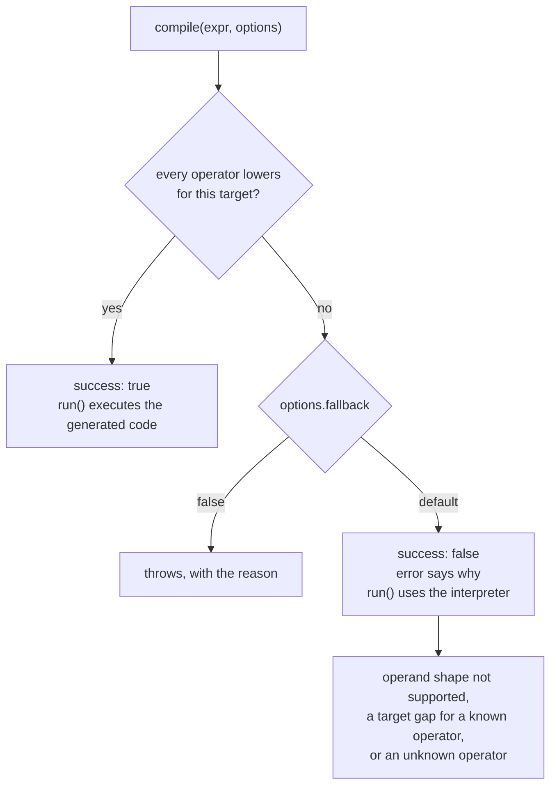

The three reasons are described under
[Why a compilation declined](#why-a-compilation-declined).

### The `run()` Contract: Shaped Inputs, Read-Only Results

On the `javascript` target, `run()` requires inputs of the shape the compiled
code reads, and treats its results as read-only. The runner does a constant
amount of work per binding on each call, one `typeof`:

- a `{re, im}` value bound to a real binding throws a `TypeError` that names
  the binding (the unsigned pole `~oo` is projected to `Infinity` instead);
- a plain number bound to a complex binding is lifted to `{re, im: 0}`;
- a string or a typed array (`Float64Array`, …) bound to a binding the code
  reads as an array is refused: the compiled code reads plain arrays only, so
  convert a typed array once on your side with `Array.from(typed)`.

The string refusal applies to a binding declared with a bare collection type
(`indexed_collection`, `collection`, `list`), with a collection of non-text
elements (`list<number>`), with `list<string>` or `list<character>`, or whose
collection type the engine inferred from its uses. Compiled code would read
the string as UTF-16 code units, not as characters, so the `TypeError` names
the binding and says so. A binding whose type admits a string (`string`,
`indexed_collection<character>`) is not refused. These entry checks are on by
default; `compile(expr, { entryChecks: false })` turns them off, for a caller
that validates its own inputs.

```javascript
ce.declare('S', 'indexed_collection');
const f = compile(ce.box(['Length', ['Drop', 'S', 1]]));
f.run({ S: 'abc' });
// ➔ throws TypeError: "S" (type `indexed_collection`) is compiled as a
//   JavaScript array, and compiled code does not accept a string for it: it
//   would read the string as UTF-16 code units, not as characters. Pass an
//   array, or declare the binding `string` to compile text.
```

A number bound to a binding declared as a list is not refused at entry, since
some lowerings accept a scalar. When the compiled body then fails because it
needed an array, the error names the binding and keeps the body's message as
its `cause`:

```javascript
ce.declare('S', 'list<number>');
compile(ce.box(['Sum', 'S'])).run({ S: 5 });
// ➔ throws TypeError: "S" (type `list<number>`) received a number: compiled
//   code reads such a binding as a JavaScript array, and the compiled body
//   failed (_.S.reduce is not a function). Pass an array.
```

Nothing else is checked, converted, or copied:

- a value of another type is not refused, and the result is undefined: it
  can differ from the value of the interpreter, and between targets. With
  `x` declared `real`, `x + 1` gives `2` for `x = true` and `"ab1"` for
  `x = "ab"`. See [Supplying Inputs](#supplying-inputs);
- the entries of a list input are never read. A `{re, im}` object, a string
  or a typed array at an entry of a list the code reads on the real lane
  computes with that value, as it would in plain JavaScript;
- a returned collection or `{re, im}` object is the value the code built. It
  may be a value the runner keeps for every later call (a hoisted constant
  list, a bound symbol value), so do not write to a result: copy it first if
  you need to change it.

The result convention is kept: a value whose imaginary part is exactly zero
comes back as a plain number, inside a collection too, and a collection is
copied only when such a cell has to be rewritten. That check is one `typeof`
per cell of a returned collection, with no allocation.

The interpreter is the route that validates: evaluate the expression with
`.evaluate()` or `.N()` to diagnose a wrong input shape.

```typescript
const fn = compile(expr, { to: 'javascript' }).run!;
const T = Array.from(float64Board); // convert a typed array once
const v = fn({ x, y, T });          // no per-call walk, copy or check of T
```

### Running Compiled Code Without the Engine

The entry point `@cortex-js/compute-engine/runtime` exports
`createJavaScriptRuntime(options)`: the helper bundle that `run()` uses, with
no engine behind it. Store a `javascript` `CompilationResult` and run it on a
page, in a worker or on a server with `runtime.load(result)`:

```typescript
import { compile } from '@cortex-js/compute-engine';
import { createJavaScriptRuntime } from '@cortex-js/compute-engine/runtime';

const result = compile(ce.parse('x^2 + 1'), { to: 'javascript' });

const runtime = createJavaScriptRuntime({});
const f = runtime.load(result);
f({ x: 3 });
// ➔ 10
```

`load()` reads the `code`, `entryPlan`, `reconstructionDigits` and
`runtimeVersion` fields of the result, and the `preambleOnce`,
`preamblePerCall` and `callCode` fields when the code has a preamble. It
evaluates the definitions that read nothing per call (a constant list, a
memo) once, and it applies the same input steps as `run()`: a number given
for a complex binding is lifted, `~oo` given for a real binding is projected
to `Infinity`, another `{re, im}` value given for a real binding is refused,
and a string or a typed array given for a binding read as an array is
refused. `load()` throws when `result.runtimeVersion` is not
`runtime.runtimeVersion`, or when the stored code has none.

To run the stored code on a worker pool, the runtime entry also exports
`createKernelPool`, and `runtime.loadBroadcastAsync(result, { workers })`
returns the `broadcastAsync()` of the result: the same options (`out`,
`deadline`, `signal`, `chunk`, `inline`) and the same result (`done`, `route`,
`reason`), with `willUsePool(cells)` and `shippable`. The pool workers run the
entry `@cortex-js/compute-engine/kernel-worker`, so a worker that loads
stored code does not import the engine bundle.

```typescript
import {
  createJavaScriptRuntime,
  createKernelPool,
} from '@cortex-js/compute-engine/runtime';

const workers = createKernelPool({
  create: () =>
    new Worker(
      new URL('@cortex-js/compute-engine/kernel-worker', import.meta.url),
      { type: 'module' }
    ),
});
const run = createJavaScriptRuntime().loadBroadcastAsync(stored, { workers });
const { out, done, route } = await run({ x: xs }, { deadline: 100 });
```

Store the whole result, for example as `JSON.stringify(result)`, not only
the fields that `load()` reads. `loadBroadcastAsync()` sends a batch to a
worker only when the stored result has `shippable: true`. A host that copies
some fields and leaves out `shippable` gets every batch on the calling
thread, with `reason: 'not-shippable'` and no error. `workers` must be a pool
from `createKernelPool()`: another value throws a `TypeError`. The stored
fields are copied when the code is loaded, so load it again after a change.

The runtime exposes `load`, `frame`, `setFrame`, `iterationLimit`, `deadline`
and `runtimeVersion`. The other helpers are internal and can change in any
release. The options give the runtime the state it cannot read from an engine:

- `random`: the source of random draws outside a `WithRandomSeed` frame, and
  of the Monte-Carlo samples of the integrals. `null` denies draws; a draw
  then throws an error whose `name` is `CapabilityDeniedError` (test `e.name`,
  not `instanceof`: the class differs in each bundle).
- `frame`, or `runtime.setFrame()`: the frame of an interpreted
  `WithRandomSeed` that the code is called from (`{ seedLo, seedHi, next }` or
  `{ seed, next }`). After the call, `runtime.frame.next` is the advanced
  counter.
- `iterationLimit`: the cap on the lazy-stream walks (default 1024; `0` or
  less means no limit, as for `ce.iterationLimit`).
- `deadline`: an optional time after which the shuffle and choice loops throw.

A seeded program gives the same values interpreted, with `run()` and from the
stored code. Functions passed in the `functions` or `imports` compile options
are copied into the code as source, so a closure loses its enclosing scope,
and a function given by name must exist where the code runs.

### Evaluating Many Points at Once: `broadcast()`

A plotter samples a function once per pixel column, or once per cell of an
implicit plot, and `run()` converts its argument object and wraps its result
on every call. `broadcast(inputs, options)` takes the inputs of every cell at
once and writes every result into one `Float64Array`: the conversions run once
per batch, the compiled body once per cell. Measured 2026-10-20: 20 % faster
than `run()` per cell on the main thread, and the batch is what a worker
thread receives (below). It is present on a `javascript` result compiled from
an expression (`calling: 'expression'`) and on an `interval-js` result
compiled from an expression.

```javascript
const f = compile(ce.parse('\\sin(x)\\cos(y) + a'));

const xs = new Float64Array([0, 0.5, 1]);
const ys = new Float64Array([0, 1]);

// Six cells: the two arrays are the axes of a grid, `x` varying fastest.
f.broadcast({ x: xs, y: ys, a: 0.5 }, { layout: 'grid' });
// ➔ Float64Array [0.5, 0.979…, 1.341…, 0.5, 0.759…, 0.954…]

// Three cells: every array holds one value per cell.
f.broadcast({ x: xs, y: new Float64Array([1, 1, 1]), a: 0.5 });
```

**Inputs.** `inputs` maps each free variable to a `Float64Array` or to a
number. A number is the same value for every cell (a document variable). With
the default layout, `'cells'`, every array holds one value per cell (for
`interval-js`, a `lo, hi` pair per cell) and all have the same cell count.
With `layout: 'grid'` the arrays are the axes of a regular grid, in key order
of `inputs`, the first varying fastest; the cell count is the product of their
lengths and nothing is expanded on the caller's side. `options.out` is a
caller-owned output array, filled and returned instead of a new one; it must
hold at least `outputs` values per cell (below).

**Index axes** (`grid` layout only). A variable that `options.indexes` names
is an axis whose value at each cell is the cell's position along that axis.
Its input is the axis length `n`, a non-negative integer, and the variable
takes the values `0, 1, …, n − 1`. The axis has its place in key order of
`inputs`, as a column `0 … n − 1` would, but no column is built, sent to a
worker or read. A kernel that reads a shared list by cell position declares
the index with a type such as `integer<0..>`; the values that the engine gives
are then in range by construction:

```javascript
ce.declare('F', 'list<number>');
ce.declare('m', 'integer<0..>');
ce.declare('n', 'integer<0..>');
const g = compile(ce.parse('F_{m + 4n + 1}'));

// 3 × 2 cells, `m` varying fastest: the same values as the columns
// m: [0, 1, 2] and n: [0, 1].
const F = [10, 11, 12, 13, 14, 15, 16, 17];
g.broadcast({ m: 3, n: 2, F }, { layout: 'grid', indexes: ['m', 'n'] });
// ➔ Float64Array [10, 11, 12, 14, 15, 16]
```

For `interval-js`, an index axis gives the point interval of each index. A
name in `indexes` must be a key of `inputs` and must not be a shared input;
with the `cells` layout the option throws.

**Shared inputs** (`javascript` only). An input can also be bound once for the
whole batch and read by index in the expression, for example the field values
of a grid that each cell reads around its own index:

```javascript
ce.declare('F', 'list<number>');
ce.declare('i', 'integer');
const f = compile(ce.parse('F_{i+1}'));

f.broadcast({ i: new Float64Array([0, 1, 2]), F: [1, 2, 3, 4] });
// ➔ Float64Array [1, 2, 3]
```

A variable is shared when the compiled code reads it as a list (its declared
type is a list type), or when `options.shared` names it: `{ shared: ['G'] }`
is the way to share a variable that has no declared type. Each name in
`shared` must be a key of `inputs`. A shared input is a plain array of numbers
or a `Float64Array`. A shared input is not a column of the `cells` layout and
not an axis of the `grid` layout: it does not count toward the cells. A plain
array for any other variable throws.

**Batch body and declared types.** When the compiled code reads a shared list
declared as a list of numbers at a scalar index (`F_{i+1}` with
`F: list<number>`) and the caller compiled with `broadcast: true`, the result
carries a second body for batches. The batch body is a second compilation of
the same size as the first (it adds about 45 % to the compile time of such a
kernel, measured 2026-10-25), so it is built only on request: a caller that
only calls `run()` keeps the default, `false`, and a caller that broadcasts a
kernel over many cells asks for it. Without it, `broadcast()`,
`broadcastAsync()` and a kernel worker run the ordinary body for every cell,
with the same values. The batch
checks each such list once (a `Float64Array`, or a plain array whose elements
are all numbers; a plain array that passed is not checked again while its
length is the same), reads a `Float64Array` in place, and reads the list
directly in each cell. A declared type of an input is a promise of the host,
and the batch body trusts it: when the index type proves an integer of at least
1 (for example `i + 1` with `i` declared `integer<0..>`), the read has no
run-time test, and a read past the end gives `NaN`, as `At` does. When an input
breaks its declared type (a fractional `i` for `integer<0..>`, a string in a
list declared `list<number>` after it was checked), the result is not defined.
When a list fails the check, the whole batch runs the ordinary body. Declare
the index with its range: a kernel that reads `F_{i+1}` with `i: integer<0..>`
runs about 1.7 times as fast as with `i: integer` (measured 2026-10-24, 250 000 cells, two reads per cell).

**Output of a `javascript` result.** One value per cell by default. A boolean
is `1` or `0`; a complex value with a zero imaginary part is its real part; a
cell whose evaluation throws, or gives any other non-number (a complex value
with a non-zero imaginary part, a list), is `NaN`. Cell for cell, the value is
the one `run()` gives: the same compiled body runs with the same conversions.
A length mismatch throws before the loop. A variable left out, or a value
outside its declared type (a boolean for a variable declared `real`), is not
refused: the result is undefined. With `a` left out, the example above gives
`NaN` in every cell.

**Several outputs per cell.** An expression whose type is a tuple of two or
more elements that can be numbers writes that many values per cell into the
same output array. An element typed `unknown` counts: `(x, y)` with undeclared
`x` and `y` writes two values per cell. An element that cannot be a number,
such as a string, gives one value per cell. With
`m` values per cell, cell `c` is at `[m·c, m·c + m)`. The result reports the
inferred `m` as `broadcastOutputs` (absent when it is 1), and
`options.outputs` (a positive integer) overrides it.

```javascript
const g = compile(ce.parse('(i, 2i)'));
g.broadcastOutputs;                                 // ➔ 2
g.broadcast({ i: new Float64Array([1, 2, 3]) });
// ➔ Float64Array [1, 2,  2, 4,  3, 6]
```

With more than one value per cell, the elements of an array answer go through
the conversions above one by one; an element past the end of the array is
`NaN`, and an answer that is not an array, or a cell that throws, is `NaN` in
every slot. With one value per cell (`outputs: 1`), an array answer is `NaN`,
as before. `shared` and `outputs` are `javascript` options: an `interval-js`
result throws a `TypeError` for either.

**Output of an `interval-js` result.** A `lo, hi, kind` triple per cell, at
offsets `3·i`, `3·i + 1` and `3·i + 2`. The kinds are the `INTERVAL_KIND`
codes, exported from the main entry and from
`@cortex-js/compute-engine/interval`:

| Code | Meaning | `lo`, `hi` |
|------|---------|------------|
| `interval` | an ordinary enclosure; a half-infinite bound is ordinary | the enclosure |
| `empty` | no value on the input (`sqrt([-2, -1])`) | NaN |
| `entire` | every real; nothing can be said | NaN |
| `singularPole` | the input crosses a pole (`1/x` on `[-1, 1]`) | NaN |
| `singularJump` | the input crosses a jump (`floor`) | the values on both sides |
| `partial` | part of the input is outside the domain (`sqrt([-1, 4])`) | the values inside |
| `boolTrue`, `boolFalse`, `boolMaybe` | a compiled comparison or logical expression | NaN |
| `error` | this cell threw, or gave bounds that are not numbers or are reversed | NaN |

A cell never rejects the batch. The `domainClipped` side of a `partial`
result and the `at` and `continuity` of a `singular` result are not reported.

```javascript
const g = compile(ce.parse('\\sqrt{x}'), { to: 'interval-js' });
g.broadcast({ x: new Float64Array([1, 4, -2, -1, -1, 4]) });
// ➔ [1, 2, INTERVAL_KIND.interval,  NaN, NaN, INTERVAL_KIND.empty,  0, 2, INTERVAL_KIND.partial]
```

### Worker Threads: `broadcastAsync()` and the Kernel Pool

`broadcastAsync(inputs, options)` takes the same inputs and `out` as
`broadcast()`, plus a `signal` (an `AbortSignal`), a `deadline` (milliseconds
of wall clock for the whole batch), a `chunk` (cells per task) and `inline`
(see below). It resolves to `{ out, done, route, reason }`, where `done` is
the number of leading cells that are valid: every cell, or fewer when the
deadline or the signal stopped the batch; the cells after `done` are
untouched. `route` is `'pool'` when workers ran the batch and
`'calling-thread'` when it ran (or, with `inline: false`, would have run) on
the calling thread; `reason` says why the pool did not take it:
`'no-pool'` (`ce.workers` is not set), `'pool-unusable'` (the workers hold
another runtime version), `'not-shippable'`, `'below-threshold'` or
`'pool-declined'` (a worker failed during the batch).

`broadcastAsync()` takes `shared` and `outputs` as `broadcast()` does; `done`
is still a count of cells, not of values. On a pool, the shared inputs go to
each worker once per call, with the first slice of the call that the worker
receives, and the worker keeps them until the call ends; each later slice
carries only its own cells. A `Float64Array` shared input is copied for each
worker and transferred, a plain array is cloned. The default stride travels
with the stored result (`broadcastOutputs`), so a worker and
`createJavaScriptRuntime().loadBroadcast(result)` lay out the cells the same
way, and the runtime reads the shared inputs from the stored entry plan.

Without a worker pool it runs the batch inline, in slices between yields to
the event loop, so a deadline still applies and a long batch does not block a
frame. The first slice also runs after a yield: no cell is computed before
`broadcastAsync()` returns. With a pool it splits the cells into one slice per worker (or `chunk`
cells per slice), ships them, and writes each returned slice into `out` as it
arrives. A batch under a threshold runs inline in any case: the pool measures
the cells per millisecond of each compiled function from its inline batches,
and ships a batch only when its serial time would exceed about 10 ms (before
the first measurement, 20 000 cells). Measured 2026-10-20 on an 18-core
machine: an implicit plot of 512×512 interval cells takes 175 ms inline and 34
ms on 8 workers; a 2000-column 1D plot takes under 2 ms and never ships.

A host that must never compute on the calling thread (a live plot that
repaints on every frame) has three tools:

- `inline: false` refuses the calling thread: when the pool would not take the
  batch, `broadcastAsync()` resolves at once with `done: 0`, computes nothing,
  and leaves the threshold measurement unchanged. When a worker fails during
  the batch, the cells the workers finished are kept and the rest is not
  computed.
- `result.willUsePool(cells)` says in advance whether a batch of that many
  cells would go to the pool, with the current `ce.workers` and threshold (for
  an `interval-js` result, `cells` counts intervals).
- `result.shippable` says whether the compiled result can run on a worker at
  all. It is `false` for code that draws random numbers, for a `vars` or
  `functions` entry that names a host global, and for a caller preamble; such
  a result always runs on the calling thread.

The engine creates no worker on its own. The host builds the pool and gives it
to one or more engines:

```javascript
import { ComputeEngine, createKernelPool } from '@cortex-js/compute-engine';

const pool = createKernelPool({
  // The worker file ships as one self-contained ES module,
  // `dist/esm-min/kernel-worker.js` (`@cortex-js/compute-engine/kernel-worker`).
  // Copy it next to your own files when your bundler does not resolve the
  // package at run time, and start it from its URL.
  create: () => new Worker(new URL('./kernel-worker.js', import.meta.url), { type: 'module' }),
  size: 4,        // default: one less than the hardware concurrency, at most 8
  prewarm: true,  // create the workers on idle time now, not on the first batch
});

const ce = new ComputeEngine();
ce.workers = pool;

const f = compile(ce.parse('\\sin(x)\\cos(y) + x^2 - y^2 - 0.3'), { to: 'interval-js' });
const { out, done } = await f.broadcastAsync(
  { x: xAxis, y: yAxis },
  { layout: 'grid', deadline: 30 }
);
```

In Node the factory returns a `worker_threads` `Worker` on the same file.

**An engine inside a worker.** When the engine itself runs in a dedicated
worker (to keep the page responsive), the code in that worker makes the pool,
with a factory that starts workers of its own (nested workers), and sets
`ce.workers` as above. Nothing comes from the page: the pool reads
`navigator.hardwareConcurrency`, which a worker has, and uses
`requestIdleCallback` for `prewarm` only when it exists. The worker URL must
be one that the worker can start, for example
`new URL('./kernel-worker.js', import.meta.url)` in a module worker. This was
checked on 2026-10-24 with a module worker that runs a batch and a `FindFit`
scan on its own pool of two nested module workers: same values as on one
thread, in Chromium 156, Firefox 157 and WebKit 27.2 (Playwright builds), and
with Node `worker_threads`. A pool made on the page cannot serve an engine in
a worker: the two threads would need a protocol between them, which does not
exist.

A worker reports the versions of the runtimes it holds; a stored result compiled
by another release is refused by the worker, and its slices then run inline.
`pool.dispose()` terminates the workers; a later batch creates them again. A
Content Security Policy must allow the worker script (`worker-src`) and
`new Function` in it (`'unsafe-eval'`): the worker rebuilds each function from
its text, as `createJavaScriptRuntime().load()` does. `SharedArrayBuffer` is
not needed; the arrays are transferred.

The two standalone runtimes have the same batch forms:
`createJavaScriptRuntime().loadBroadcast(result)` and
`createIntervalRuntime().loadBroadcast(result)` (from
`@cortex-js/compute-engine/interval`) rebuild a stored result as a
`broadcast()` function, with no engine behind it. An `interval-js` result
carries `runtimeVersion`, `preambleOnce` and `preamblePerCall` for them, as a
`javascript` result does.

### Parallel Loops on Worker Threads: `runAsync()`

A `parallel for` loop (`ParallelLoop` in MathJSON) says that its passes are
independent. `run()` still runs them in order, on the calling thread.
`runAsync(inputs, options)` runs the same program and sends each
`parallel for` that can run on the pool to the workers of `ce.workers`: each
worker gets one range of consecutive passes and adds the terms of its passes
to zero, then the calling thread adds these sums to the accumulators, in the
order of the ranges. The statements outside these loops run on the calling
thread. `runAsync()` is on a `javascript` result called with an object of
variables (the default `calling: 'expression'`).

```javascript
import { ComputeEngine, compile, createKernelPool } from '@cortex-js/compute-engine';

const ce = new ComputeEngine();
ce.workers = createKernelPool({
  create: () => new Worker(new URL('./kernel-worker.js', import.meta.url), { type: 'module' }),
  size: 3,
});
ce.declare('H', 'list<integer>');
ce.declare('n', 'integer');

// let L = H
// parallel for k in 1..n { L[k % 3 + 1] += 1 }
// L
const count = compile(
  ce.box([
    'Block',
    ['Declare', 'L', "'unknown'", 'H'],
    [
      'ParallelLoop',
      ['AddTo', ['At', 'L', ['Add', ['Mod', 'k', 3], 1]], 1],
      ['Element', 'k', ['Range', 1, 'n']],
    ],
    'L',
  ])
);

count.willParallelize(900_000);
// ➔ true

const L = await count.runAsync(
  { H: [0, 0, 0], n: 900_000 },
  { onLoop: (report) => console.log(report) }
);
// onLoop: { passes: 900000, route: 'pool' }
// L ➔ [300000, 300000, 300000], the value of count.run(…)
```

The promise resolves to the value of `run(inputs)`, except for the order of
the additions (below). The inputs are checked and the value converted as
`run()` does. An error of the program rejects the promise; `runAsync()` never
throws. The input list `H` is not changed. The calling thread is free only
while the program waits for the workers, and the host must not change the
values of `inputs` until the promise settles.

**The options.**

- `signal`: an `AbortSignal`. A signal that is already aborted rejects the
  promise with `signal.reason` before any statement runs. An abort while the
  program waits for the workers rejects it with `signal.reason`; the workers
  that still run a range are terminated and replaced after the grace period of
  the pool. An abort while the calling thread runs statements is seen at the
  next loop that can run on the pool.
- `minPasses`: the smallest count of passes that goes to the pool, a positive
  integer. Default: 20 000. With `n: 1000`, the loop above runs on the calling
  thread and `onLoop` receives
  `{ passes: 1000, route: 'calling-thread', reason: 'below-threshold' }`;
  with `minPasses: 100`, it runs on the pool.
- `onLoop(report)`: called once for each run of a loop that can run on the
  pool, with `{ passes, route, reason }`. `route` is `'pool'` or
  `'calling-thread'`; `reason` says why the pool did not take the loop:
  `'no-pool'` (`ce.workers` is not set), `'pool-unusable'` (the workers hold
  another runtime version), `'below-threshold'`, `'too-large'` (the private
  lists of all the workers would hold more than 16 million numbers together)
  or `'pool-declined'` (a worker did not complete its range, and the calling
  thread ran it again).

`result.willParallelize(passes?)` is `true` when the program has a loop that
can run on the pool (also inside a function that it calls), `ce.workers` is a
usable pool, and `passes`, when it is given, is at least 20 000. It does not
know the range of a loop and does not read `minPasses`:
`count.willParallelize(1000)` is `false`, and without a pool
`count.willParallelize()` is `false`.

**When a loop runs in order.** A loop runs on the calling thread, with the
code of `run()`, and does not call `onLoop`, unless:

- its domain is a range (`1..n`), not a list;
- each accumulator is a local variable of the function or block that holds
  the loop, a number (`s += e`) or a list of numbers with one index
  (`L[i] += e`), and the loop reads it nowhere else;
- the body writes no other outer variable and does not leave the loop
  (`break`, `return`);
- the body reads only numbers, booleans, strings and lists or tuples of these
  from outside, calls no function value, makes no random draw, and calls no
  function of the `functions` or `operators` option;
- the program is compiled in the default mode, with no `iterationBudget`;
- the loop is a statement of the program or of a user function (also inside
  an `if`, a `for` or a `while`), and the program calls that function as a
  statement, as the value of a declaration or an assignment, or as its last
  value. A call in an operand (`total(H, 4) + 1`), an argument
  (`max(total(H, 4), 1)`), a callback (`map`) or `WithRandomSeed` runs the
  loop in order. Write `let t = total(H, 4)`, then `t + 1`. When the program
  uses a function in such a position, the loops of that function run in
  order at all its calls.

The rules, with an example for each, are in `docs/COMPILATION-MODEL.md` of the
repository ("The worker pool and `parallel for`: `runAsync()`").

**The values.** The pool adds the terms of each range to zero, then adds the
sums in the order of the ranges, where `run()` adds each term in the order of
the passes. An accumulator of integers whose value and partial sums stay
within ±2^53 has the value of `run()`. An accumulator of real numbers can
differ in the last bits, and the difference depends on the size of the pool:
the sum of `1/k` for `k` in `1..1000000` gave `14.392726722864989` with
`run()` and `14.392726722865703` with `runAsync()` on 3 workers. An element of
a list accumulator that holds `-0` keeps `-0` when the sum of each range is
exactly 0, where `run()` gives `+0` if a pass adds `+0` to it.

**Errors.** When a worker does not complete its range (an error of a pass, a
worker that fails), the calling thread runs that range again, and `onLoop`
receives `reason: 'pool-declined'`. A range that fails there too rejects the
promise with the error that `run()` throws. Each worker uses the engine's
`iterationLimit`.

### Limiting Loops: `iterationBudget`

A compiled `Loop` has no time check, so a loop that does not end stops the page
that runs it, also under `ce.withTimeLimit()`. When you run a document that you
did not write, set a limit when you compile it:

```js
const expr = ce.box(['Block', ['Declare', 'k', "'unknown'", 0],
  ['Loop', ['Assign', 'k', ['Add', 'k', 1]]], 'k']);
const { run } = compile(expr, { iterationBudget: 1e6 });
run({}); // throws a CancellationError, cause 'iteration-limit-exceeded'
```

Each iteration of a `Loop` adds one to one total for a call of the compiled
code, including nested loops and loops in the bodies of user functions. The next
call starts at 0. The limit is a count and not a time, so it stops at the same
pass on every machine. To get a time limit, measure the cost of a pass.

- `javascript` and `interval-js` throw. Stored code that you run with
  `createJavaScriptRuntime()` or `createIntervalRuntime()` keeps the limit.
- `broadcast()` gives `NaN` for a cell over the limit, as for any error of a
  cell. Each cell has its own count, so a batch costs up to cells × budget.
- `glsl` cannot throw: over the limit, the loops of the shader stop and the
  value is `NaN`. On this target the limit also applies to `Sum` and
  `Product`, and it is 10,000 passes when the option is not set (see "What
  the GLSL Target Compiles: `canCompile()`").
- A `Sum` or `Product` over the budget gives `NaN` and does not throw. On
  `interval-js` it gives the `entire` interval.

Without the option, the compiled code has no check.

### Constant Folding

A **pure** subexpression with no free variables is evaluated at compile time
and emitted as a literal instead of being lowered structurally — on every
target:

```javascript
compile(ce.parse("\\mathrm{Sum}(\\mathrm{Take}(\\mathrm{Map}(\\_ \\mapsto \\_^2, 1..20), 10))")).code
// ➔ "385"

compile(ce.parse("x + \\mathrm{Sum}(\\mathrm{Map}(\\_ \\mapsto \\_^2, 1..5))")).code
// ➔ "_.x + 55"
```

Numbers, booleans, and **constant collections** fold. A constant collection
becomes a literal list, which matters most when the collection is constant but
its consumer is not:

```javascript
const r = compile(ce.box(['At', ['Map', ['Function', ['Square', 'y'], 'y'],
                                 ['Range', 1, 6]], 'k']));
r.code         // ➔ "_SYS.at(_lit_1, _.k)"
r.preambleOnce // ➔ "const _lit_1 = [1, 4, 9, 16, 25, 36];\n"
```

The index `k` is a run-time input, so the expression as a whole cannot fold —
but its base is baked once at compile time instead of being rebuilt and
mapped over on every call. The baked list is a preamble local that `run()`
evaluates once per compiled function (it is in `preamble`, and in
`preambleOnce` for a runtime that splits the two), so a caller that runs
`code` itself must include the preamble, as for a bound symbol value
(`_val_*`) or a user function (`_fn_*`). A written list literal of three or
more numbers (`[1, 2, 3]`, a matrix of them) is hoisted the same way. Collection folding is bounded: it applies to a
**finite, indexed** collection (a `Set` has no defined element order, so it
never folds) of at most 50 **numeric** elements. A longer collection, or one
holding strings, tuples or nested collections, compiles structurally.

Folding declines — and the subtree compiles exactly as before — whenever any
of the following holds:

- the subtree is **impure** (`Random(…)` and friends keep drawing at run
  time);
- it mentions an **unknown**, a **`vars`-mapped input** (even one with an
  engine value — `vars` pins it live), or a name bound by an enclosing lambda
  or loop;
- it mentions an operator whose emission you overrode with the `functions` or
  `operators` options (folding would evaluate the engine's definition, not
  yours);
- it contains a `Sum` or `Product` over a **non-finite bound** (`Σ i,
  i=1..∞`): for a divergent series the interpreter's numeric evaluation
  silently returns an iteration-limit-truncated partial sum, and folding
  would bake that wrong number as a constant — such expressions keep their
  fail-closed structural behavior (a *bounded* infinite pipeline like
  `Sum(Take(Map(_ ↦ _^2, 1..∞), 10))` still folds);
- it is estimated to cost too much to evaluate at compile time, or exceeds
  the engine's collection-size cap. The estimate is **deterministic** — it
  reads the expression and nothing else, so the same input always compiles
  to the same output, and folded code is safe to pin in a test. Constructs
  that multiply work are priced by their counts: a `Sum` or `Product` by its
  number of iterations, a `Map` or `Filter` by the size of its source. An
  expression whose count cannot be determined statically is not folded —
  though a bound supplied by a *consumer* still counts, which is why
  `Sum(Take(Map(f, 1..∞), 10))` folds while `Sum(Map(f, 1..∞))` does not;
- the compilation records a capture set (the `symbolDeps` option, used by the
  engine's implicit-compilation cache): folding evaluates through engine
  state transitively and would under-report the dependencies the cache is
  keyed on, so such a compilation never folds.

The folded value is the **interpreter's** (`.N()`), so a folded constant can
differ in the last ulp from what the structural code would have computed in a
different operation order — compiled output tracks `evaluate()` by design
(`sin(π/6)` compiles to `0.5`, not `Math.sin(Math.PI / 6)`, which is
`0.49999999999999994`).

**To disable folding** — for example to inspect the structural lowering of a
constant expression — pass `constantFold: false`:

```javascript
compile(expr, { constantFold: false });
```

The interval-arithmetic target (`interval-js`) never constant-folds: a folded
point value would discard the outward-rounded enclosure that target exists to
compute.

### Why a compilation declined

When `success` is `false`, `CompilationResult.error` carries the reason (the
same text the `fallback: false` path throws). The message identifies which of
three things happened:

| Message shape                                                | Meaning                                                                                   |
| :----------------------------------------------------------- | :---------------------------------------------------------------------------------------- |
| `X: cannot compile — …` naming an operand or a component      | The head lowers, but not for these operand shapes (e.g. a collection-valued point component) |
| `X: cannot compile — the operator is known … no lowering`     | A target gap: the engine knows `X`, this target has no codegen for it                      |
| ``Unknown operator `X` ``                                     | No operator definition for `X` at all — a typo, or a symbol never declared as a function   |

`CompilationResult.unsupported` lists the same heads declaratively, so a caller
can branch on the condition without parsing the message. The list is empty when
`success` is `true`. A name that the expression binds (a local function, a
parameter of a function literal, an index) is never in the list: when a call of
such a name declines, only the message names it.

### Inputs With No Type and Values With No Settled Shape

Program and Block locals keep the contracts established during preparation.
Runtime writes cannot give an unknown local, or an empty unannotated list's
elements, a known static type. Supply annotations when compilation needs that
information. Declarations without an initializer conservatively decline
compilation, including a declaration followed by a straight-line initialization;
that form remains valid for interpreted execution.

Compiled code settles the shape of every value (a number, a complex number, a
string, a list, a point or a matrix) at compile time, and does not test it at
run time. Two declines follow from this rule. Both occur on every target, and
with the default fallback the interpreter computes the value.

**An input with no type declines**, with `diagnostic.code` `'untyped-input'`.
An input is a free symbol of the compiled code. When its type is `unknown` or
`any`, `unsupported` holds its name:

```javascript
const r = compile(ce.box(['If', ['Less', 'M', 3], 'M', 0]));
r.success          // ➔ false
r.unsupported      // ➔ ['M']
r.run({ M: [1, 5] }) // ➔ [1, 0], from the interpreter
```

Declare the input (`ce.declare('M', 'real')`). When the host can pass both
shapes, declare a union such as `real | list<real>`: a union compiles. A
parameter of a function is not an input, so `t ↦ 2t` compiles.

An input with no declared type has the type that the compiled expression
requires of it: in `x + 1`, `x` is a `number`, and `freeSymbolTypes` reports
it. A type that only another expression requires is not used, because
parsing an expression declares nothing. Declare the inputs, or call
`ce.infer()` with the expressions that use them, before you compile:

```javascript
const a = ce.parse('x + 1');
const b = ce.parse('x > 1');
compile(b).success;   // ➔ false: `x > 1` requires no type of `x`
ce.infer([a, b]);     // declares x: number
compile(b).success;   // ➔ true
```

The result of an operation such as `subs()` does not carry the types that the
operation required of a symbol that you made before it. Declare such a
symbol before you compile the result:

```javascript
const q = ce.symbol('q0');
const r = ce.parse('a \\cos(x)').subs({ a: q });
compile(r).success;   // ➔ false: `q0` has no type
ce.declare('q0', 'real');
compile(r).success;   // ➔ true
```

A name of the library that an expression reads as a variable (`N` in
`N + 1`) has no type until it is declared: `compile(ce.parse('N + 1'))`
declines, and compiles after `ce.declare('N', 'real')`.

**A value with no settled shape declines**, with `diagnostic.code`
`'unsettled-shape'`, and `unsupported` holds the sub-expression:

- A conditional whose branches have different shapes. With `x: real`,
  `If(x > 0, [1, 2], 3)` declines.
- A name that gets values of different shapes in one scope. A local has the
  type of its first value, and an assignment of a value of another type is the
  static error `assignment-type-mismatch`: `Block(p ≔ 0; p ≔ [1, 2]; p)` is
  invalid, so it declines with `'compile-error'`. The shapes can differ only
  when the declared type admits both, and a declared `any` does:
  `Block(Declare(p, "any", 0), Assign(p, [1, 2]), p)` declines. The order of
  the assignments is not examined, and the length of a list is not part of its
  shape: `Block(p ≔ [1, 2]; p ≔ [1, 2, 3]; p)` compiles. A declared type that
  is a union of shapes (`real | list<real>`) compiles with one body per
  member.
- Arithmetic over a symbol declared `any` or `value`, on the `javascript` and
  `interval-js` targets. Such a symbol can hold a number or a list.
  `(t: any) ↦ 2t` declines, and `unsupported` holds `t`. With the fallback, the
  interpreter gives `[2, 4]` for `[1, 2]`. Declare the shape, such as `real` or
  `list<real>`, to compile it.
- A function literal that assigns a name of an enclosing scope (a callback, a
  stored function, a user function that the code calls).
  `Block(p ≔ 0; Filter(L, u ↦ Block(p ≔ 5, u > 1)); p)` declines. The root of
  the compilation, and a function that `Apply` applies where it is written to
  scalar arguments, still compile.
- A list whose element type is a union of shapes. With
  `CS: list<real | tuple<real, real>>` and `f := t ↦ 2t`, `Map(f, CS)`
  declines, and `unsupported` holds `CS`. With the fallback, the interpreter
  gives `[2, [6, 8]]` for `CS = [1, [3, 4]]`.
- An integer power of a list whose type admits both a matrix and a list of
  points (a bare `list`, `list<unknown>`, `list<any>`), and the product of
  such a list with another list. Compiled code holds a point as an array, so
  `[[1, 2], [3, -4]]` can be a matrix, whose square is the matrix power, or
  two points, whose square is the square of each coordinate. With
  `p: list`, `p^2` declines, and `unsupported` holds `p`. With the fallback,
  the interpreter gives `[[7, -6], [-9, 22]]` for `p = [[1, 2], [3, -4]]`.
  Declare `p` as `list<list<real>>` (a matrix) or `list<tuple<real, real>>`
  (points) to compile it. `p^{0.5}` and `3p` compile.
- A node whose code a `compile` handler of its definition writes, when the
  static type of the node admits values of different shapes and code that no
  handler wrote reads its value. With `x: real` and `HostPair` declared with
  the signature `(real) -> real | list<real>` and a `compile` handler that
  returns a list, `HostPair(x)` compiles and gives `[3, 3]` for `x = 3`, but
  `HostPair(x) + 1` declines. The node compiles as the value of the whole
  expression, as an operand of another node whose code a handler writes, or
  when its type has one shape (a `missing` member is not a shape). To compile
  the consumer, give the node a type of one shape, or write the code of the
  consumer with a handler too.

**A call selects the variant of the function from the static type of its
argument.** With `f := t ↦ 2t`, `f(L)` with `L: list<real>` compiles to a map
of the scalar variant over the list, and `f(p)` with `p: tuple<real, real>`
calls a variant compiled for a point. No test of the shape runs. An input
declared with a union of shapes gets one test, where it is bound, and one
body per member. With `y: real | tuple<real, real>`, `f(y)` compiles to
`Array.isArray(y) ? f_point(y) : f(y)`, and gives `6` for `y = 3` and
`[2, 4]` for `y = [1, 2]`. To avoid the test, declare one shape, or compile
one function for each shape.

### Which Definitions the Compiled Code Reads

A compilation reads each name from the scope the expression was boxed in,
as `evaluate()` does. A declaration of the same name in a scope that is
pushed later does not change the compiled code:

```js
ce.declare("x", "real");
ce.declare("a", "real");
ce.assign("a", 10);
const expr = ce.parse("x + a");

ce.pushScope();
ce.declare("a", "real");
ce.assign("a", 1);

compile(expr).run({ x: 2 });
// ➔ 12

compile(ce.rebind(expr)).run({ x: 2 });
// ➔ 3: `rebind()` gives the expression bound in the current scope
```

The same holds for a function that the expression calls: its body reads
the names of the scope the function was defined in.

An expression built from parts that were boxed in scopes that define a name
differently has no single scope to compile in. Its compilation declines,
with the name in `binding`, and the result falls back to the interpreter:

```js
const mixed = ce.function("Add", [expr, ce.parse("a")]);
const result = compile(mixed);
result.success;
// ➔ false
result.run({ x: 2 });
// ➔ 13: the interpreter reads 10 for the first `a` and 1 for the second
```

Box the expression in one scope, or bind it again with `ce.rebind()`.

#### Naming the Inputs: the `symbolic` Option

A symbol that holds a value is folded into the compiled code. To keep it as
an input, name it in the `symbolic` option. The name is then an input
wherever the compilation reads it, also inside the functions that the
expression calls, and its value is supplied at each run:

```js
ce.declare("x", "real");
ce.declare("a", "real");
ce.assign("a", 4);
ce.parse("f(x) := |a| x").evaluate();
const expr = ce.parse("f(x) + a");

compile(expr).run({ x: 2 });
// ➔ 12: `a` is folded as 4

compile(expr, { symbolic: ["a"] }).run({ x: 2, a: -3 });
// ➔ 3: `a` is an input, in the expression and in the body of `f`
```

The symbol needs a declared type (`ce.declare("a", "real")`). A symbol
whose type was only inferred from an assigned value makes the compilation
decline. Use `vars` when the input must have a given spelling in the
emitted code.

#### Giving the Types of the Inputs: the `inputs` Option

The `inputs` option names the inputs and gives their types at the call. No
declaration is needed, and nothing is declared after the call:

```js
ce.parse("g(t) := t x").evaluate();
const expr = ce.parse("g(2) + x");

compile(expr, { inputs: { x: "real" } }).run({ x: 3 });
// ➔ 9: `x` is an input in the expression and in the body of `g`
```

The given type wins over a declaration and over a stored value, for that
compilation only:

```js
ce.declare("x", "real");
ce.assign("n", ce.parse("[1, 2, 3]"));
const row = ce.parse("n x");

compile(row, { inputs: { n: "real" } }).run({ n: 2, x: 5 });
// ➔ 10: `n` is one number here, not the stored list
```

The expression keeps the canonical form it was boxed with, so give a type
that is the type the name had when the expression was boxed, or a subtype of
it (`list<real>` for a list, a range for `real`). A rewrite that was right
for the type at boxing is not undone by a wider type:

```js
ce.declare("x", "real");
ce.declare("k", "integer");
const power = ce.parse("(x^2)^k");
power.json;
// ➔ ["Power", "x", ["Multiply", 2, "k"]]: right for an integer `k`

compile(power, { inputs: { k: "real" } }).run({ x: -3, k: 0.5 });
// ➔ -3, and (x^2)^k is 3: the rewrite is wrong for k = 0.5
```

For a wider type, parse the expression in a scope that declares the name
with that type.

A name of `inputs` that a function of the expression reads as a constant is
not an input: the compilation declines, and `diagnostic.binding` is the name.
Compile again without the name to read the constant.

### Supplying Inputs

The compiled code assumes that each input holds a value of its declared type,
and does not test it. So:

- **Declare the type and the shape of each input that you will pass**:
  `ce.declare("x", "real")`, `ce.declare("L", "list<real>")`,
  `ce.declare("P", "tuple<real, real>")`. An input with no type declines.
  An undeclared input has only the type that the compiled expression
  requires of it; `ce.infer()` declares the types that several expressions
  require.
- **When an input can have two shapes**, compile one function for each
  shape, or declare the union (`real | tuple<real, real>`). One function for
  each shape has no run-time test. The union costs one test on each call,
  where the input is bound.
- **Supply every input** that `CompilationResult.freeSymbols` lists, with a
  value of its declared type. `freeSymbolTypes` gives the type of each one.
  The compiled code does not test for an input that is left out, so when a
  value can be missing, test it before the call.
- **A value outside its type gives an undefined result.** The result can
  differ from the value of the interpreter, and it can differ between
  targets. A declared `real` holds only finite values: to get a defined
  result for `NaN` or `±Infinity`, declare the input
  `real | signed_infinity | nan`.

```javascript
ce.declare("x", "real");
ce.declare("L", "list<real>");

const f = compile(ce.parse("x > 0"));
f.code;      // ➔ "0 < _.x"
f.run({});   // ➔ false: undefined result, x is left out
             //   (the interpreter has no value for x > 0)

compile(ce.box(["Sum", "L"])).run({});
// ➔ throws TypeError: undefined result, L is left out
```

An absent value is not an input. A declared type cannot name `missing`, so an
input cannot be declared `real | missing`.
[Values That Are Absent](#values-that-are-absent) describes the absent values
that a program produces.

### Values That May Be Lists

An operand typed
[`broadcastable<T>`](/compute-engine/guides/types/) — a value that may be a
scalar or a list, such as the result of a call whose return type is
`unknown` — compiles differently per target:

- **JavaScript**: arithmetic and element-wise math functions compile through a
  runtime broadcast helper. The same compiled artifact returns a scalar for a
  scalar binding and the element-wise list for a list binding, matching the
  interpreter.
- Shapes that cannot be lowered soundly **fail closed** (a compilation error;
  with the default fallback, the interpreter is used): a product of two or
  more possibly-list operands (a run-time matrix would require the matrix
  product, not an element-wise one), `Equal`/`NotEqual` over a possibly-list
  operand, and complex-element broadcasts.
- **GLSL**: such operands compile as scalar slots, unchanged — the shader
  target has no dynamic lists.

### Out-of-Domain Operands to String Operators

Several string operators take an operand whose domain the interpreter enforces
by returning an **error value**: `RangeOf`'s `from` (an integer of 1 or more)
and its needle (a non-empty sequence), `StringReplace`'s `target` (a non-empty
string) and `count` (a positive integer), `StringRepeat`'s `n` (a non-negative
integer), and `PadStart`/`PadEnd`'s `n` (a non-negative integer) and `pad` (a
non-empty string). Compiled code has no representation for an error value, so
each of those operands takes one of three routes.

**A valid literal compiles bare.** The check happens once, at compile time, and
nothing is emitted for it:

```javascript
compile(ce.box(['PadStart', 's', 5, { str: '0' }])).code
// ➔ '_SYS.spad(_.s, 5, "0", true)'
```

**An invalid literal declines to compile**, and so does a computed operand the
engine can already *prove* out of domain (`Negate(k)` for a `k` known positive,
a symbol assigned `""`). The result is `success: false` with a message naming
the operator and the rule; with the default fallback the interpreter runs the
expression instead, and returns its error value:

```javascript
const r = compile(ce.box(['PadStart', 's', -1, { str: '0' }]));
r.success;
// ➔ false
r.error;
// ➔ "PadStart: cannot compile — `n` must be a non-negative integer of at most
//    1000000, and this operand is the literal `-1`, which the interpreter
//    answers with an error value. Fail closed (D6)."
```

This is the first row of the [decline table](#why-a-compilation-declined) — the
head lowers, just not for this operand — so it is reported in `error` only;
`CompilationResult.unsupported` stays empty, because `PadStart` itself is not a
target gap.

**A computed operand compiles and is guarded at run time.** The emitted code
carries a domain check that **throws a `RangeError`** naming the operator and
the rule when the value turns out to be out of domain:

```javascript
ce.declare('s', 'string');
ce.declare('w', 'integer');

const p = compile(ce.box(['PadStart', 's', 'w', { str: '0' }]));
p.code;
// ➔ '_SYS.spad(_.s, _SYS.domi(_.w, 0, 1000000, "PadStart: `n` must be a
//    non-negative integer of at most 1000000"), "0", true)'

p.run({ s: '7', w: 5 });
// ➔ "00007"

p.run({ s: '7', w: -1 });
// ➔ throws RangeError: PadStart: `n` must be a non-negative integer of at
//   most 1000000
```

Throwing is the deliberate divergence. The interpreter answers an out-of-domain
operand with an error value; a compiled artifact returns a plain JavaScript
value and cannot carry one, so it fails loudly rather than returning a wrong
answer. `Slice` in the same target already sets that precedent — a non-literal
span argument compiles and the emitted code throws
`RangeError: Slice: the span argument is not an ascending index range at run
time`.

The integer operations `Mod`, `Remainder`, `GCD` and `LCM` use the same
convention for magnitude. Compiled code works in doubles, so an operand beyond
the safe integer range (±2^53) or an infinity throws a `RangeError` that names
the operation and the value, instead of returning a different number. The `Mod(x, 1)`
fractional-part forms are not checked. A plot kernel that samples
`Mod(1/x, 2)` at `x = 0` throws at that sample. A constant operand is folded
from the exact value, so `DigitSum(2^1000)` compiles to `1366`.

```javascript
ce.declare('x', 'integer');
const m = compile(ce.box(['Mod', 'x', 10]));
m.run({ x: 2 ** 60 + 1 });
// ➔ throws RangeError: Mod: 1152921504606847000 is beyond the safe integer
//   range of compiled code (±9007199254740991); evaluate with the interpreter
//   for the exact result
```

The upper bound in those messages is not arbitrary. The interpreter reads these
counts with `asSmallInteger`, which answers `null` — hence an error value —
above **1 000 000**, so the compiled guard uses the same ceiling; without it
`StringRepeat(s, 2000001)` would build a multi-megabyte string where the
interpreter errors. `RangeOf`'s `from` is the exception: it is read with
`toInteger`, which has no ceiling, so a large `from` is not an error at all —
just a search that starts past the end and answers `Nothing`.


## Implicit Compilation and the `jit` Setting

Beyond explicit `compile()` calls, the engine **compiles automatically** in a
number of implicit spots — for example when draining a large numeric `Map`,
or when an exact integer computation over a large collection is provably safe
to run in floating point. This is transparent: results are identical to the
interpreter's, and any compilation failure silently falls back to
interpretation.

The `jit` property of a `ComputeEngine` instance controls this behavior:

- **`"auto"`** (the default): implicit compilation is attempted where
  beneficial. If the environment forbids code generation altogether (a
  strict Content-Security-Policy page without `'unsafe-eval'`, an MV3
  browser extension), the engine detects this on the first attempt and
  latches to `"off"` engine-wide, so at most one CSP violation is reported.
- **`"off"`**: no implicit code generation is ever attempted; every implicit
  path uses the interpreter. Set it up front on hardened runtimes, or use it
  as a diagnostic kill switch to compare interpreter and compiled behavior.

Explicit `compile()` calls are not affected by this setting — a direct
request keeps failing loudly with the environment's own error.

Toggling `jit` is an engine-configuration change: caches whose entries were
produced on the other route are invalidated, so `jit = "off"` genuinely
re-runs the interpreter rather than serving previously compiled results.

## What Can Be Compiled

Three kinds of expressions can be compiled, and each produces a `run` function
with a different calling convention.

### Plain Expressions

A plain expression like `x^2 + 1` has free variables (unknowns). The compiled
`run` function takes a **vars object** mapping variable names to values:

```live
// import { compile } from '@cortex-js/compute-engine';
const f = compile("n^2");

for (let i = 1; i < 10; i++) console.log(f.run({ n: i }));
```

An expression with no unknowns can be called with no arguments:

```live
// import { compile } from '@cortex-js/compute-engine';
console.log(compile("\\sqrt{6\\sum^{100}_{n=1}\\frac{1}{n^2}}").run());
// ➔ 3.1320...
```

### Lambda Expressions

A lambda expression uses $\mapsto$ (`\mapsto`) to explicitly declare
parameters. The compiled `run` function takes **positional arguments**:

```live
// import { compile } from '@cortex-js/compute-engine';

// Single parameter
const f = compile("x \\mapsto x^2 + 1");
console.log(f.run(3));
// ➔ 10

// Multiple parameters
const g = compile("(x, y) \\mapsto x^2 + y^2");
console.log(g.run(3, 4));
// ➔ 25
```

Pass one argument for each parameter. The compiled function does not check the
number of arguments, so that a call costs nothing more than a plain JavaScript
call. With fewer arguments, the result is not defined: for example
`compile("x \\mapsto x > 0").run()` returns `false`, where the interpreter has
no value. Inside compiled code, a call with too few arguments is refused when
the expression is compiled, and the interpreter evaluates it instead.

A parameter with a default value (see
[Default Values](/compute-engine/guides/types/#default-values)) can be left
out of a compiled call, as in the interpreter. The default fills only an
argument that the call leaves out. An absent value given at that position
(`NaN` in JavaScript, for example) is passed to the body, and the result is
not defined, as for any other operator that gets an absent operand (see
[Values That Are Absent](#values-that-are-absent)):

```js
const f = compile(ce.box(["Function", "k",
  ["Optional", ["Typed", "k", "'real'"], 2]]));
f.code;        // ➔ "(k) => { if (k === undefined) k = 2; return k; }"
f.run();       // ➔ 2
f.run(5);      // ➔ 5
f.run(NaN);    // ➔ NaN
```

Inside compiled code, every target (JavaScript, GLSL and
interval-js) adds the default value to each call that leaves the argument out
when the expression is compiled. With
`g = (k: real = 2) ↦ k + 1`, `g()` compiles to `3`. With `L: list<real>`,
`g(At(L, 100))` passes the `NaN` of a read past the end of the list to `g`,
and the result is not defined (the JavaScript code gives `NaN`); the
interpreter passes `Missing` and gives `Missing`. To replace an absent
argument, write `Coalesce` in the call: `g(Coalesce(At(L, 100), 2))` gives `3`.

Lambdas are useful when the variable name is user-specified rather than assumed
by convention. A lambda like `\theta \mapsto 1 + \cos(\theta)` makes the
parameter explicit, avoiding ambiguity.

**Declared parameter types are not checked.** A compiled call of a user
function does not test its arguments against the declared types of the
parameters. An argument whose static type does not prove a parameter type
that holds only some real numbers (`integer`, `real<0..>`) is assumed to hold
it. Where the interpreter gives an `incompatible-type` error, the compiled
value is not defined:

```js
ce.declare("h", { signature: "(x: integer) -> integer" });
ce.assign("h", ce.parse("x \\mapsto 2x"));
ce.declare("y", "real");

const f = compile(ce.parse("h(y)"));
f.code;             // ➔ "_fn_h(_.y)"
f.run({ y: 3 });    // ➔ 6
f.run({ y: 2.5 });  // ➔ 5  (the interpreter gives an incompatible-type error)

compile(ce.box(["Map", "h", ["List", 1, 2.5]])).run();
// ➔ [2, 5]
```

An argument whose static type has no value of the parameter type declines.
A body whose value cannot be of the declared result type is refused when the
function is assigned, so no call of it is compiled: with `h` declared
`(number) -> number`, `ce.assign("h", ce.parse("t \\mapsto [t, t]"))` throws
an `incompatible-type` error (see
[Typed Function Literals](/compute-engine/guides/types/#typed-function-literals)).

### Function Values

Compiled code calls a function only when it can see the function where the
call is written. A call compiles when the function is:

- a function defined with `ce.assign()` or `ce.declare()` with a value;
- a local of a block declared with a function literal as its value;
- a function literal written at the call site.

The callbacks of `Map`, `Filter`, `Sort`, `Fold` and `Reduce` compile when they
are one of these. A derivative of a defined function also compiles: with
`p = x ↦ x^3`, `p'(u)` (`Apply(Derivative(p, 1), u)`) compiles to a call of
the literal `x ↦ 3x^2`.

```js
ce.declare("L", "list<real>");
ce.declare("u", "real");
ce.assign("sq", ce.parse("t \\mapsto t^2"));
ce.assign("p", ce.parse("x \\mapsto x^3"));

compile(ce.box(["Map", "sq", "L"])).run({ L: [1, 2, 3] });  // ➔ [1, 4, 9]
compile(ce.box(["Filter", "L", ["Function", ["Greater", "x", 1], "x"]]))
  .run({ L: [1, 2, 3] });                                    // ➔ [2, 3]
compile(ce.parse("p'(u)")).run({ u: 2 });                    // ➔ 12
```

These forms do not compile, and with the default fallback the interpreter
evaluates them:

- a partial application or a curried call: `Apply(f, 1)` with `f` a function
  of two parameters, or `Apply(Apply(f, 1), u)`;
- a function passed as an argument to a user function, for example
  `h(x ↦ x + u)`, and a function with a parameter declared with a function
  type, for example `h = (g: function) ↦ g(1)`;
- a call whose value is a function: with `mk = a ↦ (x ↦ x + a)`,
  `Apply(mk(1), u)`;
- a call of a function stored in a local of a block that is assigned more than
  once, assigned inside a nested statement, or assigned the result of a call.

```js
ce.assign("f", ce.box(["Function", ["Add", "x", "y"], "x", "y"]));
const r = compile(ce.box(["Apply", ["Apply", "f", 1], "u"]));
r.success;         // ➔ false
r.run({ u: 2 });   // ➔ 3, from the interpreter
```

The interpreter keeps first-class functions: function literals, closures,
currying, partial application and function values.

### Tuple Expressions

A tuple expression like `(\cos(t), \sin(t))` compiles to a function that returns
a JavaScript array:

```live
// import { compile } from '@cortex-js/compute-engine';
const f = compile("(\\cos(t), \\sin(t))");

const [x, y] = f.run({ t: Math.PI / 5 });
console.log(x, y);
```

This is particularly useful for parametric curves. Both `Tuple` and `List`
expressions compile to arrays.

### Dictionary Expressions

A dictionary compiles to a JavaScript object literal, with each value
compiled. Each evaluation returns a new object:

```js
const f = compile(ce.box([
  "Dictionary",
  ["Tuple", "'x'", ["Cos", "t"]],
  ["Tuple", "'y'", ["Sin", "t"]],
]));
console.log(f.code);
// ➔ ({"x": Math.cos(_.t), "y": Math.sin(_.t)})
console.log(f.run({ t: 0 }));
// ➔ { x: 1, y: 0 }
```

The result has the same form as a `dictionary` input: a plain object whose
own keys are the keys of the dictionary, including a key `__proto__`. A value
whose type is `unknown` is not compiled. The GLSL and interval targets
have no dictionary value, so a dictionary does not compile on them.

### Control Structures

Control structures such as conditionals, loops, and blocks can be compiled to
JavaScript.

#### `If` and `Which` (Conditionals)

`If` expressions compile to ternary operators and `Which` expressions (used by
`\begin{cases}`) compile to chained ternaries:

```live
// import { compile } from '@cortex-js/compute-engine';

// If expression
const f = compile("\\keyword{if} x > 0 \\keyword{then} x \\keyword{else} -x");
console.log(f.run({ x: -5 }));
// ➔ 5

// Which / cases expression
const g = compile("\\begin{cases} x^2 & x > 0 \\\\ -x & x < 0 \\\\ 0 \\end{cases}");
console.log(g.run({ x: 3 }));
// ➔ 9
```

When no condition matches, compiled `Which` returns `NaN`. The interpreter
answers `Missing` for the same input — the absence marker has no value in the
target's floating-point model, so it projects to `NaN`. See
[Non-Finite Results](#non-finite-results). A selection whose arms are all
provably not numbers — strings, lists — answers the target's missing-object
literal instead, `undefined` in JavaScript, so that
`IsMissing` and `Coalesce` work on a compiled string selection; an arm whose
type is unknown counts as a number. Under a list of conditions, a position
that no clause selects is `NaN` for a number and `[NaN, NaN]` for a point,
never `undefined`, and a string arm is refused (the compilation falls back
to the interpreter). An `If` with no else-branch is
the one-clause `Which`: `If(c, t)` compiles on every target and returns
`NaN` when `c` is false (`[NaN, NaN]` for a point). An `If` whose branch is a statement — an
assignment, a loop — is a guard statement, not a value, and keeps its own
rules (see the statement sections below).

### Values That Are Absent

An absent value — the `NaN` or `undefined` of an unmatched `Which`, or of a read
past the end of a list (`At`, `First`, `Last`) — is guaranteed at three kinds
of places in compiled code:

- **where it is produced**: the producer gives `NaN` for a numeric result, a
  point of `NaN` coordinates (`[NaN, NaN]`) for a point, and the target's absent
  object (`undefined` in JavaScript) otherwise;
- **where it is moved without computation**: `At`, `First`, `Last`, `Rest`,
  `Length`, `Reverse`, and the binding of a `Map` callback parameter keep the
  hole in its position (`Length([1, Missing])` is 2 everywhere);
- **where it is discharged**: `IsMissing`, `Coalesce` (`??`) and
  `AssertPresent` (`?!`) give the interpreter's value for an absent operand,
  whatever its spelling. A point whose coordinates are all `NaN` is absent for
  them, also when its type is `tuple<real, real>`. A default parameter is not
  a discharge: it fills only an argument that the call leaves out.

Every other operator applied to an absent operand gives the target's own
value, and nothing is promised about it or about anything computed from it:
`undefined + 1` is `NaN`, `undefined > 0` is `false`, and `undefined[0]`
throws. The interpreter keeps its own
propagation (`Missing + 1` is `Missing`, `Missing > 0` is `False`), so a program
that computes on an absent value before discharging it can give one value in
the interpreter and another when compiled. Discharge first:

```javascript
ce.declare("S", "list<string>");
ce.declare("n", "integer");

// Guaranteed on every route: the absent value is discharged first.
compile(ce.parse("\\mathrm{IsMissing}(S[n])")).run({ S: ["a"], n: 5 });
// ➔ true
compile(ce.parse("\\mathrm{Coalesce}(S[n], \"d\")")).run({ S: ["a"], n: 5 });
// ➔ "d"
```

```live
// import { compile } from '@cortex-js/compute-engine';

// No clause covers x = 0, and there is no fallback clause
const h = compile("\\begin{cases} x^2 & x > 0 \\\\ -x & x < 0 \\end{cases}");
console.log(h.run({ x: 0 }));
// ➔ NaN
```

#### `Sum` and `Product`

`Sum` and `Product` with numeric bounds compile to `for` loops with accumulator
variables:

```live
// import { compile } from '@cortex-js/compute-engine';

// Fourier approximation
const f = compile("\\sum_{k=0}^{5} \\frac{\\sin((2k+1)x)}{2k+1}");
console.log(f.run({ x: 1.0 }));
```

#### `Loop`, `Break`, `Continue`, `Return`

`Loop` is imperative control flow, compiled for effect: bare `Loop(body)`
compiles to a JavaScript `while (true) { ... }` loop, and `Loop(body,
Element(...), ...)` compiles to plain `for`/`for-of` loops with no result
collection. `Break`, `Continue`, and `Return` compile to their JavaScript
equivalents.

The value of a loop is `Nothing` (or the value of a `Break(v)`), and the
compiled code has no form for it. So a loop whose value is used — the whole
expression, the last statement of a block, the body of a function — does not
compile, and `run()` uses the interpreter. This includes a search loop that
ends with a `Return`, because it gives `Nothing` when no `Return` runs. A loop
with no indexing set and no `Break`, which ends only through a `Return`, still
compiles. Use the loop as a statement, and end the block with the value it
should have:

```live
// import { compile } from '@cortex-js/compute-engine';

const loop = compile("\\keyword{for} i \\keyword{from} 1 \\keyword{to} 10 \\keyword{do} i^2");
console.log(loop.success);
// ➔ false (the value of the loop is used)

const sum = compile("s \\coloneq 0; \\keyword{for} i \\keyword{from} 1 \\keyword{to} 10 \\keyword{do} s \\coloneq s + i^2; s");
console.log(sum.success, sum.run());
// ➔ true 385
```

On JavaScript, a loop that updates a block local with `xs = ReplaceAt(xs, i, v)`
copies the list once, at the first update, and then writes it in place. A result
type on the function that holds the loop (`-> list<real>`) does not change
this. This is not possible when the list has another name or is used in a way that could see
a write, for example `ys = xs` in the loop or a function literal that reads
`xs`. Each pass of the loop then copies the whole list, and the result reports
it in `warnings`, with the code `'copying-list-update'` and the name of the
local in `binding`. The code does not change. An update that is not in a loop,
which copies once, is not reported.

```live
// import { compile } from '@cortex-js/compute-engine';

ce.declare('L', 'list<real>');
const double = ['Assign', 'xs',
  ['ReplaceAt', 'xs', 'i', ['Multiply', 2, ['At', 'xs', 'i']]]];
const loop = ['Loop', double, ['Element', 'i', ['Range', 1, ['Length', 'L']]]];

const inPlace = compile(ce.box(['Block',
  ['Declare', 'xs', "'list<real>'", 'L'], loop, 'xs']));
console.log(inPlace.run({ L: [1, 2, 3] }), inPlace.warnings);
// ➔ [2, 4, 6] undefined

const copying = compile(ce.box(['Block',
  ['Declare', 'xs', "'list<real>'", 'L'],
  ['Declare', 'f', "'function'", ['Function', ['Sum', 'xs']]],
  loop, ['f']]));
console.log(copying.run({ L: [1, 2, 3] }));
// ➔ 12
console.log(copying.warnings.map((w) => [w.code, w.binding]));
// ➔ [["copying-list-update", "xs"]]
```

On GLSL, `Break` compiles as a statement of the body of a counted `Loop`,
alone or as the branch of an `If` with no else. So
`If(a > 3, Break())` in the body gives `if (3.0 < a) { break; }`, and a formula
can stop as soon as its value is known. Any other position declines: an `If`
with an else branch, a `Break` with a value, a jump in a value, and a jump with
no enclosing `Loop`. `Continue` and `Return` decline on GLSL in every position.

On `interval-js`, the condition of an `If` in a `Loop` body is compared with
interval arithmetic, and a pass of the loop runs one branch only. When the
input intervals decide the condition, the loop gives the value that the
interpreter gives: with `x` declared `real`,
`n ≔ 0; Loop(Block(n ≔ i; If(i > x, Break())), i ∈ 1..5); n + 1` gives
`[4, 4]` for `x = 2` and for `x = [2.2, 2.8]`. When the condition is true at
some points of an input interval and false at others, the pass where the loop
stops is not known, and the result is `{ kind: 'entire' }` (`x = [1.5, 2.5]`).

#### `Comprehension`

`Comprehension` compiles to nested `for (const x of ...)` loops that push
each computed value into a result array, which is returned:

```live
// import { compile } from '@cortex-js/compute-engine';

const f = compile("x^2 \\keyword{for} x = [1...5]");
console.log(f.run());
// ➔ [1, 4, 9, 16, 25]
```

On `glsl`, a comprehension over constant ranges is written out when the
expression is compiled: `x^2 \keyword{for} x = [1...5]` compiles to
`float[5](1.0, 4.0, 9.0, 16.0, 25.0)`. A comprehension whose range reads an
input declines, because a shader has no array of a length known only at run
time. A `Loop` over an integer range compiles to `glsl` in a block.

#### Multi-statement constructs on the shader targets

A shader has no expression-level loop or IIFE, so on GLSL a `Sum` or
`Product` with a symbolic bound is emitted as **statements** (with constant
bounds it unrolls into an ordinary expression instead). Such a loop is hoisted
ahead of the value that consumes it, so it can appear anywhere in an
expression: with `n` declared `integer`, `0.03\sum_{k=0}^{n}kx` compiles, and
a nested sum is hoisted into its enclosing loop body rather than out of it.
A bound with no declared or inferred type declines (see "What the GLSL
Target Compiles: `canCompile()`").

A `Block`, with the `Loop` statements in it, is valid as the whole
expression and as the body of a user function, and declines when used as a
sub-expression.

A shader has no dynamic array, so a literal `List`, `Tuple` or `PointList` is
written into the shader as a constant array constructor. The `glsl` target
accepts at most **256** elements this way. A larger constant collection is
outside the GLSL fragment: the compilation declines with the diagnostic code
`outside-fragment`, and the message names the type of the list and the
limit. Ship such a collection as a texture (a `storage: sampler2D` input read
with `At`) instead. The `javascript` and `interval-js` targets have no such
limit: a list of any length is one array constant there.

```javascript
const big = ce.box(['List', ...Array.from({ length: 300 }, (_, i) => i)]);
const r = compile(ce.box(['At', big, 'k']), { to: 'glsl' });
r.diagnostic.code;
// ➔ "outside-fragment"
r.diagnostic.operator;
// ➔ "List"
r.error;
// ➔ "The value of `[0,1,2,…,299]` has the type `list<real, 300>`, which the
//    GLSL target cannot hold (a list needs a static count of at most the
//    array limit)."
```

#### `Block` and `where`

`Block` expressions create scoped variable bindings. The `where` syntax provides
a convenient way to define local variables:

```live
// import { compile } from '@cortex-js/compute-engine';

const f = compile("r^2 \\text{ where } r \\coloneq x^2 + y^2");
console.log(f.run({ x: 3, y: 4 }));
// ➔ 625
```

An item of a `where` clause is a binding (`r \coloneq v`, or `r = v` with a
symbol on the left) or a condition (any other relation). Each binding is a
`Declare(r, "unknown", v)` statement of one `Block`, and the conditions wrap
the body in a single-branch `If`, which gives `NaN` for a number when a
condition is false, as a restriction `e\{c\}` does:

```live
// import { compile } from '@cortex-js/compute-engine';

const g = compile("x^2 \\text{ where } a \\coloneq 2, x > a");
console.log(g.run({ x: 3 }), g.run({ x: 1 }));
// ➔ 9 NaN
```

The serializer writes such a `Block`, and every single-branch `If`, with
`where`: `ce.parse("x^2\\{x>0\\}+1").latex` is
`x^2+1\text{ where }0\lt x`.

A local has a value from its declaration: `Declare(x, type, v)`, or, in
LaTeX, the first assignment of the name at the level of the block, which
parses as a `Declare`. A `Declare` with no value, a `Declare` in a branch or in
a loop body, an `Assign` to a name that no scope declares, and a read of a
local before its declaration are static errors (`declaration-without-value`,
`declaration-below-statement`, `assignment-to-undeclared-variable`,
`read-before-declaration`), so the compilation declines. An assignment is a statement, never an operand: `f(a \coloneq 2)` is
the error `assignment-in-operand`. A later assignment must keep the type of the
local, or it is the error `assignment-type-mismatch`.

A compiled block writes only the locals that it declares, and the locals of an
enclosing compiled block. A write to a symbol of the engine, to an input or to
a `vars` name declines, because compiled code has no binding of the engine to
change. Return the value and let the host assign it, or declare a local with a
value and read the local:

```live
// import { compile } from '@cortex-js/compute-engine';

const h = compile("m \\coloneq n + 1; 2m");
console.log(h.run({ n: 1 }));
// ➔ 4
```

A block with an assignment or a declaration compiles as a statement, as the
body of a function, or as the compiled expression. As an operand it declines:
`1 + Block(b ≔ x; 2b)` declines. A block whose last statement is an assignment
has the value `Nothing`, so it declines where its value is used. End the block
with the name.

A `vars` entry is a value, the same at each read. A string entry is source
text that the JavaScript code puts in at each read of the name: `x + 2x` with
`vars: { x: 'q' }` is `q + 2 * q`. Use a plain read of a value (`'_.s'`, a
name). An entry with an effect (`'nextValue()'`) runs once for each read, or
not at all, and the result is then unspecified.

## Variable Names

The compiled function expects variable names as they appear in the parsed
MathJSON expression. Greek letters become their English names:

| LaTeX       | Variable Name |
|-------------|---------------|
| `x`, `y`    | `"x"`, `"y"`  |
| `t`         | `"t"`         |
| `\theta`    | `"theta"`     |
| `\alpha`    | `"alpha"`     |
| `u`, `v`    | `"u"`, `"v"`  |

Use the wrong name and you'll get `NaN` silently:

```javascript
const f = compile("1 + \\cos(\\theta)");

f.run({ theta: 0.5 }); // ✓ correct → 1.8776
f.run({ x: 0.5 });     // ✗ wrong key — returns NaN
```

**To discover the variable names** in an expression, use `expr.unknowns` (or
its alias `expr.freeVariables`). These properties return only the free
variables — symbols that are not constants, operators, or bound by scoping
constructs like `Sum` or `Product`:

```live
console.log(parse("n^2").unknowns);

console.log(parse("a^2+b^3").unknowns);

console.log(parse("\\sin(\\theta)").unknowns);
```

## Complex Numbers

The JavaScript target has full complex arithmetic support. When the compiler
detects that a subexpression involves complex values, it automatically emits
complex-aware code for all operations touching that subexpression.

### When Complex Arithmetic Is Used

The compiler decides at compile time whether each subexpression is
complex-valued. This happens when:

- The expression contains `i` (`ImaginaryUnit`)
- A symbol has been declared with a complex type
- An operation is applied to a complex-valued operand

The detection is **static** — based on the expression's structure, not on
runtime values. What happens to a radical of a real operand whose sign is not
known depends on the compile [mode](#modes-strict-complex). Under the
default `strict` mode the radical compiles to the real `Math.sqrt`, because
`x` has no declared complex type, so `compile("\\sqrt{x}").run({ x: -4 })` is
`NaN`, and `2` at `x = 4`. Under `mode: "complex"`, `\sqrt{x}` is
**promoted**: it is lowered through the complex kernel, and the same call
returns `{ re: 0, im: 2 }`, as `evaluate()` gives.

### Result Format

When an expression _is_ complex-valued, the compiled `run` function returns a
`{ re: number, im: number }` object instead of a plain number:

```live
// import { compile } from '@cortex-js/compute-engine';

// Explicit complex expression — compiler knows it's complex
const f = compile("(1 + 2i)^2");
console.log(f.run());
// ➔ { re: -3, im: 4 }
```

Complex-aware operations include all the standard arithmetic (`+`, `-`, `*`,
`/`), trigonometric functions (`sin`, `cos`, `tan`, and their inverses and
hyperbolic variants), `exp`, `ln`, `sqrt`, `pow`, `abs`, `arg`, `conjugate`,
`Re`, and `Im`.

### Extracting Real and Imaginary Parts

Use `Re` and `Im` to extract components from a complex expression:

```live
// import { compile } from '@cortex-js/compute-engine';

const f = compile("\\Re((1 + 2i)^2)");
console.log(f.run());
// ➔ -3  (a plain number, not an object)
```

### Mixing Real and Complex Operands

When a complex operand is combined with a real operand, the result is complex:

```live
// import { compile } from '@cortex-js/compute-engine';
const f = compile("x + 2i");
console.log(f.run({ x: 3 }));
// ➔ { re: 3, im: 2 }
```

### GLSL Target

The GLSL target is registered on an engine made from the full package entry.
An engine made from `@cortex-js/compute-engine/core` needs
`ce.registerCompilationTarget('glsl', new GLSLTarget())` first, with
`GLSLTarget` imported from `@cortex-js/compute-engine/compile` (see "Which
Targets Are Registered" above).

The GLSL target also supports complex arithmetic, but represents complex numbers
as `vec2` values — the `.x` component is the real part, `.y` is the imaginary
part:

```glsl
// Complex literal: 3 + 4i
vec2(3.0, 4.0)

// Imaginary unit
vec2(0.0, 1.0)
```

Simple operations like addition, subtraction, negation, and scalar multiplication
use native `vec2` operations. More involved operations — complex multiplication,
division, exponentiation, and transcendentals — use helper functions emitted in
a **preamble** block:

| Operation | GLSL Helper |
|-----------|-------------|
| `z * w`   | `_gpu_cmul(z, w)` |
| `z / w`   | `_gpu_cdiv(z, w)` |
| `z ^ w`   | `_gpu_cpow(z, w)` |
| `sqrt(z)` | `_gpu_csqrt(z)` |
| `exp(z)`  | `_gpu_cexp(z)` |
| `ln(z)`   | `_gpu_cln(z)` |

The preamble is **dependency-aware**: each helper declares its prerequisites
(e.g., `_gpu_cpow` depends on `_gpu_cexp`, `_gpu_cmul`, and `_gpu_cln`), and
only the needed functions are emitted in topological order. If the expression is
purely real, no preamble is generated.

Component extraction maps to native swizzle operations:

```glsl
Re(z)        →  (z).x
Im(z)        →  (z).y
Abs(z)       →  length(z)      // built-in
Arg(z)       →  atan(z.y, z.x)
Conjugate(z) →  vec2(z.x, -z.y)
```

The same complex value analysis used by the JavaScript target determines
whether each subexpression needs complex or real code paths in GLSL.

### Result Convention

A compiled JavaScript unit returns a real value as a plain `number` and a
non-real value as `{ re, im }` — and both directions are guaranteed at the
`run()` boundary: a value whose imaginary part is **exactly** zero comes back
as a `number`, and a returned `{ re, im }` always has `im !== 0`. So a
consumer's per-sample test is the single `typeof v === 'number'`, and a
`{ re, im }` with a non-zero imaginary part tells "outside the real domain"
from a genuine `NaN`. Booleans are never coerced.

```live
// import { compile } from '@cortex-js/compute-engine';

console.log(compile("(1 + 0i) * 5").run());   // 5 (a plain number)
console.log(compile("\\sqrt{x}").run({ x: 4 }));    // 2
console.log(compile("\\sqrt{x}").run({ x: -1 }));   // { re: 0, im: 1 }
```

The transcendental complex kernels chop their own roundoff dust at the
machine scale (as the interpreter does), which is what lets the boundary test
be exact: `arcsin(0.5)` compiled through the complex kernel is the number
`0.5235…`, while `1 + 10^{-12} i` stays `{ re: 1, im: 1e-12 }` — nothing is
chopped in ring arithmetic.

### Non-Finite Results

The engine distinguishes three kinds of non-finite number — the signed
infinities $+\infty$ and $-\infty$, complex infinity $\tilde\infty$, and `NaN`.
A floating-point target has only two: IEEE `Infinity`/`-Infinity` and `NaN`.
Compiled code therefore reports a **projection** of the interpreted answer, and
the two agree everywhere except at the direction-less infinity.

The signed infinities and `NaN` round-trip. `\ln(0)` is $-\infty$ interpreted
and `-Infinity` compiled; a `NaN` argument stays `NaN` through a compiled
numeric head, exactly as it does through `evaluate()`:

```live
// import { compile } from '@cortex-js/compute-engine';

console.log(compile("\\ln(x)").run({ x: 0 }));
// ➔ -Infinity

console.log(compile("\\mathrm{Heaviside}(x)").run({ x: NaN }));
// ➔ NaN
```

Complex infinity has no distinct floating-point value, so a pole projects onto
the positive infinity. Interpreting $1/0$ gives $\tilde\infty$, which carries no
direction; the compiled unit answers `Infinity`, and `-Infinity` for the
negative-zero approach that IEEE arithmetic does distinguish:

```live
// import { compile } from '@cortex-js/compute-engine';

const f = compile("\\frac{1}{x}");
console.log(f.run({ x: 0 }));    // ➔ Infinity
console.log(f.run({ x: -0 }));   // ➔ -Infinity
```

This projection reaches a comparison in a branch. In the interpreter a pole
has no order, so `1/x > 0` at `x = 0` is `False` and `\{1/x > 0: 1, 0\}` is
`0` (user decision of 2026-10-21); the compiled unit compares `Infinity > 0`,
which is `true`, and gives `1`. The two answers differ at the pole only. A
closed form with no variable (`\{1/0 > 0: 1, 0\}`) is folded at compile time to
the interpreter's answer, `0`.

On the `glsl` target, an infinity or a `NaN` computed at run time
is not guaranteed. GPU drivers (Metal, for example) can assume that no
infinity or `NaN` occurs at run time. A division by zero in a shader can therefore give a
finite value, and so can a function of its result. For example,
`\sin(2\pi T/P)` at `P = 0` is `NaN` on the `javascript` target, but on an
Apple GPU the shader returned a finite number. The compiled
shader does not test each divisor for zero, because that test would add work
to every division. When the value at a zero divisor matters, write the test
in the expression, for example `\{P = 0: \operatorname{NaN}, \sin(2\pi T/P)\}`:
a comparison is reliable on a GPU.

On `glsl` only, a product with a factor that the driver can prove is zero is
`0`, even when the other factor is `NaN` or an infinity:
`\operatorname{NaN} \cdot 0 \cdot \cos(x)` gives `0` on an Apple GPU (WebGL2
over ANGLE Metal), and WebGPU gives `NaN`.

`\max`, `\min`, `\operatorname{Clamp}`, `\operatorname{ElementMax}`,
`\operatorname{ElementMin}`, `\sin`, `\cos`, `\sec`, `\csc`, `\cot`,
`\operatorname{sgn}`, `\operatorname{Smoothstep}` and
`\operatorname{Heaviside}` give `NaN` when an operand is `NaN` on both
shader targets, as in the interpreter. On Apple GPUs the built-ins `max`,
`min` and `clamp` return the other operand, and `sin`, `cos`, `sign` and
`smoothstep` return 0, so the shader calls helpers that test the bit pattern
of each operand.

A helper costs more than the built-in. The shader calls the built-in
`sin`, `cos`, `max`, `min` or `clamp` when the compiler can prove that the
argument is finite in 32-bit floating point. The proof reads the declared
types and ranges of the inputs, the declared result types and parameter
ranges of the functions, the values that the calls of a function pass, the
number literals and the operators of the expression. It does not read the
body of a function to prove a call of it. To get the built-in, declare a
range:

- With `t` declared `real<-5.5..5.5>`, `\sin(10000(51.1\lfloor t\rfloor-3.9))`
  calls the built-in `sin`: the range of `t` bounds the argument.
- With `f(u) := \cos(u)/2` and no declared type, `\sin(f(x))` calls the
  helper `_gpu_sin`. Declare `f` as `(real) -> real<-1..1>` to get the
  built-in. A function whose value leaves its declared range gives an
  undefined result.
- With `x` declared `real<-1e15..1e15>` and `F(a) := \sin(a)`, the shader of
  `F(x)` defines `_fn_F` with the built-in `sin(a)`: every call passes a
  finite value. A call `F(e^y)` with `y` declared `real` makes it
  `_gpu_sin(a)`, since `e^y` can overflow in 32-bit floating point.
- With `G` declared `(real<-1..1>) -> real` and `G(a) := \sin(1000a)`,
  `_fn_G` calls the built-in `sin(1000.0 * a)` for any argument. An argument
  outside the declared range gives an undefined result.

A `NaN` keeps its value through the other operations that were measured:
addition, multiplication by a value that is not zero, `\tan`, `\sinh`,
`\cosh`, `\tanh`, `\exp`, `\ln`, `\sqrt{}`, `\arcsin`, `\arccos`,
`\arctan`, `\lfloor x \rfloor` and the other rounding functions, `\bmod`,
`|x|`, `0/0` and `\infty - \infty`.

Absence markers project the same way. `Missing` — what an unmatched `Which`
returns, and what an else-less `If` and a false restriction `e\{c\}` return
for a value that is neither a number nor a point — is not a number, so the chained ternary ends in a literal `NaN` (see
[`If` and `Which`](#if-and-which-conditionals)). The same value reaches `run()`
when the expression was never compiled at all and fell back to
interpretation: its `Missing` crosses the boundary as `NaN` too. What a
further operator makes of that value is not specified; see
[Values That Are Absent](#values-that-are-absent).

**Type guards follow the finite-by-default lattice.** Every bare numeric type
name denotes a **finite** value, so the guard a compiled parameter test emits
rejects `Infinity` and `NaN` exactly as the interpreter's signature check does:
`real` lowers to `Number.isFinite`, `integer` to `Number.isInteger`, and
`complex` to a test that a plain number is finite or that both parts of a
`{ re, im }` pair are. `+oo | -oo` — the signed pair — is the guard for
the infinities.

The `infinity` and `nan` tiers have no faithful test in the target's value
model, because the projection above is lossy in exactly the place those tiers
distinguish. A definition whose parameters use either one therefore **declines
as a whole** and runs interpreted, rather than dispatching on a test that would
disagree with `evaluate()`. This is the usual fail-closed posture for a
construct the target cannot represent.

### Modes: `strict`, `complex`

JavaScript has no complex number: a compiled value is a `number` or a
`{ re, im }` object, and the compiler decides which **statically, per node**.
What a compile **mode** fixes is what a numeric binding whose static type is
**wide** (`unknown`, `number`, an unannotated parameter, a `Block` local not
declared real) is shaped as — and what happens when a complex-shaped value
reaches one:

- **`strict`** (the default on every target) — the shader targets' model, on
  every target: the lane of a value follows its static type. A
  `complex`-typed value, a `Complex(…)` literal, `i`, an operation whose
  result type is complex, and a radical of a **provably** negative operand
  are complex-shaped; everything else is real. Nothing promotes: an
  operation whose exact value is complex on the real lane gives `NaN`
  (`√x` at `x = −1` is `NaN`, as `Math.sqrt` gives). A complex-shaped value
  meeting a wide binding — `b(z)` for `b(x) := 2x` and `z: complex` —
  **fails closed** with a `LaneMismatch` decline naming the binding to
  declare complex. A binding typed `number` is real under `strict`: the
  value you give for it must be real. A complex value there gives an
  unspecified result. With `L: list<tuple<number, real>>` at
  `[(1 + i, 2)]` and `hr = (p: tuple<real, real>) ↦ p[1] + p[2]`,
  `hr(L[1])` compiled under `strict` gives the string `"[object Object]2"`;
  under `mode: 'complex'` it gives `{ re: 3, im: 1 }`, the value of
  `evaluate()`. To pass complex values, compile with `mode: 'complex'` or
  declare the binding `complex`.
- **`complex`** — a wide binding is complex, lifted at its use; an
  unknown-sign `Sqrt`/`Ln`/`Log`, and `x^{0.3}`-style powers (a non-integer
  exponent of an unknown-sign base), **promote**: they lower through the
  complex kernels, so the compiled value matches `evaluate()`. User
  functions are emitted once. Always sound, only slower (~2.3× on affected
  chains). A kernel whose value is real still returns a plain `number`: a
  `{ re, im }` object comes back only when the imaginary part is not zero
  (`(√x)²` at `x = −4` is the number `-4`).

The `auto` mode of version 0.177.0 and earlier (the former default: `strict`
plus promotion, and a redo in `complex` mode after a lane mismatch) is
removed. `compile(expr, { mode: 'auto' })` declines with the diagnostic code
`'unsupported-mode'`; use `mode: 'complex'`, which gives the values `auto`
gave.

| Input                                       | Default (`strict`)            | `mode: 'complex'`  |
| ------------------------------------------- | ----------------------------- | ------------------ |
| `Sqrt(x)`, `x: real`, at `x = -4`           | `NaN`                         | `{ re: 0, im: 2 }` |
| `Sqrt(x)^2`, `x: real`, at `x = -4`         | `NaN`                         | `-4`               |
| `x + 2i`, `x: real`, at `x = 1`             | `{ re: 1, im: 2 }`            | `{ re: 1, im: 2 }` |
| `compile(e, { mode: 'auto' })`              | `unsupported-mode` decline    |                    |

The special functions whose value is complex for some real operands —
`HurwitzZeta`, `LerchPhi`, `PolyLog`, `EllipticK`, the complete `EllipticE`,
`Hypergeometric2F1`, `LambertW` and `Gamma` — promote under `complex` the
same way. The complex kernel is used where the operand facts do not prove
the value real (`x ≥ −1/e` for `LambertW`, `z ≤ 1` for `PolyLog`, `m ≤ 1` for
the elliptic integrals), so under `mode: 'complex'` compiled `LambertW(x)` at
`x = −1` is `{ re: -0.318…, im: 1.337… }`, as `.N()` gives, and compiled
`LerchPhi(3, 2, 1)` is `0.7734 − 1.1505i`; under `strict` both are `NaN`. The
GLSL target has no complex lane for these heads and decline a
provably complex value. `Arcsec` and `Arccsc` of a real operand of unknown
magnitude are typed `complex | infinity | nan`, so with `x` declared `real`
the compiled `Arcsec(x)` at `x = 0.5` is `{ re: 0, im: 1.317… }` in every
mode.

```live
// import { ComputeEngine, compile } from '@cortex-js/compute-engine';

const ce = new ComputeEngine();
ce.declare("t", "real");
ce.parse("z(t) \\coloneq \\sqrt{t-1}").evaluate();

// Interpreted — promotes to complex, then |·| brings it back to a real
console.log(ce.parse("|z(t)/2 - 1|").subs({ t: 0.3 }).N().toString());  // 1.08397416943394

// Compiled with `mode: 'complex'` — the same value
const r = compile(ce.parse("|z(t)/2 - 1|"), { mode: "complex" });
console.log(r.run({ t: 0.3 }), r.mode);                          // 1.08397416943394 "complex"

// Compiled by default (`strict`) — the real kernel, NaN
console.log(compile(ce.parse("|z(t)/2 - 1|")).run({ t: 0.3 }));  // NaN
```

Every result reports what was used:

- `result.mode` — `'strict'`, `'complex'` or `'bigint'`, the mode the code
  was compiled under (the requested mode, `'strict'` when none was
  requested). It is not a test of the shape of a value: `x + 2i` compiled
  under `strict` returns `{ re, im }`. Test a returned value with
  `typeof v === 'number'`;
- `result.diagnostic` — on any decline, the structured form of `error`
  (`code`, `kind: 'capability' | 'correctness'`, `message`, and for a lane
  mismatch its `boundary` and a user-legible `binding` such as "the
  parameter `x` of `b`").

Ordering comparisons and the real-only heads (`Floor`, `Mod`, `Max`, `Erf`,
…) over a value that **may** be complex — a `complex`-typed symbol, a promoted
radical — compile under `complex` with a **runtime rule**: the operand is
bound once, and the comparison is `false` / the head `NaN` when the value's
imaginary part is not exactly zero (`z < 2` is `true` at `z = 1`, `false` at
`z = i`; `y > √x` is `false` where `x < 0`). A **statically** non-real
operand of a real-only head (`Floor(2i)`) has no compiled value and is a
compile-time decline in every mode; a statically non-real operand of an
ordering comparison (`i < 2`) folds to `false`, the interpreter's answer (a
value with no order decides false, user decision of 2026-10-21), while
`i < x` with `x` free declines; `strict` declines every complex operand of
such a head.

The single most effective lever is not a mode: **declare the narrowest type
you can.** A symbol declared `real` is never a wide binding — `2a + 1`,
`b(a)`, `a < 3` stay on the real kernel in every mode (its unknown-sign
radical still promotes under `complex`, because promotion is about sign, not
wideness); a symbol declared `complex` is complex-shaped in every mode and
never a mismatch.

A function's declared result is read the same way. A function declared
`(real) -> real` whose body holds an unknown-sign radical or logarithm compiles
its body on the real kernel in every mode, and gives `NaN` outside the real
domain. A body that is complex because of a complex-typed operand still
declines.

```javascript
ce.declare('p', { signature: '(real) -> real' });
ce.assign('p', ce.parse('k \\mapsto \\sin(2.4k)\\sqrt{(k-0.5)/16}'));
ce.declare('k', 'real');
const r = compile(ce.parse('p(k)'), { mode: 'complex' });
r.preamble;
// ➔ "const _fn_p = (k) => Math.sin(2.4 * k) * Math.sqrt(0.0625 * (k + -0.5));"
r.run({ k: 0.1 });
// ➔ NaN
```

Under `complex` on the JavaScript target, a user function called from a
`Sum`, `Product` or comprehension whose index has literal integer bounds is
compiled once more for the range of that index when the range proves the
sign of such a head. With `p := k ↦ 1.45 √((k − 0.5)/16) cos(2.4k)`, a bare
`p(t)` promotes the radical, but `\sum_{k=1}^{16} p(k) x` compiles the copy
`_fn_p_integer_1___ = (k) => 1.45 * Math.cos(2.4 * k) * Math.sqrt(0.0625 * (k + -0.5))`
on the real kernel. A copy is made only when it removes a promoted head, so
a function with no such head keeps one definition.

`mode` is per compilation, on `CompileTarget` (the target
default) or on `compile()`'s options; a mode a target does not offer
(`complex` on `glsl`) is a `capability` decline, never a silent coercion. The
shader targets and `interval-js` offer `strict` only.

> **Removed:** the `complexPromotion` option is gone, and a call that still
> passes it gets no warning. `complexPromotion: true` used to select
> `mode: 'complex'`; such a call now compiles in the default `strict` mode.
> Pass `mode: 'complex'` to keep the old behavior.

## Custom Operators

By default, operators like `+`, `-`, `*`, `/` compile to their JavaScript equivalents. However, you can override operators to use custom function calls instead. This is particularly useful for:

- **Vector and matrix operations** - where `[1,2,3] + [4,5,6]` should call a custom `add()` function
- **Custom domain-specific languages** - where operations have specialized semantics
- **Type-specific operations** - where the same operator behaves differently for different types

### Basic Usage

Override operators by passing an `operators` option to `compile()`:

```javascript
import { compile } from '@cortex-js/compute-engine';

const result = compile("v + w", {
  operators: {
    Add: ['add', 11],      // Convert + to add() function
    Multiply: ['mul', 12]  // Convert * to mul() function
  },
  functions: {
    add: (a, b) => a.map((v, i) => v + b[i]),
    mul: (a, b) => a.map((v, i) => v * b[i])
  }
});

const value = result.run({ v: [1, 2, 3], w: [4, 5, 6] });
console.log(value);
// ➔ [5, 7, 9]
```

The operator override format is `[functionName, precedence]`:
- **functionName**: The name of the function to call (alphanumeric identifier)
- **precedence**: Numeric precedence level (higher = tighter binding)

### Function-Based Overrides

You can also use a function to conditionally override operators:

```javascript
import { compile } from '@cortex-js/compute-engine';

const result = compile("v + w", {
  operators: (op) => {
    // Only override Add, let other operators use defaults
    if (op === 'Add') return ['vectorAdd', 11];
    return undefined;
  },
  functions: {
    vectorAdd: (a, b) => a.map((v, i) => v + b[i])
  }
});
```

### Complex Expressions

Operator overrides work with complex nested expressions:

```javascript
import { compile } from '@cortex-js/compute-engine';

const result = compile("(a + b) * c", {
  operators: {
    Add: ['add', 11],
    Multiply: ['mul', 12]
  },
  functions: {
    add: (a, b) => a.map((v, i) => v + b[i]),
    mul: (a, b) => a.map((v, i) => v * b[i])
  }
});

const value = result.run({
  a: [1, 2, 3],
  b: [4, 5, 6],
  c: [2, 2, 2]
});
console.log(value);
// ➔ [10, 14, 18]  // (a + b) * c = ([1,2,3] + [4,5,6]) * [2,2,2]
```

### Important Notes

**Canonical Form**: Expressions are canonicalized before compilation, which may affect operator usage:
- Subtraction `a - b` is canonicalized to `Add(a, Negate(b))`
- To handle subtraction with custom operations, override both `Add` and `Negate`

**Symbol vs Function Names**:
- **Function names** (alphanumeric like `add`, `mul`) compile to function calls: `add(a, b)`
- **Symbol operators** (like `+`, `-`, `⊕`) compile to infix operators: `a + b`

**Partial Overrides**: You can override only some operators; others will use their default JavaScript implementations.

### Example: Complete Vector Math

```live 
// import { compile } from '@cortex-js/compute-engine';

// Define vector operations
function add(a, b) { return a.map((v, i) => v + b[i]); }
function mul(a, b) { return a.map((v, i) => v * b[i]); }
function neg(a) { return a.map(v => -v); }

const f = compile("u * v + w - z", {
  operators: {
    Add: ['add', 11],
    Multiply: ['mul', 12],
    Negate: ['neg', 14]
  },
  functions: { add, mul, neg }
});

console.log(f.run({
  u: [2, 3, 4],
  v: [1, 1, 1],
  w: [5, 6, 7],
  z: [1, 2, 3]
}));
// ➔ [6, 7, 8]  // u*v + w - z = [2,3,4] + [5,6,7] - [1,2,3]
```

### Compile Handlers on an Operator Definition

An operator definition can have a `compile` handler, which changes how that
operator compiles. To change a library operator, attach the handler to the
engine's own definition (a new declaration of the operator replaces its
`evaluate` and `canonical` handlers). The handler receives the operands, a
`compile` callback and a context whose `language` is the target
(`'javascript'`, `'glsl'`, `'interval-javascript'`). It returns one of three
results:

- `undefined`: the operator compiles as if it had no handler.
- an expression: it is compiled in place of the node, on every target. A
  node of the expression that the handler created is compiled with no handler
  consulted, whatever its operator, so an `At` in the result of a handler of
  `At` is the library's `At`. The operands the handler received, and the
  nodes inside them, are compiled as usual, handlers consulted, where the
  result holds them as the same objects (also when canonicalization merges
  an operand into a new node, as `Add(Add(a, b), c)` becomes `Add(a, b, c)`):
  reuse the objects you are given. An operand rebuilt (for example from its
  JSON) is a created node, and an operator inside it no longer gets its
  handler.
- target source, as a string, which can use `compile()` for the source of an
  operand.

```js
const ce = new ComputeEngine();
ce.declare('i', 'real');

const def = ce.lookupDefinition('At');
def.operator.compile = (args, _compile, { language }) => {
  if (args.length !== 2) return undefined;
  // Read at the floor of the index; a position below 1 has no element.
  return ce.function('At', [
    args[0],
    ce.function('Max', [ce.function('Floor', [args[1]]), 0]),
  ]);
};

const f = compile(ce.box(['At', ['List', 10, 20, 30], 'i']));
f.run({ i: 2.9 });  // ➔ 20
f.run({ i: 0.5 });  // ➔ NaN
```

The handler changes the compiled code only: `evaluate()` of `At([10, 20,
30], 2.9)` is still `NaN`. A handler on a control-flow head (`If`, `Sum`,
`Product`, `Block`, `Function`, `Loop`, …) is ignored, except on `Which`. The experimental profile `'ir'` accepts the
results `undefined` and expression; a handler that returns text or calls
`compile` makes it decline, and the program is then compiled by the existing
compiler on `glsl` and `interval-js`, and evaluated by the interpreter on
`javascript` (`success: false`). A handler can be called
more than once for one node in one compilation: it must be a pure function
of its operands and context for the duration of a `compile()` call.

### Runtime Helpers for Generated JavaScript

The JavaScript that the `javascript` target writes calls helper functions on
an object named `_SYS`. Most of them are internal: their names and behavior
can change in any release. Two of them are a stable contract, for a host that
writes its own code for an indexing operation (with a `compile` handler on an
operator definition, or an `operators` override of `At`):

<div className="symbols-table">

| Helper | Description |
| :--- | :--- |
| `_SYS.atNoWrap(base, index)` | The element of `base` at the 1-based position `index`, or a list of elements when `index` is a list of positions. A position that is not an integer from 1 to the length of `base` reads `NaN` when `base` holds numbers (or is empty), and `undefined` otherwise: no wrap-around, and no negative index from the end. A `base` that is not an array reads `NaN`. |
| `_SYS.atMask(base, mask)` | When `mask` is a list of booleans (a member can also be a hole: `undefined`, or `NaN` for a condition that could not be decided), the elements of `base` at the positions where `mask` is `true`, in order. A hole keeps nothing, and the two lists need not have the same length: only the positions they share are read. Any other `mask` (a position, a list of positions, an empty list) is read as by `_SYS.atNoWrap`, so one call serves an index that can be either at run time. A numeric typed array is accepted as `base`. |

</div>

```js
// The code a compile handler for `At` could write for `L[k]`:
`_SYS.atNoWrap(${compile(base)}, ${compile(index)})`
```

These two helpers keep their names and behavior. Do not call any other `_SYS`
member from your own code.

## Advanced: Custom Compilation Targets

For advanced use cases, you can create completely custom compilation targets by using the exported `CompileTarget` interface and `BaseCompiler` class.

### Exported Interfaces

```javascript
import {
  ComputeEngine,
  BaseCompiler,
  JavaScriptTarget,
  type CompileTarget,
} from '@cortex-js/compute-engine';
```

### Creating a Custom Target

Define a custom target object that implements the `CompileTarget` interface:

```javascript
import { BaseCompiler } from '@cortex-js/compute-engine';

const myTarget = {
  language: 'my-dsl',
  operators: (op) => {
    const ops = {
      Add: ['ADD', 11],
      Multiply: ['MUL', 12],
      Divide: ['DIV', 13],
    };
    return ops[op];
  },
  functions: (id) => id.toUpperCase(),
  var: (id) => `VAR("${id}")`,
  string: (s) => `"${s}"`,
  number: (n) => n.toString(),
  ws: () => ' ',
  preamble: '',
  indent: 0,
};

const code = BaseCompiler.compile("x + y * 2", myTarget);
console.log(code);
// → ADD(VAR("x"), MUL(VAR("y"), 2))
```

### Example: SQL-like Target

```javascript
import { BaseCompiler } from '@cortex-js/compute-engine';

const sqlTarget = {
  language: 'sql',
  operators: (op) => {
    return {
      Equal: ['=', 8],
      NotEqual: ['<>', 8],
      And: ['AND', 4],
      Or: ['OR', 3],
    }[op];
  },
  functions: (id) => ({ Abs: 'ABS', Sqrt: 'SQRT' }[id]),
  var: (id) => `"${id}"`, // Quote column names
  string: (s) => `'${s.replace(/'/g, "''")}'`,
  number: (n) => n.toString(),
  ws: () => ' ',
  preamble: '',
  indent: 0,
};

const sql = BaseCompiler.compile("x > 10 \\land y \\leq 20", sqlTarget);
console.log(`SELECT * FROM table WHERE ${sql}`);
// → SELECT * FROM table WHERE AND("x" > 10, "y" <= 20)
```

For more examples of custom targets, see [`examples/compile-custom-target.js`](https://github.com/cortex-js/compute-engine/blob/main/examples/compile-custom-target.js).

## Plugin Architecture: Registering Custom Targets

The Compute Engine includes a plugin architecture that allows you to register custom compilation targets and switch between them easily.

### Built-in Targets

The Compute Engine comes with these compilation targets:

- **`javascript`** (default) - Compiles to executable JavaScript functions
- **`glsl`** - Compiles to GLSL (OpenGL Shading Language) for WebGL shaders
- **`interval-js`** - Compiles to JavaScript using interval arithmetic for reliable function plotting
- **`interval-glsl`** - _(Deprecated)_ Compiles to GLSL using interval arithmetic for GPU-based plotting

### Compiling to Different Targets

Use the `to` option to specify the target language:

```javascript
import { parse, compile } from '@cortex-js/compute-engine';

const expr = parse("x^2 + y^2");

// Compile to JavaScript (default)
const jsResult = compile(expr);
console.log(jsResult.run({ x: 3, y: 4 })); // → 25

// Compile to GLSL
const glslResult = compile(expr, { to: 'glsl' });
console.log(glslResult.code); // → (x * x) + (y * y)
```

### What the GLSL Target Compiles: `canCompile()`

A shader draws pixels, in 32-bit floats, on each frame. The `glsl` target
therefore compiles a fixed list of forms, the **GLSL fragment**, and checks
an expression against it before it writes code:

- **Values**: real numbers, integers, booleans, complex numbers (a `vec2`),
  points and vectors of 2 to 4 real components, colors, constant lists of at
  most 256 numbers or points, and list inputs. A list input of at most 256
  elements is a uniform array; a longer one must be in a texture (the
  `storage` option below). Every free symbol has one of these types,
  declared or inferred from its use.
- **Operations**: arithmetic, the elementary and special functions of the
  shader library, the parts of a complex number, points and vectors (`Dot`,
  `Cross`, `Norm`, `Normalize`, `Distance`, `Length`, which is the number of
  components), colors, comparisons and logic on numbers and booleans, `If`
  and `Which` when every branch has the same type. An `If` with no else
  branch gives `NaN` where its condition is false (`false` for a boolean
  value): `If(x > 0, x)` compiles to `((0.0 < x) ? (x) : (_gpu_nan()))`.
- **Sums and indexing**: `Sum` and `Product` over one or more integer ranges
  (their bounds can read an input), `Sum` and `Product` of a point, of a
  list of 2 to 4 numbers or of a list literal of at most 256 numbers, and
  `At` with an integer index on a list or a point.
- **Functions and blocks**: calls of user functions with no recursion, whose
  body is an expression or a block of number, point or complex locals with
  `for` loops over integer ranges, `break`, `if` and `+=`. A block can also
  be the whole expression. A `parallel for` with number accumulators runs
  its passes in order.
- **Work done when compiling**: constant folding, derivatives with a closed
  form, and comprehensions or `Map` over constant ranges, which are written
  out (`x^2 \keyword{for} x = [1...5]` compiles to
  `float[5](1.0, 4.0, 9.0, 16.0, 25.0)`).

Random draws, matrices, `Match`, `Integrate`, symbolic operations, strings,
dictionaries, function values, recursion and collections whose length is
not known when compiling are outside the fragment.

`canCompile(expr, options)` tells whether `compile(expr, options)` gives
code, without writing any. It takes the options of `compile()` and answers
`{ ok: true }`, or `{ ok: false, diagnostic }` with the first node outside
the fragment. The diagnostic has the code `outside-fragment`, the operator
of that node in `operator`, or the name of a symbol in `binding`. It never
throws.

`canCompile` is also exported by the main package, beside `compile`, where
it takes a LaTeX string, a MathJSON expression or an expression, as the
free function `compile` does:

```javascript
import { canCompile } from '@cortex-js/compute-engine';

canCompile('\\sin(x) + x^2', { to: 'glsl' });
// ➔ { ok: true }
```

```javascript
import { ComputeEngine } from '@cortex-js/compute-engine';
import { compile, canCompile } from '@cortex-js/compute-engine/compile';

const ce = new ComputeEngine();

canCompile(ce.parse('\\sin(x) + x^2'), { to: 'glsl' });
// ➔ { ok: true }

canCompile(ce.parse('\\int_0^x \\sin(t)\\,dt'), { to: 'glsl' });
// ➔ { ok: false, diagnostic: {
//      code: 'outside-fragment', kind: 'capability',
//      message: 'The head `Integrate` is outside the GLSL fragment.',
//      value: 'int_(0)^(x)(sin(t) dt)', operator: 'Integrate' } }
```

When the cause is a symbol, `binding` names it, and a declaration repairs
it. The bound `n` of this sum has no type:

```javascript
canCompile(ce.parse('0.03\\sum_{k=0}^{n}kx'), { to: 'glsl' }).diagnostic.message;
// ➔ "The symbol `n` has the type `unknown`, which has no type in the GLSL
//    fragment: declare a numeric type for `n`."

ce.declare('n', 'integer');
canCompile(ce.parse('0.03\\sum_{k=0}^{n}kx'), { to: 'glsl' });
// ➔ { ok: true }
```

A long list input names the option that puts it in a texture:

```javascript
ce.declare('H', 'list<number^1600>');
canCompile(ce.box(['At', 'H', 'n']), { to: 'glsl' }).diagnostic.message;
// ➔ "The list `H` has 1600 elements, more than the limit of 256 elements of
//    a shader array: name it in the `storage` option
//    (`storage: { H: 'sampler2D' }`) to read it from a texture."

canCompile(ce.box(['At', 'H', 'n']), { to: 'glsl', storage: { H: 'sampler2D' } });
// ➔ { ok: true }
```

A parameter of a user function with no declared type takes the type of its
argument at the first call. A call with an argument of another type is
refused:

```javascript
ce.declare('x', 'real');
ce.declare('z', 'complex');
ce.assign('sq', ce.box(['Function', ['Power', 'u', 2], 'u']));

compile(ce.box(['sq', 'x']), { to: 'glsl' }).preamble;
// ➔ "float _fn_sq(float u) {\n  return (u * u);\n}\n"

canCompile(ce.box(['Add', ['sq', 'x'], ['Real', ['sq', 'z']]]), { to: 'glsl' })
  .diagnostic.message;
// ➔ "The parameter `u` of `sq` has no declared type in the GLSL fragment,
//    and it has the type `real` of its argument at the first call; the
//    argument `z` has the type `complex`. Declare the type of the
//    parameter, or call the function with arguments of one type."
```

A parameter whose type is a list with no length, as the engine infers it
from the `At` reads of the body, takes the type of its argument the same
way: a list of 2 to 4 numbers, or a point, gives a `vecN` parameter.

```javascript
ce.declare('y', 'real');
ce.declare('d', '(list<number>, list<number>) -> number');
ce.assign('d', ce.box(['Function',
  ['Add', ['Multiply', ['At', 'a', 1], ['At', 'b', 1]],
          ['Multiply', ['At', 'a', 2], ['At', 'b', 2]]],
  'a', 'b']));

compile(ce.parse('d([x, y], [1, 2])'), { to: 'glsl' }).code;
// ➔ "_fn_d(vec2(x, y), vec2(1.0, 2.0))"
```

A call of a user function with a list of 2 to 4 reals has the value that
the interpreter gives. When every parameter of the function is scalar, the
interpreter applies the function to each element of the list, and the
shader code calls the function on each component with a wrapper. Otherwise
the list binds its parameter whole: a parameter with no declared type, or a
point parameter that the body reads by index, is a `vec2` to `vec4`.

```javascript
ce.assign('f', ce.box(['Function', ['Mod', 'u', 1], 'u']));
compile(ce.box(['f', ['List', ['Negate', 'x'], ['Negate', 'y']]]), { to: 'glsl' })
  .code;
// ➔ "_fn_f_each2_1(vec2(-x, -y))"
// The preamble has `float _fn_f(float u)` and the wrapper
// `vec2 _fn_f_each2_1(vec2 a0) { return vec2(_fn_f(a0.x), _fn_f(a0.y)); }`

ce.assign('R', ce.box(['Function',
  ['List',
    ['Sum', ['Multiply', 'V', ['List', ['Cos', 't'], ['Negate', ['Sin', 't']]]]],
    ['Sum', ['Multiply', 'V', ['List', ['Sin', 't'], ['Cos', 't']]]]],
  'V', 't']));
compile(ce.box(['R', ['List', 'x', 'y'], 0.5]), { to: 'glsl' }).code;
// ➔ "_fn_R_vector_real_2_number(vec2(x, y), 0.5)"
```

A longer list is refused, and so are lists of two lengths in one call of a
scalar function, and a list at a point parameter that is declared or that a
call in the body requires (the interpreter refuses the list there).

`compile()` to `glsl` runs the same check first. For a node outside the
fragment it declines with the same diagnostic: `success` is `false` and `run()` uses the
interpreter, or, with `fallback: false`, it throws an error with the
message. `compileFunction()`, `compileShader()` and `compileToSource()` of
the GLSL target run the check too, and throw.

```javascript
const r = compile(ce.parse('\\int_0^x \\sin(t)\\,dt'), { to: 'glsl' });
r.success;           // ➔ false
r.diagnostic.code;   // ➔ "outside-fragment"
r.diagnostic.operator; // ➔ "Integrate"
```

The answer depends only on the expression, the options and the declarations
that the expression reaches (the types of its symbols, the definitions of the
functions it calls). A program can keep it until one of those declarations
changes. Only the `glsl` target has a fragment: for another target,
`canCompile()` answers `ok: false`, and the program calls `compile()`.

**A limit on the loops of a shader.** A shader cannot throw, and a loop with
a large bound can stop the GPU long enough for the browser to lose the WebGL
context. The code of `compile()` to `glsl` counts the passes of every loop
(`Sum`, `Product`, `Loop`, `parallel for`, also in user functions), with one
count for each evaluation. Over the limit, the loops stop and the value is
`NaN` (`false` for a boolean). The limit is the `iterationBudget` option,
10,000 by default; `Infinity` removes the counter. With
`iterationBudget: 100`, `\sum_{k=1}^{n} kx` compiles to:

```glsl
_gpu_passes = 0;
float _tv1 = 0.0;
for (int k = 1; k <= int(floor(n)); k++) {
  if (++_gpu_passes > 100) break;
  _tv1 += float(k) * x;
}
float _tv2 = _tv1;
return _gpu_passes > 100 ? _gpu_nan() : _tv2;
```

### Lists in Shader Storage: the `storage` Option

On the `glsl` target, a free symbol that holds a list of numbers is by
default a shader array of a fixed length (`uniform float S[1600];`), which you
declare and fill. The `storage` option says where the values of a list live
instead, per symbol name. The option is checked on every target, but only the
shader target uses it: an unknown
kind, or a name that is not a free symbol of the expression, throws an error.

A free symbol whose type gives no length (`list<number>`, `list`,
`set<number>`, `matrix`) has no shader declaration, so a compilation that
reads it declines and falls back to the interpreter. Declare the length in
the type (`list<number^8>`).

| Kind | Targets | The list | Reads |
| :--- | :--- | :--- | :--- |
| `'sampler2D'` | `glsl` | A fixed length (`list<number^1600>`), in a single-channel float texture that you declare and upload | `At(S, i)` |

A shader function has no parameter for a list. When a user-defined function
receives a list input of the expression as an argument, the call uses a
definition of the function with no parameter for the list, whose body reads
the input itself, from the uniform array or the texture:

```javascript
ce.declare('H', 'list<number^1600>');
ce.declare('g', '(list<real>, real) -> real');
ce.assign('g', ce.box(['Function', ['Multiply', ['At', 'L', 1600], 'x'], 'L', 'x']));
const r = compile(ce.box(['g', 'H', 'x']), {
  to: 'glsl',
  storage: { H: 'sampler2D' },
});
// r.code: "_fn_g_bind0_H(x)"
// r.preamble holds:
// float _fn_g_bind0_H(float x) {
//   return x * _gpu_texat1600(H, 1600.0);
// }
```

The argument must be an input. For a list argument that is a local
variable, a list literal or a computed list, the function still has no
shader definition: the compilation declines, unless it can fold or inline
the call.

### Inputs That Are Local to Your Shader Code: the `callerLocals` Option

A user-defined function is emitted as a shader function in the preamble, at
file scope. When its body reads an input of the expression, the shader
function names that input:

```javascript
ce.declare('x', 'real');
ce.declare('y', 'real');
ce.parse('g(u) := u + x').evaluate();
const r = compile(ce.parse('g(1)'), { to: 'glsl' });
// r.code: "_fn_g(1.0)"
// r.preamble:
// float _fn_g(float u) {
//   return u + x;
// }
```

This works when `x` is a global of your shader (a uniform). It does not when
you place the code in a function of your own, such as
`float userFn(float x, float y) { … }`: `x` is then a parameter of `userFn`,
and `_fn_g` cannot see it.

The `callerLocals` option names the symbols that are local to the code that
runs the compiled expression. A shader function that reads one of them,
directly or through a shader function it calls, takes it as a parameter after
its own, and each call passes it:

```javascript
ce.parse('h(x) := g(x) \\cdot y').evaluate();
const r = compile(ce.parse('h(3)'), {
  to: 'glsl',
  callerLocals: ['x', 'y'],
});
// r.code: "_fn_h(3.0, x, y)"
// r.preamble:
// float _fn_g(float u, float _in_x) {
//   return u + _in_x;
// }
//
// float _fn_h(float x, float _in_x, float _in_y) {
//   return _in_y * _fn_g(x, _in_x);
// }
```

- The entries are symbol names, not shader text. A call in the code passes
  the `vars` source of the name when there is one (`vars: { x: 'p.x' }`
  gives `_fn_g(1.0, p.x)`), and the name otherwise.
- The added parameters follow the function's own, in the sorted order of the
  symbol names. They depend on the function and the option only, so two
  compilations with the same option emit the same text for the same function.
- A name that is not in the option is read by its name, as before. With the
  option absent or empty, the emitted text does not change. The other
  targets ignore the option.
- A variable bound in the expression does not reach into the body of a
  function. In `\sum_{x=1}^{300} (x + g(x))` the `x` that `g` reads is the
  input, so the code copies the input to a temporary before the loop
  (`float _tv2 = x;`) and passes the temporary. The code is then a list of
  statements that ends with a `return`.

The compilation declines when a shader function reads a caller local that has
no GLSL value type (only scalars, booleans, complex values and vectors of 2
to 4 components have one), or when a call must pass a caller local whose
`vars` source is not a read of a variable (`vars: { x: 'next()' }`).

### Interval Arithmetic Targets

The Compute Engine includes interval arithmetic compilation targets designed for
reliable function plotting. These targets operate on intervals `[lo, hi]` rather
than point values, providing guaranteed enclosures of the true result and
detecting singularities.

#### Why Interval Arithmetic?

Standard plotting approaches sample functions at regular intervals, which can:
- Miss features (spikes between sample points)
- Create aliasing (high-frequency oscillations appear as lower frequencies)
- Produce wild line segments at singularities (like `tan(π/2)`)
- Render discontinuities as vertical lines

Interval arithmetic addresses these by:
- Returning wide intervals when uncertainty is high (triggers refinement)
- Explicitly detecting division by zero and other singularities
- Indicating when function domains are restricted

#### JavaScript Interval Target (`interval-js`)

```javascript
import { compile } from '@cortex-js/compute-engine';

const f = compile("\\sin(x) / x", { to: 'interval-js' });

// Call with interval inputs
const value = f.run({ x: { lo: -0.1, hi: 0.1 } });
console.log(value);
// → { kind: 'singular' }  // Division by interval containing zero
```

The function accepts an object where keys are variable names and values are
`Interval` objects with `lo` and `hi` properties.

A lambda expression compiles to a function of its arguments, as on the
`javascript` target (`calling: 'lambda'`). Each argument is a number (a point
interval) or an `Interval`:

```javascript
const g = compile("(x, y) \\mapsto x^2 + y", { to: 'interval-js' });
g.run({ lo: 1, hi: 2 }, 0.5);
// → { kind: 'interval', value: { lo: 1.5, hi: 4.5 } }
```

Such a function takes only its arguments, so a lambda whose body reads another
variable (`x \mapsto a x`) does not compile (`success: false`), and it has no
`broadcast()`.

#### Result Types

The compiled function returns an `IntervalResult` discriminated union:

| Kind | Meaning | Example |
|------|---------|---------|
| `interval` | Normal result with bounds | `sin([0, π])` → `{ kind: 'interval', value: { lo: 0, hi: 1 } }` |
| `empty` | No valid output values | `sqrt([-2, -1])` → `{ kind: 'empty' }` |
| `entire` | Result spans all reals | Division with mixed signs near zero |
| `singular` | Contains a pole/asymptote | `1 / [-1, 1]` → `{ kind: 'singular' }` |
| `partial` | Partially valid domain | `sqrt([-1, 4])` → `{ kind: 'partial', value: { lo: 0, hi: 2 }, domainClipped: 'lo' }` |

#### Examples

```javascript
import { compile } from '@cortex-js/compute-engine';

// Simple function - normal result
const sinResult = compile('\\sin(x)', { to: 'interval-js' });
sinResult.run({ x: { lo: 0, hi: Math.PI } });
// → { kind: 'interval', value: { lo: 0, hi: 1 } }

// Singularity detection
const recipResult = compile('1/x', { to: 'interval-js' });
recipResult.run({ x: { lo: -1, hi: 1 } });
// → { kind: 'singular' }

// Partial domain
const sqrtResult = compile('\\sqrt{x}', { to: 'interval-js' });
sqrtResult.run({ x: { lo: -1, hi: 4 } });
// → { kind: 'partial', value: { lo: 0, hi: 2 }, domainClipped: 'lo' }

// Multi-variable expressions
const fnResult = compile('x^2 + y', { to: 'interval-js' });
fnResult.run({ x: { lo: 1, hi: 2 }, y: { lo: 0, hi: 0.5 } });
// → { kind: 'interval', value: { lo: 1, hi: 4.5 } }
```

#### Many Cells at Once

`result.broadcast()` evaluates an `interval-js` function over an array of
cells in one call and encodes each result as a `lo, hi, kind` triple, and
`result.broadcastAsync()` runs the batch on a worker pool. See *Evaluating
Many Points at Once* and *Worker Threads* above.

#### GLSL Interval Target (`interval-glsl`)

:::warning[Deprecated]
The `interval-glsl` target is
deprecated and will be removed in a future release. GPU interval evaluation only
pays off when the entire pipeline stays on the GPU; a compile → GPU framebuffer →
`readPixels` → CPU round-trip is net-negative versus CPU `interval-js`, and the
target cannot compile any relational operator (so it cannot host
restriction/masking conditions). Use **`interval-js`** (CPU interval arithmetic)
or the scalar **`glsl`** target instead.
:::

For GPU-based plotting, compile to GLSL interval arithmetic:

```javascript
import { IntervalGLSLTarget } from '@cortex-js/compute-engine';

const target = new IntervalGLSLTarget();

// Generate complete shader code
const shader = target.compileShaderFunction("\\sin(x) + y^2", {
  functionName: 'evaluateInterval',
  parameters: ['x', 'y'],
  version: '300 es'
});

console.log(shader);
// Outputs complete GLSL shader with interval arithmetic library
```

In GLSL, intervals are represented as `vec2` where `.x` is the lower bound and
`.y` is the upper bound. The generated shader includes status flags for
singularity detection.

#### Plotting Integration

The interval results enable adaptive plotting algorithms:

```javascript
function shouldSubdivide(result, tolerance) {
  switch (result.kind) {
    case 'singular':
    case 'entire':
      return true;  // Always refine near singularities
    case 'interval':
    case 'partial':
      return (result.value.hi - result.value.lo) > tolerance;
    case 'empty':
      return false;  // Nothing to plot
  }
}
```


### Registering Custom Targets

You can also create your own compilation targets using `ce.registerCompilationTarget()`:

```javascript
import { ComputeEngine, BaseCompiler, compile } from '@cortex-js/compute-engine';

const ce = new ComputeEngine();

// Define a custom target (e.g., for R, MATLAB, etc.)
class CustomTarget {
  getOperators() {
    return {
      Add: ['+', 11],
      Multiply: ['*', 12],
      // ... other operators
    };
  }

  getFunctions() {
    return {
      Sin: 'sin',
      Cos: 'cos',
      // ... other functions
    };
  }

  createTarget() {
    return {
      language: 'custom',
      operators: (op) => this.getOperators()[op],
      functions: (id) => this.getFunctions()[id],
      var: (id) => id,
      string: (str) => JSON.stringify(str),
      number: (n) => n.toString(),
      indent: 0,
      ws: () => ' ',
      preamble: '',
    };
  }

  compile(expr, options = {}) {
    const target = this.createTarget();
    const code = BaseCompiler.compile(expr, target);

    return {
      target: 'custom',
      success: true,
      code,
    };
  }
}

// Register and use
ce.registerCompilationTarget('custom', new CustomTarget());
const result = compile("x + y * 2", { to: 'custom' });
console.log(result.code);
```

### Direct Target Override

For one-time use, you can provide a `CompileTarget` directly without registration:

```javascript
import { compile } from '@cortex-js/compute-engine';

const customTarget = {
  language: 'custom',
  operators: () => ['+', 10],
  functions: () => undefined,
  var: (id) => id.toUpperCase(),
  string: (str) => `"${str}"`,
  number: (n) => n.toString(),
  indent: 0,
  ws: () => ' ',
  preamble: '',
};

const result = compile("a + b", { target: customTarget });
console.log(result.code); // → A + B
```

The `target` option takes precedence over the `to` option if both are provided.

### Creating Custom Language Targets

To create a custom language target, implement the `LanguageTarget` interface:

```typescript
interface LanguageTarget {
  /**
   * Returns operator mappings for this language.
   * Maps operator names to [operator_string, precedence] tuples.
   */
  getOperators(): CompiledOperators;

  /**
   * Returns function mappings for this language.
   * Maps function names to language-specific function names or implementations.
   */
  getFunctions(): CompiledFunctions;

  /**
   * Creates a CompileTarget with the specified options.
   */
  createTarget(options?: Partial<CompileTarget>): CompileTarget;

  /**
   * Compiles an expression to a CompilationResult.
   * For non-JavaScript targets, this typically returns a result
   * with the source code in the `code` property.
   */
  compile(
    expr: Expression,
    options?: CompilationOptions
  ): CompilationResult;
}
```

For complete examples of custom targets including RPN (Reverse Polish Notation), Python, and more, see [`examples/compile-plugin-architecture.js`](https://github.com/cortex-js/compute-engine/blob/main/examples/compile-plugin-architecture.js).

## Performance Benchmarks

### JavaScript Benchmarks

To measure the performance of compiled code, the project includes a benchmark script:

**JavaScript Benchmarks** (Node.js):
```bash
npm run test compute-engine/compile-performance
```

### Expected Results

The benchmarks test the same mathematical expressions across different targets:

| Target | Performance | Use Case |
|--------|------------|----------|
| **JavaScript Compiled** | 40-2900x faster than eval | CPU computation, real-time calculations |
| **GLSL** | Massively parallel on GPU | Graphics, WebGL shaders |

**Key Insights**:
- JavaScript compilation is excellent for single-threaded CPU performance
- GLSL enables GPU parallelism for millions of simultaneous operations

## Limitations

**Precision:** Compiled functions use machine-precision (64-bit) floating-point
arithmetic only. Arbitrary-precision and symbolic calculations are not available.

**Complex numbers:** The JavaScript target supports complex arithmetic when the
expression involves complex-valued operands (e.g., `i`, complex-typed symbols).
Complex results are returned as `{ re, im }` objects. See
[Complex Numbers](#complex-numbers) for details and
[Result Convention](#result-convention): a real value is a plain `number`, so `typeof v === 'number' ? v : NaN` projects to the reals.

**Unsupported functions:** Most standard mathematical functions are supported,
but some cannot be compiled. When compilation fails, `compile()` returns a
`CompilationResult` with `success` set to `false`.

By default, a fallback `run` function based on the CE's numerical evaluator is
provided so the expression still produces a result (at lower performance). Set
`{ fallback: false }` to throw instead.

```live
// import { compile, parse } from '@cortex-js/compute-engine';
function compileOrEvaluate(latex) {
  const result = compile(latex);
  if (result.success) {
    return result.run() + " (compiled)";
  } else {
    const evaluated = parse(latex).N();
    return evaluated.numericValue + " (evaluated)";
  }
}

// `compile()` can handle this expression
console.log(compileOrEvaluate("\\frac{\\sqrt{5}+1}{2}"));

// `compile()` cannot handle `Expand`, so it falls back
// and we use numerical evaluation with expr.N()
console.log(compileOrEvaluate("\\operatorname{Expand}((x+1)^2)"));
```

**Target coverage varies.** Not every function that compiles to JavaScript also
compiles to GLSL or interval-js. The JavaScript target has the broadest coverage
(~120 functions including special functions, statistics, Bessel, and color
operations). The GLSL target supports ~80 functions (basic math, trig,
hyperbolic, gamma, erf, and color — but not statistics, Bessel, Zeta, LambertW,
or iterative constructs like Sum/Product). The interval-js target covers ~60
functions (basic math, trig, hyperbolic, gamma).

When a target fails, callers should fall back to a more capable target (e.g.,
GLSL → JavaScript, interval-js → JavaScript).

---

# Assumptions

Source: https://epsil.dev/compute-engine/guides/assumptions/

<Intro>
Assumptions are statements about symbols that are assumed to be true. For
example, the assumption that \\(x\\) is a positive real number can be used to 
simplify \\(|x|\\) to \\(x\\).
</Intro>


Assumptions can be used to describe the range of values that a symbol can take. 

The assumptions knowledge base is then used by the Compute Engine to simplify 
expressions.

<ReadMore path="/compute-engine/guides/simplify/" > 
Read more about **Simplifying Expressions** <Icon name="chevron-right-bold" />
</ReadMore>


For example, the assumption that \\(x\\) is positive is used to simplify
\\(\\sqrt\{x^2\}\\) to \\(x\\).

```js
ce.assume(["Greater", "x", 0]);
ce.parse("\\sqrt{x^2}").simplify().print();
// ➔ x
```

Assumptions can be used for other operations as well, such as solving equations or
integrating.


## Defining New Assumptions

**To make an assumption about a symbol**, use the `ce.assume()` method.

For example, to indicate \\(\beta \neq 0\\):

```js
ce.assume(ce.parse("\\beta \\neq 0"));
```

Each call to `ce.assume()` replaces the previous assumptions about the symbol.

### Return Values

The `ce.assume()` method returns a status indicating the result of the assumption:

- `'ok'` - The assumption was successfully added
- `'tautology'` - The assumption is redundant (already implied by existing assumptions)
- `'contradiction'` - The assumption conflicts with existing assumptions
- `'not-a-predicate'` - The expression is not a valid assumption proposition
- `'internal-error'` - The assumption could not be processed

Every outcome is reported as a return value; an expression that cannot be
assumed does not throw. The `["Assume"]` operator reports the same outcomes as
a string — see the
[`Assume` reference](/compute-engine/reference/core/#assume).

```js
ce.assume(ce.parse("x > 4"));

// Redundant assumption (x > 4 implies x > 0)
ce.assume(ce.parse("x > 0"));
// ➔ 'tautology'

// Conflicting assumption (x > 4 contradicts x < 0)
ce.assume(ce.parse("x < 0"));
// ➔ 'contradiction'

// Same assumption repeated
ce.assume(ce.parse("y = 5"));
ce.assume(ce.parse("y = 5"));
// ➔ 'tautology'
```

## Value Resolution from Assumptions

When an equality assumption is made, the symbol evaluates to the assumed value:

```js
ce.assume(ce.parse("\\alpha = 5"));
ce.parse("\\alpha").evaluate();
// ➔ 5

ce.parse("\\alpha + 1").evaluate();
// ➔ 6

// Equality comparisons work correctly
ce.parse("\\alpha = 5").evaluate();
// ➔ True

ce.parse("\\alpha = 0").evaluate();
// ➔ False
```

## Inequality Evaluation

When inequality assumptions are made, the Compute Engine uses transitive reasoning
to determine the results of comparisons:

```js
ce.assume(ce.parse("x > 4"));

// Transitive reasoning: x > 4 > 0, so x > 0
ce.parse("x > 0").evaluate();
// ➔ True

ce.parse("x < 0").evaluate();
// ➔ False

// Properties are also available
ce.parse("x").isPositive;
// ➔ true

ce.parse("x").isGreater(0);
// ➔ true
```

## Type Inference from Assumptions

The type of a symbol is automatically inferred from assumptions.
`ce.assume()` declares the symbols that it constrains:

```js
ce.assume(ce.parse("x > 4"));
ce.expr("x").type.toString();
// ➔ 'real<4<..>'

ce.assume(ce.parse("n = 42"));
ce.expr("n").type.toString();
// ➔ 'integer'

ce.assume(ce.parse("z = 3.14"));
ce.expr("z").type.toString();
// ➔ 'real'
```

Inequality assumptions (`>`, `<`, `>=`, `<=`) set the symbol's type to `real`,
carrying the bound along when there is one. Equality assumptions infer the type
from the value.

### Assumptions and the Infinities

`real` names the **finite** reals, so an inequality assumption rules the
infinities out even when it leaves one side unbounded. A symbol assumed greater
than 4 has an open upper end, but $+\infty$ is not a value it can take:

```js
ce.assume(ce.parse("x > 4"));
ce.expr("x").isFinite;
// ➔ true

ce.expr("x").type.matches("infinity");
// ➔ false
```

An equality assumption against an infinite value, on the other hand, infers one
of the non-finite types — `infinity` for an infinity of any direction, `nan` for
`NaN`. Neither is a subtype of `real`:

```js
ce.assume(ce.parse("m = \\infty"));
ce.expr("m").type.toString();
// ➔ 'infinity'
```

Assigning such a value directly declares the same type:

```js
ce.assign("p", ce.parse("\\infty"));
ce.expr("p").type.toString();
// ➔ 'infinity'

ce.assign("r", ce.box(NaN));
ce.expr("r").type.toString();
// ➔ 'nan'
```

Because the two are disjoint, claiming a symbol already known to be infinite is
a real number is not a narrowing — it is a **contradiction**, and `assume()`
reports it as one rather than silently discarding either fact:

```js
ce.assign("a", ce.parse("\\infty"));

ce.assume(ce.parse("a \\in \\R"));
// ➔ 'contradiction'
```

Use `ExtendedRealNumbers` when you mean the extended real line — that set does
contain $\pm\infty$, while `RealNumbers` does not.

## Assumptions Lifecycle

Assumptions are stored in a knowledge base which is tied to the current 
evaluation context. 

Any assumptions made in the current context are automatically inherited by all 
child contexts.

When a context is exited, all assumptions made in that context are forgotten.


**To remove previous assumptions**, use `ce.forget()`.

- Invoking `ce.forget()` with no arguments will remove all assumptions.
- Passing an array of symbol names will remove assumptions about each of the
  symbols.
- Passing a symbol name will only remove assumptions about that particular
  symbol.

The `forget()` method clears both the assumptions and any values set by equality
assumptions:

```js
ce.assume(ce.parse("x = 5"));
ce.parse("x").evaluate();
// ➔ 5

ce.forget("x");

ce.parse("x").evaluate();
// ➔ x (symbol, no longer has a value)

ce.verify(ce.parse("x > 0"));
// ➔ undefined (assumption cleared)
```

**To temporarily define a series of assumptions**, create a new scope.

Assumptions made in a nested scope are automatically cleaned up when `popScope()`
is called. This includes both the assumptions and any values set by equality
assumptions:

```js
ce.declare("x", "number");
ce.verify(ce.parse("x > 2"));
// ➔ undefined

ce.pushScope();

ce.assume(ce.parse("x > 0"));
ce.verify(ce.parse("x > 2"));
// ➔ true

ce.assume(ce.parse("y = 10"));
ce.parse("y").evaluate();
// ➔ 10

ce.popScope(); // all assumptions made in the current scope are forgotten

ce.verify(ce.parse("x > 2"));
// ➔ undefined

ce.parse("y").evaluate();
// ➔ y (value cleared when scope exited)
```


## Assumption Propositions

The argument of the `ce.assume()` method is a **proposition**. A proposition is a
statement that can be either true or false. Assumption propositions can take 
the following forms:


<div className="symbols-table">

| Operator                                                 |                                                                                                                     |
| :--------------------------------------------------- | :------------------------------------------------------------------------------------------------------------------ |
| `Element`<br/>`NotElement`                            | Indicate the domain of a symbol                                                                                     |
| `Less`<br/>`LessEqual`<br/>`Greater`<br/>`GreaterEqual` | Inequality. Both sides are assumed to be `RealNumbers`, which are the **finite** reals — an inequality never admits $\pm\infty$ |
| `Equal`<br/>`NotEqual`                                | Equality                                                                                                            |

</div>


Some propositions can be described in several equivalent ways. You can use 
whichever form you prefer. Similarly, when querying the knowledge base later, 
you can use any form you'd like.

```js example
ce.assume(ce.parse("x > 0"));

// Equivalent to...
ce.assume(ce.parse("0 < x"));
```

### Constraints on Parts of a Value

An inequality can constrain the **real part**, **imaginary part**, **magnitude**
or **argument** of a symbol, rather than the symbol itself. This is useful for
complex-valued symbols, where a bare inequality (which assumes both sides are
real) does not apply.

```js example
ce.assume(ce.parse("\\Re(s) > 1"));    // real part of s
ce.assume(ce.parse("\\Im(\\tau) > 0")); // imaginary part of τ (upper half-plane)
ce.assume(["Less", ["Abs", "q"], 1]);   // |q| < 1 (inside the unit disk)
```

A bound on the magnitude says the symbol is finite without saying it is real, so
it infers the type `complex` — the finite complex numbers:

```js
ce.assume(["Less", ["Abs", "q"], 1]);
ce.expr("q").type.toString();
// ➔ 'complex'
```

The open upper half-plane has a LaTeX shorthand: `\mathbb{C}^+`. In a
membership, `\tau \in \mathbb{C}^+` is equivalent to `Im(τ) > 0` — it
canonicalizes to that inequality, so it both reads naturally and discharges the
same guards.

```js example
ce.assume(ce.parse("\\tau \\in \\mathbb{C}^+")); // same as Im(τ) > 0
```

These part-constraints are honored when discharging conditions during
simplification and rule application: a rule guarded by `Re(s) > 1` will fire
for a symbol assumed to satisfy it, and will **not** fire (fail-closed) when
the constraint is unknown.

The discharge matches like with like. An assumed part-inequality satisfies a
guard expressed as an inequality on the **same** part, including transitively —
assuming `Re(s) > 1` also discharges `Re(s) > 0`, and `Im(τ) > 1` discharges
`Im(τ) > 0`. The upper half-plane is expressed this way: identities for modular
and theta functions are guarded by `Im(τ) > 0`, so a symbol assumed to satisfy
`ce.assume(["Greater", ["Imaginary", "tau"], 0])` discharges them. See the
[Identities Library](/compute-engine/guides/identities/).

### Conjunctions

Use `And` to make several assumptions about a symbol in a single call. (Unlike
separate `ce.assume()` calls, the parts are added together rather than each
replacing the previous.)

```js example
ce.assume(["And", ["Greater", "x", 0], ["Less", "x", 1]]); // 0 < x < 1
```

### Excluding Values from a Domain

`Element` and `NotElement` describe the domain of a symbol. Combine `Element`
with `SetMinus` to assume a symbol belongs to a set with specific values
removed — for example, a nonzero complex number:

```js example
ce.assume(["Element", "z", ["SetMinus", "ComplexNumbers", ["Set", 0]]]);

// Equivalent, for excluding a single value:
ce.assume(["NotElement", "z", ["Set", 0]]);
```


## Verifying Assumptions

**To test if a particular assumption is valid** call the `ce.verify()` method.

```js
ce.verify(ce.parse("x > 0"));
```


The method `ce.verify()` returns `true` if the assumption is true, `false` if it is
not, and `undefined` if it cannot be determined.

Logical operators (`And`, `Or`, `Not`) use 3-valued logic, so expressions like
`And(True, Unknown)` return `undefined`.

While `ce.verify()` is appropriate to get boolean answers, more complex queries can
also be made.

**To query the assumptions knowledge base** call the `ce.ask()` method.

The argument of `ce.ask()` can be a pattern, and it returns an array of matches as
`Substitution` objects.

```js
// "x is positive"
ce.assume(ce.parse("x > 0"));

// Ask for a lower bound (common query pattern)
ce.ask(["Greater", "x", "_k"]);

//  -> [{"_k": 0}] "It is greater than 0"

// You can also ask "which symbols are greater than 0?"
ce.ask(["Greater", "_x", 0]);

//  -> [{"_x": x}]

// Inequalities are stored internally in a normalized form, so this is also a
// matching query:
ce.ask(["Less", ["Negate", "x"], "_k"]);

//  -> [{"_k": 0}]
```

<ReadMore path="/compute-engine/guides/patterns-and-rules/" > 
Read more about **Patterns and Rules**<Icon name="chevron-right-bold" />
</ReadMore>

---

# Patterns and Rules

Source: https://epsil.dev/compute-engine/guides/patterns-and-rules/

Recognizing patterns and applying rules is a powerful symbolic computing tool to
identify and manipulate the structure of expressions.


## Wildcards

Wildcards are placeholders symbols in an expression. They start with a `_`.

The `"_"` universal wildcard matches anything that is in the corresponding 
position in an expression.

The `"__"` wildcard matches any sequence of 1 or more expressions in its
corresponding position. It is useful to capture the arguments of a function.

The `"___"` wildcard matches any sequence of 0 or more expressions in its
corresponding position.

A wildcard symbol may include a name which is used to **capture** the matching
expression, for example `_a`. 

When using a named wildcard, all instances of the named wildcard must match. In contrast, an un-named wildcard 
(a universal wildcard such as `"_"` `"__"` or `"___"`) can be used multiple 
times to match different values.


## Patterns

A pattern is an expression which can include one or more placeholders in the
form of wildcards.

Patterns are similar to Regular Expressions in traditional programming languages
but they are tailored to deal with MathJSON expressions instead of strings.

### Validating Patterns

Some wildcard combinations are invalid because they create ambiguity. For
example, consecutive sequence wildcards like `['Add', '__a', '__b']` are
invalid because there's no way to determine where `__a` ends and `__b` begins.

**To check if a pattern is valid**, use the `validatePattern()` function:

```js example
import { validatePattern } from 'compute-engine';

const ce = new ComputeEngine();
const pattern = ce.expr(['Add', '__a', '__b']);

try {
  validatePattern(pattern);
} catch (e) {
  console.log(e.message);
  // ➔ "Invalid pattern: consecutive sequence wildcards..."
}
```

Invalid patterns include:
- `['Add', '__a', '__b']` - consecutive sequence wildcards
- `['Add', '___a', '___b']` - consecutive optional sequence wildcards
- `['Add', '__a', '___b']` - sequence followed by optional sequence

Valid patterns with multi-element wildcards:
- `['Add', '__a', '_b']` - `_b` matches last element, `__a` gets the rest
- `['Add', '___a', '_b', '___c']` - `_b` anchors the middle

Given a pattern and an expression the goal of pattern matching is to find a
substitution for all the wildcards such that the pattern becomes the expression.

An expression is said to match a pattern if there exists a set of values such
that replacing the wildcards with those values is equal to the expression. 
This set of values is called a **substitution**.

For example, the pattern `["Add", 3, "_c"]` becomes the expression
`["Add", 3, "x"]` by replacing the wildcard `"_c"` with `"x"`. The substitution
is therefore `{_c : "x"}`.

On the other hand, the expression `["Divide", "x", 2]` does not match the
pattern `["Add", 3, "_c"]`: no substitution exists to transform the pattern
into the expression by substituting the wildcards.


## Matching an Expression to a Pattern

**To check if an expression matches a pattern**, use the
`_expression_.match(_pattern_)` method.

If there is no match, the method returns `null`.

If there is a match, a `Substitution` object literal with
keys corresponding to the matching named wildcards is returned.

If no named wildcards are used and there is a match, an empty object literal
is returned.


### Pattern Formats

The `pattern` argument can be provided in three formats:

**String (LaTeX)** — Single-character symbols are automatically treated as
wildcards. Results use clean unprefixed keys. `useVariations` and
`matchMissingTerms` default to `true`.

```live example
const expr = ce.parse('3x^2+2x+5');
console.log(expr.match('ax^2+bx+c'));
// ➔ { a: 3, b: 2, c: 5 }
```

**MathJSON array** — Passed directly, boxed automatically. Use `_`-prefixed
wildcard names explicitly.

```live example
const expr = ce.parse('3x^2+2x+5');
console.log(expr.match(["Add", ["Multiply", "_a", ["Power", "x", 2]],
  ["Multiply", "_b", "x"], "_c"]));
// ➔ { _a: 3, _b: 2, _c: 5 }
```

**Expression** — Used directly.

```live example
const expr = ce.parse('3x^2+2x+5');
const pattern = ce.expr(["Add", ["Multiply", "_a", ["Power", "x", 2]],
  ["Multiply", "_b", "x"], "_c"]);
console.log(expr.match(pattern));
// ➔ { _a: 3, _b: 2, _c: 5 }
```


### String Patterns

When a string pattern is used, several conveniences are applied:

- **Auto-wildcarding**: All single-character symbols become wildcards. In the
  pattern `'ax^2+bx+c'`, `a`, `b`, `c`, and `x` all become wildcards. Multi-
  character symbols (like `pi`) remain literal.

- **Clean results**: Only unprefixed keys are returned (`{a: 3}` not
  `{_a: 3}`), and self-matches are filtered out (e.g. wildcard `x` capturing
  symbol `x` is omitted).

- **Flexible defaults**: `useVariations` and `matchMissingTerms` default to
  `true`, enabling matching of structurally equivalent variants and expressions
  with missing terms.

- **Unprefixed substitution keys**: The `substitution` option accepts
  unprefixed keys:

```live example
const expr = ce.parse('3y^2+5');
console.log(expr.match('ax^2+bx+c', { substitution: { x: ce.expr('y') } }));
// ➔ { a: 3, b: 0, c: 5 }
```


### Matching Missing Terms

When `matchMissingTerms` is enabled (default for string patterns), expressions
with fewer operands than the pattern can still match. Missing terms in an
`Add` are treated as `0`, and missing factors in a `Multiply` are treated
as `1`.

```live example
// 3x^2+5 has no bx term, but still matches with b=0
const expr = ce.parse('3x^2+5');
console.log(expr.match('ax^2+bx+c'));
// ➔ { a: 3, b: 0, c: 5 }

// Works with MathJSON patterns too (opt in explicitly)
console.log(expr.match(
  ["Add", ["Multiply", "_a", ["Power", "x", 2]], ["Multiply", "_b", "x"], "_c"],
  { matchMissingTerms: true }
));
// ➔ { _a: 3, _b: 0, _c: 5 }
```

For MathJSON and Expression patterns, set `matchMissingTerms: true`
explicitly to enable this behavior.


### Commutativity

The commutativity of functions is taken into account when matching patterns.

```live example
const pattern = ce.expr(["Add", "_", "x"]);
console.log("x+1 ➔", ce.expr(["Add", 1, "x"]).match(pattern));
// ➔ { } : the expression matches the pattern

console.log("x+42 ➔", ce.expr(["Add", "x", 42]).match(pattern));
// ➔ { } : the expression matches the pattern by commutativity

console.log("5*x ➔", ce.expr(["Multiply", 5, "x"]).match(pattern));
// ➔ null : the expression does not match the pattern
```

### Exact Matching

By default, the `expr.match()` method will match some variants of the same
expression, for example `x+_a` and `x` are considered to match (with the
substitution `{_a : 0}`).

```live example
const pattern = ce.expr(["Add", "x", "_a"]);
const expr = ce.expr("x");

console.log("x ➔", expr.match(pattern));
// ➔ { _a: 0 } : the expression matches the pattern
```

**To prevent the matching of variants**, set the `exact` property to `true`.

```live example
const pattern = ce.expr(["Add", "x", "_a"]);
const expr = ce.expr("x");

console.log("exact: x ➔", expr.match(pattern, {exact: true}));
// ➔ null : the expression does not match the pattern
```

The variants can be applied to the whole expression or to sub-expressions.

```live example
const pattern = ce.expr(["Add", ["Multiply", "_a", "x"], "_b"]);

console.log("x ➔", ce.expr("x").match(pattern));
// ➔ { _a: 1, _b: 0 } : the expression matches the pattern
```


### Recursive Matching

By default, the `expr.match()` method does not consider sub-expressions: 
it is not recursive.

```live example
const pattern = ce.expr(["Add", "_", "x"]);
const expr = ce.expr(["Multiply", 2, ["Add", 1, "x"]]);

console.log("2(1+x) ➔", expr.match(pattern));
// ➔ null : the expression does not match the pattern
```

**To match sub-expressions recursively**, set the `recursive` property to
`true`.

```live example
const pattern = ce.expr(["Add", "_", "x"]);
const expr = ce.expr(["Multiply", 2, ["Add", 1, "x"]]);

console.log("recursive: 2(1+x) ➔", expr.match(pattern, {recursive: true}));
// ➔ { } : the expression matches the pattern
```


### Repeated Named Wildcards

If a named wildcard is referenced multiple times in a pattern, all its values
must match.

```live example
console.log(ce.expr(["Add", 1, "x"]).match(ce.expr(["Add", '_a', '_a'])));
// ➔ null

console.log(ce.expr(["Add", "x", "x"]).match(ce.expr(["Add", '_a', '_a'])));
// ➔ { _a: "x" }
```

### Capturing the Head of Functions

Wildcards can be used to capture the head of functions:

```live example
console.log(ce.expr(["Add", 1, "x"]).match(ce.expr(["_f", "__args"])));
// ➔ { _f: "Add", __args: ["Sequence", [1, "x"]] }
```

### Library Names in a Pattern

A function name in a pattern that is the name of a library function, such as
`Sqrt`, means the library function. In a scope where a user function `Sqrt`
is declared, a call of the user function does not match the pattern, and a
rewrite rule for the library function does not apply to it. A name that is not
the name of a library function matches by name, and a wildcard head captures
the name.

```js
const L = ce.box(['Sqrt', 'y']);    // the library square root
ce.pushScope();
ce.declare('Sqrt', 'function');
ce.assign('Sqrt', ce.box(['Function', ['Add', 'x', 100], 'x']));
const U = ce.box(['Sqrt', 'y']);    // the user function
console.log(L.match(['Sqrt', '_x']));
// ➔ { _x: "y" }
console.log(U.match(['Sqrt', '_x']));
// ➔ null
console.log(U.match(['_f', '_x']));
// ➔ { _f: "Sqrt", _x: "y" }
ce.popScope();
```

A repeated named wildcard matches only parts that are `isSame`: the pattern
`["Tuple", "_x", "_x"]` does not match `["Tuple", L, U]`.


## Substitution

The return value of the `expr.match()` function is a `Substitution` object: a
mapping from wildcards to expressions.

If there is no match, `expr.match()` returns `null`.

**To apply a substitution to a pattern**, and therefore recover the expression
it was derived from, use the `subs()` function.

```live example
const expr = ce.expr(["Add", 1, "x"]);
const pattern = ce.expr(["Add", 1, "_a"]);
const subs = expr.match(pattern);
console.log(subs);
// ➔ { _a: "x" }

console.log(pattern.subs(subs));
// ➔ ["Add", 1, "x"]
```


## Applying Rewrite Rules

A rewrite rule is an object with these properties:

- `match`: a matching pattern
- `replace`: a substitution pattern
- `condition`: an optional condition predicate
- `useVariations`: an optional boolean (default `false`); when `true` the rule
  may match equivalent variants, e.g. matching `x` against `a + x`
- `operators`: an optional dispatch hint — a list of operators this rule can
  apply to. It does not change the rule's semantics (the rule is simply never
  tried against expressions with a different operator), but it lets the engine
  index large rule sets efficiently
- `purpose`: optional, see [**Rule Purpose**](#rule-purpose) below
- `id`: an optional identifier. The id is surfaced in the `because` field of
  simplify steps, and it is **user-facing**: when a rule fires during
  `expr.explain()`, the id becomes the step's stable machine `id` — the key
  consumers use for localization and custom copy. Choose a descriptive,
  stable id (an arrow-style rewrite like `'x^n * x^m -> x^{n+m}'` or a
  kebab-case slug like `'abs-negate'`), and once published treat it as
  frozen. A curated English description can be associated with an id via
  `registerStepLabels()`; ids without one get a readable fallback derived
  from the id itself

**To apply a set of rules to an expression**, call the `expr.replace()`
function.

Each rule in the ruleset is applied to the expression in turn. If a rule
matches, the expression is replaced by the substitution pattern of the rule.


```live example
const squareRule = {
  match: ["Multiply", "_x", "_x"],
  replace: ["Square", "_x"],
};

const expr = ce.expr(["Multiply", 7, 7], { form: 'raw' });
console.log(expr.replace(squareRule) ?? expr);
// ➔ ["Square", 7]
```

The `expr.replace()` function continues applying all the rules in the ruleset
until no rules are applicable.

If `expr` is not canonical, the result of the replace operation is not
canonical either.

### Rule Purpose

The optional `purpose` property controls how `simplify()` treats a rule. It
does not affect `replace()`, which always applies every rule.

<div className="symbols-table">

| `purpose`     |                                                                                                                   |
| :------------ | :---------------------------------------------------------------------------------------------------------------- |
| `'simplify'`  | **(default)** Subject to the cost gate: the rewrite is kept only if the result is "simpler", that is, if it does not cost more than what it replaces. |
| `'transform'` | A mathematically-preferred rewrite that is **exempt** from the cost gate — applied even if it does not lower cost. |
| `'expand'`    | Grows the expression by design (e.g. expanding a definition). **Excluded** from `simplify()`'s scan, but still reachable through `expr.replace()`. |

</div>

So a rule tagged `'expand'` will fire with `expr.replace(rules)` but will be
ignored by `expr.simplify()` — which is how a rewrite like
`Γ(z+1) → z·Γ(z)` (useful on demand, but not a simplification) is kept out of
the automatic simplifier.

### Simplifying an Expression

The `expr.simplify()` function applies a collection of built-in rewrite rules.

You can define your own rules and apply them using `expr.replace()`.

### Substituting Symbols

If a pattern does not contain any named wildcards and only symbols, the
`expr.subs()` function can be used to replace all occurrences of matching symbols.

```live example
const expr = ce.expr(["Add", ["Multiply", "a", "x"], "b"]);

console.log(expr.replace([
    { match: "a", replace: 2 }, 
    { match: "b", replace: 3 }
  ], 
  { recursive: true }
));
// ➔ 2x + 3

console.log(expr.subs({"a": 2, "b": 3}));
// ➔ 2x + 3
```

## Extending `solve()`

`expr.solve()` finds the roots of an equation using two extensible rule sets on
the engine, both of which follow the same push/replace pattern as
`ce.simplificationRules`:

- `ce.solveRules` — **root templates**. Each matches an equation normalized to
  `expression = 0` and produces a root. By convention the unknown is the
  wildcard `_x`, and a condition ensures the other wildcards do not themselves
  capture the unknown.
- `ce.harmonizationRules` — rewrites that transform an equation into an
  equivalent, easier-to-solve form *before* root-finding (for example
  `ln(f(x)) = 0 → f(x) − 1 = 0`).

```live example
const ce = new ComputeEngine();

// sinh(x) + b = 0  →  x = arsinh(−b)
ce.solveRules.push({
  match: ["Add", ["Sinh", "_x"], "__b"],
  replace: ["Arsinh", ["Negate", "__b"]],
  condition: (sub) => !sub.__b.has("_x"),
});

console.log(ce.parse("\\sinh(x) - 3 = 0").solve("x"));
// ➔ [Arsinh(3)]
```

Pushed root templates are **safe**: `solve()` validates every candidate root
against the original equation (`validateRoots`), so an over-broad or incorrect
template contributes no roots — it degrades to a no-op rather than returning a
wrong answer.

The Fungrim-derived
[identities library](/compute-engine/guides/identities/) ships a curated
set of these templates (LambertW, inverse trigonometric and exponential
forms); load them with `loadIdentities(ce, { solve: true })` to solve, e.g.,
`x·eˣ = 3 → W(3)`.

---

# Extended Rules — The Identities Library

Source: https://epsil.dev/compute-engine/guides/identities/

The **Identities Library** is an optional add-on that teaches the Compute
Engine over 1,300 mathematical facts: special values and identities for the
gamma function, the Riemann zeta function, inverse trigonometric functions,
the Lambert W function, Jacobi theta functions, modular functions, and many
other special functions.

It is an opt-in module: if you don't import it, it adds **zero bytes** to your
bundle and has no effect on the engine.

```js
import { ComputeEngine } from "@cortex-js/compute-engine";
import { loadIdentities } from "@cortex-js/compute-engine/identities";

const ce = new ComputeEngine();
loadIdentities(ce);

console.log(ce.parse("\\zeta(2)").simplify().latex);
// ➔ "\frac{\pi^2}{6}"

console.log(ce.parse("\\arctan(2-\\sqrt{3})").simplify().latex);
// ➔ "\frac{\pi}{12}"
```

The rules are derived from [Fungrim](https://fungrim.org), the Mathematical
Functions Grimoire by Fredrik Johansson (MIT license). Every rule carries the
identifier of its source entry — for example a simplification justified by
rule `fungrim:d4b0b6` can be looked up at `fungrim.org/entry/d4b0b6` for its
precise statement, conditions, and references.

## What's Included

- **Specific values** — exact closed forms such as \\(\Gamma(\tfrac12) =
  \sqrt\{\pi\}\\), \\(\zeta(2) = \tfrac\{\pi^2\}\{6\}\\), \\(\operatorname\{W\}(e) = 1\\),
  values of \\(\arctan\\), \\(\operatorname\{sinc\}\\), the digamma function, and
  theta constants.
- **Identities** — rewrite rules such as \\(n \cdot (n-1)! \to n!\\),
  \\(\gcd(F_n, F_\{n+1\}) \to 1\\), \\(\sin(\pi n + \tfrac\{\pi\}\{2\}) \to (-1)^n\\),
  \\(\operatorname\{W\}(x e^x) \to x\\), argument transformations for theta and
  modular functions, and more.
- **Symbol definitions** for special functions the engine does not define
  natively (Jacobi theta, Carlson elliptic integrals, the Hurwitz zeta
  function, the arithmetic–geometric mean, and others), so expressions using
  them parse, canonicalize, and serialize correctly.

## Identity Reference

The [Fungrim Identities reference](/compute-engine/reference/fungrim/) lists
every identity and its validity conditions, organized by topic:

| | |
| --- | --- |
| [Elementary functions](/compute-engine/reference/fungrim-elementary/) | [Complex numbers](/compute-engine/reference/fungrim-complex/) |
| [Gamma and related functions](/compute-engine/reference/fungrim-gamma/) | [Orthogonal polynomials](/compute-engine/reference/fungrim-orthogonal-polynomials/) |
| [Bessel and hypergeometric functions](/compute-engine/reference/fungrim-bessel-hypergeometric/) | [Elliptic integrals](/compute-engine/reference/fungrim-elliptic-integrals/) |
| [Modular forms and theta functions](/compute-engine/reference/fungrim-modular-theta/) | [Zeta and L-functions](/compute-engine/reference/fungrim-zeta/) |
| [Number theory](/compute-engine/reference/fungrim-number-theory/) | [Combinatorial and integer sequences](/compute-engine/reference/fungrim-sequences/) |

## Guarded Rules and Assumptions

Many identities are only valid under conditions: an exponent must be an
integer, an argument must be positive, a parameter must lie in the upper
half-plane. The library enforces these conditions **fail-closed**: a rule only
fires when the engine can *prove* its condition from the declared types and
your assumptions. If a condition cannot be decided, the expression is left
unchanged.

```live
const ce = MathfieldElement.computeEngine;

// Without any assumption, nothing happens:
console.log(ce.parse("\\sin(\\pi t + \\frac{\\pi}{2})").simplify().latex);
// ➔ "\sin(\pi t + \frac{\pi}{2})"

// Declare that n is a positive integer...
ce.declare("n", "integer");
ce.assume(ce.parse("n > 0"));

// ...and the parity identity applies:
console.log(ce.parse("\\sin(\\pi n + \\frac{\\pi}{2})").simplify().latex);
// ➔ "(-1)^n"
```

Conditions over the complex domain work with the assumptions system as well
(see <a href="/compute-engine/guides/assumptions/">Assumptions</a>). For
example, identities for theta and modular functions require their parameter
to be in the upper half-plane — that is, `Im(τ) > 0`:

```js
ce.assume(ce.expr(["Greater", ["Imaginary", "tau"], 0])); // τ in the upper half-plane

// Jacobi's identity: θ₂(0,τ)⁴ + θ₄(0,τ)⁴ = θ₃(0,τ)⁴
ce.expr(["Add",
  ["Power", ["JacobiTheta", 2, 0, "tau"], 4],
  ["Power", ["JacobiTheta", 4, 0, "tau"], 4],
]).simplify();
// ➔ JacobiTheta(3, 0, tau)^4
```

The identities are written for angles in radians. An identity that contains a
trigonometric or inverse trigonometric function, `Arg` or `AbsArg` applies only
when `ce.angularUnit` is `"rad"` (the default). In another unit, for example
`"deg"`, `sin(π)` is the sine of π degrees, not 0, and these identities are not
used. The other identities, which include the identities of the hyperbolic
functions, apply in every unit.

## Simplification vs Transformation

Rules whose right-hand side is *simpler* than their left-hand side are applied
by `expr.simplify()`. Some true identities go the other way — they rewrite an
expression into a *larger* but more explicit closed form, such as
\\(\operatorname\{ln\} i \to \tfrac\{i\pi\}\{2\}\\) or the closed form of a Carlson
integral. These are loaded with a `purpose` of `"expand"` and are deliberately
**not** used by `simplify()`. To apply them, use `expr.replace()` with the
full rule set:

```js
const expr = ce.expr(["CarlsonRF", 0, 1, 2]);
expr.replace(ce.rules(ce.simplificationRules), { recursive: true });
// ➔ Gamma(1/4)² / (4 · sqrt(2π))
```

## Selective Loading and the Load Report

`loadIdentities()` accepts options to load a subset, and returns a report:

```js
const report = loadIdentities(ce, {
  topics: ["gamma", "riemann_zeta", "log"], // only these corpus topics
  classes: ["specific-value"],              // and only value rules
});

console.log(report.loaded);       // number of rules registered
console.log(report.declared);     // special-function symbols declared
console.log(report.skipped);      // anything that could not be loaded, with reasons
```

For debugging rules that don't seem to apply, the `onGuardUndecided` hook
reports when a rule matched structurally but its condition could not be
decided from the current assumptions:

```js
loadIdentities(ce, {
  onGuardUndecided: (ruleId, wildcards) =>
    console.log(`${ruleId} did not fire: condition undecided`),
});
```

## Solve Templates

The library also ships a small set of **solve templates** — derived from the
inverse-function identities in the corpus (`f(g(x)) = x`) — that extend
`expr.solve()` to transcendental equations the built-in solver does not
handle. They are **off by default** and enabled with `{ solve: true }`:

```js
const ce = new ComputeEngine();
loadIdentities(ce, { solve: true });

// x·eˣ = 3  →  x = W(3)  (Lambert W)
ce.parse("x e^x = 3").solve("x");
// ➔ [LambertW(3)]   (≈ 1.0499)

// arctan(x) = c  →  x = tan(c)
ce.parse("\\arctan(x) = 0.5").solve("x");
// ➔ [tan(0.5)]   (≈ 0.5463)
```

The templates are **safe by construction**: `solve()` validates every
candidate root against the original equation, so a template that does not
truly apply contributes nothing — it never produces a wrong answer. Because of
this, the templates carry no domain guards; they return a principal root and
defer general solution families (`x = arctan(c) + πn`). They route to
`ce.solveRules`, leaving `simplify()` unchanged.

## Performance

Loading the full library is a one-time per-engine cost and registers the rules
behind an **operator-indexed (per-head) dispatcher**: a rule is only considered
when the expression's operator matches the rule's `operators` hint. Because of
this, the impact on `simplify()` for expressions that don't involve special
functions is small — roughly **1.3× the unloaded baseline** (typically a
10–30% overhead, depending on the expression mix), rather than scaling with the
1,300+ rules loaded. Loading is per-engine and idempotent: calling
`loadIdentities()` twice does not duplicate rules.

Call `loadIdentities()` early — before declaring your own symbols — so the
library's symbol declarations (e.g. `JacobiTheta`) do not conflict with
yours. If you have already declared a symbol, the library skips it and
reports it in `report.skipped`.

## Attribution

The mathematical content is derived from
[Fungrim, the Mathematical Functions Grimoire](https://fungrim.org), © 2019
Fredrik Johansson, used under the MIT license. Rule identifiers
(`fungrim:xxxxxx`) refer to the corresponding Fungrim entries, which include
formal statements, validity conditions, and literature references.

---

# Logic and First-Order Logic

Source: https://epsil.dev/compute-engine/guides/logic/

This guide covers working with logical expressions and First-Order Logic (FOL)
in the Compute Engine. You'll learn how to parse, manipulate, evaluate, and
transform Boolean and quantified expressions.

## Boolean Expressions

### Basic Logical Operators

The Compute Engine supports standard logical operators:

```js example
const ce = new ComputeEngine();

// Conjunction (AND)
ce.parse('p \\land q');           // → ["And", "p", "q"]

// Disjunction (OR)
ce.parse('p \\lor q');            // → ["Or", "p", "q"]

// Negation (NOT)
ce.parse('\\lnot p');             // → ["Not", "p"]

// Implication (multiple notations supported)
ce.parse('p \\implies q');        // → ["Implies", "p", "q"]
ce.parse('p \\Rightarrow q');     // → ["Implies", "p", "q"]
ce.parse('p \\rightarrow q');     // → ["Implies", "p", "q"]

// Equivalence (biconditional, multiple notations)
ce.parse('p \\iff q');            // → ["Equivalent", "p", "q"]
ce.parse('p \\Leftrightarrow q'); // → ["Equivalent", "p", "q"]
ce.parse('p \\leftrightarrow q'); // → ["Equivalent", "p", "q"]
```

**Note:** `\to` is reserved for function/set mapping notation (e.g., `f: A \to B`)
and parses as `To`, not `Implies`.

**Note:** `\equiv` is *not* a spelling of `Equivalent`: it parses as
[`IdenticallyEqual`](/compute-engine/reference/core/#identicallyequal), the
mathematical identity operator. Use `\iff` or `\Leftrightarrow` for a
biconditional. (Over boolean operands the two agree, since two propositions are
identically equal exactly when they are equivalent.)

### Additional Operators

The Compute Engine also supports exclusive OR, NAND, and NOR:

```js example
// Exclusive OR (XOR)
ce.parse('p \\veebar q');         // → ["Xor", "p", "q"]

// NAND (Not AND)
ce.parse('p \\barwedge q');       // → ["Nand", "p", "q"]
```

These operators support any number of arguments:

```js example
// N-ary XOR: true when an odd number of arguments are true
ce.expr(['Xor', 'True', 'True', 'True']).evaluate();   // → True (3 is odd)
ce.expr(['Xor', 'True', 'True', 'False']).evaluate();  // → False (2 is even)

// N-ary NAND: NOT(AND(a, b, c, ...))
ce.expr(['Nand', 'True', 'True', 'False']).evaluate(); // → True

// N-ary NOR: NOT(OR(a, b, c, ...))
ce.expr(['Nor', 'False', 'False', 'False']).evaluate(); // → True
```

### Operator Precedence

Logical operators are designed to work naturally with comparison operators.
Comparisons bind tighter than logical operators, so you can write compound
conditions without parentheses:

```js example
// Comparisons bind tighter than Or
ce.parse('x = 1 \\lor y = 2');
// → ["Or", ["Equal", "x", 1], ["Equal", "y", 2]]

// And binds tighter than Or
ce.parse('a \\land b \\lor c');
// → ["Or", ["And", "a", "b"], "c"]

// Or binds tighter than Implies
ce.parse('p \\lor q \\implies r');
// → ["Implies", ["Or", "p", "q"], "r"]
```

**Important:** `Not` (`\lnot`, `\neg`) has very high precedence and only applies
to the immediately following atom. This matches standard mathematical convention:

```js example
// \lnot only applies to p, not the whole expression
ce.parse('\\lnot p \\land q');
// → ["And", ["Not", "p"], "q"]

// Use parentheses to negate compound expressions
ce.parse('\\lnot(p \\land q)');
// → ["Not", ["And", "p", "q"]]

// Similarly for comparisons
ce.parse('\\lnot x = 1');
// → ["Equal", ["Not", "x"], 1]  -- probably not what you want!

ce.parse('\\lnot(x = 1)');
// → ["Not", ["Equal", "x", 1]]  -- correct way to negate a comparison
```

### Evaluating Boolean Expressions

Boolean expressions with concrete `True`/`False` values evaluate to their
logical result:

```js example
ce.expr(['And', 'True', 'False']).evaluate();     // → False
ce.expr(['Or', 'True', 'False']).evaluate();      // → True
ce.expr(['Not', 'False']).evaluate();             // → True
ce.expr(['Implies', 'True', 'False']).evaluate(); // → False
ce.expr(['Implies', 'False', 'True']).evaluate(); // → True
ce.expr(['Xor', 'True', 'False']).evaluate();     // → True
ce.expr(['Nand', 'True', 'True']).evaluate();     // → False
ce.expr(['Nor', 'False', 'False']).evaluate();    // → True
```

### Short-Circuit Evaluation

`And` and `Or` evaluate their operands **left to right, in the order
written**, and stop at the first operand that decides the result: `And` stops
at the first `False`, `Or` at the first `True`. The remaining operands are
never evaluated — no side effect, error, or random draw is produced by them.
This is the behavior of `&&` and `||` in most programming languages, and it
is what a guard relies on:

```js example
// The out-of-range read never happens: `i <= 3` is False, so `And` stops.
ce.assign('xs', ce.expr(['List', 1, 2, 3]));
ce.assign('i', 5);
ce.expr(['And', ['LessEqual', 'i', 3], ['Greater', ['At', 'xs', 'i'], 0]])
  .evaluate();
// → False
```

Because the written order is meaningful, `And` and `Or` are **not** sorted at
canonicalization: `["And", "q", "p"]` stays `["And", "q", "p"]`. Nested
conjunctions/disjunctions are still flattened (`And(And(a, b), c)` →
`And(a, b, c)`), which preserves the order. Symbolic simplifications
(duplicate removal, `A ∧ ¬A → False`, absorption) are unaffected — they do
not depend on operand order.

**Element-wise applications are the exception.** When an operand is a
collection (by type — a list literal, a symbol bound to a list, or a call
declared to return a `list<boolean>`), the conjunction or disjunction is
applied cell by cell and the result is a list; every operand is then evaluated
once, left to right, and there is no per-cell short-circuit:

```js example
ce.expr(['And', 'False', ['List', 'True', 'False']]).evaluate();
// → ["List", "False", "False"]
```

An operand that evaluates to an error also stops the walk: the error is the
result, and the operands after it do not run.

The converse matters just as much. An operand the walk never reaches is **dead
code**: an error inside it never reaches the value. Because the walk follows
the order written, the same two operands give different results depending on
which comes first:

```js example
ce.expr(['And', 'False', ['Divide', 'x']]).evaluate();
// → "False"    — the malformed operand is never reached

ce.expr(['And', ['Divide', 'x'], 'False']).evaluate();
// → Error      — the malformed operand is reached first
```

Only *evaluation* skips the operand — the boxed expression still carries the
diagnostic, so nothing is lost to a tool that walks the expression.

`Nand`, `Nor` and `Implies` short-circuit the same way: `Nand` stops at the
first `False` (result `True`), `Nor` at the first `True` (result `False`), and
`Implies` does not evaluate its consequent when the antecedent is `False`.
`Xor` and `Equivalent` cannot short-circuit — every operand affects the
result — so every operand is evaluated. Chained comparisons are conjunctions
of their adjacent pairs and short-circuit too: in `Less(a, b, c)` (`a < b < c`)
the operand `c` is not evaluated once `a < b` is `False`.

### Absent and undefined values

Logic in the Compute Engine has two values. A comparison is `True` or
`False`. A comparison with an operand that has no value — `NaN`, the absent
value `Missing`, a pole such as `1/0`, or a complex number in an ordered
comparison — is `False`. `NotEqual` is the negation of `Equal`, so it is
`True` there. A connective reads an absent operand as `False`, and an `If` or
a `Which` whose condition is absent takes its next branch:

```js example
ce.expr(['Greater', 'Missing', 0]).evaluate();          // → "False"
ce.expr(['Not', ['Greater', 'Missing', 0]]).evaluate();  // → "True"
ce.expr(['NotEqual', 'Missing', 0]).evaluate();          // → "True"
ce.expr(['If', 'Missing', 1, 2]).evaluate();             // → 2
```

A comparison of free symbols, such as `x < 1` with no value for `x`, is not
decided: it stays unevaluated.

## First-Order Logic

First-Order Logic extends propositional logic with quantifiers and predicates,
allowing you to make statements about objects in a domain.

### Predicates

In FOL, predicates are functions that return Boolean values. They are typically
written as uppercase letters followed by arguments.

**Inside quantifier scopes**, predicates are wrapped in a `Predicate` expression
to distinguish them from regular function applications:

```js example
ce.parse('\\forall x, P(x)');
// → ["ForAll", "x", ["Predicate", "P", "x"]]

ce.parse('\\exists x, Q(x, y)');
// → ["Exists", "x", ["Predicate", "Q", "x", "y"]]
```

**Outside quantifier scopes**, single uppercase letters followed by parentheses
are parsed as regular function applications to maintain backward compatibility:

```js example
ce.parse('P(x)');           // → ["P", "x"]
ce.parse('Q(a, b)');        // → ["Q", "a", "b"]
```

For multi-letter predicate names, declare them explicitly:

```js example
ce.declare('Loves', { signature: '(value, value) -> boolean' });
ce.parse('Loves(x, y)');    // → ["Loves", "x", "y"]
```

This applies to the library functions `D` and `N` too: outside a quantifier
scope they parse as their function equivalents, so they behave as expected:
- `D(f, x)` parses as the derivative function `["D", ...]`
- `N(\sqrt{10})` parses as the numeric evaluation function `["N", ["Sqrt", 10]]`

Inside a quantifier scope, these names are wrapped as predicates like any other
single uppercase letter (e.g. `\forall x, D(x)` →
`["ForAll", "x", ["Predicate", "D", "x"]]`).

### Quantifiers

The Compute Engine supports universal and existential quantifiers:

```js example
// Universal quantifier: "for all x"
ce.parse('\\forall x, P(x)');
// → ["ForAll", "x", ["Predicate", "P", "x"]]

// Existential quantifier: "there exists x"
ce.parse('\\exists x, P(x)');
// → ["Exists", "x", ["Predicate", "P", "x"]]

// Unique existential: "there exists exactly one x"
ce.parse('\\exists! x, P(x)');
// → ["ExistsUnique", "x", ["Predicate", "P", "x"]]
```

Negated quantifiers are also supported: `NotForAll` and `NotExists`.

Quantifiers can also specify a domain using set membership:

```js example
ce.parse('\\forall x \\in \\R, x^2 \\geq 0');
// → ["ForAll", ["Element", "x", "RealNumbers"], ["GreaterEqual", ["Square", "x"], 0]]
```

### Quantifier Scope

By default, quantifiers use **tight binding** following standard FOL conventions.
The scope extends only to the immediately following formula:

```js example
ce.parse('\\forall x. P(x) \\implies Q(x)');
// Parses as: (∀x. P(x)) → Q(x)
// → ["Implies", ["ForAll", "x", ["Predicate", "P", "x"]], ["Q", "x"]]
```

Note that `P(x)` inside the quantifier becomes `["Predicate", "P", "x"]`, while
`Q(x)` outside the quantifier scope becomes `["Q", "x"]`.

Use parentheses to extend the quantifier's scope:

```js example
ce.parse('\\forall x. (P(x) \\implies Q(x))');
// Parses as: ∀x. (P(x) → Q(x))
// → ["ForAll", "x", ["Delimiter", ["Implies", ["Predicate", "P", "x"], ["Predicate", "Q", "x"]]]]
```

You can change this behavior with the `quantifierScope` option:

```js example
// Loose binding - scope extends to end of expression
ce.parse('\\forall x. P(x) \\implies Q(x)', { quantifierScope: 'loose' });
// → ["ForAll", "x", ["Implies", ["Predicate", "P", "x"], ["Predicate", "Q", "x"]]]
```

## Evaluating Quantifiers

Quantifiers can be evaluated to Boolean values when the bound variable is
constrained to a finite domain.

### Finite Domain Evaluation

Specify a finite domain using `Element` with a `Set`, `List`, `Range`, or
`Interval`:

```js example
// Universal: all elements satisfy the predicate
ce.expr(['ForAll',
  ['Element', 'x', ['Set', 1, 2, 3]],
  ['Greater', 'x', 0]
]).evaluate();
// → True (1 > 0, 2 > 0, 3 > 0 all hold)

// Existential: at least one element satisfies the predicate
ce.expr(['Exists',
  ['Element', 'x', ['Set', 1, 2, 3]],
  ['Greater', 'x', 2]
]).evaluate();
// → True (3 > 2 holds)

// Unique existential: exactly one element satisfies the predicate
ce.expr(['ExistsUnique',
  ['Element', 'x', ['Set', 1, 2, 3]],
  ['Equal', 'x', 2]
]).evaluate();
// → True (only 2 equals 2)
```

### Using Range Domains

For integer ranges, use `Range`:

```js example
// All integers from 1 to 100 are positive
ce.expr(['ForAll',
  ['Element', 'n', ['Range', 1, 100]],
  ['Greater', 'n', 0]
]).evaluate();
// → True

// Some integer from 1 to 10 is a perfect square greater than 5
ce.expr(['Exists',
  ['Element', 'n', ['Range', 1, 10]],
  ['And', ['Greater', 'n', 5], ['Equal', ['Sqrt', 'n'], ['Floor', ['Sqrt', 'n']]]]
]).evaluate();
// → True (9 is a perfect square > 5)
```

### Nested Quantifiers

Nested quantifiers are evaluated over the Cartesian product of their domains:

```js example
// For all pairs (x, y) in {1,2} × {1,2}: x + y > 0
ce.expr(['ForAll', ['Element', 'x', ['Set', 1, 2]],
  ['ForAll', ['Element', 'y', ['Set', 1, 2]],
    ['Greater', ['Add', 'x', 'y'], 0]
  ]
]).evaluate();
// → True (checks all 4 pairs: (1,1), (1,2), (2,1), (2,2))

// There exist x, y in {1,2,3} such that x + y = 5
ce.expr(['Exists', ['Element', 'x', ['Set', 1, 2, 3]],
  ['Exists', ['Element', 'y', ['Set', 1, 2, 3]],
    ['Equal', ['Add', 'x', 'y'], 5]
  ]
]).evaluate();
// → True (x=2, y=3 or x=3, y=2)
```

### Symbolic Simplification

Quantifiers simplify automatically in certain cases:

```js example
// Constant body
ce.expr(['ForAll', 'x', 'True']).evaluate();   // → True
ce.expr(['ForAll', 'x', 'False']).evaluate();  // → False
ce.expr(['Exists', 'x', 'True']).evaluate();   // → True
ce.expr(['Exists', 'x', 'False']).evaluate();  // → False

// Body doesn't contain the quantified variable
ce.expr(['ForAll', 'x', ['Greater', 'y', 0]]).evaluate();
// → y > 0 (the quantifier is eliminated)
```

## Normal Forms

The Compute Engine can convert Boolean expressions to standard normal forms,
useful for automated reasoning and satisfiability checking.

### Conjunctive Normal Form (CNF)

CNF is a conjunction (AND) of disjunctions (OR) of literals:

```js example
// Convert (A ∧ B) ∨ C to CNF
ce.expr(['ToCNF', ['Or', ['And', 'A', 'B'], 'C']]).evaluate();
// → (A ∨ C) ∧ (B ∨ C)

// Convert implication to CNF
ce.expr(['ToCNF', ['Implies', 'A', 'B']]).evaluate();
// → ¬A ∨ B

// De Morgan's law is applied automatically
ce.expr(['ToCNF', ['Not', ['And', 'A', 'B']]]).evaluate();
// → ¬A ∨ ¬B
```

### Disjunctive Normal Form (DNF)

DNF is a disjunction (OR) of conjunctions (AND) of literals:

```js example
// Convert (A ∨ B) ∧ C to DNF
ce.expr(['ToDNF', ['And', ['Or', 'A', 'B'], 'C']]).evaluate();
// → (A ∧ C) ∨ (B ∧ C)

// De Morgan's law
ce.expr(['ToDNF', ['Not', ['Or', 'A', 'B']]]).evaluate();
// → ¬A ∧ ¬B
```

### How Conversion Works

The conversion process:
1. **Eliminate implications**: `A → B` becomes `¬A ∨ B`
2. **Eliminate equivalences**: `A ↔ B` becomes `(¬A ∨ B) ∧ (¬B ∨ A)`
3. **Push negations inward** (De Morgan's laws): `¬(A ∧ B)` becomes `¬A ∨ ¬B`
4. **Distribute** to get the target form:
   - For CNF: distribute OR over AND
   - For DNF: distribute AND over OR

## Practical Examples

### Validating Logical Arguments

Check if an argument is valid by verifying the conclusion follows from premises:

```js example
// Modus Ponens: If P → Q and P, then Q
// Check: for all truth values, (P → Q) ∧ P → Q is a tautology

ce.expr(['ForAll', ['Element', 'p', ['Set', 'True', 'False']],
  ['ForAll', ['Element', 'q', ['Set', 'True', 'False']],
    ['Implies',
      ['And', ['Implies', 'p', 'q'], 'p'],
      'q'
    ]
  ]
]).evaluate();
// → True (Modus Ponens is valid)
```

### Checking Properties Over Domains

Verify mathematical properties:

```js example
// Commutativity of addition for small integers
ce.expr(['ForAll', ['Element', 'a', ['Range', -5, 5]],
  ['ForAll', ['Element', 'b', ['Range', -5, 5]],
    ['Equal', ['Add', 'a', 'b'], ['Add', 'b', 'a']]
  ]
]).evaluate();
// → True

// Check if a function is injective over a domain
// f(x) = x² is not injective on {-2, -1, 0, 1, 2}
ce.expr(['Exists', ['Element', 'x', ['Set', -2, -1, 0, 1, 2]],
  ['Exists', ['Element', 'y', ['Set', -2, -1, 0, 1, 2]],
    ['And',
      ['NotEqual', 'x', 'y'],
      ['Equal', ['Square', 'x'], ['Square', 'y']]
    ]
  ]
]).evaluate();
// → True (x=-1, y=1 both give 1)
```

### Database-Style Queries

Use quantifiers for set-based queries:

```js example
// Define a "database" of people and their ages
const people = ['Set',
  ['List', 'Alice', 25],
  ['List', 'Bob', 30],
  ['List', 'Carol', 22]
];

// Check if someone is over 28
ce.expr(['Exists', ['Element', 'person', people],
  ['Greater', ['At', 'person', 2], 28]
]).evaluate();
// → True (Bob is 30)
```

## Satisfiability and Tautology Checking

The Compute Engine can check whether Boolean formulas are satisfiable (can be
made true) or are tautologies (always true).

### Satisfiability

Use `IsSatisfiable` to check if there exists an assignment of truth values that
makes the expression true:

```js example
// A contradiction is not satisfiable
ce.expr(['IsSatisfiable', ['And', 'A', ['Not', 'A']]]).evaluate();
// → False

// Most formulas are satisfiable
ce.expr(['IsSatisfiable', ['And', 'A', 'B']]).evaluate();
// → True (set A=True, B=True)

// A tautology is satisfiable
ce.expr(['IsSatisfiable', ['Or', 'A', ['Not', 'A']]]).evaluate();
// → True
```

### Tautology Checking

Use `IsTautology` to check if an expression is true for all possible assignments:

```js example
// Law of excluded middle
ce.expr(['IsTautology', ['Or', 'A', ['Not', 'A']]]).evaluate();
// → True

// Double negation
ce.expr(['IsTautology', ['Equivalent', ['Not', ['Not', 'A']], 'A']]).evaluate();
// → True

// De Morgan's law
ce.expr(['IsTautology', ['Equivalent',
  ['Not', ['And', 'A', 'B']],
  ['Or', ['Not', 'A'], ['Not', 'B']]
]]).evaluate();
// → True

// Modus Ponens
ce.expr(['IsTautology', ['Implies',
  ['And', ['Implies', 'A', 'B'], 'A'],
  'B'
]]).evaluate();
// → True

// A simple conjunction is not a tautology
ce.expr(['IsTautology', ['And', 'A', 'B']]).evaluate();
// → False
```

## Truth Table Generation

Use `TruthTable` to generate a complete truth table for any Boolean expression:

```js example
// Truth table for AND
ce.expr(['TruthTable', ['And', 'A', 'B']]).evaluate();
// → [["A", "B", "Result"],
//    ["False", "False", "False"],
//    ["False", "True", "False"],
//    ["True", "False", "False"],
//    ["True", "True", "True"]]

// Truth table for implication
ce.expr(['TruthTable', ['Implies', 'P', 'Q']]).evaluate();
// → [["P", "Q", "Result"],
//    ["False", "False", "True"],
//    ["False", "True", "True"],
//    ["True", "False", "False"],
//    ["True", "True", "True"]]
```

Truth tables are limited to 10 variables (1024 rows) to prevent excessive output.

## Performance Considerations

- **Domain size**: Evaluation iterates through all domain elements. Keep domains
  under 1000 elements.
- **Nested quantifiers**: With n quantifiers over domains of size k, evaluation
  checks k^n combinations. Use sparingly.
- **Short-circuit evaluation**: `ForAll` stops at the first `False`, `Exists`
  stops at the first `True`.
- **Satisfiability/Tautology**: These check all 2^n truth assignments for n
  variables. Limited to 20 variables.

## See Also

- [Logic Reference](/compute-engine/reference/logic/) - Complete list of logic
  operators and their signatures
- [Sets Reference](/compute-engine/reference/sets/) - Working with sets and
  set operations

---

# Linear Algebra

Source: https://epsil.dev/compute-engine/guides/linear-algebra/

This guide covers working with vectors, matrices, and tensors in the Compute
Engine. You'll learn how to create, manipulate, and perform operations on
multidimensional arrays.

## Quick Start: Basic Operations

If you're just getting started, here are the most common operations:

### Vector Addition

Add vectors element-wise using LaTeX parentheses notation:

```js example
const ce = new ComputeEngine();

// Parse and evaluate vector addition
ce.parse('(1,2,3) + (3,5,6)').evaluate();
// → [4,7,9]

// Or using the Add function directly
ce.expr(['Add', ['List', 1, 2, 3], ['List', 3, 5, 6]]).evaluate();
// → [5,7,9]
```

### Matrix Addition

Matrices are added element-wise:

```js example
const m1 = ce.expr(['List', ['List', 1, 2], ['List', 3, 4]]);
const m2 = ce.expr(['List', ['List', 5, 6], ['List', 7, 8]]);
m1.add(m2).evaluate();
// → [[6,8],[10,12]]
```

### Scalar Multiplication

Multiply a scalar with a vector or matrix:

```js example
ce.parse('2(1,2,3)').evaluate();
// → [2,4,6]
```

### Matrix vs Element-wise Multiplication

**Important distinction:**
- `Multiply` / `*` / `\cdot` / `\times` — and writing two matrices next to each
  other — perform **matrix multiplication** (the linear-algebraic product),
  consistent with `*` being scalar multiplication.
- Use `\odot` (`HadamardProduct`) for **element-wise** (Hadamard) multiplication.

```js example
// Matrix multiplication (row-column dot products)
ce.expr(['Multiply',
  ['List', ['List', 1, 2], ['List', 3, 4]],
  ['List', ['List', 5, 6], ['List', 7, 8]]
]).evaluate();
// → [[19,22],[43,50]]

// Same as writing the matrices next to each other in LaTeX
ce.parse('\\begin{pmatrix}1&2\\\\3&4\\end{pmatrix}\\begin{pmatrix}5&6\\\\7&8\\end{pmatrix}').evaluate();
// → [[19,22],[43,50]]

// Element-wise (Hadamard) multiplication
ce.parse('\\begin{pmatrix}1&2\\\\3&4\\end{pmatrix} \\odot \\begin{pmatrix}5&6\\\\7&8\\end{pmatrix}').evaluate();
// → [[5,12],[21,32]]  (each element multiplied independently)
```

Matrix multiplication is **not commutative** — operand order is preserved, and a
`vector·vector` product reduces to the dot product. For detailed information,
see the [Matrix Multiplication](#matrix-multiplication) section below.

The order is preserved when the engine knows that an operand is a matrix: a
matrix literal, a symbol declared as a matrix, or a symbol that holds a matrix
when the expression is created. A symbol with no type is read as a number,
and a product of numbers is put in a standard order. So declare the symbols of
a matrix expression, or use `MatrixMultiply`, when the expression is created
before the symbols get their values:

```js example
const A = ['List', ['List', 1, 2], ['List', 3, 4]];
const B = ['List', ['List', 0, 1], ['List', 1, 0]];

// `p` and `q` have no type: the product is ordered as a product of numbers
const e = ce.expr(['Multiply', 'q', 'p']);
e.json;
// → ["Multiply", "p", "q"]
ce.assign('p', ce.expr(A));
ce.assign('q', ce.expr(B));
e.evaluate();
// → [[2,1],[4,3]]  (this is p·q; q·p is [[3,4],[1,2]])

// Declared as matrices: the order is kept
ce.declare('r', 'matrix');
ce.declare('s', 'matrix');
ce.expr(['Multiply', 's', 'r']).json;
// → ["Multiply", "s", "r"]

// `MatrixMultiply` keeps the order of symbols with no type
ce.expr(['MatrixMultiply', 'q', 'p']).evaluate();
// → [[3,4],[1,2]]
```

The same holds for the parameters of a function: `(A, B) ↦ A * B - B * A`
with no parameter types is a function of two numbers, and gives the zero
matrix for two matrices. Write `(A: matrix, B: matrix) ↦ A * B - B * A`.

## LaTeX Matrix Notation

The Compute Engine supports standard LaTeX matrix environments. Here's a quick
reference:

### Matrix Environments

| LaTeX Environment | Delimiters | Example |
|-------------------|------------|---------|
| `matrix` | None | $\begin{matrix} a & b \\ c & d \end{matrix}$ |
| `pmatrix` | Parentheses ( ) | $\begin{pmatrix} a & b \\ c & d \end{pmatrix}$ |
| `bmatrix` | Brackets [ ] | $\begin{bmatrix} a & b \\ c & d \end{bmatrix}$ |
| `vmatrix` | Vertical bars \| \| | $\begin{vmatrix} a & b \\ c & d \end{vmatrix}$ (determinant) |
| `Vmatrix` | Double bars ‖ ‖ | $\begin{Vmatrix} a & b \\ c & d \end{Vmatrix}$ (norm) |

```js example
const ce = new ComputeEngine();

// All these create the same 2×2 matrix internally
ce.parse('\\begin{pmatrix} 1 & 2 \\\\ 3 & 4 \\end{pmatrix}');
ce.parse('\\begin{bmatrix} 1 & 2 \\\\ 3 & 4 \\end{bmatrix}');
ce.parse('\\begin{matrix} 1 & 2 \\\\ 3 & 4 \\end{matrix}');
// → ["List", ["List", 1, 2], ["List", 3, 4]]

// vmatrix is parsed as a determinant
ce.parse('\\begin{vmatrix} 1 & 2 \\\\ 3 & 4 \\end{vmatrix}');
// → ["Determinant", ["List", ["List", 1, 2], ["List", 3, 4]]]
```

### LaTeX Syntax Rules

- Use `&` to separate columns
- Use `\\` to separate rows
- Spaces are optional but improve readability

```latex
% Row vector (1×3)
\begin{bmatrix} 1 & 2 & 3 \end{bmatrix}

% Column vector (3×1)
\begin{pmatrix} 1 \\ 2 \\ 3 \end{pmatrix}

% 2×3 matrix
\begin{bmatrix}
  1 & 2 & 3 \\
  4 & 5 & 6
\end{bmatrix}

% Symbolic matrix
\begin{pmatrix}
  a & b \\
  c & d
\end{pmatrix}
```

### Common Operations in LaTeX

```js example
// Transpose using superscript T
ce.parse('A^T');
// → ["Transpose", "A"]

ce.parse('\\begin{pmatrix} 1 & 2 \\\\ 3 & 4 \\end{pmatrix}^T');
// → ["Transpose", ["List", ["List", 1, 2], ["List", 3, 4]]]

// Determinant using vertical bars
ce.parse('\\begin{vmatrix} a & b \\\\ c & d \\end{vmatrix}');
// → ["Determinant", ["List", ["List", "a", "b"], ["List", "c", "d"]]]

// Determinant using \det command
ce.parse('\\det\\begin{pmatrix} 1 & 2 \\\\ 3 & 4 \\end{pmatrix}');
// → ["Determinant", ["List", ["List", 1, 2], ["List", 3, 4]]]

// Inverse using superscript -1, for a symbol declared as a matrix
ce.declare('A', 'matrix');
ce.parse('A^{-1}');
// → ["Inverse", "A"]
// (for an undeclared symbol, A^{-1} is ["Divide", 1, "A"], the reciprocal)

ce.parse('\\begin{pmatrix} 1 & 2 \\\\ 3 & 4 \\end{pmatrix}^{-1}');
// → ["Inverse", ["List", ["List", 1, 2], ["List", 3, 4]]]

// Integer power: the matrix power (A·A·…), not element-wise
ce.parse('\\begin{pmatrix} 1 & 2 \\\\ 3 & 4 \\end{pmatrix}^2').evaluate();
// → [[7,10],[15,22]]  (A·A, the matrix product)

// Trace using \operatorname
ce.parse('\\operatorname{tr}\\begin{pmatrix} 1 & 2 \\\\ 3 & 4 \\end{pmatrix}');
// → ["Trace", ["List", ["List", 1, 2], ["List", 3, 4]]]
```

## Creating Vectors and Matrices

### Vectors

A vector is a one-dimensional array represented as a `List`:

```js example
const ce = new ComputeEngine();

// Row vector
const v = ce.expr(['List', 1, 2, 3]);
console.log(v.toString());  // → [1, 2, 3]

// Parse from LaTeX
ce.parse('\\begin{bmatrix} 1 & 2 & 3 \\end{bmatrix}');
// → ["List", 1, 2, 3]
```

For column vectors, use `Vector`:

```js example
// Column vector
ce.expr(['Vector', 1, 2, 3]);
// Internally becomes: ["Matrix", ["List", ["List", 1], ["List", 2], ["List", 3]]]

// Parse from LaTeX
ce.parse('\\begin{pmatrix} 1 \\\\ 2 \\\\ 3 \\end{pmatrix}');
```

### Matrices

A matrix is a two-dimensional array represented as a nested `List`:

```js example
// 2×3 matrix
const M = ce.expr(['List',
  ['List', 1, 2, 3],
  ['List', 4, 5, 6]
]);
console.log(M.toString());  // → [[1, 2, 3], [4, 5, 6]]

// Parse from LaTeX
ce.parse('\\begin{pmatrix} 1 & 2 & 3 \\\\ 4 & 5 & 6 \\end{pmatrix}');
```

**Matrices of symbols.** A cell can be a symbol with no value. A symbol
with no type, or a symbol whose type is a number type, is read as a number
cell, so the list is a matrix and the matrix operations apply to it:

```js example
const S = ce.expr(['List', ['List', 'a', 'b'], ['List', 'c', 'd']]);
S.type.toString();                            // → matrix<2x2>
ce.expr(['Trace', S]).evaluate().toString();  // → a + d
```

A symbol whose type can hold a list (a `matrix`, a `tensor`, `number | tensor`)
can be a matrix itself. Then the list can be a block matrix, so it is not
typed as a matrix, and `Trace`, `Determinant` and `Inverse` of it stay
unevaluated. A symbol gets such a type when it is declared with it. In an
expression, the operand of a matrix operation has such a type:
`Determinant(a)` gives `a` the type `matrix`, and `Trace(a)` gives it the
type `number | tensor` (`Trace` also accepts a scalar and a tensor of any
rank). That type belongs to the expression; `ce.infer()` declares it:

```js example
const det = ce.expr(['Determinant', 'a']);
det.op1.type.toString();        // → matrix
ce.expr(['List', ['List', 'a', 'b'], ['List', 'c', 'd']]).type.toString();
// → matrix<2x2>: `a` is not declared

ce.infer([det]);                // declares a: matrix
ce.expr(['List', ['List', 'a', 'b'], ['List', 'c', 'd']]).type.toString();
// → list<list<unknown>>
```

To use a symbol both as a matrix and as a cell of a matrix, give the two uses
different names.

### Tensors

Higher-dimensional arrays (tensors) use deeper nesting:

```js example
// 2×2×2 tensor
const T = ce.expr(['List',
  ['List', ['List', 1, 2], ['List', 3, 4]],
  ['List', ['List', 5, 6], ['List', 7, 8]]
]);
```

## Understanding Shape and Rank

### Shape

The **shape** of an array is a tuple of dimensions along each axis:

```js example
// Scalar: empty shape
ce.expr(['Shape', 5]).evaluate();  // → ()

// Vector: single dimension
ce.expr(['Shape', ['List', 1, 2, 3]]).evaluate();  // → (3)

// 2×3 Matrix
ce.expr(['Shape', ['List',
  ['List', 1, 2, 3],
  ['List', 4, 5, 6]
]]).evaluate();  // → (2, 3)

// 2×3×4 Tensor
ce.expr(['Shape', ['List',
  ['List', ['List', 1, 2, 3, 4], ['List', 5, 6, 7, 8], ['List', 9, 10, 11, 12]],
  ['List', ['List', 13, 14, 15, 16], ['List', 17, 18, 19, 20], ['List', 21, 22, 23, 24]]
]]).evaluate();  // → (2, 3, 4)
```

### Rank

The **rank** is the number of dimensions (length of the shape):

```js example
ce.expr(['Rank', 5]).evaluate();                  // → 0 (scalar)
ce.expr(['Rank', ['List', 1, 2, 3]]).evaluate();  // → 1 (vector)
ce.expr(['Rank', ['List', ['List', 1, 2], ['List', 3, 4]]]).evaluate();  // → 2 (matrix)
```

## Transforming Arrays

### Flatten

`Flatten` converts any array to a 1D list in row-major order:

```js example
// Flatten a matrix
ce.expr(['Flatten', ['List',
  ['List', 1, 2, 3],
  ['List', 4, 5, 6]
]]).evaluate();
// → [1, 2, 3, 4, 5, 6]

// Flatten a scalar (returns single-element list)
ce.expr(['Flatten', 42]).evaluate();
// → [42]
```

### Reshape

`Reshape` changes the dimensions of an array. Elements are taken in row-major
order and cycle if needed (APL-style):

```js example
// Reshape a vector to a matrix
ce.expr(['Reshape', ['List', 1, 2, 3, 4, 5, 6], ['Tuple', 2, 3]]).evaluate();
// → [[1, 2, 3], [4, 5, 6]]

// Reshape with cycling (7 elements → 9 needed for 3×3)
ce.expr(['Reshape', ['List', 1, 2, 3, 4, 5, 6, 7], ['Tuple', 3, 3]]).evaluate();
// → [[1, 2, 3], [4, 5, 6], [7, 1, 2]]

// Create a matrix filled with a single value
ce.expr(['Reshape', 0, ['Tuple', 3, 3]]).evaluate();
// → [[0, 0, 0], [0, 0, 0], [0, 0, 0]]

// Reshape to scalar (takes first element)
ce.expr(['Reshape', ['List', 5, 10, 15], ['Tuple']]).evaluate();
// → 5
```

### Transpose

`Transpose` swaps rows and columns (or specified axes):

```js example
ce.expr(['Transpose', ['List',
  ['List', 1, 2, 3],
  ['List', 4, 5, 6]
]]).evaluate();
// → [[1, 4], [2, 5], [3, 6]]

// Transpose of a scalar is itself
ce.expr(['Transpose', 42]).evaluate();
// → 42
```

**LaTeX:** Use superscript `T` for transpose:

```js example
ce.parse('\\begin{pmatrix} 1 & 2 & 3 \\\\ 4 & 5 & 6 \\end{pmatrix}^T').evaluate();
// → [[1, 4], [2, 5], [3, 6]]

// Or with a named matrix
ce.parse('A^T');  // → ["Transpose", "A"]
```

### Conjugate Transpose

For complex matrices, `ConjugateTranspose` transposes and conjugates each element:

```js example
ce.expr(['ConjugateTranspose', ['List',
  ['List', ['Complex', 1, 2], ['Complex', 3, 4]],
  ['List', ['Complex', 5, 6], ['Complex', 7, 8]]
]]).evaluate();
// → [[(1 - 2i), (5 - 6i)], [(3 - 4i), (7 - 8i)]]
```

**LaTeX:** Use superscript `*`, `†` (dagger), or `H` (Hermitian):

```js example
ce.parse('A^*');   // → ["ConjugateTranspose", "A"]
ce.parse('A^\\dagger');  // → ["ConjugateTranspose", "A"]
```

## Working with Diagonals

The `Diagonal` function has bidirectional behavior:

### Extract Diagonal from Matrix

```js example
ce.expr(['Diagonal', ['List',
  ['List', 1, 2, 3],
  ['List', 4, 5, 6],
  ['List', 7, 8, 9]
]]).evaluate();
// → [1, 5, 9]
```

### Create Diagonal Matrix from Vector

```js example
ce.expr(['Diagonal', ['List', 1, 2, 3]]).evaluate();
// → [[1, 0, 0], [0, 2, 0], [0, 0, 3]]

// Create an identity matrix
ce.expr(['Diagonal', ['List', 1, 1, 1]]).evaluate();
// → [[1, 0, 0], [0, 1, 0], [0, 0, 1]]
```

## Matrix Computations

### Determinant

The determinant is defined for square matrices:

```js example
ce.expr(['Determinant', ['List',
  ['List', 1, 2],
  ['List', 3, 4]
]]).evaluate();
// → -2

// Symbolic determinant
ce.expr(['Determinant', ['List',
  ['List', 'a', 'b'],
  ['List', 'c', 'd']
]]).evaluate();
// → a*d - b*c
```

**LaTeX:** Use `vmatrix` environment or `\det` command:

```js example
// Using vmatrix (vertical bars denote determinant)
ce.parse('\\begin{vmatrix} 1 & 2 \\\\ 3 & 4 \\end{vmatrix}').evaluate();
// → -2

// Using \det command
ce.parse('\\det\\begin{pmatrix} a & b \\\\ c & d \\end{pmatrix}').evaluate();
// → a*d - b*c

// Symbolic determinant
ce.parse('\\det(A)');  // → ["Determinant", "A"]
```

A matrix with a float entry is a float matrix: the determinant, and each entry
of a matrix result, is then a float, also where the value is an integer.
`ce.expr(['Determinant', ['List', ['List', 1.5, 0], ['List', 0, 2]]]).evaluate()`
is the float `3.0`, not the exact `3`, and
`Transpose([[2.0, 1.5], [3, 4]])` is `[[2.0, 3.0], [1.5, 4.0]]`. A matrix of
exact entries gives exact results.

### Trace

The trace is the sum of diagonal elements:

```js example
ce.expr(['Trace', ['List',
  ['List', 1, 2, 3],
  ['List', 4, 5, 6],
  ['List', 7, 8, 9]
]]).evaluate();
// → 15  (1 + 5 + 9)

// Symbolic trace
ce.expr(['Trace', ['List',
  ['List', 'a', 'b'],
  ['List', 'c', 'd']
]]).evaluate();
// → a + d
```

**LaTeX:** Use `\operatorname{tr}` or `\mathrm{tr}`:

```js example
ce.parse('\\operatorname{tr}\\begin{pmatrix} 1 & 2 & 3 \\\\ 4 & 5 & 6 \\\\ 7 & 8 & 9 \\end{pmatrix}').evaluate();
// → 15

ce.parse('\\operatorname{tr}(A)');  // → ["Trace", "A"]
```

### Inverse

```js example
ce.expr(['Inverse', ['List',
  ['List', 1, 2],
  ['List', 3, 4]
]]).evaluate();
// → [[-2, 1], [1.5, -0.5]]

// Inverse of a scalar is its reciprocal
ce.expr(['Inverse', 4]).evaluate();
// → 0.25
```

**LaTeX:** Use superscript `-1`:

```js example
ce.parse('\\begin{pmatrix} 1 & 2 \\\\ 3 & 4 \\end{pmatrix}^{-1}').evaluate();
// → [[-2, 1], [1.5, -0.5]]

ce.parse('A^{-1}');  // → ["Inverse", "A"]
```

### Norm

The `Norm` function computes various norms for vectors and matrices.

**Vector Norms:**

```js example
// L2 norm (Euclidean, default): √(|3|² + |4|²) = 5
ce.expr(['Norm', ['List', 3, 4]]).evaluate();
// → 5

// L1 norm: |3| + |-4| = 7
ce.expr(['Norm', ['List', 3, -4], 1]).evaluate();
// → 7

// L-infinity norm: max(|3|, |-4|) = 4
ce.expr(['Norm', ['List', 3, -4], 'Infinity']).evaluate();
// → 4

// General Lp norm: (|3|³ + |4|³)^(1/3)
ce.expr(['Norm', ['List', 3, 4], 3]).evaluate();
// → ≈4.498
```

**Matrix Norms:**

```js example
// Frobenius norm (default): √(1² + 2² + 3² + 4²) = √30
ce.expr(['Norm', ['List', ['List', 1, 2], ['List', 3, 4]]]).evaluate();
// → √30 ≈ 5.477

// L1 norm: max column sum = max(4, 6) = 6
ce.expr(['Norm', ['List', ['List', 1, 2], ['List', 3, 4]], 1]).evaluate();
// → 6

// L-infinity norm: max row sum = max(3, 7) = 7
ce.expr(['Norm', ['List', ['List', 1, 2], ['List', 3, 4]], 'Infinity']).evaluate();
// → 7
```

**Scalar:** The norm of a scalar is its absolute value.

```js example
ce.expr(['Norm', -5]).evaluate();
// → 5
```

## Eigenvalues and Eigenvectors

Eigenvalues and eigenvectors are fundamental concepts in linear algebra, used
in applications ranging from principal component analysis to solving differential
equations.

### Computing Eigenvalues

The `Eigenvalues` function returns the eigenvalues of a square matrix:

```js example
// Diagonal matrix: eigenvalues are the diagonal elements
ce.expr(['Eigenvalues', ['List',
  ['List', 2, 0],
  ['List', 0, 3]
]]).evaluate();
// → [2, 3]

// General 2×2 matrix
ce.expr(['Eigenvalues', ['List',
  ['List', 4, 2],
  ['List', 1, 3]
]]).evaluate();
// → [5, 2]

// 3×3 matrix
ce.expr(['Eigenvalues', ['List',
  ['List', 1, 2, 0],
  ['List', 0, 3, 0],
  ['List', 2, -4, 2]
]]).evaluate();
// → [3, 2, 1]
```

### Computing Eigenvectors

The `Eigenvectors` function returns the eigenvectors corresponding to each
eigenvalue:

```js example
// Eigenvectors of a diagonal matrix are the standard basis vectors
ce.expr(['Eigenvectors', ['List',
  ['List', 2, 0],
  ['List', 0, 3]
]]).evaluate();
// → [[1, 0], [0, 1]]

// General matrix eigenvectors
ce.expr(['Eigenvectors', ['List',
  ['List', 4, 2],
  ['List', 1, 3]
]]).evaluate();
// → [[0.894, 0.447], [-0.707, 0.707]]
```

### Getting Both at Once

Use `Eigen` to compute both eigenvalues and eigenvectors in a single operation:

```js example
const result = ce.expr(['Eigen', ['List',
  ['List', 2, 0],
  ['List', 0, 3]
]]).evaluate();
// → Dictionary with 'Eigenvalues' and 'Eigenvectors' keys

// Access the components
ce.expr(['At', result, 'Eigenvalues']).evaluate();
// → [2, 3]

ce.expr(['At', result, 'Eigenvectors']).evaluate();
// → [[1, 0], [0, 1]]
```

### Practical Example: Diagonalization

A matrix A can be diagonalized as A = PDP⁻¹ where D is a diagonal matrix of
eigenvalues and P is the matrix of eigenvectors:

```js example
const A = ['List',
  ['List', 4, 2],
  ['List', 1, 3]
];

// Get eigenvalues and eigenvectors
const eigenvalues = ce.expr(['Eigenvalues', A]).evaluate();
// → [5, 2]

const eigenvectors = ce.expr(['Eigenvectors', A]).evaluate();
// → [[0.894, 0.447], [-0.707, 0.707]]

// The eigenvalues form the diagonal of D
const D = ce.expr(['Diagonal', eigenvalues]).evaluate();
// → [[5, 0], [0, 2]]
```

## Matrix Decompositions

Matrix decompositions factor a matrix into products of simpler matrices. They are
fundamental tools for solving linear systems, computing eigenvalues, and performing
numerical computations efficiently.

### LU Decomposition

LU decomposition factors a matrix A into a lower triangular matrix L and an upper
triangular matrix U, with a permutation matrix P for numerical stability:

```js example
import { isFunction } from '@cortex-js/compute-engine';

// LU decomposition returns [P, L, U] where PA = LU
const result = ce.expr(['LUDecomposition', ['List',
  ['List', 2, 3, 1],
  ['List', 4, 7, 5],
  ['List', 6, 18, 10]
]]).evaluate();

// Extract components
if (isFunction(result)) {
  const [P, L, U] = result.ops;
  // P: permutation matrix
  // L: lower triangular with 1s on diagonal
  // U: upper triangular
}
```

**Use Cases:**
- Solving systems of linear equations (Ax = b)
- Computing matrix determinants efficiently
- Matrix inversion

### QR Decomposition

QR decomposition factors a matrix A into an orthogonal matrix Q and an upper
triangular matrix R:

```js example
import { isFunction } from '@cortex-js/compute-engine';

// QR decomposition returns [Q, R] where A = QR
const result = ce.expr(['QRDecomposition', ['List',
  ['List', 1, 2],
  ['List', 3, 4],
  ['List', 5, 6]
]]).evaluate();

if (isFunction(result)) {
  const [Q, R] = result.ops;
  // Q: orthogonal matrix (Q^T × Q = I)
  // R: upper triangular matrix
}
```

**Use Cases:**
- Solving least squares problems
- Computing eigenvalues (QR algorithm)
- Orthogonalization of vectors

### Cholesky Decomposition

Cholesky decomposition factors a symmetric positive-definite matrix A into
the product of a lower triangular matrix L and its transpose:

```js example
// Cholesky decomposition returns L where A = L × L^T
const L = ce.expr(['CholeskyDecomposition', ['List',
  ['List', 4, 2],
  ['List', 2, 5]
]]).evaluate();
// → [[2, 0], [1, 2]]

// Verify: L × L^T = A
ce.expr(['MatrixMultiply', L, ['Transpose', L]]).evaluate();
// → [[4, 2], [2, 5]]
```

**Requirements:** The input matrix must be symmetric and positive-definite.
The function returns an error for matrices that don't meet these criteria.

**Use Cases:**
- Efficient solving of symmetric positive-definite systems
- Monte Carlo simulations
- Kalman filters

### Singular Value Decomposition (SVD)

SVD factors any matrix A into three matrices: U (left singular vectors),
Σ (diagonal matrix of singular values), and V (right singular vectors):

```js example
import { isFunction } from '@cortex-js/compute-engine';

// SVD returns [U, Σ, V] where A = U × Σ × V^T
const result = ce.expr(['SVD', ['List',
  ['List', 1, 2],
  ['List', 3, 4],
  ['List', 5, 6]
]]).evaluate();

if (isFunction(result)) {
  const [U, Sigma, V] = result.ops;
  // U: m×m orthogonal matrix
  // Σ: m×n diagonal matrix of singular values
  // V: n×n orthogonal matrix
}
```

**Use Cases:**
- Principal Component Analysis (PCA)
- Image compression
- Pseudoinverse computation
- Dimensionality reduction
- Solving ill-conditioned linear systems

### Practical Example: Solving Linear Systems with LU

Using LU decomposition to solve Ax = b is more efficient than computing A⁻¹
directly, especially when solving multiple systems with the same matrix A:

```js example
import { isFunction } from '@cortex-js/compute-engine';

const A = ['List',
  ['List', 2, 1, 1],
  ['List', 4, 3, 3],
  ['List', 8, 7, 9]
];
const b = ['List', 4, 10, 24];

// Get LU decomposition
const luResult = ce.expr(['LUDecomposition', A]).evaluate();
if (isFunction(luResult)) {
  const [P, L, U] = luResult.ops;

  // The solution process:
  // 1. Solve Ly = Pb for y (forward substitution)
  // 2. Solve Ux = y for x (back substitution)
  // This is implemented internally when using Inverse
}
```

## Matrix Multiplication

Use `MatrixMultiply` to perform matrix multiplication. The `*`, `\cdot` and
`\times` operators, and writing two matrices next to each other, also compute the
matrix product for tensor operands and reuse the same implementation — so
`A * B`, `A \cdot B`, `AB`, and `MatrixMultiply(A, B)` are equivalent. The
function supports multiple combinations of operands:

### Matrix × Matrix

```js example
// 2×3 matrix times 3×2 matrix → 2×2 matrix
ce.expr(['MatrixMultiply',
  ['List', ['List', 1, 2, 3], ['List', 4, 5, 6]],
  ['List', ['List', 7, 8], ['List', 9, 10], ['List', 11, 12]]
]).evaluate();
// → [[58, 64], [139, 154]]

// Symbolic matrix multiplication
ce.expr(['MatrixMultiply',
  ['List', ['List', 'a', 'b'], ['List', 'c', 'd']],
  ['List', ['List', 'e', 'f'], ['List', 'g', 'h']]
]).evaluate();
// → [[a*e + b*g, a*f + b*h], [c*e + d*g, c*f + d*h]]
```

### Matrix × Vector

When multiplying a matrix by a vector, the vector is treated as a column vector:

```js example
// 2×3 matrix times 3-vector → 2-vector
ce.expr(['MatrixMultiply',
  ['List', ['List', 1, 2, 3], ['List', 4, 5, 6]],
  ['List', 1, 2, 3]
]).evaluate();
// → [14, 32]
```

### Vector × Matrix

When a vector multiplies a matrix, it's treated as a row vector:

```js example
// 2-vector times 2×3 matrix → 3-vector
ce.expr(['MatrixMultiply',
  ['List', 1, 2],
  ['List', ['List', 1, 2, 3], ['List', 4, 5, 6]]
]).evaluate();
// → [9, 12, 15]
```

### Dot Product (Vector × Vector)

Multiplying two vectors of the same length computes their dot product:

```js example
ce.expr(['MatrixMultiply',
  ['List', 1, 2, 3],
  ['List', 4, 5, 6]
]).evaluate();
// → 32  (1*4 + 2*5 + 3*6)
```

### Dimension Validation

`MatrixMultiply` validates that dimensions are compatible and returns an error
if they don't match:

```js example
// 2×2 matrix times 3-vector: incompatible (2 ≠ 3)
ce.expr(['MatrixMultiply',
  ['List', ['List', 1, 2], ['List', 3, 4]],
  ['List', 1, 2, 3]
]).evaluate();
// → Error("incompatible-dimensions", "2 vs 3")
```

### LaTeX Serialization

`MatrixMultiply` expressions serialize using the `\cdot` notation:

```js example
const A = ['Matrix', ['List', ['List', 1, 2], ['List', 3, 4]]];
const B = ['Matrix', ['List', ['List', 5, 6], ['List', 7, 8]]];
ce.expr(['MatrixMultiply', A, B]).latex;
// → "\begin{pmatrix}1 & 2\\ 3 & 4\end{pmatrix} \cdot \begin{pmatrix}5 & 6\\ 7 & 8\end{pmatrix}"
```

## Matrix Power

Raising a square matrix to an integer power `A^n` computes the **matrix power**
(repeated matrix product), consistent with `*` being the matrix product:

```js example
// A^2 = A · A
ce.parse('\\begin{pmatrix}1&2\\\\3&4\\end{pmatrix}^2').evaluate();
// → [[7,10],[15,22]]

// A^0 is the identity matrix
ce.expr(['Power', ['List', ['List', 1, 2], ['List', 3, 4]], 0]).evaluate();
// → [[1,0],[0,1]]

// A^{-1} is the inverse, A^{-n} = (A^n)^{-1}
ce.expr(['Power', ['List', ['List', 1, 2], ['List', 3, 4]], -1]).evaluate();
// → [[-2,1],[1.5,-0.5]]
```

`A^n` (an integer power) routes to `MatrixPower`. A non-square base returns an
`expected-square-matrix` error. For an element-wise power of the entries, map
`Power` over the matrix.

The same reading applies to a symbol whose value is a square matrix of
numbers, also when the power was built before the value was assigned: the
`Power` evaluation reads an integer exponent over such a value as
`MatrixPower`.

```js example
const e = ce.parse('B^2');
ce.assign('B', ce.box(['List', ['List', 1, 2], ['List', 3, 4]]));
e.evaluate();
// → [[7,10],[15,22]]  (the matrix power, as for B^2 parsed after the assignment)
```

The exception is `B^{-1}` built before the assignment: with `B` undeclared,
it canonicalizes to `Divide(1, B)`, so it evaluates to the element-wise
reciprocal `[[1, 1/2], [1/3, 1/4]]`, not the inverse. Declare `B` as a
`matrix` first, or parse `B^{-1}` after the assignment, to get `Inverse(B)`.

A **non-integer** exponent is element-wise: `[[1, 2], [3, 4]]^{1/2}` is
`[[1, √2], [√3, 2]]`, the square root of each entry, not the matrix square
root. This is the reading Mathematica gives `M^(1/2)` too. There is no
operator for the matrix square root or for a matrix function of a non-integer
exponent.

A **symbolic** exponent that is not known to be an integer or a non-integer
keeps the power as it is, and the power evaluates when the exponent gets a
value. An exponent declared `integer` gives `MatrixPower`:

```js example
const e = ce.parse('\\begin{pmatrix}1&2\\\\3&4\\end{pmatrix}^n');
e.evaluate();
// → [[1,2],[3,4]]^n

ce.declare('k', 'integer');
ce.parse('\\begin{pmatrix}1&2\\\\3&4\\end{pmatrix}^k').evaluate();
// → MatrixPower([[1,2],[3,4]], k)

ce.declare('n', 'integer');
ce.assign('n', 2);
e.evaluate();
// → [[7,10],[15,22]]
```

`simplify()` follows the same reading. For `A` declared a `matrix`,
`ce.parse('A A').simplify()` is `MatrixPower(A, 2)`, and
`\sqrt{A}\sqrt{A}` is `MatrixPower(\sqrt{A}, 2)`. The same-base rules for
numbers do not apply to a matrix: `e^A e^B` is not combined into `e^{A+B}`
(`Exp` of a matrix is element-wise, see below), and `A^a / A^b` is left as it
is.

:::warning[No matrix exponential]
`Exp` applied to a matrix broadcasts **element-wise**: `["Exp", M]` computes
$e^{m_{ij}}$ entry by entry — it is **not** the matrix exponential $e^M$,
which is not currently implemented. The same holds for other scalar functions
(`Sin`, `Ln`, …): applied to a matrix, they all map over the entries.
:::

## Hadamard (Element-wise) Product

The `\odot` operator (`HadamardProduct`) multiplies two same-shape tensors entry
by entry — distinct from the matrix product computed by `*`:

```js example
ce.parse('[1,2,3] \\odot [4,5,6]').evaluate();
// → [4,10,18]

ce.parse('\\begin{pmatrix}1&2\\\\3&4\\end{pmatrix} \\odot \\begin{pmatrix}5&6\\\\7&8\\end{pmatrix}').evaluate();
// → [[5,12],[21,32]]
```

Operands of incompatible shape return an `incompatible-dimensions` error.

## Matrix Subtraction

Matrices subtract element-wise, including products of matrices — for example the
commutator `AB − BA`:

```js example
ce.parse('\\begin{pmatrix}1&2\\\\3&4\\end{pmatrix}\\begin{pmatrix}5&6\\\\7&8\\end{pmatrix} - \\begin{pmatrix}5&6\\\\7&8\\end{pmatrix}\\begin{pmatrix}1&2\\\\3&4\\end{pmatrix}').evaluate();
// → [[-4,-12],[12,4]]
```

## Matrix Addition and Scalar Broadcasting

The `Add` function supports element-wise addition of matrices and vectors,
as well as scalar broadcasting.

### Matrix + Matrix

Add two matrices of the same shape element-wise:

```js example
// 2×2 matrix + 2×2 matrix
ce.expr(['Add',
  ['List', ['List', 1, 2], ['List', 3, 4]],
  ['List', ['List', 5, 6], ['List', 7, 8]]
]).evaluate();
// → [[6, 8], [10, 12]]

// Symbolic matrix addition
ce.expr(['Add',
  ['List', ['List', 'a', 'b'], ['List', 'c', 'd']],
  ['List', ['List', 1, 2], ['List', 3, 4]]
]).evaluate();
// → [[a + 1, b + 2], [c + 3, d + 4]]
```

### Scalar + Matrix

Add a scalar to every element of a matrix:

```js example
// Scalar + 2×2 matrix
ce.expr(['Add', 10, ['List', ['List', 1, 2], ['List', 3, 4]]]).evaluate();
// → [[11, 12], [13, 14]]

// Multiple operands: scalar + matrix + matrix
ce.expr(['Add',
  ['List', ['List', 1, 2], ['List', 3, 4]],
  10,
  ['List', ['List', 5, 6], ['List', 7, 8]]
]).evaluate();
// → [[16, 18], [20, 22]]
```

### Vector Addition

Vectors also support element-wise addition and scalar broadcasting:

```js example
// Vector + vector
ce.expr(['Add', ['List', 1, 2, 3], ['List', 4, 5, 6]]).evaluate();
// → [5, 7, 9]

// Scalar + vector
ce.expr(['Add', ['List', 7, 11], 3]).evaluate();
// → [10, 14]
```

### Dimension Validation

`Add` validates that all matrices have compatible dimensions:

```js example
// 2×3 matrix + 2×2 matrix: incompatible shapes
ce.expr(['Add',
  ['List', ['List', 1, 2, 3], ['List', 4, 5, 6]],
  ['List', ['List', 1, 2], ['List', 3, 4]]
]).evaluate();
// → Error("incompatible-dimensions", "2x2 vs 2x3")
```

## Accessing Elements

Use `At` to access elements by index (1-based):

```js example
const M = ['List',
  ['List', 1, 2, 3],
  ['List', 4, 5, 6]
];

// Access element at row 2, column 3
ce.expr(['At', M, 2, 3]).evaluate();
// → 6

// Negative indices count from the end
ce.expr(['At', M, -1, -1]).evaluate();
// → 6 (last row, last column)
```

As a collection, a matrix is a collection of its **rows**: `At` with a
single index returns a row, and collection operations such as `Count`,
`First`, `Take` and `Drop` operate row by row.

```js example
ce.expr(['At', M, 2]).evaluate();
// → [4, 5, 6] (second row)

ce.expr(['Count', M]).evaluate();
// → 2 (number of rows)
```

To operate on the scalar entries instead, flatten the matrix first:
`['Count', ['Flatten', M]]` is 6.

## Practical Examples

### Creating Special Matrices

```js example
// Identity matrix (3×3)
ce.expr(['IdentityMatrix', 3]).evaluate();
// → [[1, 0, 0], [0, 1, 0], [0, 0, 1]]

// Zero matrix (3×3) - square
ce.expr(['ZeroMatrix', 3]).evaluate();
// → [[0, 0, 0], [0, 0, 0], [0, 0, 0]]

// Zero matrix (2×4) - rectangular
ce.expr(['ZeroMatrix', 2, 4]).evaluate();
// → [[0, 0, 0, 0], [0, 0, 0, 0]]

// Ones matrix (2×3)
ce.expr(['OnesMatrix', 2, 3]).evaluate();
// → [[1, 1, 1], [1, 1, 1]]

// Matrix filled with a specific value using Reshape
ce.expr(['Reshape', 7, ['Tuple', 2, 4]]).evaluate();
// → [[7, 7, 7, 7], [7, 7, 7, 7]]

// Diagonal matrix from vector
ce.expr(['Diagonal', ['List', 1, 2, 3]]).evaluate();
// → [[1, 0, 0], [0, 2, 0], [0, 0, 3]]
```

### Matrix Properties

```js example
const M = ['List',
  ['List', 'a', 'b'],
  ['List', 'c', 'd']
];

// Check if square: compare shape dimensions
const shape = ce.expr(['Shape', M]).evaluate();
// → (2, 2) - equal dimensions means square
```

### Solving Linear Systems

The most direct way to solve systems of linear equations is using the `solve()`
method on a system parsed from LaTeX `\begin{cases}` notation:

```js example
// Solve the system: x + y = 70, 2x - 4y = 80
const system = ce.parse('\\begin{cases}x+y=70\\\\2x-4y=80\\end{cases}');
const result = system.solve(['x', 'y']);

console.log(result.x.json);  // 60
console.log(result.y.json);  // 10
```

The `solve()` method returns an object mapping variable names to their solutions,
or `null` if the system has no unique solution (inconsistent or under-determined).

```js example
// 3x3 system: x + y + z = 6, 2x + y - z = 1, x - y + 2z = 5
const system3 = ce.parse('\\begin{cases}x+y+z=6\\\\2x+y-z=1\\\\x-y+2z=5\\end{cases}');
const result3 = system3.solve(['x', 'y', 'z']);
// → { x: 1, y: 2, z: 3 }

// Inconsistent system returns null
const bad = ce.parse('\\begin{cases}x+y=1\\\\x+y=2\\end{cases}');
bad.solve(['x', 'y']);  // → null
```

#### Exact Rational Arithmetic

The linear system solver uses exact rational arithmetic throughout the Gaussian
elimination process. When a system has fractional coefficients, the solution
preserves exact rational results rather than introducing floating-point errors:

```js example
// System with fractional coefficients
const frac = ce.parse('\\begin{cases}x+y=1\\\\x-y=\\frac{1}{2}\\end{cases}');
const result = frac.solve(['x', 'y']);

console.log(result.x.json);  // ["Rational", 3, 4]  (exact 3/4)
console.log(result.y.json);  // ["Rational", 1, 4]  (exact 1/4)

// More complex fractional system
const frac2 = ce.parse('\\begin{cases}\\frac{x}{3}+\\frac{y}{2}=1\\\\\\frac{x}{4}+\\frac{y}{5}=1\\end{cases}');
const result2 = frac2.solve(['x', 'y']);
// → { x: 36/7, y: -10/7 }
```

This is particularly useful for educational applications where exact fractions
are preferred over decimal approximations.

#### Matrix Method

Alternatively, you can solve Ax = b by multiplying both sides by A⁻¹:

```js example
// Solve: x + 2y = 5, 3x + 4y = 11
// Matrix form: [[1, 2], [3, 4]] * [x, y]ᵀ = [5, 11]ᵀ

const A = ['List', ['List', 1, 2], ['List', 3, 4]];
const b = ['List', 5, 11];

// x = A⁻¹ * b
const A_inv = ce.expr(['Inverse', A]).evaluate();
// → [[-2, 1], [1.5, -0.5]]

const solution = ce.expr(['MatrixMultiply', A_inv, b]).evaluate();
// → [1, 2]
// Solution: x = 1, y = 2
```

#### Non-linear Polynomial Systems

The `solve()` method also handles certain non-linear polynomial systems with
2 equations and 2 variables. Two patterns are recognized:

**Product + Sum Pattern**: Systems where one equation is a product `xy = p` and
another is a sum `x + y = s`:

```js example
// xy = 6, x + y = 5
// x and y are roots of t² - 5t + 6 = 0
const e = ce.parse('\\begin{cases}xy=6\\\\x+y=5\\end{cases}');
const result = e.solve(['x', 'y']);
// → [{ x: 2, y: 3 }, { x: 3, y: 2 }]
```

**Substitution Method**: When one equation is linear in one variable:

```js example
// From x + y = 5: y = 5 - x
// Substitute into x² + y = 7: x² + (5-x) = 7 → x² - x - 2 = 0
const e = ce.parse('\\begin{cases}x+y=5\\\\x^2+y=7\\end{cases}');
const result = e.solve(['x', 'y']);
// → [{ x: 2, y: 3 }, { x: -1, y: 6 }]
```

Non-linear systems return an array of solution objects (since there may be
multiple solutions), unlike linear systems which return a single object.
Only real solutions are returned; complex solutions are filtered out.

#### Linear Inequality Systems

The `solve()` method also handles systems of linear inequalities in 2 variables.
Instead of finding a single point, it returns the vertices of the feasible region
(a convex polygon):

```js example
// Triangle region: x >= 0, y >= 0, x + y <= 10
const e = ce.parse('\\begin{cases}x\\geq 0\\\\y\\geq 0\\\\x+y\\leq 10\\end{cases}');
const result = e.solve(['x', 'y']);
// → [{ x: 0, y: 0 }, { x: 10, y: 0 }, { x: 0, y: 10 }]

// Square region: 0 <= x <= 5, 0 <= y <= 5
const square = ce.parse('\\begin{cases}x\\geq 0\\\\x\\leq 5\\\\y\\geq 0\\\\y\\leq 5\\end{cases}');
const vertices = square.solve(['x', 'y']);
// → [{ x: 0, y: 0 }, { x: 5, y: 0 }, { x: 5, y: 5 }, { x: 0, y: 5 }]

// Pentagon with multiple constraints
const pentagon = ce.parse('\\begin{cases}x\\geq 0\\\\y\\geq 0\\\\x\\leq 4\\\\y\\leq 4\\\\x+y\\leq 6\\end{cases}');
const pentagonVertices = pentagon.solve(['x', 'y']);
// → [{ x: 0, y: 0 }, { x: 4, y: 0 }, { x: 4, y: 2 }, { x: 2, y: 4 }, { x: 0, y: 4 }]
```

The solver supports all inequality operators: `<`, `<=`, `>`, `>=`. Vertices are
returned in counterclockwise convex hull order. Returns `null` if the system has
no feasible region (infeasible) or contains non-linear constraints.

**Note:** Currently only 2-variable systems are supported. The solver finds the
vertices of the feasible region by computing all pairwise intersections of
constraint boundaries and filtering to those that satisfy all constraints.

#### Under-determined Systems (Parametric Solutions)

When a linear system has fewer equations than variables (under-determined), it has
infinitely many solutions. Instead of returning `null`, the `solve()` method
returns parametric solutions where free variables appear as themselves:

```js example
// Single equation with two variables
const e = ce.parse('\\begin{cases}x+y=5\\end{cases}');
const result = e.solve(['x', 'y']);
console.log(result.x.latex);  // "5 - y"
console.log(result.y.latex);  // "y"
// Here y is a free variable, and x is expressed in terms of y

// Two equations with three variables
const e2 = ce.parse('\\begin{cases}x+y+z=6\\\\x-y=2\\end{cases}');
const result2 = e2.solve(['x', 'y', 'z']);
console.log(result2.x.latex);  // "4 - z/2"
console.log(result2.y.latex);  // "2 - z/2"
console.log(result2.z.latex);  // "z"
// Here z is free, and x, y are expressed in terms of z

// Three equations with four variables
const e3 = ce.parse('\\begin{cases}a+b+c+d=10\\\\a-b=2\\\\c+d=4\\end{cases}');
const result3 = e3.solve(['a', 'b', 'c', 'd']);
// → { a: 4, b: 2, c: 4 - d, d: d }
```

The solver uses Gaussian elimination to identify which variables are "pivot"
variables (determined by the equations) and which are "free" variables (can take
any value). Inconsistent systems still return `null`.

## Performance Considerations

Tensors are stored internally in an optimized format:

- **Memory efficient**: Uses flat arrays with stride calculations
- **O(1) reshaping**: `Reshape` and `Transpose` often just change metadata
- **Lazy evaluation**: Operations are computed on demand

For large matrices, avoid creating intermediate results when possible:

```js example
// Instead of multiple reshape operations, compute the final shape first
const data = ['Range', 1, 24];
ce.expr(['Reshape', data, ['Tuple', 2, 3, 4]]).evaluate();
```

## Error Handling

Operations that require specific matrix properties return errors when those
properties aren't met:

```js example
// Determinant requires a square matrix
ce.expr(['Determinant', ['List', 1, 2, 3]]).evaluate();
// → Error("expected-square-matrix", "[1, 2, 3]")

// Inverse requires a square matrix
ce.expr(['Inverse', ['List',
  ['List', 1, 2, 3],
  ['List', 4, 5, 6]
]]).evaluate();
// → Error("expected-square-matrix", "[[1, 2, 3], [4, 5, 6]]")
```

## Serializing to LaTeX

After performing computations, you can convert results back to LaTeX for display:

```js example
const ce = new ComputeEngine();

// Create and evaluate a matrix operation
const M = ce.parse('\\begin{pmatrix} 1 & 2 \\\\ 3 & 4 \\end{pmatrix}');
const inv = ce.expr(['Inverse', M]).evaluate();

// Convert back to LaTeX
console.log(inv.latex);
// → "\begin{pmatrix}-2 & 1\\ \frac{3}{2} & -\frac{1}{2}\end{pmatrix}"

// Transpose example
const T = ce.expr(['Transpose', M]).evaluate();
console.log(T.latex);
// → "\begin{pmatrix}1 & 3\\ 2 & 4\end{pmatrix}"

// Determinant (returns a scalar)
const det = ce.parse('\\begin{vmatrix} a & b \\\\ c & d \\end{vmatrix}').evaluate();
console.log(det.latex);
// → "ad - bc"
```

### Controlling Matrix Delimiters

By default, matrices serialize with parentheses (`pmatrix`). The delimiter style
is preserved from the original parse when possible.

## See Also

- [Linear Algebra Reference](/compute-engine/reference/linear-algebra/) - Complete
  list of linear algebra functions
- [Collections Reference](/compute-engine/reference/collections/) - Working with
  lists and other collections

---

# MathJSON Format

Source: https://epsil.dev/math-json/

import Mathfield from '@site/src/components/Mathfield';
import ConsoleMarkup from '@site/src/components/ConsoleMarkup';
import {useState, useEffect} from 'react';
import BrowserOnly from '@docusaurus/BrowserOnly';
import ErrorBoundary from '@site/src/components/ErrorBoundary';

export function setupComputeEngine() {
  if (window.ce !== undefined) return;
  // If we're not ready, try again in 50ms
  if (!("ComputeEngine" in window)) {
    setTimeout(setupComputeEngine, 50);
    return;
  }
}
export function MathJSONOutput({children}) {
  const [value, setValue] = useState(children);
  const [json, setJson] = useState({});
  useEffect(setupComputeEngine, []);
  // We need to use useEffect so that the MathfieldElement is available
  // when this code runs (in the client).
  useEffect(() => {
    let cancelled = false;

    const tryParse = () => {
      if (window.ce) {
        const result = window.ce.parse(value);
        setJson(result?.json ?? {});
      } else if (!cancelled) {
        setTimeout(tryParse, 50);
      }
    };

    tryParse();

    return () => { cancelled = true; };
  }, [value]);
  return<>
    <Mathfield 
      style={{ width: "100%", borderRadius: "8px", padding: "8px", marginBottom: "1em" }}
      onChange={(ev) => setValue(ev.target.value)}
    >{value}</Mathfield>
    <ConsoleMarkup value={json}/>
  </>;
}


<HeroImage path="/img/hand-cube2.jpg" style={{"--container-height": "800px"}} >
# MathJSON
</HeroImage>

<Intro>
A lightweight data interchange format for mathematical notation.
</Intro>

<div className="symbols-table">

| Math                      | MathJSON                                                                 |
| :------------------------ | :----------------------------------------------------------------------- |
| $$\displaystyle\frac{n}{1+n}$$       | `["Divide", "n", ["Add", 1, "n"]]`                           |
| $$\sin^{-1}^\prime(x)$$ | `["Apply", ["Derivative", ["InverseFunction", "Sin"]], "x"]` |

</div>


MathJSON is built on the [JSON format](https://www.json.org/). Its focus is on
interoperability between software programs to facilitate the exchange of
mathematical data and the building of scientific software through the
integration of software components communicating with a common format.

It is human-readable, while being easy for machines to generate and parse. It is
simple enough that it can be generated, consumed and manipulated using any
programming languages.

MathJSON can be transformed from (parsing) and to (serialization) other formats.

:::info[Demo]
Type an expression in the mathfield below to see its MathJSON representation.
<ErrorBoundary>
  <MathJSONOutput>{`e^{i\\pi}+1=0`}</MathJSONOutput>
</ErrorBoundary>
:::


The **Compute Engine** library provides an implementation in
JavaScript/TypeScript of utilities that parse LaTeX to MathJSON, serialize
MathJSON to LaTeX, and provide a collection of functions for symbolic
manipulation and numeric evaluations of MathJSON expressions.

<ReadMore path="/compute-engine/demo/"> 
Try a demo of the **Compute Engine**<Icon name="chevron-right-bold" />
</ReadMore>

<ReadMore path="/compute-engine/guides/latex-syntax/">
Read more about the **Compute Engine** LaTeX syntax parsing and
serializing<Icon name="chevron-right-bold" />
</ReadMore>

Mathematical notation is used in a broad array of fields, from elementary school
arithmetic, engineering, applied mathematics to physics and more. New notations
are invented regularly and MathJSON endeavors to be flexible and extensible to
account for those notations.

The Compute Engine includes a standard library of functions and symbols which
can be extended with custom libraries.

<ReadMore path="/compute-engine/standard-library/">
Read more about the **MathJSON Standard Library**<Icon name="chevron-right-bold" />
</ReadMore>

MathJSON is not intended to be suitable as a visual representation of arbitrary
mathematical notations, and as such is not a replacement for LaTeX or MathML.


## Structure of a MathJSON Expression

A MathJSON expression is a combination of **numbers**, **symbols**, **strings**,
**functions**.


**Number**

```json example
3.14
314e-2
{"num": "3.14159265358979323846264338327950288419716939937510"}
{"num": "-Infinity"}
```

**Symbol**

```json example
"x"
"Pi"
"`🍎`"
{"sym": "半径"}
{"sym": "Pi", "wikidata": "Q167"}
```

**String**

```json example
"'Diameter of a circle'"
{"str": "Srinivasa Ramanujan"}
```

**Function**

```json example
["Add", 1, "x"]
{"fn": ["Add", {"num": "1"}, {"sym": "x"}]}
```

**Numbers**, **symbols**, **strings** and **functions** are expressed either as
object literals with a `"num"` `"str"` `"sym"` or `"fn"` key, respectively, or
using a shorthand notation as a JSON number, string or array.

The shorthand notation is more concise and easier to read, but it cannot include
metadata properties.

:::note[S-expressions]
MathJSON shares similarities with **S-expressions** (symbolic expressions) used 
in languages like **Lisp** and **Scheme**. Both represent data and code using 
nested lists, where the first element typically indicates the operator or 
function and the following elements are its arguments. For example, the 
MathJSON expression `["Add", 1, "x"]` is analogous to the Lisp expression 
`(+ 1 x)`. This structure provides a natural and extensible way to represent 
mathematical expressions as data.
:::


## Numbers

A MathJSON **number** is either:

- an object literal with a `"num"` key
- a JSON number
- a JSON string literal. Using a string is useful to represent numbers with a 
  higher precision or greater range than JSON numbers.

### Numbers as Object Literals

**Numbers** may be represented as an object literal with a `"num"` key. The
value of the key is a **string** representation of the number.

```json
{
  "num": <string>
}
```

The string representing a number follows the
[JSON syntax for number](https://tools.ietf.org/html/rfc7159#section-6), with
the following differences:

- The range or precision of MathJSON numbers may be greater than the range and
  precision supported by [IEEE 754](https://en.wikipedia.org/wiki/IEEE_754)
  64-bit float.

```json example
{ "num": "1.1238976755823478721365872345683247563245876e-4567" }
```

- The string values `"NaN"` `"+Infinity"` and `"-Infinity"` are used to
  represent respectively an undefined result as per
  [IEEE 754](https://en.wikipedia.org/wiki/IEEE_754), $+\infty$, and
  $-\infty$.

```json example
{ "num": "+Infinity" }
```

- If the string includes the pattern `/\([0-9]+\)/`, that is a series of one or
  more digits enclosed in parentheses, that pattern is interpreted as
  repeating digits.

```json example
{ "num": "1.(3)" }
{ "num": "0.(142857)" }
{ "num": "0.(142857)e7" }
```

  A repeating-decimal number boxes to the exact `["Rational", …]` it represents
  (for example `{ "num": "0.(3)" }` boxes to `["Rational", 1, 3]`), rather than
  a truncated decimal float.

- A string with no decimal point represents an exact integer, also when it has
  an exponent: `{ "num": "7e+60" }` is the integer 7 followed by 60 zeros. The
  Compute Engine writes a large integer this way when it ends with more than
  five zeros. The JavaScript `BigInt()` constructor does not accept an
  exponent; the function `bigint()` of `@cortex-js/compute-engine/numerics`
  does, and returns `null` for a string that is not an integer:

```js
import { bigint } from '@cortex-js/compute-engine/numerics';
bigint('184763904e+8');   // 18476390400000000n
bigint('1.5e+20');        // null
```

- The following characters in a string representing a number are ignored:

<div className="symbols-table first-column-header" style={{'--first-col-width': '9ch'}}>

|            |                       |
| :--------- | :-------------------- |
| **U+0009** | **TAB**               |
| **U+000A** | **LINE FEED**         |
| **U+000B** | **VERTICAL TAB**      |
| **U+000C** | **FORM FEED**         |
| **U+000D** | **CARRIAGE RETURN**   |
| **U+0020** | **SPACE**             |
| **U+00A0** | **UNBREAKABLE SPACE** |

</div>

### Numbers as Number Literals

When a **number** is compatible with the JSON representation of numbers and
has no metadata, a JSON number literal may be used.

Specifically:

- the number fits in a 64-bit binary floating point, as per **IEEE 754-2008**, with a 
  53-bit significand (about 15 digits of precision) and 11-bit exponent.
  If negative, its range is from $-1.797693134862315 \cdot 10^{+308}$ to $-2.225073858507201\cdot 10^{-308}$ 
  and if positive from $2.225073858507201\cdot 10^{-308}$ to $1.797693134862315\cdot 10^{+308}$
- the number is finite: it is not `+Infinity` `-Infinity` or `NaN`.

```json example
0
-234.534e-46
```


The numeric values below may not be represented as JSON number literals:

```json example
// Exponent out of bounds
{ "num": "5.78e400" }

// Too many digits
{ "num": "3.14159265358979323846264338327950288419716" }

// Non-finite numeric value
{ "num": "-Infinity" }
```

### Numbers as String Literals

An alternate representation of a **number** with no extra metadata is as a
string matching the Regex pattern `/^[+-]?(0|[1-9][0-9]*)(\.[0-9]+)?(\([0-9]+\))?([eE][+-]?[0-9]+)?$/`.

This allows for a shorthand representation of numbers with a higher precision or
greater range than JSON numbers.

```json example
"3.14159265358979323846264338327950288419716"
"-1.7976931348623157e+308"
"5.7(317)e-2"
```

## Strings

A MathJSON **string** is either:

- an object literal with a `"str"` key
- a [JSON string](https://tools.ietf.org/html/rfc7159#section-7) that starts and
  ends with **U+0027 `'` APOSTROPHE**.
- a JSON string that is not a symbol shorthand or a number shorthand.

That is:

- `"Hello World"` is a string (it includes a space character which is not allowed in symbols)
- `"HelloWorld"` is a symbol (it does not include a space character)
- `"3.14"` is a number (it is a valid JSON number)
- `"'3.14'"` is a string (it is wrapped with single quotes)
- `"🍎"` is a string
- ``"`🍎`"`` is a symbol shorthand (it is wrapped with backticks)

MathJSON strings must be [well formed JSON strings](https://tc39.es/proposal-well-formed-stringify/), which means they must escape surrogate codepoints `U+D800` to `U+DFFF`, control characters `U+0000` to `U+001F`, and the characters **U+0022 `'` QUOTATION MARK** and **U+005C `\` REVERSE SOLIDUS** (backslash).


<div className="symbols-table first-column-header" style={{'--first-col-width': '9ch'}}>

| Codepoint                | Name                            | Escape Sequence      |
| :----------------------- | :------------------------------ | :------------------- |
| **U+0000** to **U+001F** |                                 | `\u0000` to `\u001f` |
| **U+0008**               | **BACKSPACE**                   | `\b` or `\u0008`     |
| **U+0009**               | **TAB**                         | `\t` or `\u0009`     |
| **U+000A**               | **LINE FEED**                   | `\n` or `\u000a`     |
| **U+000C**               | **FORM FEED**                   | `\f` or `\u000c`     |
| **U+000D**               | **CARRIAGE RETURN**             | `\r` or `\u000d`     |
| **U+0022**               | **QUOTATION MARK**              | `\"` or `\u0022`    |
| **U+005C**               | **REVERSE SOLIDUS** (backslash) | `\\` or `\u005c`     |
| **U+D800** to **U+DFFF** | **SURROGATE CODEPOINTS**        | `\uD800` to `\uDFFF`  |
</div>

Any character may be escaped using the `\u` escape sequence, which is a
Unicode escape sequence of the form `\uXXXX` where `XXXX` is a four-digit hexadecimal codepoint. The hexadecimal letters `A` though `F` can be upper or lower case.

To escape a character that is not in the Basic Multilingual Plane (BMP), 
the character is represented as a 12-character sequence, encoding the UTF-16 
surrogate pair.

For example, the character **U+1F34E 🍎 RED APPLE** is represented as the sequence `\uD83C\uDF4E`.

The encoding of the string follows the encoding of the JSON payload: UTF-8,
UTF-16LE, UTF-16BE, etc...

```json example
"'Alan Turing'"
```

## Functions

A MathJSON function expression is either:

- an object literal with a `"fn"` key.
- a JSON array

Function expressions in the context of MathJSON may be used to represent
mathematical functions but are more generally used to represent the application
of a function to some arguments.

The function expression `["Add", 2, 3]` applies the function named `Add` to the
arguments `2` and `3`.

### Functions as Object Literal

The default representation of **function expressions** is an object literal with
a `"fn"` key. The value of the `fn` key is an array representing the function 
operator (its name) and its arguments (its operands).

```js
{
  "fn": [Operator, ...Operands[]]
}
```

For example:
- $$2+x$$: `{ "fn": ["Add", 2, "x"] }`
- $$\sin(2x+\pi)$$: `{ "fn": ["Sin", ["Add", ["Multiply", 2, "x"], "Pi"]] }`
- $$x^2-3x+5$$: `{ "fn": ["Add", ["Power", "x", 2], ["Multiply", -3, "x"], 5] }`


### Functions as JSON Arrays

If a **function expression** has no extra metadata it may be represented as a JSON array.

For example these two expressions are equivalent:

```json example
{ "fn": ["Cos", ["Add", "x", 1]] }

["Cos", ["Add", "x", 1]]
```

:::note
An array representing a function must have at least one element, the operator of the
function. Therefore `[]` is not a valid expression.
:::

### Function Operator

The **operator** of the function expression is the first element in the array. 
Its presence is required. It indicates the **name of the function**: this is 
what the function is about.

The operator is a symbol following the conventions for function names (see
below).

```json example
// Apply the function "Sin" to the argument "x"
["Sin", "x"]

// Apply "Cos" to a function expression
["Cos", ["Divide", "Pi", 2]]
```

Following the operator are zero or more **arguments** (or **operands**),
which are expressions.

:::warning[CAUTION]
The arguments of a function are expressions. To represent an
argument which is a list, use a `["List"]` expression, do not use a JSON array.
:::

The expression corresponding to $ \sin^{-1}(x) $ is:

```json example
["Apply", ["InverseFunction", "Sin"], "x"]
```

The operator of this expression is `"Apply"` and its argument are the expressions
`["InverseFunction", "Sin"]` and `"x"`.


## Symbols

A MathJSON **symbol** is either:

- an object literal with a `"sym"` key
- a JSON string

Symbols are JSON strings that represent the names of symbols, variables, 
constants, wildcards and functions.

For a JSON string literal to be interpreted as a symbol, it must either 
begin and start with a `` ` `` (`U+0060` GRAVE ACCENT) or be a 
string matching the Regex pattern `/^[a-zA-Z_][a-zA-Z0-9_]*$/`.


Before they are used, JSON escape sequences (such as `\u` sequences, `\\`, etc.)
are decoded.

The symbols are then normalized to the
[Unicode Normalization Form C (NFC)](https://unicode.org/reports/tr15/). They
are stored internally and compared using the Unicode NFC.

For example, these four object literals represent the same symbol:

- `{ "sym": "Å" }`
- `{ "sym": "A\u030a" }` **U+0041 `A‌` LATIN CAPITAL LETTER** + **U+030A ` ̊` COMBINING RING
  ABOVE**
- `{ "sym": "\u00c5" }` **U+00C5 `Å` LATIN CAPITAL LETTER A WITH RING ABOVE** 
- `{ "sym": "\u0041\u030a" }` **U+0041 `A‌`  LATIN CAPITAL LETTER A** + **U+030A ` ̊` COMBINING RING
  ABOVE**

Symbols conform to a profile of
[UAX31-R1-1](https://unicode.org/reports/tr31/) with the following
modifications:

- The character **U+005F `_` LOW LINE** is added to the `Start` character set
- The characters should belong to a
  [recommended script](https://www.unicode.org/reports/tr31/#Table_Recommended_Scripts)
- A symbol can be a sequence of one or more emojis. Characters that have
  both the Emoji and XIDC property are only considered emojis when they are
  preceded with emoji modifiers. The definition below is based on
  [Unicode TR51](https://unicode.org/reports/tr51/#EBNF_and_Regex) but modified
  to exclude invalid symbols.

Symbols match either the `NON_EMOJI_SYMBOL` or the `EMOJI_SYMBOL`
regex patterns below:

```js
const NON_EMOJI_SYMBOL = /^[\p{XIDS}_]\p{XIDC}*$/u;
```

(from [Unicode TR51](https://unicode.org/reports/tr51/#EBNF_and_Regex))

or

```js
const VS16 = "\\u{FE0F}"; // Variation Selector-16, forces emoji presentation
const KEYCAP = "\\u{20E3}"; // Combining Enclosing Keycap
const ZWJ = "\\u{200D}"; // Zero Width Joiner

const FLAG_SEQUENCE = "\\p{RI}\\p{RI}";

const TAG_MOD = `(?:[\\u{E0020}-\\u{E007E}]+\\u{E007F})`;
const EMOJI_MOD = `(?:\\p{EMod}|${VS16}${KEYCAP}?|${TAG_MOD})`;
const EMOJI_NOT_SYMBOL = `(?:(?=\\P{XIDC})\\p{Emoji})`;
const ZWJ_ELEMENT = `(?:${EMOJI_NOT_SYMBOL}${EMOJI_MOD}*|\\p{Emoji}${EMOJI_MOD}+|${FLAG_SEQUENCE})`;
const POSSIBLE_EMOJI = `(?:${ZWJ_ELEMENT})(${ZWJ}${ZWJ_ELEMENT})*`;
const EMOJI_SYMBOL = new RegExp(`^(?:${POSSIBLE_EMOJI})+$`, "u");
```

In summary, when using Latin characters, symbols can start with a letter or
an underscore, followed by zero or more letters, digits and underscores.

Carefully consider when to use non-latin characters. Use non-latin characters
for whole words, for example: `"半径"` (radius), `"מְהִירוּת"` (speed), `"直徑"`
(diameter) or `"सतह"` (surface).

Avoid mixing Unicode characters from different scripts in the same symbols.

Do not include bidi markers such as **U+200E `LTR`***  or **U+200F `RTL`** in
symbols. LTR and RTL marks should be added as needed by the client
displaying the symbol. They should be ignored when parsing symbols.

Avoid visual ambiguity issues that might arise with some Unicode characters. For
example:

- prefer using `"gamma"` rather than **U+0194 `ɣ` LATIN SMALL LETTER GAMMA**
  or **U+03B3 `γ` GREEK SMALL LETTER GAMMA**
- prefer using `"Sum"` rather than **U+2211 `∑` N-ARY SUMMATION**, which can
  be visually confused with **U+03A3 `Σ` GREEK CAPITAL LETTER SIGMA**.

### Library Names Shadowed by a Local Definition

A symbol reads the definition of its name in the scope where it is read. A
local definition can shadow a name of the standard library: in a block where
`Pi` is declared and assigned `3`, the symbol `"Pi"` is `3`.

The expression `["Module", name]` is the definition of `name` in the standard
library, whatever the scope defines. A call of a library function is
`["Apply", ["Module", name], ...arguments]`:

```json
["Add", ["Module", "Pi"], "Pi"]
// ➔ π + 3 in the block above

["Apply", ["Module", "Floor"], 2.5]
// ➔ 2, also where a user function `Floor` is defined
```

The Compute Engine writes these forms in the MathJSON of an expression (`.json`
and `toMathJson()`) only in a scope where the bare name would read another
definition. So the MathJSON of a result, read again in that scope, has the same
value. Outside such a scope, the bare name is written. A name that the library
does not define is the error `["Error", "'not-a-library-name'", name]`. Where
a user function shadows the name of a library function, a qualified call of it
is the call of the library function, and the library rules apply to it, also
for a library function that holds or binds its arguments (`Sum`, `If`).

---

The following naming convention for wildcards, variables, constants and function
names are recommendations.

### Wildcards Naming Convention

Symbols that begin with **U+005F `_` LOW LINE** (underscore) should be used to
denote wildcards and other placeholders.

For example, they may be used to denote the positional parameter in a function
expression. They may also denote placeholders and captured expression in
patterns.

<div className="symbols-table first-column-header" style={{'--first-col-width': '7ch'}}>

| Wildcard                    |                                                                       |
| :-------------------------- | :-------------------------------------------------------------------- |
| `"_"`                       | Wildcard for a single expression or for the first positional argument |
| `"_1"`                      | Wildcard for a positional argument                                    |
| <code>"\_&#x200A;\_"</code> | Wildcard for a sequence of 1 or more expression                       |
| `"___"`                     | Wildcard for a sequence of 0 or more expression                       |
| `"_a"`                      | Capturing an expression as a wildcard named `a`                       |

</div>

### Variables Naming Convention

- If a variable is made of several words, use camelCase. For example
  `"newDeterminant"`

- Prefer clarity over brevity and avoid obscure abbreviations.

  Use `"newDeterminant"` rather than `"newDet"` or `"nDet"`

### Constants Naming Convention

- If using latin characters, the first character of a constant should be an
  uppercase letter `A`-`Z`

- If the name of a constant is made up of several words, use PascalCase. For example
  `"SpeedOfLight"`

### Function Names Naming Convention

- The name of the functions in the MathJSON Standard Library starts with an
  uppercase letter `A`-`Z`. For example `"Sin"`, `"Reduce"`.

- The name of your own functions can start with a lowercase or uppercase letter.

- If the name of a function is made up of several words, use PascalCase or camelCase. For example
  `"InverseFunction"` or `"inverseFunction"`.

### LaTeX Rendering Conventions

The following recommendations may be followed by clients displaying MathJSON
symbols with LaTeX, or parsing LaTeX to MathJSON symbols.

These recommendations do not affect computation or manipulation of expressions
following these conventions.

- A symbol may be composed of a main body, some modifiers, some style
  variants, some subscripts and superscripts. For example:
    - `"alpha_0__prime"` $$\alpha_0^\prime $$
    - `"x_vec"` $$ \vec{x} $$
    - `"Re_fraktur"` $$\mathfrak{Re} $$.
- Subscripts are indicated by an underscore `_` and superscripts by a
  double-underscore `__`. There may be more than one superscript or subscript,
  but they get concatenated. For example `"a_b__c_q__p"` -> `a_{b, q}^{c, p}`
  \\( a\_\{b, q\}^\{c, p\} \\).
- Modifiers after a superscript or subscript apply to the closest preceding
  superscript or subscript. For example `"a_b_prime"` -> `a_{b^{\prime}}`

Modifiers include:

<div className="symbols-table first-column-header" style={{'--first-col-width': '14ch'}}>

| Modifier        | LaTeX             |                          |
| :-------------- | :---------------- | ------------------------ |
| `_deg`          | `\degree`         | \\( x\degree \\)         |
| `_prime`        | `{}^\prime`       | \\( x^\{\prime\} \\)       |
| `_dprime`       | `{}^\doubleprime` | \\( x^\{\doubleprime\} \\) |
| `_ring`         | `\mathring{}`     | \\( \mathring\{x\} \\)     |
| `_hat`          | `\hat{}`          | \\( \hat\{x\} \\)          |
| `_tilde`        | `\tilde{}`        | \\( \tilde\{x\} \\)        |
| `_vec`          | `\vec{}`          | \\( \vec\{x\} \\)          |
| `_bar`          | `\overline{}`     | \\( \overline\{x\} \\)     |
| `_underbar`     | `\underline{}`    | \\( \underline\{x\} \\)    |
| `_dot`          | `\dot{}`          | \\( \dot\{x\} \\)          |
| `_ddot`         | `\ddot{}`         | \\( \ddot\{x\} \\)         |
| `_tdot`         | `\dddot{}`        | \\( \dddot\{x\} \\)        |
| `_qdot`         | `\ddddot{}`       | \\( \ddddot\{x\} \\)       |
| `_operator`     | `\operatorname{}` | \\( \operatorname\{x\} \\) |
| `_upright`      | `\mathrm{}`       | \\( \mathrm\{x\} \\)       |
| `_italic`       | `\mathit{}`       | \\( \mathit\{x\} \\)       |
| `_bold`         | `\mathbf{}`       | \\( \mathbf\{x\} \\)       |
| `_doublestruck` | `\mathbb{}`       | \\( \mathbb\{x\} \\)       |
| `_fraktur`      | `\mathfrak{}`     | \\( \mathfrak\{x\} \\)     |
| `_script`       | `\mathscr{}`      | \\( \mathscr\{x\} \\)       |

</div>

- The following common names, when they appear as the body or in a
  subscript/superscript of a symbol, may be replaced with a corresponding
  LaTeX command:

<div className="symbols-table first-column-header" style={{'--first-col-width': '15ch'}}>

| Common Names     | LaTeX         |                     |
| :--------------- | :------------ | ------------------- |
| `alpha`          | `\alpha`      | \\( \alpha \\)      |
| `beta`           | `\beta`       | \\( \beta \\)       |
| `gamma`          | `\gamma`      | \\( \gamma \\)      |
| `delta`          | `\delta`      | \\( \delta \\)      |
| `epsilon`        | `\epsilon`    | \\( \epsilon \\)    |
| `epsilonSymbol`  | `\varepsilon` | \\( \varepsilon \\) |
| `zeta`           | `\zeta`       | \\( \zeta \\)       |
| `eta`            | `\eta`        | \\( \eta \\)        |
| `theta`          | `\theta`      | \\( \theta \\)      |
| `thetaSymbol`    | `\vartheta`   | \\( \vartheta \\)   |
| `iota`           | `\iota`       | \\( \iota \\)       |
| `kappa`          | `\kappa`      | \\( \kappa \\)      |
| `kappaSymbol`    | `\varkappa`   | \\( \varkappa \\)   |
| `mu`             | `\mu`         | \\( \mu \\)         |
| `nu`             | `\nu`         | \\( \nu \\)         |
| `xi`             | `\xi`         | \\( \xi \\)         |
| `omicron`        | `\omicron`    | \\( \omicron \\)    |
| `piSymbol`       | `\varpi`      | \\( \varpi \\)      |
| `rho`            | `\rho`        | \\( \rho \\)        |
| `rhoSymbol`      | `\varrho`     | \\( \varrho \\)     |
| `sigma`          | `\sigma`      | \\( \sigma \\)      |
| `finalSigma`     | `\varsigma`   | \\( \varsigma \\)   |
| `tau`            | `\tau`        | \\( \tau \\)        |
| `phi`            | `\phi`        | \\( \phi \\)        |
| `phiLetter`      | `\varphi`     | \\( \varphi \\)     |
| `upsilon`        | `\upsilon`    | \\( \upsilon \\)    |
| `chi`            | `\chi`        | \\( \chi \\)        |
| `psi`            | `\psi`        | \\( \psi \\)        |
| `omega`          | `\omega`      | \\( \omega \\)      |
| `Alpha`          | `\Alpha`      | \\( \Alpha \\)      |
| `Beta`           | `\Beta`       | \\( \Beta \\)       |
| `Gamma`          | `\Gamma`      | \\( \Gamma \\)      |
| `Delta`          | `\Delta`      | \\( \Delta \\)      |
| `Epsilon`        | `\Epsilon`    | \\( \Epsilon \\)    |
| `Zeta`           | `\Zeta`       | \\( \Zeta \\)       |
| `Eta`            | `\Eta`        | \\( \Eta \\)        |
| `Theta`          | `\Theta`      | \\( \Theta \\)      |
| `Iota`           | `\Iota`       | \\( \Iota \\)       |
| `Kappa`          | `\Kappa`      | \\( \Kappa \\)      |
| `Lambda`         | `\Lambda`     | \\( \Lambda \\)     |
| `Mu`             | `\Mu`         | \\( \Mu \\)         |
| `Nu`             | `\Nu`         | \\( \Nu \\)         |
| `Xi`             | `\Xi`         | \\( \Xi \\)         |
| `Omicron`        | `\Omicron`    | \\( \Omicron \\)    |
| `Pi`             | `\Pi`         | \\( \Pi \\)         |
| `Rho`            | `\Rho`        | \\( \Rho \\)        |
| `Sigma`          | `\Sigma`      | \\( \Sigma \\)      |
| `Tau`            | `\Tau`        | \\( \Tau \\)        |
| `Phi`            | `\Phi`        | \\( \Phi \\)        |
| `Upsilon`        | `\Upsilon`    | \\( \Upsilon \\)    |
| `Chi`            | `\Chi`        | \\( \Chi \\)        |
| `Psi`            | `\Psi`        | \\( \Psi \\)        |
| `Omega`          | `\Omega`      | \\( \Omega \\)      |
| `digamma`        | `\digamma`    | \\( \digamma \\)    |
| `aleph`          | `\aleph`      | \\( \aleph \\)      |
| `lambda`         | `\lambda`     | \\( \lambda \\)     |
| `bet`            | `\beth`       | \\( \beth \\)       |
| `gimel`          | `\gimel`      | \\( \gimel \\)      |
| `dalet`          | `\dalet`      | \\( \dalet \\)      |
| `ell`            | `\ell`        | \\( \ell \\)        |
| `turnedCapitalF` | `\Finv`       | \\( \Finv \\)       |
| `turnedCapitalG` | `\Game`       | \\( \Game \\)       |
| `weierstrass`    | `\wp`         | \\( \wp \\)         |
| `eth`            | `\eth`        | \\( \eth \\)        |
| `invertedOhm`    | `\mho`        | \\( \mho \\)        |
| `hBar`           | `\hbar`       | \\( \hbar \\)       |
| `hSlash`         | `\hslash`     | \\( \hslash \\)     |
| `blacksquare`    | `\blacksquare`| \\( \blacksquare \\)|
| `bottom`         | `\bot`        | \\( \bot \\)        |
| `bullet`         | `\bullet`     | \\( \bullet \\)     |
| `circle`         | `\circ`       | \\( \circ \\)       |
| `diamond`        | `\diamond`    | \\( \diamond \\)    |
| `times`          | `\times`      | \\( \times \\)      |
| `top`            | `\top`        | \\( \top \\)        |
| `square`         | `\square`     | \\( \square \\)     |
| `star`           | `\star`       | \\( \star \\)       |

</div>

- The following names, when used as a subscript or superscript, may be replaced
  with a corresponding LaTeX command:

<div className="symbols-table first-column-header">

| Subscript/Supscript | LaTeX                 |                            |
| :------------------ | :-------------------- | -------------------------- |
| `plus`              | `{}_{+}` / `{}^{+}`   | \\( x\_\{+\} x^+\\)          |
| `minus`             | `{}_{-}` /`{}^{-}`    | \\( x\_\{-\} x^-\\)          |
| `pm`                | `{}_\pm` /`{}^\pm`    | \\( x\_\{\pm\} x^\pm \\)     |
| `ast`               | `{}_\ast` /`{}^\ast`  | \\( \{x\}\_\ast x^\ast \\)   |
| `dag`               | `{}_\dag` /`{}^\dag`  | \\( \{x\}\_\dag x^\dag \\)   |
| `ddag`              | `{}_\ddag` `{}^\ddag` | \\( \{x\}\_\ddag x^\ddag \\) |
| `hash`              | `{}_\#` `{}^\#`       | \\( \{x\}\_\# x^\#\\)        |

</div>

- Multi-letter symbols may be rendered with a `\mathit{}`, `\mathrm{}` or
  `\operatorname{}` command.

- Symbol fragments ending in digits may be rendered with a corresponding
  subscript.

<div className="symbols-table first-column-header" style={{"--first-col-width":"18ch"}}>

| Symbol           | LaTeX              |                           |
| :------------------- | :----------------- | ------------------------- |
| `time`               | `\mathrm{time}`    | \\( \mathrm\{time\} \\)     |
| `speed_italic`       | `\mathit{speed}`   | \\( \mathit\{speed\} \\)    |
| `P_blackboard__plus` | `\mathbb{P}^{+}`   | $$ \mathbb{P}^+ $$      |
| `alpha`              | `\alpha`           | \\( \alpha \\)            |
| `mu0`                | `\mu_{0}`          | \\( \mu_0 \\)             |
| `m56`                | `m_{56}`           | \\( m\_\{56\} \\)           |
| `c_max`              | `\mathrm{c_{max}}` | \\( \mathrm\{c\_\{max\}\} \\) |

</div>


## Dictionaries

**Dictionaries** are collections of key-value pairs. They are represented as a
`["Dictionary", ["Tuple", key, value], ...]` expression.

```json example
["Dictionary", 
  ["Tuple", {str: "x"}, 120], 
  ["Tuple", {str: "y"}, 36]
]
```

The keys of a dictionary are Unicode strings. They are compared using the
[Unicode Normalization Form C (NFC)](https://unicode.org/reports/tr15/).
Keys must be unique within a dictionary.

The value of the key-value tuples can be any valid MathJSON expression, including
numbers, strings and functions.

For example, the following dictionary contains an expression and a list as values:

```json example
["Dictionary",
  ["Tuple", {str: "expression"}, {fn: ["Add", "x", 1]}],
  ["Tuple", {str: "list"}, [1, 2, 3]]
]
```

As a shorthand, dictionaries can be represented as a JSON object literal with a
`"dict"` property. The keys are strings and the values are interpreted as
follow:

| Value Type      | MathJSON Representation                       |
| :------------ | :-------------------------------------------- |
| boolean       | `{symbol: "True"}` or `{symbol: "False"}`                        |
| string       | `{str: "value"}`                          |
| array        | `["List", ...]`             |
| `{sym: }` | `{sym: "name"}` |
| `{fn: }`     | `{fn: "name", args: [...]}`             |

The values are *not* interpreted as a MathJSON expression, but as a JSON value,
which is then transformed into a MathJSON expression.

```json
{
  "dict": {
    "title": "My Dictionary",
    "enabled": true,
    "list": [1, 2, 3] 
  }
}
```

which is interpreted as:

```json example
["Dictionary",
  ["Tuple", {sym: "title"}, {str: "My Dictionary"}],
  ["Tuple", {sym: "enabled"}, {sym: "True"}],
  ["Tuple", {sym: "list"}, ["List", 1, 2, 3]]
]
```


## Metadata

MathJSON object literals may be annotated with supplemental information.

A **number** represented as a JSON number literal, a **symbol** or **string**
represented as a JSON string literal, or a **function** represented as a JSON
array must be transformed into the equivalent object literal to be annotated.

The following metadata keys are recommended:

<div className="symbols-table first-column-header" style={{'--first-col-width': '14ch'}}>

| Key             | Note                                                                                                                                                                         |
| :-------------- | :--------------------------------------------------------------------------------------------------------------------------------------------------------------------------- |
| `wikidata`      | A short string indicating an entry in a wikibase.<br/>This information can be used to disambiguate the meaning of a symbol. Unless otherwise specified, the entry in this key refers to an entry in the `wikidata.org` wikibase                                               |
| `comment`       | A human readable plain string to annotate an expression, since JSON does not allow comments in its encoding                                                                  |
| `documentation` | A Markdown-encoded string providing documentation about this expression.                                                                                                     |
| `latex`         | A visual representation in LaTeX of the expression. <br/> This can be useful to preserve non-semantic details, for example parentheses in an expression or styling attributes |
| `sourceUrl`     | A URL to the source of this expression                                                                                                                                       |
| `sourceContent` | The source from which this expression was generated.<br/> It could be a LaTeX expression, or some other source language.                                                      |
| `sourceOffsets` | A pair of character offsets in `sourceContent` or `sourceUrl` from which this expression was produced                                                                        |
| `hash`          | A string representing a digest of this expression.                                                                                                                           |

</div>

```json example
{
  "sym": "Pi",
  "comment": "The ratio of the circumference of a circle to its diameter",
  "wikidata": "Q167",
  "latex": "\\pi"
}

{
  "sym": "Pi",
  "comment": "The greek letter ∏",
  "wikidata": "Q168",
}
```

## MathJSON Standard Library

This document defines the structure of MathJSON expression. The MathJSON
Standard Library defines a recommended **vocabulary** to use in MathJSON
expressions.

Before considering inventing your own vocabulary, check if the MathJSON Standard
Library already provides relevant definitions.

The MathJSON Standard Library includes definitions for:

<div className="symbols-table" style={{"--first-col-width":"21ch"}}>

| Topic                                                               |                                                                        |
| :------------------------------------------------------------------ | :--------------------------------------------------------------------- |
| [Arithmetic](/compute-engine/reference/arithmetic/)                 | `Add` `Multiply` `Power` `Exp` `Log` `ExponentialE` `ImaginaryUnit`... |
| [Calculus](/compute-engine/reference/calculus/)                     | `D` `Derivative` `Integrate`...                                        |
| [Collections](/compute-engine/reference/collections/)               | `List` `Reverse` `Filter`...                                           |
| [Complex](/compute-engine/reference/complex/)                       | `Real` `Conjugate` `ComplexRoots`...                                  |
| [Control Structures](/compute-engine/reference/control-structures/) | `If` `Block` `Loop` ...                                                |
| [Core](/compute-engine/reference/core/)                             | `Declare` `Assign` `Error` `LatexString`...                          |
| [Functions](/compute-engine/reference/functions/)                   | `Function` `Apply` `Return` ...                                        |
| [Logic](/compute-engine/reference/logic/)                           | `And` `Or` `Not` `True` `False` `ForAll` ...                            |
| [Sets](/compute-engine/reference/sets/)                             | `Union` `Intersection` `EmptySet` `RealNumbers` `Integers`  ...                                  |
| [Special Functions](/compute-engine/reference/special-functions/)   | `Gamma` `Factorial`...                                                 |
| [Statistics](/compute-engine/reference/statistics/)                 | `StandardDeviation` `Mean` `Erf`...                                    |
| [Strings and Text](/compute-engine/reference/strings/)              | `Text` `Annotated`...                                                 |
| [Trigonometry](/compute-engine/reference/trigonometry/)             | `Pi` `Cos` `Sin` `Tan`...                                              |

</div>

When defining a new function, avoid using a name already defined in the Standard
Library.

<ReadMore path="/compute-engine/guides/augmenting/">
Read more about **Adding New Definitions**<Icon name="chevron-right-bold" />
</ReadMore>

## Implementations

In addition to the JavaScript implementation available here, implementations
of MathJSON for other languages are available from the projects below.

### Julia

- [https://github.com/s-celles/MathJSON.jl](https://github.com/s-celles/MathJSON.jl).


### Python

- [https://pypi.org/project/mathjson-solver/](https://pypi.org/project/mathjson-solver/)

---

# Compute Engine API Reference

Source: https://epsil.dev/compute-engine/api/

import APIFilter from '@site/src/components/APIFilter';
import MemberCard from '@site/src/components/MemberCard';

# Compute Engine API Reference


## Compute Engine

<MemberCard>

### AngularUnit {#angularunit}

```ts
type AngularUnit = "rad" | "deg" | "grad" | "turn";
```

When a unitless value is passed to or returned from a trigonometric function,
the angular unit of the value.

| Angular Unit | Description |
|:--------------|:-------------|
| `rad` | radians, 2π radians is a full circle |
| `deg` | degrees, 360 degrees is a full circle |
| `grad` | gradians, 400 gradians is a full circle |
| `turn` | turns, 1 turn is a full circle |

To change the angular unit used by the Compute Engine, use:

```js
ce.angularUnit = 'deg';
```

</MemberCard>

<MemberCard>

### RoundingTies {#roundingties}

```ts
type RoundingTies = 
  | "away-from-zero"
  | "to-even"
  | "toward-zero"
  | "toward-positive-infinity"
  | "toward-negative-infinity";
```

The rule that `Round` uses for a value that is exactly halfway between two
integers (a tie). A value that is not a tie always rounds to the nearest
integer.

| Rule | `Round(2.5)` | `Round(3.5)` | `Round(-2.5)` | Description |
|:-----|:------------:|:------------:|:-------------:|:------------|
| `away-from-zero` | `3` | `4` | `-3` | the default |
| `to-even` | `2` | `4` | `-2` | IEEE 754, Python, NumPy and Mathematica |
| `toward-zero` | `2` | `3` | `-2` | |
| `toward-positive-infinity` | `3` | `4` | `-2` | JavaScript `Math.round` |
| `toward-negative-infinity` | `2` | `3` | `-3` | |

The rule also applies to the step form `Round(x, step)`, which rounds to
the nearest multiple of the step: the tie is at the half of the step
(with the step `1/100`, `Round(0.125, 1/100)` is a tie).

To change the rule used by the Compute Engine, use:

```js
ce.roundingTies = 'to-even';
```

</MemberCard>

<MemberCard>

### AssignValue {#assignvalue}

```ts
type AssignValue = KernelAssignValue<Expression, ExpressionInput, IComputeEngine>;
```

Assignable value for `ce.assign()`.

</MemberCard>

### ComputeEngine {#computeengine}

Compute engine surface used by the expression and definition types.

This interface is empty here and augmented by `types-engine.ts` with the
members of `IComputeEngine`. The expression types cannot import
`IComputeEngine` directly: `types-engine.ts` imports this file, and the
repository allows no import cycle, not even between type-only modules.
`types-definitions.ts` imports this interface from here for the same
reason. The package entry points export their own `ComputeEngine` type
(`IComputeEngine`), which takes precedence over this one; the two are
structurally identical.

#### Extends

- [`IComputeEngine`](#icomputeengine)

<MemberCard>

##### ComputeEngine.latexSyntax {#latexsyntax-1}

```ts
readonly latexSyntax: ILatexSyntax | undefined;
```

The LatexSyntax instance used for LaTeX parsing/serialization.
 `undefined` when no LatexSyntax was provided to the constructor and
 the entry point has no LaTeX support (the core-only bundle).

 To add a notation to a running engine, call
 `ce.latexSyntax.addEntries([...])`: later parses and serializations use
 the new entries. An engine created without the `latexSyntax` option
 has its own instance, so the change applies to that engine only. An
 instance given to several engines with the `latexSyntax` option is
 shared: the change applies to all of them.

</MemberCard>

<MemberCard>

##### ComputeEngine.latexOptions {#latexoptions-1}

```ts
latexOptions: Partial<ParseLatexOptions & SerializeLatexOptions>;
```

Engine-wide LaTeX parse/serialize options (e.g. `decimalSeparator`).
 Merged into every `parse()` and `toLatex()` call between LatexSyntax
 defaults and per-call overrides.

</MemberCard>

<MemberCard>

##### ComputeEngine.True {#true-1}

```ts
readonly True: Expression;
```

</MemberCard>

<MemberCard>

##### ComputeEngine.False {#false-1}

```ts
readonly False: Expression;
```

</MemberCard>

<MemberCard>

##### ComputeEngine.Pi {#pi-1}

```ts
readonly Pi: Expression;
```

</MemberCard>

<MemberCard>

##### ComputeEngine.E {#e-1}

```ts
readonly E: Expression;
```

</MemberCard>

<MemberCard>

##### ComputeEngine.Nothing {#nothing-1}

```ts
readonly Nothing: Expression;
```

</MemberCard>

<MemberCard>

##### ComputeEngine.Missing {#missing-1}

```ts
readonly Missing: Expression;
```

The `Missing` symbol: an absent value whose position is preserved.

</MemberCard>

<MemberCard>

##### ComputeEngine.Zero {#zero-1}

```ts
readonly Zero: Expression;
```

</MemberCard>

<MemberCard>

##### ComputeEngine.One {#one-1}

```ts
readonly One: Expression;
```

</MemberCard>

<MemberCard>

##### ComputeEngine.Half {#half-1}

```ts
readonly Half: Expression;
```

</MemberCard>

<MemberCard>

##### ComputeEngine.NegativeOne {#negativeone-1}

```ts
readonly NegativeOne: Expression;
```

</MemberCard>

<MemberCard>

##### ComputeEngine.Two {#two-1}

```ts
readonly Two: Expression;
```

</MemberCard>

<MemberCard>

##### ComputeEngine.I {#i-1}

```ts
readonly I: Expression;
```

ImaginaryUnit

</MemberCard>

<MemberCard>

##### ComputeEngine.NaN {#nan-2}

```ts
readonly NaN: Expression;
```

</MemberCard>

<MemberCard>

##### ComputeEngine.PositiveInfinity {#positiveinfinity-2}

```ts
readonly PositiveInfinity: Expression;
```

</MemberCard>

<MemberCard>

##### ComputeEngine.NegativeInfinity {#negativeinfinity-2}

```ts
readonly NegativeInfinity: Expression;
```

</MemberCard>

<MemberCard>

##### ComputeEngine.ComplexInfinity {#complexinfinity-1}

```ts
readonly ComplexInfinity: Expression;
```

</MemberCard>

<MemberCard>

##### ComputeEngine.context {#context-1}

```ts
readonly context: EvalContext;
```

</MemberCard>

<MemberCard>

##### ComputeEngine.contextStack {#contextstack-1}

```ts
contextStack: readonly EvalContext[];
```

</MemberCard>

<MemberCard>

##### ComputeEngine.\_delegatedEvaluations {#_delegatedevaluations-1}

```ts
_delegatedEvaluations: number;
```

</MemberCard>

<MemberCard>

##### ComputeEngine.macroNames {#macronames-1}

```ts
readonly macroNames: ReadonlySet<string>;
```

The names that were declared as a macro on this engine
(`ce.declare(name, { macro })`), in any scope. The set never shrinks: a
name stays in it after the scope of its declaration is popped, and after
a later declaration of the name that is not a macro. So a name that is
not in the set is not a macro in any scope, and a name that is in the set
may be one: `ce.lookupDefinition(name)` gives the definition that the
current scope reads. The set of an engine with no macro is empty.

</MemberCard>

<MemberCard>

##### ComputeEngine.timeRemaining {#timeremaining-1}

```ts
readonly timeRemaining: number;
```

The number of milliseconds left before the earliest deadline of the
active `withTimeLimit` spans (an enclosing span preempts a later inner
limit), and `0` or less once that deadline has passed. `Infinity` when
no active span has a time limit, which includes a `withStepBudget` span
with no `withTimeLimit` around it.

This value and [stepBudgetSpent](#stepbudgetspent-1) describe the span that is active
in the current synchronous code. Code that runs after an `await`, even
inside `withTimeLimit` or an `evaluateAsync()` call, is outside the
span: it reads `Infinity` and `false`.

The engine checks its deadline only inside its own work (evaluation,
canonicalization). A host loop that runs inside a span and does work of
its own (walking expressions, building a list) reads this value to stop
on time: `if (ce.timeRemaining <= 0) break;`.

A spent step budget does not change this value; read
[stepBudgetSpent](#stepbudgetspent-1) for it.

</MemberCard>

<MemberCard>

##### ComputeEngine.stepBudgetSpent {#stepbudgetspent-1}

```ts
readonly stepBudgetSpent: boolean;
```

True inside a `withStepBudget` span (or a span nested in one) when a
step budget of the current span or of an enclosing one is spent; false
otherwise, and always false outside any span.

When a budget is spent, the engine throws a `CancellationError`, but
code between the throw and the end of the span can catch it and return
a value. Such a value is partial. A host that stores values in a cache
reads this before a write, so that it does not keep a partial value.

</MemberCard>

<MemberCard>

##### ComputeEngine.stepsLeft {#stepsleft-1}

```ts
readonly stepsLeft: number | undefined;
```

The number of steps left in the budget of the innermost
`withStepBudget` span, or `undefined` when no such span is active.
It is negative once that budget is spent: after the throw that spends
it, each later check still counts one step, so `steps - ce.stepsLeft`
is the number of steps used only while the budget is not spent. A
`withTimeLimit` span nested in a step-budget span does not change it,
nor does a budget the engine opens for its own search: host code that
the engine calls during that search reads the host's budget.

Read inside the callback of `withStepBudget`, it tells the two things
[stepBudgetSpent](#stepbudgetspent-1) cannot: how many steps the span has used
(`steps - ce.stepsLeft`), and whether THIS span's budget is spent
(`ce.stepsLeft < 0`) rather than the budget of an enclosing span. A
step is an opaque unit: compare counts only on one engine version.
Like [timeRemaining](#timeremaining-1), it describes the span of the current
synchronous code.

</MemberCard>

<MemberCard>

##### ComputeEngine.iterationLimit {#iterationlimit-1}

```ts
iterationLimit: number;
```

</MemberCard>

<MemberCard>

##### ComputeEngine.recursionLimit {#recursionlimit-1}

```ts
recursionLimit: number;
```

</MemberCard>

<MemberCard>

##### ComputeEngine.maxCollectionSize {#maxcollectionsize-1}

```ts
maxCollectionSize: number;
```

</MemberCard>

<MemberCard>

##### ComputeEngine.bignum {#bignum-2}

```ts
bignum: (a) => BigDecimal;
```

</MemberCard>

<MemberCard>

##### ComputeEngine.complex {#complex-2}

```ts
complex: (a, b?) => Complex;
```

</MemberCard>

<MemberCard>

##### ComputeEngine.angularUnit {#angularunit-2}

```ts
angularUnit: AngularUnit;
```

</MemberCard>

<MemberCard>

##### ComputeEngine.roundingTies {#roundingties-2}

```ts
roundingTies: RoundingTies;
```

The rule that `Round` uses for a value halfway between two integers.
 See [RoundingTies](#roundingties). Default: `'away-from-zero'`.

</MemberCard>

<MemberCard>

##### ComputeEngine.costFunction {#costfunction-2}

```ts
costFunction: (expr) => number;
```

</MemberCard>

<MemberCard>

##### ComputeEngine.simplificationRules {#simplificationrules-1}

```ts
simplificationRules: Rule[];
```

The rules used by `.simplify()` when no explicit `rules` option is passed.
 Initialized to the built-in simplification rules.
 Users can `push()` additional rules or replace the entire array.

</MemberCard>

<MemberCard>

##### ComputeEngine.solveRules {#solverules-1}

```ts
solveRules: Rule[];
```

The rules used by `solve()` to find roots of univariate expressions.
 Each rule matches a normalized equation `f(_x) = 0` — the unknown is
 the wildcard `_x` — and `replace` produces a root expression.
 Conditions should reject matches where other wildcards capture `_x`.
 Candidate roots are validated against the original equation, so an
 over-eager template degrades to a no-op rather than a wrong answer.
 Initialized to the built-in root-finding rules; `push()` to extend,
 assign to replace.

</MemberCard>

<MemberCard>

##### ComputeEngine.harmonizationRules {#harmonizationrules-1}

```ts
harmonizationRules: Rule[];
```

The rules used by `solve()` to transform an equation into equivalent,
 easier-to-solve forms before root-finding (e.g. `ln f(x) → f(x) - 1`).
 Same conventions and extension pattern as `solveRules`.

</MemberCard>

<MemberCard>

##### ComputeEngine.strict {#strict-2}

```ts
strict: boolean;
```

</MemberCard>

<MemberCard>

##### ComputeEngine.jit {#jit-1}

```ts
jit: "auto" | "off";
```

Whether the engine may implicitly generate and execute compiled code as
a performance optimization (auto-compiled `Map` drains, compiled numeric
quadrature/limit kernels). `'auto'` (default) attempts implicit
compilation and latches to `'off'` engine-wide on the first CSP
`EvalError`; `'off'` never attempts it. Explicit `compile()` is exempt.

</MemberCard>

<MemberCard>

##### ComputeEngine.workers {#workers-1}

```ts
workers: KernelPool | undefined;
```

The worker pool that `broadcastAsync()` of a compiled result uses, built
by the host with `createKernelPool()`. The engine creates no worker on
its own: with no pool every batch runs on the calling thread. One pool
can serve several engines, and it is read at each call.

</MemberCard>

<MemberCard>

##### ComputeEngine.trace {#trace-1}

```ts
trace: readonly string[];
```

A list of the function calls to the current evaluation context

</MemberCard>

<MemberCard>

##### ComputeEngine.effects {#effects-3}

```ts
get effects(): EffectHandlers
set effects(handlers: EffectHandlerOverrides): void
```

The host capabilities of this engine: the handlers the library operators
use to reach the host. `Print` and `Input` use `effects.console`.

The registry is an immutable object. Reading returns the registry that a
new evaluation would use. Assigning installs a new registry: the assigned
object is a COMPLETE description — a handler it does not mention returns
to its default, so `ce.effects = {}` restores every default. A `null`
handler denies the capability: an operator that needs it evaluates to an
`Error("capability-denied", …)` value.

```ts
const lines: string[] = [];
ce.effects = {
  console: { log: (line) => lines.push(line), readLine: () => undefined },
};
```

Each evaluation (`evaluate()`, `N()`, `evaluateAsync()`) uses the registry
that was installed when it started. An assignment does not change the
handlers of an evaluation that is already running.

For a change that must last for one block of code only, use
[`withEffects`](#witheffects).

</MemberCard>

<MemberCard>

##### ComputeEngine.precision {#precision-1}

```ts
get precision(): number
set precision(p: number | "auto" | "machine"): void
```

</MemberCard>

<MemberCard>

##### ComputeEngine.tolerance {#tolerance-3}

```ts
get tolerance(): number
set tolerance(v: number | "auto"): void
```

The absolute tolerance of the comparisons that involve a float, and of
`chop()`. A number is kept as set; `'auto'` is `10^(-precision + 2)`,
recomputed at each precision change.

</MemberCard>

<MemberCard>

##### ComputeEngine.declareProtocol() {#declareprotocol-1}

```ts
declareProtocol(name, members, options?): void
```

Declare a protocol (Appendix A "Host API"). Throws on error, including
on re-declaration — the Epsil statement route replaces instead (P5).

`options.extends` lists the PARENTS of the protocol, protocols that must
already be declared:

```js
ce.declareProtocol('PartialOrder', {
  functions: { compare: '(self: Self, other: Self) -> integer' },
});
ce.declareProtocol('LinearOrder', {}, { extends: ['PartialOrder'] });
```

A type that conforms to `LinearOrder` then conforms to `PartialOrder`
too: a conformance to a protocol registers a conformance to each of its
ancestors that the type does not already conform to, and the
implementation given to `declareProtocolImplementation` may implement
the members of every ancestor. A protocol may not declare a member that
one of its ancestors declares (`protocol-member-inherited`), and two
parents whose ancestors declare the same member name cannot be extended
together (`protocol-extends-member-conflict`). An `extends` value that is
not an array of strings, or that lists a name twice, throws
`invalid-protocol-declaration`; a name that is not a declared protocol
throws `protocol-unknown`.

####### name

`string`

####### members

[`ProtocolMembersInput`](#protocolmembersinput)

####### options?

####### extends?

readonly `string`[]

</MemberCard>

<MemberCard>

##### ComputeEngine.declareProtocolImplementation() {#declareprotocolimplementation-1}

```ts
declareProtocolImplementation(
   type, 
   protocol, 
   impl, 
   options?): void
```

Implement `protocol` for `type`, declaring the conformance edge if it is
not already registered (Appendix A "Host API").

THROWS on every error — the host channel; the Epsil statement route
returns error VALUES instead. A second host implementation of the same
(type, protocol) pair throws rather than replacing (P5).

The callbacks are JavaScript functions, so they carry no signature the
engine can check: they are trusted like host-declared operator handlers,
and only member-name coverage, unknown members and a `set` handler on a
`readonly` property are validated.

`options.where` declares a CONDITIONAL conformance: `type` is then a HEAD
PATTERN naming the variables (`'list<T>'`) and `where` is the clause SOURCE
that binds them (`'where T is Comparable'`; the `where` word may be
omitted). A malformed clause, or a head variable the clause does not bind,
throws.

####### type

`string`

####### protocol

`string`

####### impl

[`ProtocolImplementationInput`](#protocolimplementationinput)

####### options?

####### where?

`string`

</MemberCard>

<MemberCard>

##### ComputeEngine.conformsTo() {#conformsto-1}

```ts
conformsTo(type, protocol): boolean
```

Whether `type` conforms to `protocol`, answered without calling any of
the protocol's members. An unknown protocol answers `false`.

Inheritance included: a conformance registered for a supertype answers
for its subtypes. A CONDITIONAL conformance (`list<T> is P where T is
P`) recurses, deciding itself against `type`'s own arguments.

`type` may be a `TypeString`, parsed the way [IComputeEngine.type](#type-11)
parses one.

####### type

  \| `string`
  \| [`RecordType`](#recordtype)
  \| [`AlgebraicType`](#algebraictype)
  \| [`NegationType`](#negationtype)
  \| [`CollectionType`](#collectiontype)
  \| [`ListType`](#listtype)
  \| [`SetType`](#settype)
  \| [`BroadcastableType`](#broadcastabletype)
  \| [`ObjectType`](#objecttype)
  \| [`DictionaryType`](#dictionarytype)
  \| [`TupleType`](#tupletype)
  \| [`SymbolType`](#symboltype)
  \| [`ExpressionType`](#expressiontype)
  \| [`NumericType`](#numerictype)
  \| [`FunctionSignature`](#functionsignature)
  \| [`ValueType`](#valuetype)
  \| [`TypeVariable`](#typevariable)
  \| [`TypeReference`](#typereference)

####### protocol

`string`

</MemberCard>

<MemberCard>

##### ComputeEngine.withTimeLimit() {#withtimelimit-1}

```ts
withTimeLimit<T>(limit, fn): T
```

Run `fn` with at most `ms` milliseconds (numeric form) or `limit.ms`
(object form, which also accepts an attribution `label`). A tighter
enclosing span preempts this limit; use the label and
`CancellationError.attribution`/`spans` to tell which limit fired.

**⚠️ `fn` MUST be synchronous.** The span is restored in a synchronous
`finally`, so a `Promise`-returning (`async`) callback hands control back
at its first `await` while the span is still open: work that resumes after
that point runs **outside** the deadline and is never cancelled (see
`docs/TIMEOUT-MODEL.md` §6.4). An `expr.evaluateAsync()` call that `fn`
makes before its first `await` is the exception: the evaluation keeps
the span's deadline until it ends
(`ce.withTimeLimit(20, () => { p = expr.evaluateAsync(); })`). For
cancellation that is not a time limit, use
`expr.evaluateAsync({ signal })` with an `AbortSignal`.

• T

####### limit

  \| `number`
  \| \{
  `ms`: `number`;
  `label`: `string`;
 \}

####### fn

() => `T` *extends* `Promise`\<`unknown`\> ? `never` : `T`

</MemberCard>

<MemberCard>

##### ComputeEngine.withStepBudget() {#withstepbudget-1}

```ts
withStepBudget<T>(limit, fn): T
```

Run `fn` with at most `limit.steps` steps of engine work: a hang guard
that fires at the same point on every machine, unlike a wall-clock
limit. A step is one of the engine's cooperative cancellation checks —
an opaque unit, deterministic for one computation on one engine state,
but not a measure of cost and not comparable across engine versions;
tune the budget empirically and keep a `withTimeLimit` span outside it.
A spent budget throws a `CancellationError` with `cause: 'step-budget'`
and the span's `label` as its `attribution`.

**⚠️ `fn` MUST be synchronous**, as for `withTimeLimit`.

• T

####### limit

####### steps

`number`

####### label?

`string`

####### fn

() => `T` *extends* `Promise`\<`unknown`\> ? `never` : `T`

</MemberCard>

<MemberCard>

##### ComputeEngine.withEffects() {#witheffects-1}

```ts
withEffects<T>(overrides, fn): T
```

Run `fn` with some host capabilities replaced or denied, then put the
previous ones back. Evaluations that START inside `fn` use the changed
registry.

`overrides` is applied on top of the registry in effect when
`withEffects` is called, so calls nest: a capability an inner call does
not mention keeps the handler of the outer call. A `null` value denies the
capability, even if it has a default handler — this is how to evaluate an
expression that is not trusted:

```ts
const result = ce.withEffects({ console: null }, () => expr.evaluate());
```

The previous registry is put back when `fn` returns or throws. If `fn`
returns a promise, it is put back when that promise settles (fulfilled or
rejected), and `withEffects` returns a promise that settles the same way.

An asynchronous evaluation keeps the registry it started with, so an
evaluation that started BEFORE `withEffects` was called is not changed by
it. But while the promise of an asynchronous `fn` is pending, the changed
registry is the installed one: an unrelated evaluation that starts during
that time, from other code, also uses it. Start such evaluations before
calling `withEffects`, or use a separate engine.

• T

####### overrides

[`EffectHandlerOverrides`](#effecthandleroverrides)

####### fn

() => `T`

</MemberCard>

<MemberCard>

##### ComputeEngine.withEvaluationContext() {#withevaluationcontext-1}

```ts
withEvaluationContext<T>(options, fn): T
```

Run the synchronous `fn` in the evaluation context that `options`
carries, then put the previous context back, and return the result of
`fn`.

For an `evaluateAsync` handler. The handler receives `options`, which
carry the evaluation context of the evaluation that called it: the host
capability registry, and the lexical scopes of the scoped operators that
the evaluation is inside (the scope of the index of a `Sum`, for
example). While the handler is suspended at an `await`, other code can
run on the same engine, so the engine does not keep that context
installed for the handler. Before the first `await`, the context is in
place. After it, synchronous work that reads the scope — canonicalizing
a held operand (`x.canonical`), `ce.box()`, `ce.parse()`, `evaluate()`,
`ce.assign()` — sees the global scope unless it runs inside `fn`. An
index of an enclosing `Sum` then stays symbolic, and a new global
symbol with its name is declared.

```ts
ce.declare('Late', {
  signature: '(integer) -> integer',
  lazy: true,
  evaluateAsync: async ([x], options) => {
    await delay(1);
    return ce
      .withEvaluationContext(options, () => x.canonical)
      .evaluateAsync(options);
  },
});
```

A nested `evaluateAsync(options)` call does not need it: the options
carry the context to that evaluation.

If `fn` returns a promise, only the synchronous part of `fn`, up to its
first `await`, runs in the context.

• T

####### options

`Partial`\<`EvaluateOptions`\> \| `undefined`

####### fn

() => `T`

</MemberCard>

<MemberCard>

##### ComputeEngine.chop() {#chop-1}

###### chop(n)

```ts
chop(n): number
```

####### n

`number`

###### chop(n)

```ts
chop(n): 0 | BigDecimal
```

####### n

`BigDecimal`

###### chop(n)

```ts
chop(n): number | BigDecimal
```

####### n

`number` \| `BigDecimal`

</MemberCard>

<MemberCard>

##### ComputeEngine.expr() {#expr-3}

```ts
expr(expr, options?): Expression
```

####### expr

  \| [`NumericValue`](#abstract-numericvalue)
  \| [`ExpressionInput`](#expressioninput)

####### options?

####### form?

[`FormOption`](#formoption)

####### scope?

`Scope`

</MemberCard>

<MemberCard>

##### ComputeEngine.~~box()~~ {#box-1}

```ts
box(expr, options?): Expression
```

####### expr

  \| [`NumericValue`](#abstract-numericvalue)
  \| [`ExpressionInput`](#expressioninput)

####### options?

####### form?

[`FormOption`](#formoption)

####### scope?

`Scope`

###### Deprecated

Use `expr()` instead.

</MemberCard>

<MemberCard>

##### ComputeEngine.rebind() {#rebind-1}

```ts
rebind(expr, options?): Expression
```

Rebuild `expr` as if `ce.expr(expr.json, { form, scope })` had been
called — every symbol resolves afresh in `scope` (or the current scope)
— without serializing `expr` to MathJSON.

`ce.expr(expr, { scope })` on an already-boxed expression keeps the
bindings the expression was boxed with; it never re-resolves a symbol.
This is the operation that does. Use it when an expression built under
one set of declarations must be read under another: a body boxed in a
shadow scope, a row re-classified after a declaration changed.

For the canonical and partial forms the MathJSON is built as a DAG — one
array per DISTINCT function node, shared by every parent that reads it
(a leaf contributes its own constant-size MathJSON) — where
`expr.json` writes a tree, one copy of a shared node per path. That
MathJSON is then boxed by the ordinary route, so the result matches
`ce.expr(expr.json, …)` by construction, including for an expression
that already holds an `Error` node. Canonical boxing still visits every
path, as it does for any MathJSON. The raw and structural forms
canonicalize nothing, so each distinct node is rebuilt once and a shared
sub-expression stays shared in the result as well.

- `form`: `'canonical'` (default), `'structural'`, `'raw'`, or a
  partial form such as `['Flatten', 'Order']`.
- `scope`: the lexical scope the rebuild resolves and declares in.

Verbatim LaTeX and source positions are dropped, as the MathJSON route
drops them. A mutable object is rebuilt as its record snapshot, as that
route boxes it.

To give a name a value for one evaluation, or to hide its value, use
`withValues()`, not a declaration in a pushed scope followed by
`rebind()`: a stored function that the expression calls reads the names
of the scope it was defined in, which a pushed scope does not change.

####### expr

[`Expression`](#expression-5)

####### options?

####### form?

[`FormOption`](#formoption)

####### scope?

`Scope`

</MemberCard>

<MemberCard>

##### ComputeEngine.parse() {#parse-2}

###### parse(latex, options)

```ts
parse(latex, options?): Expression
```

Parse a LaTeX string and return a boxed expression.

This is a convenience method equivalent to `ce.expr(parse(latex))`,
but uses the engine's symbol definitions for better parsing accuracy.

`options.scope` RECEIVES the parse's writes: the whole parse runs with
that scope as the current lexical scope, so name resolution (including
the parser's symbol oracle) walks `scope → parents`, and every
declaration and inference made while it runs lands rooted there. Boxing
itself declares no name. Discarding the scope discards the writes. Use `ce.createScope()` to make one that can be read
back.

`options.speculative` leaves NO trace in the engine's type state: the
parse runs inside a transient scope (declarations and inferences land
there and are discarded with it), and every ambient symbol whose type is currently
inferred is shadowed in that scope with its current type — so a
narrowing use in `latex` refines the discarded shadow instead of
persistently narrowing the ambient symbol. Use it for derive-style
parses that only READ the result (its type, structure, or
serialization): the result's bindings refer to the discarded scope, so
do not retain, evaluate, or compare it against later expressions.
Mutually exclusive with `scope`.

####### latex

`string`

####### options?

`Partial`\<[`ParseLatexOptions`](#parselatexoptions)\> & \{
  `form`: [`FormOption`](#formoption);
  `scope`: `Scope`;
  `speculative`: `boolean`;
 \}

###### parse(latex, options)

```ts
parse(latex, options?): Expression | null
```

####### latex

`string` \| `null`

####### options?

`Partial`\<[`ParseLatexOptions`](#parselatexoptions)\> & \{
  `form`: [`FormOption`](#formoption);
  `scope`: `Scope`;
  `speculative`: `boolean`;
 \}

</MemberCard>

<MemberCard>

##### ComputeEngine.appliedNonFunctions() {#appliednonfunctions-1}

```ts
appliedNonFunctions(latex): string[]
```

The symbols that appear in function-application syntax `f(…)` in `latex`
but are not defined as functions in the current scope (so they parse as
implicit multiplication or are left unresolved). Scope-aware and
side-effect-free. Intended to flag calls to undefined functions in tools
such as notebooks; intersect with [Expression.freeVariables](#freevariables)
to drop deliberate multiplication of defined values.

Only parenthesized-group application is detected: a symbol juxtaposed
with a matrix environment (`\mathrm{Eigenvalues}\begin{pmatrix}…`) is
not reported, since a matrix never reaches the symbol-with-delimiter
juxtaposition analysis.

####### latex

`string`

</MemberCard>

<MemberCard>

##### ComputeEngine.function() {#function-1}

```ts
function(name, ops, options?): Expression
```

####### name

`string`

####### ops

readonly [`ExpressionInput`](#expressioninput)[]

####### options?

####### metadata?

[`Metadata`](#metadata-1)

####### form?

[`FormOption`](#formoption)

####### scope?

`Scope`

</MemberCard>

<MemberCard>

##### ComputeEngine.\_getCompilationTarget() {#_getcompilationtarget-1}

###### \_getCompilationTarget(name)

```ts
_getCompilationTarget(name): 
  | JavaScriptCompilationTarget<Expression>
  | undefined
```

####### name

`"javascript"`

###### \_getCompilationTarget(name)

```ts
_getCompilationTarget(name): 
  | LanguageTarget<Expression, string, unknown, number>
  | undefined
```

####### name

`string`

</MemberCard>

<MemberCard>

##### ComputeEngine.registerCompilationTarget() {#registercompilationtarget-1}

```ts
registerCompilationTarget(name, target): void
```

Register a compilation target under `name`, so that
`compile(expr, { to: name })` resolves it. A later registration under the
same name replaces the earlier target. Throws when `name` is empty or the
target lacks one of `getOperators()`, `getFunctions()`, `createTarget()`
and `compile()`.

Every engine has `javascript` and `interval-js`. Every engine also has
`glsl` once the full package entry,
`@cortex-js/compute-engine/epsil` or the CLI has been loaded anywhere in
the program, whichever entry made the engine and in whichever order. A
program that loads only `@cortex-js/compute-engine/core` has the two
built-in targets: import `GLSLTarget`
from `@cortex-js/compute-engine/compile` and register it here.

####### name

`string`

####### target

`LanguageTarget`\<[`Expression`](#expression-5)\>

</MemberCard>

<MemberCard>

##### ComputeEngine.unregisterCompilationTarget() {#unregistercompilationtarget-1}

```ts
unregisterCompilationTarget(name): void
```

Remove the compilation target registered under `name`. A name that is
not registered is ignored.

####### name

`string`

</MemberCard>

<MemberCard>

##### ComputeEngine.number() {#number-2}

###### number(value, options)

```ts
number(value, options?): Expression
```

Create a complex number from its real part and its imaginary part, each
a JavaScript `number` or a `BigDecimal`.

When the engine works above machine precision (`ce.precision` greater
than 15), a `BigDecimal` part is kept at the precision it holds: a part
too small or too large for a double (`1e-800`, `1e800`) or with more
than 16 significant digits is not rounded to a double. This is the
lossless alternative to `ce.number(ce.complex(re, im))`: `ce.complex()`
returns a `Complex` object, whose parts are always doubles. At machine
precision, both parts are rounded to doubles: there
`{ re: ce.bignum('1e-800'), im: ce.bignum(2) }` gives `2i`.

When the imaginary part is zero (a `number` or a `BigDecimal`), the
result is a real number.

When both parts are integers, the result is the EXACT Gaussian integer,
as `ce.number(2)` is the exact `2`: a part is an integer when it is a
`number` that is a safe integer, or an integer-valued `BigDecimal` whose
exponent is at most `10^6` (also at machine precision, and also outside
the double range). When a part has a fraction, is a `number` past the
safe integers, or is a `BigDecimal` with a larger exponent (`1e2000000`),
the result is a float. A `Complex` given to `ce.number()` or `ce.box()`
does not follow this rule: it holds two doubles, so it is always a
float (`ce.number(new Complex(2, 3))` is the float `2.0 + 3.0i`).

```js
ce.precision = 30;
ce.number({ re: ce.bignum('1e-800'), im: ce.bignum(2) });
// ➔ a complex number with the real part 1e-800 and the imaginary part 2
ce.number({ re: 1, im: 0 });
// ➔ 1
ce.number({ re: 2, im: 3 }).isExact;
// ➔ true
ce.number({ re: 2.5, im: 3 }).isExact;
// ➔ false
```

####### value

####### re

`number` \| `BigDecimal`

####### im

`number` \| `BigDecimal`

####### options?

####### metadata?

[`Metadata`](#metadata-1)

####### canonical?

[`CanonicalOptions`](#canonicaloptions)

###### number(value, options)

```ts
number(value, options?): Expression
```

####### value

  \| `string`
  \| `number`
  \| `bigint`
  \| [`MathJsonNumberObject`](#mathjsonnumberobject)
  \| `BigDecimal`
  \| [`Rational`](#rational-1)
  \| [`NumericValue`](#abstract-numericvalue)
  \| `Complex`

####### options?

####### metadata?

[`Metadata`](#metadata-1)

####### canonical?

[`CanonicalOptions`](#canonicaloptions)

</MemberCard>

<MemberCard>

##### ComputeEngine.symbol() {#symbol-1}

```ts
symbol(sym, options?): Expression
```

####### sym

`string`

####### options?

####### canonical?

[`CanonicalOptions`](#canonicaloptions)

####### metadata?

[`Metadata`](#metadata-1)

####### autoDeclare?

`boolean`

</MemberCard>

<MemberCard>

##### ComputeEngine.string() {#string-2}

```ts
string(s, metadata?): Expression
```

####### s

`string`

####### metadata?

[`Metadata`](#metadata-1)

</MemberCard>

<MemberCard>

##### ComputeEngine.character() {#character-2}

```ts
character(s, metadata?): Expression
```

Create a boxed character — one user-perceived character.

`s` must be exactly one grapheme cluster after NFC normalization; use the
`CharacterFrom` operator when the content is not known to satisfy that, as
it reports a diagnostic instead.

####### s

`string`

####### metadata?

[`Metadata`](#metadata-1)

</MemberCard>

<MemberCard>

##### ComputeEngine.error() {#error-2}

```ts
error(message, where?): Expression
```

####### message

`string` \| `string`[]

####### where?

`string`

</MemberCard>

<MemberCard>

##### ComputeEngine.typeError() {#typeerror-1}

```ts
typeError(expectedType, actualType, where?): Expression
```

####### expectedType

[`Type`](#type-3)

####### actualType

  \| [`Type`](#type-3)
  \| [`BoxedType`](#boxedtype)
  \| `undefined`

####### where?

[`ExpressionInput`](#expressioninput)

</MemberCard>

<MemberCard>

##### ComputeEngine.hold() {#hold-1}

```ts
hold(expr): Expression
```

####### expr

[`ExpressionInput`](#expressioninput)

</MemberCard>

<MemberCard>

##### ComputeEngine.tuple() {#tuple-1}

###### tuple(elements)

```ts
tuple(...elements): Expression
```

####### elements

...readonly `number`[]

###### tuple(elements)

```ts
tuple(...elements): Expression
```

####### elements

...readonly [`Expression`](#expression-5)[]

</MemberCard>

<MemberCard>

##### ComputeEngine.list() {#list-1}

```ts
list(values): Expression
```

A `List` of numbers, built without boxing each element.

The elements are copied into a frozen array of machine numbers that the
list keeps as its store: `count`, `at`, `type`, `isSame` and `array`
answer from it, and the boxed operands are built only if `ops` is read.
The result is an ordinary canonical `List` in every other respect.

`values` may be a `number[]`, a `Float64Array` or any array-like of
numbers. Its `length` must be a non-negative safe integer and each
element a JS number; anything else throws a `TypeError`. `-0` is stored
as `+0`.

Use it to hand a large numeric list to the engine cheaply, and read it
back with `expr.array`.

####### values

`ArrayLike`\<`number`\>

</MemberCard>

<MemberCard>

##### ComputeEngine.type() {#type-12}

```ts
type(type): BoxedType
```

####### type

  \| `string`
  \| [`RecordType`](#recordtype)
  \| [`AlgebraicType`](#algebraictype)
  \| [`NegationType`](#negationtype)
  \| [`CollectionType`](#collectiontype)
  \| [`ListType`](#listtype)
  \| [`SetType`](#settype)
  \| [`BroadcastableType`](#broadcastabletype)
  \| [`ObjectType`](#objecttype)
  \| [`DictionaryType`](#dictionarytype)
  \| [`TupleType`](#tupletype)
  \| [`SymbolType`](#symboltype)
  \| [`ExpressionType`](#expressiontype)
  \| [`NumericType`](#numerictype)
  \| [`FunctionSignature`](#functionsignature)
  \| [`ValueType`](#valuetype)
  \| [`TypeVariable`](#typevariable)
  \| [`TypeReference`](#typereference)
  \| [`BoxedType`](#boxedtype)

</MemberCard>

<MemberCard>

##### ComputeEngine.rules() {#rules-2}

```ts
rules(rules, options?): BoxedRuleSet
```

####### rules

`Rule` \| readonly Rule \| BoxedRule[] \| `BoxedRuleSet` \| `null` \| `undefined`

####### options?

####### canonical?

`boolean`

####### purpose?

[`RulePurpose`](#rulepurpose)

Default purpose applied to any rule in the set that doesn't carry
 its own `purpose` tag (a per-rule tag takes precedence).

</MemberCard>

<MemberCard>

##### ComputeEngine.getRuleSet() {#getruleset-1}

```ts
getRuleSet(id?): BoxedRuleSet | undefined
```

####### id?

`"harmonization"` \| `"solve-univariate"` \| `"standard-simplification"`

</MemberCard>

<MemberCard>

##### ComputeEngine.pushScope() {#pushscope-1}

```ts
pushScope(scope?, name?): void
```

####### scope?

`Scope`

####### name?

`string`

</MemberCard>

<MemberCard>

##### ComputeEngine.popScope() {#popscope-1}

```ts
popScope(): void
```

</MemberCard>

<MemberCard>

##### ComputeEngine.createScope() {#createscope-1}

```ts
createScope(bindings?, parent?): InspectableScope
```

####### bindings?

`Record`\<`string`, 
  \| `string`
  \| [`RecordType`](#recordtype)
  \| [`AlgebraicType`](#algebraictype)
  \| [`NegationType`](#negationtype)
  \| [`CollectionType`](#collectiontype)
  \| [`ListType`](#listtype)
  \| [`SetType`](#settype)
  \| [`BroadcastableType`](#broadcastabletype)
  \| [`ObjectType`](#objecttype)
  \| [`DictionaryType`](#dictionarytype)
  \| [`TupleType`](#tupletype)
  \| [`SymbolType`](#symboltype)
  \| [`ExpressionType`](#expressiontype)
  \| [`NumericType`](#numerictype)
  \| [`FunctionSignature`](#functionsignature)
  \| [`ValueType`](#valuetype)
  \| [`TypeVariable`](#typevariable)
  \| [`TypeReference`](#typereference)
  \| [`TaggedValueDefinition`](#taggedvaluedefinition)
  \| [`TaggedOperatorDefinition`](#taggedoperatordefinition)\>

####### parent?

`Scope`

</MemberCard>

<MemberCard>

##### ComputeEngine.lookupDefinition() {#lookupdefinition-2}

```ts
lookupDefinition(id): BoxedDefinition | undefined
```

####### id

`string`

</MemberCard>

<MemberCard>

##### ComputeEngine.assign() {#assign-1}

###### assign(ids)

```ts
assign(ids): IComputeEngine
```

####### ids

\{\}

###### assign(id, value)

```ts
assign(id, value): IComputeEngine
```

####### id

`string`

####### value

`AssignValue`

###### assign(arg1, arg2)

```ts
assign(arg1, arg2?): IComputeEngine
```

####### arg1

`string` \| \{\}

####### arg2?

`AssignValue`

</MemberCard>

<MemberCard>

##### ComputeEngine.withValues() {#withvalues-1}

```ts
withValues<T>(values, fn): T
```

Run `fn` with each symbol of `values` bound to the given value, and
put back the earlier value and type of each symbol when `fn` returns or
throws. `fn` must be synchronous.

• T

####### values

\{\}

####### fn

() => `T`

</MemberCard>

<MemberCard>

##### ComputeEngine.declareType() {#declaretype-1}

```ts
declareType(name, type, options?): void
```

####### name

`string`

####### type

  \| `string`
  \| [`RecordType`](#recordtype)
  \| [`AlgebraicType`](#algebraictype)
  \| [`NegationType`](#negationtype)
  \| [`CollectionType`](#collectiontype)
  \| [`ListType`](#listtype)
  \| [`SetType`](#settype)
  \| [`BroadcastableType`](#broadcastabletype)
  \| [`ObjectType`](#objecttype)
  \| [`DictionaryType`](#dictionarytype)
  \| [`TupleType`](#tupletype)
  \| [`SymbolType`](#symboltype)
  \| [`ExpressionType`](#expressiontype)
  \| [`NumericType`](#numerictype)
  \| [`FunctionSignature`](#functionsignature)
  \| [`ValueType`](#valuetype)
  \| [`TypeVariable`](#typevariable)
  \| [`TypeReference`](#typereference)
  \| [`BoxedType`](#boxedtype)

####### options?

####### alias?

`boolean`

####### fromStatement?

`boolean`

####### mint?

`boolean`

Whether the declaration also declares a value-level constructor
of the same name (`point(1, 2)` for `type point = tuple<…>`). Default
`true`. A VALUE KIND uses `false`: its type is a nominal type defined
as exactly `value` (`ce.declareType('gf8', 'value', { mint: false })`),
and its values are made by the head that declares its arithmetic
(`GF8(3)`), so a second constructor with no arithmetic must not
exist. See the `arithmetic` field of `OperatorDefinition`.

####### typeParams?

[`TypeParamsOption`](#typeparamsoption)

</MemberCard>

<MemberCard>

##### ComputeEngine.declare() {#declare-1}

###### declare(symbols)

```ts
declare(symbols): IComputeEngine
```

####### symbols

\{\}

###### declare(id, type, scope)

```ts
declare(id, type, scope?): IComputeEngine
```

####### id

`string`

####### type

  \| `string`
  \| [`RecordType`](#recordtype)
  \| [`AlgebraicType`](#algebraictype)
  \| [`NegationType`](#negationtype)
  \| [`CollectionType`](#collectiontype)
  \| [`ListType`](#listtype)
  \| [`SetType`](#settype)
  \| [`BroadcastableType`](#broadcastabletype)
  \| [`ObjectType`](#objecttype)
  \| [`DictionaryType`](#dictionarytype)
  \| [`TupleType`](#tupletype)
  \| [`SymbolType`](#symboltype)
  \| [`ExpressionType`](#expressiontype)
  \| [`NumericType`](#numerictype)
  \| [`FunctionSignature`](#functionsignature)
  \| [`ValueType`](#valuetype)
  \| [`TypeVariable`](#typevariable)
  \| [`TypeReference`](#typereference)

####### scope?

  \| `Scope`
  \| [`DeclareOptions`](#declareoptions) & \{
  `extend`: `false`;
 \}

###### declare(id, patch, options)

```ts
declare(id, patch, options): IComputeEngine
```

####### id

`string`

####### patch

[`OperatorDefinitionPatch`](#operatordefinitionpatch)

####### options

[`DeclareOptions`](#declareoptions) & \{
  `extend`: `true`;
 \}

###### declare(id, def, scope)

```ts
declare(id, def, scope?): IComputeEngine
```

####### id

`string`

####### def

[`SymbolDefinitionInput`](#symboldefinitioninput)

####### scope?

  \| `Scope`
  \| [`DeclareOptions`](#declareoptions) & \{
  `extend`: `false`;
 \}

###### declare(arg1, arg2, arg3)

```ts
declare(arg1, arg2?, arg3?): IComputeEngine
```

####### arg1

`string` \| \{\}

####### arg2?

  \| `string`
  \| [`RecordType`](#recordtype)
  \| [`AlgebraicType`](#algebraictype)
  \| [`NegationType`](#negationtype)
  \| [`CollectionType`](#collectiontype)
  \| [`ListType`](#listtype)
  \| [`SetType`](#settype)
  \| [`BroadcastableType`](#broadcastabletype)
  \| [`ObjectType`](#objecttype)
  \| [`DictionaryType`](#dictionarytype)
  \| [`TupleType`](#tupletype)
  \| [`SymbolType`](#symboltype)
  \| [`ExpressionType`](#expressiontype)
  \| [`NumericType`](#numerictype)
  \| [`FunctionSignature`](#functionsignature)
  \| [`ValueType`](#valuetype)
  \| [`TypeVariable`](#typevariable)
  \| [`TypeReference`](#typereference)
  \| `Partial`\<`OnlyFirst`\<[`ValueDefinition`](#valuedefinition), [`BaseDefinition`](#basedefinition) & \{
  `holdUntil`: `"never"` \| `"evaluate"` \| `"N"`;
  `type`:   \| `string`
     \| [`RecordType`](#recordtype)
     \| [`AlgebraicType`](#algebraictype)
     \| [`NegationType`](#negationtype)
     \| [`CollectionType`](#collectiontype)
     \| [`ListType`](#listtype)
     \| [`SetType`](#settype)
     \| [`BroadcastableType`](#broadcastabletype)
     \| [`ObjectType`](#objecttype)
     \| [`DictionaryType`](#dictionarytype)
     \| [`TupleType`](#tupletype)
     \| [`SymbolType`](#symboltype)
     \| [`ExpressionType`](#expressiontype)
     \| [`NumericType`](#numerictype)
     \| [`FunctionSignature`](#functionsignature)
     \| [`ValueType`](#valuetype)
     \| [`TypeVariable`](#typevariable)
     \| [`TypeReference`](#typereference)
     \| [`BoxedType`](#boxedtype);
  `inferred`: `boolean`;
  `effectsDeclared`: `boolean`;
  `value`:   \| [`ExpressionInput`](#expressioninput)
     \| ((`ce`) => [`Expression`](#expression-5) \| `null`);
  `macro`: [`MathJsonExpression`](#mathjsonexpression);
  `eq`: (`a`) => `boolean` \| `undefined`;
  `neq`: (`a`) => `boolean` \| `undefined`;
  `cmp`: (`a`) => `"<"` \| `">"` \| `"="` \| `undefined`;
  `collection`: [`CollectionHandlers`](#collectionhandlers);
  `subscriptEvaluate`: (`subscript`, `options`) => [`Expression`](#expression-5) \| `undefined`;
 \} & `Partial`\<[`BaseDefinition`](#basedefinition)\> & `Partial`\<[`OperatorDefinitionFlags`](#operatordefinitionflags)\> & \{
  `type`: [`OperatorTypeHandlerOnTypes`](#operatortypehandlerontypes);
  `signature`:   \| `string`
     \| [`RecordType`](#recordtype)
     \| [`AlgebraicType`](#algebraictype)
     \| [`NegationType`](#negationtype)
     \| [`CollectionType`](#collectiontype)
     \| [`ListType`](#listtype)
     \| [`SetType`](#settype)
     \| [`BroadcastableType`](#broadcastabletype)
     \| [`ObjectType`](#objecttype)
     \| [`DictionaryType`](#dictionarytype)
     \| [`TupleType`](#tupletype)
     \| [`SymbolType`](#symboltype)
     \| [`ExpressionType`](#expressiontype)
     \| [`NumericType`](#numerictype)
     \| [`FunctionSignature`](#functionsignature)
     \| [`ValueType`](#valuetype)
     \| [`TypeVariable`](#typevariable)
     \| [`TypeReference`](#typereference)
     \| [`BoxedType`](#boxedtype);
  `inferredSignature`: `boolean`;
  `sgn`: (`ops`, `options`) => [`Sign`](#sign) \| `undefined`;
  `isPositive`: `boolean`;
  `isNonNegative`: `boolean`;
  `isNegative`: `boolean`;
  `isNonPositive`: `boolean`;
  `even`: (`ops`, `options`) => `boolean` \| `undefined`;
  `complexity`: `number`;
  `canonical`: (`ops`, `options`) => [`Expression`](#expression-5) \| `null`;
  `evaluate`:   \| [`Expression`](#expression-5)
     \| ((`ops`, `options`) => [`Expression`](#expression-5) \| `undefined`);
  `evaluateAsync`: (`ops`, `options`) => `Promise`\<[`Expression`](#expression-5) \| `undefined`\>;
  `evalDimension`: (`args`, `options`) => [`Expression`](#expression-5);
  `derivative`: [`OperatorDerivative`](#operatorderivative);
  `compile`: [`OperatorCompileHandler`](#operatorcompilehandler);
  `compileShippable`: `boolean`;
  `compileHelpers`: `Readonly`\<`Record`\<`string`, (...`args`) => `unknown`\>\>;
  `eq`: (`a`, `b`, `prover?`) => `boolean` \| `undefined`;
  `neq`: (`a`, `b`) => `boolean` \| `undefined`;
  `collection`: [`CollectionHandlers`](#collectionhandlers);
  `arithmetic`: [`ArithmeticDefinition`](#arithmeticdefinition);
  `canEnumerate`: (`expr`) => `boolean` \| `undefined`;
  `elementCount`: (`expr`) => `number` \| `undefined`;
  `elementAt`: (`expr`, `index`) => [`Expression`](#expression-5) \| `undefined`;
  `inferOperandTypes`: (`ops`, `requirement`) => 
     \| readonly (
     \| [`Type`](#type-3)
     \| \{
     `replace`: ...;
    \}
     \| `undefined`)[]
     \| `undefined`;
 \}\>\>
  \| `Partial`\<`OnlyFirst`\<[`OperatorDefinition`](#operatordefinition), [`BaseDefinition`](#basedefinition) & \{
  `holdUntil`: `"never"` \| `"evaluate"` \| `"N"`;
  `type`:   \| `string`
     \| [`RecordType`](#recordtype)
     \| [`AlgebraicType`](#algebraictype)
     \| [`NegationType`](#negationtype)
     \| [`CollectionType`](#collectiontype)
     \| [`ListType`](#listtype)
     \| [`SetType`](#settype)
     \| [`BroadcastableType`](#broadcastabletype)
     \| [`ObjectType`](#objecttype)
     \| [`DictionaryType`](#dictionarytype)
     \| [`TupleType`](#tupletype)
     \| [`SymbolType`](#symboltype)
     \| [`ExpressionType`](#expressiontype)
     \| [`NumericType`](#numerictype)
     \| [`FunctionSignature`](#functionsignature)
     \| [`ValueType`](#valuetype)
     \| [`TypeVariable`](#typevariable)
     \| [`TypeReference`](#typereference)
     \| [`BoxedType`](#boxedtype);
  `inferred`: `boolean`;
  `effectsDeclared`: `boolean`;
  `value`:   \| [`ExpressionInput`](#expressioninput)
     \| ((`ce`) => [`Expression`](#expression-5) \| `null`);
  `macro`: [`MathJsonExpression`](#mathjsonexpression);
  `eq`: (`a`) => `boolean` \| `undefined`;
  `neq`: (`a`) => `boolean` \| `undefined`;
  `cmp`: (`a`) => `"<"` \| `">"` \| `"="` \| `undefined`;
  `collection`: [`CollectionHandlers`](#collectionhandlers);
  `subscriptEvaluate`: (`subscript`, `options`) => [`Expression`](#expression-5) \| `undefined`;
 \} & `Partial`\<[`BaseDefinition`](#basedefinition)\> & `Partial`\<[`OperatorDefinitionFlags`](#operatordefinitionflags)\> & \{
  `type`: [`OperatorTypeHandlerOnTypes`](#operatortypehandlerontypes);
  `signature`:   \| `string`
     \| [`RecordType`](#recordtype)
     \| [`AlgebraicType`](#algebraictype)
     \| [`NegationType`](#negationtype)
     \| [`CollectionType`](#collectiontype)
     \| [`ListType`](#listtype)
     \| [`SetType`](#settype)
     \| [`BroadcastableType`](#broadcastabletype)
     \| [`ObjectType`](#objecttype)
     \| [`DictionaryType`](#dictionarytype)
     \| [`TupleType`](#tupletype)
     \| [`SymbolType`](#symboltype)
     \| [`ExpressionType`](#expressiontype)
     \| [`NumericType`](#numerictype)
     \| [`FunctionSignature`](#functionsignature)
     \| [`ValueType`](#valuetype)
     \| [`TypeVariable`](#typevariable)
     \| [`TypeReference`](#typereference)
     \| [`BoxedType`](#boxedtype);
  `inferredSignature`: `boolean`;
  `sgn`: (`ops`, `options`) => [`Sign`](#sign) \| `undefined`;
  `isPositive`: `boolean`;
  `isNonNegative`: `boolean`;
  `isNegative`: `boolean`;
  `isNonPositive`: `boolean`;
  `even`: (`ops`, `options`) => `boolean` \| `undefined`;
  `complexity`: `number`;
  `canonical`: (`ops`, `options`) => [`Expression`](#expression-5) \| `null`;
  `evaluate`:   \| [`Expression`](#expression-5)
     \| ((`ops`, `options`) => [`Expression`](#expression-5) \| `undefined`);
  `evaluateAsync`: (`ops`, `options`) => `Promise`\<[`Expression`](#expression-5) \| `undefined`\>;
  `evalDimension`: (`args`, `options`) => [`Expression`](#expression-5);
  `derivative`: [`OperatorDerivative`](#operatorderivative);
  `compile`: [`OperatorCompileHandler`](#operatorcompilehandler);
  `compileShippable`: `boolean`;
  `compileHelpers`: `Readonly`\<`Record`\<`string`, (...`args`) => `unknown`\>\>;
  `eq`: (`a`, `b`, `prover?`) => `boolean` \| `undefined`;
  `neq`: (`a`, `b`) => `boolean` \| `undefined`;
  `collection`: [`CollectionHandlers`](#collectionhandlers);
  `arithmetic`: [`ArithmeticDefinition`](#arithmeticdefinition);
  `canEnumerate`: (`expr`) => `boolean` \| `undefined`;
  `elementCount`: (`expr`) => `number` \| `undefined`;
  `elementAt`: (`expr`, `index`) => [`Expression`](#expression-5) \| `undefined`;
  `inferOperandTypes`: (`ops`, `requirement`) => 
     \| readonly (
     \| [`Type`](#type-3)
     \| \{
     `replace`: ...;
    \}
     \| `undefined`)[]
     \| `undefined`;
 \}\>\>
  \| [`BoxedOperatorDefinition`](#boxedoperatordefinition)
  \| [`OperatorDefinitionPatch`](#operatordefinitionpatch)

####### arg3?

`Scope` \| [`DeclareOptions`](#declareoptions)

</MemberCard>

<MemberCard>

##### ComputeEngine.loadLibrary() {#loadlibrary-1}

```ts
loadLibrary(library): IComputeEngine
```

Load a library on an engine that is already constructed. Its
definitions are declared in the global scope, as with `ce.declare()`,
and its name is recorded (see `libraryOf()`). Each library in its
`requires` list must already be loaded.

####### library

[`LibraryDefinition`](#librarydefinition)

</MemberCard>

<MemberCard>

##### ComputeEngine.libraryOf() {#libraryof-1}

```ts
libraryOf(name): string | undefined
```

The name of the library whose definition `name` resolves to in the
current scope (`'trigonometry'` for `Sin`), or `undefined` for a name
that no library defines or that a declaration shadows.

####### name

`string`

</MemberCard>

<MemberCard>

##### ComputeEngine.assume() {#assume-1}

```ts
assume(predicate): AssumeResult
```

####### predicate

`string` \| [`Expression`](#expression-5)

</MemberCard>

<MemberCard>

##### ComputeEngine.infer() {#infer-1}

```ts
infer(exprs): InferResult
```

**`Experimental`**

Declare the names that `exprs` use, with the types that their uses
require.

Each name is declared, marked as inferred, in its home scope: the scope
that a declaration of the name would go in when the expression that uses
it was boxed. When the home scope already holds an inferred definition
of the name, that definition is narrowed instead. The type is the meet of
the types that the uses in `exprs` require, met with the type of that
inferred definition. The order of `exprs` does not change the result.

A name is not changed, and is reported in `skipped`, when the uses
require types that have no common subtype (`x + 1` and `x(3)`), when
they require no type, when the home scope holds a definition of the name
that is not inferred, and when the home scope is not the current scope
or one of its ancestors. Each expression then keeps the type that its
own uses require.

A library name used as a value (`N` in `N + 1`) is declared as a
variable, which shadows the library definition in the home scope. A
call head (`f` in `f(x)`) is declared with a function type.

####### exprs

readonly [`Expression`](#expression-5)[]

</MemberCard>

<MemberCard>

##### ComputeEngine.declareSequence() {#declaresequence-1}

```ts
declareSequence(name, def): IComputeEngine
```

Declare a sequence with a recurrence relation.

####### name

`string`

####### def

[`SequenceDefinition`](#sequencedefinition)

###### Example

```typescript
// Fibonacci sequence
ce.declareSequence('F', {
  base: { 0: 0, 1: 1 },
  recurrence: 'F_{n-1} + F_{n-2}',
});
ce.parse('F_{10}').evaluate();  // → 55
```

</MemberCard>

<MemberCard>

##### ComputeEngine.getSequenceStatus() {#getsequencestatus-1}

```ts
getSequenceStatus(name): SequenceStatus
```

Get the status of a sequence definition.

####### name

`string`

###### Example

```typescript
ce.parse('F_0 := 0').evaluate();
ce.getSequenceStatus('F');
// → { status: 'pending', hasBase: true, hasRecurrence: false, baseIndices: [0] }
```

</MemberCard>

<MemberCard>

##### ComputeEngine.getSequence() {#getsequence-1}

```ts
getSequence(name): SequenceInfo | undefined
```

Get information about a defined sequence.
Returns `undefined` if the symbol is not a sequence.

####### name

`string`

</MemberCard>

<MemberCard>

##### ComputeEngine.listSequences() {#listsequences-1}

```ts
listSequences(): string[]
```

List all defined sequences.
Returns an array of sequence names.

A name is listed when the definition it has in the current scope is a
sequence, as for `isSequence()`.

</MemberCard>

<MemberCard>

##### ComputeEngine.isSequence() {#issequence-1}

```ts
isSequence(name): boolean
```

Check if a symbol is a defined sequence.

The answer is for the definition that the name has in the current
scope. A sequence declared in an enclosing scope is a sequence. A
sequence is no longer one after the scope that declared it is popped,
or after `undeclare()`.

####### name

`string`

</MemberCard>

<MemberCard>

##### ComputeEngine.clearSequenceCache() {#clearsequencecache-1}

```ts
clearSequenceCache(name?): void
```

Clear the memoization cache for a sequence.
If no name is provided, clears caches for all sequences.

####### name?

`string`

</MemberCard>

<MemberCard>

##### ComputeEngine.getSequenceCache() {#getsequencecache-1}

```ts
getSequenceCache(name): 
  | Map<string | number, Expression>
  | undefined
```

Get the memoization cache for a sequence.
Returns a Map of index → value, or `undefined` if not a sequence or memoization is disabled.

For single-index sequences, keys are numbers.
For multi-index sequences, keys are comma-separated strings (e.g., '5,2').

####### name

`string`

</MemberCard>

<MemberCard>

##### ComputeEngine.getSequenceTerms() {#getsequenceterms-1}

```ts
getSequenceTerms(
   name, 
   start, 
   end, 
   step?): Expression[] | undefined
```

Generate a list of sequence terms from start to end (inclusive).

####### name

`string`

The sequence name

####### start

`number`

Starting index (inclusive)

####### end

`number`

Ending index (inclusive)

####### step?

`number`

Step size (default: 1)

###### Example

```typescript
ce.declareSequence('F', { base: { 0: 0, 1: 1 }, recurrence: 'F_{n-1} + F_{n-2}' });
ce.getSequenceTerms('F', 0, 10);
// → [0, 1, 1, 2, 3, 5, 8, 13, 21, 34, 55]
```

</MemberCard>

<MemberCard>

##### ComputeEngine.lookupOEIS() {#lookupoeis-1}

```ts
lookupOEIS(terms, options?): Promise<OEISSequenceInfo[]>
```

Look up sequences in OEIS by their terms.

####### terms

(`number` \| [`Expression`](#expression-5))[]

Array of sequence terms to search for

####### options?

[`OEISOptions`](#oeisoptions)

Optional configuration (timeout, maxResults)

###### Example

```typescript
const results = await ce.lookupOEIS([0, 1, 1, 2, 3, 5, 8, 13]);
// → [{ id: 'A000045', name: 'Fibonacci numbers', ... }]
```

</MemberCard>

<MemberCard>

##### ComputeEngine.checkSequenceOEIS() {#checksequenceoeis-1}

```ts
checkSequenceOEIS(name, count?, options?): Promise<{
  matches: OEISSequenceInfo[];
  terms: number[];
}>
```

Check if a defined sequence matches an OEIS sequence.

####### name

`string`

Name of the defined sequence

####### count?

`number`

Number of terms to check (default: 10)

####### options?

[`OEISOptions`](#oeisoptions)

Optional configuration

###### Example

```typescript
ce.declareSequence('F', { base: { 0: 0, 1: 1 }, recurrence: 'F_{n-1} + F_{n-2}' });
const result = await ce.checkSequenceOEIS('F', 10);
// → { matches: [{ id: 'A000045', name: 'Fibonacci numbers', ... }], terms: [0, 1, 1, ...] }
```

</MemberCard>

<MemberCard>

##### ComputeEngine.interpret() {#interpret-1}

```ts
interpret(expr, options?): Promise<InterpretResult>
```

Interpret a notational expression, then propose OEIS-attributed closed
forms for it (the async v4 of the `Interpret` ladder).

`result.expression` is exactly what the synchronous `Interpret` head
returns (a `Sum`/`Product`, or the input unchanged); `result.candidates`
are OEIS-attributed closed forms, each verified to reproduce every
extracted sample exactly. This is the only interpretation path that
performs a network lookup. Too few samples, being offline, a timeout, or an
empty result all yield an empty candidate list rather than a rejection.

####### expr

[`Expression`](#expression-5)

The (typically inert, continuation-bearing) expression

####### options?

[`OEISOptions`](#oeisoptions)

OEIS request options (timeout, maxResults)

###### Example

```typescript
const { expression, candidates } = await ce.interpret(
  ce.parse('1 + 3 + 6 + 10 + \\cdots + n')
);
```

</MemberCard>

<MemberCard>

##### ComputeEngine.forget() {#forget-1}

```ts
forget(symbol?): void
```

####### symbol?

`string` \| `string`[]

</MemberCard>

<MemberCard>

##### ComputeEngine.undeclare() {#undeclare-1}

```ts
undeclare(names): void
```

Remove the binding of one or more names from the current scope.

The binding goes whatever it holds: a value, a function given with
`ce.assign()` or `ce.declare()`, or a function defined by one or more
clauses (`f(x) := …`, `DefineFunction`). This is different from
`forget()`, which removes assumptions and keeps the declaration.

After the call, the name is not declared in the current scope:

- When an enclosing scope declares the name, that declaration applies
  again. `undeclare()` does not change an enclosing scope.
- Otherwise, the name is a free symbol: `f(2)` stays unevaluated as
  `["f", 2]`, and `x + 1` stays symbolic.
- A later `ce.declare()`, `ce.assign()`, `f(x) := …` or `DefineFunction`
  of the name is a new declaration, and is accepted.

An expression boxed before the call does not use the removed binding
either. A symbol reads the value that the scope chain holds when the
expression is evaluated. A call such as `f(2)` boxed before the call
evaluates to `["f", 2]`, and after a new definition of `f` in the same
scope it uses the new definition, as for a function given again with
`ce.assign()`.

Assumptions about the name are not removed: an assumption applies to
the name, and so to a new declaration of it. Use `forget()` to remove
them.

####### names

`string` \| readonly `string`[]

###### Throws

if a name is not declared in the current scope. A name declared
only in an enclosing scope is not declared in the current scope. To
remove a name only when it is declared, test
`ce.context.lexicalScope.bindings.has(name)` first.

###### Throws

if a name is defined by a library: a standard library, a library
given to the constructor, or a library loaded with `ce.loadLibrary()`.
Also throws for any name of the system scope, which holds the standard
library.

###### Throws

if a name is the variable of an operator such as `Sum`, or a
parameter of a function, while that expression is evaluated.

When one name of a list is refused, no binding is removed.

```ts
ce.pushScope();
ce.parse('f(n) := n + 1').evaluate();
ce.parse('f(2)').evaluate();   // 3
ce.undeclare('f');
ce.parse('f(2)').evaluate();   // f(2)
```

</MemberCard>

<MemberCard>

##### ComputeEngine.ask() {#ask-1}

```ts
ask(pattern): BoxedSubstitution[]
```

####### pattern

[`Expression`](#expression-5)

</MemberCard>

<MemberCard>

##### ComputeEngine.verify() {#verify-1}

```ts
verify(query): boolean | undefined
```

####### query

`string` \| [`Expression`](#expression-5)

</MemberCard>

<MemberCard>

##### ComputeEngine.operatorInfo() {#operatorinfo-2}

```ts
operatorInfo(head): OperatorInfo | undefined
```

Introspect a registered operator head.

Returns `undefined` if no definition is registered in this engine.
Otherwise returns `{ kind, signature? }` where `kind` is `'function'`
when the operator has an `evaluate` or `collection` handler, and
`'opaque'` when it is declared as a typed-but-opaque node (e.g.,
`Triangle`, `Sphere`).

Use this to classify heads encountered in parsed MathJSON without
maintaining a parallel list of "known" operators.

####### head

`string`

</MemberCard>

<MemberCard>

##### ComputeEngine.normalizeIdentifier() {#normalizeidentifier-1}

```ts
normalizeIdentifier(latex): string
```

Convert a LaTeX identifier string to its canonical MathJSON name without
declaring the symbol in the engine scope.

Examples:
- `'R_{3}'` → `'R_3'`
- `'\\theta_x'` → `'theta_x'`
- `'\\alpha'` → `'alpha'`
- `'1 + 2'` → `''` (not an identifier)

Use this instead of `ce.parse(latex).symbol` when you need the canonical
name without the side-effect of auto-declaring the symbol.

####### latex

`string`

</MemberCard>

<MemberCard>

##### ComputeEngine.symbolInfo() {#symbolinfo-2}

```ts
symbolInfo(name): SymbolInfo | undefined
```

Return introspection metadata for a symbol (value definition) in the
current scope chain.

- `kind: 'constant'` when the symbol is a CE-registered constant
  (e.g. `Pi`, `True`, `ExponentialE`).
- `kind: 'variable'` for declared but non-constant value symbols
  (e.g. after `ce.declare('a', 'real')`).

Returns `undefined` for unknown names and for names that resolve to
operator/function definitions (use `operatorInfo()` for those — the
two methods are non-overlapping).

####### name

`string`

</MemberCard>

<MemberCard>

##### ComputeEngine.searchDefinitions() {#searchdefinitions-1}

```ts
searchDefinitions(query, options?): DefinitionSearchResult[]
```

Reverse library search: map plain-text concept keywords to a ranked list
of matching identifiers in the current scope chain (standard library plus
any user declarations).

The query is a string (tokenized on whitespace) or an array of strings;
tokens are OR-ed — a definition matches when **any** token matches — and
definitions matching more tokens, or matching them more exactly, rank
higher.

Every returned `id` resolves via `ce.lookupDefinition(id)`; chain that
call for full detail.

####### query

`string` \| `string`[]

####### options?

####### limit?

`number`

</MemberCard>

<MemberCard>

##### ComputeEngine.suggestOperatorName() {#suggestoperatorname-1}

```ts
suggestOperatorName(name): string | undefined
```

Given a `name` that is **not** a known operator, return the closest known
operator name — a "did you mean" suggestion — or `undefined` when nothing
is close enough. Powers the Epsil `unknown-function` diagnostic.

Matching is conservative and applied in priority order (first match wins):
case-insensitive exact match, singular/plural, Damerau–Levenshtein
distance (≤ 2 for names of length ≥ 6, ≤ 1 for length 5, never for
shorter names), then a prefix match against exactly one operator. Ties
prefer the candidate sharing the longest prefix with the query.

```ts
ce.suggestOperatorName('Quartile'); // → 'Quartiles'
ce.suggestOperatorName('foo');      // → undefined
```

####### name

`string`

</MemberCard>

<MemberCard>

##### ComputeEngine.temporaryName() {#temporaryname-1}

```ts
temporaryName(hint, ...avoid): string
```

Return a name for a temporary symbol: `<hint>_tmp<n>`, with `n` the
smallest integer from 1 such that the name
- has no definition that `ce.lookupDefinition()` finds from the current
  scope, and
- is not a name of `avoid`, and does not occur in an expression of
  `avoid`, as a symbol (free or bound) or as the operator of a call.

Each item of `avoid` is a boxed expression, a string (one name, not text
to search) or a set of names. An array throws: an array of strings is
also a MathJSON call, so box it or pass the set of its names. An
expression is walked as it is written, each shared subtree once; the
walk does not enter the values or the bodies of the names it reads.

Pass in `avoid` every expression that the name will be put in or
combined with, the bodies and stored values that the computation reads,
and the names returned by earlier calls that are not declared yet: two
calls in a row with the same hint return the same name otherwise. A name
that an expression uses with no definition is not seen by the lookup.

The hint is cleaned: the `_` at its start and at its end are removed and
each `__` becomes `_`; `tmp` is used if nothing is left. A hint that is
not a valid symbol name, or for which `<hint>_tmp1` is not one (an
emoji), throws.

The function keeps no state and declares nothing: the same call in the
same state returns the same name. The caller declares the name if it
needs a definition, and the definition ends with its scope.

A name that ends with `_tmp` and a positive integer is reserved for this
function. The engine does not enforce it. A host can remove
`/_tmp[1-9]\d*$/` from the name to get the hint.

```ts
ce.temporaryName('t');                                // → 't_tmp1'
ce.temporaryName('t', ce.box(['Add', 't_tmp1', 'x'])); // → 't_tmp2'
ce.temporaryName('s', new Set(['s_tmp1']));           // → 's_tmp2'
ce.temporaryName('_x');                               // → 'x_tmp1'
```

####### hint

`string`

####### avoid

...(`string` \| `ReadonlySet`\<`string`\> \| [`Expression`](#expression-5))[]

</MemberCard>

<MemberCard>

##### ComputeEngine.functionProperties() {#functionproperties-2}

```ts
functionProperties(name): FunctionProperties | undefined
```

Return the known analytic properties of an operator — poles, zeros, branch
points/cuts, residues, holomorphic/meromorphic domains — drawn from the
Fungrim-derived metadata store, or `undefined` if none are recorded.

```ts
ce.functionProperties('Gamma')?.poles?.toString(); // 'NonPositiveIntegers'
```

The set-valued accessors (`poles`, `zeros`, ...) return a boxed set for the
unconditional record of that kind; parametric / conditional records (e.g.
residues that depend on parameters) are available via `entries`.

####### name

`string`

</MemberCard>

<MemberCard>

##### ComputeEngine.contourIntegrate() {#contourintegrate-1}

```ts
contourIntegrate(integrand, variable, contour): ContourIntegralResult
```

Integrate over a circle, simple polygon, or the entire real line by the
residue theorem. Real-line contours also accept an explicit principal value.
Returns pole classifications, residues, their sum, and the integral.
Unsupported or undecidable inputs have no value; boundary poles have
status `pole-on-contour`. See [ContourInput](#contourinput) for contour forms.

####### integrand

[`ExpressionInput`](#expressioninput)

####### variable

`string`

####### contour

[`ContourInput`](#contourinput)

</MemberCard>

<MemberCard>

##### ComputeEngine.toJSON() {#tojson-3}

```ts
toJSON(): string
```

Debug representation, e.g. for `JSON.stringify()`.

</MemberCard>

## Boxed Expression

<MemberCard>

### SimplifyOptions {#simplifyoptions}

```ts
type SimplifyOptions = {
  rules: null | Rule | ReadonlyArray<BoxedRule | Rule> | BoxedRuleSet;
  costFunction: (expr) => number;
  strategy: "default" | "fu" | "trig";
};
```

Options for `Expression.simplify()`

</MemberCard>

<MemberCard>

### ExplainOptions {#explainoptions}

```ts
type ExplainOptions = SimplifyOptions & {
  verbosity: ExplainVerbosity;
  variable: string | string[];
  order: number;
};
```

Options for `Expression.explain()`

In addition to the `SimplifyOptions` (honored when explaining a
`'simplify'` operation, so that `explain('simplify', options).result`
matches `simplify(options)`):

- `verbosity`: `'default'` returns the curated step chain (bookkeeping
  steps filtered out); `'all'` returns the raw, uncurated chain.
- `variable`: the unknown, for the `'solve'` and `'D'` operations. For a
  system of equations (`explain('solve')` on a `List`/`And`), pass the
  unknowns as an array, in order.
- `order`: for the `'D'` operation only, the order of the derivative to
  explain (the n-th derivative with respect to `variable`). Defaults to `1`.
  Ignored when the receiver is already a `D(…)` expression (which encodes
  its own differentiation sequence).

</MemberCard>

<MemberCard>

### EvaluateOptions {#evaluateoptions}

```ts
type EvaluateOptions = KernelEvaluateOptions;
```

Options for evaluating boxed expressions.

This is the compute-engine-specialized form of the generic kernel type.

</MemberCard>

<MemberCard>

### IntervalBounds {#intervalbounds}

```ts
type IntervalBounds = {
  lower: Expression;
  lowerStrict: boolean;
  upper: Expression;
  upperStrict: boolean;
};
```

Lower and upper bounds for a symbol extracted from a domain restriction.

`lowerStrict`/`upperStrict` are `true` for strict (`<`, `>`) bounds and
`false` (or `undefined`) for non-strict (`≤`, `≥`) bounds.

</MemberCard>

<MemberCard>

### StaticShape {#staticshape}

```ts
type StaticShape = {
  indexed: boolean;
  count: number | bigint | undefined;
  elementType: Type | undefined;
};
```

The collection shape that an expression promises before it is evaluated.
See `Expression.staticShape`.

</MemberCard>

### NumberLiteralInterface {#numberliteralinterface}

Narrowed interface for number literal expressions.

Obtained via `isNumber()`.

<MemberCard>

##### NumberLiteralInterface.numericValue {#numericvalue-1}

```ts
readonly numericValue: number | NumericValue;
```

</MemberCard>

<MemberCard>

##### NumberLiteralInterface.isExact {#isexact-2}

```ts
readonly isExact: boolean;
```

</MemberCard>

<MemberCard>

##### NumberLiteralInterface.isComplex {#iscomplex-1}

```ts
readonly isComplex: boolean;
```

True if the imaginary part of this number is not zero.

Unlike a test of `im !== 0`, this is `true` for an imaginary part too
small or too large for a double (the exact `10^{-800}·i`), because it is
read from the numeric value itself, not from its double projection
`im`.

</MemberCard>

<MemberCard>

##### NumberLiteralInterface.isNumberLiteral {#isnumberliteral}

```ts
readonly isNumberLiteral: true;
```

</MemberCard>

### SymbolInterface {#symbolinterface}

Narrowed interface for symbol expressions.

Obtained via `isSymbol()`.

<MemberCard>

##### SymbolInterface.symbol {#symbol-2}

```ts
readonly symbol: string;
```

</MemberCard>

### FunctionInterface {#functioninterface}

Narrowed interface for function expressions.

Obtained via `isFunction()`.

<MemberCard>

##### FunctionInterface.isFunctionExpression {#isfunctionexpression}

```ts
readonly isFunctionExpression: true;
```

</MemberCard>

<MemberCard>

##### FunctionInterface.ops {#ops-1}

```ts
readonly ops: readonly Expression[];
```

</MemberCard>

<MemberCard>

##### FunctionInterface.nops {#nops}

```ts
readonly nops: number;
```

</MemberCard>

<MemberCard>

##### FunctionInterface.\_numericStore {#_numericstore}

```ts
readonly _numericStore: readonly number[] | undefined;
```

Internal. The numeric store of a `List` built by `ce.list()`: its
elements as frozen machine numbers, from which the operands are boxed on
the first read of `ops`. `undefined` for every other function
expression. A walker that only looks for symbols or effects skips a node
with a store instead of reading `ops`, which would box every element.
The public view is `array`.

</MemberCard>

<MemberCard>

##### FunctionInterface.\_numericStoreFloats {#_numericstorefloats}

```ts
readonly _numericStoreFloats: boolean;
```

Internal. Are the integer-valued elements of the numeric store floats?
`true` when a float computation produced the store (`2·L` with the
element `0.5` holds the float `1`): the operand at that position is
then a float, not `engine.number(store[i])`. `false` for `ce.list()`
and when there is no store.

</MemberCard>

<MemberCard>

##### FunctionInterface.\_machineFloats {#_machinefloats}

```ts
readonly _machineFloats: boolean | undefined;
```

Internal. The exactness of the integer-valued elements of a `List` of
machine numbers: `false` exact, `true` floats, `undefined` when the
list is not a list of machine numbers or mixes both kinds. See
`BoxedFunction._machineFloats`.

</MemberCard>

<MemberCard>

##### FunctionInterface.op1 {#op1}

```ts
readonly op1: Expression;
```

</MemberCard>

<MemberCard>

##### FunctionInterface.op2 {#op2}

```ts
readonly op2: Expression;
```

</MemberCard>

<MemberCard>

##### FunctionInterface.op3 {#op3}

```ts
readonly op3: Expression;
```

</MemberCard>

<MemberCard>

##### FunctionInterface.\_isLiteralData() {#_isliteraldata}

```ts
_isLiteralData(): boolean
```

Internal. Is this node written-out DATA: a canonical `List` or `Tuple`
bound to the standard library whose every element is a number literal,
a failed cell, or such a `List` or `Tuple` in turn? A failed cell is an
`Error` node with no symbol in it, and is data too. Such a node holds no
symbol and evaluates to itself. The answer is computed once per node.

</MemberCard>

### StringInterface {#stringinterface}

Narrowed interface for string expressions.

Obtained via `isString()`.

<MemberCard>

##### StringInterface.string {#string-3}

```ts
readonly string: string;
```

</MemberCard>

<MemberCard>

##### StringInterface.buffer {#buffer}

```ts
readonly buffer: Uint8Array;
```

The UTF-8 encoding of the string, as a byte buffer.

</MemberCard>

<MemberCard>

##### StringInterface.unicodeScalars {#unicodescalars}

```ts
readonly unicodeScalars: number[];
```

The Unicode scalar values (code points) of the string.

</MemberCard>

### CharacterInterface {#characterinterface}

Narrowed interface for a character expression — one NFC-normalized grapheme
cluster (UAX #29).

Obtained via `isCharacter()`.

`string` holds the cluster's content and is deliberately spelled the same as
`StringInterface.string`, so a consumer that only needs the text (the
`String` interpolation join, `StringJoin`) can read either kind through one
property without first deciding which it has.

<MemberCard>

##### CharacterInterface.string {#string-4}

```ts
readonly string: string;
```

The content of the character: exactly one grapheme cluster.

</MemberCard>

<MemberCard>

##### CharacterInterface.unicodeScalars {#unicodescalars-1}

```ts
readonly unicodeScalars: number[];
```

The Unicode scalar values (code points) of the cluster.

</MemberCard>

### TensorInterface {#tensorinterface}

Narrowed interface for tensor expressions.

Obtained via `isTensor()`.

<MemberCard>

##### TensorInterface.shape {#shape-4}

```ts
readonly shape: number[];
```

</MemberCard>

<MemberCard>

##### TensorInterface.rank {#rank-3}

```ts
readonly rank: number;
```

</MemberCard>

### CollectionInterface {#collectioninterface}

Narrowed interface for collection expressions.

Obtained via `isCollection()`.

#### Extended by

- [`IndexedCollectionInterface`](#indexedcollectioninterface)

<MemberCard>

##### CollectionInterface.isCollection {#iscollection-2}

```ts
readonly isCollection: true;
```

</MemberCard>

<MemberCard>

##### CollectionInterface.count {#count-3}

```ts
readonly count: number | bigint | undefined;
```

</MemberCard>

<MemberCard>

##### CollectionInterface.isFiniteCollection {#isfinitecollection-1}

```ts
readonly isFiniteCollection: boolean | undefined;
```

</MemberCard>

<MemberCard>

##### CollectionInterface.isEmptyCollection {#isemptycollection-1}

```ts
readonly isEmptyCollection: boolean | undefined;
```

</MemberCard>

<MemberCard>

##### CollectionInterface.isEnumerableCollection {#isenumerablecollection-1}

```ts
readonly isEnumerableCollection: boolean | undefined;
```

</MemberCard>

<MemberCard>

##### CollectionInterface.each() {#each-1}

```ts
each(): Generator<Expression>
```

</MemberCard>

<MemberCard>

##### CollectionInterface.contains() {#contains-2}

```ts
contains(rhs): boolean | undefined
```

####### rhs

[`Expression`](#expression-5)

</MemberCard>

<MemberCard>

##### CollectionInterface.subsetOf() {#subsetof-2}

```ts
subsetOf(other, strict): boolean | undefined
```

####### other

[`Expression`](#expression-5)

####### strict

`boolean`

</MemberCard>

### IndexedCollectionInterface {#indexedcollectioninterface}

Narrowed interface for indexed collection expressions (lists, vectors,
matrices, tuples).

Obtained via `isIndexedCollection()`.

#### Extends

- [`CollectionInterface`](#collectioninterface)

<MemberCard>

##### IndexedCollectionInterface.isIndexedCollection {#isindexedcollection-1}

```ts
readonly isIndexedCollection: true;
```

</MemberCard>

<MemberCard>

##### IndexedCollectionInterface.at() {#at-3}

```ts
at(index): Expression | undefined
```

####### index

`number`

</MemberCard>

<MemberCard>

##### IndexedCollectionInterface.indexWhere() {#indexwhere-2}

```ts
indexWhere(predicate): number | undefined
```

####### predicate

(`element`) => `boolean`

</MemberCard>

<MemberCard>

### ExpressionInput {#expressioninput}

```ts
type ExpressionInput = 
  | number
  | bigint
  | boolean
  | string
  | BigNum
  | Complex
  | MathJsonNumberObject
  | MathJsonStringObject
  | MathJsonSymbolObject
  | MathJsonFunctionObject
  | MathJsonDictionaryObject
  | readonly [MathJsonSymbol, ...ExpressionInput[]]
  | MathJsonExpression
  | Expression;
```

An expression input is a MathJSON expression which can include some
engine expression terms.

This is convenient when creating new expressions from portions
of an existing `Expression` while avoiding unboxing and reboxing.

</MemberCard>

### ObjectInterface {#objectinterface}

Narrowed interface for **object** expressions — the engine's one mutable
value kind (a reference to a record whose stored fields can be changed in
place).

Obtained via `isObject()`. The instance IS the heap record: host reference
identity of the expression is object identity, so every comparison tier
(`isSame`, `isEqual`, `isIdenticallyEqual`) answers `a === b` for objects,
and no code path may clone, rebuild or re-box one.

The members below are engine-internal (they are how the property-access
operators and the serialization walk reach the slots); user code reads and
writes fields through the language's property syntax, not through these.

Design: `docs/TYPE-SYSTEM.md`;
semantics: `docs/TYPE_SYSTEM_ROADMAP.md` Appendix B.

<MemberCard>

##### ObjectInterface.typeName {#typename}

```ts
readonly typeName: string;
```

The name of the nominal type this object was constructed with. The
resolved type itself is pinned on the instance and returned by `.type`;
this is the name that rides serialization (the `Object` provenance head
and `CircularReference` markers).

</MemberCard>

<MemberCard>

### ReplaceOptions {#replaceoptions}

```ts
type ReplaceOptions = {
  recursive: boolean;
  once: boolean;
  useVariations: boolean;
  matchPermutations: boolean;
  iterationLimit: number;
  form: FormOption;
  direction: "left-right" | "right-left";
};
```

Options for `Expression.replace()`.

</MemberCard>

<MemberCard>

### CanonicalForm {#canonicalform}

```ts
type CanonicalForm = 
  | "InvisibleOperator"
  | "Number"
  | "Multiply"
  | "Add"
  | "Power"
  | "Divide"
  | "Flatten"
  | "Order";
```

Canonical normalization transforms.

</MemberCard>

<MemberCard>

### CanonicalOptions {#canonicaloptions}

```ts
type CanonicalOptions = 
  | boolean
  | CanonicalForm
  | CanonicalForm[];
```

</MemberCard>

<MemberCard>

### FormOption {#formoption}

```ts
type FormOption = 
  | "canonical"
  | "structural"
  | "raw"
  | CanonicalForm
  | CanonicalForm[];
```

Controls how expressions are created.

</MemberCard>

<MemberCard>

### Metadata {#metadata-1}

```ts
type Metadata = {
  latex: string;
  wikidata: string;
  sourceOffsets: [start: number, end: number];
};
```

Metadata that can be associated with a MathJSON expression.

</MemberCard>

## Pattern Matching

<MemberCard>

### Substitution {#substitution}

```ts
type Substitution<T> = KernelSubstitution<T>;
```

A substitution describes the values of the wildcards in a pattern so that
the pattern is equal to a target expression.

A substitution can also be considered a more constrained version of a
rule whose `match` is always a symbol.

#### Type Parameters

• T = [`ExpressionInput`](#expressioninput)

</MemberCard>

<MemberCard>

### BoxedSubstitution {#boxedsubstitution}

```ts
type BoxedSubstitution<T> = KernelBoxedSubstitution<T>;
```

#### Type Parameters

• T = [`Expression`](#expression-5)

</MemberCard>

<MemberCard>

### PatternMatchOptions {#patternmatchoptions}

```ts
type PatternMatchOptions<T> = KernelPatternMatchOptions<T>;
```

Control how a pattern is matched to an expression.

#### Type Parameters

• T = [`Expression`](#expression-5)

</MemberCard>

## Rules

<MemberCard>

### RuleReplaceFunction {#rulereplacefunction}

```ts
type RuleReplaceFunction = KernelRuleReplaceFunction<Expression>;
```

Rule replacement callback specialized to boxed expressions.

</MemberCard>

<MemberCard>

### RuleConditionFunction {#ruleconditionfunction}

```ts
type RuleConditionFunction = KernelRuleConditionFunction<Expression, IComputeEngine>;
```

Rule condition callback with access to the compute engine.

</MemberCard>

<MemberCard>

### RuleFunction {#rulefunction}

```ts
type RuleFunction = KernelRuleFunction<Expression>;
```

Dynamic rule callback.

</MemberCard>

<MemberCard>

### Rule {#rule}

```ts
type Rule = KernelRule<Expression, ExpressionInput, IComputeEngine>;
```

Rule declaration specialized to boxed expression and compute engine types.

</MemberCard>

<MemberCard>

### RulePurpose {#rulepurpose}

```ts
type RulePurpose = "simplify" | "transform" | "expand";
```

The purpose of a rule determines how its result is treated by
the simplification cost policy:

- `'simplify'`: the result must pass the cost gate (the default;
  today's behavior — results that grow the expression are discarded).
- `'transform'`: a mathematically-preferred rewrite; exempt from the
  cost gate (accepted by `simplify()` even if structurally larger).
- `'expand'`: growth-by-design (series, argument expansion); skipped by
  `simplify()`, but reachable via `expr.replace()` and future expand APIs.

</MemberCard>

<MemberCard>

### ExplainOperation {#explainoperation}

```ts
type ExplainOperation = "simplify" | "solve" | "D" | "Integrate";
```

The operation that an `Explanation` traces. See `expr.explain()`.

</MemberCard>

<MemberCard>

### ExplainVerbosity {#explainverbosity}

```ts
type ExplainVerbosity = "default" | "all";
```

How much of the raw rule trace `expr.explain()` returns:

- `'default'`: curated — bookkeeping steps (driver-internal markers) and
  no-op steps are filtered out.
- `'all'`: the raw, uncurated chain (for rule authors and debugging).

</MemberCard>

## Assumptions

<MemberCard>

### ExpressionMapInterface {#expressionmapinterface}

```ts
type ExpressionMapInterface<U> = KernelExpressionMapInterface<U, Expression>;
```

Map-like interface keyed by boxed expressions.

#### Type Parameters

• U

</MemberCard>

<MemberCard>

### Assumption {#assumption}

```ts
type Assumption = KernelAssumption<Expression, IComputeEngine>;
```

Assumption predicates bound to this compute engine.

</MemberCard>

<MemberCard>

### FactSubject {#factsubject}

```ts
type FactSubject = KernelFactSubject<BoxedValueDefinition>;
```

One subject of an assumption, specialized to this engine/runtime model.

</MemberCard>

<MemberCard>

### FactRecord {#factrecord}

```ts
type FactRecord = KernelFactRecord<BoxedValueDefinition>;
```

One assertion recorded by `assume()`, specialized to this engine/runtime
model. The assumptions store maps a normalized fact to a list of these.

</MemberCard>

<MemberCard>

### AssumeResult {#assumeresult}

```ts
type AssumeResult = 
  | "internal-error"
  | "not-a-predicate"
  | "contradiction"
  | "tautology"
  | "ok";
```

</MemberCard>

## Compiling

### ArithmeticCompile {#arithmeticcompile}

The compiled form of a value kind (the `compile` field of an
[ArithmeticDefinition](#arithmeticdefinition)).

The hooks branch on `context.language`, like the `compile` handler of an
operator definition. `undefined` from a hook declines: the compilation
then fails with a diagnostic that names the kind type.

<MemberCard>

##### ArithmeticCompile.type? {#type-5}

```ts
type?: {
  lowered: string | undefined;
  add: string | undefined;
  multiply: string | undefined;
  apply: string | undefined;
  entry: boolean;
  shippable: boolean;
  helpers: Readonly<Record<string, (...args) => unknown>>;
  hostNames: readonly string[];
};
```

The representation of the kind TYPE and its operations. It belongs to
the kind type, not to one operator: the operators of one kind type that
are declared at the same time must give the same object (or none, and
then they use the one another operator gave).

##### type.shippable?

```ts
shippable?: boolean;
```

Whether code from this lowering may be sent to a worker as text.
Default `false`. A compilation result is shippable only when every
kind contract it uses says `true` and lists no `hostNames`, and no
input of the code is a value of a kind (its `entry` check is a
function of the host, which a worker does not have).

##### type.helpers?

```ts
helpers?: Readonly<Record<string, (...args) => unknown>>;
```

Functions that the code of this lowering calls by name. The engine
copies the source of each one into the compiled code, as
`const <name> = (<source>);`, so the code carries them to a worker
and to a stored result. The rules are those of
`OperatorDefinition.compileHelpers`: a helper must not read a
variable from outside its own body, and its name is an identifier
that does not start with `_`. Put a helper here, not in `hostNames`,
when the code can carry it.

##### type.hostNames?

```ts
hostNames?: readonly string[];
```

The functions of the host that the code of this lowering calls and
that it does not carry (they are not in `helpers`). A worker does not
have them, so a non-empty list makes the result not shippable,
whatever `shippable` says.

</MemberCard>

<MemberCard>

##### ArithmeticCompile.value()? {#value-4}

```ts
value(value, compile, context): string | undefined
```

The source of a literal value of THIS operator, in the representation of
the kind type. An operator without it declines a literal of its own.

####### value

[`Expression`](#expression-5)

####### compile

(`expr`) => `string`

####### context

[`OperatorCompileContext`](#operatorcompilecontext)

</MemberCard>

<MemberCard>

### CompiledType {#compiledtype}

```ts
type CompiledType = boolean | number | string | object;
```

</MemberCard>

<MemberCard>

### JSSource {#jssource}

```ts
type JSSource = string;
```

</MemberCard>

<MemberCard>

### CompiledExpression {#compiledexpression}

```ts
type CompiledExpression = {
  evaluate: (scope) => number | Expression;
};
```

</MemberCard>

<MemberCard>

### OperatorCompileContext {#operatorcompilecontext}

```ts
type OperatorCompileContext = {
  language: string;
  typeOf: (expr) => Type;
};
```

The context passed to a custom operator [OperatorCompileHandler](#operatorcompilehandler). A
curated, stable subset of the internal compilation target: enough to emit
target-specific source without exposing the full internal machinery.

</MemberCard>

<MemberCard>

### OperatorCompileHandler {#operatorcompilehandler}

```ts
type OperatorCompileHandler = (args, compile, context) => string | undefined;
```

A custom compilation handler for an operator, set on an
`OperatorDefinition`. It mirrors a built-in compiled-function handler:
it receives the (canonical) operands, a `compile` callback to lower a
sub-expression to target source, and the compilation `context` (branch on
`context.language`). It returns target source, or `undefined` (or
an empty string) to fall back to the target's default compilation of this
operator (a `null` returned from untyped JavaScript is tolerated and
treated the same).

Takes precedence over the target's built-in operator/function mapping and
broadcast lowering, so it can override how a built-in operator compiles
(e.g. a custom-tolerance `GCD`, or a re-mapped `Add`/`Multiply`/`Power`/
relational operator). It does NOT override the structural / control-flow
heads (`Sequence`, `Sum`, `Product`, `Function`, `Declare`, `Assign`,
`Return`, `Break`, `Continue`, `Loop`, `Comprehension`, `If`, `Which`,
`Match`, `Block`), which have their own bespoke lowering; a handler
declared on one of those heads is ignored.

```ts
ce.declare('MyGcd', {
  signature: '(number, number) -> number',
  compile: (args, compile, { language }) =>
    language === 'javascript'
      ? `_gcd(${compile(args[0])}, ${compile(args[1])})`
      : undefined,
});
```

</MemberCard>

## Definitions

<MemberCard>

### EvaluateHandlerOptions {#evaluatehandleroptions}

```ts
type EvaluateHandlerOptions = Partial<EvaluateOptions> & {
  engine: ComputeEngine;
  expression: Expression;
  precision: number;
  effects: EffectHandlers;
};
```

The `options` argument passed to an `evaluate` / `evaluateAsync` handler.

#### EvaluateHandlerOptions.expression?

```ts
expression?: Expression;
```

The canonical expression node being evaluated.

Its `ops` are the **raw** operands: canonical and bound, but
**pre-numericization** — the same objects the `type` handler sees. The
handler's first parameter, by contrast, holds the *evaluated* operands,
which under `numericApproximation` have already been turned into floats.

That makes this the handler's only access to the operands' exactness. For
example `Power` reads the exact rational `p/q` of its exponent from
`expression.op2` to decide the branch of a negative base — under `.N()`
the exponent it receives as an operand is a double, from which `p/q`
can only be guessed.

**`expression.ops[i]` is NOT in general the provenance of `ops[i]`.** The
evaluated operands come from `holdMap`, which reindexes them: it FLATTENS
an associative operator (`f(a, f(b, c))` arrives as three operands, one
more than the node has), it UNWRAPS `ReleaseHold` (so `expression.ops[i]`
is the wrapper, not what was evaluated), and it DROPS an operand whose
evaluation yields nothing. The correspondence holds only for a
non-associative operator with no `ReleaseHold` and no dropped operand — so
a handler that indexes into `expression.ops` must treat
`expression.ops.length !== ops.length` as "no provenance" and fall back to
what it can compute from the evaluated operands alone.

**On a `lazy: true` operator there is no contrast to draw**: `holdMap`
returns the operands unchanged, so the handler's first parameter is raw
and held too — and, on the box/parse routes, not even canonicalized (see
the lazy-operator trap in `ARCHITECTURE.md`: such a handler must canonicalize
each held operand it consumes).

Read-only: do not mutate it, and do not assume it is present (a handler
invoked outside the evaluation driver may not receive one).

#### EvaluateHandlerOptions.precision?

```ts
precision?: number;
```

The number of significant digits the caller asked for, when
`numericApproximation` is `true`. `undefined` when
`numericApproximation` is `false`: an exact evaluation has no precision.

- Inside `N(x, p)`, it is `p` for the evaluation of `x` and of every
  expression evaluated inside it, also when `p` is lower than the
  precision of the engine (then `N` computes at the precision of the
  engine and rounds the result to `p` digits).
- Otherwise (`x.N()`, `N(x)`, `evaluate({ numericApproximation: true })`)
  it is `ce.precision`, the precision of the engine.

A handler can use it to compute to the requested number of digits
without reading `ce.precision`. `N(x, p)` with a `p` greater than the
precision of the engine computes at `p` digits plus guard digits for the
time of the call and restores the precision of the engine after it; on
the asynchronous route the raised precision travels with the evaluation
(`EvaluateOptions._precisionWindow`).

#### EvaluateHandlerOptions.effects

```ts
effects: EffectHandlers;
```

The host capabilities of THIS evaluation: the `ce.effects` registry as it
was when the evaluation started. A handler that reaches a host capability
reads it from here, never from `ce.effects`, so that a change of registry
made while the evaluation runs — or made for a different, concurrent
asynchronous evaluation — has no effect on it.

A handler may use a capability only if its operator declares the
corresponding effect label: `options.effects.console` requires `console`
in the signature. A `null` handler is a denial: return
`ce.error(['capability-denied', '<capability>'])`.

</MemberCard>

<MemberCard>

### ValueDefinition {#valuedefinition}

```ts
type ValueDefinition = BaseDefinition & {
  holdUntil: "never" | "evaluate" | "N";
  type:   | Type
     | TypeString
     | BoxedType;
  inferred: boolean;
  effectsDeclared: boolean;
  value:   | LatexString
     | ExpressionInput
     | ((ce) => Expression | null);
  macro: MathJsonExpression;
  eq: (a) => boolean | undefined;
  neq: (a) => boolean | undefined;
  cmp: (a) => "=" | ">" | "<" | undefined;
  collection: CollectionHandlers;
  subscriptEvaluate: (subscript, options) => Expression | undefined;
};
```

A bound symbol (i.e. one with an associated definition) has either a type
(e.g. ∀ x ∈ ℝ), a value (x = 5) or both (π: value = 3.14... type = 'real').

#### ValueDefinition.inferred

```ts
inferred: boolean;
```

If true, the type is inferred, and could be adjusted later
as more information becomes available or if the symbol is explicitly
declared.

#### ValueDefinition.effectsDeclared

```ts
effectsDeclared: boolean;
```

Annotation provenance on the EFFECTS axis of a function-typed
declaration (`docs/EFFECTS-MODEL.md`, "Annotation provenance") — the
effects-axis analog of `inferred`.

True when the author STATED the arrow's effects: a non-empty specifier
(`(number) scope -> number`), or the `pure` keyword — which denotes the
same empty set a bare arrow does, so the type alone cannot tell them
apart. A bare arrow leaves effects on the inferred track: assigning a
body re-stamps them freely. A stated set is a CONTRACT: every assigned
body must satisfy `inferred ⊆ declared`.

Set by `ce.declare()` from the parsed declaration; not normally written
by hand.

#### ValueDefinition.value

```ts
value: 
  | LatexString
  | ExpressionInput
  | ((ce) => Expression | null);
```

`value` can be a JS function since for some constants, such as
`Pi`, the actual value depends on the `precision` setting of the
`ComputeEngine` and possible other environment settings

#### ValueDefinition.macro

```ts
macro: MathJsonExpression;
```

The raw MathJSON body of a macro: `ce.declare('A', { macro: body })`.

A macro has no value and the type `unknown`. A name of the input
(MathJSON or LaTeX) that resolves to the macro where it is boxed in a
canonical or a structural form is replaced by the body, boxed at that
place, in the scope of the occurrence and in the same form. A position
that takes a name (a parameter, an index, the variable of `D`, the
target of `Assign`) is not an occurrence, and a symbol made with
`ce.symbol()` is not expanded. A parameter, an index or a local of the
same name hides the macro.

A definition with `macro` takes no other field.

#### ValueDefinition.subscriptEvaluate?

```ts
subscriptEvaluate?: (subscript, options) => Expression | undefined;
```

Custom evaluation handler for subscripted expressions of this symbol.
Called when evaluating `Subscript(symbol, index)`.

###### subscript

[`Expression`](#expression-5)

The subscript expression (already evaluated)

###### options

Contains the compute engine and evaluation options

####### engine

[`ComputeEngine`](#computeengine)

####### numericApproximation?

`boolean`

</MemberCard>

### SequenceDefinition {#sequencedefinition}

Definition for a sequence declared with `ce.declareSequence()`.

A sequence is defined by base cases and a recurrence relation.

#### Example

```typescript
// Fibonacci sequence
ce.declareSequence('F', {
  base: { 0: 0, 1: 1 },
  recurrence: 'F_{n-1} + F_{n-2}',
});
ce.parse('F_{10}').evaluate();  // → 55
```

<MemberCard>

##### SequenceDefinition.variable? {#variable}

```ts
variable?: string;
```

Index variable name for single-index sequences, default 'n'.
For multi-index sequences, use `variables` instead.

</MemberCard>

<MemberCard>

##### SequenceDefinition.variables? {#variables}

```ts
variables?: string[];
```

Index variable names for multi-index sequences.
Example: `['n', 'k']` for Pascal's triangle `P\_{n,k}`

If provided, this takes precedence over `variable`.

</MemberCard>

<MemberCard>

##### SequenceDefinition.base {#base}

```ts
base: Record<number | string, number | Expression>;
```

Base cases as index → value mapping.

For single-index sequences, use numeric keys:
```typescript
base: { 0: 0, 1: 1 }  // F_0 = 0, F_1 = 1
```

For multi-index sequences, use comma-separated string keys:
```typescript
base: {
  '0,0': 1,    // Exact: P_{0,0} = 1
  'n,0': 1,    // Pattern: P_{n,0} = 1 for all n
  'n,n': 1,    // Pattern: P_{n,n} = 1 (diagonal)
}
```

Pattern keys use variable names to match any value. When the same
variable appears multiple times (e.g., 'n,n'), the indices must be equal.

</MemberCard>

<MemberCard>

##### SequenceDefinition.recurrence {#recurrence}

```ts
recurrence: string | Expression;
```

Recurrence relation as LaTeX string or Expression

</MemberCard>

<MemberCard>

##### SequenceDefinition.memoize? {#memoize}

```ts
memoize?: boolean;
```

Whether to memoize computed values (default: true)

</MemberCard>

<MemberCard>

##### SequenceDefinition.domain? {#domain-1}

```ts
domain?: 
  | {
  min: number;
  max: number;
 }
  | Record<string, {
  min: number;
  max: number;
}>;
```

Valid index domain constraints.

For single-index sequences:
```typescript
domain: { min: 0, max: 100 }
```

For multi-index sequences, use per-variable constraints:
```typescript
domain: { n: { min: 0 }, k: { min: 0 } }
```

</MemberCard>

<MemberCard>

##### SequenceDefinition.constraints? {#constraints}

```ts
constraints?: string | Expression;
```

Constraint expression for multi-index sequences.
The expression should evaluate to a boolean/numeric value.
If it evaluates to false or 0, the subscript is considered out of domain.

Example: `'k <= n'` for Pascal's triangle (only valid when k ≤ n)

</MemberCard>

### SequenceStatus {#sequencestatus}

Status of a sequence definition.

<MemberCard>

##### SequenceStatus.status {#status-1}

```ts
status: "complete" | "pending" | "not-a-sequence";
```

Status of the sequence:
- 'complete': Both base case(s) and recurrence defined
- 'pending': Waiting for base case(s) or recurrence
- 'not-a-sequence': Symbol is not a sequence

</MemberCard>

<MemberCard>

##### SequenceStatus.hasBase {#hasbase}

```ts
hasBase: boolean;
```

Whether at least one base case is defined

</MemberCard>

<MemberCard>

##### SequenceStatus.hasRecurrence {#hasrecurrence}

```ts
hasRecurrence: boolean;
```

Whether a recurrence relation is defined

</MemberCard>

<MemberCard>

##### SequenceStatus.baseIndices {#baseindices}

```ts
baseIndices: (string | number)[];
```

Keys of defined base cases.
For single-index: numeric indices (e.g., [0, 1])
For multi-index: string keys including patterns (e.g., ['0,0', 'n,0', 'n,n'])

</MemberCard>

<MemberCard>

##### SequenceStatus.variable? {#variable-1}

```ts
variable?: string;
```

Index variable name if recurrence is defined (single-index)

</MemberCard>

<MemberCard>

##### SequenceStatus.variables? {#variables-1}

```ts
variables?: string[];
```

Index variable names if recurrence is defined (multi-index)

</MemberCard>

### SequenceInfo {#sequenceinfo}

Information about a defined sequence for introspection.

<MemberCard>

##### SequenceInfo.name {#name-1}

```ts
name: string;
```

The sequence name

</MemberCard>

<MemberCard>

##### SequenceInfo.variable? {#variable-2}

```ts
variable?: string;
```

Index variable name for single-index sequences (e.g., `"n"`)

</MemberCard>

<MemberCard>

##### SequenceInfo.variables? {#variables-2}

```ts
variables?: string[];
```

Index variable names for multi-index sequences (e.g., `["n", "k"]`)

</MemberCard>

<MemberCard>

##### SequenceInfo.baseIndices {#baseindices-1}

```ts
baseIndices: (string | number)[];
```

Base case keys.
For single-index: numeric indices
For multi-index: string keys including patterns

</MemberCard>

<MemberCard>

##### SequenceInfo.memoize {#memoize-1}

```ts
memoize: boolean;
```

Whether memoization is enabled

</MemberCard>

<MemberCard>

##### SequenceInfo.domain {#domain-2}

```ts
domain: 
  | {
  min: number;
  max: number;
 }
  | Record<string, {
  min: number;
  max: number;
}>;
```

Domain constraints.
For single-index: `{ min?, max? }`
For multi-index: per-variable constraints

</MemberCard>

<MemberCard>

##### SequenceInfo.cacheSize {#cachesize}

```ts
cacheSize: number;
```

Number of cached values

</MemberCard>

<MemberCard>

##### SequenceInfo.isMultiIndex {#ismultiindex}

```ts
isMultiIndex: boolean;
```

Whether this is a multi-index sequence

</MemberCard>

<MemberCard>

### Tri {#tri}

```ts
type Tri = boolean | undefined;
```

A three-valued fact about an operand: `true` (provably yes), `false`
(provably no), `undefined` (not decidable from what the descriptor knows).

</MemberCard>

<MemberCard>

### OperandFacts {#operandfacts}

```ts
type OperandFacts = {
  finite: Tri;
  sgn: Sign;
  closed: Tri;
  collection: Tri;
  finiteCollection: Tri;
  indexed: Tri;
  shape: readonly number[];
  elementType: Type;
};
```

The facts a `type` handler in the `'types'` shape may read about one
operand, beside the operand's type. Every fact is derived from pure
sources — the operand's type, a literal's value, a symbol's held value or
recorded assumptions, structural reads — never by canonicalizing,
declaring, or evaluating anything.

The set is deliberately minimal: a fact earns a field only when the
operand's TYPE cannot carry it. Anything the type proves is read off
`OperandDescriptor.type` directly — an error operand's type IS `'error'`
(so there is no `valid` field), and a literal's value, sign, and
finiteness normally travel in its value-carrying type. Each field below
merges the type channel with the pure value channel, so a handler reads
ONE place and never re-derives the combination; the doc of each field
names the residue that justifies it.

</MemberCard>

<MemberCard>

### OperandStructure {#operandstructure}

```ts
type OperandStructure = 
  | {
  kind: "symbol";
  name: string;
  lookupByName: false;
  system: boolean;
  inferred: boolean;
  local: boolean;
  free: true;
  captured: true;
 }
  | {
  kind: "string";
  text: string;
 }
  | {
  kind: "number";
  tier: Type;
  literal: 0 | 1;
  rational: readonly [bigint, bigint];
 }
  | {
  kind: "application";
  head: string;
  callee: OperandDescriptor;
  children: ReadonlyArray<OperandDescriptor>;
 }
  | {
  kind: "function-literal";
  parameters: ReadonlyArray<{
     name: string;
     annotated: Type;
     rest: boolean;
     optional: boolean;
     default: ParameterDefault;
    }>;
  body: OperandStructure;
 }
  | {
  kind: "tuple";
  arity: number;
  elements: ReadonlyArray<OperandDescriptor>;
 }
  | {
  kind: "list-literal";
  shape: readonly number[];
  elements: ReadonlyArray<OperandDescriptor>;
};
```

An inert, expression-free structural view of an operand, for `type`
handlers in the `'types'` shape that need more than the operand's type
(is it a symbol? a string literal? an application of which operator?).
Children appear as descriptors, so a handler can recurse without ever
holding an expression.

#### Type Declaration

\{
  `kind`: `"symbol"`;
  `name`: `string`;
  `lookupByName`: `false`;
  `system`: `boolean`;
  `inferred`: `boolean`;
  `local`: `boolean`;
  `free`: `true`;
  `captured`: `true`;
 \}

#### OperandStructure.lookupByName?

```ts
lookupByName?: false;
```

False when resolving this name in the current engine context would
select a different binding, or when this is a synthetic bound symbol.
Type handlers must then use the descriptor's own type rather than
derive a call or read a declaration by name.

#### OperandStructure.system?

```ts
system?: boolean;
```

Present (`true`) when the symbol resolves to the definition the
engine's SYSTEM scope binds under this name — the library constant
or operator, not a user or local declaration that shadows it. The
ring arms of `At` and `Subscript` read it: `Integers[k]` is a
quotient-ring adjunction only for the library `Integers`.

#### OperandStructure.inferred?

```ts
inferred?: boolean;
```

Present (`true`) when the symbol's recorded type was INFERRED
(subject to revision) rather than declared — the fact the
`Multiply` and `List`-fold handlers consult when deciding how much
to trust an operand's type. Lives on the structure node, not in
`OperandFacts`: it is a property of this symbol, not of a type.

#### OperandStructure.local?

```ts
local?: boolean;
```

Present (`true`) when the symbol is a block-local binding a `Block`
hoisted for a `let` or a block-introducing assignment, still waiting
for the statement that gives it a value. Such a local is not a
generic value, its type is simply not known yet: the handlers that
ask whether an operand may hold a list read it.

#### OperandStructure.free?

```ts
free?: true;
```

Present (`true`) when the symbol is free: it has no value, it is
not a constant and not a pattern wildcard (a name
that starts with `_`), and a scope of the current context other
than the system scope binds it, but not as a parameter of a
function literal, a local of a `Block` or the variable of a binder
(a `Sum` index). The `List` type handler reads a symbol of type
`unknown` as a number cell only when this is present: these are the
symbols that the canonical form of a literal list infers as
numbers.

#### OperandStructure.captured?

```ts
captured?: true;
```

Present (`true`) when the body of a function literal reads the
symbol, and the symbol has no value and is not a parameter of the
literal or a `let` local of the body (`isCapturedValuelessSymbol`).
When the body is evaluated, the symbol reads the value that an outer
scope holds at that time. A call of a function literal reads such a
symbol of type `unknown` as an operand that may hold a list.

\{
  `kind`: `"string"`;
  `text`: `string`;
 \}

\{
  `kind`: `"number"`;
  `tier`: [`Type`](#type-3);
  `literal`: `0` \| `1`;
  `rational`: readonly \[`bigint`, `bigint`\];
 \}

#### OperandStructure.tier

```ts
tier: Type;
```

The tier the literal contributes to a COMPOSITE type: `integer`,
`rational`, `real`, `complex`, `imaginary`, `nan`, `infinity`, or
the signed pair `+oo | -oo`. A literal's handler-visible type
(`type` on the descriptor) carries its value or an enclosing range;
a composite built from the literal — a tuple's component, a list's
element, a record's field — is a stored contract and carries the
tier instead, so a container handler reads it here and never
builds the literal type only to widen it away. Read off the value
(`numberLiteralTierType`, `boxed-expression/literal-tier.ts`).

#### OperandStructure.rational?

```ts
rational?: readonly [bigint, bigint];
```

The literal's exact value as a REDUCED fraction, when it is a
rational with no radical part: `[numerator, denominator]`, the
denominator positive. A literal's handler-visible type carries only
an outward-rounded range for a rational no double represents
exactly, so a handler that needs the exact terms (the parity of a
power's exponent denominator decides real against complex) reads
them here. Absent for a float, a complex, a radical, or a
non-finite literal.

\{
  `kind`: `"application"`;
  `head`: `string`;
  `callee`: [`OperandDescriptor`](#operanddescriptor);
  `children`: `ReadonlyArray`\<[`OperandDescriptor`](#operanddescriptor)\>;
 \}

#### OperandStructure.callee?

```ts
callee?: OperandDescriptor;
```

The callable's own contract when ambient lookup would select a
different binding. A held literal may also supply its body structure.
Derive this call through Apply rather than resolving head by name.

\{
  `kind`: `"function-literal"`;
  `parameters`: `ReadonlyArray`\<\{
     `name`: `string`;
     `annotated`: [`Type`](#type-3);
     `rest`: `boolean`;
     `optional`: `boolean`;
     `default`: [`ParameterDefault`](#parameterdefault);
    \}\>;
  `body`: [`OperandStructure`](#operandstructure);
 \}

#### OperandStructure.parameters

```ts
parameters: ReadonlyArray<{
  name: string;
  annotated: Type;
  rest: boolean;
  optional: boolean;
  default: ParameterDefault;
}>;
```

One entry per parameter operand, in order. `rest` marks the REST
parameter (`(a, ...rest) => …`): it is always the last entry, it
takes no annotation, and it binds a tuple of every argument from its
own position onwards rather than occupying one positional slot. A
consumer reading arity must therefore treat the entries before it as
the required count and admit any number after. `optional` marks a
parameter with a default value (`(x, k = 2) => x * k`), and
`default` is that value: a call may leave the parameter out, and
the parameter then receives its default. The parameters with a
default come after the required ones.

\{
  `kind`: `"tuple"`;
  `arity`: `number`;
  `elements`: `ReadonlyArray`\<[`OperandDescriptor`](#operanddescriptor)\>;
 \}

#### OperandStructure.elements

```ts
elements: ReadonlyArray<OperandDescriptor>;
```

One descriptor per component, in order.

\{
  `kind`: `"list-literal"`;
  `shape`: readonly `number`[];
  `elements`: `ReadonlyArray`\<[`OperandDescriptor`](#operanddescriptor)\>;
 \}

#### OperandStructure.elements

```ts
elements: ReadonlyArray<OperandDescriptor>;
```

One descriptor per top-level element, in order. A nested row is
itself a `list-literal` structure, reachable through its
descriptor's `structureOf()`.

</MemberCard>

<MemberCard>

### OperandDescriptor {#operanddescriptor}

```ts
type OperandDescriptor = {
  type: Type;
  facts: OperandFacts;
  structureOf: () => OperandStructure | undefined;
};
```

What a `type` handler in the `'types'` shape receives in place of an
operand expression: the operand's handler-visible type (a number
literal's value-carrying type included), a set of three-valued facts,
and an optional on-demand structural view. Descriptors carry no
expression, so a handler cannot canonicalize, declare, or evaluate its
operands while deriving a type — which is the point of the shape: type
derivation must not modify engine state.

Built by `describe()` (from a real operand) and `describeType()` (from a
type alone) in `boxed-expression/operand-descriptor.ts`; the design is
`docs/plans/2026-08-22-type-handlers-on-types.md` §5.1.

</MemberCard>

<MemberCard>

### ReadonlyDefinitionView {#readonlydefinitionview}

```ts
type ReadonlyDefinitionView = {
  value: Readonly<BoxedValueDefinition>;
  operator: Readonly<BoxedOperatorDefinition>;
};
```

The definition view a `'types'`-shape `type` handler gets from
`PureEngineView.lookupDefinition`: the tagged value/operator halves with
every own property readonly. The shallow `Readonly` is compile-time
protection against the direct field writes a type handler must never
perform (`def.operator.signature = …`); the runtime purity guard remains
the dynamic enforcement for anything the type system cannot see.

</MemberCard>

### PureEngineView {#pureengineview}

The read-only slice of the engine available to a `type` handler in the
`'types'` shape: enough to parse and resolve types, and to look up a
definition — none of the mutating surface (`declare`, `assign`, `box`,
`parse`, `evaluate`), and the definition lookup answers a read-only view
([ReadonlyDefinitionView](#readonlydefinitionview)). The full `ComputeEngine` satisfies this
interface structurally, so the restriction is compile-time only; the
runtime purity guard (`CE_TYPE_PURITY_GUARD`, always on under test) is
what enforces it dynamically.

<MemberCard>

##### PureEngineView.\_typeResolver {#_typeresolver}

```ts
readonly _typeResolver: TypeResolver;
```

</MemberCard>

<MemberCard>

##### PureEngineView.tolerance {#tolerance}

```ts
readonly tolerance: number;
```

The engine's numeric tolerance, a read-only configuration value a
membership handler consults (`Element` declines rather than refute a
near-match inside it).

</MemberCard>

<MemberCard>

##### PureEngineView.strict {#strict}

```ts
readonly strict: boolean;
```

True when the engine checks the types of operands when it boxes an
expression (`ComputeEngine.strict`). A handler that answers `error` for
an operand that the boxing check refuses reads it, so that a non-strict
engine keeps the unevaluated application.

</MemberCard>

<MemberCard>

##### PureEngineView.\_protocolRegistry {#_protocolregistry}

```ts
readonly _protocolRegistry: Readonly<Record<string, object>>;
```

The protocol registry, keyed by protocol name. Its records are typed
opaquely here because the record type lives in `types-engine.ts`,
which imports this file; the protocol readers in `engine-protocols.ts`
(`protocolOfName`, `protocolMemberSignature`,
`protocolPropertyTypeOfReceiver`) take this view and know the records'
real shape. Read-only from a handler.

</MemberCard>

<MemberCard>

##### PureEngineView.type() {#type-4}

```ts
type(type): BoxedType
```

####### type

  \| `string`
  \| [`RecordType`](#recordtype)
  \| [`AlgebraicType`](#algebraictype)
  \| [`NegationType`](#negationtype)
  \| [`CollectionType`](#collectiontype)
  \| [`ListType`](#listtype)
  \| [`SetType`](#settype)
  \| [`BroadcastableType`](#broadcastabletype)
  \| [`ObjectType`](#objecttype)
  \| [`DictionaryType`](#dictionarytype)
  \| [`TupleType`](#tupletype)
  \| [`SymbolType`](#symboltype)
  \| [`ExpressionType`](#expressiontype)
  \| [`NumericType`](#numerictype)
  \| [`FunctionSignature`](#functionsignature)
  \| [`ValueType`](#valuetype)
  \| [`TypeVariable`](#typevariable)
  \| [`TypeReference`](#typereference)
  \| [`BoxedType`](#boxedtype)

</MemberCard>

<MemberCard>

##### PureEngineView.lookupDefinition() {#lookupdefinition}

```ts
lookupDefinition(id): ReadonlyDefinitionView | undefined
```

####### id

`string`

</MemberCard>

<MemberCard>

### TypeHandlerContext {#typehandlercontext}

```ts
type TypeHandlerContext = {
  engine: PureEngineView;
  derive: (operator, operands) => Type | undefined;
};
```

The context argument of a `type` handler in the `'types'` shape.

`derive(operator, operands)` is the recursive entry point a handler needs
to type an application it does not have in hand — the body of a mapping
literal over the source's element type, say. It runs the named operator's
own `type` handler on the given descriptors, falling back to the declared
(instantiated) signature result, and reads nothing but definitions and
types (`deriveApplicationType`, `boxed-expression/derive-application-type.ts`).
It answers `undefined` for an unknown operator.

</MemberCard>

<MemberCard>

### OperatorTypeHandlerOnTypes {#operatortypehandlerontypes}

```ts
type OperatorTypeHandlerOnTypes = (operands, context) => BoxedType | undefined;
```

The `type` handler of an operator definition: a function of operand
DESCRIPTORS. Such a handler never sees an operand expression, so
deriving a type cannot declare, canonicalize, or evaluate anything — the
state-purity contract of
`docs/plans/2026-08-22-type-handlers-on-types.md`. Under test, and with
`CE_TYPE_PURITY_GUARD` set elsewhere, a handler that writes engine state
throws.
Return a `BoxedType` (for example `context.engine.type('real')`), or
`undefined` to use the declared signature. Numeric literal cargo in a
boxed result is widened at the application boundary; intentional ranges
remain intact. Built-ins use `BoxedType.forResult()` to share that work.

</MemberCard>

<MemberCard>

### OperatorDerivativeHandler {#operatorderivativehandler}

```ts
type OperatorDerivativeHandler = (ops, options) => Expression | undefined;
```

A handler that gives one partial derivative of an operator.

- `ops` are the arguments of the application being differentiated, for
  example `[x^2, y]` for `F(x^2, y)`. They are canonical, not evaluated.
- `options.argument` is the 0-based index of the argument with respect
  to which the partial derivative is requested.

Return the partial derivative `∂F/∂(argument number options.argument)`
evaluated AT `ops`, for example `2·x^2` for the first partial of
`F(u, v) = u^2 + v` applied to `[x^2, y]`. Do not multiply by the
derivative of the argument: the chain rule is applied by the caller.

Return `undefined` when the partial derivative is not known. That
partial then stays symbolic, as `Apply(Derivative(F, 1, 0), x^2, y)`.

Do not call `.simplify()` on the result: the derivative is computed
inside the simplification of other expressions, and calling `.simplify()`
there can recurse without end.

</MemberCard>

<MemberCard>

### OperatorDerivative {#operatorderivative}

```ts
type OperatorDerivative = 
  | ReadonlyArray<ExpressionInput | Expression>
  | OperatorDerivativeHandler;
```

The value of the `derivative` key of an operator definition. It has one
of two forms:

1. **An array with one entry for each argument**. Entry `i` is a function
   literal (`["Function", body, ...parameters]`, as MathJSON or as an
   expression) with one parameter for each argument of the operator. It
   gives the partial derivative with respect to argument `i`, as a
   function of all the arguments. For `F(x, y) = x^2·y`:

   ```ts
   derivative: [
     ['Function', ['Multiply', 2, 'x', 'y'], 'x', 'y'],  // ∂F/∂x
     ['Function', ['Power', 'x', 2], 'x', 'y'],           // ∂F/∂y
   ]
   ```

   The array is used only for an application with as many arguments as
   the array has entries, and an entry is used only if its literal has
   one parameter for each argument. In any other case the partial
   derivatives stay symbolic.

2. **A handler**, see [OperatorDerivativeHandler](#operatorderivativehandler). Use it when the
   number of arguments varies, or when a partial derivative needs code.

In both forms the derivative of `F(g₁, …, gₙ)` with respect to `v` is
given by the chain rule: `Σᵢ ∂ᵢF(g₁, …, gₙ) · ∂gᵢ/∂v`. A partial
derivative is requested only for an argument that depends on `v`.

For an argument that is a point (a tuple or a list of tuples), the
product `∂ᵢF · ∂gᵢ/∂v` multiplies each coordinate. It is correct only
when the partial derivative is a number `c` (the Jacobian is `c·I`). When
the partial derivative is a point (a gradient) or is not given, the
derivative of the application stays unevaluated.

</MemberCard>

### BaseDefinition {#basedefinition}

Metadata common to both symbols and functions.

<MemberCard>

##### BaseDefinition.description {#description}

```ts
description: string | string[];
```

If a string, a short description, about one line long.

Otherwise, a list of strings, each string a paragraph.

May contain Markdown.

</MemberCard>

<MemberCard>

##### BaseDefinition.keywords? {#keywords}

```ts
keywords?: string[];
```

Search keywords (synonyms, alternate names) used by
`ce.searchDefinitions()`. Not shown in documentation.

</MemberCard>

<MemberCard>

##### BaseDefinition.examples {#examples}

```ts
examples: string | string[];
```

A list of examples of how to use this symbol or operator.

Each example is one line of Epsil source — `Rationalize(1.75)` — that
evaluates on a fresh engine to a value worth showing. A trailing `//`
comment is allowed and is replaced by the value the example evaluates
to when the standard-library page is generated
(`scripts/build-library-docs.ts`); that page executes every example, so
one that stops evaluating fails the documentation build.

</MemberCard>

<MemberCard>

##### BaseDefinition.url {#url-2}

```ts
url: string;
```

A URL pointing to more information about this symbol or operator.

</MemberCard>

<MemberCard>

##### BaseDefinition.wikidata {#wikidata}

```ts
wikidata: string;
```

A short string representing an entry in a wikibase.

For example `"Q167"` is the [wikidata entry](https://www.wikidata.org/wiki/Q167)
for the `Pi` constant.

</MemberCard>

<MemberCard>

##### BaseDefinition.isConstant? {#isconstant}

```ts
readonly isConstant?: boolean;
```

If true, the value or type of the definition cannot be changed

</MemberCard>

<MemberCard>

### SymbolDefinition {#symboldefinition}

```ts
type SymbolDefinition = OneOf<[ValueDefinition, OperatorDefinition]>;
```

A table mapping symbols to their definition.

Symbols should be valid MathJSON symbols. In addition, the
following rules are recommended:

- Use only latin letters, digits and `-`: `/[a-zA-Z0-9-]+/`
- The first character should be a letter: `/^[a-zA-Z]/`
- Functions and symbols exported from a library should start with an uppercase letter `/^[A-Z]/`

</MemberCard>

<MemberCard>

### PartialSymbolDefinition {#partialsymboldefinition}

```ts
type PartialSymbolDefinition<T> = T extends unknown ? Partial<T> : never;
```

`Partial` distributed over the [SymbolDefinition](#symboldefinition) union (a plain
`Partial<A | B>` would merge the arms into one loose object type).

#### Type Parameters

• T = [`SymbolDefinition`](#symboldefinition)

</MemberCard>

<MemberCard>

### SymbolDefinitionInput {#symboldefinitioninput}

```ts
type SymbolDefinitionInput = 
  | PartialSymbolDefinition
  | BoxedOperatorDefinition;
```

A definition as `ce.declare()` accepts it: a partial definition, or the
boxed operator definition read back from `expr.operatorDefinition`.

Admitting the boxed definition is what lets an operator be re-declared
from its existing definition with some handlers replaced:

```ts
const sqrt = ce.expr('Sqrt').operatorDefinition!;
ce.declare('Sqrt', {
  ...sqrt,
  evaluate: (ops, options) => sqrt.evaluate!(ops, options),
});
```

</MemberCard>

### LibraryDefinition {#librarydefinition}

A library bundles symbol/operator definitions and declares dependencies on
other libraries. It carries no LaTeX dictionary entries: to parse or
serialize a new notation, pass a dictionary to the `LatexSyntax` given with
the `latexSyntax` constructor option, or add entries to a running engine
with `ce.latexSyntax.addEntries()`.

To load a custom library on a running engine, use `ce.loadLibrary()`.

Use with the `libraries` constructor option to load standard or custom
libraries:

```ts
const ce = new ComputeEngine({
  libraries: ['core', 'arithmetic', {
    name: 'custom',
    requires: ['arithmetic'],
    definitions: { G: { value: 6.674e-11, type: 'real', isConstant: true } },
  }],
});
```

<MemberCard>

##### LibraryDefinition.name {#name-4}

```ts
name: string;
```

Library identifier

</MemberCard>

<MemberCard>

##### LibraryDefinition.requires? {#requires}

```ts
requires?: string[];
```

Libraries that must be loaded before this one

</MemberCard>

<MemberCard>

##### LibraryDefinition.definitions? {#definitions}

```ts
definitions?: Readonly<{}> | Readonly<{}>[];
```

Symbol and operator definitions

</MemberCard>

### BaseCollectionHandlers {#basecollectionhandlers}

These handlers are the primitive operations that can be performed on
all collections, indexed or not.

#### Definitions

<MemberCard>

##### BaseCollectionHandlers.iterator {#iterator}

```ts
iterator: (collection) => 
  | Iterator<Expression, undefined, any>
  | undefined;
```

Return an iterator that iterates over the elements of the collection.

The order in which the elements are returned is not defined. Requesting
two iterators on the same collection may return the elements in a
different order.

</MemberCard>

#### Other

<MemberCard>

##### BaseCollectionHandlers.count {#count}

```ts
count: (collection) => number | bigint | undefined;
```

Return the number of elements in the collection.

An empty collection has a count of 0. An infinite collection has a count
of `Infinity`. Return `undefined` when the count cannot be determined.

A finite count that is not a safe integer (larger than
`Number.MAX_SAFE_INTEGER`) cannot be held exactly by a `number`: return
it as a `bigint`. A handler can also return a `bigint` for a smaller
count: `expr.count` always converts a count that is a safe integer to a
`number`.

</MemberCard>

<MemberCard>

##### BaseCollectionHandlers.isEmpty? {#isempty}

```ts
isEmpty?: (collection) => boolean | undefined;
```

Optional flag to quickly check if the collection is empty, without having to count exactly how may elements it has (useful for lazy evaluation).

</MemberCard>

<MemberCard>

##### BaseCollectionHandlers.isFinite? {#isfinite}

```ts
isFinite?: (collection) => boolean | undefined;
```

Optional flag to quickly check if the collection is finite, without having to count exactly how many elements it has (useful for lazy evaluation).

</MemberCard>

<MemberCard>

##### BaseCollectionHandlers.isEnumerable? {#isenumerable}

```ts
isEnumerable?: (collection) => boolean | undefined;
```

Optional predicate answering whether `iterator()` will actually produce
this collection's elements — the cheap way to tell an EMPTY collection
from one that merely cannot be walked, which are otherwise
indistinguishable (both yield nothing).

Return `false` when the elements have no computable value in the current
state: symbolic bounds (`Range(a, b)`, `Linspace(a, 1, 3)`, a symbolic
repeat count), or a source that is itself not enumerable. Return
`undefined` only when it cannot be decided without evaluating.

Implementations must be O(1) and must NOT consult `count`, `isEmpty` or
`isFinite` on themselves, nor walk the collection: a wrapper answers by
reading its source's `isEnumerableCollection`, so a chain costs one call
per level. (Reading the emptiness facets instead is exponential in the
chain depth — each read re-enters the next `isEmpty` down.)

Default when the handler is ABSENT: `true` (an operator with a
`collection` block can enumerate its elements). A handler that IS declared
owns all three states — returning `undefined` from it means "cannot tell
cheaply" and does not fall back to the default.

</MemberCard>

<MemberCard>

##### BaseCollectionHandlers.isCollection? {#iscollection}

```ts
isCollection?: (collection) => boolean;
```

Optional predicate for operators whose collection-ness depends on their
operands, e.g. `If(cond, value)`, which is a collection exactly when
`value` is one.

Returning `false` reports the expression as a scalar, as if it had no
collection handlers at all.

Default: `true` (an operator with a `collection` block is a collection).

</MemberCard>

<MemberCard>

##### BaseCollectionHandlers.isLazy? {#islazy}

```ts
isLazy?: (collection) => boolean;
```

Return `true` if the collection is lazy, `false` otherwise.
If the collection is lazy, it means that the elements are not
computed until they are needed, for example when iterating over the
collection.

Default: `false`. A collection is eager unless its definition says
otherwise: the elements of a `List` are already materialized operands,
so nothing is deferred. Lazy collections such as `Range` or `Map` declare
this handler to opt in.

</MemberCard>

<MemberCard>

##### BaseCollectionHandlers.elementMemo? {#elementmemo}

```ts
elementMemo?: boolean;
```

Opt this operator's instances into per-instance element memoization: a
complete walk of an unmodified instance is served from a cached prefix
on subsequent walks (`boxed-expression/collection-element-memo.ts`).

Set it on lazy operators that evaluate a function per element (`Map`,
`Filter`, `Tabulate`, …), where re-deriving an element is expensive.
Leave it off structural reindexers (`Take`, `Reverse`, `Zip`, …), which
re-serve their source's elements cheaply — when the source is itself a
flagged instance, the source's own memo already absorbs the cost.

Default: `false`

</MemberCard>

<MemberCard>

##### BaseCollectionHandlers.callsCallbackOnRead? {#callscallbackonread}

```ts
callsCallbackOnRead?: boolean;
```

Set on a lazy operator that calls a function operand when its elements
are read, not when it is evaluated (`Map`, `Filter`, `Tabulate`, …).
An instance created during a function call keeps the evaluation
context of that call, and each read of the instance runs in it, so that
a name that the callback reads by its binding in the context (the symbol
default `d` of a parameter `(x, k = d) => x * k`) has the value it had in
the call, also when the instance is read after the call has returned
(`boxed-expression/lazy-view-context.ts`).

Leave it off an operator that calls its function operand when it is
evaluated (`Reduce`, `Sort`), and off an operator with no function
operand.

Default: `false`

</MemberCard>

<MemberCard>

##### BaseCollectionHandlers.contains? {#contains}

```ts
contains?: (collection, target) => boolean | undefined;
```

Return `true` if the target expression is in the collection,
`false` otherwise.

Return `undefined` if the membership cannot be determined.

</MemberCard>

<MemberCard>

##### BaseCollectionHandlers.countOf? {#countof}

```ts
countOf?: (collection, target) => number | bigint | undefined;
```

Return the number of elements of the collection that are structurally
the same as `target` (the `isSame()` comparison), without a walk of the
collection. `Count(xs, v)` reads it.

Give this handler when the collection can have more elements than a
walk can visit (a combinatorial generator such as `Permutations` has
`n!` elements): without it, `Count(xs, v)` walks every element. A count
that is not a safe integer is returned as a `bigint`.

Return `undefined` when the count cannot be computed without a walk.
The answer must be the one a walk that compares each element with
`isSame()` gives.

</MemberCard>

<MemberCard>

##### BaseCollectionHandlers.subsetOf? {#subsetof}

```ts
subsetOf?: (collection, other, strict) => boolean | undefined;
```

Return `true` if all the elements of `collection` are in `other` — that
is, `collection` ⊆ `other`. The RECEIVER is the candidate subset, matching
the public `Expression.subsetOf(other, strict)` method that dispatches
here. Both `collection` and `other` are collections.

If strict is `true`, the subset must be strict, that is, `other` must have
an element that `collection` does not.

Return `undefined` if the subset relation cannot be determined. A handler
that cannot see far enough to answer must return `undefined` rather than
`false`: `false` is read as a proof that the relation does NOT hold.

</MemberCard>

<MemberCard>

##### BaseCollectionHandlers.eltsgn? {#eltsgn}

```ts
eltsgn?: (collection) => Sign | undefined;
```

Return the sign of all the elements of the collection.

</MemberCard>

<MemberCard>

##### BaseCollectionHandlers.elttype? {#elttype}

```ts
elttype?: (collection) => Type | undefined;
```

Return the widest type of all the elements in the collection

</MemberCard>

### IndexedCollectionHandlers {#indexedcollectionhandlers}

These additional collection handlers are applicable to indexed
collections only.

The elements of an indexed collection can be accessed by index, and
the order of the elements is defined.

<MemberCard>

##### IndexedCollectionHandlers.at {#at}

```ts
at: (collection, index) => Expression | undefined;
```

Return the element at the specified index.

The first element is `at(1)`, the last element is `at(-1)`.

If the index is &lt;0, return the element at index `count() + index + 1`.

The index can also be a string, for example for records. There is no
handler that enumerates the valid string keys: a handler that accepts
them decides which ones it recognizes, and returns `undefined` for the
rest.

If the index is invalid, return `undefined`.

</MemberCard>

<MemberCard>

##### IndexedCollectionHandlers.indexWhere {#indexwhere}

```ts
indexWhere: (collection, predicate) => number | undefined;
```

Return the index of the first element that matches the predicate.

If no element matches the predicate, return `undefined`.

</MemberCard>

<MemberCard>

##### IndexedCollectionHandlers.atBigint? {#atbigint}

```ts
atBigint?: (collection, index) => Expression | undefined;
```

Return the element at a 1-based position given as a `bigint`.

The position is positive. A negative position is converted before the
call: it counts from the end, so it is `count + index + 1`.

`at()` takes a `number`, which cannot hold a position larger than
`Number.MAX_SAFE_INTEGER` exactly. Give this handler when the collection
can have more elements than that (its `count` can be a `bigint`): it is
used for such a position, and for a negative position when the count is
a `bigint`. Without it, these positions have no element.

If the position is outside the collection, return `undefined`.

</MemberCard>

<MemberCard>

##### IndexedCollectionHandlers.indexOf? {#indexof}

```ts
indexOf?: (collection, target) => number | bigint | undefined;
```

Return the 1-based position of the first element that is structurally
the same as `target` (the `isSame()` comparison), without a walk of the
collection. `IndexOf(xs, v)` reads it.

Return `0` when no element is the same as `target`, and `undefined` when
the position cannot be computed without a walk. A position that is not a
safe integer is returned as a `bigint`. The answer must be the one a walk
that compares each element with `isSame()` gives.

</MemberCard>

<MemberCard>

### CollectionHandlers {#collectionhandlers}

```ts
type CollectionHandlers = BaseCollectionHandlers & Partial<IndexedCollectionHandlers>;
```

The collection handlers are the primitive operations that can be
performed on collections, such as lists, sets, tuples, etc...

</MemberCard>

### ArithmeticContext {#arithmeticcontext}

The context passed to the hooks of an [ArithmeticDefinition](#arithmeticdefinition).

<MemberCard>

##### ArithmeticContext.engine {#engine-1}

```ts
readonly engine: ComputeEngine;
```

</MemberCard>

<MemberCard>

##### ArithmeticContext.numericApproximation {#numericapproximation}

```ts
readonly numericApproximation: boolean;
```

`true` under `.N()`. The hook numericizes its own result: a kind whose
values are exact (a residue class) computes the exact value anyway; a
kind whose values carry a float (a measurement, an interval) returns the
numeric form. The caller does not apply `.N()` to the result.

</MemberCard>

<MemberCard>

##### ArithmeticContext.tolerance? {#tolerance-1}

```ts
readonly tolerance?: number;
```

For the `compare` hook only: the tolerance of the caller, when it
compares within a tolerance. `.is()` gives the `tolerance` argument of
the call, or `engine.tolerance` when the call has none (`.is()` is the
comparison within a tolerance, also for two exact values). `undefined`
for every other comparison (the relational operators, `isEqual()`,
`isLess()`, `Max`, `Min`, `Sort`, …): the hook then applies its own
rule, usually two exact values compared exactly and a float within
`engine.tolerance`.

</MemberCard>

### KindOperands {#kindoperands}

The operands of an `add`, `multiply` or `apply` hook of an
[ArithmeticDefinition](#arithmeticdefinition).

<MemberCard>

##### KindOperands.evaluated {#evaluated}

```ts
readonly evaluated: readonly Expression[];
```

The evaluated operands.

</MemberCard>

<MemberCard>

##### KindOperands.written {#written}

```ts
readonly written: readonly (Expression | undefined)[];
```

The operands as they were written before evaluation, aligned with
`evaluated`. `undefined` for a value that an earlier fold made, which
has no written form. A kind whose rule depends on how a term was
written reads it here (a temperature with an offset reads `Negate(b)` in
`a - b`).

</MemberCard>

<MemberCard>

##### KindOperands.exact() {#exact}

```ts
exact(i): Expression
```

The exact value of operand `i`: `evaluated[i]` outside `.N()`. Under
`.N()`, the operand evaluated again without the numeric approximation
when it is transitively pure (evaluating it again cannot repeat a side
effect), else `evaluated[i]`. The result is memoized.

####### i

`number`

</MemberCard>

<MemberCard>

##### KindOperands.elements() {#elements}

```ts
elements(i): readonly Expression[] | undefined
```

At an operator whose parameter is a collection type, the elements of
collection operand `i`, enumerated once by the engine. `undefined` for an
operand that is not a collection, or that was not enumerated (a
collection larger than `engine.maxCollectionSize`, of unknown or
infinite count, or whose element type cannot hold a value of a kind).

####### i

`number`

</MemberCard>

<MemberCard>

### KindOperand {#kindoperand}

```ts
type KindOperand = {
  evaluated: Expression;
  written: Expression | undefined;
  exact: Expression;
};
```

One operand of a `negate`, `divide`, `power` or `compare` hook of an
[ArithmeticDefinition](#arithmeticdefinition). The fields have the meaning of the fields of
[KindOperands](#kindoperands) with the same name.

</MemberCard>

### KindFold {#kindfold}

The result of an `add` or `multiply` hook of an
[ArithmeticDefinition](#arithmeticdefinition): the operands that the hook combined, by their
index in `ops.evaluated`, and the value they make.

<MemberCard>

##### KindFold.value {#value-3}

```ts
readonly value: Expression;
```

</MemberCard>

<MemberCard>

##### KindFold.operands {#operands}

```ts
readonly operands: readonly number[];
```

</MemberCard>

### ArithmeticDefinition {#arithmeticdefinition}

The arithmetic of a VALUE KIND, given by the `arithmetic` field of the
operator definition of the head that constructs its values.

The fields marked PER TYPE belong to the kind type (the result type of the
head), because a symbol of that type has no head to ask: `admittedAs`,
`resultType` and `compile.type`. The other fields belong to the head.

Rules for a hook:
- The operands of `add` and `multiply` arrive in canonical order, and
  `multiply` must commute.
- A hook may build and evaluate expressions through the engine, including
  expressions with values of another kind. A hook never calls
  `.simplify()`.
- A hook that throws propagates the error, as an `evaluate` handler does.
- A fold that names an operand index out of range or twice is an error in
  the definition of the kind and throws.

<MemberCard>

##### ArithmeticDefinition.admittedAs? {#admittedas}

```ts
admittedAs?: "number" | "real" | "none";
```

PER TYPE. Where a value of this kind is admitted beyond the arithmetic
operators and the parameters that name its type or admit `value`.
Default `'none'`.

</MemberCard>

<MemberCard>

##### ArithmeticDefinition.compile? {#compile}

```ts
compile?: ArithmeticCompile;
```

The compiled form of the kind. Absent: every target declines an
expression that holds a value of the kind.

</MemberCard>

<MemberCard>

##### ArithmeticDefinition.add()? {#add-1}

```ts
add(ops, context): readonly KindFold[] | undefined
```

The sum of the operands of which at least one is a value of this kind.
`ops` are the evaluated operands. A fold names the operands it combined,
by their index in `ops.evaluated`, and the value they make. A hook may
return several folds and must not name an operand twice. A fold may name
an operand of another kind only to absorb it into its own value. A
fold's `value` may be a value of another kind or a plain number.
`undefined`, or an empty list, folds nothing.

####### ops

[`KindOperands`](#kindoperands)

####### context

[`ArithmeticContext`](#arithmeticcontext)

</MemberCard>

<MemberCard>

##### ArithmeticDefinition.multiply()? {#multiply}

```ts
multiply(ops, context): readonly KindFold[] | undefined
```

The product of the operands of which at least one is a value of this
kind. The contract is the one of `add`.

####### ops

[`KindOperands`](#kindoperands)

####### context

[`ArithmeticContext`](#arithmeticcontext)

</MemberCard>

<MemberCard>

##### ArithmeticDefinition.negate()? {#negate}

```ts
negate(x, context): Expression | undefined
```

`-x`. `undefined` declines.

####### x

[`KindOperand`](#kindoperand)

####### context

[`ArithmeticContext`](#arithmeticcontext)

</MemberCard>

<MemberCard>

##### ArithmeticDefinition.divide()? {#divide}

```ts
divide(a, b, context): Expression | undefined
```

`a / b`, at least one operand of this kind. `undefined` declines.

####### a

[`KindOperand`](#kindoperand)

####### b

[`KindOperand`](#kindoperand)

####### context

[`ArithmeticContext`](#arithmeticcontext)

</MemberCard>

<MemberCard>

##### ArithmeticDefinition.power()? {#power}

```ts
power(base, exponent, context): Expression | undefined
```

`base ^ exponent`, at least one operand of this kind. `Sqrt(x)` calls it
with the exponent `1/2`, `Root(x, n)` with `1/n`, `Square(x)` with `2`.
`undefined` declines.

####### base

[`KindOperand`](#kindoperand)

####### exponent

[`KindOperand`](#kindoperand)

####### context

[`ArithmeticContext`](#arithmeticcontext)

</MemberCard>

<MemberCard>

##### ArithmeticDefinition.compare()? {#compare}

```ts
compare(a, b, context): 0 | 1 | -1 | "<=" | ">=" | "unordered" | undefined
```

The order of two values of which at least one is of this kind, for the
comparison operators, `Max`, `Min`, `ElementMax`, `ElementMin`, `Sort`,
`Clamp` and the comparison methods:

- `-1`, `0` or `1`: the order of the two values;
- `'unordered'`: the two values are known and have no order (a value
  with a complex or `NaN` nominal). The four order operators (`Less`,
  `LessEqual`, `Greater`, `GreaterEqual`) answer `False`, as they do for
  a complex number; `Equal` and `NotEqual` ask the `eq` handler of the
  head definitions; `Max`, `Min` and `Sort` leave the call unevaluated;
- `'<='`: `a` is less than or equal to `b`, and the hook cannot say
  which (two enclosures that touch: `Enclosure(0, 1)` and
  `Enclosure(1, 2)`). `LessEqual` answers `True` and `Greater` answers
  `False`; `Less` and `GreaterEqual` stay unevaluated; `Equal` and
  `NotEqual` ask the `eq` handlers. `'>='` is the mirror answer. A
  reader that needs a total order (`Sort`, `Max` and `Min` without an
  `extremum` hook) reads them as `undefined`;
- `undefined`: the two values are not comparable (a value of another
  kind, a symbol with no value). An order comparison stays unevaluated,
  `Equal` and `NotEqual` ask the `eq` handlers.

A kind without `compare` has no order.

####### a

[`KindOperand`](#kindoperand)

####### b

[`KindOperand`](#kindoperand)

####### context

[`ArithmeticContext`](#arithmeticcontext)

</MemberCard>

<MemberCard>

##### ArithmeticDefinition.extremum()? {#extremum}

```ts
extremum(which, ops, context): Expression | undefined
```

The maximum (`which` is `'max'`) or the minimum of the operands, of
which at least one is a value of this kind, for `Max`, `Min`,
`ElementMax`, `ElementMin` and `Clamp`. The engine asks this hook
before it orders the operands with `compare`, so a kind whose values
can overlap gives a value that is not one of the operands: the maximum
of two enclosures is the enclosure of the larger ends
(`Max(Enclosure(0, 2), Enclosure(1, 3))` is `Enclosure(1, 3)`).
`undefined` declines, and the engine orders the operands with
`compare`. Absent: the engine orders the operands with `compare`.

####### which

`"max"` \| `"min"`

####### ops

[`KindOperands`](#kindoperands)

####### context

[`ArithmeticContext`](#arithmeticcontext)

</MemberCard>

<MemberCard>

##### ArithmeticDefinition.~~isExact()?~~ {#isexact-1}

```ts
isExact(value): boolean
```

Whether the value `value` of this kind is exact. Absent: a value
of the kind is exact. A measurement is never exact.

The engine does not read this hook now. It is kept for compatibility
with kind definitions that declare it.

####### value

[`Expression`](#expression-5)

###### Deprecated

The engine does not read it: an exact form with no value
gives `NaN`, whether its operands are exact or not.

</MemberCard>

<MemberCard>

##### ArithmeticDefinition.isNaN()? {#isnan-1}

```ts
isNaN(value): boolean
```

Whether the value `value` of this kind stands for no value, as the
number `NaN` does: a measurement with a `NaN` nominal, a quantity with a
`NaN` magnitude. Such a value follows the rule of `NaN` at `Max`, `Min`,
`ElementMax`, `ElementMin` and `Clamp`: `Max(Quantity(NaN, m), 2 m)` is
`NaN`, as `Max(NaN, 2)` is. Absent: no value of the kind is `NaN`.

####### value

[`Expression`](#expression-5)

</MemberCard>

<MemberCard>

##### ArithmeticDefinition.numericValue()? {#numericvalue}

```ts
numericValue(value): Expression | undefined
```

The number that the value `value` of this kind stands for, when the
values of the kind stand for a number: the nominal of a measurement.
The numeric accessors of the value read it: `re`, `im`, `bignumRe`,
`bignumIm` and `valueOf()` (`Measurement(2.5, 0.1).re` is `2.5`, and a
complex nominal gives its real and imaginary parts). Absent, or
`undefined`: those accessors answer as for any other expression that
is not a number (`re` is `NaN`).

The FACT queries (`isPositive`, `sgn`, `isInteger`, `isFinite`, …) do
not read it: they stay `undefined` for a value of a kind, so that no
canonical fold of the numbers applies to it.

####### value

[`Expression`](#expression-5)

</MemberCard>

<MemberCard>

##### ArithmeticDefinition.apply()? {#apply}

```ts
apply(operator, ops, context): Expression | undefined
```

Called in place of the `evaluate` handler of `operator` when at least one
operand is a value of this kind that the operator admitted only because
of `admittedAs`. `undefined` leaves the expression unevaluated.

####### operator

`string`

####### ops

[`KindOperands`](#kindoperands)

####### context

[`ArithmeticContext`](#arithmeticcontext)

</MemberCard>

<MemberCard>

##### ArithmeticDefinition.resultType()? {#resulttype}

```ts
resultType(operator, operandTypes): 
  | string
  | RecordType
  | AlgebraicType
  | NegationType
  | CollectionType
  | ListType
  | SetType
  | BroadcastableType
  | ObjectType
  | DictionaryType
  | TupleType
  | SymbolType
  | ExpressionType
  | NumericType
  | FunctionSignature
  | ValueType
  | TypeVariable
  | TypeReference
  | undefined
```

PER TYPE. The static result type of a cell of `operator` with an operand
of this kind's type, from the operand types without their shapes, or
`undefined` for the default. `operator` is the dispatched operator:
`'Add'` for a sum or a difference, `'Power'` for `Sqrt`, `Root` and
`Square`, with the type of the implied exponent among `operandTypes`.
A type string is parsed in the engine (`'number | uq'`).

####### operator

`string`

####### operandTypes

readonly [`Type`](#type-3)[]

</MemberCard>

<MemberCard>

### TaggedValueDefinition {#taggedvaluedefinition}

```ts
type TaggedValueDefinition = {
  value: BoxedValueDefinition;
};
```

The definition for a value, represented as a tagged object literal.

</MemberCard>

<MemberCard>

### TaggedOperatorDefinition {#taggedoperatordefinition}

```ts
type TaggedOperatorDefinition = {
  operator: BoxedOperatorDefinition;
};
```

The definition for an operator, represented as a tagged object literal.

</MemberCard>

<MemberCard>

### BoxedDefinition {#boxeddefinition}

```ts
type BoxedDefinition = 
  | TaggedValueDefinition
  | TaggedOperatorDefinition;
```

A definition can be either a value or an operator.

It is collected in a tagged object literal, instead of being a simple union
type, so that the type of the definition can be changed while keeping
references to the definition in bound expressions.

</MemberCard>

<MemberCard>

### TypeProvenanceEntry {#typeprovenanceentry}

```ts
type TypeProvenanceEntry = {
  type: BoxedType;
  kind: "declared" | "auto-declared" | "inferred" | "value-derived";
  axis: "type" | "effects";
  cause: Expression;
  span: {
     start: number;
     end: number;
    };
};
```

One recorded write to a definition's type (or an operator definition's
signature): the type the write installed, the mechanism that installed it,
and — for writes triggered by canonicalizing an expression — that
expression.

Provenance can never live on `Type`/`BoxedType` objects themselves: parsed
types are interned, deep-frozen, and shared across engines (the
`TYPE_CACHE` in `common/type/parse.ts`), so two occurrences of `boolean`
are the same object. The history therefore lives on the per-engine
definition, next to `inferredType`.

Design: `docs/TYPE-SYSTEM.md`, phase 1.

</MemberCard>

### BoxedBaseDefinition {#boxedbasedefinition}

#### Extends

- `Partial`\<[`BaseDefinition`](#basedefinition)\>

#### Extended by

- [`BoxedValueDefinition`](#boxedvaluedefinition)
- [`BoxedOperatorDefinition`](#boxedoperatordefinition)

<MemberCard>

##### BoxedBaseDefinition.examples? {#examples-1}

```ts
examples?: string[];
```

The usage examples of the definition. A definition may give a single
string; the boxed definition always stores a list.

</MemberCard>

<MemberCard>

##### BoxedBaseDefinition.collection? {#collection-1}

```ts
collection?: CollectionHandlers;
```

If this is the definition of a collection, the set of primitive operations
that can be performed on this collection (counting the number of elements,
enumerating it, etc...).

</MemberCard>

### BoxedValueDefinition {#boxedvaluedefinition}

#### Extends

- [`BoxedBaseDefinition`](#boxedbasedefinition)

<MemberCard>

##### BoxedValueDefinition.holdUntil {#holduntil}

```ts
holdUntil: "never" | "evaluate" | "N";
```

If the symbol has a value, it is held as indicated in the table below.
A green checkmark indicate that the symbol is substituted.

<div className="symbols-table">

| Operation     | `"never"` | `"evaluate"` | `"N"` |
| :---          | :-----:   | :----:      | :---:  |
| `canonical()` |    (X)    |              |       |
| `evaluate()`  |    (X)    |     (X)      |       |
| `"N()"`       |    (X)    |     (X)      |  (X)  |

</div>

Some examples:
- `ImaginaryUnit` has `holdUntil: 'never'`: it is substituted during canonicalization
- `x` has `holdUntil: 'evaluate'` (variables)
- `Pi` has `holdUntil: 'N'` (special numeric constant)

**Default:** `evaluate`

</MemberCard>

<MemberCard>

##### BoxedValueDefinition.macro? {#macro}

```ts
readonly macro?: MathJsonExpression;
```

The raw body of a macro definition (`ce.declare(name, { macro })`),
`undefined` for every other value definition. A macro definition has no
value and the type `unknown`.

</MemberCard>

<MemberCard>

##### BoxedValueDefinition.value {#value-6}

```ts
value: Expression | undefined;
```

The current value of the symbol: the value an `assume(x = …)` puts in
 force for the current context if there is one, else the stored value.
 For constants, this is immutable.

</MemberCard>

<MemberCard>

##### BoxedValueDefinition.isSelfReferential {#isselfreferential}

```ts
readonly isSelfReferential: boolean;
```

True if the current value refers to the symbol itself (a degenerate
self-referential binding, e.g. `a := a + 1` over an unbound `a`). Such a
binding forms a cycle: resolving the value would re-resolve the symbol
forever. When set, the symbol is treated as unbound during resolution so
that `evaluate()`/`.N()`/collection queries stay symbolic instead of
overflowing the stack. Computed once when the value is assigned.

</MemberCard>

<MemberCard>

##### BoxedValueDefinition.eq? {#eq-1}

```ts
eq?: (a) => boolean | undefined;
```

</MemberCard>

<MemberCard>

##### BoxedValueDefinition.neq? {#neq}

```ts
neq?: (a) => boolean | undefined;
```

</MemberCard>

<MemberCard>

##### BoxedValueDefinition.cmp? {#cmp}

```ts
cmp?: (a) => "<" | ">" | "=" | undefined;
```

</MemberCard>

<MemberCard>

##### BoxedValueDefinition.inferredType {#inferredtype}

```ts
inferredType: boolean;
```

True if the type has been inferred. An inferred type can be updated as
more information becomes available.

A type that is not inferred, but has been set explicitly, cannot be updated.

</MemberCard>

<MemberCard>

##### BoxedValueDefinition.\_programVariable {#_programvariable}

```ts
_programVariable: boolean;
```

</MemberCard>

<MemberCard>

##### BoxedValueDefinition.effectsDeclared {#effectsdeclared}

```ts
effectsDeclared: boolean;
```

Annotation provenance on the EFFECTS axis — the effects-axis analog of
[inferredType](#inferredtype) (`docs/EFFECTS-MODEL.md`, "Annotation provenance").

True when the declaration STATED the arrow's effects (a non-empty
specifier, or the `pure` keyword). False for a bare arrow, which leaves
effects on the inferred track: an assigned body's inferred effects are
accepted and re-stamped, never checked against the declaration.

</MemberCard>

<MemberCard>

##### BoxedValueDefinition.type {#type-7}

```ts
type: BoxedType;
```

The type known in the CURRENT state: declaredType narrowed by
everything the assumptions in force prove about this definition. Reading
it is what makes a fact visible; nothing derived from it may be STORED
(see declaredType). Writing it reports a `type-write` state
event, so cached results that read this type are computed again.

</MemberCard>

<MemberCard>

##### BoxedValueDefinition.subscriptEvaluate? {#subscriptevaluate-1}

```ts
subscriptEvaluate?: (subscript, options) => Expression | undefined;
```

Custom evaluation handler for subscripted expressions of this symbol.
Called when evaluating `Subscript(symbol, index)`.

</MemberCard>

<MemberCard>

##### BoxedValueDefinition.dispose() {#dispose}

```ts
dispose(): void
```

Release resources owned by this definition when its scope is disposed.

</MemberCard>

<MemberCard>

### BroadcastExemption {#broadcastexemption}

```ts
type BroadcastExemption = 
  | "tensors"
  | "tuples"
  | "collection-result"
  | "evaluated-operands"
  | "whole-collection-compare"
  | "single-collection-join"
  | "surplus-operands";
```

A shape of operand (or result) whose broadcast handling an operator's own
handlers provide, exempting it from the generic broadcast machinery. See
[OperatorDefinitionFlags.broadcastExemptions](#operatordefinitionflags) for the meaning of
each label.

</MemberCard>

<MemberCard>

### OperandRole {#operandrole}

```ts
type OperandRole = 
  | {
  kind: "value";
 }
  | {
  kind: "held";
 }
  | {
  kind: "statement";
 }
  | {
  kind: "raw";
 }
  | {
  kind: "opaque";
 }
  | {
  kind: "bound";
  type: TypeString;
 }
  | {
  kind: "clause";
  type: TypeString;
};
```

The role of one operand of an operator, as the `operands` handler of
[OperatorDefinitionFlags](#operatordefinitionflags) declares it. The role says how the operand
is canonicalized and whether it is evaluated before the `evaluate` handler
of the operator runs.

- `value`: the operand is a value, and an `Assign` or a `Declare` there is
  an error. In an operator that is not `lazy`, the operand is
  canonicalized, checked against the signature, and evaluated before the
  `evaluate` handler runs; this is the default role of such an operator.
  In a `lazy` operator, the handlers receive the operand as written and
  canonicalize and evaluate it themselves; only a bare `N` or `D` there is
  read as a variable, not as the library operator.
- `held`: the operand is a value that the `evaluate` handler receives as
  its canonicalization left it, not evaluated, so that the handler can
  read it as written (`Fibonacci(10^6)` in `Mod(Fibonacci(10^6), p)`) and
  evaluate it itself when it needs its value. Otherwise the operand is a
  `value`: it is canonicalized and checked against the signature, the
  type and the validity of the application read it, an `Assign` or a
  `Declare` there is an error, and a literal list there is broadcast, each
  element held. An operand that only its evaluation makes a list is held
  whole. Valid only on an operator that is not `lazy`: a `lazy` operator
  canonicalizes none of its operands, and its handlers receive every
  operand unevaluated (`raw`).
- `statement`: the operand is a statement that the operator runs, zero,
  one or several times (the body of a loop, a branch of a conditional). An
  `Assign` there is valid. The operand is not evaluated
  before the `evaluate` handler runs: the handler evaluates it when and as
  often as it needs to. The engine canonicalizes the operand as a branch,
  except in a `lazy` operator with a `canonical` handler, which receives
  it as written and canonicalizes it itself. In a branch, a `Declare` is
  the error `declaration-below-statement`, an assignment of a name that
  no enclosing scope declares is the error
  `assignment-to-undeclared-variable`, an assignment of a declared name
  writes that name, and a bare `Break` or `Continue` symbol is an error.
- `raw`: the operand is kept as written, not canonicalized and not
  evaluated. The default of a `lazy` operator. Valid only on a `lazy`
  operator.
- `opaque`: the operand is kept as written, and an `Assign` or a `Declare`
  in it is valid (the expression of `Hold` and of `Error`). Valid only on a
  `lazy` operator.
- `bound`: the operand is a bound variable of the operator, a symbol
  that the operator declares in its own scope (the variable of `D(f, x)`,
  the expansion variable of `Series`), with the type `type` (`unknown`
  when it is left out). A symbol held in a `Hold` is a bound variable
  too; any other operand declares nothing. The variable remains a free
  variable of the expression, as for `D`: the value of `D(x^2, x)` is a
  function of `x`. The operand is not evaluated before the `evaluate`
  handler runs; it is kept as written in a `lazy` operator, and
  canonicalized in the scope of the operator otherwise.
- `clause`: the operand is an indexing set whose index is a bound
  variable of the operator: `Limits(k, 1, 10)`, `Element(k, S)` (a
  tuple pattern `Element(Tuple(p, q), S)` binds each of its names), a
  tuple `Tuple(k, 1, 10)` or `Triple(k, 1, 10)`, a set `Set(k, 1, 10)`,
  a parenthesized tuple of the LaTeX parser, or a symbol, also held.
  `type` is the type of the index of a range-shaped clause. When `type`
  is `integer` and the bounds are integer literals, the index has the
  ranged type (`integer<1..10>` for `Limits(k, 1, 10)`); any other
  `type` is used as given. The index of an `Element` clause does not
  take `type`: it is `integer<a..b>` for a range `Range(a, b)` with
  integer literal bounds, and otherwise an inferred `unknown` that a
  `canonical` handler can narrow from the collection. The index is not a
  free variable of the expression. It is visible in its own clause, in
  the later clauses and in the operands before the first clause (the
  body), not in an earlier clause. Consecutive `clause` operands are read as the clauses of
  `Sum`, with the flat spelling: in `Sum(body, k, 1, 10)` the operands
  after the symbol `k` are its bounds, not indexes. An operand that holds
  no index declares nothing. The operand is not evaluated before the
  `evaluate` handler runs, and is canonicalized as a `bound` operand is.

An operator whose `operands` handler gives a `bound` or a `clause` role
is a **binder**: it has its own scope, as with `scoped: true`, and the
engine declares each bound variable in that scope before it canonicalizes
the other operands, so that the parse, `ce.box()` and `ce.function()`
routes bind the same variable. The engine finds that the operator is a
binder when it is declared (see the `operands` handler of
[OperatorDefinitionFlags](#operatordefinitionflags)).

</MemberCard>

<MemberCard>

### OperatorDefinitionFlags {#operatordefinitionflags}

```ts
type OperatorDefinitionFlags = {
  lazy: boolean;
  operands: (ops) => ReadonlyArray<OperandRole>;
  scoped: boolean;
  broadcastable: boolean;
  broadcastExemptions: ReadonlyArray<BroadcastExemption>;
  threadsConditionals: boolean | number[];
  inspectsErrors: boolean;
  selectsOperands: boolean;
  evaluatesOperands: boolean;
  namedArgumentsRequired: boolean;
  missingBehavior: "reject" | "propagate" | "handle";
  missingStrip: "all" | number[];
  nanBehavior:   | "reject"
     | "propagate"
     | "handle"
     | ReadonlyArray<"reject" | "propagate" | "handle" | undefined>;
  partiality: "total" | "may-marker";
  definedWhen: (ops) => boolean | undefined;
  requires: (ops) => boolean | undefined;
  associative: boolean;
  commutative: boolean;
  commutativeOrder: ((a, b) => number) | undefined;
  commutativeMatch: boolean;
  idempotent: boolean;
  involution: boolean;
  pure: boolean;
  effects: EffectSet | undefined;
  effectsDeclared: boolean;
  frameProtocol: "seed" | undefined;
  invokes: boolean | {};
  discharges: {} | undefined;
  holdClass: "evaluate" | "quote" | "release";
  drawsRandom: boolean;
  readsRandomFrame: boolean;
};
```

An operator definition can have some flags to indicate specific
properties of the operator.

</MemberCard>

<MemberCard>

### LambdaDefinition {#lambdadefinition}

```ts
type LambdaDefinition = {
  parameters: ReadonlyArray<{
     name: string;
     type: Type | undefined;
     optional: boolean;
     default: ParameterDefault;
    }>;
  body: Expression;
};
```

A traversable, public view of a user-defined function literal
(`f(x) := …`, `x ↦ …`, or `ce.assign('f', lambda)`): its parameters and
its body as a boxed expression. Returned by
[BoxedOperatorDefinition.lambda](#lambda).

</MemberCard>

### BoxedOperatorDefinition {#boxedoperatordefinition}

The definition includes information specific about an operator, such as
handlers to canonicalize or evaluate a function expression with this
operator.

#### Extends

- [`BoxedBaseDefinition`](#boxedbasedefinition)
- [`OperatorDefinitionFlags`](#operatordefinitionflags)

<MemberCard>

##### BoxedOperatorDefinition.scoped {#scoped-1}

```ts
scoped: boolean;
```

`true` when the operator creates a lexical scope: it was declared
`scoped: true`, or it is a binder, whose `operands` handler gives a
`bound` or a `clause` role.

</MemberCard>

<MemberCard>

##### BoxedOperatorDefinition.complexity {#complexity}

```ts
complexity: number;
```

</MemberCard>

<MemberCard>

##### BoxedOperatorDefinition.inferredSignature {#inferredsignature}

```ts
inferredSignature: boolean;
```

If true, the signature was inferred from usage and may be modified
as more information becomes available.

</MemberCard>

<MemberCard>

##### BoxedOperatorDefinition.signature {#signature}

```ts
signature: BoxedType;
```

The type of the arguments and return value of this function

</MemberCard>

<MemberCard>

##### BoxedOperatorDefinition.resolvedMissingBehavior {#resolvedmissingbehavior}

```ts
readonly resolvedMissingBehavior: "reject" | "propagate" | "handle" | "pass-through";
```

The *resolved* missing-value behavior (§3.A of the missing-value typing
design): the declared `missingBehavior` flag of [OperatorDefinitionFlags](#operatordefinitionflags)
when present, otherwise
`'propagate'` for a declared all-numeric signature and `'pass-through'`
for everything else. Recomputed from the current signature — never cached
across a signature mutation.

</MemberCard>

<MemberCard>

##### BoxedOperatorDefinition.enforcesParameterAnnotations {#enforcesparameterannotations}

```ts
readonly enforcesParameterAnnotations: boolean;
```

True for a function literal whose parameter annotations are enforced at
a call (at least one annotated parameter). Such a function admits an
argument typed `missing | T` at boxing, and answers an
`incompatible-type` error when the value is absent at a parameter whose
annotation has no `missing` member.

</MemberCard>

<MemberCard>

##### BoxedOperatorDefinition.resolvedPartiality {#resolvedpartiality}

```ts
readonly resolvedPartiality: "total" | "may-marker" | "defined-when";
```

The *resolved* partiality of the declaration (Contract B): the
declared `partiality`, `'defined-when'` when a `definedWhen` predicate
is declared, and the sound `'may-marker'` default when nothing is.

</MemberCard>

<MemberCard>

##### BoxedOperatorDefinition.isUserFunctionDefinition {#isuserfunctiondefinition}

```ts
readonly isUserFunctionDefinition: boolean;
```

True for a USER-DEFINED callable — a lambda, or an unscoped strict
multi-clause definition. The sanctioned opt-out of the Contract B
machinery: its own application machinery owns every exceptional
operand, and the higher-order conservative floor
(`docs/ERROR-MODEL.md` §4) caps what a consumer may assume about it
at `may-marker` with unknown NaN behavior.

</MemberCard>

<MemberCard>

##### BoxedOperatorDefinition.invokesNone {#invokesnone}

```ts
readonly invokesNone: boolean;
```

True when NO operand position invokes — the cheap operator-level
pre-gate for the latent half of the projection rule.

</MemberCard>

<MemberCard>

##### BoxedOperatorDefinition.lambda {#lambda}

```ts
readonly lambda: LambdaDefinition | undefined;
```

If this operator definition was created from a user-defined function
literal (`f(x) := …`, `x ↦ …`, `ce.assign('f', lambda)`), a structured
view of it for traversal and classification: the parameters and the body
as a boxed expression. `undefined` for built-in operators.

The return shape and per-argument types are also available via
[signature](#signature); this accessor additionally exposes the body so a
consumer can resolve a function reference structurally — without
re-parsing or textually inlining its source.

</MemberCard>

<MemberCard>

##### BoxedOperatorDefinition.type? {#type-8}

```ts
type?: OperatorTypeHandlerOnTypes;
```

If present, this handler determines the result type more precisely
than the signature, from the operand DESCRIPTORS (types, facts and
structure — never the operand expressions).

</MemberCard>

<MemberCard>

##### BoxedOperatorDefinition.sgn? {#sgn-2}

```ts
sgn?: (ops, options) => Sign | undefined;
```

If present, this handler can be used to determine the sign of the
 return value of the function, based on the sign and type of its
 arguments.

The arguments themselves should *not* be evaluated, only their types and
sign should be used.

This can be used in some case for example to determine when certain
simplifications are valid.

The handler MUST be a pure function of the operands: no evaluation
(`.evaluate()`, `.N()` — including indirectly, through helpers that
numericize a bound or probe a collection element), no canonicalization
of new expressions, no declarations. The type path dispatches `sgn`
handlers while deriving an application's type (the `sgn` operand fact),
so a handler that changes engine state invalidates the very caches the
derivation is filling. Audit record: open item O7 of
`docs/plans/2026-08-22-type-handlers-on-types.md`.

</MemberCard>

<MemberCard>

##### BoxedOperatorDefinition.eq? {#eq-2}

```ts
eq?: (a, b, prover?) => boolean | undefined;
```

See `OperatorDefinition.eq` for the meaning of `prover`.

</MemberCard>

<MemberCard>

##### BoxedOperatorDefinition.neq? {#neq-1}

```ts
neq?: (a, b) => boolean | undefined;
```

</MemberCard>

<MemberCard>

##### BoxedOperatorDefinition.canEnumerate? {#canenumerate}

```ts
canEnumerate?: (expr) => boolean | undefined;
```

The eager producer's enumerability precondition — see the
`canEnumerate` contract on [OperatorDefinition](#operatordefinition).

</MemberCard>

<MemberCard>

##### BoxedOperatorDefinition.elementCount? {#elementcount}

```ts
elementCount?: (expr) => number | undefined;
```

The eager producer's element count — see the `elementCount` contract on
[OperatorDefinition](#operatordefinition).

</MemberCard>

<MemberCard>

##### BoxedOperatorDefinition.elementAt? {#elementat}

```ts
elementAt?: (expr, index) => Expression | undefined;
```

The eager producer's element read — see the `elementAt` contract on
[OperatorDefinition](#operatordefinition).

</MemberCard>

<MemberCard>

##### BoxedOperatorDefinition.inferOperandTypes? {#inferoperandtypes}

```ts
inferOperandTypes?: (ops, requirement) => 
  | readonly (
  | Type
  | {
  replace: Type;
 }
  | undefined)[]
  | undefined;
```

Use-driven element inference — see the `inferOperandTypes` contract on
[OperatorDefinition](#operatordefinition).

</MemberCard>

<MemberCard>

##### BoxedOperatorDefinition.canonical? {#canonical}

```ts
canonical?: (ops, options) => Expression | null;
```

</MemberCard>

<MemberCard>

##### BoxedOperatorDefinition.evaluate? {#evaluate}

```ts
evaluate?: (ops, options) => Expression | undefined;
```

</MemberCard>

<MemberCard>

##### BoxedOperatorDefinition.evaluateAsync? {#evaluateasync}

```ts
evaluateAsync?: (ops, options) => Promise<Expression | undefined>;
```

</MemberCard>

<MemberCard>

##### BoxedOperatorDefinition.evalDimension? {#evaldimension}

```ts
evalDimension?: (ops, options) => Expression;
```

</MemberCard>

<MemberCard>

##### BoxedOperatorDefinition.derivative? {#derivative}

```ts
derivative?: OperatorDerivative;
```

The partial derivatives of the operator, as given by the `derivative`
key of its definition. See [OperatorDerivative](#operatorderivative).

</MemberCard>

<MemberCard>

##### BoxedOperatorDefinition.compile? {#compile-1}

```ts
compile?: OperatorCompileHandler;
```

</MemberCard>

<MemberCard>

##### BoxedOperatorDefinition.compileShippable? {#compileshippable}

```ts
compileShippable?: boolean;
```

See `OperatorDefinition.compileShippable`.

</MemberCard>

<MemberCard>

##### BoxedOperatorDefinition.compileHelpers? {#compilehelpers}

```ts
compileHelpers?: Readonly<Record<string, (...args) => unknown>>;
```

See `OperatorDefinition.compileHelpers`.

</MemberCard>

<MemberCard>

##### BoxedOperatorDefinition.arithmetic? {#arithmetic}

```ts
arithmetic?: ArithmeticDefinition;
```

The arithmetic of the value kind this operator constructs, as given by
the `arithmetic` field of its definition. See
[ArithmeticDefinition](#arithmeticdefinition).

</MemberCard>

<MemberCard>

##### BoxedOperatorDefinition.stripsMissingAt() {#stripsmissingat}

```ts
stripsMissingAt(i): boolean
```

True if a `missing` arm is stripped from parameter position `i` before
validation (§3.A). Only `propagate`/`handle` operators strip; `missingStrip`
selects the positions.

####### i

`number`

</MemberCard>

<MemberCard>

##### BoxedOperatorDefinition.declaredParameterTypeAt() {#declaredparametertypeat}

```ts
declaredParameterTypeAt(i): Type | undefined
```

The declared type of parameter position `i` (0-based: the required
parameters, then the optional ones, then the variadic one for every
later position), or `undefined` for an overload set or a position past a
non-variadic signature.

####### i

`number`

</MemberCard>

<MemberCard>

##### BoxedOperatorDefinition.refusesAbsentOperandAt() {#refusesabsentoperandat}

```ts
refusesAbsentOperandAt(i): boolean
```

True when an absent scalar operand (`Missing`) at position
`i` is refused at evaluation with an `incompatible-type` error naming the
parameter's type: a declared `reject`, or the default for an operator
with no absence behavior of its own whose parameter at `i` excludes
absence and is read as data (not a number, a collection, a function,
`expression`, `symbol`, `any` or `unknown`). User decision P2 of
`docs/plans/2026-10-21-presence-contracts-and-assertion.md`
(2026-10-21).

####### i

`number`

</MemberCard>

<MemberCard>

##### BoxedOperatorDefinition.threadsConditionalsAt() {#threadsconditionalsat}

```ts
threadsConditionalsAt(i): boolean
```

True if the `threadsConditionals` flag of
[OperatorDefinitionFlags](#operatordefinitionflags) selects operand position `i`: a
conditional value (a restriction, `Which`) there moves out of the application at
evaluation. A broadcastable operator threads every position whatever this
answers.

####### i

`number`

</MemberCard>

<MemberCard>

##### BoxedOperatorDefinition.operandRoles() {#operandroles}

```ts
operandRoles(ops): 
  | readonly ("value" | "raw" | "opaque" | "held" | "statement" | "bound" | "clause")[]
  | undefined
```

The kind of the role of each operand of `ops`, the operands of an
application of this operator, as the `operands` handler of
[OperatorDefinitionFlags](#operatordefinitionflags) declares them, with the default role
(`value`, or `raw` for a `lazy` operator) for a position that the
handler leaves out. One entry per operand. `undefined` when the
definition has no `operands` handler: every operand then has the
default role.

####### ops

readonly [`Expression`](#expression-5)[]

</MemberCard>

<MemberCard>

##### BoxedOperatorDefinition.resolvedNanBehaviorAt() {#resolvednanbehaviorat}

```ts
resolvedNanBehaviorAt(i, armSignature?): "reject" | "propagate" | "handle" | "inert"
```

The *resolved* NaN policy for parameter position `i` (Contract B,
`docs/ERROR-MODEL.md` §4). For a user-defined callable the answer is
always `'inert'` — the higher-order conservative floor, absolute even
over an explicit declaration (see `isUserFunctionDefinition`).
Otherwise an explicit `nanBehavior` declaration wins.
Otherwise, while the slot's declared carrier admits `nan` (bare
`number`, an inferred signature, a union with `nan`) the answer is
`'inert'` — `NaN` is an ordinary domain member and the handler owns
it. For a precise carrier that excludes `nan`, the derived default is
`'propagate'` when the carrier is a subtype of `complex` that is not a
subtype of `integer` and the result type is numeric, `'reject'`
otherwise. Recomputed from the current signature — never cached.

####### i

`number`

####### armSignature?

[`Type`](#type-3)

The resolved overload arm to derive from, when the caller has one:
per-arm carriers give per-arm derived policies. Explicit
`nanBehavior` declarations remain operator-level.

</MemberCard>

<MemberCard>

##### BoxedOperatorDefinition.contractBResultAdjustment() {#contractbresultadjustment}

```ts
contractBResultAdjustment(ops, armSignature?): 
  | "none"
  | "is-nan"
  | "widen-nan"
  | "widen-nan-cells"
  | "widen-marker"
  | "is-marker"
```

The Contract B adjustment to a derived application result type for
these arguments (`docs/ERROR-MODEL.md` §4): `'is-marker'` when the
declared `definedWhen` is provably false — the value IS the codomain
marker (§2 rule 4: `NaN` for a numeric codomain, `Missing` for a
settled non-numeric one); `'widen-marker'` when a DECLARED partiality
is undischarged (`definedWhen` undecided, or an explicit
`may-marker`) — every cell of the result gains its marker arm;
`'is-nan'` when a scalar argument in a `propagate` slot is a proven
`NaN` — the value of the whole application is `NaN`, whatever the
codomain's shape; `'widen-nan'` when such an argument may be `NaN` —
the application gains a top-level `| nan` arm; `'widen-nan-cells'`
when the NaN evidence rides in the cells of a broadcast lift — the
lifted result's numeric cells gain `| nan`; `'none'` otherwise. The
omitted `may-marker` default contributes no arm (see
the implementation note in `boxed-operator-definition.ts`).

####### ops

readonly [`Expression`](#expression-5)[]

####### armSignature?

[`Type`](#type-3)

The resolved overload arm, when the caller has one — the NaN
evidence derives per-slot policies from its carriers.

</MemberCard>

<MemberCard>

##### BoxedOperatorDefinition.invokesAt() {#invokesat}

```ts
invokesAt(i): boolean
```

True if operand position `i` may INVOKE a function-valued operand — the
per-position reader for the `invokes` flag of [OperatorDefinitionFlags](#operatordefinitionflags).
Missing
map indices default to `true`. Every consumer of the metadata goes
through this accessor (or [invokesNone](#invokesnone)), never the raw field.

####### i

`number`

</MemberCard>

<MemberCard>

### DeclareOptions {#declareoptions}

```ts
type DeclareOptions = {
  scope: Scope;
  extend: boolean;
};
```

The options of `ce.declare(id, def, options)`.

- `scope`: the scope the declaration is installed in. The default is the
  current lexical scope.
- `extend`: when `true`, `def` is a PATCH applied to the operator definition
  currently visible for `id`, not a new definition. See
  [OperatorDefinitionPatch](#operatordefinitionpatch).

</MemberCard>

<MemberCard>

### InferResult {#inferresult}

```ts
type InferResult = {
  declared: {
     name: string;
     scope: Scope;
     type: Type;
    }[];
  skipped: {
     name: string;
     scope: Scope;
     reason: "conflict" | "untyped" | "defined" | "out-of-scope";
    }[];
};
```

The result of `ce.infer()`.

- `declared`: each name that `ce.infer()` declared in its home scope, or
  whose inferred definition it narrowed there, with the type it has now.
- `skipped`: each symbol of the expressions that it did not change, with
  the reason:
  - `'conflict'`: the expressions require types that have no common
    subtype (`x + 1` and `x(3)`), or a type that has none in common with
    the inferred definition of the name;
  - `'untyped'`: no use requires a type of the name (`q` in `[q]`), or the
    requirements give the type `unknown`;
  - `'defined'`: the home scope holds a definition of the name with a
    declared type (`ce.declare('x', 'real')`). A definition with the
    declared type `unknown` states no type: `ce.infer()` gives it the type
    that the uses require;
  - `'out-of-scope'`: the home scope is not the current scope or one of its
    ancestors (it was popped).

A symbol whose type is already the type that the uses require, a symbol
of the library (`Pi`), a parameter of a function literal, the variable of
a binder (the index of a `Sum`) and a symbol declared in a scope that was
popped are in neither list.

Each list is sorted by name, then by the depth of the scope.

</MemberCard>

<MemberCard>

### OperatorDefinitionPatch {#operatordefinitionpatch}

```ts
type OperatorDefinitionPatch = OperatorDefinition & {
  addSignature:   | Type
     | TypeString;
};
```

The patch `ce.declare(id, patch, { extend: true })` applies to the operator
definition currently visible for `id`.

The engine builds a NEW definition from the fields of the visible one and
the fields of the patch, and installs it in the target scope. A field the
patch does not name keeps its value. A field the patch names replaces the
old value: when two extensions give the same handler (two `evaluate`
handlers, for example), the later one wins. The visible definition is not
changed, so an expression boxed before the extension keeps using it.

- `signature` replaces the signature.
- `addSignature` adds an overload: the new signature is the intersection
  `old & addSignature`. A call that matches both arms resolves to the old
  arm first.

In both cases the new signature must be a subtype of the old one, so that
every call that was valid stays valid. For example `(value, value*) -> set`
can replace `(set<any>, value*) -> set`, but `(any*) -> any` cannot replace
`(value+) -> value`. This does not apply when the old signature was only
inferred (`inferredSignature` is `true`: an operator declared without a
signature, or a function whose signature is inferred from its body),
since such a signature is not a contract.

Extending a standard-library operator without replacing its `evaluate`,
`canonical`, `compile` or `derivative` handler (for example, to add a
description or a wider signature) keeps it a library operator: `D`,
compilation and the numeric evaluation of the library still apply to it.
An extension that replaces one of these handlers is treated as a user
definition with the same name, as a plain `ce.declare()` is.

</MemberCard>

### EqHandlers {#eqhandlers}

These handlers compare two expressions.

If only one of the handlers is provided, the other is derived from it.

Having both may be useful if comparing non-equality is faster than equality.

<MemberCard>

##### EqHandlers.eq {#eq-3}

```ts
eq: (a, b) => boolean | undefined;
```

</MemberCard>

<MemberCard>

##### EqHandlers.neq {#neq-2}

```ts
neq: (a, b) => boolean | undefined;
```

</MemberCard>

<MemberCard>

### Hold {#hold-2}

```ts
type Hold = "none" | "all" | "first" | "rest" | "last" | "most";
```

</MemberCard>

## Host Capabilities

### ConsoleHandler {#consolehandler}

The host console, as the engine sees it: the implementation behind the
`console` effect label. The `Print` operator calls `log`; the `Input`
operator calls `readLine`.

<MemberCard>

##### ConsoleHandler.log() {#log}

```ts
log(line): void
```

Write one line of text. The line has no trailing newline; the handler
adds the line break its output medium needs.

####### line

`string`

</MemberCard>

<MemberCard>

##### ConsoleHandler.readLine() {#readline}

```ts
readLine(prompt?): string | null | undefined
```

Read one line of text, synchronously. `prompt`, when given, is displayed
before the read.

The three results are distinct:
- a string: the line, without its trailing newline;
- `null`: end of input, or the user canceled the read — `Input`
  evaluates to `Nothing`;
- `undefined`: this host has no interactive input — `Input` stays
  unevaluated.

####### prompt?

`string`

</MemberCard>

### EntropyHandler {#entropyhandler}

The unseeded source of randomness of the host: the implementation behind
the `entropy` effect label. `RandomExpression` draws from it, and so does
every random operator (`Random`, `Shuffle`, `RandomChoice`, …) when it is
evaluated OUTSIDE a `WithRandomSeed` frame — inside a frame the draws come
from the seeded, deterministic stream and this handler is not consulted.

<MemberCard>

##### EntropyHandler.random() {#random}

```ts
random(): number
```

Return a uniformly distributed number in `[0, 1)`.

</MemberCard>

### EffectHandlers {#effecthandlers}

The host capabilities of an engine: one handler for each capability the
library operators can reach. This is the value of `ce.effects`.

A handler is either an implementation or **`null`**. `null` is a denial:
an operator that needs the capability evaluates to an
`Error("capability-denied", …)` value instead of reaching the host.

The object is immutable. To change a handler, install a new registry:
assign `ce.effects`, or call `ce.withEffects()` for a change that lasts for
one callback.

Only `console` and `entropy` have a handler today, because the console
operators and the random operators are the only library operators that
reach a host capability. The other capability labels of the effect system
(`network`, `fs_read`, `fs_write`, `time`, `environment`) get a handler when
the first operator that needs one is added: a handler that no operator
reads would accept an override and silently do nothing.

<MemberCard>

##### EffectHandlers.console {#console}

```ts
readonly console: ConsoleHandler | null;
```

</MemberCard>

<MemberCard>

##### EffectHandlers.entropy {#entropy}

```ts
readonly entropy: EntropyHandler | null;
```

</MemberCard>

<MemberCard>

### EffectHandlerOverrides {#effecthandleroverrides}

```ts
type EffectHandlerOverrides = { readonly [K in keyof EffectHandlers]?: EffectHandlers[K] };
```

A partial change to the host capabilities, for `ce.withEffects()` and the
`ce.effects` setter. For each capability:
- an implementation replaces the current handler;
- `null` denies the capability, even when the default handler exists;
- an absent key, or `undefined`, keeps the current handler.

</MemberCard>

## Latex Parsing and Serialization

<MemberCard>

### LatexToken {#latextoken}

```ts
type LatexToken = string | "<{>" | "<}>" | "<space>" | "<$>" | "<$$>";
```

A `LatexToken` is a token as returned by `Parser.peek`.

It can be one of the indicated tokens, or a string that starts with a
`` for LaTeX commands, or a LaTeX character which includes digits,
letters and punctuation.

</MemberCard>

<MemberCard>

### LatexString {#latexstring}

```ts
type LatexString = string;
```

A LatexString is a regular string of LaTeX, for example:
`\frac{\pi}{2}`

</MemberCard>

<MemberCard>

### Delimiter {#delimiter}

```ts
type Delimiter = 
  | "."
  | ")"
  | "("
  | "]"
  | "["
  | "{"
  | "}"
  | "<"
  | ">"
  | "|"
  | "||"
  | "\\lceil"
  | "\\rceil"
  | "\\lfloor"
  | "\\rfloor"
  | "\\llbracket"
  | "\\rrbracket";
```

Open and close delimiters that can be used with [`MatchfixEntry`](#matchfixentry)
record to define new LaTeX dictionary entries.

</MemberCard>

<MemberCard>

### DelimiterScale {#delimiterscale}

```ts
type DelimiterScale = "normal" | "scaled" | "big" | "none";
```

</MemberCard>

<MemberCard>

### LibraryCategory {#librarycategory}

```ts
type LibraryCategory = 
  | "arithmetic"
  | "calculus"
  | "collections"
  | "colors"
  | "control-structures"
  | "combinatorics"
  | "core"
  | "linear-algebra"
  | "logic"
  | "number-theory"
  | "other"
  | "physics"
  | "polynomials"
  | "relop"
  | "statistics"
  | "trigonometry"
  | "units";
```

</MemberCard>

<MemberCard>

### Precedence {#precedence}

```ts
type Precedence = number;
```

:::info[THEORY OF OPERATIONS]

The precedence of an operator is a number that indicates the order in which
operators are applied.

For example, in `1 + 2 * 3`, the `*` operator has a **higher** precedence
than the `+` operator, so it is applied first.

The precedence ranges from 0 to 1000. The larger the number, the higher the
precedence, the more "binding" the operator is.

### Operator Precedence Table

| Precedence | Operators | Description |
|------------|-----------|-------------|
| **880** | `\lnot` `\neg` `++` `--` `+` `-` (prefix) | Prefix/postfix unary |
| **810** | `!` `'` `!!` `'''` | Factorial, prime (postfix) |
| **800** | `_` (subscript) | Subscript |
| **780** | `\degree` `\prime` | Degree, prime symbols |
| **740** | `\%` | Percent |
| **720** | `/` (inline division) | Inline division |
| **700** | `^` `\overset` `\underset` | Exponentiation, over/underscript |
| **650** | (invisible multiply) `\cdot` | Implicit multiplication |
| **600** | `\div` `\frac` | Division |
| **390** | `\times` `*` `/` | Multiplication |
| **350** | `\cup` `\cap` | Set union/intersection |
| **275** | `+` `-` (infix) | Addition, subtraction |
| **270** | `\to` `\rightarrow` `\mapsto` | Arrows |
| **265** | `\setminus` `\smallsetminus` `:` (range) | Set difference, range |
| **260** | `:=` | Assignment |
| **255** | `\ne` | Not equal |
| **250** | `\not\approxeq` | Not approximately equal |
| **247** | `\approx` | Approximately |
| **245-246** | `=` `<` `>` `\lt` `\gt` `\nless` `\ngtr` | Equality, comparison |
| **241-244** | `\le` `\leq` `\ge` `\geq` `>=` | Less/greater or equal |
| **240** | `\in` `\notin` `\subset` `\supset` ... | Set membership/relations |
| **235** | `\land` `\wedge` `\&` | Logical AND |
| **232** | `\veebar` `\barwedge` (Xor, Nand, Nor) | Logical XOR, NAND, NOR |
| **230** | `\lor` `\vee` `\parallel` | Logical OR |
| **220** | `\implies` `\Rightarrow` `\vdash` `\models` | Implication, entailment |
| **219** | `\iff` `\Leftrightarrow` `\equiv` | Equivalence |
| **200** | `\forall` `\exists` `\exists!` | Quantifiers |
| **160** | `\mid` `\vert` (set builder) | Set builder notation |
| **19-20** | `,` `;` `\ldots` | Sequence separators |

### Key Relationships

- **Comparisons bind tighter than logic**: `x = 1 \lor y = 2` parses as
  `(x = 1) \lor (y = 2)`, not `x = (1 \lor y) = 2`
- **AND binds tighter than OR**: `a \land b \lor c` parses as
  `(a \land b) \lor c`
- **Logic operators bind tighter than implication**: `a \lor b \implies c`
  parses as `(a \lor b) \implies c`

Some constants are defined below for common precedence values.

**Note**: MathML defines
[some operator precedence](https://www.w3.org/TR/2009/WD-MathML3-20090924/appendixc.html),
but it has some issues and inconsistencies. However,
whenever possible we adopted the MathML precedence.

The JavaScript operator precedence is documented
[here](https://developer.mozilla.org/en-US/docs/Web/JavaScript/Reference/Operators/Operator_precedence).

:::

</MemberCard>

<MemberCard>

### Terminator {#terminator}

```ts
type Terminator = {
  minPrec: Precedence;
  condition: (parser) => boolean;
};
```

This indicates a condition under which parsing should stop:
- an operator of a precedence higher than specified has been encountered
- the last token has been reached
- or if a condition is provided, the condition returns true

</MemberCard>

<MemberCard>

### ParseHandler {#parsehandler}

```ts
type ParseHandler = 
  | ExpressionParseHandler
  | SymbolParseHandler
  | FunctionParseHandler
  | EnvironmentParseHandler
  | PostfixParseHandler
  | InfixParseHandler
  | MatchfixParseHandler;
```

**Custom parsing handler.**

When this handler is invoked the parser points right after the LaTeX
fragment that triggered it.

Tokens can be consumed with `parser.nextToken()` and other parser methods
such as `parser.parseGroup()`, `parser.parseOptionalGroup()`, etc...

If it was in an infix or postfix context, `lhs` will represent the
left-hand side argument. In a prefix or matchfix context, `lhs` is `null`.

In a superfix (`^`) or subfix (`_`) context (that is if the first token of
the trigger is `^` or `_`), `lhs` is `["Superscript", lhs, rhs]`
and `["Subscript", lhs, rhs]`, respectively.

The handler should return `null` if the tokens could not be parsed
(didn't match the syntax that was expected), or the matching expression
otherwise.

If the tokens were parsed but should be ignored, the handler should
return `Nothing`.

</MemberCard>

<MemberCard>

### ExpressionParseHandler {#expressionparsehandler}

```ts
type ExpressionParseHandler = (parser, until?) => MathJsonExpression | null;
```

</MemberCard>

<MemberCard>

### PrefixParseHandler {#prefixparsehandler}

```ts
type PrefixParseHandler = (parser, until?) => MathJsonExpression | null;
```

</MemberCard>

<MemberCard>

### SymbolParseHandler {#symbolparsehandler}

```ts
type SymbolParseHandler = (parser, until?) => MathJsonExpression | null;
```

</MemberCard>

<MemberCard>

### FunctionParseHandler {#functionparsehandler}

```ts
type FunctionParseHandler = (parser, until?) => MathJsonExpression | null;
```

</MemberCard>

<MemberCard>

### EnvironmentParseHandler {#environmentparsehandler}

```ts
type EnvironmentParseHandler = (parser, until?) => MathJsonExpression | null;
```

</MemberCard>

<MemberCard>

### PostfixParseHandler {#postfixparsehandler}

```ts
type PostfixParseHandler = (parser, lhs, until?) => MathJsonExpression | null;
```

</MemberCard>

<MemberCard>

### InfixParseHandler {#infixparsehandler}

```ts
type InfixParseHandler = (parser, lhs, until) => MathJsonExpression | null;
```

</MemberCard>

<MemberCard>

### MatchfixParseHandler {#matchfixparsehandler}

```ts
type MatchfixParseHandler = (parser, body) => MathJsonExpression | null;
```

</MemberCard>

<MemberCard>

### LatexArgumentType {#latexargumenttype}

```ts
type LatexArgumentType = 
  | "{expression}"
  | "[expression]"
  | "{text}"
  | "[text]"
  | "{unit}"
  | "[unit]"
  | "{glue}"
  | "[glue]"
  | "{string}"
  | "[string]"
  | "{color}"
  | "[color]";
```

</MemberCard>

<MemberCard>

### Trigger {#trigger}

```ts
type Trigger = {
  latexTrigger: LatexString | LatexToken[];
  symbolTrigger: MathJsonSymbol;
};
```

A trigger is the set of tokens that will make an entry in the
LaTeX dictionary eligible to parse the stream and generate an expression.
If the trigger matches, the `parse` handler is called, if available.

The trigger can be specified either as a LaTeX string (`latexTrigger`) or
as an symbol (`symbolTrigger`). A symbol match several
LaTeX expressions that are equivalent, for example `\operatorname{gcd}` or
 `\mathbin{gcd}`, match the `"gcd"` symbol

`matchfix` operators use `openTrigger` and `closeTrigger` instead.

</MemberCard>

<MemberCard>

### BaseEntry {#baseentry}

```ts
type BaseEntry = {
  name: MathJsonSymbol;
  serialize: LatexString | SerializeHandler;
  standaloneSymbol: boolean;
};
```

Maps a string of LaTeX tokens to a function or symbol and vice-versa.

</MemberCard>

<MemberCard>

### DefaultEntry {#defaultentry}

```ts
type DefaultEntry = BaseEntry & Trigger & {
  parse:   | MathJsonExpression
     | ExpressionParseHandler;
};
```

</MemberCard>

<MemberCard>

### ExpressionEntry {#expressionentry}

```ts
type ExpressionEntry = BaseEntry & Trigger & {
  kind: "expression";
  parse:   | MathJsonExpression
     | ExpressionParseHandler;
  precedence: Precedence;
};
```

</MemberCard>

<MemberCard>

### MatchfixEntry {#matchfixentry}

```ts
type MatchfixEntry = BaseEntry & {
  kind: "matchfix";
  openTrigger: Delimiter | LatexToken[];
  closeTrigger: Delimiter | LatexToken[];
  parse: MatchfixParseHandler;
};
```

#### MatchfixEntry.openTrigger

```ts
openTrigger: Delimiter | LatexToken[];
```

If `kind` is `'matchfix'`: the `openTrigger` and `closeTrigger`
properties are required.

#### MatchfixEntry.parse?

```ts
parse?: MatchfixParseHandler;
```

When invoked, the parser is pointing after the close delimiter.
The argument of the handler is the body, i.e. the content between
the open delimiter and the close delimiter.

</MemberCard>

<MemberCard>

### InfixEntry {#infixentry}

```ts
type InfixEntry = BaseEntry & Trigger & {
  kind: "infix";
  associativity: "right" | "left" | "none" | "any";
  precedence: Precedence;
  parse: string | InfixParseHandler;
};
```

#### InfixEntry.kind

```ts
kind: "infix";
```

Infix position, with an operand before and an operand after: `a ⊛ b`.

Example: `+`, `\times`.

#### InfixEntry.associativity?

```ts
associativity?: "right" | "left" | "none" | "any";
```

- **`none`**: a ? b ? c -> syntax error
- **`any`**: a + b + c -> +(a, b, c)
- **`left`**: a / b / c -> /(/(a, b), c)
- **`right`**: a = b = c -> =(a, =(b, c))

- `any`-associative operators have an unlimited number of arguments
- `left`, `right` or `none` associative operators have two arguments

</MemberCard>

<MemberCard>

### PostfixEntry {#postfixentry}

```ts
type PostfixEntry = BaseEntry & Trigger & {
  kind: "postfix";
  precedence: Precedence;
  parse: string | PostfixParseHandler;
};
```

#### PostfixEntry.kind

```ts
kind: "postfix";
```

Postfix position, with an operand before: `a ⊛`

Example: `!`.

</MemberCard>

<MemberCard>

### PrefixEntry {#prefixentry}

```ts
type PrefixEntry = BaseEntry & Trigger & {
  kind: "prefix";
  precedence: Precedence;
  parse: string | PrefixParseHandler;
};
```

#### PrefixEntry.kind

```ts
kind: "prefix";
```

Prefix position, with an operand after: `⊛ a`

Example: `-`, `\not`.

</MemberCard>

<MemberCard>

### EnvironmentEntry {#environmententry}

```ts
type EnvironmentEntry = BaseEntry & {
  kind: "environment";
  parse: EnvironmentParseHandler;
  symbolTrigger: MathJsonSymbol;
};
```

A LaTeX dictionary entry for an environment, that is a LaTeX
construct using `\begin{...}...\end{...}`.

</MemberCard>

<MemberCard>

### SymbolEntry {#symbolentry}

```ts
type SymbolEntry = BaseEntry & Trigger & {
  kind: "symbol";
  precedence: Precedence;
  parse:   | MathJsonExpression
     | SymbolParseHandler;
};
```

#### SymbolEntry.precedence?

```ts
precedence?: Precedence;
```

Used for appropriate wrapping (i.e. when to surround it with parens)

</MemberCard>

<MemberCard>

### FunctionEntry {#functionentry}

```ts
type FunctionEntry = BaseEntry & Trigger & {
  kind: "function";
  parse:   | MathJsonExpression
     | FunctionParseHandler;
  arguments: "enclosure" | "implicit";
};
```

A function is a symbol followed by:
- some postfix operators such as `\prime`
- an optional list of arguments in an enclosure (parentheses)

For more complex situations, for example implicit arguments or
inverse functions postfix (i.e. ^{-1}), use a custom parse handler with a
entry of kind `expression`.

#### FunctionEntry.arguments?

```ts
arguments?: "enclosure" | "implicit";
```

How arguments are parsed:
- `'enclosure'` (default): arguments must be enclosed in parentheses,
  e.g. `\max(a, b)`.
- `'implicit'`: arguments can be provided with or without parentheses,
  e.g. `\det A` is parsed as `\det(A)`.
  Bare arguments are parsed at multiplication precedence, so
  `\det 2A + 1` is parsed as `\det(2A) + 1`.

</MemberCard>

<MemberCard>

### LatexDictionaryEntry {#latexdictionaryentry}

```ts
type LatexDictionaryEntry = OneOf<[
  | ExpressionEntry
  | MatchfixEntry
  | InfixEntry
  | PostfixEntry
  | PrefixEntry
  | SymbolEntry
  | FunctionEntry
  | EnvironmentEntry
| DefaultEntry]>;
```

A dictionary entry is a record that maps a LaTeX token or string of tokens
( a trigger) to a MathJSON expression or to a parsing handler.

To define custom LaTeX parsing and serialization, pass a `LatexSyntax`
instance to the `ComputeEngine` constructor via the `latexSyntax` option.
The `LatexSyntax` `dictionary` option **replaces** the default dictionary, so
start from `LATEX_DICTIONARY` and append your entries:

```ts
import { ComputeEngine, LatexSyntax, LATEX_DICTIONARY } from '@cortex-js/compute-engine';

const ce = new ComputeEngine({
  latexSyntax: new LatexSyntax({ dictionary: [...LATEX_DICTIONARY, myEntry] }),
});
```

</MemberCard>

<MemberCard>

### SymbolResolution {#symbolresolution}

```ts
type SymbolResolution = {
  type:   | BoxedType
     | TypeString;
  subscriptEvaluate: boolean;
};
```

What the ambient environment knows about a declared symbol, as reported by
the ParseLatexOptions.resolveSymbol handler.

Declaration is signaled by the *presence* of this record (the handler
returns `undefined` for an undeclared symbol), so a declared symbol whose
type is not known is `{ type: 'unknown' }` — there is no way to report a
type for an undeclared symbol.

</MemberCard>

<MemberCard>

### ParseLatexOptions {#parselatexoptions}

```ts
type ParseLatexOptions = NumberFormat & {
  strict: boolean;
  skipSpace: boolean;
  parseNumbers: "auto" | "rational" | "decimal" | "never";
  resolveSymbol: (symbol) => SymbolResolution | undefined;
  resolveApplication: (context) => "apply" | "multiply" | undefined;
  parseUnexpectedToken: (lhs, parser) => MathJsonExpression | null;
  preserveLatex: boolean;
  diagnostics: boolean;
  onAmbiguity: "report" | "error";
  quantifierScope: "tight" | "loose";
  timeDerivativeVariable: string;
  tolerance: number;
};
```

The LaTeX parsing options can be used with the `ce.parse()` method.

#### ParseLatexOptions.strict

```ts
strict: boolean;
```

Controls the strictness of LaTeX parsing:

- `true`: Strict LaTeX syntax required (e.g., `\sin{x}`, `x^{n+1}`)
- `false`: Accept relaxed Math-ASCII/Typst-like syntax in addition to
  LaTeX (e.g., `sin(x)`, `x^(n+1)`)

**Default**: `true`

#### ParseLatexOptions.skipSpace

```ts
skipSpace: boolean;
```

If true, ignore space characters in math mode.

**Default**: `true`

#### ParseLatexOptions.parseNumbers

```ts
parseNumbers: "auto" | "rational" | "decimal" | "never";
```

When parsing a decimal number, e.g. `3.1415`:

- `"auto"` or `"decimal"`: if a decimal number, parse it as an approximate
  decimal number with a whole part and a fractional part
- `"rational"`: if a decimal number, parse it as an exact rational number
  with a numerator  and a denominator. If not a decimal number, parse
  it as a regular number.
- `"never"`: do not parse numbers, instead return each token making up
 the number (minus sign, digits, decimal marker, etc...).

Note: if the number includes repeating digits (e.g. `1.33(333)`),
it will be parsed as a decimal number even if this setting is `"rational"`.

**Default**: `"auto"`

#### ParseLatexOptions.resolveSymbol?

```ts
resolveSymbol?: (symbol) => SymbolResolution | undefined;
```

The symbol oracle: invoked when the parser needs to know what the
ambient environment knows about a symbol.

Return `undefined` if the symbol is undeclared, or a [SymbolResolution](#symbolresolution)
record if it is declared. Declaration is the *presence* of the record —
a symbol declared with an `unknown` type is still declared (return
`{ type: 'unknown' }` for it), which is distinct from returning
`undefined`.

Lexical bindings and explicit engine declarations take precedence. This
handler supplies facts for names without an authoritative declaration;
speculative types inferred from earlier uses do not suppress it.
Answers are cached by name for a single parse. Use `resolveApplication`
for notation choices that depend on an occurrence's syntax or position.

Supplied facts belong to the resulting expression: they are retained for
deferred canonicalization, including per-call handlers, without declaring
symbols in the caller's scope. Changing a handler later does not change
the meaning of an already parsed expression.

The `symbol` argument is a [valid symbol](#symbols).

#### ParseLatexOptions.resolveApplication?

```ts
resolveApplication?: (context) => "apply" | "multiply" | undefined;
```

Interpret an unresolved symbol followed by parentheses.

Called after structural parsing for heads without an authoritative type.
Explicit declarations, external symbol facts and lexical parameters take
precedence. Return `undefined` to retain the usual notation heuristics.
Return `apply` or `multiply` to commit an occurrence's reading without
declaring its head. The decision is retained in raw MathJSON and survives
later canonicalization, including when this handler is supplied per-call.

This is a pure syntax policy, not a definition recognizer: a host that uses
`=` for definitions should discover headers and declare them before parsing
bodies. The hook is not called for bare juxtaposition or square brackets.

#### ParseLatexOptions.parseUnexpectedToken

```ts
parseUnexpectedToken: (lhs, parser) => MathJsonExpression | null;
```

This handler is invoked when the parser encounters an unexpected token.

The `lhs` argument is the left-hand side of the token, if any.

The handler can access the unexpected token with `parser.peek`. If
it is a token that should be recognized, the handler can consume it
by calling `parser.nextToken()`.

The handler should return an expression or `null` if the token is not
recognized.

#### ParseLatexOptions.preserveLatex

```ts
preserveLatex: boolean;
```

If true, the expression will be decorated with the LaTeX
fragments corresponding to each elements of the expression.

The top-level expression, that is the one returned by `parse()`, will
include the verbatim LaTeX input that was parsed. The sub-expressions
may contain a slightly different LaTeX, for example with consecutive spaces
replaced by one, with comments removed and with some low-level LaTeX
commands replaced, for example `\egroup` and `\bgroup`.

**Default:** `false`

#### ParseLatexOptions.diagnostics?

```ts
diagnostics?: boolean;
```

If true, collect opt-in parse-time diagnostics (see [ParseDiagnostic](#parsediagnostic))
flagging charitable parse decisions — undeclared symbols, application-like
juxtaposition read as multiply, discarded `%` comments, and trailing noise
dropped by recovery. In non-strict mode, also: letter runs read as a
product (`ambiguous-letter-run`), an implicit product read as the whole
denominator of a `/` (`ambiguous-denominator`), digits
separated by white space read as one number (`ambiguous-digit-groups`), a
symbol directly followed by `.digits` read as a product
(`ambiguous-letter-decimal`), and a prefix `±` or two signs in a row
(`ambiguous-sign`).

This flag only takes effect through
[ComputeEngine.parse](#parse-1), which
wires up the collector and attaches the resulting array to the top-level
parsed expression's `parseDiagnostics` property. On the standalone
`LatexSyntax.parse()` entry point the flag is a silent no-op (that entry
returns plain MathJSON with nowhere to attach diagnostics).

This is purely additive: enabling it never changes the parse output.

**Default:** `false`

#### ParseLatexOptions.onAmbiguity?

```ts
onAmbiguity?: "report" | "error";
```

What the lenient grammar (`strict: false`) does with a reading that has
a second common reading, that is, with each diagnostic whose code starts
with `ambiguous-` (see [ParseDiagnostic](#parsediagnostic)):

- `"report"`: keep the reading. The diagnostic is reported when
  `diagnostics` is `true`.
- `"error"`: put an `Error` node in place of the smallest expression that
  holds the source span of the diagnostic. The error code is the
  diagnostic code, and the error holds the source text of the span:
  `["Error", "'ambiguous-sign'", ["LatexString", "'--'"]]`. This works
  without `diagnostics: true`, and for every code that starts with
  `ambiguous-`.

The parser records the source span of the expressions it builds. When
no recorded expression holds the span of a diagnostic, for example
because a later step rebuilt that part of the result, the `Error` node
replaces the whole result. When two diagnostics select nested
expressions, the `Error` node of the outer expression is kept.

In strict mode (`strict: true`) this option has no effect: the strict
grammar reports no `ambiguous-*` diagnostic.

**Default:** `"report"`

#### ParseLatexOptions.quantifierScope

```ts
quantifierScope: "tight" | "loose";
```

Controls how quantifier scope is determined when parsing expressions
like `\forall x. P(x) \rightarrow Q(x)`.

- `"tight"`: The quantifier binds only to the immediately following
  well-formed formula, stopping at logical connectives (`\rightarrow`,
  `\implies`, `\land`, `\lor`, etc.). This follows standard First-Order
  Logic conventions. Use explicit parentheses for wider scope:
  `\forall x. (P(x) \rightarrow Q(x))`.

- `"loose"`: The quantifier scope extends to the end of the expression
  or until a lower-precedence operator is encountered.

**Default:** `"tight"`

##### Example

```ts
// With "tight" (default):
// \forall x. P(x) \rightarrow Q(x)
// parses as: (∀x. P(x)) → Q(x)

// With "loose":
// \forall x. P(x) \rightarrow Q(x)
// parses as: ∀x. (P(x) → Q(x))
```

#### ParseLatexOptions.timeDerivativeVariable

```ts
timeDerivativeVariable: string;
```

The variable used for time derivatives in Newton notation
(`\dot{x}`, `\ddot{x}`, etc.).

When parsing `\dot{x}`, it will be interpreted as `["D", "x", timeDerivativeVariable]`.

**Default:** `"t"`

#### ParseLatexOptions.tolerance

```ts
tolerance: number;
```

The tolerance used when validating inferred range steps from sampled
elements (e.g. `[0, 0.1, 0.2, \ldots, 1]`). Two consecutive differences
are considered equal when they differ by less than this value.

Populated automatically from `ce.tolerance` by `ce.parse()`.

**Default:** `ce.tolerance` (typically `1e-7`)

</MemberCard>

### Parser {#parser}

An instance of `Parser` is provided to the `parse` handlers of custom
LaTeX dictionary entries.

<MemberCard>

##### Parser.options {#options}

```ts
readonly options: Readonly<ParseLatexOptions>;
```

</MemberCard>

<MemberCard>

##### Parser.inQuantifierScope {#inquantifierscope}

```ts
readonly inQuantifierScope: boolean;
```

True if currently parsing inside a quantifier body (ForAll, Exists, etc.)

</MemberCard>

<MemberCard>

##### Parser.index {#index}

```ts
index: number;
```

The index of the current token

</MemberCard>

<MemberCard>

##### Parser.atEnd {#atend}

```ts
readonly atEnd: boolean;
```

True if the last token has been reached.
Consider also `atTerminator()`.

</MemberCard>

<MemberCard>

##### Parser.peek {#peek}

```ts
readonly peek: string;
```

Return the next token, without advancing the index

</MemberCard>

<MemberCard>

##### Parser.atBoundary {#atboundary}

</MemberCard>

<MemberCard>

##### Parser.environmentName()? {#environmentname}

```ts
environmentName(): string | null
```

The name of the innermost environment (`\begin{name} … \end{name}`)
whose body is being read, or `null` outside an environment. A row of a
`cases` environment records a second reading of an assignment to a
subscripted name (see `parseAssign()` in `definitions-core.ts`).

</MemberCard>

<MemberCard>

##### Parser.\_recordBlockRowAlternative()? {#_recordblockrowalternative}

```ts
_recordBlockRowAlternative(expr, local): void
```

Record `local` as the second reading of the row expression `expr` of a
`cases` environment: the declaration of a block local, which the block
branch of `parseCasesEnvironment()` swaps in when the environment turns
out to be a block.

####### expr

[`MathJsonExpression`](#mathjsonexpression)

####### local

[`MathJsonExpression`](#mathjsonexpression)

</MemberCard>

<MemberCard>

##### Parser.blockRowAlternative()? {#blockrowalternative}

```ts
blockRowAlternative(expr): MathJsonExpression | null
```

The recorded second reading of a row expression, or `null`.

####### expr

[`MathJsonExpression`](#mathjsonexpression)

</MemberCard>

<MemberCard>

##### Parser.binderSymbol() {#bindersymbol}

```ts
binderSymbol(expr): string | null
```

The name that `expr` declares when it is read in a binder position: the
index of a sum or a product, the variable of a comprehension, a function
parameter, a local variable of a `where` clause. A symbol is its own
name. An element access that the symbol parser made from a subscript on
a symbol declared as an indexed collection (`n_{0}` when `n` is a list
is read as `At(n, 0)` everywhere else) is the joined name, `n_0`: a
binder is a new name, whatever its base is declared as. Any other
expression gives `null`.

A custom dictionary entry that binds a name (a `with` clause, a loop
form) reads the binder with this method, not with `parseSymbol()`,
which cannot read `n_{0}` as a new name when `n` is a list. Pass the
expression that `parseExpression()` returned for the binding, or its
left-hand side, and then rewrite the body with
[rebindSubscripts](#rebindsubscripts).

####### expr

  \| [`MathJsonExpression`](#mathjsonexpression)
  \| `null`
  \| `undefined`

</MemberCard>

<MemberCard>

##### Parser.rebindSubscripts() {#rebindsubscripts}

```ts
rebindSubscripts(expr, names): MathJsonExpression
```

Replace, in `expr`, each element access that the symbol parser made from
a subscript on an indexed collection (`At(n, 0)` from `n_{0}`) whose
joined name is one of `names` with that name. A binder calls it on its
body, and on the bindings that follow the declaration, so that the
occurrences of the new name are the name and not an element of the base.
The other parts of `expr` are not changed. The parse of a body that
precedes the clause (`n_{0} + 1 \operatorname{with} n_{0} = 2`, an infix
entry) is rewritten the same way, so a custom clause can bind a name
after its body was read. A `Subscript` that the parser made from a
joined name in the body of an inner sum or product
(`\sum_{m_{n_0}=1}^{3}\sum_{n_0=1}^{2} m_{n_0}`, where the inner sum
reads `m_{n_0}` as `m` indexed by `n_0`) is replaced the same way: here
it is the name `m_n_0`, the index of the outer sum.

####### expr

[`MathJsonExpression`](#mathjsonexpression)

####### names

`ReadonlySet`\<`string`\>

</MemberCard>

<MemberCard>

##### Parser.resolveSymbol() {#resolvesymbol}

```ts
resolveSymbol(id): 
  | {
  type: BoxedType;
  subscriptEvaluate: boolean;
  inferred: boolean;
 }
  | undefined
```

The single symbol oracle: everything the parser knows about `id`.

Merges (in priority order) parser-local bindings — sum indices, `Block`/
`Function` parameters, tracked in the parser's symbol table — over the
ParseLatexOptions.resolveSymbol handler (which `ce.parse()` wires
to consult explicit engine declarations before external handlers).

Returns `undefined` if `id` is undeclared. A declared symbol always gets
a record — declaration *presence* is the `!== undefined` check, distinct
from type knowledge: a symbol declared with an `unknown` type still
resolves (with `type.isUnknown` true).

####### id

`string`

</MemberCard>

<MemberCard>

##### Parser.isLibraryFunction() {#islibraryfunction}

```ts
isLibraryFunction(id): boolean
```

Whether `id` is a function of a library of the engine, so that a LaTeX
assignment cannot define it. A parameter of a function that the parser is
reading, and the name of that function, are not the library function. A
parser with no engine gives `false`.

####### id

`string`

</MemberCard>

<MemberCard>

##### Parser.isFunctionTriggerName() {#isfunctiontriggername}

```ts
isFunctionTriggerName(name): boolean
```

Whether `name` is claimed by a `kind: 'function'` dictionary entry's
`symbolTrigger` (`log`, `lcm`, `var`, …). Such a name owns its call
syntax — including any subscript, which its parser may bind as an
argument (`\operatorname{log}_2(x)` is `Log(x, 2)`) — so subscript
absorption must not fold `name_sub` into a plain symbol and preempt the
function reading.

####### name

`string`

</MemberCard>

<MemberCard>

##### Parser.pushSymbolTable() {#pushsymboltable}

```ts
pushSymbolTable(): void
```

</MemberCard>

<MemberCard>

##### Parser.popSymbolTable() {#popsymboltable}

```ts
popSymbolTable(): void
```

</MemberCard>

<MemberCard>

##### Parser.addSymbol() {#addsymbol}

```ts
addSymbol(id, type): void
```

####### id

`string`

####### type

`string` \| [`BoxedType`](#boxedtype)

</MemberCard>

<MemberCard>

##### Parser.enterQuantifierScope() {#enterquantifierscope}

```ts
enterQuantifierScope(): void
```

Enter a quantifier scope for parsing the body of ForAll, Exists, etc.

</MemberCard>

<MemberCard>

##### Parser.exitQuantifierScope() {#exitquantifierscope}

```ts
exitQuantifierScope(): void
```

Exit the current quantifier scope

</MemberCard>

<MemberCard>

##### Parser.atTerminator() {#atterminator}

```ts
atTerminator(t): boolean
```

Return true if the terminator condition is met or if the last token
has been reached.

####### t

[`Terminator`](#terminator) \| `undefined`

</MemberCard>

<MemberCard>

##### Parser.nextToken() {#nexttoken}

```ts
nextToken(): string
```

Return the next token and advance the index

</MemberCard>

<MemberCard>

##### Parser.latex() {#latex}

```ts
latex(start, end?): string
```

Return a string representation of the expression
between `start` and `end` (default: the whole expression)

####### start

`number`

####### end?

`number`

</MemberCard>

<MemberCard>

##### Parser.error() {#error}

```ts
error(code, fromToken): MathJsonExpression
```

Return an error expression with the specified code and arguments.

The returned `Error` expression includes `sourceOffsets` metadata with
zero-based, end-exclusive offsets into the serialized LaTeX. Missing-operand
errors use a collapsed (zero-width) range at the position where the operand
was expected.

####### code

`string` \| \[`string`, `...MathJsonExpression[]`\]

####### fromToken

`number`

</MemberCard>

<MemberCard>

##### Parser.sourceOffsets() {#sourceoffsets-1}

```ts
sourceOffsets(startToken, endToken?): [start: number, end: number]
```

Return source offsets for a token range, as zero-based, end-exclusive
character offsets into the serialized LaTeX (`tokensToString`). For input
that round-trips unchanged (e.g. editor-generated LaTeX), these match the
original input string.

####### startToken

`number`

####### endToken?

`number`

</MemberCard>

<MemberCard>

##### Parser.skipSpace() {#skipspace}

```ts
skipSpace(): boolean
```

If there are any space, advance the index until a non-space is encountered

</MemberCard>

<MemberCard>

##### Parser.skipVisualSpace() {#skipvisualspace}

```ts
skipVisualSpace(): void
```

Skip over "visual space" which
includes space tokens, empty groups `{}`, and commands such as `\,` and `\!`

</MemberCard>

<MemberCard>

##### Parser.match() {#match}

```ts
match(token): boolean
```

If the next token matches the target advance and return true. Otherwise
return false

####### token

`string`

</MemberCard>

<MemberCard>

##### Parser.matchAll() {#matchall}

```ts
matchAll(tokens): boolean
```

Return true if the next tokens match the argument, an array of tokens, or null otherwise

####### tokens

`string`[]

</MemberCard>

<MemberCard>

##### Parser.matchAny() {#matchany}

```ts
matchAny(tokens): string
```

Return the next token if it matches any of the token in the argument or null otherwise

####### tokens

`string`[]

</MemberCard>

<MemberCard>

##### Parser.parseChar() {#parsechar}

```ts
parseChar(): string | null
```

If the next token is a character, return it and advance the index
This includes plain characters (e.g. 'a', '+'...), characters
defined in hex (^^ and ^^^^), the `\char` and `\unicode` command.

</MemberCard>

<MemberCard>

##### Parser.parseGroup() {#parsegroup}

```ts
parseGroup(): MathJsonExpression | null
```

Parse an expression in a LaTeX group enclosed in curly brackets `{}`.
These are often used as arguments to LaTeX commands, for example
`\frac{1}{2}`.

Return `null` if none was found
Return `Nothing` if an empty group `{}` was found

</MemberCard>

<MemberCard>

##### Parser.parseToken() {#parsetoken}

```ts
parseToken(): MathJsonExpression | null
```

Some LaTeX commands (but not all) can accept arguments as single
tokens (i.e. without braces), for example `^2`, `\sqrt3` or `\frac12`

This argument will usually be a single token, but can be a sequence of
tokens (e.g. `\sqrt\frac12` or `\sqrt\operatorname{speed}`).

The following tokens are excluded from consideration in order to fail
early when encountering a likely syntax error, for example `x^(2)`
instead of `x^{2}`. With `(` in the list of excluded tokens, the
match will fail and the error can be recovered.

The excluded tokens include `!"#$%&(),/;:?@[]`|~", `\left`, `\bigl`, etc...

</MemberCard>

<MemberCard>

##### Parser.parseOptionalGroup() {#parseoptionalgroup}

```ts
parseOptionalGroup(): MathJsonExpression | null
```

Parse an expression enclosed in a LaTeX optional group enclosed in square brackets `[]`.

Return `null` if none was found.

</MemberCard>

<MemberCard>

##### Parser.parseEnclosure() {#parseenclosure}

```ts
parseEnclosure(): MathJsonExpression | null
```

Parse an enclosure (open paren/close paren, etc..) and return the expression inside the enclosure

</MemberCard>

<MemberCard>

##### Parser.parseStringGroup() {#parsestringgroup}

```ts
parseStringGroup(optional?, rawTokens?): string | null
```

Some LaTeX commands have arguments that are not interpreted as
expressions, but as strings. For example, `\begin{array}{ccc}` (both
`array` and `ccc` are strings), `\color{red}` or `\operatorname{lim sup}`.

If the next token is the start of a group (`{`), return the content
of the group as a string. This may include white space, and it may need
to be trimmed at the start and end of the string.

LaTeX commands are typically not allowed inside a string group (for example,
`\alpha` would result in an error), but we do not enforce this.

If `optional` is true, this should be an optional group in square brackets
otherwise it is a regular group in braces.

If `rawTokens` is provided, the raw (un-normalized) tokens of the group
content are appended to it — useful when the same content must be matched
verbatim later (the returned string normalizes commands such as `\alpha`
to unicode, which is lossy).

####### optional?

`boolean`

####### rawTokens?

`string`[]

</MemberCard>

<MemberCard>

##### Parser.parseSymbol() {#parsesymbol}

```ts
parseSymbol(until?): MathJsonExpression | null
```

A symbol can be:
- a single-letter symbol: `x`
- a single LaTeX command: `\pi`
- a multi-letter symbol: `\operatorname{speed}`

####### until?

`Partial`\<[`Terminator`](#terminator)\>

</MemberCard>

<MemberCard>

##### Parser.parseTabular() {#parsetabular}

```ts
parseTabular(): 
  | MathJsonExpression[][]
  | null
```

Parse an expression in a tabular format, where rows are separated by `\\`
and columns by `&`.

Return rows of sparse columns: empty rows are indicated with `Nothing`,
and empty cells are also indicated with `Nothing`.

</MemberCard>

<MemberCard>

##### Parser.parseArguments() {#parsearguments}

```ts
parseArguments(kind?, until?): 
  | readonly MathJsonExpression[]
  | null
```

Parse an argument list, for example: `(12, x+1)` or `\left(x\right)`

- 'enclosure' : will look for arguments inside an enclosure
   (an open/close fence) (**default**)
- 'implicit': either an expression inside a pair of `()`, or just a primary
   (i.e. we interpret `\cos x + 1` as `\cos(x) + 1`)

Return an array of expressions, one for each argument, or `null` if no
argument was found.

####### kind?

`"enclosure"` \| `"implicit"`

####### until?

[`Terminator`](#terminator)

</MemberCard>

<MemberCard>

##### Parser.parseBraceArguments() {#parsebracearguments}

```ts
parseBraceArguments(): 
  | readonly MathJsonExpression[]
  | null
```

Parse one or more `{...}` groups as an argument list, exactly as if
they were a parenthesized argument list: `\gcd{a,b}` ≡ `\gcd(a,b)`,
and consecutive groups are successive arguments (`\mod{x}{2}` ≡
`\mod(x,2)`, the TeX multi-argument-macro habit). A group whose
content is a comma sequence contributes each element as an argument.

An empty group is not an argument (`{}` is spacing/grouping
decoration), and no group at all returns `null`.

Used as a fallback after `parseArguments('enclosure')` for
dictionary-registered function heads, where the writer's intent is
unambiguous even though the braces render invisibly.

</MemberCard>

<MemberCard>

##### Parser.parsePostfixOperator() {#parsepostfixoperator}

```ts
parsePostfixOperator(lhs, until?): MathJsonExpression | null
```

Parse a postfix operator, such as `'` or `!`.

Prefix, infix and matchfix operators are handled by `parseExpression()`

####### lhs

[`MathJsonExpression`](#mathjsonexpression) \| `null`

####### until?

`Partial`\<[`Terminator`](#terminator)\>

</MemberCard>

<MemberCard>

##### Parser.parseExpression() {#parseexpression}

```ts
parseExpression(until?): MathJsonExpression | null
```

Parse an expression:

```
<expression> ::=
 | <primary> ( <infix-op> <expression> )?
 | <prefix-op> <expression>

<primary> :=
  (<number> | <symbol> | <function-call> | <matchfix-expr>)
  (<subsup> | <postfix-operator>)*

<matchfix-expr> :=
  <matchfix-op-open> <expression> <matchfix-op-close>

<function-call> ::=
  | <function><matchfix-op-group-open><expression>[',' <expression>]<matchfix-op-group-close>
```

This is the top-level parsing entry point.

Stop when an operator of precedence less than `until.minPrec`
or the sequence of tokens `until.tokens` is encountered

`until` is `{ minPrec:0 }` by default.

####### until?

`Partial`\<[`Terminator`](#terminator)\>

</MemberCard>

<MemberCard>

##### Parser.parseNumber() {#parsenumber}

```ts
parseNumber(): MathJsonExpression | null
```

Parse a number.

</MemberCard>

<MemberCard>

##### Parser.addBoundary() {#addboundary}

```ts
addBoundary(boundary): void
```

Boundaries are used to detect the end of an expression.

They are used for unusual syntactic constructs, for example
`\int \sin x dx` where the `dx` is not an argument to the `\sin`
function, but a boundary of the integral.

They are also useful when handling syntax errors and recovery.

For example, `\begin{bmatrix} 1 & 2 { \end{bmatrix}` has an
extraneous `{`, but the parser will attempt to recover and continue
parsing when it encounters the `\end{bmatrix}` boundary.

####### boundary

`string`[]

</MemberCard>

<MemberCard>

##### Parser.removeBoundary() {#removeboundary}

```ts
removeBoundary(): void
```

</MemberCard>

<MemberCard>

##### Parser.matchBoundary() {#matchboundary}

```ts
matchBoundary(): boolean
```

</MemberCard>

<MemberCard>

##### Parser.boundaryError() {#boundaryerror}

```ts
boundaryError(msg): MathJsonExpression
```

####### msg

`string` \| \[`string`, `...MathJsonExpression[]`\]

</MemberCard>

<MemberCard>

### RootStyle {#rootstyle}

```ts
type RootStyle = "radical" | "quotient" | "solidus";
```

How to serialize a root, i.e. `\sqrt{x}`, `x^{1/2}` or `x^\frac12`.

</MemberCard>

<MemberCard>

### FractionStyle {#fractionstyle}

```ts
type FractionStyle = 
  | "quotient"
  | "block-quotient"
  | "inline-quotient"
  | "inline-solidus"
  | "nice-solidus"
  | "reciprocal"
  | "factor";
```

How to serialize a fraction.

</MemberCard>

<MemberCard>

### LogicStyle {#logicstyle}

```ts
type LogicStyle = "word" | "boolean" | "uppercase-word" | "punctuation";
```

How to serialize the logic operators.

</MemberCard>

<MemberCard>

### PowerStyle {#powerstyle}

```ts
type PowerStyle = "root" | "solidus" | "quotient";
```

How to serialize a fractional power.

</MemberCard>

<MemberCard>

### NumericSetStyle {#numericsetstyle}

```ts
type NumericSetStyle = "compact" | "regular" | "interval" | "set-builder";
```

How to serialize a numeric set, i.e. `\R^*`, `\R \setminus \lbrace 0\rbrace`.

</MemberCard>

<MemberCard>

### IndexStyle {#indexstyle}

```ts
type IndexStyle = "subscript" | "bracket";
```

How to serialize collection indexing (the `At` operator).

</MemberCard>

<MemberCard>

### StyleOption {#styleoption}

```ts
type StyleOption<T> = T | ((expr, level) => T);
```

A serialization style option: either a constant, or a function of the
expression and of its nesting level.

#### Type Parameters

• T extends `string`

</MemberCard>

<MemberCard>

### SerializeLatexOptions {#serializelatexoptions}

```ts
type SerializeLatexOptions = NumberSerializationFormat & {
  prettify: boolean;
  materialization: boolean | number | [number, number];
  exponentialE: LatexString;
  invisibleMultiply: LatexString;
  invisiblePlus: LatexString;
  multiply: LatexString;
  missingSymbol: LatexString;
  keywordStyle: "text" | "keyword" | "operatorname";
  applyFunctionStyle: StyleOption<DelimiterScale>;
  groupStyle: StyleOption<DelimiterScale>;
  rootStyle: StyleOption<RootStyle>;
  fractionStyle: StyleOption<FractionStyle>;
  logicStyle: StyleOption<LogicStyle>;
  powerStyle: StyleOption<PowerStyle>;
  numericSetStyle: StyleOption<NumericSetStyle>;
  indexStyle: StyleOption<IndexStyle>;
  dotNotation: boolean;
  dmsFormat: boolean;
  angleNormalization: "none" | "0...360" | "-180...180";
};
```

The LaTeX serialization options can used with the `expr.toLatex()` method.

#### SerializeLatexOptions.prettify

```ts
prettify: boolean;
```

If true, prettify the LaTeX output.

For example, render `x\cdot y^{-1}` as `\frac{x}{y}`, and
`\frac{1}{a}\cdot\frac{1}{b}` as `\frac{1}{ab}`. A product whose only
denominators are those of quotients with a numerator other than 1 keeps
its factors, so that it reads back as the same expression:
`90\frac{x}{y}` stays `90\times\frac{x}{y}`.

#### SerializeLatexOptions.materialization

```ts
materialization: boolean | number | [number, number];
```

Controls the materialization of the lazy collections.

- If `true`, lazy collections are materialized, i.e. it is rendered as a
  LaTeX expression with all its elements.
- If `false`, the expression is not materialized, i.e. it is
  rendered as a LaTeX command with its arguments.
- If a number is provided, it is the maximum number of elements
  that will be materialized.
- If a pair of numbers is provided, it is the number of elements
  of the head and the tail that will be materialized, respectively.

#### SerializeLatexOptions.exponentialE?

```ts
exponentialE?: LatexString;
```

LaTeX used to render the constant `ExponentialE`, the counterpart of
`imaginaryUnit`. Use `e` or `\mathrm{e}` to match the glyph used for
the imaginary unit.

Serialization only: `\exponentialE`, `\mathrm{e}` and `\operatorname{e}`
are always read as the constant.

##### Default

`\exponentialE`

#### SerializeLatexOptions.invisibleMultiply

```ts
invisibleMultiply: LatexString;
```

LaTeX string used to render an invisible multiply, e.g. in '2x'.

If empty, both operands are concatenated, i.e. `2x`.

Use `\cdot` to insert a `\cdot` operator between them, i.e. `2 \cdot x`.

Empty by default.

#### SerializeLatexOptions.invisiblePlus

```ts
invisiblePlus: LatexString;
```

LaTeX string used to render [mixed numbers](https://en.wikipedia.org/wiki/Fraction#Mixed_numbers) e.g. '1 3/4'.

Leave it empty to join the main number and the fraction, i.e. render it
as `1\frac{3}{4}`.

Use `+` to insert an explicit `+` operator between them,
 i.e. `1+\frac{3}{4}`

Empty by default.

#### SerializeLatexOptions.multiply

```ts
multiply: LatexString;
```

LaTeX string used to render an explicit multiply operator.

For example, `\times`, `\cdot`, etc...

Default: `\times`

#### SerializeLatexOptions.missingSymbol

```ts
missingSymbol: LatexString;
```

Serialize the expression `["Error", "'missing'"]`,  with this LaTeX string

#### SerializeLatexOptions.keywordStyle

```ts
keywordStyle: "text" | "keyword" | "operatorname";
```

How to serialize keyword constructs (`if`/`then`/`else`, `for`, `where`,
`and`, `or`, the quantifiers, …).

- `'text'` (default): `\text{if }`, `\text{ then }`, … — the conventional
  spelling. Spacing is encoded manually inside the braces.
- `'keyword'`: `\keyword{if}`, `\keyword{then}`, … — a math-mode command
  whose renderer applies symmetric keyword spacing. Requires the rendering
  environment to define `\keyword`.
- `'operatorname'`: `\operatorname{if}`, … — operator-name spacing.

All three spellings parse back to the same expression.

##### Default

```ts
'text'
```

#### SerializeLatexOptions.indexStyle

```ts
indexStyle: StyleOption<IndexStyle>;
```

Notation used to serialize collection indexing (the `At` operator), e.g.
`["At", v, 1]`.

- `'bracket'` (default): `v[1]`, `M[i,j]` — programming-style indexing,
  which always round-trips back to `At` even when the collection symbol
  is not declared.
- `'subscript'`: `v_1`, `M_{i,j}` — conventional mathematical notation,
  symmetric with how subscript indexing of an `indexed_collection`
  parses; only round-trips when the base is declared as a collection.

#### SerializeLatexOptions.dotNotation

```ts
dotNotation: boolean;
```

When `true`, member-access heads serialize to dot notation:
- `First(p)` → `p.x`
- `Second(p)` → `p.y`
- `Third(p)` → `p.z`
- `Real(z)` → `z.\operatorname{real}`
- `Imaginary(z)` → `z.\operatorname{imag}`
- `Length(L)` → `L.\operatorname{count}`
- `Sum(L)` → `L.\operatorname{total}`
- `Max(L)` → `L.\max`
- `Min(L)` → `L.\min`

When `false` (default), the standard function-call form is used.

Only applies to arity-1 forms. Multi-operand forms (e.g. `Sum` with
an index tuple) keep their standard serialization even when this is `true`.

**Serializer-only.** This flag has no effect on parsing. All input
forms continue to parse as before regardless of the flag (e.g. `|L|`,
`\operatorname{count}(L)`, and `L.\operatorname{count}` all parse to
`["Length", L]` whether `dotNotation` is on or off). The flag only
decides which form the serializer emits.

Set engine-wide via `ce.latexOptions.dotNotation = true`, or per-call
via `expr.toLatex({ dotNotation: true })`.

**Default**: `false`

#### SerializeLatexOptions.dmsFormat?

```ts
dmsFormat?: boolean;
```

When true, serialize angle quantities in degrees-minutes-seconds format.
When false (default), use decimal degrees.

##### Default

```ts
false
```

##### Example

```typescript
const ce = new ComputeEngine();
const angle = ce.expr(['Quantity', 9.5, 'deg']);

// DMS format
angle.latex({ dmsFormat: true });  // "9°30'"

// Decimal format (default)
angle.latex({ dmsFormat: false }); // "9.5°"

// Full DMS notation
ce.expr(['Quantity', 9.504166, 'deg'])
  .latex({ dmsFormat: true });     // "9°30'15\""
```

#### SerializeLatexOptions.angleNormalization?

```ts
angleNormalization?: "none" | "0...360" | "-180...180";
```

Normalize angles to a specific range during serialization.
Useful for geographic coordinates and rotations.

##### Default

```ts
'none'
```

##### Example

```typescript
const ce = new ComputeEngine();

// No normalization (show exact value)
ce.expr(['Degrees', 370])
  .latex({ angleNormalization: 'none' });  // "370°"

// Normalize to [0, 360) - useful for bearings
ce.expr(['Degrees', 370])
  .latex({ angleNormalization: '0...360' }); // "10°"

ce.expr(['Degrees', -45])
  .latex({ angleNormalization: '0...360' }); // "315°"

// Normalize to [-180, 180] - useful for longitude
ce.expr(['Degrees', 190])
  .latex({ angleNormalization: '-180...180' }); // "-170°"

// Combine with DMS format
ce.expr(['Degrees', 370])
  .latex({
    dmsFormat: true,
    angleNormalization: '0...360'
  }); // "10°0'0\""
```

</MemberCard>

<MemberCard>

### ResolvedSerializeLatexOptions {#resolvedserializelatexoptions}

```ts
type ResolvedSerializeLatexOptions = Omit<SerializeLatexOptions, 
  | "applyFunctionStyle"
  | "groupStyle"
  | "rootStyle"
  | "fractionStyle"
  | "logicStyle"
  | "powerStyle"
  | "numericSetStyle"
  | "indexStyle"
  | "readsAsPointList"
  | "readsAsCardinality"
  | "readsAsMatrixPowerBase"
  | "readsAsFunctionSymbol"> & {
  readsAsPointList: ((operands) => boolean | undefined) | undefined;
  readsAsCardinality: ((operand) => boolean | undefined) | undefined;
  readsAsMatrixPowerBase: ((base) => boolean | undefined) | undefined;
  readsAsFunctionSymbol: ((name) => boolean | undefined) | undefined;
  applyFunctionStyle: (expr, level) => DelimiterScale;
  groupStyle: (expr, level) => DelimiterScale;
  rootStyle: (expr, level) => RootStyle;
  fractionStyle: (expr, level) => FractionStyle;
  logicStyle: (expr, level) => LogicStyle;
  powerStyle: (expr, level) => PowerStyle;
  numericSetStyle: (expr, level) => NumericSetStyle;
  indexStyle: (expr, level) => IndexStyle;
};
```

The serialization options as seen by the serializer: the style options
have been normalized from their constant form (e.g. `rootStyle: 'solidus'`)
to their function form.

</MemberCard>

### Serializer {#serializer}

An instance of `Serializer` is provided to the `serialize` handlers of custom
LaTeX dictionary entries.

<MemberCard>

##### Serializer.options {#options-1}

```ts
readonly options: Required<ResolvedSerializeLatexOptions>;
```

</MemberCard>

<MemberCard>

##### Serializer.dictionary {#dictionary-1}

```ts
readonly dictionary: SerializerDictionary;
```

</MemberCard>

<MemberCard>

##### Serializer.level {#level}

```ts
level: number;
```

"depth" of the expression:
- 0 for the root
- 1 for a subexpression of the root
- 2 for subexpressions of the subexpressions of the root
- etc...

This allows the serialized LaTeX to vary depending on the depth of the
expression.

For example use `\Bigl(` for the top level, and `\bigl(` or `(` for others.

</MemberCard>

<MemberCard>

##### Serializer.depth {#depth}

```ts
readonly depth: number;
```

How deeply the expression being written is nested: 0 for the expression
`serialize()` was called on, 1 for one of its operands, and so on. Unlike
`level`, no serializer adjusts it, so it tells whether the expression is
an operand of another one.

</MemberCard>

<MemberCard>

##### Serializer.serialize {#serialize-1}

```ts
serialize: (expr) => string;
```

Output a LaTeX string representing the expression

</MemberCard>

<MemberCard>

##### Serializer.wrap {#wrap}

```ts
wrap: (expr, prec?) => string;
```

Add a group fence around the expression if it is
an operator of precedence less than or equal to `prec`.

</MemberCard>

<MemberCard>

##### Serializer.applyFunctionStyle {#applyfunctionstyle}

```ts
applyFunctionStyle: (expr, level) => DelimiterScale;
```

Styles

</MemberCard>

<MemberCard>

##### Serializer.groupStyle {#groupstyle}

```ts
groupStyle: (expr, level) => DelimiterScale;
```

</MemberCard>

<MemberCard>

##### Serializer.rootStyle {#rootstyle-1}

```ts
rootStyle: (expr, level) => "radical" | "quotient" | "solidus";
```

</MemberCard>

<MemberCard>

##### Serializer.fractionStyle {#fractionstyle-1}

```ts
fractionStyle: (expr, level) => 
  | "quotient"
  | "block-quotient"
  | "inline-quotient"
  | "inline-solidus"
  | "nice-solidus"
  | "reciprocal"
  | "factor";
```

</MemberCard>

<MemberCard>

##### Serializer.logicStyle {#logicstyle-1}

```ts
logicStyle: (expr, level) => "boolean" | "word" | "uppercase-word" | "punctuation";
```

</MemberCard>

<MemberCard>

##### Serializer.powerStyle {#powerstyle-1}

```ts
powerStyle: (expr, level) => "quotient" | "solidus" | "root";
```

</MemberCard>

<MemberCard>

##### Serializer.numericSetStyle {#numericsetstyle-1}

```ts
numericSetStyle: (expr, level) => "compact" | "regular" | "interval" | "set-builder";
```

</MemberCard>

<MemberCard>

##### Serializer.indexStyle {#indexstyle-1}

```ts
indexStyle: (expr, level) => "subscript" | "bracket";
```

</MemberCard>

<MemberCard>

##### Serializer.serializeAtDepth() {#serializeatdepth}

```ts
serializeAtDepth(expr, depth): string
```

Serialize `expr` as if it stood at nesting `depth` (0 for the root), for
a serializer that writes the same expression again in another form, or
for an operand whose parent already writes the parentheses it would add.

####### expr

  \| [`MathJsonExpression`](#mathjsonexpression)
  \| `null`
  \| `undefined`

####### depth

`number`

</MemberCard>

<MemberCard>

##### Serializer.serializeFunction() {#serializefunction}

```ts
serializeFunction(expr, def?): string
```

####### expr

[`MathJsonExpression`](#mathjsonexpression)

####### def?

`SerializerDictionaryEntry`

</MemberCard>

<MemberCard>

##### Serializer.serializeSymbol() {#serializesymbol}

```ts
serializeSymbol(expr): string
```

####### expr

[`MathJsonExpression`](#mathjsonexpression)

</MemberCard>

<MemberCard>

##### Serializer.wrapString() {#wrapstring}

```ts
wrapString(s, style, delimiters?): string
```

Output `s` surrounded by delimiters.

If `delimiters` is not specified, use `()`

####### s

`string`

####### style

[`DelimiterScale`](#delimiterscale)

####### delimiters?

`string`

</MemberCard>

<MemberCard>

##### Serializer.wrapArguments() {#wraparguments}

```ts
wrapArguments(expr): string
```

A string with the arguments of expr fenced appropriately and separated by
commas.

####### expr

[`MathJsonExpression`](#mathjsonexpression)

</MemberCard>

<MemberCard>

##### Serializer.wrapShort() {#wrapshort}

```ts
wrapShort(expr): string
```

Add a group fence around the expression if it is
short (not a function)

####### expr

  \| [`MathJsonExpression`](#mathjsonexpression)
  \| `null`
  \| `undefined`

</MemberCard>

<MemberCard>

##### Serializer.wrapPowerBase() {#wrappowerbase}

```ts
wrapPowerBase(expr): string
```

Like `wrapShort`, but for a base directly under a `^` (the base of a
`Power`/`Square`, or of a `Root` written in exponent form: the solidus
or quotient root style), where a nested power or a
postfix `Factorial` also needs a fence.

####### expr

  \| [`MathJsonExpression`](#mathjsonexpression)
  \| `null`
  \| `undefined`

</MemberCard>

<MemberCard>

### SerializeHandler {#serializehandler}

```ts
type SerializeHandler = (serializer, expr) => string;
```

The `serialize` handler of a custom LaTeX dictionary entry can be
a function of this type.

</MemberCard>

<MemberCard>

### ParseDiagnostic {#parsediagnostic}

```ts
type ParseDiagnostic = {
  code: string;
  start: number;
  end: number;
  detail: Record<string, unknown>;
};
```

An opt-in parse-time diagnostic, collected when a LaTeX string is parsed
with `ce.parse(latex, { diagnostics: true })` and exposed on the top-level
result via `Expression.parseDiagnostics`.

Diagnostics flag *charitable* parse decisions that are usually errors in
machine-generated LaTeX (LLM output, OCR): a name read as multiplication
where the source looked like a function application, a reference to an
undeclared symbol, an unescaped `%` that discarded input, or trailing noise
silently dropped by error recovery. They are additive metadata — enabling
them never changes the parse output.

### Codes (`code`, an open enum)

- `"undeclared-symbol"` — a parsed symbol reference resolves to no
  declaration (neither a parser-local binding such as a sum index, nor a
  definition in the engine scope). `detail: { name, type }` where `type` is
  the string form of the resolved type (`"unknown"`). Fires at every
  reference site, including plain variables like `x`.
- `"juxtaposition-as-multiply"` — a symbol immediately followed by a
  delimited group `(…)` or a matrix environment was read as multiplication
  rather than function application. `detail: { name, declaredAs }` with
  `declaredAs` one of `"unknown" | "value" | "function"`. `name` is the
  source symbol even when it was lexed as a unit (`\mathrm{N}(2)`) or
  segmented into a letter run (`divisors(60)` → `"divisors"`). When the
  symbol was read as a unit, `detail` additionally carries
  `lexedAs: "unit"`.
- `"ambiguous-letter-run"` — non-strict mode only: a run of two or more
  letters that is not a known word was read as a product of its parts
  (`eps` → `e·p·s`, `sinx` → `s·i·n·x`, `xpi` → `x·π`). `detail: { run,
  parts }` with `run` the letters as written and `parts` the MathJSON
  symbols it was read as. The diagnostic span is the run. Not emitted for
  explicit products such as `a*b*c`, nor for a run read as one name (a
  bare function name, a spelled-out Greek letter, a letter run before a
  parenthesis), nor for a differential `d` and one letter that is the
  numerator or denominator of a differential quotient (`dy/dx`,
  `\frac{dy}{dx}`). Also emitted when an unbraced superscript or
  subscript takes only the first letter of a run (`e^xy` → `e^x·y`,
  `x^ab` → `x^a·b`): the span is then the whole run, and `parts` is the
  script and the rest of the run as written.
- `"comment-discarded"` — an unescaped `%` discarded the rest of a line.
  `detail: { discardedLength }`.
- `"recovered"` — trailing tokens skipped/coerced by non-strict error
  recovery that do not otherwise surface as an `Error` node. `detail` may
  include the skipped fragment as `{ skipped }`.
- `"ambiguous-denominator"` — non-strict mode only: the
  denominator of a `/` or `÷` is an implicit product, which binds tighter
  than `/`. `1/2x` is read as `1/(2x)`, not `(1/2)x`. The span covers the
  denominator. A differential denominator (`dy/dx`) is not reported.
- `"ambiguous-digit-groups"` — non-strict mode only: white space between
  digits was read as part of one number (`2 3` → 23, `1 000` → 1000,
  `3 .5` → 3.5). `detail: { digits }`. Visual space commands (`1\,000`) and the `{,}`
  separator are not reported.
- `"ambiguous-letter-decimal"` — non-strict mode only: a symbol is directly
  followed by `.digits` (`x.5`), read as the product `x \cdot 0.5`.
  `detail: { name }`. The span starts at the `.`.
- `"ambiguous-sign"` — non-strict mode only: a prefix `±` (also spelled
  `\pm`, `\plusmn` or `+-`) with no left operand, read as a measurement
  with a nominal value of 0 where a person often means two values
  (`x = ±1` is read as `Measurement(0, 1)`, and `y = +-\sqrt{x}` as
  `Measurement(0, √x)`), a prefix `∓` (also spelled `\mp` or `-+`) with
  no left operand, read as `MinusPlus(0, …)` (`x = ∓1` and `-+x` are
  read as `MinusPlus(0, 1)` and `MinusPlus(0, x)`), or two signs in a row
  (`--x`, `x - -y`, `a + -b`, and `a -+ b`, which is read as
  `MinusPlus(a, b)`).
  `detail: { signs }`, the signs as written with no white space. The span
  covers the signs. `a +- b` with no white space is read as
  `Measurement(a, b)` and is not reported.
- Non-strict mode only, codes for a reading that has a second common
  reading (the reading does not change):
  - `"ambiguous-exponent-end"` — where an unbraced exponent ends:
    `e^2pi` (`e^2·π`), `e^i pi`, `e^x/2`, `x^1/2`. `detail: { exponent }`.
    The span is from the base to the end of the operand after the
    exponent: `e^2pi`.
  - `"ambiguous-implicit-subscript"` — a letter followed by digits is a
    subscript (`x2` → `x_2`), and a digit subscript ends before a letter
    (`x_1y` → `x_1·y`). `detail: { base?, subscript }`.
  - `"ambiguous-name-digits"` — letters and digits that are not a library
    function, before a parenthesis: `atan3(y)` → `arctan(3y)`.
    `detail: { name }`.
  - `"ambiguous-function-argument"` — a bare function name with an
    argument of more than one factor and no parentheses (`sin x y` →
    `sin(xy)`), or `log` and a number after white space (`log 2 x` →
    `log_2(x)`), or an argument with no parentheses that starts with `+`
    (`ln+1` → `ln(1)`). `detail: { function }`.
  - `"ambiguous-function-subscript"` — a bare function name other than
    `log` with a subscript, read as the strict grammar reads it:
    `ln_3(x)` → `Log(x, 3)`, `tan_1x` → `Apply(Subscript(Tan, 1), x)`.
    A person can mean a name such as `tan_1`. `detail: { name, subscript }`.
  - `"ambiguous-function-without-parentheses"` — a symbol declared as a
    function followed by an operand: `f x` → `f·x`. `detail: { name }`.
  - `"ambiguous-name-then-number"` — a name, white space, a number:
    `x 2` → `x·2`. `detail: { name }`.
  - `"ambiguous-delta"` — `Δ` or `Delta` followed by a letter: `Δx` →
    `Δ·x`.
  - `"ambiguous-constant-name"` — a library constant alone on the left of
    `=` (`e = 1.6e-19`, `pi = 3.14`), or followed by a parenthesized group
    on the left of `=` (`pi(x) = x` → `π·x = x`, where a person can mean
    the definition of a function `pi`). `detail: { name }`. Only an `=`
    at the top level of the line is reported: the index of
    `\sum_{i=1}^n` is not.
  - `"ambiguous-log-base"` — `log` with two arguments in parentheses:
    `log(x, 2)` is `Log(x, 2)`, the base second, and other tools put the
    base first. Also the name `lg`, which is the base-10 logarithm and,
    in computer science, the base-2 logarithm. `detail: { name }`.
  - `"ambiguous-engine-operator"` — a one-letter library operator written
    as a plain letter before a parenthesis, read as a call of the
    operator: `N(x)` (numeric evaluation), `D(x)` (derivative). A person
    usually means a function of their own. `\operatorname{N}(x)` is not
    reported. `detail: { name }`.
  - `"ambiguous-lookalike-letter"` — a Greek letter that looks like a
    Latin letter (`Α`, `Ρ`, `ο`). `detail: { letter }`.
  - `"ambiguous-unknown-character"` — a character that is not math, read
    as a string: `y = ж`. `detail: { text }`.
  - `"ambiguous-radical"` — the extent of `√` without braces or
    parentheses: `√2π` → `√2·π`, `√x²` → `(√x)²`, `3√8` → `3·√8`. The
    span ends after the operand that follows the radicand.
  - `"ambiguous-absolute-value"` — bars that pair two ways: `|x|y|z|`.
  - `"ambiguous-equation-number"` — a parenthesized number or letter at
    the end of the line, after white space, read as a factor
    (`y = x^2 (2)`, `x = 4 (m)`). The span is the group.
  - `"ambiguous-group-product"` — a parenthesized name followed by a
    parenthesized group with a comma, read as a product (`(x)(1,2)`).
  - `"ambiguous-factorial"` — `!=` directly after an operand, read as
    `≠` (`5!=120`). The span is the `!=`.
  - `"ambiguous-arrow"` — `<-`, read as `< -` (`x <- 2`).
  - `"ambiguous-equal-chain"` — more than one `=` in a chain
    (`x = x = x`). The span is from the first to the last `=`.
  - `"ambiguous-element"` — `in`, `\in` or `∈` whose left operand is an
    equation (`y = x in [0,1]`). The span is the operator.
  - `"ambiguous-interval"` — after `in`, `\in`, `∈` or `\notin`, a
    bracket pair `[a, b]` or `(a, b)`, or a range `[a..b]`, followed by
    an operator, so the pair is not read as an interval:
    `M in [0,1]^2` → `Element(M, Power(List(0, 1), 2))`. The span is the
    bracket pair and the operator after it, with the operand of a `^` or
    a `/` (`[0,1]^2`). `M in [0,1]` is not reported.
  - `"ambiguous-range"` — a range with two `..` (`1..10..2`), a range
    with one `..` next to an operation (`1..5/2`), or `...` directly
    followed by a digit after a decimal number (`.5...5`, which can be
    `.5..` and `.5`).
  - `"ambiguous-percent"` — a `%` after a number (`y = 50%`), which
    starts a comment. The span is the number and the `%`, in
    original-input coordinates.
  - `"ambiguous-comma"` — a comma outside every bracket (`1,5`).
  - `"ambiguous-list-label"` — a list label read as math: `1. y = x`,
    `x = 1. 5`, `(1) y = x`, `a) y = x`, or a line that is only `1.`,
    `(1)`, `(i)` or `[1]`. A letter label is one of `a` to `h`, and only
    when more follows it: a line that is only `(x)` is not reported.
  - `"ambiguous-number-notation"` — `1_000` or `0x10`.
    `detail: { notation }`, `"digit-grouping"` or `"hexadecimal"`.
  - `"ambiguous-date"` — digit groups joined by `-` or `/` that can be a
    date, a phone number or a range (`2026-10-15`, `9/30/2026`,
    `555-1234`, `7-11`). `3/4`, `2-1` and two groups in parentheses
    (`x = (1-10)`) are not reported.

  Their spans use the normalized-LaTeX convention below, except
  `ambiguous-percent`.

### Span convention (`start`/`end`)

Spans for `undeclared-symbol`, `juxtaposition-as-multiply` and every
`ambiguous-*` code except `ambiguous-percent` are offsets into CE's
**normalized** LaTeX (the
re-serialized token stream), which matches the original input only when
the input round-trips unchanged. A Unicode superscript or subscript is the
exception: it is measured as written, not as its expansion, so `x²! + 1`
reports the span `x²!` (offsets 0 to 3), not `x^{2}!`.
`comment-discarded` is the exception: because the comment is precisely what
was stripped before tokenization, its span is in **original-input**
coordinates. `recovered` spans are a best-effort original-input range (equal
to normalized coordinates for the comment-free trailing noise that recovery
handles). Per the ratified spec, spans are informational; policy should key
on `code` + `detail`.

</MemberCard>

## Numerics

<MemberCard>

### ExactNumericValueData {#exactnumericvaluedata}

```ts
type ExactNumericValueData = {
  rational: Rational;
  radical: number;
  imRational: Rational;
  imRadical: number;
};
```

The value is equal to `rational * sqrt(radical) + imRational * sqrt(imRadical) * i`

Representable set (enforced by `ExactNumericValue`): one radical times a
Gaussian rational, `√r·(p + q·i)`:
- real values: `rational * sqrt(radical)` (imaginary part 0);
- pure-imaginary values: the real part is 0 (e.g. `√2·i`);
- both parts non-zero: `radical` and `imRadical` are equal (e.g. `2+3i`,
  `1/2-5i/3`, `√2 + √2·i`).

A value needing two different radicals on a non-zero real AND a non-zero
imaginary component (e.g. `1 + √2·i`) is NOT representable exactly.

</MemberCard>

<MemberCard>

### NumericValueData {#numericvaluedata}

```ts
type NumericValueData = {
  re: BigDecimal | number;
  im: BigDecimal | number;
};
```

</MemberCard>

<MemberCard>

### NumericValueFactory {#numericvaluefactory}

```ts
type NumericValueFactory = (data) => NumericValue;
```

</MemberCard>

### `abstract` NumericValue {#abstract-numericvalue}

<MemberCard>

##### new NumericValue()

```ts
new NumericValue(): NumericValue
```

</MemberCard>

<MemberCard>

##### NumericValue.im {#im-1}

```ts
im: number;
```

The imaginary part of this numeric value, as the double nearest to it.

Can be negative, zero or positive.

This is a PROJECTION for computations in doubles. It is `0` when the
true imaginary part is too small for a double (`10^{-800}`) and
`±Infinity` when it is too large (`10^{800}`). So do not use it to decide
whether the value is complex (use `isComplex`), nor whether the
imaginary part is finite or an integer.

</MemberCard>

<MemberCard>

##### NumericValue.type {#type-2}

</MemberCard>

<MemberCard>

##### NumericValue.isExact {#isexact}

True if numeric value is the product of a rational and the square root of an integer.

This includes: 3/4√5, -2, √2, etc...

But it doesn't include 0.5, 3.141592, etc...

</MemberCard>

<MemberCard>

##### NumericValue.asExact {#asexact}

If `isExact()`, returns an ExactNumericValue, otherwise returns undefined.

</MemberCard>

<MemberCard>

##### NumericValue.re {#re-1}

The real part of this numeric value.

Can be negative, 0 or positive.

</MemberCard>

<MemberCard>

##### NumericValue.bignumRe {#bignumre}

bignum version of .re, if available

</MemberCard>

<MemberCard>

##### NumericValue.isComplex {#iscomplex}

True if the imaginary part of this numeric value is not zero.

This is read from a representation that holds the imaginary part without
loss (the exact rational of an `ExactNumericValue`), so it is true for an
imaginary part whose double projection `im` is `0`, such as the exact
`10^{-800}·i`. Use it, not `im !== 0`, to decide whether a value is
complex.

A value with a NaN imaginary part is NaN; do not rely on `isComplex` to
detect it.

</MemberCard>

<MemberCard>

##### NumericValue.bignumIm {#bignumim}

</MemberCard>

<MemberCard>

##### NumericValue.numerator {#numerator}

</MemberCard>

<MemberCard>

##### NumericValue.denominator {#denominator}

</MemberCard>

<MemberCard>

##### NumericValue.isNaN {#isnan}

</MemberCard>

<MemberCard>

##### NumericValue.isPositiveInfinity {#ispositiveinfinity}

</MemberCard>

<MemberCard>

##### NumericValue.isNegativeInfinity {#isnegativeinfinity}

</MemberCard>

<MemberCard>

##### NumericValue.isComplexInfinity {#iscomplexinfinity}

</MemberCard>

<MemberCard>

##### NumericValue.isZero {#iszero}

</MemberCard>

<MemberCard>

##### NumericValue.isOne {#isone}

</MemberCard>

<MemberCard>

##### NumericValue.isNegativeOne {#isnegativeone}

</MemberCard>

<MemberCard>

##### NumericValue.isZeroWithTolerance() {#iszerowithtolerance}

```ts
isZeroWithTolerance(_tolerance): boolean
```

####### \_tolerance

`number` \| `BigDecimal`

</MemberCard>

<MemberCard>

##### NumericValue.sgn() {#sgn}

```ts
abstract sgn(): 0 | 1 | -1 | undefined
```

The sign of complex numbers is undefined

</MemberCard>

<MemberCard>

##### NumericValue.N() {#n}

```ts
abstract N(): NumericValue
```

Return a non-exact representation of the numeric value

</MemberCard>

<MemberCard>

##### NumericValue.roundToPrecision() {#roundtoprecision}

```ts
roundToPrecision(_digits): NumericValue
```

This value with each part rounded to `digits` significant digits. A
value that is already within `digits` (an exact value, a machine float,
a big decimal with no more digits) is returned as it is.

The `add` and `mul` of a big decimal are exact, so a running sum or
product of big floats grows a digit count of the size of the exponent
span, or of the number of factors: the numeric folds of `Sum` and
`Product` round each partial result with this method.

####### \_digits

`number`

</MemberCard>

<MemberCard>

##### NumericValue.neg() {#neg}

```ts
abstract neg(): NumericValue
```

</MemberCard>

<MemberCard>

##### NumericValue.inv() {#inv}

```ts
abstract inv(): NumericValue
```

</MemberCard>

<MemberCard>

##### NumericValue.add() {#add}

```ts
abstract add(other): NumericValue
```

####### other

`number` \| [`NumericValue`](#abstract-numericvalue)

</MemberCard>

<MemberCard>

##### NumericValue.sub() {#sub}

```ts
abstract sub(other): NumericValue
```

####### other

[`NumericValue`](#abstract-numericvalue)

</MemberCard>

<MemberCard>

##### NumericValue.mul() {#mul}

```ts
abstract mul(other): NumericValue
```

####### other

`number` \| `BigDecimal` \| [`NumericValue`](#abstract-numericvalue)

</MemberCard>

<MemberCard>

##### NumericValue.div() {#div}

```ts
abstract div(other): NumericValue
```

####### other

`number` \| [`NumericValue`](#abstract-numericvalue)

</MemberCard>

<MemberCard>

##### NumericValue.pow() {#pow}

```ts
abstract pow(n): NumericValue
```

####### n

  \| `number`
  \| [`NumericValue`](#abstract-numericvalue)
  \| \{
  `re`: `number`;
  `im`: `number`;
 \}

</MemberCard>

<MemberCard>

##### NumericValue.root() {#root}

```ts
abstract root(n): NumericValue
```

####### n

`number`

</MemberCard>

<MemberCard>

##### NumericValue.sqrt() {#sqrt}

```ts
abstract sqrt(): NumericValue
```

</MemberCard>

<MemberCard>

##### NumericValue.gcd() {#gcd}

```ts
abstract gcd(other): NumericValue
```

####### other

[`NumericValue`](#abstract-numericvalue)

</MemberCard>

<MemberCard>

##### NumericValue.abs() {#abs}

```ts
abstract abs(): NumericValue
```

</MemberCard>

<MemberCard>

##### NumericValue.ln() {#ln}

```ts
abstract ln(base?): NumericValue
```

####### base?

`number`

</MemberCard>

<MemberCard>

##### NumericValue.exp() {#exp}

```ts
abstract exp(): NumericValue
```

</MemberCard>

<MemberCard>

##### NumericValue.floor() {#floor}

```ts
abstract floor(): NumericValue
```

</MemberCard>

<MemberCard>

##### NumericValue.ceil() {#ceil}

```ts
abstract ceil(): NumericValue
```

</MemberCard>

<MemberCard>

##### NumericValue.round() {#round}

```ts
abstract round(): NumericValue
```

</MemberCard>

<MemberCard>

##### NumericValue.eq() {#eq}

```ts
abstract eq(other): boolean
```

####### other

`number` \| [`NumericValue`](#abstract-numericvalue)

</MemberCard>

<MemberCard>

##### NumericValue.lt() {#lt}

```ts
abstract lt(other): boolean | undefined
```

####### other

`number` \| [`NumericValue`](#abstract-numericvalue)

</MemberCard>

<MemberCard>

##### NumericValue.lte() {#lte}

```ts
abstract lte(other): boolean | undefined
```

####### other

`number` \| [`NumericValue`](#abstract-numericvalue)

</MemberCard>

<MemberCard>

##### NumericValue.gt() {#gt}

```ts
abstract gt(other): boolean | undefined
```

####### other

`number` \| [`NumericValue`](#abstract-numericvalue)

</MemberCard>

<MemberCard>

##### NumericValue.gte() {#gte}

```ts
abstract gte(other): boolean | undefined
```

####### other

`number` \| [`NumericValue`](#abstract-numericvalue)

</MemberCard>

<MemberCard>

##### NumericValue.valueOf() {#valueof-1}

```ts
valueOf(): string | number
```

Object.valueOf(): returns a primitive value, preferably a JavaScript
 number over a string, even if at the expense of precision

</MemberCard>

<MemberCard>

##### NumericValue.\[toPrimitive\]() {#toprimitive-1}

```ts
toPrimitive: string | number | null
```

Object.toPrimitive()

####### hint

`"string"` \| `"number"` \| `"default"`

</MemberCard>

<MemberCard>

##### NumericValue.toJSON() {#tojson-1}

```ts
toJSON(): unknown
```

Object.toJSON

</MemberCard>

<MemberCard>

##### NumericValue.print() {#print}

```ts
print(): void
```

</MemberCard>

<MemberCard>

### SmallInteger {#smallinteger}

```ts
type SmallInteger = IsInteger<number>;
```

A `SmallInteger` is an integer < 1e6

</MemberCard>

<MemberCard>

### Rational {#rational-1}

```ts
type Rational = 
  | [SmallInteger, SmallInteger]
  | [bigint, bigint];
```

A rational number is a number that can be expressed as the quotient or fraction p/q of two integers,
a numerator p and a non-zero denominator q.

A rational can either be represented as a pair of small integers or
a pair of big integers.

</MemberCard>

<MemberCard>

### BigNum {#bignum}

```ts
type BigNum = BigDecimal;
```

</MemberCard>

<MemberCard>

### Sign {#sign}

```ts
type Sign = 
  | "zero"
  | "positive"
  | "negative"
  | "non-negative"
  | "non-positive"
  | "not-zero"
  | "unsigned";
```

</MemberCard>

## OEIS

### OEISSequenceInfo {#oeissequenceinfo}

Result from an OEIS lookup operation.

<MemberCard>

##### OEISSequenceInfo.id {#id-1}

```ts
id: string;
```

OEIS sequence ID (e.g., 'A000045')

</MemberCard>

<MemberCard>

##### OEISSequenceInfo.name {#name-2}

```ts
name: string;
```

Sequence name/description

</MemberCard>

<MemberCard>

##### OEISSequenceInfo.terms {#terms}

```ts
terms: number[];
```

First several terms of the sequence

</MemberCard>

<MemberCard>

##### OEISSequenceInfo.formula? {#formula}

```ts
formula?: string;
```

Formula or recurrence (if available) — the first formula line

</MemberCard>

<MemberCard>

##### OEISSequenceInfo.formulas? {#formulas}

```ts
formulas?: string[];
```

All free-text formula lines, as returned by OEIS (if available)

</MemberCard>

<MemberCard>

##### OEISSequenceInfo.comments? {#comments}

```ts
comments?: string[];
```

Comments about the sequence

</MemberCard>

<MemberCard>

##### OEISSequenceInfo.url {#url}

```ts
url: string;
```

URL to the OEIS page

</MemberCard>

### OEISOptions {#oeisoptions}

Options for OEIS operations.

<MemberCard>

##### OEISOptions.timeout? {#timeout}

```ts
timeout?: number;
```

Request timeout in milliseconds (default: 10000)

</MemberCard>

<MemberCard>

##### OEISOptions.maxResults? {#maxresults}

```ts
maxResults?: number;
```

Maximum number of results to return for lookups (default: 5)

</MemberCard>

### OEISCandidate {#oeiscandidate}

An OEIS-attributed closed-form proposal produced by `ce.interpret()`.

The `expression` has been *verified* to reproduce every extracted sample
exactly. Attribution (`id`, `name`, `url`, `formula`) is mandatory: OEIS data
is CC BY-NC, so a candidate must always carry a link back to its source.

<MemberCard>

##### OEISCandidate.expression {#expression}

```ts
expression: Expression;
```

The parsed and sample-verified closed-form expression.

</MemberCard>

<MemberCard>

##### OEISCandidate.id {#id-2}

```ts
id: string;
```

OEIS sequence ID (e.g., 'A000217').

</MemberCard>

<MemberCard>

##### OEISCandidate.name {#name-3}

```ts
name: string;
```

Sequence name/description.

</MemberCard>

<MemberCard>

##### OEISCandidate.url {#url-1}

```ts
url: string;
```

URL to the OEIS page.

</MemberCard>

<MemberCard>

##### OEISCandidate.formula {#formula-1}

```ts
formula: string;
```

The free-text OEIS formula line the expression was parsed from.

</MemberCard>

### InterpretResult {#interpretresult}

Result of `ce.interpret()`: the sync-recognized form of the input (the same
value the `Interpret` head returns), plus any OEIS-attributed candidates.

<MemberCard>

##### InterpretResult.expression {#expression-1}

```ts
expression: Expression;
```

The recognized expression, or the input unchanged when nothing fired.

</MemberCard>

<MemberCard>

##### InterpretResult.candidates {#candidates}

```ts
candidates: OEISCandidate[];
```

Verified, OEIS-attributed closed-form proposals (possibly empty).

</MemberCard>

## Other

### FunctionPropertyRecord {#functionpropertyrecord}

A single analytic-property record for an operator. The MathJSON fields are
raw (as translated from Fungrim); box them with `ce.expr` to query.

<MemberCard>

##### FunctionPropertyRecord.id {#id}

```ts
readonly id: string;
```

The Fungrim entry id (provenance).

</MemberCard>

<MemberCard>

##### FunctionPropertyRecord.property {#property}

```ts
readonly property: string;
```

One of `Poles`, `Zeros`, `BranchPoints`, `BranchCuts`, `Residue`,
`EssentialSingularities`, `IsHolomorphic`, `IsMeromorphic`,
`AnalyticContinuation`, `Solutions`, `ComplexZeroMultiplicity`.

</MemberCard>

<MemberCard>

##### FunctionPropertyRecord.var {#var}

```ts
readonly var: string | null;
```

The distinguished variable the property is stated in (e.g. `z`).

</MemberCard>

<MemberCard>

##### FunctionPropertyRecord.argIndex {#argindex}

```ts
readonly argIndex: number | null;
```

Index of `var` among the operator's arguments, or null when there is no
single argument position (parametric / composite).

</MemberCard>

<MemberCard>

##### FunctionPropertyRecord.expr {#expr}

```ts
readonly expr: ExpressionInput | null;
```

</MemberCard>

<MemberCard>

##### FunctionPropertyRecord.domain {#domain}

```ts
readonly domain: ExpressionInput | null;
```

</MemberCard>

<MemberCard>

##### FunctionPropertyRecord.point {#point}

```ts
readonly point: ExpressionInput | null;
```

</MemberCard>

<MemberCard>

##### FunctionPropertyRecord.condition {#condition}

```ts
readonly condition: ExpressionInput | null;
```

</MemberCard>

<MemberCard>

##### FunctionPropertyRecord.value {#value}

```ts
readonly value: ExpressionInput | null;
```

</MemberCard>

<MemberCard>

##### FunctionPropertyRecord.assumptions {#assumptions}

```ts
readonly assumptions: ExpressionInput | null;
```

</MemberCard>

### FunctionProperties {#functionproperties}

Queryable analytic properties of an operator, returned by
`ce.functionProperties(name)`. The set-valued accessors return a boxed set
(e.g. `NonPositiveIntegers`) for the unconditional record of that kind, or
`undefined` when no such record exists. Parametric / conditional records
(e.g. residues that depend on parameters) are available via `entries`.

<MemberCard>

##### FunctionProperties.operator {#operator}

```ts
readonly operator: string;
```

</MemberCard>

<MemberCard>

##### FunctionProperties.entries {#entries}

```ts
readonly entries: readonly FunctionPropertyRecord[];
```

All analytic-property records for this operator.

</MemberCard>

<MemberCard>

##### FunctionProperties.poles {#poles}

```ts
readonly poles: Expression | undefined;
```

</MemberCard>

<MemberCard>

##### FunctionProperties.zeros {#zeros}

```ts
readonly zeros: Expression | undefined;
```

</MemberCard>

<MemberCard>

##### FunctionProperties.branchPoints {#branchpoints}

```ts
readonly branchPoints: Expression | undefined;
```

</MemberCard>

<MemberCard>

##### FunctionProperties.branchCuts {#branchcuts}

```ts
readonly branchCuts: Expression | undefined;
```

</MemberCard>

<MemberCard>

##### FunctionProperties.essentialSingularities {#essentialsingularities}

```ts
readonly essentialSingularities: Expression | undefined;
```

</MemberCard>

<MemberCard>

##### FunctionProperties.holomorphicDomain {#holomorphicdomain}

```ts
readonly holomorphicDomain: Expression | undefined;
```

The domain on which the function is holomorphic.

</MemberCard>

<MemberCard>

##### FunctionProperties.isMeromorphic {#ismeromorphic}

```ts
readonly isMeromorphic: boolean | undefined;
```

Whether the function is meromorphic, when the corpus records it.

</MemberCard>

<MemberCard>

### SymbolTable {#symboltable}

```ts
type SymbolTable = {
  parent: SymbolTable | null;
  ids: {};
};
```

</MemberCard>

<MemberCard>

### newSymbolIds() {#newsymbolids}

```ts
function newSymbolIds(): {}
```

A prototype-free [SymbolTable.ids](#symboltable) map — see the note there.

</MemberCard>

<MemberCard>

### ApplicationContext {#applicationcontext}

```ts
type ApplicationContext = {
  head: MathJsonSymbol;
  arguments: ReadonlyArray<MathJsonExpression>;
  sourceOffsets: readonly [number, number];
  headSourceOffsets: readonly [number, number];
  ancestors: ReadonlyArray<{
     operator: MathJsonSymbol;
     operandIndex: number;
    }>;
};
```

A syntactically ambiguous symbol followed by parentheses.

The arguments and ancestry describe the parsed structure, not LaTeX tokens.
Source offsets are half-open UTF-16 offsets in normalized LaTeX, as for parse
diagnostics. Ancestry runs from the outermost expression to the nearest
parent, with one-based operand indices; it includes written Delimiters.

</MemberCard>

<MemberCard>

### ContourOrientation {#contourorientation}

```ts
type ContourOrientation = "counterclockwise" | "clockwise";
```

Positive orientation is counterclockwise.

</MemberCard>

<MemberCard>

### Contour {#contour}

```ts
type Contour = 
  | {
  kind: "real-line";
  principalValue: boolean;
 }
  | {
  kind: "circle";
  center: ExpressionInput;
  radius: ExpressionInput;
  orientation: ContourOrientation;
 }
  | {
  kind: "polygon";
  vertices: readonly ExpressionInput[];
  orientation: ContourOrientation;
 }
  | {
  kind: "rectangle";
  lowerLeft: ExpressionInput;
  upperRight: ExpressionInput;
  orientation: ContourOrientation;
};
```

A closed contour, or a real line completed by a controlled semicircle.
Polygon vertices are complex numbers in traversal order. An explicit
polygon orientation overrides that order.

#### Type Declaration

\{
  `kind`: `"real-line"`;
  `principalValue`: `boolean`;
 \}

#### Contour.kind

```ts
kind: "real-line";
```

The real axis from -infinity to +infinity, closed in a half-plane
after the large-arc contribution has been established.

\{
  `kind`: `"circle"`;
  `center`: [`ExpressionInput`](#expressioninput);
  `radius`: [`ExpressionInput`](#expressioninput);
  `orientation`: [`ContourOrientation`](#contourorientation);
 \}

\{
  `kind`: `"polygon"`;
  `vertices`: readonly [`ExpressionInput`](#expressioninput)[];
  `orientation`: [`ContourOrientation`](#contourorientation);
 \}

\{
  `kind`: `"rectangle"`;
  `lowerLeft`: [`ExpressionInput`](#expressioninput);
  `upperRight`: [`ExpressionInput`](#expressioninput);
  `orientation`: [`ContourOrientation`](#contourorientation);
 \}

</MemberCard>

<MemberCard>

### ContourInput {#contourinput}

```ts
type ContourInput = Contour | ExpressionInput;
```

Accepted MathJSON forms are CircleContour(center, radius, orientation?),
PolygonContour(List(vertices...), orientation?), and
RectangleContour(lowerLeft, upperRight, orientation?), and
RealLineContour(principalValue?). The orientation is +1 (counterclockwise)
or -1 (clockwise); principalValue is True or False. Circle equations
Equal(Abs(z - center), radius) are also accepted.

</MemberCard>

<MemberCard>

### NormalizedContour {#normalizedcontour}

```ts
type NormalizedContour = 
  | {
  kind: "real-line";
  principalValue: boolean;
  orientation: ContourOrientation;
 }
  | {
  kind: "circle";
  center: Expression;
  radius: Expression;
  orientation: ContourOrientation;
 }
  | {
  kind: "polygon";
  vertices: readonly Expression[];
  orientation: ContourOrientation;
};
```

</MemberCard>

<MemberCard>

### ContourPole {#contourpole}

```ts
type ContourPole = {
  point: Expression;
  kind: "pole" | "essential" | "removable" | "undetermined";
  location: "inside" | "outside" | "boundary" | "undetermined";
  enclosed: boolean | undefined;
  order: number;
  residue: Expression;
  leadingCoefficient: Expression;
};
```

</MemberCard>

<MemberCard>

### ContourIntegralResult {#contourintegralresult}

```ts
type ContourIntegralResult = {
  method: "residue-theorem";
  status:   | "success"
     | "pole-on-contour"
     | "invalid-contour"
     | "unsupported"
     | "undetermined";
  reason: string;
  contour: NormalizedContour;
  polesComplete: boolean;
  poleScope: "global" | "contour";
  poles: readonly ContourPole[];
  divergence: "positive-infinity" | "negative-infinity" | "no-value" | "undetermined";
  residueSum: Expression;
  value: Expression;
  realIntegral: {
     closure: "upper" | "lower";
     projection: "none" | "real" | "imaginary";
     principalValue: boolean;
     largeArcContribution: Expression;
    };
};
```

Intermediate results of symbolic contour integration. No partial sum is
exposed as an integral: value and residueSum exist only on success.
poles includes essential singularities and removable denominator zeros,
explicitly marked as such. The pole-on-contour status also covers an
essential singularity on the integration path.
polesComplete means candidate discovery is complete in poleScope, not that every
candidate's order or residue has been determined.

</MemberCard>

<MemberCard>

### OperatorDefinition {#operatordefinition}

```ts
type OperatorDefinition = Partial<BaseDefinition> & Partial<OperatorDefinitionFlags> & {
  type: OperatorTypeHandlerOnTypes;
  signature:   | Type
     | TypeString
     | BoxedType;
  inferredSignature: boolean;
  sgn: (ops, options) => Sign | undefined;
  isPositive: boolean;
  isNonNegative: boolean;
  isNegative: boolean;
  isNonPositive: boolean;
  even: (ops, options) => boolean | undefined;
  complexity: number;
  canonical: (ops, options) => Expression | null;
  evaluate:   | ((ops, options) => Expression | undefined)
     | Expression;
  evaluateAsync: (ops, options) => Promise<Expression | undefined>;
  evalDimension: (args, options) => Expression;
  derivative: OperatorDerivative;
  compile: OperatorCompileHandler;
  compileShippable: boolean;
  compileHelpers: Readonly<Record<string, (...args) => unknown>>;
  eq: (a, b, prover?) => boolean | undefined;
  neq: (a, b) => boolean | undefined;
  collection: CollectionHandlers;
  arithmetic: ArithmeticDefinition;
  canEnumerate: (expr) => boolean | undefined;
  elementCount: (expr) => number | undefined;
  elementAt: (expr, index) => Expression | undefined;
  inferOperandTypes: (ops, requirement) => 
     | ReadonlyArray<
     | Type
     | {
     replace: Type;
    }
     | undefined>
     | undefined;
};
```

#### OperatorDefinition.type?

```ts
type?: OperatorTypeHandlerOnTypes;
```

The type of the result (return type) as a function of the operand
DESCRIPTORS — their types, facts and structure, never the operand
expressions. See [OperatorTypeHandlerOnTypes](#operatortypehandlerontypes).

Should be a subtype of the type indicated by the signature: for a
signature `(number) -> real` the result may be `real` or `integer`,
never `complex`.

#### OperatorDefinition.signature?

```ts
signature?: 
  | Type
  | TypeString
  | BoxedType;
```

The function signature, describing the type of the arguments and the
return type.

If a `type` handler is provided, the return type of the function should
be a subtype of the return type in the signature.

**Default values.** An optional parameter can have a default value,
written after its type: `(x: number, factor: number = 2) -> number`.
A parameter with a default is optional (it is not also marked `?`).
The parameters with a default come after the required parameters and
before the optional parameters without a default.

A default is a number (a finite number, `NaN`, `+oo` or `-oo`), a
string, `true` or `false`, a symbol, the empty list `[]` or the empty
dictionary `{}`. A symbol default is the symbol itself, not its value
when the operator is declared: `over: set = Integers`,
`mode: symbol<Auto> | symbol<Manual> = Auto`. The symbol need not be
declared. For another value, declare a constant and give its name.

When the operator is declared, each default is checked against the
type of its parameter, and the declaration throws if it does not fit:
a number, a string, a boolean, `[]` or `{}` must match the type, a
declared symbol must be a valid argument at that parameter, and for a
parameter typed with literal symbol types the symbol must be one of
them. A default is refused in an overloaded signature (an intersection
of signatures), on a parameter whose type mentions a type variable, and
anywhere other than the parameters of the top-level signature (for
example in the type of a parameter that is itself a function).

A call that leaves out a parameter with a default receives the default
when it is canonicalized: `Scaled(3)` is the same expression as
`Scaled(3, 2)`, and the `evaluate` handler, the `type` handler and the
compiler see two operands. The default is inserted only when every
required parameter has an argument. The signature prints the default.

#### OperatorDefinition.inferredSignature?

```ts
inferredSignature?: boolean;
```

If `true`, the `signature` is a starting point to be refined, not a
contract: assigning a function literal to this operator narrows the
signature from the literal's body, and calls type from the narrowed
signature.

Declaring a `signature` normally pins it (`inferredSignature: false`),
which is what you want for a fixed API. Set this to `true` to vouch
that a name is an operator — so `f(x)` parses as an application rather
than a multiplication — while leaving its types to be inferred from the
body assigned later:

```js
ce.declare('q', { signature: '(unknown) -> unknown', inferredSignature: true });
ce.assign('q', ce.parse('t \\mapsto 2t+1'));
// signature is now `(unknown) -> number`, so `q(x) < y` types
// `boolean` and compiles, while `q(L) < y` over a list `L` still types
// `list<boolean>` and fails closed.
```

A declaration that omits `signature` entirely behaves the same way.

#### OperatorDefinition.sgn?

```ts
sgn?: (ops, options) => Sign | undefined;
```

Return the sign of the function expression.

If the sign cannot be determined, return `undefined`.

When determining the sign, only literal values and the values of
symbols, if they are literals, should be considered.

Do not evaluate the arguments.

However, the type and sign of the arguments can be used to determine the
sign.

The handler must be a pure function of the operands — the type path
dispatches it while deriving an application's type. See the purity
contract on `OperatorDefinition.sgn`.

#### OperatorDefinition.isPositive?

```ts
readonly isPositive?: boolean;
```

The value of this expression is > 0, same as `isGreater(0)`

#### OperatorDefinition.isNonNegative?

```ts
readonly isNonNegative?: boolean;
```

The value of this expression is >= 0, same as `isGreaterEqual(0)`

#### OperatorDefinition.isNegative?

```ts
readonly isNegative?: boolean;
```

The value of this expression is &lt; 0, same as `isLess(0)`

#### OperatorDefinition.isNonPositive?

```ts
readonly isNonPositive?: boolean;
```

The  value of this expression is &lt;= 0, same as `isLessEqual(0)`

#### OperatorDefinition.even?

```ts
even?: (ops, options) => boolean | undefined;
```

Return `true` if the function expression is even, `false` if it is odd
and `undefined` if it is neither (for example if it is not a number,
or if it is a complex number).

#### OperatorDefinition.complexity?

```ts
complexity?: number;
```

A number used to order arguments.

Argument with higher complexity are placed after arguments with
lower complexity when ordered canonically in commutative functions.

- Additive functions: 1000-1999
- Multiplicative functions: 2000-2999
- Root and power functions: 3000-3999
- Log functions: 4000-4999
- Trigonometric functions: 5000-5999
- Hypertrigonometric functions: 6000-6999
- Special functions (factorial, Gamma, ...): 7000-7999
- Collections: 8000-8999
- Inert and styling:  9000-9999
- Logic: 10000-10999
- Relational: 11000-11999

**Default**: 100,000

#### OperatorDefinition.canonical?

```ts
canonical?: (ops, options) => Expression | null;
```

Return the canonical form of the expression with the arguments `args`.

The arguments (`args`) may not be in canonical form. If necessary, they
can be put in canonical form.

This handler should validate the type and number of the arguments
(arity).

If a required argument is missing, it should be indicated with a
`["Error", "'missing"]` expression. If more arguments than expected
are present, this should be indicated with an
`["Error", "'unexpected-argument'"]` error expression

If the type of an argument is not compatible, it should be indicated
with an `incompatible-type` error.

`["Sequence"]` expressions are not folded and need to be handled
 explicitly.

If the function is associative, idempotent or an involution,
this handler should account for it. Notably, if it is commutative, the
arguments should be sorted in canonical order.

Values of symbols should not be substituted, unless they have
a `holdUntil` attribute of `"never"`.

The handler should not consider the value or any assumptions about any
of the arguments that are symbols or functions (i.e. `arg.is(0)`,
`arg.isInteger`, etc...) since those may change over time.

The result of the handler should be a canonical expression.

If the arguments do not match, they should be replaced with an
appropriate `["Error"]` expression. If the expression cannot be put in
canonical form, the handler should return `null`.

#### OperatorDefinition.evaluate?

```ts
evaluate?: 
  | ((ops, options) => Expression | undefined)
  | Expression;
```

Evaluate a function expression.

When the handler is invoked, the arguments have been evaluated, except
if the `lazy` option is set to `true`.

It is not necessary to further simplify or evaluate the arguments.

If performing numerical calculations and `options.numericalApproximation`
is `false` return an exact numeric value, for example return a rational
number or a square root, rather than a floating point approximation.
Use `ce.number()` to create the numeric value.

If the expression cannot be evaluated, due to the values, types, or
assumptions about its arguments, return `undefined` or
an `["Error"]` expression.

The handler must not evaluate an expression that contains the call
that it evaluates, for example an expression that the host code keeps
in a variable. The engine does not detect this, and the result is not
specified. Under `evaluateAsync()` the promise of the outer evaluation
can never settle (see `evaluateAsync`).

#### OperatorDefinition.evaluateAsync?

```ts
evaluateAsync?: (ops, options) => Promise<Expression | undefined>;
```

An asynchronous version of `evaluate`.

A handler that evaluates an operand with `evaluateAsync` passes its
own `options` on (`x.evaluateAsync(options)`, or a copy that keeps the
`_effects`, `_contextStack` and `_precisionWindow` fields): they carry
the state of the evaluation across the handler's `await`s, among which
the precision window of an enclosing `N(x, p)` call. An operand
evaluation started with options of the handler's own inherits the
window in force when it starts, but a handler that awaits BEFORE it
evaluates its operand starts that evaluation outside the window.

The handler must not evaluate an expression that contains the call
that it evaluates. If it does, the promise of the outer evaluation can
never settle. For example, with `g` a host operator whose handler is
`async () => { await node.evaluateAsync(); return ce.number(5); }`
and `node` the expression `Reverse(List(1, g()))`, the call
`node.evaluateAsync()` never settles. When `g` is declared `pure`, the
nested call waits for the evaluation of `node` that is in progress,
and that evaluation waits for the handler. Otherwise, each nested call
starts a new evaluation of `node`, which calls the handler again,
without end. The engine does not detect either case.

#### OperatorDefinition.evalDimension?

```ts
evalDimension?: (args, options) => Expression;
```

**`Experimental`**

Dimensional analysis

#### OperatorDefinition.derivative?

```ts
derivative?: OperatorDerivative;
```

The partial derivatives of this operator, used by `D`, `Derivative`
and the prime notation (`f'(x)`). See [OperatorDerivative](#operatorderivative) for
the two accepted forms.

Without this key, the derivative of an application of an operator
whose `evaluate` handler does not give a formula stays symbolic:
`D(Sq(x), x)` is `Apply(Derivative(Sq, 1), x)`. With it, the
derivative is computed with the chain rule:

```ts
ce.declare('Sq', {
  signature: '(number) -> number',
  evaluate: ([x]) => (isNumber(x) ? x.mul(x) : undefined),
  derivative: [['Function', ['Multiply', 2, 'x'], 'x']],
});
ce.parse('\\frac{d}{dx} \\operatorname{Sq}(x^2)').evaluate();
// ➔ 4x^3   (that is, Sq'(x^2) · 2x = 2x^2 · 2x)
```

When the definition also has an `evaluate` handler that is a function
literal, this key has precedence: the derivative is computed from
this key, not by differentiating the body of the literal.

An operator of the standard library keeps its own derivative rule. A
definition that shadows a standard library name (a user definition
of `Sinh`, for example) is a different operator, and its `derivative`
key is used.

#### OperatorDefinition.compile?

```ts
compile?: OperatorCompileHandler;
```

A custom compilation handler for this operator: emit target-language
source for a call to this operator. Takes precedence over the target's
built-in operator/function mapping and its broadcast lowering, so it can
override how a built-in operator compiles (e.g. a custom-tolerance `GCD`,
or a re-mapped `Add`/`Multiply`/`Power`/relational operator).

It does NOT override the structural / control-flow heads, which have
their own bespoke lowering: `Sequence`, `Sum`, `Product`, `Function`,
`Declare`, `Assign`, `Return`, `Break`, `Continue`, `Loop`,
`Comprehension`, `If`, `Match`, `Block`. A handler
declared on one of those heads is ignored.

Exception: `Which` IS overridable (it has no binding structure — its
operands are plain condition/value pairs a handler can compile through
the callback it is given). To customize how `Which` compiles while
keeping its stock evaluation semantics, attach the handler to the
engine's own definition rather than re-declaring the operator (a
re-declaration replaces the stock `evaluate`/`canonical` handlers):

```ts
const def = ce.lookupDefinition('Which');
if (def && 'operator' in def) def.operator.compile = myWhichHandler;
```

The override is per-engine (each `ComputeEngine` builds its own
standard-library definitions), and the decline contract applies: a
handler returning `undefined` falls back to the built-in `Which`
lowering, coercion and frame-protocol wrapping included.

**Attaching in place is the supported route for EVERY operator the
engine already defines, not only `Which`.** Three things follow from
re-declaring instead, and all three are silent:

- A re-declaration REPLACES the stock `evaluate`/`canonical` handlers.
  Spreading the captured definition (`ce.declare(op, {...orig, compile})`)
  is an attempt to carry them across by hand and is not equivalent —
  attaching to the definition `lookupDefinition` returns keeps them by
  construction, with nothing to carry.
- A re-declaration also replaces the definition's EFFECTS declaration,
  and that is what decides whether a compiled `Sum`/`Product` over a
  body mentioning the operator keeps its NaN early exit — the
  `if (acc !== acc) return NaN;` emitted between terms, valid because
  NaN absorbs `+` and `*`, so once the accumulator is NaN no later
  term can change the answer. An operator definition is GRANTED
  purity, so a re-declaration that states no effects keeps the exit.
  One that states any effects refuses it, since skipping terms would
  skip the effects too — and the lever is the effect SET, not the
  `pure` keyword: `pure` is a derived reading of `effects`, so
  `effects: ['random']` or an effect-annotated signature loses the
  exit exactly as `pure: false` does, while `effects: []` keeps it
  exactly as an unspecified definition does. For this exit, carrying
  a `compile` handler costs nothing by itself, whether it supplies
  source or declines for the target at hand: the gate reads the
  definition's declared effects, not who supplied the code. The one
  shape it cannot catch is a handler emitting effectful source under
  a definition that states no effects.

  The exit this governs is the one the scalar `Sum`/`Product`
  lowering emits through `BaseCompiler.isEmissionSkippable`. An
  element-wise (collection-valued) body carries a separate,
  UNCONDITIONAL latch of the same spelling, emitted so that a
  length mismatch collapsing the fold to a scalar NaN cannot be
  broadcast back over the next term's shape. That latch does not
  consult the declared effects, so declaring effects does not buy
  back the later iterations of an element-wise body.
- Call-sharing is the one cost a handler still pays for being on a
  re-declared definition, and the declared effects do not govern it. A
  `compile` handler the engine did not install is a live-source
  splice the CSE harvest cannot analyse, so every node under that
  head is refused as a candidate and every callee body mentioning it
  is refused with it. A self-recursive body loses the binding that
  made its repeated self-call linear and compiles exponentially —
  measured ×4 per two levels of `R(i,x,y) = R(i-1,x,y) +
  0.5·S(x,y,R(i-1,x,y))`. Declaring `pure: true` on the
  re-declaration does NOT restore sharing. Attaching in place is
  exempt, because the definition is still the engine's own.

The evaluate side is NOT symmetric with the decline contract above:
returning `undefined` from an `evaluate` handler leaves the expression
unevaluated rather than falling back, so a handler that means to
delegate must call the captured original explicitly.

Return `undefined` (or an empty string) to fall back to the
default compilation (a `null` returned from untyped JavaScript is
tolerated and treated the same). See [OperatorCompileHandler](#operatorcompilehandler).

On the `javascript` target, the code may call two runtime helpers,
which keep their names and behavior across releases:
`_SYS.atNoWrap(base, index)` reads the element at a 1-based position
(or the elements at a list of positions) with no wrap-around, and
`_SYS.atMask(base, mask)` keeps the elements where a list of booleans
is `true`, and reads any other index as `atNoWrap` does. The other
members of `_SYS` are internal and can change in any release. The
compile guide ("Runtime Helpers for Generated JavaScript") gives the
details.

The code a caller handler writes runs only on the thread that compiled
it: the result is not shippable, so `broadcastAsync()` does not send
it to the kernel pool (`reason: 'not-shippable'`). This holds also
for a handler attached in place to a built-in definition. Set
compileShippable when the code can run on a worker.

#### OperatorDefinition.compileShippable?

```ts
compileShippable?: boolean;
```

Whether the code that the compile handler writes can run on
a worker of the kernel pool. Default: `false`.

A worker receives the compiled code as text and has none of the
functions or global variables of the thread that compiled it. Set
`true` only when the code calls nothing but the helpers of the
compiled-code runtime, the operands that the handler compiled, and the
functions given in compileHelpers. When the code calls a
function of the compiling thread (`globalThis.myFn(…)`) and this flag
is `true`, every cell that a worker evaluates throws, and its value is
`NaN` (`BroadcastAsyncResult.failed` counts these cells).

A compiled result is shippable only when every caller handler that
wrote part of its code has this flag.

#### OperatorDefinition.compileHelpers?

```ts
compileHelpers?: Readonly<Record<string, (...args) => unknown>>;
```

Functions that the code of the compile handler calls by name.
The engine copies the source of each function (`fn.toString()`) into
the code it compiles, as `const <name> = (<source>);`, so the code
carries its helpers to a worker of the kernel pool and to a stored
result. A helper is defined only when the handler wrote code for the
`javascript` or `interval-javascript` target.

Because only the source is copied, a helper must not read a variable
from outside its own body (a closure variable or an import). Such a
read throws when the compiled code runs, on every thread. A name must
be a JavaScript identifier that does not start with `_` (the engine
uses that prefix for its own names). Choose a name that a parameter of
a compiled function cannot shadow, for example `myLibFloorIndex`.
Two definitions may give a helper of the same name only with the same
source.

On the `interval-javascript` target, a compiled operand comes in one
of two forms, and a helper must accept both: a bare enclosure
`{ lo, hi }` (an input such as `_.x`), or the result of an interval
function, `{ kind: 'interval', value: { lo, hi } }` (for example
`_IA.sqrt(_.x)`, or any operand in a branch of an `If` whose
condition narrows it). A result can also be `{ kind: 'partial',
value: { lo, hi }, … }`, `{ kind: 'empty' }`, `{ kind: 'entire' }`
or `{ kind: 'singular', … }`. A helper that reads only `x.lo` reads
`undefined` from the second form, with no error. A helper can return
either form.

```ts
ce.declare('Wrap', {
  signature: '(number, number) -> number',
  compileShippable: true,
  compileHelpers: {
    wrapIndex: (i: number, n: number) => ((i % n) + n) % n,
  },
  compile: (args, compile, { language }) =>
    language === 'javascript'
      ? `wrapIndex(${compile(args[0])}, ${compile(args[1])})`
      : undefined,
});
```

#### OperatorDefinition.eq?

```ts
eq?: (a, b, prover?) => boolean | undefined;
```

Custom equality handler.

`prover` indicates the tier of the caller: `false` for the cheap
arithmetic tier (`eq()` / `.isEqual()`), `true` for the prover tier
(`eqIdentical()` / `.isIdenticallyEqual()`), and `undefined` when the
caller does not distinguish (e.g. `cmp()`). A handler that does
prover-tier work (sampling, expand/simplify, identity questions in the
free variables) must decline — return `undefined` — when
`prover === false`.

#### OperatorDefinition.arithmetic?

```ts
arithmetic?: ArithmeticDefinition;
```

Declares that the values this operator constructs are a VALUE KIND:
values with their own arithmetic (a residue class, a measurement, an
element of a finite field). See [ArithmeticDefinition](#arithmeticdefinition).

The result type of every arm of the signature must be a KIND TYPE: a
kind primitive (`residue`), or a nominal type whose definition is
exactly `value`, declared with
`ce.declareType(name, 'value', { mint: false })`. The marker arms
`nan`, `missing`, `nothing` and `error` may be added. Any other result
type (a number type, `boolean`, `string`, a collection, `value`,
`any`, `expression`, a nominal type with another definition) is
refused when the operator is declared. A definition that gives `add`
must also give `negate`.

The fields `admittedAs`, `resultType` and `compile.type` belong to the
kind TYPE, not to this operator: the operators of one kind type that
are declared at the same time must give equal values for them (or
leave them out).

#### OperatorDefinition.canEnumerate?

```ts
canEnumerate?: (expr) => boolean | undefined;
```

For an operator that RETURNS a collection but has no `collection`
handlers (an EAGER producer — `Characters`, `Divisors`, `Eigenvalues`,
…): can `evaluate()` produce the collection's elements in the current
state?

This is the operator's own decline test — the guard at the top of its
`evaluate` handler — exposed so the enumerability facet
(`isEnumerableCollection`) can answer without evaluating. Contract
(see `docs/COLLECTIONS-MODEL.md`):

- MUST be O(1), evaluation-free and side-effect free. An impure
  producer answers from its operands' facets, consuming no draws.
- `false` means evaluation WOULD decline — callers stay inert without
  paying for the evaluation.
- `true` is a hard promise that evaluation produces the collection. An
  operator whose success is not cheaply decidable (`Solve`,
  `FindRoot`) must return `undefined`, never `true`.
- The operand seen here is the CANONICAL operand, not the evaluated
  one. An unevaluated compound operand (`Divisors(n + 1)`) whose value
  cannot be read cheaply must yield `undefined` (undecidable), not
  `false` — only a definitively unavailable operand (a valueless
  symbol, a literal of the wrong kind) yields `false`. See
  `canEnumerateOperand` (`collection-utils.ts`) for the shared
  tri-state resolution.

Ignored (never consulted) when the definition has `collection`
handlers — those own enumerability via `collection.isEnumerable`.

#### OperatorDefinition.elementCount?

```ts
elementCount?: (expr) => number | undefined;
```

For an operator that RETURNS a collection but has no `collection`
handlers (an EAGER producer — `Sort`, `Chunk`, `Ordering`, …): how many
elements would `evaluate()` produce?

The `count` twin of canEnumerate, and the honest replacement for
the broadcast count fallback: `count` reads the operands' agreed length
only for a `broadcastable` operator, where agreement IS the semantics
(`docs/BROADCAST-MODEL.md`). A reshaping operator's length is its own
business, so it must say so here or report `undefined`.

Contract, mirroring `canEnumerate`:

- MUST be O(1), evaluation-free and side-effect free. An impure producer
  (`RandomShuffle`) answers from its operands' facets, consuming ZERO
  draws.
- The operands seen here are the CANONICAL ones. Anything not cheaply
  knowable — a non-literal shape argument, an unknown source length —
  must report `undefined` (decline), never a guess.
- A returned number is a hard promise: it must equal
  `expr.evaluate().count`. When evaluation would DECLINE (an infinite or
  unknown-length source), report `undefined` — a count nobody can walk is
  worse than no count (Tycho item-169 ruling).

Consulted only when the definition has no `collection.count` handler —
a declared `count` owns the answer, including its `undefined`.

#### OperatorDefinition.elementAt?

```ts
elementAt?: (expr, index) => Expression | undefined;
```

For an operator that RETURNS a collection but has no `collection`
handlers: the element at the 1-based position `index` of the
collection that `evaluate()` would produce, built from the operands
with no evaluation. `PointX(L)` at `k` is `PointX(L.at(k))`.

The `at()` twin of elementCount. Contract:

- Called only for a valid, pure expression whose `count` is known, with
  `1 ≤ index ≤ count`.
- MUST NOT evaluate the expression. The element it returns can be
  unevaluated, and its evaluation MUST equal
  `expr.evaluate().at(index)`: `at()` returns that evaluation.
- Anything not cheaply knowable must report `undefined` (decline):
  `at()` then evaluates the expression and reads the element of the
  result.

Consulted only when the definition has no `collection.at` handler.

#### OperatorDefinition.inferOperandTypes?

```ts
inferOperandTypes?: (ops, requirement) => 
  | ReadonlyArray<
  | Type
  | {
  replace: Type;
 }
  | undefined>
  | undefined;
```

Use-driven element inference. Called when a type REQUIREMENT reaches
an application of this operator: its result is an operand of a typed
parameter (`k(xs[1])` with `k: (integer) -> integer` requires
`integer`) or of an arithmetic operator, which requires a scalar
numeric result (`xs[1] + 1` requires `real`). The handler answers the
type each OPERAND must have for the result to satisfy the requirement:
one entry per operand, `undefined` where that operand learns nothing,
or `undefined` for the whole call to decline.

The engine writes each entry onto the operand through the ordinary
inference path, so only an operand whose type is inferred (or still
unknown) moves, a declared type never does, and an operand that is
itself an application forwards to its own operator's handler
(`m[1][2] + 1` reaches `m`). A `widen` never reaches the handler: it
carries a result possibility, not a constraint on the operands.

Only a VALUE requirement reaches the handler: never `any`, `unknown`,
`value`, `nothing`, an absence marker alone, or a function type. An
absence arm (`real | missing`) is stripped before the call.

An entry can also be `{ replace: t }`: the handler has combined the
operand's current inferred type with this requirement itself, and `t`
replaces that type instead of being intersected with it. This is for a
combination that is not an intersection, such as a tuple that gets one
more component. The same guards apply: a declared type never moves.

`At` answers `dictionary<r> | indexed_collection<r>` for its base and
`First`/`Second`/`Third`/`Last` answer `indexed_collection<r>`. The
scalar reading is written on purpose: `xs[1] + 1` requires `number`
of the element, exactly as `x + 1` infers a bare `x` as `number`.
For a base that is a bare function parameter, `At` answers a
`replace` entry that records each index read separately (a tuple for
literal indices). Design and rulings: `docs/INFERENCE_ROADMAP.md` §5.

</MemberCard>

<MemberCard>

### SymbolDefinitions {#symboldefinitions}

```ts
type SymbolDefinitions = Readonly<{}>;
```

</MemberCard>

### ILatexSyntax {#ilatexsyntax}

Minimal interface for a LaTeX parser/serializer.
 Structurally compatible with `LatexSyntax` without importing it.

<MemberCard>

##### ILatexSyntax.dictionary? {#dictionary-2}

```ts
readonly dictionary?: readonly Partial<OnlyFirst<
  | ExpressionEntry
  | MatchfixEntry
  | InfixEntry
  | PostfixEntry
  | PrefixEntry
  | SymbolEntry
  | FunctionEntry
  | EnvironmentEntry
  | DefaultEntry, {} & (
  | ExpressionEntry
  | MatchfixEntry
  | InfixEntry
  | PostfixEntry
  | PrefixEntry
  | SymbolEntry
  | FunctionEntry
  | EnvironmentEntry
  | DefaultEntry)>>[];
```

The dictionary entries, including the entries added with
 `addEntries()`. A call to `addEntries()` gives a new array, so a
 different array means a different dictionary. Rule strings are parsed
 with these entries plus the rule entries. Optional: a minimal injected
 syntax may not have it, and then rule strings are parsed with the
 default dictionary. See `LatexSyntax.dictionary`.

</MemberCard>

<MemberCard>

##### ILatexSyntax.parse() {#parse}

```ts
parse(latex, options?): MathJsonExpression | null
```

####### latex

`string`

####### options?

`Partial`\<[`ParseLatexOptions`](#parselatexoptions)\>

</MemberCard>

<MemberCard>

##### ILatexSyntax.serialize() {#serialize-2}

```ts
serialize(expr, options?): string
```

####### expr

[`MathJsonExpression`](#mathjsonexpression)

####### options?

`Record`\<`string`, `unknown`\>

</MemberCard>

<MemberCard>

##### ILatexSyntax.getNamedTriggers()? {#getnamedtriggers}

```ts
getNamedTriggers(): readonly {
  name: string;
  triggers: string[];
 }[]
```

Named dictionary entries with their LaTeX trigger strings, for reverse
 library search (`ce.searchDefinitions()`). Optional: MathJSON-only
 builds and minimal injected syntaxes may not implement it.

</MemberCard>

<MemberCard>

##### ILatexSyntax.addEntries()? {#addentries}

```ts
addEntries(entries): void
```

Add LaTeX dictionary entries. The next parse or serialization uses
 them. Optional: `LatexSyntax` implements it, a minimal injected syntax
 may not. If the same instance is used by several engines, the entries
 apply to all of them. See `LatexSyntax.addEntries()`.

####### entries

readonly `Partial`\<`OnlyFirst`\<
  \| [`ExpressionEntry`](#expressionentry)
  \| [`MatchfixEntry`](#matchfixentry)
  \| [`InfixEntry`](#infixentry)
  \| [`PostfixEntry`](#postfixentry)
  \| [`PrefixEntry`](#prefixentry)
  \| [`SymbolEntry`](#symbolentry)
  \| [`FunctionEntry`](#functionentry)
  \| [`EnvironmentEntry`](#environmententry)
  \| [`DefaultEntry`](#defaultentry), \{\} & (
  \| [`ExpressionEntry`](#expressionentry)
  \| [`MatchfixEntry`](#matchfixentry)
  \| [`InfixEntry`](#infixentry)
  \| [`PostfixEntry`](#postfixentry)
  \| [`PrefixEntry`](#prefixentry)
  \| [`SymbolEntry`](#symbolentry)
  \| [`FunctionEntry`](#functionentry)
  \| [`EnvironmentEntry`](#environmententry)
  \| [`DefaultEntry`](#defaultentry))\>\>[]

</MemberCard>

<MemberCard>

### OperatorInfo {#operatorinfo}

```ts
type OperatorInfo = {
  kind: "function" | "opaque";
  signature: BoxedType;
  canEvaluate: boolean;
};
```

</MemberCard>

<MemberCard>

### SymbolInfo {#symbolinfo}

```ts
type SymbolInfo = {
  kind: "constant" | "variable";
  type: BoxedType;
};
```

</MemberCard>

<MemberCard>

### DefinitionSearchResult {#definitionsearchresult}

```ts
type DefinitionSearchResult = {
  id: MathJsonSymbol;
  kind: "function" | "opaque" | "constant" | "variable";
};
```

One result of `ce.searchDefinitions()`.

</MemberCard>

<MemberCard>

### IntegrationProvider {#integrationprovider}

```ts
type IntegrationProvider = (integrand, variable, trace?) => Expression | null;
```

A symbolic-integration provider: given an integrand and the integration
variable, returns a closed-form antiderivative (an expression in `variable`),
or `null` when it cannot integrate it. See `IComputeEngine._integrationProvider`.

When an optional `trace` accumulator is passed (by `expr.explain('Integrate')`),
the provider appends a curated, whole-state step chain describing how the
antiderivative was found. The argument is backward-compatible: the plain
`Integrate` evaluator calls the provider with two arguments and never traces.

</MemberCard>

<MemberCard>

### ProtocolMember {#protocolmember}

```ts
type ProtocolMember = 
  | {
  kind: "function";
  signature: string;
 }
  | {
  kind: "readonly" | "readwrite";
  type: string;
};
```

One requirement of a protocol. A `function` member's signature is stored
VERBATIM, with `Self` unsubstituted: `Self` is a textual substitution token
(ruling P12), never a type the registry can resolve.

</MemberCard>

<MemberCard>

### InferenceWriteEvent {#inferencewriteevent}

```ts
type InferenceWriteEvent = {
  name: string;
  binding: BoxedDefinition;
  target:   | BoxedValueDefinition
     | BoxedOperatorDefinition;
  valueDef: BoxedValueDefinition;
  from: BoxedType;
  to: BoxedType;
  kind: "inferred";
};
```

One write of inference evidence onto a definition, as delivered to
`IComputeEngine._noteInferenceWrite` — the single emission point whose
subscribers are the provenance history, the fresh-inference set, and the
narrowing sink. See `docs/TYPE-SYSTEM.md`
(phase 1).

</MemberCard>

<MemberCard>

### InferenceCauseContext {#inferencecausecontext}

```ts
type InferenceCauseContext = {
  operator: string;
  ops: ReadonlyArray<ExpressionInput>;
  expr: Expression;
};
```

The ambient canonicalization context recorded as the `cause` of provenance
entries: the operator expression being canonicalized when an inference
write fires. Kept as the operator name + the operand array as the
canonicalizer received it (possibly raw MathJSON — canonicalization has
not run yet); `expr` is the non-canonical materialization, built lazily on
the first write that records it (writes are rare — building an expression
per canonicalization would not be).

</MemberCard>

<MemberCard>

### ParameterRequirement {#parameterrequirement}

```ts
type ParameterRequirement = {
  type: BoxedType;
  cause: InferenceCauseContext;
  numeric: boolean;
};
```

What the uses of a parameter of a function literal required while the
literal is boxed (decision D18 of
`docs/plans/2026-11-11-bound-once-spec.md`): the type that a read of the
parameter gives, and the cause of the use that last changed it, recorded
as the provenance of the type when it is written on the definition.

</MemberCard>

<MemberCard>

### ParameterRecord {#parameterrecord}

```ts
type ParameterRecord = {
  requirements: Map<BoxedValueDefinition, ParameterRequirement>;
  env: UnitEnvironment;
  collectorDepth: number;
  memoStarts: number;
  created: Set<BoxedValueDefinition>;
};
```

The record of a function literal while it is boxed: the requirement of
each parameter, keyed by its value definition, and the environment of the
literal, which holds the entries that the uses of its parameters write
(outside a trial) and that a later use reads. The environment is made with
the record: a read of it is recorded only by the caches whose computation
started after that (`collectorDepth`, `objectDepCollectorDepth()`), as a
computation that started before boxes the literal again.

</MemberCard>

<MemberCard>

### JSImplementation {#jsimplementation}

```ts
type JSImplementation = {
  host: ProtocolHostHandler;
};
```

A HOST (JavaScript) implementation of a protocol member. A callback carries
no type information the engine can read, so — like a host-declared operator
handler — it is TRUSTED: only member-name coverage is checked, never its
signature. Boxed in a wrapper so it stays distinguishable from an Epsil
function literal (design P10).

</MemberCard>

<MemberCard>

### ProtocolHostHandler {#protocolhosthandler}

```ts
type ProtocolHostHandler = (...args) => unknown;
```

A host callback implementing one protocol member. Its arguments arrive as
boxed engine values (the receiver first, per P1); its result is boxed by the
engine. The engine cannot type-check it — that is what "trusted" means
here.

</MemberCard>

<MemberCard>

### ConformanceRecord {#conformancerecord}

```ts
type ConformanceRecord = {
  target: Type;
  targetKey: string;
  where: TypeParameter[];
  impl: Record<string, Expression | JSImplementation>;
  _authored: Record<string, Expression | JSImplementation>;
  _implOrigin: {
     batch: number;
     block: Expression;
    };
  pending: boolean;
  _pendingReason: string;
  _via: string;
  _derived: true;
  declaredByStatement: boolean;
};
```

One conformance edge: "this target type conforms to this protocol".
Conformances are add-only (monotone); only their implementations replace.

</MemberCard>

<MemberCard>

### SumConformanceRecord {#sumconformancerecord}

```ts
type SumConformanceRecord = {
  sum: string;
  impl: Record<string, Expression | JSImplementation>;
  block: Expression;
};
```

A whole-SUM conformance, as the author wrote it: `type shape is Area { … }`
where `shape` is a sum type (user ruling of 2026-09-22).

The statement itself registers one ordinary edge per variant — a sum names a
transparent alias of its variants, and an alias cannot conform — so this
record is bookkeeping, not an edge: it is what lets a variant the sum gains
in a LATER batch receive the same implementation block. The block is kept as
the author wrote it, BEFORE `Self` is bound: each variant's edge substitutes
`Self` with its own target, so the substituted block of one variant is the
wrong body for another.

</MemberCard>

<MemberCard>

### ProtocolRecord {#protocolrecord}

```ts
type ProtocolRecord = {
  name: string;
  members: Record<string, ProtocolMember>;
  extends: string[];
  conformances: ConformanceRecord[];
  declaredByStatement: boolean;
  _sumConformances: SumConformanceRecord[];
  _declOrigin: DeclarationOrigin;
};
```

A protocol declaration and every conformance registered against it.

</MemberCard>

<MemberCard>

### ProtocolMembersInput {#protocolmembersinput}

```ts
type ProtocolMembersInput = {
  functions: Record<string, string>;
  readonly: Record<string, string>;
  readwrite: Record<string, string>;
};
```

The host-API shape of a protocol's requirements. A flat
`Record<string, string>` cannot represent properties, hence the three
buckets (Appendix A "Host API").

</MemberCard>

<MemberCard>

### ProtocolImplementationInput {#protocolimplementationinput}

```ts
type ProtocolImplementationInput = {
  functions: Record<string, ProtocolHostHandler>;
  getters: Record<string, ProtocolHostHandler>;
  setters: Record<string, ProtocolHostHandler>;
};
```

The host-API shape of an IMPLEMENTATION block. Property handlers are given
under their surface names (`getters.hash`), not under the internal
`__get__hash` mangling (Appendix A "Properties": the mangling is an
implementation detail, not part of the public surface).

</MemberCard>

### IComputeEngine {#icomputeengine}

#### Extended by

- [`ComputeEngine`](#computeengine)

<MemberCard>

##### IComputeEngine.latexSyntax {#latexsyntax}

```ts
readonly latexSyntax: ILatexSyntax | undefined;
```

The LatexSyntax instance used for LaTeX parsing/serialization.
 `undefined` when no LatexSyntax was provided to the constructor and
 the entry point has no LaTeX support (the core-only bundle).

 To add a notation to a running engine, call
 `ce.latexSyntax.addEntries([...])`: later parses and serializations use
 the new entries. An engine created without the `latexSyntax` option
 has its own instance, so the change applies to that engine only. An
 instance given to several engines with the `latexSyntax` option is
 shared: the change applies to all of them.

</MemberCard>

<MemberCard>

##### IComputeEngine.latexOptions {#latexoptions}

```ts
latexOptions: Partial<ParseLatexOptions & SerializeLatexOptions>;
```

Engine-wide LaTeX parse/serialize options (e.g. `decimalSeparator`).
 Merged into every `parse()` and `toLatex()` call between LatexSyntax
 defaults and per-call overrides.

</MemberCard>

<MemberCard>

##### IComputeEngine.True {#true}

```ts
readonly True: Expression;
```

</MemberCard>

<MemberCard>

##### IComputeEngine.False {#false}

```ts
readonly False: Expression;
```

</MemberCard>

<MemberCard>

##### IComputeEngine.Pi {#pi}

```ts
readonly Pi: Expression;
```

</MemberCard>

<MemberCard>

##### IComputeEngine.E {#e}

```ts
readonly E: Expression;
```

</MemberCard>

<MemberCard>

##### IComputeEngine.Nothing {#nothing}

```ts
readonly Nothing: Expression;
```

</MemberCard>

<MemberCard>

##### IComputeEngine.Missing {#missing}

```ts
readonly Missing: Expression;
```

The `Missing` symbol: an absent value whose position is preserved.

</MemberCard>

<MemberCard>

##### IComputeEngine.Zero {#zero}

```ts
readonly Zero: Expression;
```

</MemberCard>

<MemberCard>

##### IComputeEngine.One {#one}

```ts
readonly One: Expression;
```

</MemberCard>

<MemberCard>

##### IComputeEngine.Half {#half}

```ts
readonly Half: Expression;
```

</MemberCard>

<MemberCard>

##### IComputeEngine.NegativeOne {#negativeone}

```ts
readonly NegativeOne: Expression;
```

</MemberCard>

<MemberCard>

##### IComputeEngine.Two {#two}

```ts
readonly Two: Expression;
```

</MemberCard>

<MemberCard>

##### IComputeEngine.I {#i}

```ts
readonly I: Expression;
```

ImaginaryUnit

</MemberCard>

<MemberCard>

##### IComputeEngine.NaN {#nan-1}

```ts
readonly NaN: Expression;
```

</MemberCard>

<MemberCard>

##### IComputeEngine.PositiveInfinity {#positiveinfinity-1}

```ts
readonly PositiveInfinity: Expression;
```

</MemberCard>

<MemberCard>

##### IComputeEngine.NegativeInfinity {#negativeinfinity-1}

```ts
readonly NegativeInfinity: Expression;
```

</MemberCard>

<MemberCard>

##### IComputeEngine.ComplexInfinity {#complexinfinity}

```ts
readonly ComplexInfinity: Expression;
```

</MemberCard>

<MemberCard>

##### IComputeEngine.context {#context}

```ts
readonly context: EvalContext;
```

</MemberCard>

<MemberCard>

##### IComputeEngine.contextStack {#contextstack}

```ts
contextStack: readonly EvalContext[];
```

</MemberCard>

<MemberCard>

##### IComputeEngine.\_delegatedEvaluations {#_delegatedevaluations}

```ts
_delegatedEvaluations: number;
```

</MemberCard>

<MemberCard>

##### IComputeEngine.macroNames {#macronames}

```ts
readonly macroNames: ReadonlySet<string>;
```

The names that were declared as a macro on this engine
(`ce.declare(name, { macro })`), in any scope. The set never shrinks: a
name stays in it after the scope of its declaration is popped, and after
a later declaration of the name that is not a macro. So a name that is
not in the set is not a macro in any scope, and a name that is in the set
may be one: `ce.lookupDefinition(name)` gives the definition that the
current scope reads. The set of an engine with no macro is empty.

</MemberCard>

<MemberCard>

##### IComputeEngine.timeRemaining {#timeremaining}

```ts
readonly timeRemaining: number;
```

The number of milliseconds left before the earliest deadline of the
active `withTimeLimit` spans (an enclosing span preempts a later inner
limit), and `0` or less once that deadline has passed. `Infinity` when
no active span has a time limit, which includes a `withStepBudget` span
with no `withTimeLimit` around it.

This value and [stepBudgetSpent](#stepbudgetspent-1) describe the span that is active
in the current synchronous code. Code that runs after an `await`, even
inside `withTimeLimit` or an `evaluateAsync()` call, is outside the
span: it reads `Infinity` and `false`.

The engine checks its deadline only inside its own work (evaluation,
canonicalization). A host loop that runs inside a span and does work of
its own (walking expressions, building a list) reads this value to stop
on time: `if (ce.timeRemaining <= 0) break;`.

A spent step budget does not change this value; read
[stepBudgetSpent](#stepbudgetspent-1) for it.

</MemberCard>

<MemberCard>

##### IComputeEngine.stepBudgetSpent {#stepbudgetspent}

```ts
readonly stepBudgetSpent: boolean;
```

True inside a `withStepBudget` span (or a span nested in one) when a
step budget of the current span or of an enclosing one is spent; false
otherwise, and always false outside any span.

When a budget is spent, the engine throws a `CancellationError`, but
code between the throw and the end of the span can catch it and return
a value. Such a value is partial. A host that stores values in a cache
reads this before a write, so that it does not keep a partial value.

</MemberCard>

<MemberCard>

##### IComputeEngine.stepsLeft {#stepsleft}

```ts
readonly stepsLeft: number | undefined;
```

The number of steps left in the budget of the innermost
`withStepBudget` span, or `undefined` when no such span is active.
It is negative once that budget is spent: after the throw that spends
it, each later check still counts one step, so `steps - ce.stepsLeft`
is the number of steps used only while the budget is not spent. A
`withTimeLimit` span nested in a step-budget span does not change it,
nor does a budget the engine opens for its own search: host code that
the engine calls during that search reads the host's budget.

Read inside the callback of `withStepBudget`, it tells the two things
[stepBudgetSpent](#stepbudgetspent-1) cannot: how many steps the span has used
(`steps - ce.stepsLeft`), and whether THIS span's budget is spent
(`ce.stepsLeft < 0`) rather than the budget of an enclosing span. A
step is an opaque unit: compare counts only on one engine version.
Like [timeRemaining](#timeremaining-1), it describes the span of the current
synchronous code.

</MemberCard>

<MemberCard>

##### IComputeEngine.iterationLimit {#iterationlimit}

```ts
iterationLimit: number;
```

</MemberCard>

<MemberCard>

##### IComputeEngine.recursionLimit {#recursionlimit}

```ts
recursionLimit: number;
```

</MemberCard>

<MemberCard>

##### IComputeEngine.maxCollectionSize {#maxcollectionsize}

```ts
maxCollectionSize: number;
```

</MemberCard>

<MemberCard>

##### IComputeEngine.bignum {#bignum-1}

```ts
bignum: (a) => BigDecimal;
```

</MemberCard>

<MemberCard>

##### IComputeEngine.complex {#complex-1}

```ts
complex: (a, b?) => Complex;
```

</MemberCard>

<MemberCard>

##### IComputeEngine.angularUnit {#angularunit-1}

```ts
angularUnit: AngularUnit;
```

</MemberCard>

<MemberCard>

##### IComputeEngine.roundingTies {#roundingties-1}

```ts
roundingTies: RoundingTies;
```

The rule that `Round` uses for a value halfway between two integers.
 See [RoundingTies](#roundingties). Default: `'away-from-zero'`.

</MemberCard>

<MemberCard>

##### IComputeEngine.costFunction {#costfunction-1}

```ts
costFunction: (expr) => number;
```

</MemberCard>

<MemberCard>

##### IComputeEngine.simplificationRules {#simplificationrules}

```ts
simplificationRules: Rule[];
```

The rules used by `.simplify()` when no explicit `rules` option is passed.
 Initialized to the built-in simplification rules.
 Users can `push()` additional rules or replace the entire array.

</MemberCard>

<MemberCard>

##### IComputeEngine.solveRules {#solverules}

```ts
solveRules: Rule[];
```

The rules used by `solve()` to find roots of univariate expressions.
 Each rule matches a normalized equation `f(_x) = 0` — the unknown is
 the wildcard `_x` — and `replace` produces a root expression.
 Conditions should reject matches where other wildcards capture `_x`.
 Candidate roots are validated against the original equation, so an
 over-eager template degrades to a no-op rather than a wrong answer.
 Initialized to the built-in root-finding rules; `push()` to extend,
 assign to replace.

</MemberCard>

<MemberCard>

##### IComputeEngine.harmonizationRules {#harmonizationrules}

```ts
harmonizationRules: Rule[];
```

The rules used by `solve()` to transform an equation into equivalent,
 easier-to-solve forms before root-finding (e.g. `ln f(x) → f(x) - 1`).
 Same conventions and extension pattern as `solveRules`.

</MemberCard>

<MemberCard>

##### IComputeEngine.strict {#strict-1}

```ts
strict: boolean;
```

</MemberCard>

<MemberCard>

##### IComputeEngine.jit {#jit}

```ts
jit: "auto" | "off";
```

Whether the engine may implicitly generate and execute compiled code as
a performance optimization (auto-compiled `Map` drains, compiled numeric
quadrature/limit kernels). `'auto'` (default) attempts implicit
compilation and latches to `'off'` engine-wide on the first CSP
`EvalError`; `'off'` never attempts it. Explicit `compile()` is exempt.

</MemberCard>

<MemberCard>

##### IComputeEngine.workers {#workers}

```ts
workers: KernelPool | undefined;
```

The worker pool that `broadcastAsync()` of a compiled result uses, built
by the host with `createKernelPool()`. The engine creates no worker on
its own: with no pool every batch runs on the calling thread. One pool
can serve several engines, and it is read at each call.

</MemberCard>

<MemberCard>

##### IComputeEngine.trace {#trace}

```ts
trace: readonly string[];
```

A list of the function calls to the current evaluation context

</MemberCard>

<MemberCard>

##### IComputeEngine.effects {#effects-2}

```ts
get effects(): EffectHandlers
set effects(handlers: EffectHandlerOverrides): void
```

The host capabilities of this engine: the handlers the library operators
use to reach the host. `Print` and `Input` use `effects.console`.

The registry is an immutable object. Reading returns the registry that a
new evaluation would use. Assigning installs a new registry: the assigned
object is a COMPLETE description — a handler it does not mention returns
to its default, so `ce.effects = {}` restores every default. A `null`
handler denies the capability: an operator that needs it evaluates to an
`Error("capability-denied", …)` value.

```ts
const lines: string[] = [];
ce.effects = {
  console: { log: (line) => lines.push(line), readLine: () => undefined },
};
```

Each evaluation (`evaluate()`, `N()`, `evaluateAsync()`) uses the registry
that was installed when it started. An assignment does not change the
handlers of an evaluation that is already running.

For a change that must last for one block of code only, use
[`withEffects`](#witheffects).

</MemberCard>

<MemberCard>

##### IComputeEngine.precision {#precision}

```ts
get precision(): number
set precision(p: number | "auto" | "machine"): void
```

</MemberCard>

<MemberCard>

##### IComputeEngine.tolerance {#tolerance-2}

```ts
get tolerance(): number
set tolerance(v: number | "auto"): void
```

The absolute tolerance of the comparisons that involve a float, and of
`chop()`. A number is kept as set; `'auto'` is `10^(-precision + 2)`,
recomputed at each precision change.

</MemberCard>

<MemberCard>

##### IComputeEngine.declareProtocol() {#declareprotocol}

```ts
declareProtocol(name, members, options?): void
```

Declare a protocol (Appendix A "Host API"). Throws on error, including
on re-declaration — the Epsil statement route replaces instead (P5).

`options.extends` lists the PARENTS of the protocol, protocols that must
already be declared:

```js
ce.declareProtocol('PartialOrder', {
  functions: { compare: '(self: Self, other: Self) -> integer' },
});
ce.declareProtocol('LinearOrder', {}, { extends: ['PartialOrder'] });
```

A type that conforms to `LinearOrder` then conforms to `PartialOrder`
too: a conformance to a protocol registers a conformance to each of its
ancestors that the type does not already conform to, and the
implementation given to `declareProtocolImplementation` may implement
the members of every ancestor. A protocol may not declare a member that
one of its ancestors declares (`protocol-member-inherited`), and two
parents whose ancestors declare the same member name cannot be extended
together (`protocol-extends-member-conflict`). An `extends` value that is
not an array of strings, or that lists a name twice, throws
`invalid-protocol-declaration`; a name that is not a declared protocol
throws `protocol-unknown`.

####### name

`string`

####### members

[`ProtocolMembersInput`](#protocolmembersinput)

####### options?

####### extends?

readonly `string`[]

</MemberCard>

<MemberCard>

##### IComputeEngine.declareProtocolImplementation() {#declareprotocolimplementation}

```ts
declareProtocolImplementation(
   type, 
   protocol, 
   impl, 
   options?): void
```

Implement `protocol` for `type`, declaring the conformance edge if it is
not already registered (Appendix A "Host API").

THROWS on every error — the host channel; the Epsil statement route
returns error VALUES instead. A second host implementation of the same
(type, protocol) pair throws rather than replacing (P5).

The callbacks are JavaScript functions, so they carry no signature the
engine can check: they are trusted like host-declared operator handlers,
and only member-name coverage, unknown members and a `set` handler on a
`readonly` property are validated.

`options.where` declares a CONDITIONAL conformance: `type` is then a HEAD
PATTERN naming the variables (`'list<T>'`) and `where` is the clause SOURCE
that binds them (`'where T is Comparable'`; the `where` word may be
omitted). A malformed clause, or a head variable the clause does not bind,
throws.

####### type

`string`

####### protocol

`string`

####### impl

[`ProtocolImplementationInput`](#protocolimplementationinput)

####### options?

####### where?

`string`

</MemberCard>

<MemberCard>

##### IComputeEngine.conformsTo() {#conformsto}

```ts
conformsTo(type, protocol): boolean
```

Whether `type` conforms to `protocol`, answered without calling any of
the protocol's members. An unknown protocol answers `false`.

Inheritance included: a conformance registered for a supertype answers
for its subtypes. A CONDITIONAL conformance (`list<T> is P where T is
P`) recurses, deciding itself against `type`'s own arguments.

`type` may be a `TypeString`, parsed the way [IComputeEngine.type](#type-11)
parses one.

####### type

  \| `string`
  \| [`RecordType`](#recordtype)
  \| [`AlgebraicType`](#algebraictype)
  \| [`NegationType`](#negationtype)
  \| [`CollectionType`](#collectiontype)
  \| [`ListType`](#listtype)
  \| [`SetType`](#settype)
  \| [`BroadcastableType`](#broadcastabletype)
  \| [`ObjectType`](#objecttype)
  \| [`DictionaryType`](#dictionarytype)
  \| [`TupleType`](#tupletype)
  \| [`SymbolType`](#symboltype)
  \| [`ExpressionType`](#expressiontype)
  \| [`NumericType`](#numerictype)
  \| [`FunctionSignature`](#functionsignature)
  \| [`ValueType`](#valuetype)
  \| [`TypeVariable`](#typevariable)
  \| [`TypeReference`](#typereference)

####### protocol

`string`

</MemberCard>

<MemberCard>

##### IComputeEngine.withTimeLimit() {#withtimelimit}

```ts
withTimeLimit<T>(limit, fn): T
```

Run `fn` with at most `ms` milliseconds (numeric form) or `limit.ms`
(object form, which also accepts an attribution `label`). A tighter
enclosing span preempts this limit; use the label and
`CancellationError.attribution`/`spans` to tell which limit fired.

**⚠️ `fn` MUST be synchronous.** The span is restored in a synchronous
`finally`, so a `Promise`-returning (`async`) callback hands control back
at its first `await` while the span is still open: work that resumes after
that point runs **outside** the deadline and is never cancelled (see
`docs/TIMEOUT-MODEL.md` §6.4). An `expr.evaluateAsync()` call that `fn`
makes before its first `await` is the exception: the evaluation keeps
the span's deadline until it ends
(`ce.withTimeLimit(20, () => { p = expr.evaluateAsync(); })`). For
cancellation that is not a time limit, use
`expr.evaluateAsync({ signal })` with an `AbortSignal`.

• T

####### limit

  \| `number`
  \| \{
  `ms`: `number`;
  `label`: `string`;
 \}

####### fn

() => `T` *extends* `Promise`\<`unknown`\> ? `never` : `T`

</MemberCard>

<MemberCard>

##### IComputeEngine.withStepBudget() {#withstepbudget}

```ts
withStepBudget<T>(limit, fn): T
```

Run `fn` with at most `limit.steps` steps of engine work: a hang guard
that fires at the same point on every machine, unlike a wall-clock
limit. A step is one of the engine's cooperative cancellation checks —
an opaque unit, deterministic for one computation on one engine state,
but not a measure of cost and not comparable across engine versions;
tune the budget empirically and keep a `withTimeLimit` span outside it.
A spent budget throws a `CancellationError` with `cause: 'step-budget'`
and the span's `label` as its `attribution`.

**⚠️ `fn` MUST be synchronous**, as for `withTimeLimit`.

• T

####### limit

####### steps

`number`

####### label?

`string`

####### fn

() => `T` *extends* `Promise`\<`unknown`\> ? `never` : `T`

</MemberCard>

<MemberCard>

##### IComputeEngine.withEffects() {#witheffects}

```ts
withEffects<T>(overrides, fn): T
```

Run `fn` with some host capabilities replaced or denied, then put the
previous ones back. Evaluations that START inside `fn` use the changed
registry.

`overrides` is applied on top of the registry in effect when
`withEffects` is called, so calls nest: a capability an inner call does
not mention keeps the handler of the outer call. A `null` value denies the
capability, even if it has a default handler — this is how to evaluate an
expression that is not trusted:

```ts
const result = ce.withEffects({ console: null }, () => expr.evaluate());
```

The previous registry is put back when `fn` returns or throws. If `fn`
returns a promise, it is put back when that promise settles (fulfilled or
rejected), and `withEffects` returns a promise that settles the same way.

An asynchronous evaluation keeps the registry it started with, so an
evaluation that started BEFORE `withEffects` was called is not changed by
it. But while the promise of an asynchronous `fn` is pending, the changed
registry is the installed one: an unrelated evaluation that starts during
that time, from other code, also uses it. Start such evaluations before
calling `withEffects`, or use a separate engine.

• T

####### overrides

[`EffectHandlerOverrides`](#effecthandleroverrides)

####### fn

() => `T`

</MemberCard>

<MemberCard>

##### IComputeEngine.withEvaluationContext() {#withevaluationcontext}

```ts
withEvaluationContext<T>(options, fn): T
```

Run the synchronous `fn` in the evaluation context that `options`
carries, then put the previous context back, and return the result of
`fn`.

For an `evaluateAsync` handler. The handler receives `options`, which
carry the evaluation context of the evaluation that called it: the host
capability registry, and the lexical scopes of the scoped operators that
the evaluation is inside (the scope of the index of a `Sum`, for
example). While the handler is suspended at an `await`, other code can
run on the same engine, so the engine does not keep that context
installed for the handler. Before the first `await`, the context is in
place. After it, synchronous work that reads the scope — canonicalizing
a held operand (`x.canonical`), `ce.box()`, `ce.parse()`, `evaluate()`,
`ce.assign()` — sees the global scope unless it runs inside `fn`. An
index of an enclosing `Sum` then stays symbolic, and a new global
symbol with its name is declared.

```ts
ce.declare('Late', {
  signature: '(integer) -> integer',
  lazy: true,
  evaluateAsync: async ([x], options) => {
    await delay(1);
    return ce
      .withEvaluationContext(options, () => x.canonical)
      .evaluateAsync(options);
  },
});
```

A nested `evaluateAsync(options)` call does not need it: the options
carry the context to that evaluation.

If `fn` returns a promise, only the synchronous part of `fn`, up to its
first `await`, runs in the context.

• T

####### options

`Partial`\<`EvaluateOptions`\> \| `undefined`

####### fn

() => `T`

</MemberCard>

<MemberCard>

##### IComputeEngine.chop() {#chop}

###### chop(n)

```ts
chop(n): number
```

####### n

`number`

###### chop(n)

```ts
chop(n): 0 | BigDecimal
```

####### n

`BigDecimal`

###### chop(n)

```ts
chop(n): number | BigDecimal
```

####### n

`number` \| `BigDecimal`

</MemberCard>

<MemberCard>

##### IComputeEngine.expr() {#expr-2}

```ts
expr(expr, options?): Expression
```

####### expr

  \| [`NumericValue`](#abstract-numericvalue)
  \| [`ExpressionInput`](#expressioninput)

####### options?

####### form?

[`FormOption`](#formoption)

####### scope?

`Scope`

</MemberCard>

<MemberCard>

##### IComputeEngine.~~box()~~ {#box}

```ts
box(expr, options?): Expression
```

####### expr

  \| [`NumericValue`](#abstract-numericvalue)
  \| [`ExpressionInput`](#expressioninput)

####### options?

####### form?

[`FormOption`](#formoption)

####### scope?

`Scope`

###### Deprecated

Use `expr()` instead.

</MemberCard>

<MemberCard>

##### IComputeEngine.rebind() {#rebind}

```ts
rebind(expr, options?): Expression
```

Rebuild `expr` as if `ce.expr(expr.json, { form, scope })` had been
called — every symbol resolves afresh in `scope` (or the current scope)
— without serializing `expr` to MathJSON.

`ce.expr(expr, { scope })` on an already-boxed expression keeps the
bindings the expression was boxed with; it never re-resolves a symbol.
This is the operation that does. Use it when an expression built under
one set of declarations must be read under another: a body boxed in a
shadow scope, a row re-classified after a declaration changed.

For the canonical and partial forms the MathJSON is built as a DAG — one
array per DISTINCT function node, shared by every parent that reads it
(a leaf contributes its own constant-size MathJSON) — where
`expr.json` writes a tree, one copy of a shared node per path. That
MathJSON is then boxed by the ordinary route, so the result matches
`ce.expr(expr.json, …)` by construction, including for an expression
that already holds an `Error` node. Canonical boxing still visits every
path, as it does for any MathJSON. The raw and structural forms
canonicalize nothing, so each distinct node is rebuilt once and a shared
sub-expression stays shared in the result as well.

- `form`: `'canonical'` (default), `'structural'`, `'raw'`, or a
  partial form such as `['Flatten', 'Order']`.
- `scope`: the lexical scope the rebuild resolves and declares in.

Verbatim LaTeX and source positions are dropped, as the MathJSON route
drops them. A mutable object is rebuilt as its record snapshot, as that
route boxes it.

To give a name a value for one evaluation, or to hide its value, use
`withValues()`, not a declaration in a pushed scope followed by
`rebind()`: a stored function that the expression calls reads the names
of the scope it was defined in, which a pushed scope does not change.

####### expr

[`Expression`](#expression-5)

####### options?

####### form?

[`FormOption`](#formoption)

####### scope?

`Scope`

</MemberCard>

<MemberCard>

##### IComputeEngine.parse() {#parse-1}

###### parse(latex, options)

```ts
parse(latex, options?): Expression
```

Parse a LaTeX string and return a boxed expression.

This is a convenience method equivalent to `ce.expr(parse(latex))`,
but uses the engine's symbol definitions for better parsing accuracy.

`options.scope` RECEIVES the parse's writes: the whole parse runs with
that scope as the current lexical scope, so name resolution (including
the parser's symbol oracle) walks `scope → parents`, and every
declaration and inference made while it runs lands rooted there. Boxing
itself declares no name. Discarding the scope discards the writes. Use `ce.createScope()` to make one that can be read
back.

`options.speculative` leaves NO trace in the engine's type state: the
parse runs inside a transient scope (declarations and inferences land
there and are discarded with it), and every ambient symbol whose type is currently
inferred is shadowed in that scope with its current type — so a
narrowing use in `latex` refines the discarded shadow instead of
persistently narrowing the ambient symbol. Use it for derive-style
parses that only READ the result (its type, structure, or
serialization): the result's bindings refer to the discarded scope, so
do not retain, evaluate, or compare it against later expressions.
Mutually exclusive with `scope`.

####### latex

`string`

####### options?

`Partial`\<[`ParseLatexOptions`](#parselatexoptions)\> & \{
  `form`: [`FormOption`](#formoption);
  `scope`: `Scope`;
  `speculative`: `boolean`;
 \}

###### parse(latex, options)

```ts
parse(latex, options?): Expression | null
```

####### latex

`string` \| `null`

####### options?

`Partial`\<[`ParseLatexOptions`](#parselatexoptions)\> & \{
  `form`: [`FormOption`](#formoption);
  `scope`: `Scope`;
  `speculative`: `boolean`;
 \}

</MemberCard>

<MemberCard>

##### IComputeEngine.appliedNonFunctions() {#appliednonfunctions}

```ts
appliedNonFunctions(latex): string[]
```

The symbols that appear in function-application syntax `f(…)` in `latex`
but are not defined as functions in the current scope (so they parse as
implicit multiplication or are left unresolved). Scope-aware and
side-effect-free. Intended to flag calls to undefined functions in tools
such as notebooks; intersect with [Expression.freeVariables](#freevariables)
to drop deliberate multiplication of defined values.

Only parenthesized-group application is detected: a symbol juxtaposed
with a matrix environment (`\mathrm{Eigenvalues}\begin{pmatrix}…`) is
not reported, since a matrix never reaches the symbol-with-delimiter
juxtaposition analysis.

####### latex

`string`

</MemberCard>

<MemberCard>

##### IComputeEngine.function() {#function}

```ts
function(name, ops, options?): Expression
```

####### name

`string`

####### ops

readonly [`ExpressionInput`](#expressioninput)[]

####### options?

####### metadata?

[`Metadata`](#metadata-1)

####### form?

[`FormOption`](#formoption)

####### scope?

`Scope`

</MemberCard>

<MemberCard>

##### IComputeEngine.\_getCompilationTarget() {#_getcompilationtarget}

###### \_getCompilationTarget(name)

```ts
_getCompilationTarget(name): 
  | JavaScriptCompilationTarget<Expression>
  | undefined
```

####### name

`"javascript"`

###### \_getCompilationTarget(name)

```ts
_getCompilationTarget(name): 
  | LanguageTarget<Expression, string, unknown, number>
  | undefined
```

####### name

`string`

</MemberCard>

<MemberCard>

##### IComputeEngine.registerCompilationTarget() {#registercompilationtarget}

```ts
registerCompilationTarget(name, target): void
```

Register a compilation target under `name`, so that
`compile(expr, { to: name })` resolves it. A later registration under the
same name replaces the earlier target. Throws when `name` is empty or the
target lacks one of `getOperators()`, `getFunctions()`, `createTarget()`
and `compile()`.

Every engine has `javascript` and `interval-js`. Every engine also has
`glsl` once the full package entry,
`@cortex-js/compute-engine/epsil` or the CLI has been loaded anywhere in
the program, whichever entry made the engine and in whichever order. A
program that loads only `@cortex-js/compute-engine/core` has the two
built-in targets: import `GLSLTarget`
from `@cortex-js/compute-engine/compile` and register it here.

####### name

`string`

####### target

`LanguageTarget`\<[`Expression`](#expression-5)\>

</MemberCard>

<MemberCard>

##### IComputeEngine.unregisterCompilationTarget() {#unregistercompilationtarget}

```ts
unregisterCompilationTarget(name): void
```

Remove the compilation target registered under `name`. A name that is
not registered is ignored.

####### name

`string`

</MemberCard>

<MemberCard>

##### IComputeEngine.number() {#number-1}

###### number(value, options)

```ts
number(value, options?): Expression
```

Create a complex number from its real part and its imaginary part, each
a JavaScript `number` or a `BigDecimal`.

When the engine works above machine precision (`ce.precision` greater
than 15), a `BigDecimal` part is kept at the precision it holds: a part
too small or too large for a double (`1e-800`, `1e800`) or with more
than 16 significant digits is not rounded to a double. This is the
lossless alternative to `ce.number(ce.complex(re, im))`: `ce.complex()`
returns a `Complex` object, whose parts are always doubles. At machine
precision, both parts are rounded to doubles: there
`{ re: ce.bignum('1e-800'), im: ce.bignum(2) }` gives `2i`.

When the imaginary part is zero (a `number` or a `BigDecimal`), the
result is a real number.

When both parts are integers, the result is the EXACT Gaussian integer,
as `ce.number(2)` is the exact `2`: a part is an integer when it is a
`number` that is a safe integer, or an integer-valued `BigDecimal` whose
exponent is at most `10^6` (also at machine precision, and also outside
the double range). When a part has a fraction, is a `number` past the
safe integers, or is a `BigDecimal` with a larger exponent (`1e2000000`),
the result is a float. A `Complex` given to `ce.number()` or `ce.box()`
does not follow this rule: it holds two doubles, so it is always a
float (`ce.number(new Complex(2, 3))` is the float `2.0 + 3.0i`).

```js
ce.precision = 30;
ce.number({ re: ce.bignum('1e-800'), im: ce.bignum(2) });
// ➔ a complex number with the real part 1e-800 and the imaginary part 2
ce.number({ re: 1, im: 0 });
// ➔ 1
ce.number({ re: 2, im: 3 }).isExact;
// ➔ true
ce.number({ re: 2.5, im: 3 }).isExact;
// ➔ false
```

####### value

####### re

`number` \| `BigDecimal`

####### im

`number` \| `BigDecimal`

####### options?

####### metadata?

[`Metadata`](#metadata-1)

####### canonical?

[`CanonicalOptions`](#canonicaloptions)

###### number(value, options)

```ts
number(value, options?): Expression
```

####### value

  \| `string`
  \| `number`
  \| `bigint`
  \| [`MathJsonNumberObject`](#mathjsonnumberobject)
  \| `BigDecimal`
  \| [`Rational`](#rational-1)
  \| [`NumericValue`](#abstract-numericvalue)
  \| `Complex`

####### options?

####### metadata?

[`Metadata`](#metadata-1)

####### canonical?

[`CanonicalOptions`](#canonicaloptions)

</MemberCard>

<MemberCard>

##### IComputeEngine.symbol() {#symbol}

```ts
symbol(sym, options?): Expression
```

####### sym

`string`

####### options?

####### canonical?

[`CanonicalOptions`](#canonicaloptions)

####### metadata?

[`Metadata`](#metadata-1)

####### autoDeclare?

`boolean`

</MemberCard>

<MemberCard>

##### IComputeEngine.string() {#string-1}

```ts
string(s, metadata?): Expression
```

####### s

`string`

####### metadata?

[`Metadata`](#metadata-1)

</MemberCard>

<MemberCard>

##### IComputeEngine.character() {#character-1}

```ts
character(s, metadata?): Expression
```

Create a boxed character — one user-perceived character.

`s` must be exactly one grapheme cluster after NFC normalization; use the
`CharacterFrom` operator when the content is not known to satisfy that, as
it reports a diagnostic instead.

####### s

`string`

####### metadata?

[`Metadata`](#metadata-1)

</MemberCard>

<MemberCard>

##### IComputeEngine.error() {#error-1}

```ts
error(message, where?): Expression
```

####### message

`string` \| `string`[]

####### where?

`string`

</MemberCard>

<MemberCard>

##### IComputeEngine.typeError() {#typeerror}

```ts
typeError(expectedType, actualType, where?): Expression
```

####### expectedType

[`Type`](#type-3)

####### actualType

  \| [`Type`](#type-3)
  \| [`BoxedType`](#boxedtype)
  \| `undefined`

####### where?

[`ExpressionInput`](#expressioninput)

</MemberCard>

<MemberCard>

##### IComputeEngine.hold() {#hold}

```ts
hold(expr): Expression
```

####### expr

[`ExpressionInput`](#expressioninput)

</MemberCard>

<MemberCard>

##### IComputeEngine.tuple() {#tuple}

###### tuple(elements)

```ts
tuple(...elements): Expression
```

####### elements

...readonly `number`[]

###### tuple(elements)

```ts
tuple(...elements): Expression
```

####### elements

...readonly [`Expression`](#expression-5)[]

</MemberCard>

<MemberCard>

##### IComputeEngine.list() {#list}

```ts
list(values): Expression
```

A `List` of numbers, built without boxing each element.

The elements are copied into a frozen array of machine numbers that the
list keeps as its store: `count`, `at`, `type`, `isSame` and `array`
answer from it, and the boxed operands are built only if `ops` is read.
The result is an ordinary canonical `List` in every other respect.

`values` may be a `number[]`, a `Float64Array` or any array-like of
numbers. Its `length` must be a non-negative safe integer and each
element a JS number; anything else throws a `TypeError`. `-0` is stored
as `+0`.

Use it to hand a large numeric list to the engine cheaply, and read it
back with `expr.array`.

####### values

`ArrayLike`\<`number`\>

</MemberCard>

<MemberCard>

##### IComputeEngine.type() {#type-11}

```ts
type(type): BoxedType
```

####### type

  \| `string`
  \| [`RecordType`](#recordtype)
  \| [`AlgebraicType`](#algebraictype)
  \| [`NegationType`](#negationtype)
  \| [`CollectionType`](#collectiontype)
  \| [`ListType`](#listtype)
  \| [`SetType`](#settype)
  \| [`BroadcastableType`](#broadcastabletype)
  \| [`ObjectType`](#objecttype)
  \| [`DictionaryType`](#dictionarytype)
  \| [`TupleType`](#tupletype)
  \| [`SymbolType`](#symboltype)
  \| [`ExpressionType`](#expressiontype)
  \| [`NumericType`](#numerictype)
  \| [`FunctionSignature`](#functionsignature)
  \| [`ValueType`](#valuetype)
  \| [`TypeVariable`](#typevariable)
  \| [`TypeReference`](#typereference)
  \| [`BoxedType`](#boxedtype)

</MemberCard>

<MemberCard>

##### IComputeEngine.rules() {#rules-1}

```ts
rules(rules, options?): BoxedRuleSet
```

####### rules

`Rule` \| readonly Rule \| BoxedRule[] \| `BoxedRuleSet` \| `null` \| `undefined`

####### options?

####### canonical?

`boolean`

####### purpose?

[`RulePurpose`](#rulepurpose)

Default purpose applied to any rule in the set that doesn't carry
 its own `purpose` tag (a per-rule tag takes precedence).

</MemberCard>

<MemberCard>

##### IComputeEngine.getRuleSet() {#getruleset}

```ts
getRuleSet(id?): BoxedRuleSet | undefined
```

####### id?

`"harmonization"` \| `"solve-univariate"` \| `"standard-simplification"`

</MemberCard>

<MemberCard>

##### IComputeEngine.pushScope() {#pushscope}

```ts
pushScope(scope?, name?): void
```

####### scope?

`Scope`

####### name?

`string`

</MemberCard>

<MemberCard>

##### IComputeEngine.popScope() {#popscope}

```ts
popScope(): void
```

</MemberCard>

<MemberCard>

##### IComputeEngine.createScope() {#createscope}

```ts
createScope(bindings?, parent?): InspectableScope
```

####### bindings?

`Record`\<`string`, 
  \| `string`
  \| [`RecordType`](#recordtype)
  \| [`AlgebraicType`](#algebraictype)
  \| [`NegationType`](#negationtype)
  \| [`CollectionType`](#collectiontype)
  \| [`ListType`](#listtype)
  \| [`SetType`](#settype)
  \| [`BroadcastableType`](#broadcastabletype)
  \| [`ObjectType`](#objecttype)
  \| [`DictionaryType`](#dictionarytype)
  \| [`TupleType`](#tupletype)
  \| [`SymbolType`](#symboltype)
  \| [`ExpressionType`](#expressiontype)
  \| [`NumericType`](#numerictype)
  \| [`FunctionSignature`](#functionsignature)
  \| [`ValueType`](#valuetype)
  \| [`TypeVariable`](#typevariable)
  \| [`TypeReference`](#typereference)
  \| [`TaggedValueDefinition`](#taggedvaluedefinition)
  \| [`TaggedOperatorDefinition`](#taggedoperatordefinition)\>

####### parent?

`Scope`

</MemberCard>

<MemberCard>

##### IComputeEngine.lookupDefinition() {#lookupdefinition-1}

```ts
lookupDefinition(id): BoxedDefinition | undefined
```

####### id

`string`

</MemberCard>

<MemberCard>

##### IComputeEngine.assign() {#assign}

###### assign(ids)

```ts
assign(ids): IComputeEngine
```

####### ids

\{\}

###### assign(id, value)

```ts
assign(id, value): IComputeEngine
```

####### id

`string`

####### value

`AssignValue`

###### assign(arg1, arg2)

```ts
assign(arg1, arg2?): IComputeEngine
```

####### arg1

`string` \| \{\}

####### arg2?

`AssignValue`

</MemberCard>

<MemberCard>

##### IComputeEngine.withValues() {#withvalues}

```ts
withValues<T>(values, fn): T
```

Run `fn` with each symbol of `values` bound to the given value, and
put back the earlier value and type of each symbol when `fn` returns or
throws. `fn` must be synchronous.

• T

####### values

\{\}

####### fn

() => `T`

</MemberCard>

<MemberCard>

##### IComputeEngine.declareType() {#declaretype}

```ts
declareType(name, type, options?): void
```

####### name

`string`

####### type

  \| `string`
  \| [`RecordType`](#recordtype)
  \| [`AlgebraicType`](#algebraictype)
  \| [`NegationType`](#negationtype)
  \| [`CollectionType`](#collectiontype)
  \| [`ListType`](#listtype)
  \| [`SetType`](#settype)
  \| [`BroadcastableType`](#broadcastabletype)
  \| [`ObjectType`](#objecttype)
  \| [`DictionaryType`](#dictionarytype)
  \| [`TupleType`](#tupletype)
  \| [`SymbolType`](#symboltype)
  \| [`ExpressionType`](#expressiontype)
  \| [`NumericType`](#numerictype)
  \| [`FunctionSignature`](#functionsignature)
  \| [`ValueType`](#valuetype)
  \| [`TypeVariable`](#typevariable)
  \| [`TypeReference`](#typereference)
  \| [`BoxedType`](#boxedtype)

####### options?

####### alias?

`boolean`

####### fromStatement?

`boolean`

####### mint?

`boolean`

Whether the declaration also declares a value-level constructor
of the same name (`point(1, 2)` for `type point = tuple<…>`). Default
`true`. A VALUE KIND uses `false`: its type is a nominal type defined
as exactly `value` (`ce.declareType('gf8', 'value', { mint: false })`),
and its values are made by the head that declares its arithmetic
(`GF8(3)`), so a second constructor with no arithmetic must not
exist. See the `arithmetic` field of `OperatorDefinition`.

####### typeParams?

[`TypeParamsOption`](#typeparamsoption)

</MemberCard>

<MemberCard>

##### IComputeEngine.declare() {#declare}

###### declare(symbols)

```ts
declare(symbols): IComputeEngine
```

####### symbols

\{\}

###### declare(id, type, scope)

```ts
declare(id, type, scope?): IComputeEngine
```

####### id

`string`

####### type

  \| `string`
  \| [`RecordType`](#recordtype)
  \| [`AlgebraicType`](#algebraictype)
  \| [`NegationType`](#negationtype)
  \| [`CollectionType`](#collectiontype)
  \| [`ListType`](#listtype)
  \| [`SetType`](#settype)
  \| [`BroadcastableType`](#broadcastabletype)
  \| [`ObjectType`](#objecttype)
  \| [`DictionaryType`](#dictionarytype)
  \| [`TupleType`](#tupletype)
  \| [`SymbolType`](#symboltype)
  \| [`ExpressionType`](#expressiontype)
  \| [`NumericType`](#numerictype)
  \| [`FunctionSignature`](#functionsignature)
  \| [`ValueType`](#valuetype)
  \| [`TypeVariable`](#typevariable)
  \| [`TypeReference`](#typereference)

####### scope?

  \| `Scope`
  \| [`DeclareOptions`](#declareoptions) & \{
  `extend`: `false`;
 \}

###### declare(id, patch, options)

```ts
declare(id, patch, options): IComputeEngine
```

####### id

`string`

####### patch

[`OperatorDefinitionPatch`](#operatordefinitionpatch)

####### options

[`DeclareOptions`](#declareoptions) & \{
  `extend`: `true`;
 \}

###### declare(id, def, scope)

```ts
declare(id, def, scope?): IComputeEngine
```

####### id

`string`

####### def

[`SymbolDefinitionInput`](#symboldefinitioninput)

####### scope?

  \| `Scope`
  \| [`DeclareOptions`](#declareoptions) & \{
  `extend`: `false`;
 \}

###### declare(arg1, arg2, arg3)

```ts
declare(arg1, arg2?, arg3?): IComputeEngine
```

####### arg1

`string` \| \{\}

####### arg2?

  \| `string`
  \| [`RecordType`](#recordtype)
  \| [`AlgebraicType`](#algebraictype)
  \| [`NegationType`](#negationtype)
  \| [`CollectionType`](#collectiontype)
  \| [`ListType`](#listtype)
  \| [`SetType`](#settype)
  \| [`BroadcastableType`](#broadcastabletype)
  \| [`ObjectType`](#objecttype)
  \| [`DictionaryType`](#dictionarytype)
  \| [`TupleType`](#tupletype)
  \| [`SymbolType`](#symboltype)
  \| [`ExpressionType`](#expressiontype)
  \| [`NumericType`](#numerictype)
  \| [`FunctionSignature`](#functionsignature)
  \| [`ValueType`](#valuetype)
  \| [`TypeVariable`](#typevariable)
  \| [`TypeReference`](#typereference)
  \| `Partial`\<`OnlyFirst`\<[`ValueDefinition`](#valuedefinition), [`BaseDefinition`](#basedefinition) & \{
  `holdUntil`: `"never"` \| `"evaluate"` \| `"N"`;
  `type`:   \| `string`
     \| [`RecordType`](#recordtype)
     \| [`AlgebraicType`](#algebraictype)
     \| [`NegationType`](#negationtype)
     \| [`CollectionType`](#collectiontype)
     \| [`ListType`](#listtype)
     \| [`SetType`](#settype)
     \| [`BroadcastableType`](#broadcastabletype)
     \| [`ObjectType`](#objecttype)
     \| [`DictionaryType`](#dictionarytype)
     \| [`TupleType`](#tupletype)
     \| [`SymbolType`](#symboltype)
     \| [`ExpressionType`](#expressiontype)
     \| [`NumericType`](#numerictype)
     \| [`FunctionSignature`](#functionsignature)
     \| [`ValueType`](#valuetype)
     \| [`TypeVariable`](#typevariable)
     \| [`TypeReference`](#typereference)
     \| [`BoxedType`](#boxedtype);
  `inferred`: `boolean`;
  `effectsDeclared`: `boolean`;
  `value`:   \| [`ExpressionInput`](#expressioninput)
     \| ((`ce`) => [`Expression`](#expression-5) \| `null`);
  `macro`: [`MathJsonExpression`](#mathjsonexpression);
  `eq`: (`a`) => `boolean` \| `undefined`;
  `neq`: (`a`) => `boolean` \| `undefined`;
  `cmp`: (`a`) => `"<"` \| `">"` \| `"="` \| `undefined`;
  `collection`: [`CollectionHandlers`](#collectionhandlers);
  `subscriptEvaluate`: (`subscript`, `options`) => [`Expression`](#expression-5) \| `undefined`;
 \} & `Partial`\<[`BaseDefinition`](#basedefinition)\> & `Partial`\<[`OperatorDefinitionFlags`](#operatordefinitionflags)\> & \{
  `type`: [`OperatorTypeHandlerOnTypes`](#operatortypehandlerontypes);
  `signature`:   \| `string`
     \| [`RecordType`](#recordtype)
     \| [`AlgebraicType`](#algebraictype)
     \| [`NegationType`](#negationtype)
     \| [`CollectionType`](#collectiontype)
     \| [`ListType`](#listtype)
     \| [`SetType`](#settype)
     \| [`BroadcastableType`](#broadcastabletype)
     \| [`ObjectType`](#objecttype)
     \| [`DictionaryType`](#dictionarytype)
     \| [`TupleType`](#tupletype)
     \| [`SymbolType`](#symboltype)
     \| [`ExpressionType`](#expressiontype)
     \| [`NumericType`](#numerictype)
     \| [`FunctionSignature`](#functionsignature)
     \| [`ValueType`](#valuetype)
     \| [`TypeVariable`](#typevariable)
     \| [`TypeReference`](#typereference)
     \| [`BoxedType`](#boxedtype);
  `inferredSignature`: `boolean`;
  `sgn`: (`ops`, `options`) => [`Sign`](#sign) \| `undefined`;
  `isPositive`: `boolean`;
  `isNonNegative`: `boolean`;
  `isNegative`: `boolean`;
  `isNonPositive`: `boolean`;
  `even`: (`ops`, `options`) => `boolean` \| `undefined`;
  `complexity`: `number`;
  `canonical`: (`ops`, `options`) => [`Expression`](#expression-5) \| `null`;
  `evaluate`:   \| [`Expression`](#expression-5)
     \| ((`ops`, `options`) => [`Expression`](#expression-5) \| `undefined`);
  `evaluateAsync`: (`ops`, `options`) => `Promise`\<[`Expression`](#expression-5) \| `undefined`\>;
  `evalDimension`: (`args`, `options`) => [`Expression`](#expression-5);
  `derivative`: [`OperatorDerivative`](#operatorderivative);
  `compile`: [`OperatorCompileHandler`](#operatorcompilehandler);
  `compileShippable`: `boolean`;
  `compileHelpers`: `Readonly`\<`Record`\<`string`, (...`args`) => `unknown`\>\>;
  `eq`: (`a`, `b`, `prover?`) => `boolean` \| `undefined`;
  `neq`: (`a`, `b`) => `boolean` \| `undefined`;
  `collection`: [`CollectionHandlers`](#collectionhandlers);
  `arithmetic`: [`ArithmeticDefinition`](#arithmeticdefinition);
  `canEnumerate`: (`expr`) => `boolean` \| `undefined`;
  `elementCount`: (`expr`) => `number` \| `undefined`;
  `elementAt`: (`expr`, `index`) => [`Expression`](#expression-5) \| `undefined`;
  `inferOperandTypes`: (`ops`, `requirement`) => 
     \| readonly (
     \| [`Type`](#type-3)
     \| \{
     `replace`: ...;
    \}
     \| `undefined`)[]
     \| `undefined`;
 \}\>\>
  \| `Partial`\<`OnlyFirst`\<[`OperatorDefinition`](#operatordefinition), [`BaseDefinition`](#basedefinition) & \{
  `holdUntil`: `"never"` \| `"evaluate"` \| `"N"`;
  `type`:   \| `string`
     \| [`RecordType`](#recordtype)
     \| [`AlgebraicType`](#algebraictype)
     \| [`NegationType`](#negationtype)
     \| [`CollectionType`](#collectiontype)
     \| [`ListType`](#listtype)
     \| [`SetType`](#settype)
     \| [`BroadcastableType`](#broadcastabletype)
     \| [`ObjectType`](#objecttype)
     \| [`DictionaryType`](#dictionarytype)
     \| [`TupleType`](#tupletype)
     \| [`SymbolType`](#symboltype)
     \| [`ExpressionType`](#expressiontype)
     \| [`NumericType`](#numerictype)
     \| [`FunctionSignature`](#functionsignature)
     \| [`ValueType`](#valuetype)
     \| [`TypeVariable`](#typevariable)
     \| [`TypeReference`](#typereference)
     \| [`BoxedType`](#boxedtype);
  `inferred`: `boolean`;
  `effectsDeclared`: `boolean`;
  `value`:   \| [`ExpressionInput`](#expressioninput)
     \| ((`ce`) => [`Expression`](#expression-5) \| `null`);
  `macro`: [`MathJsonExpression`](#mathjsonexpression);
  `eq`: (`a`) => `boolean` \| `undefined`;
  `neq`: (`a`) => `boolean` \| `undefined`;
  `cmp`: (`a`) => `"<"` \| `">"` \| `"="` \| `undefined`;
  `collection`: [`CollectionHandlers`](#collectionhandlers);
  `subscriptEvaluate`: (`subscript`, `options`) => [`Expression`](#expression-5) \| `undefined`;
 \} & `Partial`\<[`BaseDefinition`](#basedefinition)\> & `Partial`\<[`OperatorDefinitionFlags`](#operatordefinitionflags)\> & \{
  `type`: [`OperatorTypeHandlerOnTypes`](#operatortypehandlerontypes);
  `signature`:   \| `string`
     \| [`RecordType`](#recordtype)
     \| [`AlgebraicType`](#algebraictype)
     \| [`NegationType`](#negationtype)
     \| [`CollectionType`](#collectiontype)
     \| [`ListType`](#listtype)
     \| [`SetType`](#settype)
     \| [`BroadcastableType`](#broadcastabletype)
     \| [`ObjectType`](#objecttype)
     \| [`DictionaryType`](#dictionarytype)
     \| [`TupleType`](#tupletype)
     \| [`SymbolType`](#symboltype)
     \| [`ExpressionType`](#expressiontype)
     \| [`NumericType`](#numerictype)
     \| [`FunctionSignature`](#functionsignature)
     \| [`ValueType`](#valuetype)
     \| [`TypeVariable`](#typevariable)
     \| [`TypeReference`](#typereference)
     \| [`BoxedType`](#boxedtype);
  `inferredSignature`: `boolean`;
  `sgn`: (`ops`, `options`) => [`Sign`](#sign) \| `undefined`;
  `isPositive`: `boolean`;
  `isNonNegative`: `boolean`;
  `isNegative`: `boolean`;
  `isNonPositive`: `boolean`;
  `even`: (`ops`, `options`) => `boolean` \| `undefined`;
  `complexity`: `number`;
  `canonical`: (`ops`, `options`) => [`Expression`](#expression-5) \| `null`;
  `evaluate`:   \| [`Expression`](#expression-5)
     \| ((`ops`, `options`) => [`Expression`](#expression-5) \| `undefined`);
  `evaluateAsync`: (`ops`, `options`) => `Promise`\<[`Expression`](#expression-5) \| `undefined`\>;
  `evalDimension`: (`args`, `options`) => [`Expression`](#expression-5);
  `derivative`: [`OperatorDerivative`](#operatorderivative);
  `compile`: [`OperatorCompileHandler`](#operatorcompilehandler);
  `compileShippable`: `boolean`;
  `compileHelpers`: `Readonly`\<`Record`\<`string`, (...`args`) => `unknown`\>\>;
  `eq`: (`a`, `b`, `prover?`) => `boolean` \| `undefined`;
  `neq`: (`a`, `b`) => `boolean` \| `undefined`;
  `collection`: [`CollectionHandlers`](#collectionhandlers);
  `arithmetic`: [`ArithmeticDefinition`](#arithmeticdefinition);
  `canEnumerate`: (`expr`) => `boolean` \| `undefined`;
  `elementCount`: (`expr`) => `number` \| `undefined`;
  `elementAt`: (`expr`, `index`) => [`Expression`](#expression-5) \| `undefined`;
  `inferOperandTypes`: (`ops`, `requirement`) => 
     \| readonly (
     \| [`Type`](#type-3)
     \| \{
     `replace`: ...;
    \}
     \| `undefined`)[]
     \| `undefined`;
 \}\>\>
  \| [`BoxedOperatorDefinition`](#boxedoperatordefinition)
  \| [`OperatorDefinitionPatch`](#operatordefinitionpatch)

####### arg3?

`Scope` \| [`DeclareOptions`](#declareoptions)

</MemberCard>

<MemberCard>

##### IComputeEngine.loadLibrary() {#loadlibrary}

```ts
loadLibrary(library): IComputeEngine
```

Load a library on an engine that is already constructed. Its
definitions are declared in the global scope, as with `ce.declare()`,
and its name is recorded (see `libraryOf()`). Each library in its
`requires` list must already be loaded.

####### library

[`LibraryDefinition`](#librarydefinition)

</MemberCard>

<MemberCard>

##### IComputeEngine.libraryOf() {#libraryof}

```ts
libraryOf(name): string | undefined
```

The name of the library whose definition `name` resolves to in the
current scope (`'trigonometry'` for `Sin`), or `undefined` for a name
that no library defines or that a declaration shadows.

####### name

`string`

</MemberCard>

<MemberCard>

##### IComputeEngine.assume() {#assume}

```ts
assume(predicate): AssumeResult
```

####### predicate

`string` \| [`Expression`](#expression-5)

</MemberCard>

<MemberCard>

##### IComputeEngine.infer() {#infer}

```ts
infer(exprs): InferResult
```

**`Experimental`**

Declare the names that `exprs` use, with the types that their uses
require.

Each name is declared, marked as inferred, in its home scope: the scope
that a declaration of the name would go in when the expression that uses
it was boxed. When the home scope already holds an inferred definition
of the name, that definition is narrowed instead. The type is the meet of
the types that the uses in `exprs` require, met with the type of that
inferred definition. The order of `exprs` does not change the result.

A name is not changed, and is reported in `skipped`, when the uses
require types that have no common subtype (`x + 1` and `x(3)`), when
they require no type, when the home scope holds a definition of the name
that is not inferred, and when the home scope is not the current scope
or one of its ancestors. Each expression then keeps the type that its
own uses require.

A library name used as a value (`N` in `N + 1`) is declared as a
variable, which shadows the library definition in the home scope. A
call head (`f` in `f(x)`) is declared with a function type.

####### exprs

readonly [`Expression`](#expression-5)[]

</MemberCard>

<MemberCard>

##### IComputeEngine.declareSequence() {#declaresequence}

```ts
declareSequence(name, def): IComputeEngine
```

Declare a sequence with a recurrence relation.

####### name

`string`

####### def

[`SequenceDefinition`](#sequencedefinition)

###### Example

```typescript
// Fibonacci sequence
ce.declareSequence('F', {
  base: { 0: 0, 1: 1 },
  recurrence: 'F_{n-1} + F_{n-2}',
});
ce.parse('F_{10}').evaluate();  // → 55
```

</MemberCard>

<MemberCard>

##### IComputeEngine.getSequenceStatus() {#getsequencestatus}

```ts
getSequenceStatus(name): SequenceStatus
```

Get the status of a sequence definition.

####### name

`string`

###### Example

```typescript
ce.parse('F_0 := 0').evaluate();
ce.getSequenceStatus('F');
// → { status: 'pending', hasBase: true, hasRecurrence: false, baseIndices: [0] }
```

</MemberCard>

<MemberCard>

##### IComputeEngine.getSequence() {#getsequence}

```ts
getSequence(name): SequenceInfo | undefined
```

Get information about a defined sequence.
Returns `undefined` if the symbol is not a sequence.

####### name

`string`

</MemberCard>

<MemberCard>

##### IComputeEngine.listSequences() {#listsequences}

```ts
listSequences(): string[]
```

List all defined sequences.
Returns an array of sequence names.

A name is listed when the definition it has in the current scope is a
sequence, as for `isSequence()`.

</MemberCard>

<MemberCard>

##### IComputeEngine.isSequence() {#issequence}

```ts
isSequence(name): boolean
```

Check if a symbol is a defined sequence.

The answer is for the definition that the name has in the current
scope. A sequence declared in an enclosing scope is a sequence. A
sequence is no longer one after the scope that declared it is popped,
or after `undeclare()`.

####### name

`string`

</MemberCard>

<MemberCard>

##### IComputeEngine.clearSequenceCache() {#clearsequencecache}

```ts
clearSequenceCache(name?): void
```

Clear the memoization cache for a sequence.
If no name is provided, clears caches for all sequences.

####### name?

`string`

</MemberCard>

<MemberCard>

##### IComputeEngine.getSequenceCache() {#getsequencecache}

```ts
getSequenceCache(name): 
  | Map<string | number, Expression>
  | undefined
```

Get the memoization cache for a sequence.
Returns a Map of index → value, or `undefined` if not a sequence or memoization is disabled.

For single-index sequences, keys are numbers.
For multi-index sequences, keys are comma-separated strings (e.g., '5,2').

####### name

`string`

</MemberCard>

<MemberCard>

##### IComputeEngine.getSequenceTerms() {#getsequenceterms}

```ts
getSequenceTerms(
   name, 
   start, 
   end, 
   step?): Expression[] | undefined
```

Generate a list of sequence terms from start to end (inclusive).

####### name

`string`

The sequence name

####### start

`number`

Starting index (inclusive)

####### end

`number`

Ending index (inclusive)

####### step?

`number`

Step size (default: 1)

###### Example

```typescript
ce.declareSequence('F', { base: { 0: 0, 1: 1 }, recurrence: 'F_{n-1} + F_{n-2}' });
ce.getSequenceTerms('F', 0, 10);
// → [0, 1, 1, 2, 3, 5, 8, 13, 21, 34, 55]
```

</MemberCard>

<MemberCard>

##### IComputeEngine.lookupOEIS() {#lookupoeis}

```ts
lookupOEIS(terms, options?): Promise<OEISSequenceInfo[]>
```

Look up sequences in OEIS by their terms.

####### terms

(`number` \| [`Expression`](#expression-5))[]

Array of sequence terms to search for

####### options?

[`OEISOptions`](#oeisoptions)

Optional configuration (timeout, maxResults)

###### Example

```typescript
const results = await ce.lookupOEIS([0, 1, 1, 2, 3, 5, 8, 13]);
// → [{ id: 'A000045', name: 'Fibonacci numbers', ... }]
```

</MemberCard>

<MemberCard>

##### IComputeEngine.checkSequenceOEIS() {#checksequenceoeis}

```ts
checkSequenceOEIS(name, count?, options?): Promise<{
  matches: OEISSequenceInfo[];
  terms: number[];
}>
```

Check if a defined sequence matches an OEIS sequence.

####### name

`string`

Name of the defined sequence

####### count?

`number`

Number of terms to check (default: 10)

####### options?

[`OEISOptions`](#oeisoptions)

Optional configuration

###### Example

```typescript
ce.declareSequence('F', { base: { 0: 0, 1: 1 }, recurrence: 'F_{n-1} + F_{n-2}' });
const result = await ce.checkSequenceOEIS('F', 10);
// → { matches: [{ id: 'A000045', name: 'Fibonacci numbers', ... }], terms: [0, 1, 1, ...] }
```

</MemberCard>

<MemberCard>

##### IComputeEngine.interpret() {#interpret}

```ts
interpret(expr, options?): Promise<InterpretResult>
```

Interpret a notational expression, then propose OEIS-attributed closed
forms for it (the async v4 of the `Interpret` ladder).

`result.expression` is exactly what the synchronous `Interpret` head
returns (a `Sum`/`Product`, or the input unchanged); `result.candidates`
are OEIS-attributed closed forms, each verified to reproduce every
extracted sample exactly. This is the only interpretation path that
performs a network lookup. Too few samples, being offline, a timeout, or an
empty result all yield an empty candidate list rather than a rejection.

####### expr

[`Expression`](#expression-5)

The (typically inert, continuation-bearing) expression

####### options?

[`OEISOptions`](#oeisoptions)

OEIS request options (timeout, maxResults)

###### Example

```typescript
const { expression, candidates } = await ce.interpret(
  ce.parse('1 + 3 + 6 + 10 + \\cdots + n')
);
```

</MemberCard>

<MemberCard>

##### IComputeEngine.forget() {#forget}

```ts
forget(symbol?): void
```

####### symbol?

`string` \| `string`[]

</MemberCard>

<MemberCard>

##### IComputeEngine.undeclare() {#undeclare}

```ts
undeclare(names): void
```

Remove the binding of one or more names from the current scope.

The binding goes whatever it holds: a value, a function given with
`ce.assign()` or `ce.declare()`, or a function defined by one or more
clauses (`f(x) := …`, `DefineFunction`). This is different from
`forget()`, which removes assumptions and keeps the declaration.

After the call, the name is not declared in the current scope:

- When an enclosing scope declares the name, that declaration applies
  again. `undeclare()` does not change an enclosing scope.
- Otherwise, the name is a free symbol: `f(2)` stays unevaluated as
  `["f", 2]`, and `x + 1` stays symbolic.
- A later `ce.declare()`, `ce.assign()`, `f(x) := …` or `DefineFunction`
  of the name is a new declaration, and is accepted.

An expression boxed before the call does not use the removed binding
either. A symbol reads the value that the scope chain holds when the
expression is evaluated. A call such as `f(2)` boxed before the call
evaluates to `["f", 2]`, and after a new definition of `f` in the same
scope it uses the new definition, as for a function given again with
`ce.assign()`.

Assumptions about the name are not removed: an assumption applies to
the name, and so to a new declaration of it. Use `forget()` to remove
them.

####### names

`string` \| readonly `string`[]

###### Throws

if a name is not declared in the current scope. A name declared
only in an enclosing scope is not declared in the current scope. To
remove a name only when it is declared, test
`ce.context.lexicalScope.bindings.has(name)` first.

###### Throws

if a name is defined by a library: a standard library, a library
given to the constructor, or a library loaded with `ce.loadLibrary()`.
Also throws for any name of the system scope, which holds the standard
library.

###### Throws

if a name is the variable of an operator such as `Sum`, or a
parameter of a function, while that expression is evaluated.

When one name of a list is refused, no binding is removed.

```ts
ce.pushScope();
ce.parse('f(n) := n + 1').evaluate();
ce.parse('f(2)').evaluate();   // 3
ce.undeclare('f');
ce.parse('f(2)').evaluate();   // f(2)
```

</MemberCard>

<MemberCard>

##### IComputeEngine.ask() {#ask}

```ts
ask(pattern): BoxedSubstitution[]
```

####### pattern

[`Expression`](#expression-5)

</MemberCard>

<MemberCard>

##### IComputeEngine.verify() {#verify}

```ts
verify(query): boolean | undefined
```

####### query

`string` \| [`Expression`](#expression-5)

</MemberCard>

<MemberCard>

##### IComputeEngine.operatorInfo() {#operatorinfo-1}

```ts
operatorInfo(head): OperatorInfo | undefined
```

Introspect a registered operator head.

Returns `undefined` if no definition is registered in this engine.
Otherwise returns `{ kind, signature? }` where `kind` is `'function'`
when the operator has an `evaluate` or `collection` handler, and
`'opaque'` when it is declared as a typed-but-opaque node (e.g.,
`Triangle`, `Sphere`).

Use this to classify heads encountered in parsed MathJSON without
maintaining a parallel list of "known" operators.

####### head

`string`

</MemberCard>

<MemberCard>

##### IComputeEngine.normalizeIdentifier() {#normalizeidentifier}

```ts
normalizeIdentifier(latex): string
```

Convert a LaTeX identifier string to its canonical MathJSON name without
declaring the symbol in the engine scope.

Examples:
- `'R_{3}'` → `'R_3'`
- `'\\theta_x'` → `'theta_x'`
- `'\\alpha'` → `'alpha'`
- `'1 + 2'` → `''` (not an identifier)

Use this instead of `ce.parse(latex).symbol` when you need the canonical
name without the side-effect of auto-declaring the symbol.

####### latex

`string`

</MemberCard>

<MemberCard>

##### IComputeEngine.symbolInfo() {#symbolinfo-1}

```ts
symbolInfo(name): SymbolInfo | undefined
```

Return introspection metadata for a symbol (value definition) in the
current scope chain.

- `kind: 'constant'` when the symbol is a CE-registered constant
  (e.g. `Pi`, `True`, `ExponentialE`).
- `kind: 'variable'` for declared but non-constant value symbols
  (e.g. after `ce.declare('a', 'real')`).

Returns `undefined` for unknown names and for names that resolve to
operator/function definitions (use `operatorInfo()` for those — the
two methods are non-overlapping).

####### name

`string`

</MemberCard>

<MemberCard>

##### IComputeEngine.searchDefinitions() {#searchdefinitions}

```ts
searchDefinitions(query, options?): DefinitionSearchResult[]
```

Reverse library search: map plain-text concept keywords to a ranked list
of matching identifiers in the current scope chain (standard library plus
any user declarations).

The query is a string (tokenized on whitespace) or an array of strings;
tokens are OR-ed — a definition matches when **any** token matches — and
definitions matching more tokens, or matching them more exactly, rank
higher.

Every returned `id` resolves via `ce.lookupDefinition(id)`; chain that
call for full detail.

####### query

`string` \| `string`[]

####### options?

####### limit?

`number`

</MemberCard>

<MemberCard>

##### IComputeEngine.suggestOperatorName() {#suggestoperatorname}

```ts
suggestOperatorName(name): string | undefined
```

Given a `name` that is **not** a known operator, return the closest known
operator name — a "did you mean" suggestion — or `undefined` when nothing
is close enough. Powers the Epsil `unknown-function` diagnostic.

Matching is conservative and applied in priority order (first match wins):
case-insensitive exact match, singular/plural, Damerau–Levenshtein
distance (≤ 2 for names of length ≥ 6, ≤ 1 for length 5, never for
shorter names), then a prefix match against exactly one operator. Ties
prefer the candidate sharing the longest prefix with the query.

```ts
ce.suggestOperatorName('Quartile'); // → 'Quartiles'
ce.suggestOperatorName('foo');      // → undefined
```

####### name

`string`

</MemberCard>

<MemberCard>

##### IComputeEngine.temporaryName() {#temporaryname}

```ts
temporaryName(hint, ...avoid): string
```

Return a name for a temporary symbol: `<hint>_tmp<n>`, with `n` the
smallest integer from 1 such that the name
- has no definition that `ce.lookupDefinition()` finds from the current
  scope, and
- is not a name of `avoid`, and does not occur in an expression of
  `avoid`, as a symbol (free or bound) or as the operator of a call.

Each item of `avoid` is a boxed expression, a string (one name, not text
to search) or a set of names. An array throws: an array of strings is
also a MathJSON call, so box it or pass the set of its names. An
expression is walked as it is written, each shared subtree once; the
walk does not enter the values or the bodies of the names it reads.

Pass in `avoid` every expression that the name will be put in or
combined with, the bodies and stored values that the computation reads,
and the names returned by earlier calls that are not declared yet: two
calls in a row with the same hint return the same name otherwise. A name
that an expression uses with no definition is not seen by the lookup.

The hint is cleaned: the `_` at its start and at its end are removed and
each `__` becomes `_`; `tmp` is used if nothing is left. A hint that is
not a valid symbol name, or for which `<hint>_tmp1` is not one (an
emoji), throws.

The function keeps no state and declares nothing: the same call in the
same state returns the same name. The caller declares the name if it
needs a definition, and the definition ends with its scope.

A name that ends with `_tmp` and a positive integer is reserved for this
function. The engine does not enforce it. A host can remove
`/_tmp[1-9]\d*$/` from the name to get the hint.

```ts
ce.temporaryName('t');                                // → 't_tmp1'
ce.temporaryName('t', ce.box(['Add', 't_tmp1', 'x'])); // → 't_tmp2'
ce.temporaryName('s', new Set(['s_tmp1']));           // → 's_tmp2'
ce.temporaryName('_x');                               // → 'x_tmp1'
```

####### hint

`string`

####### avoid

...(`string` \| `ReadonlySet`\<`string`\> \| [`Expression`](#expression-5))[]

</MemberCard>

<MemberCard>

##### IComputeEngine.functionProperties() {#functionproperties-1}

```ts
functionProperties(name): FunctionProperties | undefined
```

Return the known analytic properties of an operator — poles, zeros, branch
points/cuts, residues, holomorphic/meromorphic domains — drawn from the
Fungrim-derived metadata store, or `undefined` if none are recorded.

```ts
ce.functionProperties('Gamma')?.poles?.toString(); // 'NonPositiveIntegers'
```

The set-valued accessors (`poles`, `zeros`, ...) return a boxed set for the
unconditional record of that kind; parametric / conditional records (e.g.
residues that depend on parameters) are available via `entries`.

####### name

`string`

</MemberCard>

<MemberCard>

##### IComputeEngine.contourIntegrate() {#contourintegrate}

```ts
contourIntegrate(integrand, variable, contour): ContourIntegralResult
```

Integrate over a circle, simple polygon, or the entire real line by the
residue theorem. Real-line contours also accept an explicit principal value.
Returns pole classifications, residues, their sum, and the integral.
Unsupported or undecidable inputs have no value; boundary poles have
status `pole-on-contour`. See [ContourInput](#contourinput) for contour forms.

####### integrand

[`ExpressionInput`](#expressioninput)

####### variable

`string`

####### contour

[`ContourInput`](#contourinput)

</MemberCard>

<MemberCard>

##### IComputeEngine.toJSON() {#tojson-2}

```ts
toJSON(): string
```

Debug representation, e.g. for `JSON.stringify()`.

</MemberCard>

<MemberCard>

### RuleStep {#rulestep}

```ts
type RuleStep = KernelRuleStep<Expression>;
```

A single rule application step with provenance.

</MemberCard>

<MemberCard>

### RuleSteps {#rulesteps}

```ts
type RuleSteps = KernelRuleSteps<Expression>;
```

A list of rule application steps.

</MemberCard>

<MemberCard>

### ExplainStep {#explainstep}

```ts
type ExplainStep = KernelExplainStep<Expression>;
```

One step of an `Explanation`. See `expr.explain()`.

</MemberCard>

<MemberCard>

### Explanation {#explanation}

```ts
type Explanation = KernelExplanation<Expression>;
```

A structured step-by-step explanation. See `expr.explain()`.

</MemberCard>

<MemberCard>

### BoxedRule {#boxedrule}

```ts
type BoxedRule = KernelBoxedRule<Expression, IComputeEngine>;
```

A boxed/normalized rule form.

</MemberCard>

<MemberCard>

### BoxedRuleSet {#boxedruleset}

```ts
type BoxedRuleSet = KernelBoxedRuleSet<Expression, IComputeEngine>;
```

Collection of boxed rules.

</MemberCard>

<MemberCard>

### Scope {#scope-1}

```ts
type Scope = KernelScope<BoxedDefinition>;
```

Lexical scope specialized to boxed definitions.

</MemberCard>

<MemberCard>

### InspectableScope {#inspectablescope}

```ts
type InspectableScope = KernelInspectableScope<BoxedDefinition>;
```

A caller-owned, readable lexical scope — the product of
`ce.createScope()`. Specialized to boxed definitions.

</MemberCard>

<MemberCard>

### ScopeDeclaration {#scopedeclaration}

```ts
type ScopeDeclaration = KernelScopeDeclaration<BoxedDefinition>;
```

One entry of an [InspectableScope](#inspectablescope) harvest.

</MemberCard>

<MemberCard>

### ScopeNarrowing {#scopenarrowing}

```ts
type ScopeNarrowing = KernelScopeNarrowing<BoxedDefinition>;
```

One outer-definition narrowing observed by an [InspectableScope](#inspectablescope).

</MemberCard>

<MemberCard>

### EvalContext {#evalcontext}

```ts
type EvalContext = KernelEvalContext<Expression, BoxedDefinition, BoxedValueDefinition>;
```

Evaluation context specialized to this engine/runtime model.

</MemberCard>

### Expression {#expression-5}

#### Function Expression

<MemberCard>

##### Expression.operator {#operator-4}

```ts
readonly operator: string;
```

The name of the operator of the expression.

For example, the name of the operator of `["Add", 2, 3]` is `"Add"`.

A string literal has a `"String"` operator.

A symbol has a `"Symbol"` operator.

A number has a `"Number"`, `"Real"`, `"Rational"` or `"Integer"` operator; amongst some others.
Practically speaking, for fully canonical and valid expressions, all of these are likely to
collapse to `"Number"`.

</MemberCard>

#### Latex Parsing and Serialization

<MemberCard>

##### Expression.parseDiagnostics? {#parsediagnostics}

```ts
parseDiagnostics?: readonly ParseDiagnostic[];
```

Parse-time diagnostics collected when the expression was produced by
`ce.parse(latex, { diagnostics: true })`.

This property is present (as a possibly-empty, frozen array) **only** on
the top-level expression returned by a `diagnostics: true` parse; it is
`undefined` everywhere else (sub-expressions, and any expression parsed
without the flag). Diagnostics are purely additive metadata: enabling them
never changes the parse output.

See [ParseDiagnostic](#parsediagnostic) for the code enumeration and span conventions.

</MemberCard>

#### Numeric Expression

<MemberCard>

##### Expression.isEven {#iseven}

```ts
readonly isEven: boolean | undefined;
```

If the value of this expression is not an **integer** return `undefined`.

</MemberCard>

<MemberCard>

##### Expression.isOdd {#isodd}

```ts
readonly isOdd: boolean | undefined;
```

If the value of this expression is not an **integer** return `undefined`.

</MemberCard>

<MemberCard>

##### Expression.re {#re-2}

```ts
readonly re: number;
```

Return the real part of the value of this expression, if a number.

Otherwise, return `NaN` (not a number).

</MemberCard>

<MemberCard>

##### Expression.im {#im-2}

```ts
readonly im: number;
```

If value of this expression is a number, return the imaginary part of the
value. If the value is a real number, the imaginary part is 0.

Otherwise, return `NaN` (not a number).

</MemberCard>

<MemberCard>

##### Expression.bignumRe {#bignumre-1}

```ts
readonly bignumRe: BigDecimal | undefined;
```

If the value of this expression is a number, return the real part of the
value as a `BigNum`.

If the value is not available as a bignum return `undefined`. That is,
the value is not upconverted to a bignum.

To get the real value either as a bignum or a number, use
`expr.bignumRe ?? expr.re`.

When using this pattern, the value is returned as a bignum if available,
otherwise as a number or `NaN` if the value is not a number.

</MemberCard>

<MemberCard>

##### Expression.bignumIm {#bignumim-1}

```ts
readonly bignumIm: BigDecimal | undefined;
```

If the value of this expression is a number, return the imaginary part as
a `BigNum`.

It may be 0 if the number is real.

If the value of the expression is not a number or the value is not
available as a bignum return `undefined`. That is, the value is not
upconverted to a bignum.

To get the imaginary value either as a bignum or a number, use
`expr.bignumIm ?? expr.im`.

When using this pattern, the value is returned as a bignum if available, otherwise as a number or `NaN` if the value is not a number.

</MemberCard>

<MemberCard>

##### Expression.sgn {#sgn-3}

```ts
readonly sgn: Sign | undefined;
```

Return the sign of the expression.

Note that complex numbers have no natural ordering, so if the value is an
imaginary number (a complex number with a non-zero imaginary part),
`this.sgn` will return `unsigned`.

If a symbol, this does take assumptions into account, that is `this.sgn`
will return `positive` if the symbol is assumed to be positive
using `ce.assume()`.

Non-canonical expressions return `undefined`.

</MemberCard>

<MemberCard>

##### Expression.isPositive {#ispositive}

```ts
readonly isPositive: boolean | undefined;
```

The value of this expression is > 0, same as `isGreaterEqual(0)`

</MemberCard>

<MemberCard>

##### Expression.isNonNegative {#isnonnegative}

```ts
readonly isNonNegative: boolean | undefined;
```

The value of this expression is >= 0, same as `isGreaterEqual(0)`

</MemberCard>

<MemberCard>

##### Expression.isNegative {#isnegative}

```ts
readonly isNegative: boolean | undefined;
```

The value of this expression is &lt; 0, same as `isLess(0)`

</MemberCard>

<MemberCard>

##### Expression.isNonPositive {#isnonpositive}

```ts
readonly isNonPositive: boolean | undefined;
```

The  value of this expression is &lt;= 0, same as `isLessEqual(0)`

</MemberCard>

<MemberCard>

##### Expression.isNaN {#isnan-2}

```ts
readonly isNaN: boolean | undefined;
```

If true, the value of this expression is a number with no value: either
`NaN`.

`NaN` ("Not a Number", from the floating point format standard IEEE-754)
is the result of a computation with no value, such as `0.0/0.0` or
`0/0`, and the marker of an absent numeric operand.

Note that if `isNaN` is true, `isNumber` is also true (yes, `NaN` is a
number).

</MemberCard>

<MemberCard>

##### Expression.isInfinity {#isinfinity}

```ts
readonly isInfinity: boolean | undefined;
```

The numeric value of this expression is `±Infinity` or ComplexInfinity.

</MemberCard>

<MemberCard>

##### Expression.isFinite {#isfinite-1}

```ts
readonly isFinite: boolean | undefined;
```

This expression is a number, but not `±Infinity`, `ComplexInfinity` or
 `NaN`

</MemberCard>

#### Other

<MemberCard>

##### Expression.hash {#hash}

```ts
readonly hash: number;
```

A structural hash of this expression, suitable as an **in-memory**
bucketing or cache key with a deep compare on hit.

The contract:

- **Invariant**: if `a.isSame(b)` is `true`, then `a.hash === b.hash`.
  The hash is the structural tier's companion — a pure function of the
  canonical tree. A symbol's assigned value never affects it.

- **Stability**: deterministic within a release — the same canonical
  tree yields the same hash across engine instances and processes, as
  it is computed from structure and strings only, with no engine state.
  **Not stable across releases**: the hash function may change in any
  release, so a cache keyed on it must not outlive the engine build.
  Never persist it.

- **Collisions**: a 32-bit-class, bucketing-grade hash. Distinct
  expressions may share a hash; always verify a hash hit with
  `isSame()` (or another structural compare) before treating two
  expressions as identical.

- **Bound variables**: folds bound-variable _names_ (binding-identity,
  not alpha-equivalence), matching `isSame()`: `Sum(i, i in 1..n)` and
  `Sum(j, j in 1..n)` hash differently, just as they are not `isSame()`.
  This clause co-evolves with `isSame()` semantics.

- **Ranges and lists**: a finite `Range` whose bounds and step are
  integer literals and that has at most 10,000 elements is `isSame()` to
  the `List` of its integers, so it has the hash of that list:
  `Range(1, 3)` and `[1, 2, 3]` have the same hash. A character and a
  one-cluster string with the same content also have the same hash.

</MemberCard>

<MemberCard>

##### Expression.digest {#digest}

```ts
readonly digest: string;
```

A 128-bit digest of this expression's **serialized structure** — the
MathJSON `.json` writes — as 32 hexadecimal characters: an **in-memory
cache key** that needs no compare on hit, computed without writing the
MathJSON out.

It replaces `JSON.stringify(expr.json)` as a key, and keys the same
way: two expressions digest alike exactly when their MathJSON is the
same tree (a collision between two distinct trees is not expected in
practice — 128 bits from a non-cryptographic mixer, on the engine's own
serializations), with two deliberate exceptions where the digest is
coarser than the text — a dictionary's entry order does not enter it,
and a character digests like the one-cluster string with the same
content, as the two are the same value.

It is therefore **not an `isSame` key**, in both directions, and
`hash` remains the `isSame` companion:
- two symbols of the same name digest alike whatever they are bound to
  (a symbol serializes as its name), even when `isSame` — which reads
  binding identity — says they differ;
- the exact rational `1/2` and the float `0.5` are `isSame` but
  serialize apart, and digest apart.

- **Cost**: memoized per node, so it is linear in the DISTINCT nodes of
  the expression — except at and above a mutable object, whose record
  snapshot is read fresh like `.json`, so a store to it is seen by every
  node that contains it. `JSON.stringify(expr.json)` is
  linear in the PATHS, which on a value that shares its sub-expressions
  is exponential in the depth.
- **Stability**: deterministic within a release, across engine
  instances and processes. **Not stable across releases** and not
  cryptographic: never persist it, never use it to authenticate.
- **Bound variables**: folds bound-variable names, as the MathJSON does.

</MemberCard>

<MemberCard>

##### Expression.engine {#engine-2}

```ts
readonly engine: ComputeEngine;
```

The Compute Engine instance associated with this expression provides
a context in which to interpret it, such as definition of symbols
and functions.

</MemberCard>

<MemberCard>

##### Expression.toMathJson() {#tomathjson}

```ts
toMathJson(options?): MathJsonExpression
```

Serialize to a MathJSON expression with specified options.

Use `{ digits: 'auto' }` to round arbitrary-precision
numbers to `ce.precision` significant digits. The default
(`'max'`) emits all available digits with no rounding.

####### options?

`Readonly`\<`Partial`\<[`JsonSerializationOptions`](#jsonserializationoptions)\>\>

</MemberCard>

<MemberCard>

##### Expression.json {#json}

```ts
readonly json: MathJsonExpression;
```

MathJSON representation of this expression.

This representation always use shorthands when possible. Metadata is not
included.

Numbers are converted to JavaScript numbers and may lose precision.

The expression is represented exactly and no sugaring is applied. For
example, `["Power", "x", 2]` is not represented as `["Square", "x"]`.

For more control over the serialization, use `expr.toMathJson()`.

Note that lazy collections are *not* eagerly evaluated.

For arbitrary-precision numbers, the full raw `BigDecimal` value is
emitted with no rounding (same as `toJSON()`). This preserves data
fidelity for round-tripping but may include trailing digits beyond
`ce.precision` that are not meaningful. Use
`toMathJson({ digits: 'auto' })` for rounded output.

:::info[Note]
Applicable to canonical and non-canonical expressions.
:::

</MemberCard>

<MemberCard>

##### Expression.latex {#latex-1}

```ts
readonly latex: string;
```

Return a LaTeX representation of this expression.

This is a convenience getter that delegates to the standalone
`serialize()` function from the `latex-syntax` module.

Numeric values are rounded to `ce.precision` significant digits.
Noise digits from precision-bounded operations (division,
transcendentals) are not displayed.

</MemberCard>

<MemberCard>

##### Expression.toLatex() {#tolatex}

```ts
toLatex(options?): string
```

Return a LaTeX representation of this expression with custom
serialization options.

Numeric values are rounded to `ce.precision` significant digits.

####### options?

`Record`\<`string`, `any`\>

</MemberCard>

<MemberCard>

##### Expression.print() {#print-1}

```ts
print(): void
```

Output to the console a string representation of the expression.

Note that lazy collections are eagerly evaluated when printed.

</MemberCard>

<MemberCard>

##### Expression.verbatimLatex? {#verbatimlatex}

```ts
verbatimLatex?: string;
```

If the expression was constructed from a LaTeX string, the verbatim LaTeX
 string it was parsed from.

</MemberCard>

<MemberCard>

##### Expression.sourceOffsets? {#sourceoffsets-2}

```ts
sourceOffsets?: [start: number, end: number];
```

Source offsets in the original source string, when available.

</MemberCard>

<MemberCard>

##### Expression.isCanonical {#iscanonical}

If `true`, this expression is in a canonical form.

</MemberCard>

<MemberCard>

##### Expression.isStructural {#isstructural}

If `true`, this expression is in a structural form.

The structural form of an expression is used when applying rules to
an expression. For example, a rational number is represented as a
function expression instead of a `Expression` object.

</MemberCard>

<MemberCard>

##### Expression.canonical {#canonical-1}

Return the canonical form of this expression.

If a function expression or symbol, they are first bound with a definition
in the current scope.

When determining the canonical form the following operator definition
flags are applied:
- `associative`: \\( f(a, f(b), c) \longrightarrow f(a, b, c) \\)
- `idempotent`: \\( f(f(a)) \longrightarrow f(a) \\)
- `involution`: \\( f(f(a)) \longrightarrow a \\)
- `commutative`: sort the arguments.

If this expression is already canonical, the value of canonical is
`this`.

The arguments of a canonical function expression may not all be
canonical, for example in the `["Declare", "i", 2]` expression,
`i` is not canonical since it is used only as the name of a symbol, not
as a (potentially) existing symbol.

:::info[Note]
Partially canonical expressions, such as those produced through
`CanonicalForm`, also yield an expression which is marked as `canonical`.
This means that, likewise for partially canonical expressions, the
`canonical` property will return the self-same expression (and
'isCanonical' will also be true).
:::

</MemberCard>

<MemberCard>

##### Expression.structural {#structural}

Return the structural form of this expression.

Some expressions, such as rational numbers, are represented with
a `Expression` object. In some cases, for example when doing a
structural comparison of two expressions, it is useful to have a
structural representation of the expression where the rational numbers
is represented by a function expression instead.

If there is a structural representation of the expression, return it,
otherwise return `this`.

</MemberCard>

<MemberCard>

##### Expression.isValid {#isvalid}

```ts
readonly isValid: boolean;
```

`false` if this expression or any of its subexpressions is an `["Error"]`
expression.

The check is **deep**: an `["Error"]` anywhere in the expression tree
invalidates the whole expression. This includes the *elements* of a list,
vector or matrix — `(1,2) + [3,4]` broadcasts to a list of
`incompatible-type` errors, and that list is invalid — and operands held
unevaluated, such as the body of a `["Hold"]`.

:::info[Note]
Applicable to canonical and non-canonical expressions. For
non-canonical expression, this may indicate a syntax error while parsing
LaTeX. For canonical expression, this may indicate argument type
mismatch, or missing or unexpected arguments.
:::

This is a check for **well-formedness, not for meaningfulness**: it
answers "is this expression free of errors?", not "will it evaluate to a
useful value?". An expression is still valid when it contains free
symbols (`x + 1`), calls an undeclared function, or evaluates to `NaN` or
`±∞` (`0/0` and `1/0` are both valid). Conversely, a valid expression may
still fail to evaluate for reasons this property does not report.

Use it as an **admission gate** — check `isValid` before compiling,
plotting, or otherwise consuming an expression built from untrusted or
user-supplied input, since malformed input surfaces as an `["Error"]`
expression rather than as a thrown exception. To find out *what* is
wrong, walk the expression for `["Error"]` subexpressions; each carries
an error code and the offending operand.

</MemberCard>

<MemberCard>

##### Expression.isPure {#ispure}

```ts
readonly isPure: boolean;
```

If *true*, evaluating this expression has no side-effects (does not
change the state of the Compute Engine).

If *false*, evaluating this expression may change the state of the
Compute Engine or it may return a different value each time it is
evaluated, even if the state of the Compute Engine is the same.

As an example, the `["Add", 2, 3]` function expression is pure, but
the `["Random"]` function expression is not pure.

For a function expression to be pure, the function itself (its operator)
must be pure, and all of its arguments must be pure too.

A pure function expression may return a different value each time it is
evaluated if its arguments are not constant. For example, the
`["Add", "x", 1]` function expression is pure, but it is not
constant, because `x` is not constant.

:::info[Note]
Applicable to canonical expressions only
:::

Since Stage 2 of the effects model this is a **view** of the runtime
effect channel: "no impurity label in `effectsOf(expr)`" (see
`boxed-expression/effects-of.ts`).

</MemberCard>

<MemberCard>

##### Expression.effects {#effects-4}

```ts
readonly effects: 
  | "any"
  | readonly EffectLabel[]
  | undefined;
```

The effects of **evaluating** this expression: `undefined` when there are
none (the expression is pure), `'any'` when the effects are not known, or
the effect labels in alphabetical order.

This is the set `isPure` summarizes — `isPure` is "no impurity label in
here" — but it says *which* effects, so a consumer can act on them: a
`scope` write invalidates a memo, `random` means the value will differ on
re-evaluation, `network` means evaluating may be slow or may fail.

It reports what evaluating this expression **does**, not what the value it
produces **can do** if you later invoke it. A symbol bound to a drawing
function has no effects — evaluating it just yields the function — while
its *type* carries the draw:

```ts
ce.assign('rf', ce.box(['Function', ['Random'], 'x']));
ce.box('rf').effects;           // ➔ undefined  (producing the value)
ce.box('rf').isPure;            // ➔ true
ce.box('rf').type.effects;      // ➔ ['random'] (invoking it)
ce.box(['Map', xs, 'rf']).effects; // ➔ ['random'] (Map invokes it)
```

Numbers, strings, symbols and dictionaries have no effects. See
`docs/EFFECTS-MODEL.md` ("Projection and discharge") for how an
application's effects are computed from its operator and operands.

</MemberCard>

<MemberCard>

##### Expression.isConstant {#isconstant-1}

```ts
readonly isConstant: boolean;
```

`True` if evaluating this expression always returns the same value.

If *true* and a function expression, implies that it is *pure* and
that all of its arguments are constant.

Number literals, symbols with constant values, and pure numeric functions
with constant arguments are all *constant*, i.e.:
- `42` is constant
- `Pi` is constant
- `["Divide", "Pi", 2]` is constant
- `x` is not constant, unless declared with a constant flag.
- `["Add", "x", 2]` is either constant only if `x` is constant.

</MemberCard>

<MemberCard>

##### Expression.errors {#errors}

```ts
readonly errors: readonly Expression[];
```

All the `["Error"]` subexpressions.

If an expression includes an error, the expression is also an error.
In that case, the `this.isValid` property is `false`.

:::info[Note]
Applicable to canonical and non-canonical expressions.
:::

</MemberCard>

<MemberCard>

##### Expression.getSubexpressions() {#getsubexpressions}

```ts
getSubexpressions(operator): readonly Expression[]
```

All the subexpressions matching the named operator, recursively.

Example:

```js
const expr = ce.parse('a + b * c + d');
const subexpressions = expr.getSubexpressions('Add');
// -> `[['Add', 'a', 'b'], ['Add', 'c', 'd']]`
```

The walk continues into the values of a dictionary. A function
expression or a dictionary that occurs several times as the SAME object
(a shared subexpression) is listed once.

:::info[Note]
Applicable to canonical and non-canonical expressions.
:::

####### operator

`string`

</MemberCard>

<MemberCard>

##### Expression.subexpressions {#subexpressions}

```ts
readonly subexpressions: readonly Expression[];
```

All the subexpressions in this expression, recursively

Example:

```js
const expr = ce.parse('a + b * c + d');
const subexpressions = expr.subexpressions;
// -> `[['Add', 'a', 'b'], ['Add', 'c', 'd'], 'a', 'b', 'c', 'd']`
```

The walk continues into the values of a dictionary. A function
expression or a dictionary that occurs several times as the SAME object
(a shared subexpression) is listed once.

:::info[Note]
Applicable to canonical and non-canonical expressions.
:::

</MemberCard>

<MemberCard>

##### Expression.symbols {#symbols}

```ts
readonly symbols: readonly string[];
```

All the symbols in the expression, recursively, including
bound variables (e.g., summation/product index variables).

Use [unknowns](#unknowns) or [freeVariables](#freevariables) to get only the
symbols that are free (not bound by a scoping construct).

```js
const expr = ce.parse('a + b * c + d');
const symbols = expr.symbols;
// -> ['a', 'b', 'c', 'd']
```

:::info[Note]
Applicable to canonical and non-canonical expressions.
:::

</MemberCard>

<MemberCard>

##### Expression.unknowns {#unknowns}

```ts
readonly unknowns: readonly string[];
```

All the symbols used in the expression that do not have a value
associated with them, i.e. they are declared but not defined.

</MemberCard>

<MemberCard>

##### Expression.freeVariables {#freevariables}

```ts
readonly freeVariables: readonly string[];
```

The free variables of the expression: symbols that are not constants,
not operators, not bound to a value, and not locally scoped (e.g.,
summation/product index variables are excluded).

This is an alias for [unknowns](#unknowns).

</MemberCard>

<MemberCard>

##### Expression.defines {#defines}

```ts
readonly defines: readonly string[];
```

The symbols **defined** by this expression: the target of a top-level
`["Assign", …]` or `["Declare", …]` (e.g. `a` in `a := 3`, `f` in
`f(x) := …`), recursing through `["Block", …]` sequences. A
destructuring target defines each name of its pattern: `a` and `b` in
`(a, b) := (1, 2)`. Empty for expressions that define nothing.

Complements [freeVariables](#freevariables) (the symbols an expression
*references*). A tool that builds a dependency graph keyed on cells —
e.g. a notebook — can use `defines` for the out-edges and
[references](#references) for the in-edges.

:::info[Note]
Applicable to canonical and non-canonical expressions.
:::

</MemberCard>

<MemberCard>

##### Expression.referencedFunctions {#referencedfunctions}

```ts
readonly referencedFunctions: readonly string[];
```

The user functions **applied** in this expression: the operator head of
a function application when that head is a user-definable symbol — `f` in
`f(x)`, `g` in `g(x) := f(x) + 1`. A user function is listed whether it
is undefined, declared, or already defined (`f(x) := …`,
`ce.assign("f", …)`). The operators of a library (`Add`, `Sin`, …: the
standard library, a library given to the constructor, or one loaded with
`ce.loadLibrary()`), constants, and names bound by an enclosing scope of
the expression (function parameters, summation indices, `Block` locals) are
excluded.

Operator heads are not symbols of the expression, so they appear in
neither [symbols](#symbols) nor [freeVariables](#freevariables). This accessor recovers
the function-call dependency edges those views miss.

:::info[Note]
Applicable to canonical and non-canonical expressions.
:::

</MemberCard>

<MemberCard>

##### Expression.references {#references}

```ts
readonly references: readonly string[];
```

The symbols this expression **references** but does not itself define:
every user name it reads, as a value or as an applied function
([referencedFunctions](#referencedfunctions)), minus [defines](#defines). A name is listed
whether or not it already has a value or a definition: after
`a := 5`, `g(x) := x + a` still references `a`. This is the difference
with [freeVariables](#freevariables), which lists only the symbols that have no
value. The names of a library (`Pi`, `Sin`, …: the standard library, a
library given to the constructor, or one loaded with
`ce.loadLibrary()`), constants, and names bound by the expression itself (parameters, indices, `Block`
locals) are excluded.

This is the complete in-edge set for a dependency graph keyed on cells
(e.g. a notebook): pair it with [defines](#defines) for the out-edges.
Subtracting `defines` drops self-references, so a recursive
`g(x) := g(x - 1)` reports no dependency on itself.

```js
const cell = ce.parse('g(x) := f(x) + a', { canonical: false });
cell.defines;    // -> ['g']
cell.references; // -> ['a', 'f']
```

:::info[Note]
Applicable to canonical and non-canonical expressions.
:::

</MemberCard>

<MemberCard>

##### Expression.toNumericValue() {#tonumericvalue}

```ts
toNumericValue(): [NumericValue, Expression]
```

Attempt to factor a numeric coefficient `c` and a `rest` out of a
canonical expression such that `rest.mul(c)` is equal to `this`.

Attempts to make `rest` a positive value (i.e. pulls out negative sign).

```json
['Multiply', 2, 'x', 3, 'a']
   -> [NumericValue(6), ['Multiply', 'x', 'a']]

['Divide', ['Multiply', 2, 'x'], ['Multiply', 3, 'y', 'a']]
   -> [NumericValue({rational: [2, 3]}), ['Divide', 'x', ['Multiply, 'y', 'a']]]
```

</MemberCard>

<MemberCard>

##### Expression.neg() {#neg-2}

```ts
neg(): Expression
```

Negate (additive inverse)

</MemberCard>

<MemberCard>

##### Expression.inv() {#inv-1}

```ts
inv(): Expression
```

Inverse (multiplicative inverse)

</MemberCard>

<MemberCard>

##### Expression.abs() {#abs-1}

```ts
abs(): Expression
```

Absolute value

</MemberCard>

<MemberCard>

##### Expression.add() {#add-4}

```ts
add(rhs): Expression
```

Addition

####### rhs

`number` \| [`Expression`](#expression-5)

</MemberCard>

<MemberCard>

##### Expression.sub() {#sub-2}

```ts
sub(rhs): Expression
```

Subtraction

####### rhs

[`Expression`](#expression-5)

</MemberCard>

<MemberCard>

##### Expression.mul() {#mul-2}

```ts
mul(rhs): Expression
```

Multiplication

####### rhs

  \| `number`
  \| [`NumericValue`](#abstract-numericvalue)
  \| [`Expression`](#expression-5)

</MemberCard>

<MemberCard>

##### Expression.div() {#div-2}

```ts
div(rhs): Expression
```

Division

####### rhs

`number` \| [`Expression`](#expression-5)

</MemberCard>

<MemberCard>

##### Expression.pow() {#pow-2}

```ts
pow(exp): Expression
```

Power

####### exp

`number` \| [`Expression`](#expression-5)

</MemberCard>

<MemberCard>

##### Expression.root() {#root-1}

```ts
root(exp): Expression
```

Exponentiation

####### exp

`number` \| [`Expression`](#expression-5)

</MemberCard>

<MemberCard>

##### Expression.sqrt() {#sqrt-1}

```ts
sqrt(): Expression
```

Square root

</MemberCard>

<MemberCard>

##### Expression.ln() {#ln-1}

```ts
ln(base?): Expression
```

Logarithm (natural by default)

####### base?

`number` \| [`Expression`](#expression-5)

</MemberCard>

<MemberCard>

##### Expression.numerator {#numerator-1}

Return this expression expressed as a numerator.

</MemberCard>

<MemberCard>

##### Expression.denominator {#denominator-1}

Return this expression expressed as a denominator.

</MemberCard>

<MemberCard>

##### Expression.numeratorDenominator {#numeratordenominator}

Return this expression expressed as a numerator and denominator.

</MemberCard>

<MemberCard>

##### Expression.toRational() {#torational}

```ts
toRational(): [number, number] | null
```

Return the value of this expression as a pair of integer numerator and
denominator, or `null` if the expression is not a rational number.

- For a `BoxedNumber` with an exact rational value, extracts from the
  numeric representation.
- For an integer, returns `[n, 1]`.
- For a `Divide` or `Rational` function with integer operands, returns
  `[num, den]`.
- For everything else, returns `null`.

The returned rational is always in lowest terms.

```typescript
ce.parse('\\frac{6}{4}').toRational()  // [3, 2]
ce.parse('7').toRational()              // [7, 1]
ce.parse('x + 1').toRational()          // null
ce.number(1.5).toRational()             // null (machine float)
```

</MemberCard>

<MemberCard>

##### Expression.factors() {#factors}

```ts
factors(): readonly Expression[]
```

Return the multiplicative factors of this expression as a flat array.

This is a structural decomposition — it does not perform algebraic
factoring (use `ce.function('Factor', [expr])` for that).

- `Multiply(a, b, c)` returns `[a, b, c]`
- `Negate(x)` returns `[-1, ...x.factors()]`
- Anything else returns `[expr]`

```typescript
ce.parse('2xyz').factors()     // [2, x, y, z]
ce.parse('-3x').factors()      // [-1, 3, x]
ce.parse('x + 1').factors()    // [x + 1]
```

</MemberCard>

<MemberCard>

##### Expression.polynomialCoefficients() {#polynomialcoefficients}

```ts
polynomialCoefficients(variable?): readonly Expression[] | undefined
```

Return the coefficients of this expression as a polynomial in `variable`,
in descending order of degree. Returns `undefined` if the expression is
not a polynomial in the given variable.

If `variable` is omitted, auto-detects when the expression has exactly
one unknown. Returns `undefined` if there are zero or multiple unknowns.

```typescript
ce.parse('x^2 + 2x + 1').polynomialCoefficients('x')  // [1, 2, 1]
ce.parse('x^3 + 2x + 1').polynomialCoefficients('x')  // [1, 0, 2, 1]
ce.parse('sin(x)').polynomialCoefficients('x')          // undefined
ce.parse('x^2 + 5').polynomialCoefficients()            // [1, 0, 5]
```

Subsumes `isPolynomial`:
```typescript
const isPolynomial = expr.polynomialCoefficients('x') !== undefined;
```

Subsumes `polynomialDegree`:
```typescript
const degree = expr.polynomialCoefficients('x')?.length - 1;
```

When `variable` is an array, the expression must be polynomial in ALL
listed variables. Coefficients are decomposed by the first variable;
remaining variables appear as symbolic coefficients.

```typescript
ce.parse('x^2*y + 3x + y^2').polynomialCoefficients(['x', 'y'])
// → [y, 3, y²]  (coefficients of x², x¹, x⁰)
```

####### variable?

`string` \| `string`[]

</MemberCard>

<MemberCard>

##### Expression.polynomialRoots() {#polynomialroots}

```ts
polynomialRoots(variable?): readonly Expression[] | undefined
```

Return the roots of this expression treated as a polynomial in `variable`.
Returns `undefined` if the expression is not a polynomial in the given
variable. Returns an empty array if no roots can be found.

If `variable` is omitted, auto-detects when the expression has exactly
one unknown.

```typescript
ce.parse('x^2 - 5x + 6').polynomialRoots('x')  // [2, 3]
ce.parse('x^2 + 1').polynomialRoots('x')         // [] (no real roots)
ce.parse('sin(x)').polynomialRoots('x')           // undefined
```

####### variable?

`string`

</MemberCard>

<MemberCard>

##### Expression.isScoped {#isscoped}

```ts
readonly isScoped: boolean;
```

If true, the expression has its own local scope that can be used
for local variables and arguments. Only true if the expression is a
function expression.

</MemberCard>

<MemberCard>

##### Expression.localScope {#localscope}

If this expression has a local scope, return it.

</MemberCard>

<MemberCard>

##### Expression.subs() {#subs}

```ts
subs(sub, options?): Expression
```

Replace all the FREE occurrences of the symbols in the expression as
indicated.

The occurrences replaced are exactly those that `freeVariables` reports
as free. A name bound by a binder is not replaced where the binder binds
it: the index of a `Sum`, `Product` or `Comprehension`, the parameter of
a `Function` literal, the variable of a definite `Integrate`, a local of
a `Block`. So `["Sum", "j", ["Limits", "j", 1, 3]]` is unchanged by
`subs({j: 5})`, and in `["Add", "j", ["Sum", "j", ["Limits", "j", 1, 3]]]`
only the first `j` is replaced. The bounds of a `Limits` clause of a
`Sum`, `Product` or `Integrate` read the enclosing binding, so they are
replaced: `["Sum", "j", ["Limits", "j", 1, "j"]]` with `j` replaced by
`4` is `["Sum", "j", ["Limits", "j", 1, 4]]`.

The variable of `D`, the expansion variable of `Series` and the variable
of an indefinite `Integrate` are free: the value of the expression is a
function of them. When such a variable is replaced, the expression keeps
its variable, and the result is the value of the expression at the
point: `["D", ["Power", "x", 2], "x"]` with `x` replaced by `3` is
`["EvaluateAt", ["Function", ["D", ["Power", "x", 2], "x"], "x"], 3]`,
written `\left.\left(\frac{\mathrm{d}x^2}{\mathrm{d}x}\right)\right|_{x=3}`,
which evaluates to `6`. Only the variable itself is applied at a
point. The replacement of another name is put in the derivative, the
series or the integral before it is computed: `["D", ["Multiply", "y",
["Power", "x", 2]], "x"]` with `y` replaced by `3` is `["D",
["Multiply", 3, ["Power", "x", 2]], "x"]`, and `["D", ["Multiply", "x",
"y"], "x"]` with `y` replaced by `x` is `["D", ["Multiply", "x", "x"],
"x"]`, which evaluates to `2x`. When more than one such variable is
replaced, the `Function` literal has one parameter per variable, the
point is a `Tuple`, and all the variables are replaced at the same time:
`\left.\left(…\right)\right|_{x=3, y=5}`. A replacement can contain the
variable: with `x` replaced by `x + 1`, the `D` above evaluates to
`2(x + 1)`, where the `x` of `x + 1` is the `x` of the enclosing scope.
When the value has no
closed form (`Series(e^{1/x}, x, 0, 3)`), the `EvaluateAt` stays
unevaluated. The value of a `Series` at a point keeps its remainder:
`Series(sin x, x, 0, 3)` with `x` replaced by `1/2` evaluates to
`23/48 + BigO(1/32)`, and with `x` replaced by `0` to `BigO(0)`. Under
`.N()` the remainder stays a `BigO` term and the other terms are
approximated: the first value is `0.479… + BigO(0.03125)`. Wrap the
series in `Normal` to drop the remainder, before or after the
substitution. `Normal(Series(sin x, x, 0, 3))` with `x` replaced by
`0.5` evaluates to `0.479…` under `.N()`.

A `Block` that assigns a variable of an enclosing scope, and can read it
before the first assignment, reads its value from outside the block, so
the variable is free. A replacement of each occurrence would give an
invalid assignment, so the block keeps its occurrences and gets a first
statement that assigns the replacement: with `a` declared outside the
block, `["Block", ["Assign", "a", ["Add", "a", 1]], "a"]` with `a`
replaced by `2` is `["Block", ["Assign", "a", 2], ["Assign", "a", ["Add",
"a", 1]], "a"]`, which evaluates to `3`. When it is evaluated, the block
writes the variable of the enclosing scope, as the block it replaces
does. With several such variables, the first statement assigns them all
at the same time: `["Assign", ["Tuple", "a", "b"], ["Tuple", "b",
"a"]]` for `a` replaced by `b` and `b` replaced by `a`. A replacement of
another name that reads such a variable (`x` replaced by `a` with `a`
replaced by `3`) is inserted as it is, and reads the value that the
first statement assigns.

The substitution avoids variable capture. When a replacement contains a
free name that a binder binds, and the substitution replaces an
occurrence in the scope of that name, the binder renames the name to a
fresh name first: `k` becomes `k_1`, or `k_2` when `k_1` is used in the
binder or in a replacement.
`["Sum", ["Add", "j", "k"], ["Limits", "k", 1, 3]]` with `j` replaced by
`k` is `["Sum", ["Add", "k", "k_1"], ["Limits", "k_1", 1, 3]]`, which
evaluates to `3k + 6`, and `["Function", ["Power", "y", "x"], "x"]` with
`y` replaced by `x` is the function `x_1 ↦ x^(x_1)`. A named argument of a
call of such a renamed function uses the new name of the parameter. A
binder with no such name is not renamed and keeps its identity.

In two cases a bound name cannot be renamed before the block runs, and
the replacement is inserted as it is, so the held block captures the
name:
- the target of an `Assign` in a `Block` that is not canonical (a held
  block), when no `Declare` of the block declares it. The `Assign` makes
  a local only when the name is not declared where the block is released.
  With `s` declared, `["Hold", ["Block", ["Assign", "s", 3], ["Add", "y",
  "s"]]]` with `y` replaced by `s` is `["Hold", ["Block", ["Assign", "s",
  3], ["Add", "s", "s"]]]`, and its released value is `6`;
- a `Declare` or an `Assign` in an operand of a statement of a held
  block (a branch of an `If`): the later reads denote the local only when
  that branch runs.

The replacement is also inserted as it is in a few other rare cases
where a correct rename cannot be decided before the expression runs.

`this.replace()` can give a similar result, and it can replace more
than symbols, but `this.subs()` is more efficient and simpler. A
recursive `replace()` does not skip bound variables and does not rename
a binder: it rewrites the structure of the expression. A rule whose
match is the symbol `j` replaces the `j` of
`["Sum", ["Add", "j", "k"], ["Limits", "k", 1, 3]]` by `k` with no
rename, and its result evaluates to `12`. The values of the wildcards of
a rule are inserted in its replacement the same way: a binder that the
replacement writes binds the names in them.

The free symbols of the result are bound in the CURRENT scope, not in the
scope the receiver was built in. A node that owns a local scope keeps
that scope, so a binder's bound variables go on denoting the binder's own
bindings — including for a binder nested inside another one, whose scope
chain would otherwise no longer reach the outer binder's index.

If `options.canonical` is not set, the result is canonical if `this`
is canonical.

:::info[Note]
Applicable to canonical and non-canonical expressions.

If this is a function, an empty substitution is given, and the computed value of `canonical`
does not differ from that of this expr.: then a call this method is analagous to requesting a
*clone*.
:::

####### sub

`Substitution`\<[`ExpressionInput`](#expressioninput)\>

####### options?

####### canonical?

[`CanonicalOptions`](#canonicaloptions)

</MemberCard>

<MemberCard>

##### Expression.map() {#map}

```ts
map(fn, options?): Expression
```

Recursively replace all the subexpressions in the expression as indicated.

To remove a subexpression, return an empty `["Sequence"]` expression.

The `canonical` option is applied to each function subexpression after
the substitution is applied.

If no `options.canonical` is set, the result is canonical if `this`
is canonical.

**Default**: `{ canonical: this.isCanonical, recursive: true }`

:::info[Note]
Applicable to canonical and non-canonical expressions.
:::

####### fn

(`expr`) => [`Expression`](#expression-5)

####### options?

####### canonical

[`CanonicalOptions`](#canonicaloptions)

####### recursive?

`boolean`

</MemberCard>

<MemberCard>

##### Expression.replace() {#replace}

```ts
replace(rules, options?): Expression | null
```

Transform the expression by applying one or more replacement rules:

- If the expression matches the `match` pattern and the `condition`
 predicate is true, replace it with the `replace` pattern.

- If no rules apply, return `null`.

The `form` option controls the form of *replacements*. The deprecated
`canonical` option is also accepted for backward compatibility; only one
of the two may be specified.

When neither `form` nor `canonical` is specified, the form of each
replacement is determined as follows:
1. the form of the replacement produced by the rule, if it has a
   non-`'raw'` form;
2. otherwise, the form of the expression being replaced;
3. otherwise, the replacement is left in its raw form.

While the form applies directly to replaced sub-expressions only, a
non-`'raw'` form also propagates 'opportunistically' up the expression
tree: an expression whose operands all share a form after replacement
assumes that form as well. (Specifying `form: 'raw'` disables this
propagation.)

:::info[Note]
Applicable to input expressions of any form.

To match a specific symbol (not a wildcard pattern), the `match` must be
a `Expression` (e.g., `{ match: ce.expr('x'), replace: ... }`).

For simple symbol substitution, consider using `subs()` instead.
:::

####### rules

`BoxedRuleSet` \| `Rule` \| `Rule`[]

####### options?

`Partial`\<[`ReplaceOptions`](#replaceoptions)\>

</MemberCard>

<MemberCard>

##### Expression.has() {#has}

```ts
has(v): boolean
```

True if the expression includes a symbol `v` or a function operator `v`.

When `v` is an array, true if the expression includes any of the names
in `v`.

A dictionary is a node with the operator `Dictionary`, and the test
looks at the values of its entries. A key is a string, not a symbol, so
a key never matches: for `{"a" -> u}`, `has("u")` and
`has("Dictionary")` are `true` and `has("a")` is `false`. To test
whether a dictionary has a key, use `hasKey()` of
`DictionaryInterface`.

:::info[Note]
Applicable to canonical and non-canonical expressions.
:::

####### v

`string` \| `string`[]

</MemberCard>

<MemberCard>

##### Expression.match() {#match-1}

```ts
match(pattern, options?): BoxedSubstitution<Expression> | null
```

If this expression matches `pattern`, return a substitution that makes
`pattern` equal to `this`. Otherwise return `null`.

If `pattern` includes wildcards (symbols that start
with `_`), the substitution will include a prop for each matching named
wildcard.

If this expression matches `pattern` but there are no named wildcards,
return the empty substitution, `{}`.

`pattern` can be:
- A **string** (LaTeX): single-character symbols are auto-converted to
  wildcards (e.g., `'ax^2+bx+c'` treats `a`, `b`, `c` as wildcards).
  Results use unprefixed keys (`{a: 3}` not `{_a: 3}`) and self-matches
  are filtered out. `useVariations` and `matchMissingTerms` default to
  `true`. Unprefixed keys are accepted in `substitution`.
- A **MathJSON array** (e.g., `['Add', '_a', '_b']`): boxed automatically.
- An **Expression**: used directly.

Read more about [**patterns and rules**](/compute-engine/guides/patterns-and-rules/).

:::info[Note]
Applicable to canonical and non-canonical expressions.
:::

####### pattern

[`ExpressionInput`](#expressioninput)

####### options?

`PatternMatchOptions`\<[`Expression`](#expression-5)\>

</MemberCard>

<MemberCard>

##### Expression.wikidata {#wikidata-1}

```ts
readonly wikidata: string | undefined;
```

Wikidata identifier.

If not a canonical expression, return `undefined`.

</MemberCard>

<MemberCard>

##### Expression.description {#description-1}

```ts
readonly description: string[] | undefined;
```

An optional short description if a symbol or function expression.

May include markdown. Each string is a paragraph.

If not a canonical expression, return `undefined`.

</MemberCard>

<MemberCard>

##### Expression.url {#url-3}

```ts
readonly url: string | undefined;
```

An optional URL pointing to more information about the symbol or
 function operator.

If not a canonical expression, return `undefined`.

</MemberCard>

<MemberCard>

##### Expression.complexity {#complexity-1}

```ts
readonly complexity: number | undefined;
```

Expressions with a higher complexity score are sorted
first in commutative functions

If not a canonical expression, return `undefined`.

</MemberCard>

<MemberCard>

##### Expression.baseDefinition {#basedefinition-1}

```ts
readonly baseDefinition: BoxedBaseDefinition | undefined;
```

For symbols and functions, a definition associated with the
expression. `this.baseDefinition` is the base class of symbol and function
definition.

If not a canonical expression, return `undefined`.

</MemberCard>

<MemberCard>

##### Expression.operatorDefinition {#operatordefinition-1}

```ts
readonly operatorDefinition: BoxedOperatorDefinition | undefined;
```

For function expressions, the definition of the operator associated with
the expression. For symbols, the definition of the symbol if it is an
operator, for example `"Sin"`.

If not a canonical expression or not a function expression,
its value is `undefined`.

</MemberCard>

<MemberCard>

##### Expression.valueDefinition {#valuedefinition-1}

```ts
readonly valueDefinition: BoxedValueDefinition | undefined;
```

For symbols, a definition associated with the expression, if it is
not an operator.

If not a canonical expression, or not a value, its value is `undefined`.

</MemberCard>

<MemberCard>

##### Expression.simplify() {#simplify}

```ts
simplify(options?): Expression
```

Return a simpler form of this expression.

A series of rewriting rules are applied repeatedly, until no more rules
apply.

The values assigned to symbols and the assumptions about symbols may be
used, for example `expr.isInteger` or `expr.isPositive`.

No calculations involving decimal numbers (numbers that are not
integers) are performed but exact calculations may be performed,
for example:

$$ \sin(\frac{\pi}{4}) \longrightarrow \frac{\sqrt{2}}{2} $$.

The result is canonical.

To manipulate symbolically non-canonical expressions, use `expr.replace()`.

####### options?

`Partial`\<`SimplifyOptions`\>

</MemberCard>

<MemberCard>

##### Expression.explain() {#explain}

```ts
explain(operation?, options?): Explanation
```

Return a structured, step-by-step explanation of an operation applied
to this expression: the textbook chain *expression → step (with a
reason) → … → result*.

The `operation` defaults to `'simplify'`. The explanation runs the same
engine code as the plain method: `explain('simplify').result` is the
same value `simplify()` returns.

For `'solve'`, the receiver is a univariate equation (or an expression
`f`, read as `f = 0`); the unknown is inferred or passed via
`options.variable`. Step values are *equations* — the state after each
phase (`2x+1=5` → `2x-4=0` → `x=2`), including candidate roots and
rejected extraneous candidates — and `result` is a `List` of the same
roots `solve()` returns. Systems of equations are not supported yet.

For `'D'`, steps are whole-expression states in traversal order: each
textbook rule (sum, product, quotient, power, chain, …) first appears
with its unresolved sub-derivatives as inert `D(…)` terms, which
resolve step by step. The variable is inferred when unambiguous, or
passed via `options.variable`; `result` matches evaluating
`D(expr, variable)`.

Each step carries the expression state after the step, a stable machine
`id` (the key for localization and custom copy) and a default English
`description`. The `initial` property is the canonical form of this
expression — canonicalization happens before the first step is recorded
and is not traced.

By default the step chain is curated: internal bookkeeping steps are
filtered out. Pass `verbosity: 'all'` to get the raw chain (for
debugging and rule authoring).

####### operation?

[`ExplainOperation`](#explainoperation)

####### options?

`ExplainOptions`

</MemberCard>

<MemberCard>

##### Expression.toSignedFunction() {#tosignedfunction}

```ts
toSignedFunction(): Expression | undefined
```

For a relation expression (`Equal`, `Less`, `Greater`, `LessEqual`,
`GreaterEqual`, `NotEqual`), return the "signed function" form
useful for implicit-surface rendering and region classification:

- `Equal(a, b)` → `a - b` (zero on the surface)
- `Less(a, b)` / `LessEqual(a, b)` → `a - b` (negative when relation holds)
- `Greater(a, b)` / `GreaterEqual(a, b)` → `b - a` (negative when relation holds)
- `NotEqual(a, b)` → `a - b` (caller checks ≠ 0)

For non-relation expressions, returns `undefined`.

Strictness (strict vs non-strict inequality) and direction (less vs
greater) are encoded in the original `expr.operator`, not in the
returned expression. Callers handling 3D implicit rendering use
`expr.operator` for the boundary policy and the signed function for
the interior/exterior classification.

Notes:
- CE canonical form normalizes `GreaterEqual(a, b)` to `LessEqual(b, a)`
  (and similarly `Greater` to `Less`). Callers using `toSignedFunction()`
  on canonicalized parsed expressions will see `LessEqual`/`Less` rather
  than `GreaterEqual`/`Greater`. The signed-function semantics are
  preserved through the normalization. The `GreaterEqual`/`Greater`
  branches handle non-canonical expressions constructed via
  `ce.expr(['GreaterEqual', ...])`.
- For chained relations with more than two operands (e.g.
  `Less(a, b, c)` from `a < b < c`), only the first pair is used.
  The result is the signed function for the first sub-relation only;
  3D implicit rendering rarely uses chained relations, but if it
  does, callers should decompose first.

</MemberCard>

<MemberCard>

##### Expression.getInterval() {#getinterval}

```ts
getInterval(symbol): IntervalBounds | undefined
```

For an expression representing a domain restriction (a restriction whose
condition is a comparison or `And` of comparisons over `symbol`, or
a bare comparison expression), return the lower/upper bounds for
`symbol`. Returns `undefined` if no bounds can be extracted.

Supported shapes:
- Bare comparisons: `a < x`, `x < b`, etc.
- Chained comparisons: `a < x < b` (parsed as `Less(a, x, b)`)
- `And(c1, c2, ...)` where each `ci` is a supported shape
- `If(cond, e)` — operates on `cond`
- `Multiply(f, If(...), ...)` — the Desmos parse shape for
  `f(x)\{a < x < b\}`; bounds from each restriction factor are merged

`lowerStrict`/`upperStrict` are `true` for strict (`<`, `>`) bounds
and `false` for non-strict (`≤`, `≥`).

Returns `undefined` for unsupported shapes (e.g. equations, non-linear
constraints, comparisons over multiple symbols, disjunctions).

####### symbol

`string`

</MemberCard>

<MemberCard>

##### Expression.evaluate() {#evaluate-2}

```ts
evaluate(options?): Expression
```

Return the value of the canonical form of this expression.

A pure expression always returns the same value (provided that it
remains constant / values of sub-expressions or symbols do not change),
and has no side effects.

Evaluating an impure expression may return a varying value, and may have
some side effects such as adjusting symbol assumptions.

To perform approximate calculations, use `expr.N()` instead,
or call with `options.numericApproximation` to `true`.

It is possible that the result of `expr.evaluate()` may be the same as
`expr.simplify()`.

The result is in canonical form.

**Time and recursion limits**: if the evaluation runs inside an enclosing
[`ComputeEngine.withTimeLimit`](#withtimelimit)
span and exceeds its deadline, spends an enclosing
[`ComputeEngine.withStepBudget`](#withstepbudget)
budget, or exceeds the recursion limit, a `CancellationError` is thrown
(its `cause` is `'timeout'`, `'step-budget'` or
`'recursion-depth-exceeded'`). Catch it to distinguish
an interrupted evaluation from a symbolic (inert) result.

####### options?

`Partial`\<`EvaluateOptions`\>

</MemberCard>

<MemberCard>

##### Expression.evaluateAsync() {#evaluateasync-1}

```ts
evaluateAsync(options?): Promise<Expression>
```

Asynchronous version of `evaluate()`.

The `options` argument can include a `signal` property, which is an
`AbortSignal` object. If the signal is aborted, a `CancellationError` is thrown.

A call made inside a
[`ComputeEngine.withTimeLimit`](#withtimelimit)
(or `withStepBudget`) span keeps the span's limit for the whole
evaluation, the parts that run after an `await` included: the limit is
read when `evaluateAsync()` is called, not when the span closes. A
limit that expires is reported as it is by `evaluate()`.
A span around a nested `evaluateAsync(options)` call (from an
asynchronous handler, with the options it received) applies to that
call until it ends, when it ends sooner than the limit of the
evaluation or adds a step budget; the other parts of the evaluation
keep their own limit. Nested limits combine: the earlier time limit
applies, and a step counts against every step budget in force.

####### options?

`Partial`\<`EvaluateOptions`\>

</MemberCard>

<MemberCard>

##### Expression.N() {#n-1}

```ts
N(): Expression
```

Return a numeric approximation of the canonical form of this expression.

Any necessary calculations, including on decimal numbers (non-integers),
are performed.

The calculations are performed according to the
`precision` property of the `ComputeEngine`.

To only perform exact calculations, use `this.evaluate()` instead.

If the function is not numeric, the result of `this.N()` is the same as
`this.evaluate()`.

The result is in canonical form.

Note on typing (SYMBOLIC P2-24, by design): `N()` produces a float
literal, so its `type` can widen relative to the exact input's — e.g.
`1/3` has type `rational` while `(1/3).N()` has type
`real`. The result type reflects the representation produced,
not the mathematical value's tightest type.

</MemberCard>

<MemberCard>

##### Expression.solve() {#solve}

```ts
solve(vars?): 
  | readonly Expression[]
  | Record<string, Expression>
  | Record<string, Expression>[]
  | null
```

If this is an equation, solve the equation for the variables in vars.
Otherwise, solve the equation `this = 0` for the variables in vars.

For univariate equations, returns an array of solutions (roots). For a
trigonometric equation, the array holds the principal roots: one root of
each family of roots in one period, with no free parameter
(`sin(x) = 1/2` gives `[π/6, 5π/6]`). This is different from the `Solve`
operator, which gives the families themselves with a fresh integer
parameter `t` (`[π/6 + 2πt, 5π/6 + 2πt]`), so that its list holds every
root. Returns `null` when the solver
cannot solve the equation, and also when it can find only a part of the
roots: when the unknown is in a function that the solver cannot invert
and that is not periodic (`(x - 1)·BesselJ(0, x) = 0`), or in a factor of
a product that gives no root and is not shown to have none
(`(x - 2)(x + e^x) = 0`).
For systems of linear equations (List of Equal expressions), returns
an object mapping variable names to their values.
For non-linear polynomial systems (like xy=6, x+y=5), returns an array
of solution objects (multiple solutions possible).

```javascript
// Univariate equation
const expr = ce.parse("x^2 + 2*x + 1 = 0");
console.log(expr.solve("x")); // Returns array of roots

// System of linear equations
const system = ce.parse("\\begin{cases}x+y=70\\\\2x-4y=80\\end{cases}");
console.log(system.solve(["x", "y"])); // Returns { x: 60, y: 10 }

// Non-linear polynomial system (product + sum)
const nonlinear = ce.parse("\\begin{cases}xy=6\\\\x+y=5\\end{cases}");
console.log(nonlinear.solve(["x", "y"])); // Returns [{ x: 2, y: 3 }, { x: 3, y: 2 }]
```

####### vars?

  \| `string`
  \| `Iterable`\<`string`, `any`, `any`\>
  \| [`Expression`](#expression-5)
  \| `Iterable`\<[`Expression`](#expression-5), `any`, `any`\>

</MemberCard>

<MemberCard>

##### Expression.value {#value-7}

```ts
get value(): Expression | undefined
set value(value: 
  | number[]
  | ExpressionInput
  | OnlyFirst<{
  re: number;
  im: number;
 }, {
  re: number;
  im: number;
 } & {
  num: number;
  denom: number;
 } & Expression>
  | OnlyFirst<{
  num: number;
  denom: number;
 }, {
  re: number;
  im: number;
 } & {
  num: number;
  denom: number;
 } & Expression>
  | OnlyFirst<Expression, {
  re: number;
  im: number;
 } & {
  num: number;
  denom: number;
 } & Expression>
  | undefined): void
```

If this expression is a number literal, a string literal or a function
 literal, return the expression.

If the expression is a symbol, return the value of the symbol.

Otherwise, the expression is a symbolic expression, including an unknown
symbol, i.e. a symbol with no value, return `undefined`.

If the expression is a symbol, set the value of the symbol.

Will throw a runtime error if either not a symbol, or a symbol with the
`constant` flag set to `true`.

Setting the value of a symbol results in the forgetting of all assumptions
about it in the current scope.

</MemberCard>

<MemberCard>

##### Expression.isCollection {#iscollection-1}

```ts
isCollection: boolean;
```

Is `true` if the expression is a collection.

When `isCollection` is `true`, the expression:

- has an `each()` method that returns a generator over the elements
  of the collection.
- has a `size` property that returns the number of elements in the
  collection.
- has a `contains(other)` method that returns `true` if the `other`
  expression is in the collection.

### `isCollection` is a CAPABILITY, `type.matches('collection<any>')` is a SHAPE

This is the single most common source of collection-handling bugs in the
engine, so it is worth stating precisely. The two predicates answer
different questions and neither implies the other:

- `isCollection` — "can I enumerate this **now**?" It is `false` for a
  symbol declared `list<number>`/`vector<2>` that has not been assigned
  yet, and for an application whose head returns a collection (`L(1)`
  under `L: (number) -> vector<2>`): both are collection-shaped, but
  there is nothing to walk. To ask what shape an expression promises
  before evaluation (`L(1)` promises an indexed collection of 2
  elements), read `staticShape`.
- `type.matches('collection<any>')` — "is this operand
  collection-**shaped**?" It is `true` for those valueless cases, and
  `false` for a materialized collection whose type is top
  (`unknown`/`any`), which `isCollection` reports `true`.

A shape test should spell the `<any>` FAMILY TOP rather than the bare
name. Since 0.160.0 the bare `collection` also matches `list<any>`,
`list<nothing>` and `list<integer|missing>`, but the explicit top does
not depend on how the bare name is read.
(`COLLECTION_SHAPE_TYPE` and friends in `common/type/primitive.ts` are
the same tops as `Type` constants, for `isSubtype` call sites.)

Pick by the question you are actually asking:

- About to call `each()`, `contains()`, `at()`, or read `count` — that is
  a capability question. Use `isCollection`.
- Deciding whether an operand takes the SCALAR path or the
  collection/broadcast path — that is a shape question. Test
  `isCollection || type.matches('collection<any>')`, or the operand class
  alone with `isValuelessCollectionTyped()` (`collection-utils.ts`).

Getting this wrong has a characteristic signature: the operator takes its
scalar path for an operand that is not a scalar and commits an answer that
the SAME expression contradicts once the symbol is assigned. A 2026-08-15
audit of all 95 `isCollection` sites found seven operator families doing
exactly that — `Sum(L)` answering `L`, `Union(L, Set(1))` collapsing `L`
into a single element, `SetMinus` INVERTING a membership answer,
`Mean(L)` committing `NaN`, `Which` throwing on a `list<boolean>`
condition. Pinned in
`test/compute-engine/valueless-collection-typed-operand.test.ts`, which is
the place to add a case if you touch this.

A third predicate covers a distinct case: `isPossiblyCollectionTyped()`
(`collection-utils.ts`) is for an operand that MIGHT become a collection
at runtime — a top-typed application, or a `broadcastable<T>` — where the
honest answer is that the shape is not statically visible at all.

One more operand class answers a confident `false` to BOTH `isCollection`
and `type.matches('collection<any>')` while still being able to hold a
collection: a union of a scalar branch and a collection branch — a
valueless `u: number | list<number>`, and the `2u` lifted over it, since a
broadcast over such an operand carries the union through rather than
claiming a definite list. The scalar branch defeats the match, so a gate
that must decline for a MAYBE-collection has to ask one of the two
union predicates in `collection-utils.ts` as well:
`unionMayHoldACollection()` for an ENUMERATION gate (a big op folding its
body — tuple, string and fixed-shape branches enumerate too), or
`scalarOrCollectionUnionBranches()` for a BROADCAST gate.

</MemberCard>

<MemberCard>

##### Expression.staticShape {#staticshape-1}

```ts
readonly staticShape: StaticShape | undefined;
```

The collection shape that this expression promises, or `undefined` when
it promises no collection.

It does not evaluate an application or a symbol. For a collection value
it reads the collection facets, and the `count` of a lazy view over an
eager source (`Join(f(1), [4])`, a `Filter`) evaluates that source: it
calls `f`, or runs the filter's function once per element.

`staticShape` answers the SHAPE question: "what does this expression
promise to be?". `isCollection` answers the CAPABILITY question: "is a
collection value present that I can walk now?". The two differ for an
expression that has no value yet:

```js
ce.assign('f', ce.parse('n \\mapsto [n, n+1, n+2, n/2]'));
const e = ce.box(['f', 3]);
e.isCollection;  // false: nothing to walk before evaluation
e.count;         // undefined
e.staticShape;   // { indexed: true, count: 4, elementType: 'rational' }
```

The answer comes from:

- the collection facets, when `isCollection` is `true` (a list, a
  string, a dictionary, a symbol that holds a collection);
- the declared type of a symbol with no collection value
  (`L: vector<2>` gives a count of 2). A type that the engine inferred
  from the uses of an undeclared name is not a promise;
- the static type of an application whose head is bound: a library
  operator, a function literal assigned to a name, or a declared
  signature. A call of an undeclared name (`foo([1, 2])`) promises
  nothing, although its type lifts over the collection argument. A
  broadcast (`x + 1`) promises a collection only when one of its
  operands promises one. A `missing` or `nothing` arm of the type is an
  absence of the whole value and is set aside; a type with a scalar arm
  or a string type promises nothing;
- the arms of a selection (`If(c, a, b)`, `Which`), when every arm
  promises a collection and no arm is a point or a string.

`each()` and `at()` give the elements of the VALUE. When the value
does not have the declared type, `each()` can give another number of
elements than `staticShape.count`; the host must supply values of the
declared types.

</MemberCard>

<MemberCard>

##### Expression.array {#array-1}

```ts
readonly array: readonly number[] | undefined;
```

The elements of a `List` as plain machine numbers, or `undefined`.

Defined for a `List` whose every element is a machine number: an
integer, a finite double, an infinity or `NaN`. A list built by
`ce.list()` answers its own frozen array without boxing an element; an
ordinary list answers a frozen array computed once from its elements.
An element that is not a machine number — an exact rational such as
`1/3`, a radical, a bignum with more digits than a double holds, a
complex number, a symbol, a nested list — makes the answer `undefined`:
the value is never approximated. Evaluate with `.N()` first to get the
floats of an exact list.

The array is frozen. It may be passed as is into a compiled function's
argument bag.

:category: Collections

</MemberCard>

<MemberCard>

##### Expression.isMachineNumeric {#ismachinenumeric}

```ts
readonly isMachineNumeric: boolean;
```

Does `array` reproduce this expression, exactness included?

For a `List`: `true` when `array` is defined and `ce.list(expr.array)`
is this list element for element, as the interpreter computes with it.
A list built by `ce.list()` answers `true` in constant time. An
ordinary list answers `true` when every element is a float with a
fraction part or an exact integer a double holds. It answers `false`
when some element is a float with an integer value, such as `2.0`:
`ce.list()` boxes the double `2` as the exact integer `2`. It answers
`false` too when some element is an exact non-integer such as the
rational `1/2`: `array` admits it, since a
double holds `0.5` with no rounding, but re-boxing `0.5` gives a float,
which computes as one (`0.5 / 3` is `0.1666…` where `1/2 ÷ 3` is
`1/6`). A consumer that must keep exact values exact takes `array` only
when this is `true`.

For a number: `true` when the number is a float with a fraction part
or past the safe integers, an exact integer a double holds, `NaN` or an
infinity; `false` for a float with a safe-integer value (`2.0`), an
exact non-integer, a radical or a complex number.

`false` for every other expression.

:category: Collections

</MemberCard>

<MemberCard>

##### Expression.isIndexedCollection {#isindexedcollection}

```ts
isIndexedCollection: boolean;
```

Is `true` if this is an indexed collection, such as a list, a vector,
a matrix, a tuple, etc...

The elements of an indexed collection can be accessed by a one-based
index.

When `isIndexedCollection` is `true`, the expression:
- has an `each()`, `size()` and `contains(rhs)` methods
   as for a collection.
- has an `at(index: number)` method that returns the element at the
   specified index.
- has an `indexWhere(predicate: (element: Expression) => boolean)`
   method that returns the index of the first element that matches the
   predicate.

</MemberCard>

<MemberCard>

##### Expression.isLazyCollection {#islazycollection}

```ts
isLazyCollection: boolean;
```

False if not a collection, or if the elements of the collection
are not computed lazily.

The elements of a lazy collection are computed on demand, when
iterating over the collection using `each()`.

Use `ListFrom` and related functions to create eager collections from
lazy collections.

</MemberCard>

<MemberCard>

##### Expression.each() {#each}

```ts
each(): Generator<Expression>
```

If this is a collection, return an iterator over the elements of the
collection.

```js
const expr = ce.parse('[1, 2, 3, 4]');
for (const e of expr.each()) {
 console.log(e);
}
```

`each()` gives the elements of the value, and `staticShape.count` gives
the number of elements that the expression promises before evaluation.
The two can differ when the value does not have the declared type: a
call of a function declared `(integer) -> vector<3>` whose body gives
two elements has a `staticShape.count` of 3, but its value gives two
elements. The host must supply values of the declared types. Read
`staticShape` for the promised shape and `each()` for the elements.

</MemberCard>

<MemberCard>

##### Expression.contains() {#contains-1}

```ts
contains(rhs): boolean | undefined
```

If this is a collection, return true if the `rhs` expression is in the
collection.

Return `undefined` if the membership cannot be determined without
iterating over the collection.

####### rhs

[`Expression`](#expression-5)

</MemberCard>

<MemberCard>

##### Expression.subsetOf() {#subsetof-1}

```ts
subsetOf(other, strict): boolean | undefined
```

Check if this collection is a subset of another collection, i.e.
`this` ⊆ `other`.

Returns `undefined` when the relation cannot be determined — including
when this expression is not (yet) a collection.

####### other

[`Expression`](#expression-5)

The other collection to check against.

####### strict

`boolean`

If true, the subset relation is strict (i.e., proper subset).

</MemberCard>

<MemberCard>

##### Expression.count {#count-2}

If this is a collection, return the number of elements in the collection.

Only top-level elements are counted: for a nested collection (e.g. a
matrix represented as a list of lists), this is the number of immediate
elements (the rows), not the total number of scalar entries. For example
the count of `[[2, 3, 4], [6, 7, 9]]` is 2, not 6. This is consistent
with `each()` and `at()`, which iterate over and index the same elements.

If the collection is infinite, return `Infinity`.

If the number of elements cannot be determined, return `undefined`, for
example, if the collection is lazy and not finite and the size cannot
be determined without iterating over the collection.

For the length that an expression with no value yet promises (a call of
a function that returns a list), read `staticShape.count`.

The count is a `bigint` only when it is finite and is not a safe integer
(larger than `Number.MAX_SAFE_INTEGER`), for example the count of
`QuotientRing(Integers, 2^61 - 1)`. A count that is a safe integer is
always a `number`, and an infinite count is `Infinity`. Do not mix the
count with a `number` in arithmetic before you check its type:
JavaScript throws a `TypeError` for `count + 1` when `count` is a
`bigint`. A comparison (`count > 10`) is valid for both types.

</MemberCard>

<MemberCard>

##### Expression.isFiniteCollection {#isfinitecollection}

```ts
isFiniteCollection: boolean | undefined;
```

If this is a finite collection, return true.

</MemberCard>

<MemberCard>

##### Expression.isEmptyCollection {#isemptycollection}

```ts
isEmptyCollection: boolean | undefined;
```

If this is an empty collection, return true.

An empty collection has a size of 0.

</MemberCard>

<MemberCard>

##### Expression.isEnumerableCollection {#isenumerablecollection}

```ts
isEnumerableCollection: boolean | undefined;
```

Whether `each()` yields this collection's actual elements.

This is the cheap predicate that separates the two reasons `each()` can
produce nothing:

- `true`: the elements are enumerable, so a walk that yields nothing
  means the collection is **empty**.
- `false`: the elements cannot be produced in the current state, so a
  walk that yields nothing means **nothing at all**. For example
  `Range(a, b)` with free variables, `Repeat(3, n)` with a symbolic
  count, or a wrapper over such a source (`Take(Range(a, b), 2)`).
- `undefined`: undecidable without evaluating — an *eager* collection
  operator (`Characters(s)`, `UnicodeScalars(s)`) has no collection
  handlers until it is evaluated, yet `each()` walks it through the
  materialize-then-iterate path.

An arithmetic **broadcast** (`x + [1, 2]`, `Sin(1..99)` — a
`broadcastable` operator whose collection-ness is a lift over its
operands) answers from its participants: `true` when they agree on a
length, evaluation is draw-free, and every collection-typed participant
is itself enumerable; `false` when a participant is definitively
unwalkable (a valueless symbol, an application of an UNBOUND head —
`x + Total([1, 2])` with `Total` undeclared binds vacuously and can
never produce elements); `undefined` when the lengths disagree or an
impure participant (`RandomShuffle(xs) + 1`) makes per-index reads
unable to promise draw coherence — there `each()` still walks, but
`at()` declines. Impurity confined to a *scalar* (lifted) operand does
not demote the answer: `[1, 2] + RandomInteger(1, 10)` is `true` — its
evaluation distributes structurally without consuming randomness, and
both `each()` and `at()` serve the unevaluated elements.

Independent of `count`: a collection can know its size and still not be
enumerable (`Linspace(a, 1, 3)` has a count of 3 and no computable
elements), and an enumerable collection can have an unknown size.

Answered structurally, without evaluating: O(1) for a leaf, O(depth) for
a chain of wrappers.

</MemberCard>

<MemberCard>

##### Expression.at() {#at-2}

```ts
at(index): Expression | undefined
```

If this is an indexed collection, return the element at the specified
 index. The first element is at index 1.

If the index is negative, return the element at index `size() + index + 1`.

The last element is at index -1.

####### index

`number`

</MemberCard>

<MemberCard>

##### Expression.get() {#get}

```ts
get(key): Expression | undefined
```

If this is a keyed collection (map, record, tuple), return the value of
the corresponding key.

If `key` is a `Expression`, it should be a string.

####### key

`string` \| [`Expression`](#expression-5)

</MemberCard>

<MemberCard>

##### Expression.indexWhere() {#indexwhere-1}

```ts
indexWhere(predicate): number | undefined
```

If this is an indexed collection, return the index of the first element
that matches the predicate.

####### predicate

(`element`) => `boolean`

</MemberCard>

#### Primitive Methods

<MemberCard>

##### Expression.valueOf() {#valueof-2}

```ts
valueOf(): string | number | boolean | number[] | number[][] | number[][][]
```

Return a JavaScript primitive value for the expression, based on
`Object.valueOf()`.

This method is intended to make it easier to work with JavaScript
primitives, for example when mixing JavaScript computations with
symbolic computations from the Compute Engine.

If the expression is a **machine number**, a **bignum**, or a **rational**
that can be converted to a machine number, return a JavaScript `number`.
This conversion may result in a loss of precision.

If the expression is the **symbol `"True"`** or the **symbol `"False"`**,
return `true` or `false`, respectively.

If the expression is a **symbol with a numeric value**, return the numeric
value of the symbol.

If the expression is a **string literal**, return the string value.

If the expression is a **tensor** (list of number or multidimensional
array or matrix), return an array of numbers, or an array of
arrays of numbers, or an array of arrays of arrays of numbers.

If the expression is a function expression return a string representation
of the expression.

</MemberCard>

<MemberCard>

##### Expression.\[toPrimitive\]() {#toprimitive-2}

```ts
toPrimitive: string | number | null
```

Similar to`expr.valueOf()` but includes a hint.

####### hint

`"string"` \| `"number"` \| `"default"`

</MemberCard>

<MemberCard>

##### Expression.toString() {#tostring-1}

```ts
toString(): string
```

Return an ASCIIMath representation of the expression. This string is
suitable to be output to the console for debugging, for example.

Based on `Object.toString()`.

To get a LaTeX representation of the expression, use `expr.latex`.

Note that lazy collections are eagerly evaluated.

Used when coercing a `Expression` to a `String`.

For arbitrary-precision numbers (`BigNumericValue`), the output is
rounded to `BigDecimal.precision` significant digits. Digits beyond the
working precision are noise from precision-bounded operations (division,
transcendentals) and are not displayed. Machine-precision numbers use
their native `Number.toString()`.

</MemberCard>

<MemberCard>

##### Expression.toJSON() {#tojson-4}

```ts
toJSON(): MathJsonExpression
```

Used by `JSON.stringify()` to serialize this object to JSON.

Method version of `expr.json`.

Based on `Object.toJSON()`.

Note that lazy collections are *not* eagerly evaluated.

The output preserves the full raw `BigDecimal` value with no rounding,
ensuring lossless round-tripping via `ce.expr(expr.json)`. Digits beyond
`ce.precision` may be present but are not guaranteed to be accurate.
Use `toMathJson({ digits: 'auto' })` for precision-rounded
MathJSON output.

</MemberCard>

<MemberCard>

##### Expression.is() {#is-1}

```ts
is(other, tolerance?): boolean
```

Smart equality check: structural first, then numeric evaluation fallback.
Symmetric: `a.is(b)` always equals `b.is(a)`.

First tries an exact structural check (same as `isSame()`). If that fails
and the expression is constant (no free variables), evaluates numerically
and compares within `engine.tolerance`.

For literal numbers compared to primitives (`number`, `bigint`), behaves
identically to `isSame()` — no tolerance is applied. Tolerance only
applies to expressions that require evaluation (e.g., `\\sin(\\pi)`).

```typescript
ce.parse('\\cos(\\frac{\\pi}{2})').is(0)  // true — evaluates, within tolerance
ce.number(1e-17).is(0)                     // false — literal, no tolerance
ce.parse('x + 1').is(1)                    // false — has free variables
ce.parse('\\pi').is(3.14, 0.01)            // true — within custom tolerance
```

After the structural check, attempts to expand both sides (distributing
products, applying the multinomial theorem, etc.) and re-checks
structural equality. This catches equivalences like `(x+1)^2` vs
`x^2+2x+1` even when the expression has free variables.

When one side is a value of a value kind (a value made by a head
declared with an `arithmetic` field), the result is the result of
`Equal` for the two sides when the kind type declares `compare` (the
`compare` hook orders the two values within the tolerance: `tolerance`,
else `engine.tolerance`, also for two exact values), and of `isSame()`
otherwise.

####### other

`string` \| `number` \| `bigint` \| `boolean` \| [`Expression`](#expression-5)

####### tolerance?

`number`

If provided, overrides `engine.tolerance` for the
numeric comparison. Has no effect when the comparison is structural
(i.e., when `isSame()` succeeds or the expression has free variables).
When one side is a value of a value kind, it is given to the `compare`
hook of the kind (`ArithmeticContext.tolerance`).

</MemberCard>

#### Relational Operator

<MemberCard>

##### Expression.isSame() {#issame}

```ts
isSame(rhs): boolean
```

Fast exact structural/symbolic equality check.

Returns `true` if the expression is structurally identical to `rhs`.
The value of a symbol is never followed: if `one` is assigned `1`,
`ce.symbol('one').isSame(1)` is `false`.

Two symbols, or two calls, with the same name are the same only when
they denote the same binding. A call of the library `Sqrt`, boxed before
a user function `Sqrt` is declared in a scope, and a call `Sqrt(y)`
boxed in that scope are not the same: they are calls of two different
functions. Two calls of the library function are the same, also when
they come from two engines. A raw call (boxed with `form: 'raw'`, or
held by `Hold`) has no binding: two raw calls are compared by their
names, and a raw call is not the same as a canonical call.

The elements of a set literal are not ordered, so two sets with the same
elements in a different order are the same:
`ce.box(['Set', 2, 1]).isSame(ce.box(['Set', 1, 2]))` is `true`. A
set-builder (`Set(body, Element(k, S))`) compares its two operands by
position.

A finite `Range` whose bounds and step are integer literals and that has
at most 10,000 elements is the same as the `List` of its integers, and
has the same `hash`: `ce.box(['Range', 1, 3]).isSame(ce.box(['List', 1,
2, 3]))` is `true`. A larger range is compared by its operands only.
The range and the list are the same only when both are calls of the
library functions, or both are raw calls: a raw `Range(1, 3)` is not the
same as a canonical `[1, 2, 3]`, and a call of a user function named
`Range` is not the same as a list.

A character and a one-cluster string with the same content are the same,
although their types are different: `ce.string('a')` is the same as
`ce.character('a')`.

Accepts JavaScript primitives: `number`, `bigint`, `boolean`, `string`.

Does **not** evaluate expressions — purely structural.

`ce.parse('1+x', {form: 'raw'}).isSame(ce.parse('x+1', {form: 'raw'}))` is `false`.

See `expr.is()` for a smart check with numeric evaluation fallback,
`expr.isEqual()` for value equality, and `expr.isIdenticallyEqual()` to
prove an identity in the free variables.

:::info[Note]
Applicable to canonical and non-canonical expressions.
:::

####### rhs

`string` \| `number` \| `bigint` \| `boolean` \| [`Expression`](#expression-5)

</MemberCard>

<MemberCard>

##### Expression.isLess() {#isless}

```ts
isLess(other): boolean | undefined
```

The value of both expressions are compared.

If the expressions cannot be compared, return `undefined`

####### other

`number` \| [`Expression`](#expression-5)

</MemberCard>

<MemberCard>

##### Expression.isLessEqual() {#islessequal}

```ts
isLessEqual(other): boolean | undefined
```

The value of both expressions are compared.

If the expressions cannot be compared, return `undefined`

####### other

`number` \| [`Expression`](#expression-5)

</MemberCard>

<MemberCard>

##### Expression.isGreater() {#isgreater}

```ts
isGreater(other): boolean | undefined
```

The value of both expressions are compared.

If the expressions cannot be compared, return `undefined`

####### other

`number` \| [`Expression`](#expression-5)

</MemberCard>

<MemberCard>

##### Expression.isGreaterEqual() {#isgreaterequal}

```ts
isGreaterEqual(other): boolean | undefined
```

The value of both expressions are compared.

If the expressions cannot be compared, return `undefined`

####### other

`number` \| [`Expression`](#expression-5)

</MemberCard>

<MemberCard>

##### Expression.isEqual() {#isequal}

```ts
isEqual(other): boolean | undefined
```

Mathematical equality (strong equality), that is the value
of this expression and the value of `other` are numerically equal.

An expression without free variables is evaluated numerically, and the
two values are compared. Numbers whose difference is less than
`engine.tolerance` are considered equal. This tolerance is set when the
`engine.precision` is changed to be such that the last two digits are
ignored.

Evaluating the expressions may be expensive. Other options to consider
to compare two expressions include:
- `expr.isSame(other)` for a fast exact structural comparison (no evaluation)
- `expr.is(other)` for a smart check that tries structural first, then
  numeric evaluation fallback for constant expressions
- `expr.isIdenticallyEqual(other)` to prove an identity in the free
  variables, such as `(x+1)^2` vs `x^2+2x+1`

**Examples**

```js
let expr = ce.parse('2 + 2');
console.log(expr.isEqual(4)); // true
console.log(expr.isSame(4)); // false (structural only)
console.log(expr.is(4)); // true (evaluates, within tolerance)

expr = ce.parse('4');
console.log(expr.isEqual(4)); // true
console.log(expr.isSame(4)); // true
console.log(expr.is(4)); // true

```

**Free variables — "truth under constraints" semantics.** When either
expression has free variables, equality means "could these be equal
under the current (and possible) constraints?". The result is `true`
when the two canonical forms are structurally the same (`x+1` vs `1+x`),
and a fact in the assumptions database (`ce.assume(...)`) can decide it
either way: after `ce.assume(ce.parse('x = 4'))`, `x+1` vs `5` is
`true` and `x` vs `3` is `false`. Anything else is `undefined`, never a
definitive `false` — including `x` vs `2`, which an assumption could
make true.

No identity proof is attempted: `(x+1)^2` vs `x^2+2x+1`, and even
`x+x` vs `2x`, are `undefined`. Use `expr.isIdenticallyEqual()` to prove
that two expressions are equal for every value of their free variables.

####### other

`number` \| [`Expression`](#expression-5)

</MemberCard>

<MemberCard>

##### Expression.isIdenticallyEqual() {#isidenticallyequal}

```ts
isIdenticallyEqual(other): boolean | undefined
```

Identity of this expression and `other` in **all** their free variables,
that is `sin(x)^2 + cos(x)^2 ≡ 1`. This is the deepest — and most
expensive — of the three equality tiers:

| Method | Semantics |
| --- | --- |
| `expr.isSame(other)` | **Structural**: syntactic equality of the canonical forms. Always decidable, no evaluation. |
| `expr.isEqual(other)` | **Arithmetic**: the values are equal (within `engine.tolerance`). |
| `expr.isIdenticallyEqual(other)` | **Identity**: the two expressions are equal for every value of their free variables. |

Three-valued: `true` when identity could be established, `false` when the
expressions are provably different, and `undefined` when neither could be
determined. In particular, expressions that merely *disagree* at sampled
points (`x+1` vs `x+2`) are `undefined`, not `false`: an assumption could
still constrain them equal.

Identity is established by stochastic sampling (evaluating both
expressions at random points), falling back to a symbolic
expand-and-simplify proof. A `true` obtained from sampling alone is
therefore a very strong indication, but not a formal proof
([Richardson's theorem](https://en.wikipedia.org/wiki/Richardson%27s_theorem)
makes a complete decision procedure impossible).

This is the API counterpart of the `IdenticallyEqual` operator (`\equiv`
in LaTeX).

####### other

`number` \| [`Expression`](#expression-5)

</MemberCard>

#### Tensor Expression

<MemberCard>

##### Expression.shape {#shape-3}

```ts
readonly shape: number[];
```

The **shape** describes the **axes** of the expression, where each axis
represent a way to index the elements of the expression.

When the expression is a scalar (number), the shape is `[]`.

When the expression is a vector of length `n`, the shape is `[n]`.

When the expression is a `n` by `m` matrix, the shape is `[n, m]`.

</MemberCard>

<MemberCard>

##### Expression.rank {#rank-2}

```ts
readonly rank: number;
```

The **rank** refers to the number of dimensions (or axes) of the
expression.

Return 0 for a scalar, 1 for a vector, 2 for a matrix, > 2 for
a multidimensional matrix.

The rank is equivalent to the length of `expr.shape`

:::info[Note]
There are several definitions of rank in the literature.
For example, the row rank of a matrix is the number of linearly
independent rows. The rank can also refer to the number of non-zero
singular values of a matrix.
:::

</MemberCard>

#### Type Properties

<MemberCard>

##### Expression.type {#type-13}

```ts
get type(): BoxedType
set type(type: 
  | string
  | RecordType
  | AlgebraicType
  | NegationType
  | CollectionType
  | ListType
  | SetType
  | BroadcastableType
  | ObjectType
  | DictionaryType
  | TupleType
  | SymbolType
  | ExpressionType
  | NumericType
  | FunctionSignature
  | ValueType
  | TypeVariable
  | TypeReference
  | BoxedType): void
```

The type of the value of this expression.

If a symbol the type of the value of the symbol.

If a function expression, the type of the value of the function
(the result type).

If a symbol with a `"function"` type (a function literal), returns the
signature.

If not valid, return `"error"`.

If the type is not known, return `"unknown"`.

</MemberCard>

<MemberCard>

##### Expression.isNumber {#isnumber}

```ts
readonly isNumber: boolean | undefined;
```

`true` if the value of this expression is a number.

Note that in a fateful twist of cosmic irony, `NaN` ("Not a Number")
**is** a number.

If `isNumber` is `true`, this indicates that evaluating the expression
will return a number.

This does not indicate that the expression is a number literal. To check
if the expression is a number literal, use `expr.isNumberLiteral`.

For example, the expression `["Add", 1, "x"]` is a number if "x" is a
number and `expr.isNumber` is `true`, but `isNumberLiteral` is `false`.

</MemberCard>

<MemberCard>

##### Expression.isInteger {#isinteger}

```ts
readonly isInteger: boolean | undefined;
```

The value of this expression is an element of the set ℤ: ...,-2, -1, 0, 1, 2...

Note that ±∞ and NaN are not integers.

</MemberCard>

<MemberCard>

##### Expression.isRational {#isrational}

```ts
readonly isRational: boolean | undefined;
```

The value of this expression is an element of the set ℚ, p/q with p ∈ ℕ, q ∈ ℤ ⃰  q >= 1

Note that every integer is also a rational.

This is equivalent to `this.type === "rational" || this.type === "integer"`

Note that ±∞ and NaN are not rationals.

</MemberCard>

<MemberCard>

##### Expression.isExtendedReal {#isextendedreal}

```ts
readonly isExtendedReal: boolean | undefined;
```

The value of this expression is on the **extended real line**: a finite
real number, or one of the two signed infinities `+∞` and `-∞`.

The unsigned complex infinity `~∞` is **not** on the extended real line,
and neither is `NaN`; both answer `false`. A number with a non-zero
imaginary part answers `false`.

Use this predicate for a gate that must also hold at `±∞` — sign
reasoning, the `1/±∞ = 0` fold, a claim that a result is a signed
infinity. For a **finite** real, test `this.type.matches("real")`
instead: the bare type name `real` denotes the finite reals.

</MemberCard>

<MemberCard>

##### Expression.isFunction {#isfunction}

```ts
readonly isFunction: boolean | undefined;
```

The value of this expression is a function.

This is equivalent to `this.type.matches("function")`, that is, the
expression evaluates to a function (for example a symbol bound to a
function literal, or a function literal itself).

This is distinct from `isFunctionExpression`, which is a *structural*
property (`true` when the expression is a function application node such
as `["Add", 1, 2]`).

</MemberCard>

#### Value Properties

<MemberCard>

##### Expression.constantValue {#constantvalue}

```ts
readonly constantValue: string | number | boolean | object | undefined;
```

If this expression is constant (see `isConstant`), return its value,
otherwise `undefined`.

</MemberCard>

### DictionaryInterface {#dictionaryinterface}

Interface for dictionary-like structures.
Use `isDictionary()` to check if an expression is a dictionary.

<MemberCard>

##### DictionaryInterface.keys {#keys}

</MemberCard>

<MemberCard>

##### DictionaryInterface.entries {#entries-1}

</MemberCard>

<MemberCard>

##### DictionaryInterface.values {#values}

</MemberCard>

<MemberCard>

##### DictionaryInterface.get() {#get-1}

```ts
get(key): Expression | undefined
```

####### key

`string`

</MemberCard>

<MemberCard>

##### DictionaryInterface.hasKey() {#haskey}

```ts
hasKey(key): boolean
```

True if the dictionary has an entry with the key `key`.

This is the key test. The `has()` method of the expression is the
symbol test: on a dictionary it looks for a symbol in the VALUES and
never matches a key, because a key is a string, not a symbol. For
`{"a" -> u}`, `hasKey("a")` is `true`, `has("a")` is `false` and
`has("u")` is `true`.

####### key

`string`

</MemberCard>

## Serialization

<MemberCard>

### NumberFormat {#numberformat}

```ts
type NumberFormat = {
  positiveInfinity: LatexString;
  negativeInfinity: LatexString;
  notANumber: LatexString;
  imaginaryUnit: LatexString;
  decimalSeparator: LatexString;
  digitGroupSeparator:   | LatexString
     | [LatexString, LatexString];
  digitGroup: "lakh" | number | [number | "lakh", number];
  exponentProduct: LatexString;
  beginExponentMarker: LatexString;
  endExponentMarker: LatexString;
  truncationMarker: LatexString;
  repeatingDecimal: "auto" | "vinculum" | "dots" | "parentheses" | "arc" | "none";
};
```

These options control how numbers are parsed and serialized.

</MemberCard>

<MemberCard>

### NumberSerializationFormat {#numberserializationformat}

```ts
type NumberSerializationFormat = NumberFormat & {
  digits: DisplayDigits;
  notation: "auto" | "engineering" | "scientific" | "adaptiveScientific";
  avoidExponentsInRange:   | undefined
     | null
     | [negativeExponent: number, positiveExponent: number];
};
```

#### NumberSerializationFormat.digits?

```ts
digits?: DisplayDigits;
```

Controls how many digits a number is displayed with. See
[DisplayDigits](#displaydigits).

The LaTeX serializer rounds a float number literal with
`{ fractional: n }` and `{ significant: n }`, and writes an exact number
in full. `"auto"` needs the engine precision, so only `toLatex()` and the
`.latex` getter apply it, when they serialize the expression to MathJSON;
the LaTeX serializer writes every digit of the MathJSON number for
`"auto"` and `"max"`.

</MemberCard>

<MemberCard>

### DisplayDigits {#displaydigits}

```ts
type DisplayDigits = 
  | "auto"
  | "max"
  | {
  significant: number;
 }
  | {
  fractional: number;
};
```

Controls how many digits a number is **displayed** with when serialized.

This is a display/formatting concern only: it does not change the stored
value, nor the precision used for computation.

- `"auto"`: round to the engine's working precision (`ce.precision`). This is
  the default used by the `.latex` getter.
- `"max"`: display all stored digits, with no rounding. This is the default
  used by `.json` / `toMathJson()`.
- `{ significant: n }`: round **inexact** values to `n` significant figures.
  Exact values (integers, rationals, radicals) are displayed in full — this
  is a no-op on them. Truncation only: trailing zeros are not padded
  (`2.0` stays `2`).
- `{ fractional: n }`: display `n` digits after the decimal point, using
  `toFixed` semantics (may pad with trailing zeros, e.g. `2` → `2.00`).

Rounding is orthogonal to notation: it never switches a number to
scientific/exponential notation as a side effect. Fixed-vs-scientific is
controlled by the `notation` / `avoidExponentsInRange` options.

</MemberCard>

<MemberCard>

### JsonSerializationOptions {#jsonserializationoptions}

```ts
type JsonSerializationOptions = {
  prettify: boolean;
  inferredAnnotations: boolean;
  exclude: string[];
  shorthands: ("all" | "number" | "symbol" | "function" | "string" | "dictionary")[];
  metadata: ("all" | "wikidata" | "latex" | "sourceOffsets")[];
  repeatingDecimal: boolean;
  digits: DisplayDigits;
};
```

Options to control serialization to MathJSON when using
`Expression.toMathJson()`.

</MemberCard>

## Tensors

<MemberCard>

### DataTypeMap {#datatypemap}

```ts
type DataTypeMap = {
  float64: number;
  float32: number;
  int32: number;
  uint8: number;
  complex128: Complex;
  complex64: Complex;
  bool: boolean;
  expression: Expression;
};
```

Map of `TensorDataType` to JavaScript type.

</MemberCard>

<MemberCard>

### TensorDataType {#tensordatatype}

```ts
type TensorDataType = keyof DataTypeMap;
```

The type of the cells in a tensor.

</MemberCard>

### TensorData {#tensordata}

A record representing the type, shape and data of a tensor.

#### Extended by

- [`Tensor`](#tensor)

<MemberCard>

##### TensorData.dtype {#dtype}

```ts
dtype: DT;
```

</MemberCard>

<MemberCard>

##### TensorData.shape {#shape-1}

```ts
shape: number[];
```

</MemberCard>

<MemberCard>

##### TensorData.rank? {#rank}

```ts
rank?: number;
```

</MemberCard>

<MemberCard>

##### TensorData.data {#data}

```ts
data: DataTypeMap[DT][];
```

</MemberCard>

<MemberCard>

##### TensorData.holdsFloat? {#holdsfloat}

```ts
holdsFloat?: boolean;
```

Is the tensor a float tensor? `true` when an entry of the matrix the
tensor was packed from is a float (a number literal that is not exact,
such as `1.5` or `2.0`), or when the tensor was computed from a float
tensor. Every cell of a float tensor is read back as a float, even when
its value is an integer: the determinant of `[[1.5, 0], [0, 2]]` is the
float `3`, not the exact `3`. Only the numeric dtypes (`float64`,
`complex128`, …) use it: a cell of the `expression` dtype keeps its own
exactness.

</MemberCard>

### TensorField {#tensorfield}

<MemberCard>

##### TensorField.one {#one-2}

```ts
readonly one: T;
```

</MemberCard>

<MemberCard>

##### TensorField.zero {#zero-2}

```ts
readonly zero: T;
```

</MemberCard>

<MemberCard>

##### TensorField.nan {#nan-3}

```ts
readonly nan: T;
```

</MemberCard>

<MemberCard>

##### TensorField.cast() {#cast}

###### cast(x, dtype)

```ts
cast(x, dtype): number | undefined
```

####### x

`T`

####### dtype

`"float64"`

###### cast(x, dtype)

```ts
cast(x, dtype): number | undefined
```

####### x

`T`

####### dtype

`"float32"`

###### cast(x, dtype)

```ts
cast(x, dtype): number | undefined
```

####### x

`T`

####### dtype

`"int32"`

###### cast(x, dtype)

```ts
cast(x, dtype): number | undefined
```

####### x

`T`

####### dtype

`"uint8"`

###### cast(x, dtype)

```ts
cast(x, dtype): Complex | undefined
```

####### x

`T`

####### dtype

`"complex128"`

###### cast(x, dtype)

```ts
cast(x, dtype): Complex | undefined
```

####### x

`T`

####### dtype

`"complex64"`

###### cast(x, dtype)

```ts
cast(x, dtype): boolean | undefined
```

####### x

`T`

####### dtype

`"bool"`

###### cast(x, dtype)

```ts
cast(x, dtype): Expression | undefined
```

####### x

`T`

####### dtype

`"expression"`

###### cast(x, dtype)

```ts
cast(x, dtype): number[] | undefined
```

####### x

`T`[]

####### dtype

`"float64"`

###### cast(x, dtype)

```ts
cast(x, dtype): number[] | undefined
```

####### x

`T`[]

####### dtype

`"float32"`

###### cast(x, dtype)

```ts
cast(x, dtype): number[] | undefined
```

####### x

`T`[]

####### dtype

`"int32"`

###### cast(x, dtype)

```ts
cast(x, dtype): number[] | undefined
```

####### x

`T`[]

####### dtype

`"uint8"`

###### cast(x, dtype)

```ts
cast(x, dtype): Complex[] | undefined
```

####### x

`T`[]

####### dtype

`"complex128"`

###### cast(x, dtype)

```ts
cast(x, dtype): Complex[] | undefined
```

####### x

`T`[]

####### dtype

`"complex64"`

###### cast(x, dtype)

```ts
cast(x, dtype): boolean[] | undefined
```

####### x

`T`[]

####### dtype

`"bool"`

###### cast(x, dtype)

```ts
cast(x, dtype): Expression[] | undefined
```

####### x

`T`[]

####### dtype

`"expression"`

###### cast(x, dtype)

```ts
cast(x, dtype): 
  | number
  | boolean
  | number[]
  | Expression
  | Complex
  | Expression[]
  | Complex[]
  | boolean[]
  | undefined
```

####### x

`T` \| `T`[]

####### dtype

keyof [`DataTypeMap`](#datatypemap)

</MemberCard>

<MemberCard>

##### TensorField.expression() {#expression-3}

```ts
expression(x): Expression
```

####### x

`T`

</MemberCard>

<MemberCard>

##### TensorField.isZero() {#iszero-1}

```ts
isZero(x): boolean
```

####### x

`T`

</MemberCard>

<MemberCard>

##### TensorField.isOne() {#isone-1}

```ts
isOne(x): boolean
```

####### x

`T`

</MemberCard>

<MemberCard>

##### TensorField.equals() {#equals}

```ts
equals(lhs, rhs): boolean
```

####### lhs

`T`

####### rhs

`T`

</MemberCard>

<MemberCard>

##### TensorField.add() {#add-2}

```ts
add(lhs, rhs): T
```

####### lhs

`T`

####### rhs

`T`

</MemberCard>

<MemberCard>

##### TensorField.addn() {#addn}

```ts
addn(...xs): T
```

####### xs

...`T`[]

</MemberCard>

<MemberCard>

##### TensorField.neg() {#neg-1}

```ts
neg(x): T
```

####### x

`T`

</MemberCard>

<MemberCard>

##### TensorField.sub() {#sub-1}

```ts
sub(lhs, rhs): T
```

####### lhs

`T`

####### rhs

`T`

</MemberCard>

<MemberCard>

##### TensorField.mul() {#mul-1}

```ts
mul(lhs, rhs): T
```

####### lhs

`T`

####### rhs

`T`

</MemberCard>

<MemberCard>

##### TensorField.muln() {#muln}

```ts
muln(...xs): T
```

####### xs

...`T`[]

</MemberCard>

<MemberCard>

##### TensorField.div() {#div-1}

```ts
div(lhs, rhs): T
```

####### lhs

`T`

####### rhs

`T`

</MemberCard>

<MemberCard>

##### TensorField.pow() {#pow-1}

```ts
pow(rhs, n): T
```

####### rhs

`T`

####### n

`number`

</MemberCard>

<MemberCard>

##### TensorField.conjugate() {#conjugate}

```ts
conjugate(x): T
```

####### x

`T`

</MemberCard>

### Tensor {#tensor}

#### Extends

- [`TensorData`](#tensordata)\<`DT`\>

<MemberCard>

##### Tensor.dtype {#dtype-1}

```ts
dtype: DT;
```

</MemberCard>

<MemberCard>

##### Tensor.shape {#shape-2}

```ts
shape: number[];
```

</MemberCard>

<MemberCard>

##### Tensor.rank {#rank-1}

```ts
rank: number;
```

</MemberCard>

<MemberCard>

##### Tensor.data {#data-1}

```ts
data: DataTypeMap[DT][];
```

</MemberCard>

<MemberCard>

##### Tensor.field {#field}

```ts
readonly field: TensorField<DataTypeMap[DT]>;
```

</MemberCard>

<MemberCard>

##### Tensor.expression {#expression-4}

```ts
readonly expression: Expression;
```

</MemberCard>

<MemberCard>

##### Tensor.array {#array}

```ts
readonly array: NestedArray<DataTypeMap[DT]>;
```

</MemberCard>

<MemberCard>

##### Tensor.isSquare {#issquare}

```ts
readonly isSquare: boolean;
```

</MemberCard>

<MemberCard>

##### Tensor.isSymmetric {#issymmetric}

```ts
readonly isSymmetric: boolean;
```

</MemberCard>

<MemberCard>

##### Tensor.isSkewSymmetric {#isskewsymmetric}

```ts
readonly isSkewSymmetric: boolean;
```

</MemberCard>

<MemberCard>

##### Tensor.isDiagonal {#isdiagonal}

```ts
readonly isDiagonal: boolean;
```

</MemberCard>

<MemberCard>

##### Tensor.isUpperTriangular {#isuppertriangular}

```ts
readonly isUpperTriangular: boolean;
```

</MemberCard>

<MemberCard>

##### Tensor.isLowerTriangular {#islowertriangular}

```ts
readonly isLowerTriangular: boolean;
```

</MemberCard>

<MemberCard>

##### Tensor.isTriangular {#istriangular}

```ts
readonly isTriangular: boolean;
```

</MemberCard>

<MemberCard>

##### Tensor.isIdentity {#isidentity}

```ts
readonly isIdentity: boolean;
```

</MemberCard>

<MemberCard>

##### Tensor.isZero {#iszero-2}

```ts
readonly isZero: boolean;
```

</MemberCard>

<MemberCard>

##### Tensor.at() {#at-1}

```ts
at(...indices): DataTypeMap[DT] | undefined
```

####### indices

...`number`[]

</MemberCard>

<MemberCard>

##### Tensor.diagonal() {#diagonal}

```ts
diagonal(axis1?, axis2?): DataTypeMap[DT][] | undefined
```

####### axis1?

`number`

####### axis2?

`number`

</MemberCard>

<MemberCard>

##### Tensor.trace() {#trace-2}

```ts
trace(axis1?, axis2?): 
  | Tensor<DT>
  | DataTypeMap[DT]
  | undefined
```

####### axis1?

`number`

####### axis2?

`number`

</MemberCard>

<MemberCard>

##### Tensor.reshape() {#reshape}

```ts
reshape(...shape): Tensor<DT>
```

####### shape

...`number`[]

</MemberCard>

<MemberCard>

##### Tensor.slice() {#slice}

```ts
slice(index): Tensor<DT>
```

####### index

`number`

</MemberCard>

<MemberCard>

##### Tensor.flatten() {#flatten}

```ts
flatten(): DataTypeMap[DT][]
```

</MemberCard>

<MemberCard>

##### Tensor.upcast() {#upcast}

```ts
upcast<DT>(dtype): Tensor<DT>
```

• DT extends keyof [`DataTypeMap`](#datatypemap)

####### dtype

`DT`

</MemberCard>

<MemberCard>

##### Tensor.transpose() {#transpose}

```ts
transpose(axis1?, axis2?): Tensor<DT> | undefined
```

####### axis1?

`number`

####### axis2?

`number`

</MemberCard>

<MemberCard>

##### Tensor.conjugateTranspose() {#conjugatetranspose}

```ts
conjugateTranspose(axis1?, axis2?): Tensor<DT> | undefined
```

####### axis1?

`number`

####### axis2?

`number`

</MemberCard>

<MemberCard>

##### Tensor.determinant() {#determinant}

```ts
determinant(): DataTypeMap[DT] | undefined
```

</MemberCard>

<MemberCard>

##### Tensor.inverse() {#inverse}

```ts
inverse(): Tensor<DT> | undefined
```

</MemberCard>

<MemberCard>

##### Tensor.pseudoInverse() {#pseudoinverse}

```ts
pseudoInverse(): Tensor<DT> | undefined
```

</MemberCard>

<MemberCard>

##### Tensor.adjugateMatrix() {#adjugatematrix}

```ts
adjugateMatrix(): Tensor<DT> | undefined
```

</MemberCard>

<MemberCard>

##### Tensor.minor() {#minor}

```ts
minor(axis1, axis2): DataTypeMap[DT] | undefined
```

####### axis1

`number`

####### axis2

`number`

</MemberCard>

<MemberCard>

##### Tensor.map1() {#map1}

```ts
map1(fn, scalar): Tensor<DT>
```

####### fn

(`lhs`, `rhs`) => [`DataTypeMap`](#datatypemap)\[`DT`\]

####### scalar

[`DataTypeMap`](#datatypemap)\[`DT`\]

</MemberCard>

<MemberCard>

##### Tensor.map2() {#map2}

```ts
map2(fn, rhs): Tensor<DT>
```

####### fn

(`lhs`, `rhs`) => [`DataTypeMap`](#datatypemap)\[`DT`\]

####### rhs

[`Tensor`](#tensor)\<`DT`\>

</MemberCard>

<MemberCard>

##### Tensor.add() {#add-3}

```ts
add(other): Tensor<DT>
```

####### other

[`Tensor`](#tensor)\<`DT`\> \| [`DataTypeMap`](#datatypemap)\[`DT`\]

</MemberCard>

<MemberCard>

##### Tensor.subtract() {#subtract}

```ts
subtract(other): Tensor<DT>
```

####### other

[`Tensor`](#tensor)\<`DT`\> \| [`DataTypeMap`](#datatypemap)\[`DT`\]

</MemberCard>

<MemberCard>

##### Tensor.multiply() {#multiply-1}

```ts
multiply(other): Tensor<DT>
```

####### other

[`Tensor`](#tensor)\<`DT`\> \| [`DataTypeMap`](#datatypemap)\[`DT`\]

</MemberCard>

<MemberCard>

##### Tensor.divide() {#divide-1}

```ts
divide(other): Tensor<DT>
```

####### other

[`Tensor`](#tensor)\<`DT`\> \| [`DataTypeMap`](#datatypemap)\[`DT`\]

</MemberCard>

<MemberCard>

##### Tensor.power() {#power-1}

```ts
power(other): Tensor<DT>
```

####### other

[`Tensor`](#tensor)\<`DT`\> \| [`DataTypeMap`](#datatypemap)\[`DT`\]

</MemberCard>

<MemberCard>

##### Tensor.equals() {#equals-1}

```ts
equals(other): boolean
```

####### other

[`Tensor`](#tensor)\<`DT`\>

</MemberCard>

## Type

### BoxedType {#boxedtype}

<MemberCard>

##### new BoxedType()

```ts
new BoxedType(type, typeResolver?): BoxedType
```

####### type

  \| `string`
  \| [`RecordType`](#recordtype)
  \| [`AlgebraicType`](#algebraictype)
  \| [`NegationType`](#negationtype)
  \| [`CollectionType`](#collectiontype)
  \| [`ListType`](#listtype)
  \| [`SetType`](#settype)
  \| [`BroadcastableType`](#broadcastabletype)
  \| [`ObjectType`](#objecttype)
  \| [`DictionaryType`](#dictionarytype)
  \| [`TupleType`](#tupletype)
  \| [`SymbolType`](#symboltype)
  \| [`ExpressionType`](#expressiontype)
  \| [`NumericType`](#numerictype)
  \| [`FunctionSignature`](#functionsignature)
  \| [`ValueType`](#valuetype)
  \| [`TypeVariable`](#typevariable)
  \| [`TypeReference`](#typereference)

####### typeResolver?

[`TypeResolver`](#typeresolver)

</MemberCard>

<MemberCard>

##### BoxedType.unknown {#unknown}

```ts
static unknown: BoxedType;
```

</MemberCard>

<MemberCard>

##### BoxedType.number {#number}

```ts
static number: BoxedType;
```

</MemberCard>

<MemberCard>

##### BoxedType.signed\_infinity {#signed_infinity}

```ts
static signed_infinity: BoxedType;
```

</MemberCard>

<MemberCard>

##### BoxedType.infinity {#infinity}

```ts
static infinity: BoxedType;
```

</MemberCard>

<MemberCard>

##### BoxedType.nan {#nan}

```ts
static nan: BoxedType;
```

</MemberCard>

<MemberCard>

##### BoxedType.complex {#complex}

```ts
static complex: BoxedType;
```

</MemberCard>

<MemberCard>

##### BoxedType.real {#real}

```ts
static real: BoxedType;
```

</MemberCard>

<MemberCard>

##### BoxedType.integer {#integer}

```ts
static integer: BoxedType;
```

</MemberCard>

<MemberCard>

##### BoxedType.string {#string}

```ts
static string: BoxedType;
```

</MemberCard>

<MemberCard>

##### BoxedType.character {#character}

```ts
static character: BoxedType;
```

</MemberCard>

<MemberCard>

##### BoxedType.dictionary {#dictionary}

```ts
static dictionary: BoxedType;
```

</MemberCard>

<MemberCard>

##### BoxedType.setNumber {#setnumber}

```ts
static setNumber: BoxedType;
```

</MemberCard>

<MemberCard>

##### BoxedType.setComplex {#setcomplex}

```ts
static setComplex: BoxedType;
```

</MemberCard>

<MemberCard>

##### BoxedType.setImaginary {#setimaginary}

```ts
static setImaginary: BoxedType;
```

</MemberCard>

<MemberCard>

##### BoxedType.setReal {#setreal}

```ts
static setReal: BoxedType;
```

</MemberCard>

<MemberCard>

##### BoxedType.setRational {#setrational}

```ts
static setRational: BoxedType;
```

</MemberCard>

<MemberCard>

##### BoxedType.setInteger {#setinteger}

```ts
static setInteger: BoxedType;
```

</MemberCard>

<MemberCard>

##### BoxedType.type {#type}

```ts
readonly type: Type;
```

</MemberCard>

<MemberCard>

##### BoxedType.isPolymorphic {#ispolymorphic}

```ts
readonly isPolymorphic: boolean;
```

True when this type is a **polytype**: a signature carrying a `where`
clause, or an overload set with at least one such arm.

Computed ONCE, here, at construction: every per-call dispatch check
(argument validation, result typing) reads this boolean and is O(1) — it
must never become a tree walk. Polytypes are legal only as signatures, so
the computation itself is a shallow field test.

</MemberCard>

<MemberCard>

##### BoxedType.facts {#facts}

Lazily shared facts of this type, independent of any expression.

</MemberCard>

<MemberCard>

##### BoxedType.typeResolver {#typeresolver}

The resolver this type was created with, so a DERIVED boxed type (a
projection of this one) can be built without losing the ability to name a
user-declared type.

</MemberCard>

<MemberCard>

##### BoxedType.unionMembers {#unionmembers}

The members of a union type, each boxed, or `[this]` for any other type.

Lets a consumer reason arm-by-arm without reading the raw `Type` AST.
Note that a union may be nested inside a parameter (`list<A | B>`), which
this does not reach — `couldMatch()` handles that case directly and is
usually what an arm walk was reaching for.

</MemberCard>

<MemberCard>

##### BoxedType.effects {#effects}

The **latent** effects on this type's arrow: what fires if a value of this
type is invoked. `undefined` when the type is not callable, or when its
arrow states nothing (the inferred track); `[]` when it states `pure`;
`'any'` for "unknown effects"; otherwise the labels, alphabetically
sorted.

This is how an operator asks "what happens if I call this operand?" —
`op.type.effects`, which resolves through symbol bindings because `.type`
does. It is the *invoking* half of the effects model; the *producing*
half — what evaluating an expression does — is `expr.effects`.

For an overload set (an intersection of signatures) the answer is the
union of the arms': an overload with one effect-bearing arm is not pure.

```ts
ce.type('(real) random -> real').effects;  // ➔ ['random']
ce.type('(real) pure -> real').effects;    // ➔ []
ce.type('(real) -> real').effects;         // ➔ undefined
ce.type('number').effects;                 // ➔ undefined
```

</MemberCard>

<MemberCard>

##### BoxedType.isUnknown {#isunknown}

</MemberCard>

<MemberCard>

##### BoxedType.from() {#from}

```ts
static from(type, resolver?): BoxedType
```

Box an ordinary type, sharing immutable type values within a resolver.

####### type

  \| `string`
  \| [`RecordType`](#recordtype)
  \| [`AlgebraicType`](#algebraictype)
  \| [`NegationType`](#negationtype)
  \| [`CollectionType`](#collectiontype)
  \| [`ListType`](#listtype)
  \| [`SetType`](#settype)
  \| [`BroadcastableType`](#broadcastabletype)
  \| [`ObjectType`](#objecttype)
  \| [`DictionaryType`](#dictionarytype)
  \| [`TupleType`](#tupletype)
  \| [`SymbolType`](#symboltype)
  \| [`ExpressionType`](#expressiontype)
  \| [`NumericType`](#numerictype)
  \| [`FunctionSignature`](#functionsignature)
  \| [`ValueType`](#valuetype)
  \| [`TypeVariable`](#typevariable)
  \| [`TypeReference`](#typereference)
  \| [`BoxedType`](#boxedtype)

####### resolver?

[`TypeResolver`](#typeresolver)

</MemberCard>

<MemberCard>

##### BoxedType.forResult() {#forresult}

###### forResult(type, resolver)

```ts
static forResult(type, resolver?): undefined
```

A type-handler result: widen numeric literal cargo to its stored tier,
retaining intentional ranges and resolver context. Undefined declines.
Normalization is shared only for immutable input types.

####### type

`undefined`

####### resolver?

[`TypeResolver`](#typeresolver)

###### forResult(type, resolver)

```ts
static forResult(type, resolver?): BoxedType
```

A type-handler result: widen numeric literal cargo to its stored tier,
retaining intentional ranges and resolver context. Undefined declines.
Normalization is shared only for immutable input types.

####### type

  \| `string`
  \| [`RecordType`](#recordtype)
  \| [`AlgebraicType`](#algebraictype)
  \| [`NegationType`](#negationtype)
  \| [`CollectionType`](#collectiontype)
  \| [`ListType`](#listtype)
  \| [`SetType`](#settype)
  \| [`BroadcastableType`](#broadcastabletype)
  \| [`ObjectType`](#objecttype)
  \| [`DictionaryType`](#dictionarytype)
  \| [`TupleType`](#tupletype)
  \| [`SymbolType`](#symboltype)
  \| [`ExpressionType`](#expressiontype)
  \| [`NumericType`](#numerictype)
  \| [`FunctionSignature`](#functionsignature)
  \| [`ValueType`](#valuetype)
  \| [`TypeVariable`](#typevariable)
  \| [`TypeReference`](#typereference)
  \| [`BoxedType`](#boxedtype)

####### resolver?

[`TypeResolver`](#typeresolver)

###### forResult(type, resolver)

```ts
static forResult(type, resolver?): BoxedType | undefined
```

A type-handler result: widen numeric literal cargo to its stored tier,
retaining intentional ranges and resolver context. Undefined declines.
Normalization is shared only for immutable input types.

####### type

  \| `string`
  \| [`RecordType`](#recordtype)
  \| [`AlgebraicType`](#algebraictype)
  \| [`NegationType`](#negationtype)
  \| [`CollectionType`](#collectiontype)
  \| [`ListType`](#listtype)
  \| [`SetType`](#settype)
  \| [`BroadcastableType`](#broadcastabletype)
  \| [`ObjectType`](#objecttype)
  \| [`DictionaryType`](#dictionarytype)
  \| [`TupleType`](#tupletype)
  \| [`SymbolType`](#symboltype)
  \| [`ExpressionType`](#expressiontype)
  \| [`NumericType`](#numerictype)
  \| [`FunctionSignature`](#functionsignature)
  \| [`ValueType`](#valuetype)
  \| [`TypeVariable`](#typevariable)
  \| [`TypeReference`](#typereference)
  \| [`BoxedType`](#boxedtype)
  \| `undefined`

####### resolver?

[`TypeResolver`](#typeresolver)

</MemberCard>

<MemberCard>

##### BoxedType.widen() {#widen}

```ts
static widen(...types): BoxedType
```

####### types

...readonly ([`Type`](#type-3) \| [`BoxedType`](#boxedtype))[]

</MemberCard>

<MemberCard>

##### BoxedType.narrow() {#narrow}

```ts
static narrow(...types): BoxedType
```

####### types

...readonly ([`Type`](#type-3) \| [`BoxedType`](#boxedtype))[]

</MemberCard>

<MemberCard>

##### BoxedType.matches() {#matches}

```ts
matches(other): boolean
```

True when every value of this type is an `other`.

**A polymorphic PATTERN is a consistent existential** (D12): the pattern's
variables are solved against the subject and the match holds iff a
consistent instantiation exists — so
`ce.type('(number) -> number').matches('(T) -> T where T')` is `true`,
the probe users actually mean. `couldMatch` deliberately answers `false`
on the same row (D6's bound-reading, contravariant `any`); the two
predicates diverge by design.

A polymorphic SUBJECT is the `isSubtype` story: rule 1 against a ground
pattern (instantiate-and-check), rule 3 (α-equivalence) against a
polymorphic one.

####### other

  \| `string`
  \| [`RecordType`](#recordtype)
  \| [`AlgebraicType`](#algebraictype)
  \| [`NegationType`](#negationtype)
  \| [`CollectionType`](#collectiontype)
  \| [`ListType`](#listtype)
  \| [`SetType`](#settype)
  \| [`BroadcastableType`](#broadcastabletype)
  \| [`ObjectType`](#objecttype)
  \| [`DictionaryType`](#dictionarytype)
  \| [`TupleType`](#tupletype)
  \| [`SymbolType`](#symboltype)
  \| [`ExpressionType`](#expressiontype)
  \| [`NumericType`](#numerictype)
  \| [`FunctionSignature`](#functionsignature)
  \| [`ValueType`](#valuetype)
  \| [`TypeVariable`](#typevariable)
  \| [`TypeReference`](#typereference)
  \| [`BoxedType`](#boxedtype)

</MemberCard>

<MemberCard>

##### BoxedType.is() {#is}

```ts
is(other): boolean
```

####### other

  \| `string`
  \| [`RecordType`](#recordtype)
  \| [`AlgebraicType`](#algebraictype)
  \| [`NegationType`](#negationtype)
  \| [`CollectionType`](#collectiontype)
  \| [`ListType`](#listtype)
  \| [`SetType`](#settype)
  \| [`BroadcastableType`](#broadcastabletype)
  \| [`ObjectType`](#objecttype)
  \| [`DictionaryType`](#dictionarytype)
  \| [`TupleType`](#tupletype)
  \| [`SymbolType`](#symboltype)
  \| [`ExpressionType`](#expressiontype)
  \| [`NumericType`](#numerictype)
  \| [`FunctionSignature`](#functionsignature)
  \| [`ValueType`](#valuetype)
  \| [`TypeVariable`](#typevariable)
  \| [`TypeReference`](#typereference)
  \| [`BoxedType`](#boxedtype)

</MemberCard>

<MemberCard>

##### BoxedType.isDisjointFrom() {#isdisjointfrom}

```ts
isDisjointFrom(other): boolean
```

True when no value can inhabit both this type and `other`.

Use this — not `!matches()` — to decide whether two types are unrelated.
`matches()` answers "is this a subtype of `other`", so two types that
share values without either containing the other (`integer | string` vs
`integer | boolean`) fail `matches()` in both directions.

Conservative in the safe direction: when disjointness cannot be
established the answer is `false` ("they may overlap"), never a false
claim of disjointness. So `!a.isDisjointFrom(b)` reads as *possible*
overlap, and `unknown` overlaps everything.

Throws if `other` is a string that is not a valid type.

####### other

  \| `string`
  \| [`RecordType`](#recordtype)
  \| [`AlgebraicType`](#algebraictype)
  \| [`NegationType`](#negationtype)
  \| [`CollectionType`](#collectiontype)
  \| [`ListType`](#listtype)
  \| [`SetType`](#settype)
  \| [`BroadcastableType`](#broadcastabletype)
  \| [`ObjectType`](#objecttype)
  \| [`DictionaryType`](#dictionarytype)
  \| [`TupleType`](#tupletype)
  \| [`SymbolType`](#symboltype)
  \| [`ExpressionType`](#expressiontype)
  \| [`NumericType`](#numerictype)
  \| [`FunctionSignature`](#functionsignature)
  \| [`ValueType`](#valuetype)
  \| [`TypeVariable`](#typevariable)
  \| [`TypeReference`](#typereference)
  \| [`BoxedType`](#boxedtype)

</MemberCard>

<MemberCard>

##### BoxedType.couldMatch() {#couldmatch}

```ts
couldMatch(other, options?): boolean
```

True when *some* value inhabits both this type and `other` — "could a
value of this type be an `other`?".

This is the predicate for classifying a value by shape ("might this be a
point, a point list, a matrix"). Prefer it to `matches()`, which answers
"is EVERY value of this type an `other`" and so reports `false` for a
union whose members include exactly the shape asked about:

```ts
const t = ce.type('tuple<number, number> | list<tuple<number, number>>');
t.matches('list<tuple<number, number>>');    // false
t.couldMatch('list<tuple<number, number>>'); // true
```

Unions are distributed at every depth, so a union nested inside a
parameter is handled too — `list<integer | tuple<number, number>>` could
be a `list<tuple<number, number>>`, witness `[(1,2)]`.

Symmetric, and decisive for the composite shapes it models: a
`tuple<number, number>` could not be a `list<tuple<number, number>>`, and
`list<integer^2>` could not be a `list<string^2>`. Two list types with no
dimensions could always match, whatever their elements, because the empty
list is a value of both: `list<integer>` could be a `list<string>`,
witness `[]`. To ask whether a NON-EMPTY value could be both, pass
`{ nonEmpty: true }`: a non-empty collection of both types has elements
of both element types, so the element types are compared too.

```ts
const t = ce.type('list<number>');
t.couldMatch('list<tuple<number, number>>');                     // true
t.couldMatch('list<tuple<number, number>>', { nonEmpty: true }); // false
t.couldMatch('list<integer>', { nonEmpty: true });               // true
```

Only the outer collection must be non-empty: `[[]]` is a value of both
`list<list<number>>` and `list<list<string>>`. For a type that is not a
collection, the option changes nothing. Shapes it does not model
fall back to assignability in either direction, so the answer is never
narrower than `matches()` — with one deliberate exception: `never` is
uninhabited, so nothing could be a `never`.

`unknown` could be anything. Consumers that treat an inconclusive type as
"no" must check `isUnknown` themselves.

Throws if `other` is a string that is not a valid type.

####### other

  \| `string`
  \| [`RecordType`](#recordtype)
  \| [`AlgebraicType`](#algebraictype)
  \| [`NegationType`](#negationtype)
  \| [`CollectionType`](#collectiontype)
  \| [`ListType`](#listtype)
  \| [`SetType`](#settype)
  \| [`BroadcastableType`](#broadcastabletype)
  \| [`ObjectType`](#objecttype)
  \| [`DictionaryType`](#dictionarytype)
  \| [`TupleType`](#tupletype)
  \| [`SymbolType`](#symboltype)
  \| [`ExpressionType`](#expressiontype)
  \| [`NumericType`](#numerictype)
  \| [`FunctionSignature`](#functionsignature)
  \| [`ValueType`](#valuetype)
  \| [`TypeVariable`](#typevariable)
  \| [`TypeReference`](#typereference)
  \| [`BoxedType`](#boxedtype)

####### options?

####### nonEmpty?

`boolean`

</MemberCard>

<MemberCard>

##### BoxedType.toString() {#tostring}

```ts
toString(): string
```

</MemberCard>

<MemberCard>

##### BoxedType.toJSON() {#tojson}

```ts
toJSON(): string
```

</MemberCard>

<MemberCard>

##### BoxedType.\[toPrimitive\]() {#toprimitive}

```ts
toPrimitive: string | null
```

####### hint

`string`

</MemberCard>

<MemberCard>

##### BoxedType.valueOf() {#valueof}

```ts
valueOf(): string
```

</MemberCard>


## MathJSON

<MemberCard>

### MathJsonAttributes {#mathjsonattributes}

```ts
type MathJsonAttributes = {
  comment: string;
  documentation: string;
  latex: string;
  wikidata: string;
  wikibase: string;
  openmathSymbol: string;
  openmathCd: string;
  sourceUrl: string;
  sourceContent: string;
  sourceOffsets: [start: number, end: number];
};
```

The following properties can be added to any MathJSON expression
to provide additional information about the expression.

</MemberCard>

<MemberCard>

### MathJsonSymbol {#mathjsonsymbol}

```ts
type MathJsonSymbol = string;
```

</MemberCard>

<MemberCard>

### MathJsonNumberObject {#mathjsonnumberobject}

```ts
type MathJsonNumberObject = {
  num: "NaN" | "-Infinity" | "+Infinity" | string;
 } & MathJsonAttributes;
```

A MathJSON numeric quantity.

The `num` string is made of:
- an optional `-` minus sign
- a string of decimal digits
- an optional fraction part (a `.` decimal marker followed by decimal digits)
- an optional repeating decimal pattern: a string of digits enclosed in
   parentheses
- an optional exponent part (a `e` or `E` exponent marker followed by an
  optional `-` minus sign, followed by a string of digits)

It can also consist of the string `NaN`, `-Infinity` or `+Infinity` to
represent these respective values.

A MathJSON number may contain more digits or an exponent with a greater
range than can be represented in an IEEE 64-bit floating-point.

For example:
- `-12.34`
- `0.234e-56`
- `1.(3)`
- `123456789123456789.123(4567)e999`

</MemberCard>

<MemberCard>

### MathJsonSymbolObject {#mathjsonsymbolobject}

```ts
type MathJsonSymbolObject = {
  sym: MathJsonSymbol;
 } & MathJsonAttributes;
```

</MemberCard>

<MemberCard>

### MathJsonStringObject {#mathjsonstringobject}

```ts
type MathJsonStringObject = {
  str: string;
 } & MathJsonAttributes;
```

</MemberCard>

<MemberCard>

### MathJsonFunctionObject {#mathjsonfunctionobject}

```ts
type MathJsonFunctionObject = {
  fn: [MathJsonSymbol, ...MathJsonExpression[]];
 } & MathJsonAttributes;
```

</MemberCard>

<MemberCard>

### DictionaryValue {#dictionaryvalue}

```ts
type DictionaryValue = 
  | boolean
  | number
  | string
  | ExpressionObject
| ReadonlyArray<DictionaryValue>;
```

</MemberCard>

<MemberCard>

### MathJsonDictionaryObject {#mathjsondictionaryobject}

```ts
type MathJsonDictionaryObject = {
  dict: Record<string, DictionaryValue>;
 } & MathJsonAttributes;
```

</MemberCard>

<MemberCard>

### ExpressionObject {#expressionobject}

```ts
type ExpressionObject = 
  | MathJsonNumberObject
  | MathJsonStringObject
  | MathJsonSymbolObject
  | MathJsonFunctionObject
  | MathJsonDictionaryObject;
```

</MemberCard>

<MemberCard>

### MathJsonExpression {#mathjsonexpression}

```ts
type MathJsonExpression = 
  | ExpressionObject
  | number
  | MathJsonSymbol
  | string
  | readonly [MathJsonSymbol, ...MathJsonExpression[]];
```

A MathJSON expression is a recursive data structure.

The leaf nodes of an expression are numbers, strings and symbols.
The dictionary and function nodes can contain expressions themselves.

</MemberCard>


## Type

<MemberCard>

### PrimitiveType {#primitivetype}

```ts
type PrimitiveType = 
  | NumericPrimitiveType
  | "collection"
  | "indexed_collection"
  | "list"
  | "range"
  | "set"
  | "dictionary"
  | "record"
  | "object"
  | "tuple"
  | "value"
  | "scalar"
  | "function"
  | "symbol"
  | "boolean"
  | "string"
  | "character"
  | "regexp"
  | "color"
  | "residue"
  | "measurement"
  | "quantity"
  | "enclosure"
  | "type"
  | "expression"
  | "unknown"
  | "error"
  | "nothing"
  | "missing"
  | "never"
  | "any";
```

A primitive type is a simple type that represents a concrete value.

- `any`: the top type
   - `expression`
   - `error`: an invalid value, such as `["Error", "missing"]`
   - `nothing`: the type of the `Nothing` symbol, the unit type
   - `missing`: the type of the `Missing` symbol, the unit type of an
      absent-but-positioned value (Julia `missing`, R `NA`)
   - `never`: the bottom type
   - `unknown`: a value whose type is not known

- `expression`:
   - a symbolic expression, such as `["Add", "x", 1]`
   - `<value>`
   - `symbol`: a symbol, such as `x`.
   - `function`: a function literal
     such as `["Function", ["Add", "x", 1], "x"]`.

- `value`
   - `scalar`
     - `<number>`
     - `boolean`: a boolean value: `True` or `False`.
     - `character`: exactly one user-perceived character (grapheme cluster).
   - `collection`
      - `set`: a collection of unique expressions, e.g. `set<string>`.
      - `record`: a collection of specific key-value pairs,
         e.g. `record{x: number, y: boolean}`.
      - `dictionary`: a collection of arbitrary key-value pairs
         e.g. `dictionary<string, number>`.
      - `indexed_collection`: collections whose elements can be accessed
            by a numeric index
         - `list`: a collection of expressions, possibly recursive,
             with optional dimensions, e.g. `[number]`, `[boolean^32]`,
             `[number^(2x3)]`. Used to represent a vector, a matrix or a
             tensor when the type of its elements is a number
          - `tuple`: a fixed-size collection of named or unnamed elements,
             e.g. `tuple<number, boolean>`, `tuple<x: number, y: boolean>`.
          - `string`: a string of characters, i.e. an indexed collection of
             `character`. A sibling of `list<character>`, not a subtype.

</MemberCard>

<MemberCard>

### NumericPrimitiveType {#numericprimitivetype}

```ts
type NumericPrimitiveType = 
  | "number"
  | "complex"
  | "imaginary"
  | "real"
  | "rational"
  | "integer"
  | "infinity"
  | "nan";
```

The numeric tree is FINITE BY DEFAULT and DISJOINT: every numeric VALUE is a
finite number, a number of infinite magnitude, or the not-a-number marker,
and no value is two of those — `number = complex ⊔ infinity ⊔ nan` as a
partition of the values. Every bare name below `complex` contains only
finite values. A bare `real` result type is therefore a promise of
finiteness, and the extended real line is spelled
`real | signed_infinity` — `signed_infinity` being the named union of
the two signed-infinity value types (equivalently `real | +oo | -oo`),
so it excludes the unsigned `~∞` that `infinity` would bring in. That
spelling is shared as the frozen `EXTENDED_REAL_TYPE` constant in
`common/type/primitive.ts`; use it rather than rebuilding the union.

The partition is a statement about values, NOT one the SUBTYPE RELATION
closes over. `isSubtype('complex | infinity | nan', 'number')` is true, but
the converse `isSubtype('number', 'complex | infinity | nan')` is FALSE: a
union is a supertype only of types below one of its members, and `number` is
above all three rather than inside any one of them. Deciding the converse
needs covering-union machinery that the type checker does not have. So do
not use a three-way union as a stand-in for `number` in a signature, and do
not read the `⊔` above as a subtyping identity.

- `number`: any numeric value — a finite number, a number of infinite
  magnitude, or the not-a-number marker.
- `complex`: a FINITE complex number = `imaginary` + `real`.
- `imaginary`: a finite complex number with a real part of 0 (pure
  imaginary).
- `real`: a finite real number (imaginary part 0) = `rational` plus the
  finite irrationals.
- `rational`: a finite rational number (includes the integers).
- `integer`: a finite whole number.
- `infinity`: a number of infinite magnitude, of any direction — the signed
  `+∞` and `−∞`, the unsigned complex infinity `~∞`, and mixed directed
  values such as `∞ + i`. Disjoint from `complex`: an infinity is not a
  finite number.
- `nan`: the not-a-number marker. Its only supertype is `number`, so it is
  disjoint from `complex`, `infinity` and every type below them.

The SIGNED pair `+∞`/`−∞` has no one-word name: spell it `+oo | -oo`
(the union of the two value types) where the sign-aware guarantee
matters — the `1/±∞ = 0` folds, the sign-reading gates — and `infinity`
where any infinite value is acceptable. The former one-word name
`non_finite_number` was retired 2026-08-31 (ruling L5 executed): the
name was misleading — `~∞` and `∞ + i` are non-finite numbers, yet
neither was a member.

RETIRED SPELLINGS. The five names that prefixed a tier with `finite_` are
no longer members of this union. Each denoted exactly the same set of values
as one of the bare names above, because every bare name under `number` is
finite: the four per-tier spellings each meant their own tier, and the
widest of them meant `complex` ("any finite number" IS the finite complex
type). The type PARSER still accepts all five as input aliases for one
release cycle and normalizes each to the name it denotes
(`RETIRED_NUMERIC_ALIASES` in `parser.ts`), but an alias never reaches a
`Type` node and is never serialized back out.

</MemberCard>

<MemberCard>

### ParameterDefault {#parameterdefault}

```ts
type ParameterDefault = 
  | {
  kind: "value";
  value: number | string | boolean;
 }
  | {
  kind: "symbol";
  name: string;
 }
  | {
  kind: "empty-list";
 }
  | {
  kind: "empty-dictionary";
};
```

The default value of an optional function parameter, written after the
parameter type in a signature: `(x: number, factor: number = 2) -> number`.

- `value`: a number that a JavaScript `number` holds (a finite number,
  `NaN`, `+oo` or `-oo`), a string, or a boolean.
- `symbol`: a symbol, stored by name. The symbol itself is the default;
  it is not evaluated when the signature is parsed.
- `empty-list` and `empty-dictionary`: `[]` and `{}`.

A default is part of the type: the serializer prints it, so two signatures
that differ only by a default have different identity keys. Subtyping and
matching ignore it, as they ignore the parameter name.

</MemberCard>

<MemberCard>

### NamedElement {#namedelement}

```ts
type NamedElement = {
  name: string;
  type: Type;
  default: ParameterDefault;
};
```

</MemberCard>

<MemberCard>

### EffectLabel {#effectlabel}

```ts
type EffectLabel = 
  | "console"
  | "entropy"
  | "environment"
  | "fs_read"
  | "fs_write"
  | "network"
  | "random"
  | "scope"
  | "state"
  | "time";
```

An effect label: a member of a closed, engine-versioned enumeration.

Each label carries fixed metadata (impurity, observation vs action, frame
kind, handler-backed); consumers key on that metadata, never on the label
name. See `docs/EFFECTS-MODEL.md`.

The labels bear no implication relations to each other: the order on effect
sets is plain powerset inclusion, so the singletons are pairwise
incomparable (in particular `fs_write` does not imply `fs_read`).

</MemberCard>

<MemberCard>

### EffectSet {#effectset}

```ts
type EffectSet = "any" | EffectLabel[];
```

The effect set carried by a signature's arrow.

- `'any'` is the distinguished **top**: "unknown effects". Under union it
  absorbs, and no finite bound admits it.
- Otherwise a duplicate-free, alphabetically sorted list of labels, possibly
  **empty**.

An absent (`undefined`) `effects` field and `[]` denote the **same set**, ∅:
every semantic operation — subtyping, `pure`, the label predicates, union,
`matches()` — treats them identically. They differ only in **serialization**
(ruled 2026-08-01): absent is an empty specifier slot (effects were never
stated, and stay on the inferred track), while `[]` is the author's `pure`
and serializes back as ` pure`, so an explicit purity contract survives a
parse → serialize → re-declare round trip.

Build one with `normalizeEffectSet()` (inference: an empty result collapses
to `undefined`) or `normalizeStatedEffectSet()` (a stated set: an empty
result stays `[]`).

</MemberCard>

<MemberCard>

### TypeVariable {#typevariable}

```ts
type TypeVariable = {
  kind: "variable";
  name: string;
  value: true;
};
```

A universally quantified type variable (rank-1).

Only legal inside a function signature; declared and scoped by its arm's
`where` clause (the `typeParams` field of [FunctionSignature](#functionsignature)). A variable is
**atomic and opaque**: it is never reduced, distributed or collapsed, and it
is substituted away by instantiation at a call site.

</MemberCard>

<MemberCard>

### TypeVariance {#typevariance}

```ts
type TypeVariance = "in" | "out" | "inout";
```

How a parameterized NOMINAL type relates two of its applications
(`docs/TYPE-SYSTEM.md`).

Declared inside a type-parameter clause (`type tree<out T> = …`); the words
are contextual there and are never reserved. Only a nominal declaration
carries one — a transparent alias has no declaration-level variance, and a
`where` clause never does.

</MemberCard>

<MemberCard>

### TypeParameter {#typeparameter}

```ts
type TypeParameter = {
  name: string;
  kind: "value";
  bound: Type;
  variance: TypeVariance;
  protocols: string[];
};
```

One entry of a signature's `where` clause, or of a declared type's
type-parameter clause: the variable's name and its optional declared upper
bound.

The bound must be **ground** (no type variables) — validated when the
declared type is boxed. An unbounded variable's implicit bound is `any`.

</MemberCard>

<MemberCard>

### TypeParamsOption {#typeparamsoption}

```ts
type TypeParamsOption = 
  | string
  | ReadonlyArray<
  | string
  | {
  name: string;
  bound: Type | TypeString;
  variance: TypeVariance;
  kind: "value";
}>;
```

The `typeParams` option of a generic type declaration — an ALIAS
(`ce.declareType('Pair', 'tuple<T, T>', { alias: true, typeParams: ['T'] })`)
or a parameterized NOMINAL type
(`ce.declareType('tree', '…', { typeParams: [{ name: 'T', variance: 'out' }] })`).

Either clause TEXT (`'T, U: number'`, also accepted one entry at a time) or
pre-built parameters whose bound may be a type string. Every TEXT spelling
goes through the shared clause parser (`parseTypeParameterClause`); the
object-array form is validated directly by `normalizeDeclaredTypeParams`
(same rules: reserved names, duplicates, ground bounds).

</MemberCard>

<MemberCard>

### FunctionSignature {#functionsignature}

```ts
type FunctionSignature = {
  kind: "signature";
  args: NamedElement[];
  optArgs: NamedElement[];
  variadicArg: NamedElement;
  variadicMin: 0 | 1;
  effects: EffectSet;
  typeParams: TypeParameter[];
  result: Type;
};
```

</MemberCard>

<MemberCard>

### AlgebraicType {#algebraictype}

```ts
type AlgebraicType = {
  kind: "union" | "intersection";
  types: Type[];
};
```

</MemberCard>

<MemberCard>

### NegationType {#negationtype}

```ts
type NegationType = {
  kind: "negation";
  type: Type;
};
```

</MemberCard>

<MemberCard>

### ValueType {#valuetype}

```ts
type ValueType = {
  kind: "value";
  value: any;
};
```

</MemberCard>

<MemberCard>

### RecordType {#recordtype}

```ts
type RecordType = {
  kind: "record";
  elements: Record<string, Type>;
  optional: readonly string[];
};
```

A record is a collection of key-value pairs.

The keys are strings. A record type is CLOSED: a value of
`record{a: integer, b: string}` has exactly the keys `a` and `b`, and no
other key. A field can be OPTIONAL (`record{a: integer, b: string?}`): a
value can leave the key `b` out, and when the key is there, its value is a
`string`. A read of an optional field that the value leaves out gives the
absent value of a read (`Missing`, or `NaN` for a numeric field), as an
index out of range does.

Subtyping:

- Depth subtyping: `record{a: integer}` is a subtype of `record{a: real}`.
- No width subtyping: `record{a: integer, b: string}` is NOT a subtype of
  `record{a: integer}`, because the second type has no key `b`.
- A record type is a subtype of a record type that has every one of its
  keys, when each key that the second type requires is also required by
  the first: `record{a: integer}` and `record{a: integer, b: string}` are
  subtypes of `record{a: integer, b: string?}`.
- A record type is a subtype of `dictionary<V>` when every field type,
  optional fields too, is a subtype of `V`.

A program that must accept other keys takes a `dictionary`. The bare
primitive `record` holds every record.

Build a record type with [makeRecordType](#makerecordtype), which keeps the list of
optional keys in its normal form.

</MemberCard>

<MemberCard>

### ObjectType {#objecttype}

```ts
type ObjectType = {
  kind: "object";
  elements: Record<string, Type>;
};
```

The stored-field layout of an **object** type — the engine's one mutable
value kind.

Structurally this looks like [RecordType](#recordtype), and the two are read the
same way (an ordered map from field name to field type), but they behave in
opposite ways, and the difference is deliberate:

- An object type is **nominal**. This shape is only ever the definition
  (`def`) of a declared [TypeReference](#typereference): `type Person = object{…}`.
  Two object types with identical layouts are unrelated, because a store
  through one view would break the other's declared field types (write
  `1.5` into an `object{count: integer}` viewed as `object{count: number}`).
  The nominal reference is what supplies that opacity; this shape only
  carries the layout.
- Every field is a read/write position, so a field type is **invariant**:
  two object layouts relate only when every field type is mutually equal,
  and a type variable occurring in a field verifies only as `inout`.

The bare primitive `'object'` means "any object" and is the one common
bound every declared object type is a subtype of. It sits BESIDE `record`
in the lattice and is disjoint from it — sibling categories, one
immutable/structural, one mutable/nominal — and is deliberately not a
collection.

Spec: `docs/TYPE_SYSTEM_ROADMAP.md` Appendix B, "Declaring an object type",
"No subtyping between object types", "Generic object types" (ruling B13),
and the lattice bullet of "The rest of the system" (ruling B6).

</MemberCard>

<MemberCard>

### DictionaryType {#dictionarytype}

```ts
type DictionaryType = {
  kind: "dictionary";
  values: Type;
};
```

A dictionary is a collection of key-value pairs.

The keys are strings. The set of keys is also not defined as part of the
type and can be modified at runtime.

A dictionary is suitable for use as cache or data storage.

</MemberCard>

<MemberCard>

### CollectionType {#collectiontype}

```ts
type CollectionType = {
  kind: "collection" | "indexed_collection";
  elements: Type;
};
```

`CollectionType` is a generic collection of elements of a certain type.

- Indexed collections: List, Tuple
- Non-indexed: Set, Record, Dictionary

</MemberCard>

<MemberCard>

### ListType {#listtype}

```ts
type ListType = {
  kind: "list";
  elements: Type;
  dimensions: number[] | null;
  dimensionVariables: readonly (string | undefined)[];
};
```

The elements of a list can be accessed by their one-based index.

All elements of a list have the same type, but it can be a broad type,
up to `any`.

The same element can be present in the list more than once.

A list can be multi-dimensional. For example, a list of integers with
dimensions 2x3x4 is a 3D tensor with 2 layers, 3 rows and 4 columns.

</MemberCard>

<MemberCard>

### SymbolType {#symboltype}

```ts
type SymbolType = {
  kind: "symbol";
  name: string;
};
```

</MemberCard>

<MemberCard>

### ExpressionType {#expressiontype}

```ts
type ExpressionType = {
  kind: "expression";
  operator: string;
};
```

</MemberCard>

<MemberCard>

### NumericType {#numerictype}

```ts
type NumericType = {
  kind: "numeric";
  type: NumericPrimitiveType;
  lower: number;
  upper: number;
  lowerOpen: boolean;
  upperOpen: boolean;
};
```

</MemberCard>

<MemberCard>

### SetType {#settype}

```ts
type SetType = {
  kind: "set";
  elements: Type;
};
```

Each element of a set is unique (is not present in the set more than once).
The elements of a set are not indexed.

</MemberCard>

<MemberCard>

### BroadcastableType {#broadcastabletype}

```ts
type BroadcastableType = {
  kind: "broadcastable";
  elements: Type;
};
```

A `broadcastable<T>` is either a `T`, or a collection of `T` to which an
operation applies element-wise (runtime broadcasting). It is the static
type of an arithmetic result whose operand's collection-ness is not
statically visible. The node kind exists for every `T`, numeric or not.

What the collection arm is depends on `T`:

- When no value of `T` is a list (`T` is a number type, `boolean`,
  `string`, a tuple, `integer | missing`, …; `cannotHoldAList` in
  `subtype.ts`), the arm is `tensor<T>`, a tensor of any rank whose cells
  are `T` (a list node with `dimensions` `null`). So a matrix of numbers
  is a `broadcastable<number>`, a matrix of booleans is a
  `broadcastable<boolean>`, and a plain list of numbers, of booleans or
  of points is one too, read at rank 1. A `list<list<boolean>>` is not a
  `broadcastable<boolean>`: its rows may differ in length, so it is not
  a tensor.
- When `T` can hold a list (`any`, `value`, a type variable), the arm is
  the plain list `list<T>`, read by its elements: a `list<any>` is a
  `broadcastable<any>`.

A `T` (and any subtype of `T`) is a subtype of `broadcastable<T>`, and so is
any subtype of the collection arm (a tuple, a string and an abstract
`indexed_collection<T>` are not lists). It is *not* a subtype of `T` (it
may be a collection) nor of its collection arm (it may be a scalar). See
`subtype.ts` for the full relation (`broadcastCollectionArm` builds the
arm). Decided by the user on 2026-10-21 (decision D4 of
`docs/plans/2026-10-21-list-element-tensor-cell.md`, refined to keep the
node for every `T`).

</MemberCard>

<MemberCard>

### TupleType {#tupletype}

```ts
type TupleType = {
  kind: "tuple";
  elements: NamedElement[];
};
```

The elements of a tuple are indexed and may be named or unnamed.
If one element is named, all elements must be named.

</MemberCard>

<MemberCard>

### TypeReference {#typereference}

```ts
type TypeReference = {
  kind: "reference";
  name: string;
  alias: boolean;
  def: Type | undefined;
  typeParams: TypeParameter[];
  args: Type[];
  _varianceState: "deferred" | "verified";
  _varianceBlockedOn: string[];
  _sumOf: string;
  _sumVariants: {
     name: string;
     typeParams: string[];
    }[];
  _declOrigin: DeclarationOrigin;
  _minted: boolean;
};
```

Nominal typing

</MemberCard>

<MemberCard>

### DeclarationOrigin {#declarationorigin}

```ts
type DeclarationOrigin = {
  batch: number;
  statementId: unknown;
  firstRange: [start: number, end: number];
};
```

Which compilation unit and which declaring statement a registry record came
from — the runtime half of the redefinition discipline
(`docs/TYPE-SYSTEM.md`, "Mechanics").

A second declaration of a name with the SAME `batch` and a DIFFERENT
`statementId` is a within-unit redefinition and is refused; the same
`statementId` re-registering is the same statement declaring itself again
(one statement registers up to three times per batch — the static pre-pass
canonicalizes it, then the evaluation loop canonicalizes and evaluates it)
and is accepted.

`statementId` is an opaque IDENTITY token, compared with `!==` and never
inspected: the raw (uncanonicalized) name operand the `Declare*` handlers
thread from their canonical handler into their evaluate handler. It is typed
`unknown` so this engine-free module needs no expression type.

</MemberCard>

<MemberCard>

### Type {#type-3}

```ts
type Type = 
  | PrimitiveType
  | AlgebraicType
  | NegationType
  | CollectionType
  | ListType
  | SetType
  | BroadcastableType
  | RecordType
  | ObjectType
  | DictionaryType
  | TupleType
  | SymbolType
  | ExpressionType
  | NumericType
  | NumericPrimitiveType
  | FunctionSignature
  | ValueType
  | TypeVariable
  | TypeReference;
```

</MemberCard>

<MemberCard>

### TypeString {#typestring}

```ts
type TypeString = string;
```

The type of a boxed expression indicates the kind of expression it is and
the value it represents.

The type is represented either by a primitive type (e.g. number, complex, collection, etc.), or a compound type (e.g. tuple, function signature, etc.).

Types are described using the following BNF grammar:

```bnf
<type> ::= <union_type> | "(" <type> ")"

<union_type> ::= <intersection_type> (" | " <intersection_type>)*

<intersection_type> ::= <primary_type> (" & " <primary_type>)*

<primary_type> ::=  <primitive>
               | <tuple_type>
               | <signature>
               | <list_type>
               | <set>
               | <broadcastable>
               | <collection>
               | <type_reference>

(A reference to a user-declared type. The optional argument list applies a
GENERIC type alias (`Pair<integer>`); it is expanded eagerly into the
substituted alias body when the type is built, so an applied reference never
appears in a `Type`. The authoritative grammar lives with the parser in
`./parser.ts`.)

<type_reference> ::= ( "type" )? <identifier> ( "<" <type> ("," <type>)* ">" )?

<primitive> ::= "any" | "unknown" | <value-type> | <symbolic-type> | <numeric-type>

<numeric-type> ::= "number" | "complex" | "imaginary" | "real" | "rational" | "integer"

<value-type> ::= "value" | <numeric-type> | "collection" | "boolean" | "string"

<symbolic-type> ::= "expression" | "function" | "symbol"

<tuple_type> ::= "tuple<" (<name> <type> "," <named_tuple_elements>*) ">"
           | "tuple<" (<type> "," <unnamed_tuple_elements>*) ">" |
           | "tuple<" <tuple_elements> ">"

<tuple_elements> ::= <unnamed_tuple_elements> | <named_tuple_elements>

<unnamed_tuple_elements> ::= <type> ("," <type>)*

<named_tuple_elements> ::= <name> <type> ("," <name> <type>)*

<signature> ::=  <arguments> (" " <effects>)? " -> " <type>

<effects> ::= "pure" | "any" | <effect-label> (" " <effect-label>)*

(`pure` is the STATED empty set: the same set as an empty slot, and the
spelling that round-trips through serialization. See {@link EffectSet}.)

<effect-label> ::= "console" | "entropy" | "environment" | "fs_read"
           | "fs_write" | "network" | "random" | "scope" | "time"

<arguments> ::= "()"
           | "(" <argument-list> ")"

<argument> ::= <type>
           | <name> <type>

<rest_argument> ::= "..." <type>
           | <name> "..." <type>

<optional_argument> ::= <argument> "?"
           | <argument> "=" <default_value>

<default_value> ::= <value> | <identifier> | "[" "]" | "{" "}"

(An argument with a default value is optional; it is not combined with
`?`. The arguments with a default come before the optional arguments
without one. A default is not allowed on a rest argument, nor in a tuple
type. See {@link ParameterDefault}.)

<optional_arguments> ::= <optional_argument> ("," <optional_argument>)*

<required_arguments> ::= <argument> ("," <argument>)*

<argument-list> ::= <required_arguments> ("," <rest_argument>)?
           | <required_arguments> <optional_arguments>?
           | <optional_arguments>?
           | <rest_argument>

<list_type> ::= "list<" <type> <dimensions>? ">"
           | "vector<" (<type> <dimensions>? | <dimensions>) ">"
           | "matrix<" (<type> <dimensions>? | <dimensions>) ">"
           | "tensor<" <type> ">"
  Note: there is no `[type]` bracket shorthand; a list is always written with
  one of the `list`/`vector`/`matrix`/`tensor` heads. The authoritative
  grammar lives with the parser in `./parser.ts`.

<dimensions> ::= "^" <dimension>
           | "^(" <dimension> ("x" <dimension>)* ")"

<dimension> ::= <positive-integer_literal> | <identifier>
  An identifier in a length slot is a DIMENSION VARIABLE, declared by the
  enclosing `where` clause (`(a: vector<real^N>, b: vector<real^N>) -> real
  where N`) or by the type-parameter clause of the type being declared
  (`type permutation<N> = list<integer^N>`). The leading-length spellings
  `vector<3>` and `matrix<2x3>` take literals, or an `x`-joined group of
  two or more dimensions (`matrix<MxN>`); a bare identifier there is an
  element type (`vector<T>`).

(The `callback<…>` constructor of Design D was RETIRED by Design E
(`docs/TYPE-SYSTEM.md`): callback
slots are ordinary arrow types, admitted by COMPATIBILITY rather than
subtyping. The spelling now fails to parse, with a migration hint.)

<set> ::= "set<" <type> ">"

<broadcastable> ::= "broadcastable" ( "<" <type> ">" )?

<collection> ::= ( "collection" | "indexed_collection" ) ( "<" <type> ">" )?

<name> ::= <identifier> ":"

<identifier> ::= [a-zA-Z_][a-zA-Z0-9_]*

<positive-integer_literal> ::= [1-9][0-9]*
```

Examples of types strings:
- `"number"`    -- a simple type primitive
- `"(number, boolean)"` -- a tuple type
- `"(x: number, y:boolean)"` -- a named tuple/record type. Either all arguments are named, or none are
- `"collection<any>"` -- an arbitrary collection type, with no length or element type restrictions
- `"collection<integer>"` -- a collection type where all the elements are integers
- `"collection<(number, boolean)>"` -- a collection of tuples
- `"collection<(value:number, seen:boolean)>"` -- a collection of named tuples
- `"vector<boolean^32>"` -- a list type with a fixed size of 32 elements
- `"matrix<integer^(2x3)>"` -- an integer matrix of 2 rows and 3 columns
- `"tensor<integer^(2x3x4)>"` -- a tensor of dimensions 2x3x4
- `"number -> number"` -- a signature with a single argument
- `"(x: number, number) -> number"` -- a signature with a named argument
- `"(number, y:number?) -> number"` -- a signature with an optional named argument (can have several optional arguments, at the end)
- `"(number, number+) -> number"` -- a signature with a rest argument (can have only one, and no optional arguments if there is a rest argument).
- `"() -> number"` -- a signature with an empty argument list
- `"(number) random -> number"` -- a signature that may draw from the seeded random stream
- `"(number) random scope -> number"` -- a signature with two effect labels
- `"(number) any -> number"` -- a signature with unknown effects
- `"number | boolean"` -- a union type
- `"(x: number) & (y: number)"` -- an intersection type
- `"number | ((x: number) & (y: number))"` -- a union type with an intersection type
- `"(number -> number) | number"` -- a union type with a signature and a primitive type

</MemberCard>

<MemberCard>

### TypeCompatibility {#typecompatibility}

```ts
type TypeCompatibility = "covariant" | "contravariant" | "bivariant" | "invariant";
```

</MemberCard>

<MemberCard>

### TypeResolver {#typeresolver}

```ts
type TypeResolver = {
  get names: string[];
  forward: (name) => TypeReference | undefined;
  resolve: (name) => TypeReference | undefined;
  conformsTo: (type, protocol) => boolean;
};
```

A type resolver should return a definition for a given type name.

</MemberCard>

----

<MemberCard>

### COMPLEX\_INFINITY\_VALUE {#complex_infinity_value}

```ts
const COMPLEX_INFINITY_VALUE: Readonly<{
  complexInfinity: true;
}>;
```

The value carried by the type of the unsigned complex infinity `~oo`, which
has no JavaScript number to stand for it: `Infinity` and `-Infinity` are the
signed pair, and `NaN` is a different value altogether.

A value-literal type holds an arbitrary runtime value (see [`ValueType`](#valuetype)), so this frozen tagged object is that value. Test for it with
[`isComplexInfinityValue`](#iscomplexinfinityvalue), which reads the TAG: a `Type` node can be
rebuilt or re-frozen on its way through the parser and the reducers, so
object identity is not a reliable test.

</MemberCard>

----

<MemberCard>

### isComplexInfinityValue() {#iscomplexinfinityvalue}

```ts
function isComplexInfinityValue(v): v is Readonly<{ complexInfinity: true }>
```

True if `v` is the [`COMPLEX_INFINITY_VALUE`](#complex_infinity_value) sentinel, i.e. the
value of the `~oo` value-literal type. Reads the tag, never the identity.

##### v

`unknown`

</MemberCard>

<MemberCard>

### isOptionalField() {#isoptionalfield}

```ts
function isOptionalField(t, key): boolean
```

Whether `key` is an optional field of the record type `t`. A key that
`t` does not list is not optional: it is not a field.

##### t

`Readonly`\<[`RecordType`](#recordtype)\>

##### key

`string`

</MemberCard>

<MemberCard>

### hasRecordField() {#hasrecordfield}

```ts
function hasRecordField(t, key): boolean
```

Whether `key` is a field of the record type `t`, required or optional.
An own-property test: `Object.prototype` member names (`toString`) are
valid keys, and `key in` would find them on the prototype.

##### t

`Readonly`\<[`RecordType`](#recordtype)\>

##### key

`string`

</MemberCard>

<MemberCard>

### requiredFieldKeys() {#requiredfieldkeys}

```ts
function requiredFieldKeys(t): string[]
```

The keys of the record type `t` that every value has.

##### t

`Readonly`\<[`RecordType`](#recordtype)\>

</MemberCard>

<MemberCard>

### makeRecordType() {#makerecordtype}

```ts
function makeRecordType(elements, optional?): RecordType
```

A record type with the fields `elements`, of which the keys in `optional`
are optional. The list of optional keys is sorted, keeps only keys of
`elements`, and is left out when it is empty, so that two spellings of
one type have one structure.

##### elements

`Record`\<`string`, [`Type`](#type-3)\>

##### optional?

`Iterable`\<`string`, `any`, `any`\>

</MemberCard>

<MemberCard>

### listTensorRank() {#listtensorrank}

```ts
function listTensorRank(t): number | undefined
```

The rank of the list type `t`: the number of its axes when `t` is a
tensor with a dimension list (`vector<U>` is 1, `matrix<U>` is 2,
`tensor<U^(2x3x4)>` is 3), and `undefined` for a plain list (`list<E>`,
whose `dimensions` is absent) and for a tensor of unknown rank
(`tensor<U>`, whose `dimensions` is `null`).

##### t

`Readonly`\<[`ListType`](#listtype)\>

</MemberCard>

---

# MathJSON Standard Library

Source: https://epsil.dev/compute-engine/standard-library/

The **MathJSON standard library** defines the **vocabulary** used by a MathJSON
expression.

This library defines the meaning of the symbols used in a MathJSON
expression. It is independent of the syntax used to parse/serialize from another
language such as LaTeX.

It includes definitions such as:

- "_`Pi` is a transcendental number whose value is approximately 3.14159265..._"
- "_The `Add` function is associative, commutative, pure, idempotent and can be
  applied to an arbitrary number of Real or Complex numbers_".

## Topics

The **MathJSON Standard Library** is organized by topics. Each topic is a
library of the [library reference](/library/), where each entry gives the Epsil
spelling of a function and, in its MathJSON section, its MathJSON form and its
LaTeX commands.

<div className="symbols-table" style={{"--first-col-width":"21ch"}}>

| Topic                                                               |                                                       |
| :------------------------------------------------------------------ | :--------------------------------------------------------------------- |
| [Arithmetic](/reference/arithmetic/)                 | `Add` `Multiply` `Power` `Exp` `Log` `ExponentialE` `ImaginaryUnit`... |
| [Calculus](/reference/calculus/)                     | `D` `Derivative` `Integrate`...                                                |
| [Collections](/reference/collections/)               | `List` `Reverse` `Filter`...                                           |
| [Colors](/reference/colors/)                         | `Color` `ColorToString` `ColorMix` `ColorContrast` `ContrastingColor` `Colormap` `ColorToColorspace` `ColorFromColorspace` |
| [Complex](/reference/arithmetic/#complex-numbers)                       | `Real` `Conjugate`, `ComplexRoots`...                                  |
| [Control Structures](/reference/control-structures/) | `If` `Block` `Loop` ...                                          |
| [Core](/reference/core/)                             | `Declare` `Assign` `Error` `LatexString`...                       |
| [Functions](/reference/core/#functions)                   | `Function` `Apply` `Return` ...                                        |
| [Logic](/reference/logic/)                           | `And` `Or` `Not` `True` `False` `ForAll` ...                            |
| [Sets](/compute-engine/reference/sets/)                             | `Union` `Intersection` `EmptySet` `RealNumbers` `Integers`  ...                                  |
| [Special Functions](/reference/special-functions/)   | `Gamma` `Factorial`...                                                 |
| [Statistics](/reference/statistics/)                 | `StandardDeviation` `Mean` `Erf`...                                    |
| [Strings and Text](/reference/core/#working-with-strings)              | `Characters` `StringJoin` `RangeOf` `StringReplace` `ToUpperCase` `Text`... |
| [Trigonometry](/reference/trigonometry/)             | `Pi` `Cos` `Sin` `Tan`...                                              |

</div>


### Extending the MathJSON Standard Library

The MathJSON Standard Library can be extended by defining new functions:

```js
// Declare that the symbol "f" is a function, 
// but without giving it a definition
ce.declare("f", "function");

// Define a new function `double` that returns twice its input
ce.assign("double(x)", ["Multiply", "x", 2]);

// LaTeX can be used for the definition as well...
ce.assign("half(x)", ce.parse("\\frac{x}{2}"));
```

A set of definitions can also be packaged as a **library** and given to the
engine with the `libraries` constructor option or with `ce.loadLibrary()`;
see [Loading a Library](/compute-engine/guides/augmenting/#loading-a-library).


<ReadMore path="/compute-engine/guides/augmenting/" >
Read more about <strong>Augmenting the Standard Library</strong><Icon name="chevron-right-bold" />
</ReadMore>


You can also customize the LaTeX syntax, that is how to parse and serialize 
LaTeX to MathJSON.

<ReadMore path="/compute-engine/guides/latex-syntax/" >
Read more about <strong>Parsing and Serializing LaTeX</strong><Icon name="chevron-right-bold" />
</ReadMore>

---

# Sets

Source: https://epsil.dev/compute-engine/reference/sets/

<Intro>
A **set** is a collection of distinct elements.
</Intro>

The Compute Engine standard library includes definitions for common numeric sets. Checking if a value belongs to a set is done using the `Element` expression, or the $\in$ (`\in`) command in LaTeX.

```js
ce.expr(['Element', 3.14, 'NegativeIntegers']).evaluate().print();
// ➔ False

ce.parse("42 \\in \\Z").evaluate().print();
// ➔ True
```

`Element` and `NotElement` can also be used with a **type name** on the right
hand side (e.g. `integer`, `real`, `complex`, `number`, `any`), in which
case the check is done against the expression type.

```js
ce.declare('x', 'real');
ce.expr(['Element', 'x', 'real']).evaluate().print();
// ➔ True

ce.expr(['Element', 'x', 'integer']).evaluate().print();
// ➔ False
```

Every bare numeric type name — `integer`, `rational`, `real`, `complex` — denotes
a **finite** value. So a type-name membership test agrees with the set constant of
the same name: neither `real` nor `RealNumbers` admits $\pm\infty$. To include the
infinities, use an extended set (`ExtendedRealNumbers`) or the type `number`,
which covers the finite numbers, the infinities and NaN.

Checking if an element is in a set is equivalent to checking if the type of the
element matches the type associated with the set.

```js
const x = ce.expr(42);

x.type;
// ➔ "42"  — the literal type of the number itself

x.type.matches("integer");
// ➔ true

x.isInteger;
// ➔ true

ce.expr(['Element', x, 'Integers']).evaluate().print();
// ➔ True

ce.parse("42 \\in \\Z").evaluate().print();
// ➔ True
```


## Constants

The engine writes the number sets with `\mathbb{…}` (`\mathbb{Z}`,
`\mathbb{R}_{>0}`). The short commands `\Z`, `\R`, `\Q`, `\C` and `\N`, which
MathLive defines, are read as the same sets.

<div className="symbols-table first-column-header" style={{"--first-col-width":"22ch"}}>

| Symbol     | Notation                                 | &nbsp; | Definition |
| :--------- | :--------------------------------------- | :--------- | :--------- |
| `EmptySet` | `\varnothing` or `\emptyset`| $$ \varnothing $$ or $$ \emptyset $$ | A set that has no elements           |
| `Numbers`               | `\mathrm{Numbers}` | $$ \mathrm{Numbers} $$ | Any number — real, imaginary or complex — together with $$+\infty$$, $$-\infty$$, $$\tilde\infty$$ and $$\mathrm{NaN}$$. It corresponds to the type `number` |
| `ComplexNumbers`        | `\mathbb{C}` | $$ \mathbb{C} $$ | Real or imaginary numbers (does not include the infinities or $$\mathrm{NaN}$$) |
| `ExtendedComplexNumbers`        | `\overline\C` | $$ \overline\C $$ | Real or imaginary numbers, including $$+\infty$$, $$-\infty$$ and $$\tilde\infty$$ |
| `ImaginaryNumbers`           | `\imaginaryI\R` | $$ \imaginaryI\R $$ | Complex numbers with a non-zero imaginary part and no real part |
| `RealNumbers`           | `\mathbb{R}` | $$ \mathbb{R} $$ | Numbers that form the unique Dedekind-complete ordered field $$ \left( \mathbb{R} ; + ; \cdot ; \lt \right) $$, up to an isomorphism (does not include $\pm\infty$) |
| `ExtendedRealNumbers`           | `\overline\R` | $$ \overline\R $$ | Real numbers extended to include $\pm\infty$ |
| `Integers`              | `\mathbb{Z}` | $$ \mathbb{Z}$$  | Whole numbers and their additive inverse $$\lbrace \ldots -3, -2, -1,0, 1, 2, 3\ldots\rbrace$$                                       |
| `ExtendedIntegers`              | `\overline\Z` | $$ \overline\Z$$  | Integers extended to include $\pm\infty$ |
| `RationalNumbers`       | `\mathbb{Q}` | $$ \mathbb{Q} $$  | Numbers which can be expressed as the quotient $$ \nicefrac{p}{q}$$ of two integers $$p, q \in \mathbb{Z}$$.                                  |
| `ExtendedRationalNumbers`              | `\overline\Q` | $$ \overline\Q$$  | Rational numbers extended to include $\pm\infty$ |
| `NegativeNumbers`       | `\mathbb{R}_{<0}` | $$ \mathbb{R}_{<0} $$       | Real numbers $$ \lt 0 $$ |
| `NonPositiveNumbers`    | `\mathbb{R}_{\le0}` | $$ \mathbb{R}_{\le0} $$    | Real numbers $$ \leq 0 $$ |
| `NonNegativeNumbers`    | `\mathbb{R}_{\geq0}` | $$ \mathbb{R}_{\geq0} $$    | Real numbers $$ \geq 0 $$ |
| `PositiveNumbers`       | `\mathbb{R}_{>0}` | $$ \mathbb{R}_{>0} $$     | Real numbers $$ \gt 0$$ |
| `NegativeIntegers`      | `\mathbb{Z}_{<0}` | $$ \mathbb{Z}_{<0} $$       | Integers $$ \lt 0$$, $$\lbrace \ldots -3, -2, -1\rbrace$$                                                                          |
| `NonPositiveIntegers`   | `\mathbb{Z}_{\le0}` | $$ \mathbb{Z}_{\le0} $$    | Integers $$ \leq 0 $$, $$\lbrace \ldots -3, -2, -1, 0\rbrace$$                                                                     |
| `NonNegativeIntegers`   | `\mathbb{N}` | $$ \mathbb{N} $$    | Integers $$ \geq 0 $$, $$\lbrace 0, 1, 2, 3\ldots\rbrace$$                                                                         |
| `PositiveIntegers`      | `\mathbb{N}^*` | $$ \mathbb{N}^* $$     | Integers $$ \gt 0 $$, $$\lbrace 1, 2, 3\ldots\rbrace$$                                                                             |

</div>

The terse commands `\N`, `\Z`, `\Q`, `\R` and `\C` are shorthands for
`\mathbb{N}`, `\mathbb{Z}`, `\mathbb{Q}`, `\mathbb{R}` and `\mathbb{C}`, and
the Unicode double-struck letters `ℕ`, `ℤ`, `ℚ`, `ℝ` and `ℂ` are read the same
way. A sign superscript on any of these spellings names the signed set:
`\mathbb{Z}^+` and `ℤ^-` are `PositiveIntegers` and `NegativeIntegers`.

`Union` and `Intersection` accept any finite collections, including lists. The
result is a `Set`, so duplicate elements are removed:

```json example
["Intersection", ["List", 1, 2], ["List", 2, 3]]
// ➔ ["Set", 2]
```

A MathJSON `List` is always a collection here, including when it has two
elements. Interval notation is interpreted as an `Interval` while parsing
LaTeX, before the set operation is constructed.

## Functions

New sets can be defined using one of the following operators.

<div className="symbols-table first-column-header" style={{"--first-col-width":"19ch"}}>

| Function              | Operation                                           |                                                                                                                                                                                                                     |
| :-------------------- | :-------------------------------------------------- | :------------------------------------------------------------------------------------------------------------------------------------------------------------------------------------------------------------------ |
| `CartesianProduct`    | $$ \operatorname{A} \times \operatorname{B} $$    | A.k.a the product set, the set direct product or cross product. [Q173740](https://www.wikidata.org/wiki/Q173740)                                                                                                    |
| `Complement`          | $$ \operatorname{A}^\complement $$                | The set of elements that are not in $$ \operatorname{A} $$. If $$\operatorname{A}$$ is a numeric type, the universe is assumed to be the set of all numbers. [Q242767](https://www.wikidata.org/wiki/Q242767) |
| `Intersection`        | $$ \operatorname{A} \cap \operatorname{B} $$      | The set of elements that are in $$\operatorname{A}$$ and in $$\operatorname{B}$$ [Q185837](https://www.wikidata.org/wiki/Q185837)                                                                               |
| `Union`               | $$ \operatorname{A} \cup \operatorname{B} $$      | The set of elements that are in $$\operatorname{A}$$ or in $$\operatorname{B}$$ [Q173740](https://www.wikidata.org/wiki/Q173740)                                                                                |
| `Set`                 | $$\lbrace 1, 2, 3 \rbrace $$                      | Set builder notation                                                                                                                                                                                                |
| `SetMinus`            | $$ \operatorname{A} \setminus \operatorname{B} $$ | [Q18192442](https://www.wikidata.org/wiki/Q18192442)                                                                                                                                                                |
| `SymmetricDifference` | $$ \operatorname{A} \triangle \operatorname{B} $$ | Disjunctive union = $$ (\operatorname{A} \setminus \operatorname{B}) \cup (\operatorname{B} \setminus \operatorname{A})$$ [Q1147242](https://www.wikidata.org/wiki/Q1147242)                                      |

</div>

A chain `A \setminus B \setminus C` is `SetMinus(A, B, C)`, which removes
`B` and then `C`. `\cup`, `\cap` and `\triangle` have the same precedence:
they bind more tightly than a relation and less tightly than `\setminus`, and
an unparenthesized mix nests to the right. `A \triangle B = C` is
`Equal(SymmetricDifference(A, B), C)`, and `A \cup B \triangle C` is
`Union(A, SymmetricDifference(B, C))`.

The number of elements of a set is its
[`Count`](/compute-engine/reference/collections/#count). In LaTeX it is
written $$|\operatorname{A}|$$, `\#A` or `\operatorname{card}(A)`:
`ce.parse('|\\{1,2\\}|').evaluate()` is `2`, `|\emptyset|` is `0` and
`|\mathbb{Z}|` is `PositiveInfinity`. `Count` of a set serializes back as
$$|\operatorname{A}|$$.

## Ring Constructions

The two standard notations for building a new ring from an existing one are
recognized on the blackboard-bold ring and field constants — $$\Z$$, $$\Q$$,
$$\R$$ and $$\C$$.

<div className="symbols-table first-column-header" style={{"--first-col-width":"19ch"}}>

| Function       | Notation                                    | &nbsp;                                                                        |
| :------------- | :------------------------------------------ | :---------------------------------------------------------------------------- |
| `Adjoin`       | $$ \Z[\sqrt{2}] $$                          | The ring $$\Z$$ with $$\sqrt{2}$$ adjoined                                     |
| `QuotientRing` | $$ \Z_n $$ or $$ \Z/n\Z $$                  | The quotient of $$\Z$$ by the ideal generated by $$n$$, i.e. the integers modulo $$n$$ |

</div>

**Adjunction** accepts one or more adjuncts, and reads an undeclared symbol as
an indeterminate, i.e. a polynomial ring:

```js
ce.parse("\\Z[\\sqrt{2}]");
// ➔ ["Adjoin", "Integers", ["Sqrt", 2]]

ce.parse("\\Z[\\sqrt{2},\\sqrt{3}]");
// ➔ ["Adjoin", "Integers", ["Sqrt", 2], ["Sqrt", 3]]

ce.parse("\\Z[i]");   // the Gaussian integers
// ➔ ["Adjoin", "Integers", ["Complex", 0, 1]]

ce.parse("\\Z[x]");   // polynomials in x with integer coefficients
// ➔ ["Adjoin", "Integers", "x"]
```

Field adjunction written with **parentheses** — $$\Q(\sqrt{2})$$ — is not
parsed: parentheses following a symbol are read as multiplication or function
application everywhere else in the grammar. Use the bracket form.

**Quotients** can be written with a subscript or in the longer ideal notation.
Both parse to the same expression, which serializes back to the subscript form:

```js
ce.parse("\\Z_n");
// ➔ ["QuotientRing", "Integers", "n"]

ce.parse("\\Z/n\\Z");
// ➔ ["QuotientRing", "Integers", "n"]

ce.box(["QuotientRing", "Integers", 12]).latex;
// ➔ "\Z_{12}"
```

:::warning
$$\Z_p$$ is read as the integers **modulo** $$p$$, that is $$\Z/p\Z$$. Some
texts use the same notation for the ring of $$p$$-adic integers; that reading
is not available. The mod-$$n$$ reading is by far the more common one in the
material this engine parses.
:::

A subscript that marks a **sign restriction** is not a quotient: $$\Z_+$$,
$$\R_-$$ and $$\Z_{\geq 0}$$ still name `PositiveIntegers`, `NegativeNumbers`
and `NonNegativeIntegers`, as before.

`Adjoin` is **inert**: it stays symbolic, and there is no membership test
(`Element`) and no arithmetic in the constructed ring. It does carry a type,
formed by joining the base ring's element type with the types of the adjoined
elements:

```js
ce.parse("\\Z[\\sqrt{2}]").type;   // ➔ set<real>
ce.parse("\\Z[i]").type;           // ➔ set<complex>
ce.parse("\\Z[x]").type;           // ➔ set<unknown>
```

`QuotientRing(Integers, n)` with a positive integer literal `n` is a finite
collection of the `n` residue classes `ResidueClass(0, n)` …
`ResidueClass(n−1, n)` (see
[`ResidueClass`](/compute-engine/reference/number-theory/#residueclass) for
the arithmetic of the classes). Its type is `set<value>`. An integer is not an
element of the ring: the elements are the classes.

```js
ce.parse("\\operatorname{Count}(\\mathbb{Z}/5\\mathbb{Z})").evaluate();
// ➔ 5

ce.box(["Element", ["ResidueClass", 7, 5], ["QuotientRing", "Integers", 5]]).evaluate();
// ➔ True

ce.box(["Element", 7, ["QuotientRing", "Integers", 5]]).evaluate();
// ➔ False

ce.box(["ListFrom", ["QuotientRing", "Integers", 3]]).evaluate();
// ➔ ["List", ["ResidueClass", 0, 3], ["ResidueClass", 1, 3], ["ResidueClass", 2, 3]]

ce.parse("\\Z_n").type;            // ➔ set<value>
```

With a symbolic, zero or negative modulus, or a base other than `Integers`,
the quotient ring stays symbolic, with no count and no membership test.

## Relations

To check the membership of an element in a set or the relationship between two sets using the following operators.

<div className="symbols-table first-column-header">

| Function        | Notation                                                                                                                                                                 | &nbsp;                                                                                                      |
| :-------------- | :------------------------------------------------------------------------------------------------------------------------------------------------------------------------ | :--------------------------------------------------------------------------------------------------------- |
| `Element`       | $$ x \in \operatorname{A} $$                                                                                                                                            | `x \in \operatorname{A}`                                                                                   |
| `NotElement`    | $$ x \not\in \operatorname{A} $$                                                                                                                                        | `x \not\in \operatorname{A}`                                                                               |
| `NotSubset`     | $$ \operatorname{A} \nsubset \operatorname{B} $$                                                                                                                                       | `\operatorname{A} \nsubset \operatorname{B}`                                                                              |
| `NotSuperset`   | $$ \operatorname{A} \nsupset \operatorname{B} $$                                                                                                                                       | `\operatorname{A} \nsupset \operatorname{B}`                                                                              |
| `Subset`        | $$ \operatorname{A} \subset \operatorname{B} $$ <br/> $$ \operatorname{A} \subsetneq \operatorname{B} $$ <br/> $$ \operatorname{A} \varsubsetneqq \operatorname{B} $$ | `\operatorname{A} \subset \operatorname{B}` <br/> `\operatorname{A} \subsetneq \operatorname{B}` <br/> `\operatorname{A} \varsubsetneqq \operatorname{B}` |
| `SubsetEqual`   | $$ \operatorname{A} \subseteq \operatorname{B} $$                                                                                                                       | `\operatorname{A} \subseteq \operatorname{B}`                                                              |
| `Superset`      | $$ \operatorname{A} \supset \operatorname{B} $$<br/> $$ \operatorname{A} \supsetneq \operatorname{B} $$<br/>$$ \operatorname{A} \varsupsetneq \operatorname{B} $$     | `\operatorname{A} \supset \operatorname{B}`<br/> `\operatorname{A} \supsetneq \operatorname{B}`<br/>`\operatorname{A} \varsupsetneq \operatorname{B}` |
| `SupersetEqual` | $$ \operatorname{A} \supseteq \operatorname{B} $$                                                                                                                       | `\operatorname{A} \supseteq \operatorname{B}`                                                              |

</div>

## Intervals

An **interval** is a set of real numbers that contains all numbers between two endpoints. Intervals can be open (excluding endpoints), closed (including endpoints), or half-open (including one endpoint but not the other).

### Interval Notation

The Compute Engine supports both American and ISO/European interval notation:

<div className="symbols-table first-column-header" style={{"--first-col-width":"16ch"}}>

| Notation | LaTeX | MathJSON | Description |
| :------- | :---- | :------- | :---------- |
| $[a, b]$ | `[a, b]` | `["Interval", a, b]` | Closed interval (both endpoints included) |
| $(a, b)$ | `(a, b)` | `["Interval", ["Open", a], ["Open", b]]` | Open interval (both endpoints excluded) |
| $[a, b)$ | `[a, b)` | `["Interval", a, ["Open", b]]` | Half-open (closed-open) |
| $(a, b]$ | `(a, b]` | `["Interval", ["Open", a], b]` | Half-open (open-closed) |
| $]a, b[$ | `]a, b[` | `["Interval", ["Open", a], ["Open", b]]` | Open interval (ISO notation) |

</div>

The `Open` wrapper indicates that an endpoint is excluded from the interval.

### Delimiter Variants

All interval notations support LaTeX delimiter sizing commands:

- **Explicit bracket commands**: `\lbrack`, `\rbrack`, `\lparen`, `\rparen`
- **Sizing prefixes**: `\left`/`\right`, `\bigl`/`\bigr`, `\Bigl`/`\Bigr`, `\biggl`/`\biggr`, `\Biggl`/`\Biggr`
- **Spacing commands**: `\mathopen`/`\mathclose`

```js
// All of these parse to the same Interval expression:
ce.parse('[3, 4)').json;
ce.parse('\\lbrack 3, 4\\rparen').json;
ce.parse('\\left[ 3, 4 \\right)').json;
ce.parse('\\bigl[ 3, 4 \\bigr)').json;
ce.parse('\\mathopen\\lbrack 3, 4\\mathclose\\rparen').json;
// → ["Interval", 3, ["Open", 4]]
```

```js
ce.parse('[0, 1)').json;
// ➔ ["Interval", 0, ["Open", 1]]

ce.parse('(-\\infty, 0]').json;
// ➔ ["Interval", ["Open", ["Negate", "PositiveInfinity"]], 0]
```

### Infinite Endpoints

An interval is a set of **real** numbers, and the reals are finite. An infinite
endpoint therefore describes how far the interval *extends* — it is never one of
its members, whether it is written open or closed:

```js
ce.expr(['Contains', ['Interval', 0, 'PositiveInfinity'], 'PositiveInfinity']).evaluate().print();
// ➔ False

ce.expr(['Contains', ['Interval', 0, 'PositiveInfinity'], 1000000]).evaluate().print();
// ➔ True

ce.parse('-\\infty \\in (-\\infty, 0]').evaluate().print();
// ➔ False
```

To talk about a set that does contain $\pm\infty$, use one of the extended set
constants (`ExtendedRealNumbers`, `ExtendedIntegers`, `ExtendedRationalNumbers`,
`ExtendedComplexNumbers`) rather than an interval:

```js
ce.expr(['Element', 'PositiveInfinity', 'ExtendedRealNumbers']).evaluate().print();
// ➔ True

ce.expr(['Element', 'PositiveInfinity', 'RealNumbers']).evaluate().print();
// ➔ False
```

### Contextual Interval Parsing

When bracket notation appears in a set context (such as with `\in`, `\cup`, `\cap`, `\subset`, etc.), the Compute Engine automatically interprets it as an interval:

```js
// In set context: [0, 1] becomes an Interval
ce.parse('x \\in [0, 1]').json;
// ➔ ["Element", "x", ["Interval", 0, 1]]

ce.parse('[0, 1] \\cup [2, 3]').json;
// ➔ ["Union", ["Interval", 0, 1], ["Interval", 2, 3]]

// Standalone: [0, 1] remains a List for backward compatibility
ce.parse('[0, 1]').json;
// ➔ ["List", 0, 1]
```

### Interval Serialization

An interval is always serialized so that it reads back as an `Interval`. Which
spelling is used depends on the position it appears in.

**In a set position** — the right side of `\in`/`\notin`, either side of `\cup`,
`\cap`, `\setminus`, `\subset`, `\subseteq`, `\supset`, `\supseteq` — the
conventional bracket notation is used, because the operator forces the set
reading when the LaTeX is parsed back (see **Contextual Interval Parsing**
above):

```js
ce.expr(['Element', 'x', ['Interval', 0, 1]]).latex;
// ➔ "x\\in\\lbrack0, 1\\rbrack"

ce.expr(['Union', ['Interval', 0, 1], ['Interval', 2, 3]]).latex;
// ➔ "\\lbrack0, 1\\rbrack\\cup\\lbrack2, 3\\rbrack"
```

**Anywhere else** nothing disambiguates the interval, so the serialization has
to stand on its own. Half-open intervals use American notation and an open
interval uses the ISO reversed brackets; both are unambiguous:

```js
ce.expr(['Interval', 0, ['Open', 1]]).latex;
// ➔ "\\lbrack0, 1\\rparen"

ce.expr(['Interval', ['Open', 0], ['Open', 1]]).latex;
// ➔ "\\rbrack0, 1\\lbrack"
```

A **closed** interval has no unambiguous bracket spelling — `[a, b]` is also how
a two-element list is written, and that is how the parser reads it — so it uses
the function form:

```js
ce.expr(['Interval', 0, 1]).latex;
// ➔ "\\mathrm{Interval}(0, 1)"

ce.parse('\\mathrm{Interval}(0, 1)').json;
// ➔ ["Interval", 0, 1]
```

This matters wherever the list reading would also be valid. For example
`["RandomChoice", ["Interval", 0, 1], n]` draws `n` uniform reals, while
`["RandomChoice", ["List", 0, 1], n]` picks `n` times between the two *values*
`0` and `1` — both produce a list of numbers in range, so a lossy round-trip
would be undetectable downstream.

---

# Group Theory

Source: https://epsil.dev/compute-engine/reference/group-theory/

# Group Theory

The optional group-theory library adds exact permutation, finite-group, exact
matrix, and polycyclic computations to the Compute Engine. It is a native
Compute Engine implementation; it does not require a GAP runtime. This page
describes its operators and how their values are represented. The
[capability and benchmark ledger](https://github.com/cortex-js/compute-engine/blob/main/benchmarks/group-theory.md)
describes the algorithms, measurements, and resource policies in more detail.

In the release after 0.177.0, the group operators of release 0.172.0 that
started with `Permutation` were renamed to `Group` names:
`PermutationGroupOrder` is now `GroupOrder`, `PermutationGroupContains` is
`GroupContains`, `PermutationIsSubgroup` is `GroupIsSubgroup`,
`PermutationIsNormal` is `GroupIsNormal`, `PermutationGroupIsAbelian` is
`GroupIsAbelian`, `PermutationGroupElements` is `GroupElements`,
`PermutationGroupGenerators` is `GroupGenerators`, `PermutationGroupEqual` is
`GroupEqual`, `PermutationGroupIdentity` is `GroupIdentity`, and
`PermutationSubgroupIndex` is `GroupIndex`. The new names also accept matrix
groups.

## Loading the library

```javascript
import { ComputeEngine } from '@cortex-js/compute-engine';
import {
  loadGroupTheory,
  type GroupTheoryLoadOptions,
  type GroupTheoryLoadReport,
} from '@cortex-js/compute-engine/group-theory';

const ce = new ComputeEngine();
const options: GroupTheoryLoadOptions = { maxChainWork: 50_000_000 };
const report: GroupTheoryLoadReport = loadGroupTheory(ce, options);
report.operatorCount; // 162

const s3 = ce.expr([
  'PermutationGroup',
  ['List', ['Permutation', ['List', 2, 3, 1]], ['Permutation', ['List', 2, 1]]],
  ['PermutationAction', 3],
]).evaluate();

ce.expr(['GroupOrder', s3.json]).evaluate().json; // 6
ce.expr(['GroupIsAbelian', s3.json]).evaluate().json; // 'False'
ce.expr(['PermutationOrbit', s3.json, 1]).evaluate().json; // ['List', 1, 2, 3]
```

Loading is synchronous. Repeating the call with the same effective options is
idempotent. Different options on an already-loaded engine, invalid ceilings, or
conflicting operator names cause the loader to throw. Loading returns a
`GroupTheoryLoadReport` with `operatorCount`. Group operators are absent from
the default library until loaded.

MathJSON lists start with `List`; tuples start with `Tuple`. The same operators
are callable from Epsil using ordinary function calls and list literals after
loading the library into that engine. Boolean results serialize as `True` and
`False`. An optional mathematical result serializes as `Nothing` when absent.

## Values and domains

| Type                 | Meaning                                                                                                                                                                          |
| -------------------- | -------------------------------------------------------------------------------------------------------------------------------------------------------------------------------- |
| `Permutation`        | A finite-support bijection, encoded by the images of points `1..n`. Trailing fixed points are removed; `Permutation([])` is the identity.                                        |
| `PermutationAction`  | The declared point set `1..degree`. Degree zero is allowed.                                                                                                                      |
| `PermutationGroup`   | A list of permutation generators and a declared action. An empty generator list gives the trivial group in that action.                                                          |
| `GroupMatrix`        | An exact square matrix over the rationals (characteristic `0`) or a prime field (characteristic `p`). Matrix values may be singular; matrix-group generators must be invertible. |
| `MatrixGroup`        | Dimension, characteristic, and invertible generators. Empty generators still retain the field and dimension.                                                                     |
| `GroupDescriptor`    | The union `PermutationGroup \| MatrixGroup`.                                                                                                                                     |
| `GroupElement`       | The union `Permutation \| GroupMatrix`. Membership and domain compatibility are checked by the operation using it.                                                               |
| `GroupHomomorphism`  | Source and target descriptors, with complete element/image pairs.                                                                                                                |
| `GroupQuotientValue` | Source group, normal kernel, and a verified surjective projection onto the quotient representation.                                                                              |
| `GroupPcSequence`    | An ambient descriptor and a validated polycyclic generating sequence in it. An induced sequence can represent a proper subgroup of that ambient group.                           |
| `PcGroup`            | A checked collected presentation of a finite polycyclic group, independent of enumeration.                                                                                       |
| `PcElement`          | A canonical coordinate vector bound to a `PcGroup` presentation.                                                                                                                 |

Group descriptors retain generators, not a canonical name for the subgroup. Use
`GroupEqual(G,H)` for group equality; structural equality of expressions is not
a substitute. Two permutation groups must use the same action degree for group
relations. Matrix domains must have the same dimension and field. The library
does not silently identify permutation and matrix representations or isomorphic
groups with different domains. Explicit homomorphisms can connect different
representations.

Products use right actions: `PermutationCompose(a,b)` applies `a` and then `b`.
Conjugation is `x^g = g^-1 x g`, and `[x,y] = x^-1 y^-1 x y`. Matrices act on
row vectors by right multiplication. Permutation points, generator word labels,
and finite polycyclic positions are one-based. Only an imported multiplication
table uses zero-based element indices, with identity at index zero.

For example, `Permutation([2, 3, 1])` maps 1 to 2, 2 to 3, and 3 to 1.
`Permutation([2, 1, 3])` and `Permutation([2, 1])` are the same value, and
`PermutationCompose(Permutation([2, 1, 3]), Permutation([1, 3, 2]))` is
`Permutation([3, 1, 2])`. Use the named operators for these products:
`Multiply` of two permutations is an `incompatible-type` error.

`PermutationTransversal(G, p)` returns pairs `(q, t)` where `t` maps `p` to `q`.
With the right action, these `t` are representatives of the right cosets of the
stabilizer of `p`. They depend on the order of the generators, and they are not
always the shortest words.

`PcGroup` and `PcElement` are separate from `GroupDescriptor` and
`GroupElement`. Use the `Pc*` operators for collected presentations. General
structural queries such as `GroupCenter` do not yet dispatch to this
representation.

## Options and execution limits

Where supported, the last argument is `options: dictionary<integer>?`. In
MathJSON this is a dictionary value, for example:

```javascript
ce.expr([
  'GroupElements', s3.json,
  { dict: { maxElements: 6, maxProducts: 12 } },
]).evaluate();
```

An omitted option uses the installed ceiling. A call can lower a ceiling, not
raise it. Options control execution and are never stored as mathematical data in
a group or map. The accepted keys depend on the algorithm and representation:

| Query family                                                                                                                                                        | Per-call keys                                                                                                                                 |
| ------------------------------------------------------------------------------------------------------------------------------------------------------------------- | --------------------------------------------------------------------------------------------------------------------------------------------- |
| `GroupOrder`, `GroupContains`, `GroupIsSubgroup`, `GroupIndex`, `GroupEqual`, `GroupIsNormal`, `GroupIsAbelian` on permutation groups; `PermutationPointStabilizer` | `maxWork`, `maxLevels`, `maxOrbitPoints`, `maxOrbitEdges`, `maxStoredImages`; generic group queries also accept `maxElements` and `maxPoints` |
| `GroupElements` on permutation groups                                                                                                                               | `maxElements`, `maxProducts`, `maxImageWork`, `maxStoredImages`                                                                               |
| `PermutationOrbit`, `PermutationOrbits`                                                                                                                             | `maxPoints`, `maxEdges`                                                                                                                       |
| `PermutationTransversal`                                                                                                                                            | `maxPoints`, `maxEdges`, `maxProducts`, `maxImageWork`, `maxStoredImages`                                                                     |
| Bounded finite-group, map, matrix, finite polycyclic, and section operations                                                                                        | `maxElements`, `maxWork`, `maxPoints`; only limits relevant to the operation affect its algorithm                                             |
| Collected `PcGroup`, `PcElement`, and `Pc*` operations                                                                                                              | `maxWork`                                                                                                                                     |

Permutation element operations and the three permutation constructors have no
per-call options. `GroupGenerators` and `GroupIdentity` read a permutation
descriptor directly; they do not build a chain or enumerate elements. Their
generic signatures accept and validate the finite options for both
representations. For the generic permutation chain queries, `maxElements` and
`maxPoints` are accepted finite-model controls but do not cause table or action
enumeration. Their effective `maxWork` is bounded by both `maxFiniteWork` and
`maxChainWork`. `PermutationPointStabilizer` retains its chain-only options.

Loader settings are supplied to `loadGroupTheory(ce, settings)`:

| Loader setting               |    Default |     Maximum |
| ---------------------------- | ---------: | ----------: |
| `maxDegree`                  |    100,000 |     100,000 |
| `maxGenerators`              |      1,024 |       1,024 |
| `maxGeneratorImages`         |  1,000,000 |   1,000,000 |
| `maxClosureElements`         |     10,000 |      10,000 |
| `maxClosureProducts`         |    100,000 |     100,000 |
| `maxClosureImageWork`        |  5,000,000 |   5,000,000 |
| `maxClosureStoredImages`     |  1,000,000 |   1,000,000 |
| `maxOrbitPoints`             |    100,000 |     100,000 |
| `maxOrbitEdges`              |  1,000,000 |   1,000,000 |
| `maxTransversalProducts`     |    100,000 |     100,000 |
| `maxTransversalImageWork`    |  5,000,000 |   5,000,000 |
| `maxTransversalStoredImages` |  1,000,000 |   1,000,000 |
| `maxChainWork`               | 50,000,000 |  50,000,000 |
| `maxChainLevels`             |        256 |         256 |
| `maxChainOrbitPoints`        |    100,000 |     100,000 |
| `maxChainOrbitEdges`         |  1,000,000 |  50,000,000 |
| `maxChainStoredImages`       |  1,000,000 | 100,000,000 |
| `maxFiniteElements`          |        256 |         256 |
| `maxFiniteWork`              | 50,000,000 |  50,000,000 |
| `maxMatrixActionPoints`      |    100,000 |     100,000 |

Element-count ceilings are at least one; other ceilings can be zero. Values must
be safe integers within their kernel range. The finite table bound applies when
the selected algorithm constructs a complete group model. Permutation chain
queries, faithful finite-field matrix actions, and collected presentation
arithmetic can handle orders larger than 256. Permutation `GroupElements` uses
its separate closure bounds. A bounded structural operation can still fail on a
group whose order was computed successfully.

Further fixed bounds include 4,096 enumerated subgroups, 4,096 automorphisms,
one million expanded homomorphism output units per query, matrix dimension 32,
and form computations in dimension at most eight. Collected presentations have
rank at most 64 and at most one million logical coefficient slots including
collection scratch space. Matrix coefficients and collected presentation scalar
inputs have 4,096-bit bounds; some intermediate matrix elimination integers have
a separate larger bound. The collected group order is an exact product and may
exceed the scalar-input bit bound. Large exact results can encounter these
limits before the logical work budget runs out.

A limit error is not `False`, `Nothing`, an infinite order, or a partial list.
For example, a rational matrix group's closure exceeding `maxElements` does not
prove that the group is infinite. Ordinary invalid data and exhausted budgets
produce error expressions such as `incompatible-type`,
`incompatible-permutation-action`, `group-work-limit`,
`finite-group-element-limit`, `subgroup-count-limit`,
`automorphism-count-limit`, or `group-map-output-limit`. Permutation algorithms
also report their specific `permutation-closure-*`, `permutation-orbit-*`, and
`permutation-chain-*` limits. Engine cancellation propagates. Unresolved valid
symbolic operands remain symbolic; nested errors are preserved.

For example, the order of the symmetric group on 200 points, generated by
`Permutation([2, 1])` and a 200-cycle, gives the error
`permutation-chain-orbit-edge-limit` with the default settings. After
`loadGroupTheory(ce, { maxChainOrbitEdges: 20_000_000 })` on a new engine, the
same query returns 200!.

Work counts are deterministic operation budgets, not milliseconds. The library
keeps a bounded cache of completed stabilizer chains for each engine, and
reuses them across queries on the same group. Limits are not part of the
mathematical value of a group.

## Cancellation

Long loops check the engine deadline, so a time limit set by the host also
stops a group query. A cancellation is thrown again to the caller. It never
becomes a mathematical answer or an error expression.

## Diagnostics

Errors are returned as `Error` expressions, for example
`["Error", "'duplicate-permutation-image'"]` for `Permutation([1, 1])`. Operand
type and arity errors use the shared engine diagnostics, such as
`incompatible-type`. An options argument that is not a dictionary is also an
`incompatible-type` error.

An operand that is not known yet does not cause an error: a symbol with no
value, or a call that contains one, leaves the query unevaluated. For example,
`PermutationOrder(PermutationInverse(x))` stays unevaluated until `x` has a
permutation value.

Errors in the input data include:

| Code                                | Meaning                                                                                  |
| :---------------------------------- | :--------------------------------------------------------------------------------------- |
| `invalid-permutation-image`         | An image is not an integer in the required range                                        |
| `duplicate-permutation-image`       | The image list is not a bijection                                                        |
| `invalid-permutation-action-degree` | The action degree is not a nonnegative safe integer                                      |
| `permutation-outside-action`        | A permutation moves a point outside the action                                           |
| `point-outside-permutation-action`  | The requested point is not in the action                                                 |
| `incompatible-permutation-actions`  | Two permutation groups in a stabilizer-chain query have different action degrees         |
| `incompatible-permutation-action`   | Two permutation groups in a finite-group query have different action degrees             |
| `not-a-permutation-subgroup`        | `GroupIndex` on permutation groups, when the second group is not a subgroup of the first |
| `not-a-subgroup`                    | A finite-group or matrix query needs a subgroup, and the second group is not one         |
| `permutation-exponent-limit`        | An exact exponent is too large                                                           |
| `unknown-permutation-option`        | A permutation query does not accept the named option                                     |
| `unknown-group-option`              | A finite-group, matrix or polycyclic query does not accept the named option              |
| `permutation-option-exceeds-limit`  | A per-call option of a permutation query is above the loader ceiling                     |
| `group-option-exceeds-limit`        | A per-call option of a finite-group query is above the loader ceiling                    |

Every code that ends in `-limit` and starts with `permutation-`, `group-`,
`finite-group-`, `subgroup-` or `automorphism-` means that the computation
exceeded a resource bound and gave no answer. Use a smaller input, a more
suitable query, or a larger loader setting where the maximum allows it. A
predicate never returns `False` because a limit was reached.

`loadGroupTheory()` throws, instead of returning an error expression, when a
setting is outside its range. For example, `maxChainWork: 60_000_000` throws a
`PermutationInputError` with the code `invalid-permutation-chain-work-limit`.

## Quotient and representation examples

A quotient carries its projection; its group value is not itself the source
group or a list of cosets:

```javascript
const r = ['Permutation', ['List', 2, 3, 4, 1]];
const r2 = ['Permutation', ['List', 3, 4, 1, 2]];
const c4 = ce.expr([
  'PermutationGroup', ['List', r], ['PermutationAction', 4],
]).evaluate();
const c2 = ce.expr([
  'PermutationGroup', ['List', r2], ['PermutationAction', 4],
]).evaluate();
const quotient = ce.expr(['GroupQuotient', c4.json, c2.json]).evaluate();
const projection = ce.expr(['GroupQuotientProjection', quotient.json]).evaluate();
const quotientGroup = ce.expr(['GroupQuotientGroup', quotient.json]).evaluate();
ce.expr(['GroupOrder', quotientGroup.json]).evaluate().json; // 2
ce.expr(['GroupOrder', ['GroupHomomorphismKernel', projection.json]])
  .evaluate().json; // 2
```

The quotient is returned in a regular permutation representation. A lift is a
chosen source representative satisfying `projection(lift(q)) = q`; it need not
preserve multiplication. Maps serialize complete pairs, so their meaning does
not depend on an internal enumeration order. `GroupHomomorphismCompose(f,g)`
applies `f` first and then `g`; the intermediate groups must match as actual
groups in compatible domains, though their generator lists can differ.

Exact rational matrices use characteristic zero:

```javascript
const rotation = ['GroupMatrix', 0, ['List', ['List', 0, -1], ['List', 1, 0]]];
const matrixGroup = ['MatrixGroup', 2, 0, ['List', rotation]];
ce.expr(['GroupOrder', matrixGroup]).evaluate().json; // 4
ce.expr(['GroupMatrixDeterminant', rotation]).evaluate().json; // 1
ce.expr(['GroupOrder', ['GeneralLinearGroup', 2, 3]]).evaluate().json; // 48
```

Prime-field matrices reduce rational entries modulo `p`; denominators must be
nonzero in that field. Supported prime characteristics are at most 65,521. This
is not an extension-field implementation of `GF(p^k)`. Invariant bilinear forms
are matrices `B` satisfying `g B g^T = B`. Quadratic forms use upper-triangular
coefficient matrices for `q(v) = sum(i<=j, B[i,j] v[i] v[j])`, including
characteristic two. Returned bases may contain singular matrices.

A vector or projective action returns `(permutationGroup, points, faithful)`.
The permutation point numbered `i` refers to entry `i` of the returned point
list (one-based). The full vector action is faithful. The projective action
normalizes nonzero vectors to represent lines; it has a possible scalar kernel.
Its faithfulness marker is `True` over F2 and `Nothing` over other prime fields
when the subgroup's scalar kernel has not been determined. Do not use the order
of that projective image as the matrix group's order without a kernel argument.

## Polycyclic coordinates and collected presentations

A finite sequence `P = GroupPcSequence(G,[g1,...,gr])` uses normal forms
`g1^e1 ... gr^er`, with `0 <= ei < relativeOrder[i]`. It describes a strict
subnormal cyclic series. `GroupPcgs(G)` computes one for a finite solvable group
and returns `Nothing` when the complete computation proves nonsolvability. The
finite sequence and its coordinate dictionary use the bounded finite model.

`GroupPcPresentation(P)` converts a finite sequence into checked collected
relations. It preserves the order of the coordinate positions and relative
orders. After conversion, `Pc*` arithmetic no longer enumerates the group:

```javascript
const sequence = ce.expr(['GroupPcSequence', c4.json, ['List', r]]).evaluate();
const presentation = ce.expr(['GroupPcPresentation', sequence.json]).evaluate();
const x = ['PcElement', presentation.json, ['List', 1]];
ce.expr(['PcCoordinates', ['PcPower', x, 4]]).evaluate().json; // ['List', 0]
```

The constructor is
`PcGroup(relativeOrders, powers, conjugates, inverseConjugates)`. All four lists
run from the first generator to the last. For generator `gi` of relative order
`mi`, `powers[i]` is the tail coordinate vector for `gi^mi`, of length `r-i-1`
when indexing the input arrays from zero. Row `conjugates[i]` contains one such
vector for each later generator `gj`, representing `gi^-1 gj gi`.
`inverseConjugates[i]` similarly represents `gi gj gi^-1`. Each row has `r-i-1`
vectors, each of length `r-i-1`. The last power vector and the last two
conjugation rows are empty.

Relative orders are integers at least two. Four empty lists give the trivial
group. The constructor verifies the power and conjugation consistency conditions
and rejects inconsistent relations; it does not complete arbitrary
presentations. `PcElement` accepts canonical coordinates in range, not arbitrary
unreduced words. `PcPower` accepts signed integer exponents. Arithmetic requires
the same mathematical presentation; an isomorphism to a different presentation
is not inferred.

```javascript
const hugeCyclic = [
  'PcGroup', ['List', 1000000000000],
  ['List', ['List']], ['List', ['List']], ['List', ['List']],
];
ce.expr(['PcGroupOrder', hugeCyclic]).evaluate().json; // 1000000000000
ce.expr(['PcCoordinates', ['PcPower', ['PcElement', hugeCyclic, ['List', 42]], 3]])
  .evaluate().json; // ['List', 126]
```

Finite PC sifting by a subgroup `H` preserves the right coset `Hx` and yields
identity exactly for membership. It is distinct from choosing the least
coordinate representative of `Hx`. Section operations take a numerator `H` and a
denominator `N` normal in `H`, within the parent finite sequence. Section
coordinates can include relative-order-one positions. Linear actions require a
nontrivial elementary abelian section whose returned coordinates form a
prime-field vector basis; affine actions use homogeneous row coordinates.

## Operator tables

The following tables show the mathematical signatures. To keep them readable,
the trailing `options: dictionary<integer>?` argument is omitted wherever it is
registered; the options section above identifies each family. `nothing` is the
optional result type whose value is `Nothing`. Names and argument types follow
the installed operators. In descriptions, `G` is the first group argument, `H`
the second, and `K` the third unless otherwise stated.

### Permutation values and point actions

| Operator                     | Signature                                                                        | Meaning                                                                                           |
| ---------------------------- | -------------------------------------------------------------------------------- | ------------------------------------------------------------------------------------------------- |
| `Permutation`                | `(list<integer>) -> Permutation`                                                 | Construct from a bijective image list. Fixed trailing points are omitted in the normalized value. |
| `PermutationAction`          | `(integer) -> PermutationAction`                                                 | Construct the point domain 1 through the supplied degree.                                         |
| `PermutationGroup`           | `(list<Permutation>, PermutationAction) -> PermutationGroup`                     | Construct a generator descriptor in the supplied action; every generator must fit the action.     |
| `PermutationCompose`         | `(Permutation, Permutation) -> Permutation`                                      | Product a b, applying a first and then b.                                                         |
| `PermutationInverse`         | `(Permutation) -> Permutation`                                                   | Inverse permutation.                                                                              |
| `PermutationPower`           | `(Permutation, integer) -> Permutation`                                          | Signed integer power.                                                                             |
| `PermutationOrder`           | `(Permutation) -> integer`                                                       | Exact order of an element, computed from its cycles.                                              |
| `PermutationCycles`          | `(Permutation) -> list<list<integer>>`                                           | Disjoint nontrivial cycles; fixed points are omitted.                                             |
| `PermutationConjugate`       | `(Permutation, Permutation) -> Permutation`                                      | For arguments (x,g), return g^-1 x g.                                                             |
| `PermutationCommutator`      | `(Permutation, Permutation) -> Permutation`                                      | For arguments (x,y), return x^-1 y^-1 x y.                                                        |
| `PermutationInAction`        | `(Permutation, PermutationAction) -> Permutation`                                | Check that the permutation fits the action and return the same mathematical permutation.          |
| `PermutationApply`           | `(Permutation, integer, PermutationAction) -> integer`                           | Image of the supplied point in the supplied action.                                               |
| `PermutationOrbit`           | `(group: PermutationGroup, point: integer) -> list<integer>`                     | Orbit of one point, including that point.                                                         |
| `PermutationOrbits`          | `(group: PermutationGroup) -> list<list<integer>>`                               | Partition the whole declared action, including singleton fixed-point orbits.                      |
| `PermutationTransversal`     | `(group: PermutationGroup, point: integer) -> list<tuple<integer, Permutation>>` | Pairs (point,t) with t taking the supplied base point to that point.                              |
| `PermutationPointStabilizer` | `(group: PermutationGroup, point: integer) -> PermutationGroup`                  | Subgroup fixing the supplied point, computed with a stabilizer chain.                             |

### Basic group queries and construction

| Operator                  | Signature                                                  | Meaning                                                                                                                                       |
| ------------------------- | ---------------------------------------------------------- | --------------------------------------------------------------------------------------------------------------------------------------------- |
| `GroupFromTable`          | `(list<list<integer>>) -> PermutationGroup`                | Import a square table indexed 0..n-1 with identity 0, verify the group laws, and return its faithful right regular permutation group.         |
| `GroupGenerators`         | `(GroupDescriptor) -> list<GroupElement>`                  | Validated generators of the descriptor, preserving their supplied order; not a minimum generating set.                                        |
| `GroupIdentity`           | `(GroupDescriptor) -> GroupElement`                        | Identity element in the descriptor representation.                                                                                            |
| `GroupElements`           | `(GroupDescriptor) -> list<GroupElement>`                  | Complete list, identity first. Permutation inputs use the separate closure API; matrix inputs use the bounded finite model.                   |
| `GroupOrder`              | `(GroupDescriptor) -> integer`                             | Exact order. Uses a stabilizer chain for permutations, a feasible faithful vector action for prime-field matrices, or bounded matrix closure. |
| `GroupContains`           | `(GroupDescriptor, GroupElement) -> boolean`               | Whether the compatible element belongs to G.                                                                                                  |
| `GroupIsSubgroup`         | `(GroupDescriptor, GroupDescriptor) -> boolean`            | Whether H is contained in G; the parent is the first argument.                                                                                |
| `GroupIndex`              | `(GroupDescriptor, GroupDescriptor) -> integer`            | Index [G:H]; H must be a subgroup of G.                                                                                                       |
| `GroupEqual`              | `(GroupDescriptor, GroupDescriptor) -> boolean`            | Equality of the generated subgroups in a common domain.                                                                                       |
| `GroupIsNormal`           | `(GroupDescriptor, GroupDescriptor) -> boolean`            | Whether H is normal in G.                                                                                                                     |
| `GroupIsSubnormal`        | `(GroupDescriptor, GroupDescriptor) -> boolean`            | Whether H is subnormal in G.                                                                                                                  |
| `GroupIsCharacteristic`   | `(GroupDescriptor, GroupDescriptor) -> boolean`            | Whether every automorphism of G preserves H. Structural shortcuts compare actual subgroups; otherwise a bounded automorphism search is used.  |
| `GroupIsConjugate`        | `(GroupDescriptor, GroupElement, GroupElement) -> boolean` | Whether the two supplied elements of G are conjugate by an element of G.                                                                      |
| `GroupIntersection`       | `(GroupDescriptor, GroupDescriptor) -> GroupDescriptor`    | Intersection G intersect H in their common domain.                                                                                            |
| `GroupJoin`               | `(GroupDescriptor, GroupDescriptor) -> GroupDescriptor`    | Subgroup generated by G and H.                                                                                                                |
| `GroupCentralizer`        | `(GroupDescriptor, GroupDescriptor) -> GroupDescriptor`    | Elements of G commuting with all of H. H need not be contained in G, but both must share a domain.                                            |
| `GroupNormalizer`         | `(GroupDescriptor, GroupDescriptor) -> GroupDescriptor`    | Elements of G normalizing H. H need not be contained in G, but both must share a domain.                                                      |
| `GroupNormalClosure`      | `(GroupDescriptor, GroupDescriptor) -> GroupDescriptor`    | Smallest normal subgroup of G containing H; requires H contained in G.                                                                        |
| `GroupCore`               | `(GroupDescriptor, GroupDescriptor) -> GroupDescriptor`    | Largest normal subgroup of G contained in H; requires H contained in G.                                                                       |
| `GroupCommutatorSubgroup` | `(GroupDescriptor, GroupDescriptor) -> GroupDescriptor`    | Subgroup generated by all [g,h] with g in G and h in H.                                                                                       |

### Finite structure and invariants

| Operator                            | Signature                                                        | Meaning                                                                                                                  |
| ----------------------------------- | ---------------------------------------------------------------- | ------------------------------------------------------------------------------------------------------------------------ |
| `GroupIsAbelian`                    | `(GroupDescriptor) -> boolean`                                   | Whether all group elements commute; permutation inputs retain the specialized chain implementation.                      |
| `GroupIsCyclic`                     | `(GroupDescriptor) -> boolean`                                   | Whether one element generates G. The trivial group is cyclic.                                                            |
| `GroupIsSolvable`                   | `(GroupDescriptor) -> boolean`                                   | Whether the derived series terminates at the identity.                                                                   |
| `GroupIsNilpotent`                  | `(GroupDescriptor) -> boolean`                                   | Whether G is nilpotent; prime-power and abelian cases use direct structural tests.                                       |
| `GroupIsPerfect`                    | `(GroupDescriptor) -> boolean`                                   | Whether the derived subgroup equals G.                                                                                   |
| `GroupIsSimple`                     | `(GroupDescriptor) -> boolean`                                   | Whether G is nontrivial and has no nontrivial proper normal subgroup.                                                    |
| `GroupIsElementaryAbelian`          | `(GroupDescriptor) -> boolean`                                   | Whether G is elementary abelian; the trivial group returns True.                                                         |
| `GroupIsPGroup`                     | `(GroupDescriptor) -> boolean`                                   | Whether the order is a prime power; the trivial group returns True. No prime argument is supplied.                       |
| `GroupIsSupersolvable`              | `(GroupDescriptor) -> boolean`                                   | Whether G has a normal series with prime cyclic factors.                                                                 |
| `GroupExponent`                     | `(GroupDescriptor) -> integer`                                   | Least common multiple of element orders.                                                                                 |
| `GroupNilpotencyClass`              | `(GroupDescriptor) -> integer \| nothing`                        | Nilpotency class, 0 for the trivial group, or Nothing when G is not nilpotent.                                           |
| `GroupPrime`                        | `(GroupDescriptor) -> integer \| nothing`                        | Prime dividing a nontrivial prime-power order; Nothing for the trivial group or a mixed-prime order.                     |
| `GroupCenter`                       | `(GroupDescriptor) -> GroupDescriptor`                           | Center Z(G).                                                                                                             |
| `GroupDerivedSubgroup`              | `(GroupDescriptor) -> GroupDescriptor`                           | Derived subgroup [G,G].                                                                                                  |
| `GroupFrattiniSubgroup`             | `(GroupDescriptor) -> GroupDescriptor`                           | Intersection of maximal subgroups. Prime-power and abelian groups use algebraic formulas.                                |
| `GroupFittingSubgroup`              | `(GroupDescriptor) -> GroupDescriptor`                           | Largest nilpotent normal subgroup.                                                                                       |
| `GroupSolvableRadical`              | `(GroupDescriptor) -> GroupDescriptor`                           | Largest solvable normal subgroup.                                                                                        |
| `GroupSocle`                        | `(GroupDescriptor) -> GroupDescriptor`                           | Subgroup generated by the minimal nontrivial normal subgroups.                                                           |
| `GroupAbelianInvariants`            | `(GroupDescriptor) -> list<integer>`                             | Sorted primary cyclic factor orders of the abelianization G/[G,G], not a divisibility-chain invariant-factor convention. |
| `GroupMinimalGenerators`            | `(GroupDescriptor) -> list<GroupElement>`                        | A generating tuple of minimum length; the general fallback is bounded and potentially expensive.                         |
| `GroupIndependentAbelianGenerators` | `(GroupDescriptor) -> list<GroupElement>`                        | Generators of primary cyclic direct factors. Requires G abelian.                                                         |
| `GroupEulerianFunction`             | `(GroupDescriptor, integer) -> integer`                          | Number of ordered generating tuples of the supplied nonnegative length, allowing repeated elements.                      |
| `GroupCommutatorLength`             | `(GroupDescriptor, GroupElement) -> integer \| nothing`          | Least number of commutator factors for the element; Nothing outside the derived subgroup.                                |
| `GroupFactorization`                | `(GroupDescriptor, GroupElement) -> list<integer> \| nothing`    | A shortest positive word in the descriptor generators, as one-based generator labels. Identity has the empty word.       |
| `GroupNthRoots`                     | `(GroupDescriptor, GroupElement, integer) -> list<GroupElement>` | All elements y of G satisfying y^n = x, for arguments (G,x,n).                                                           |

### Subgroup lists, series, cosets, and prime subgroups

| Operator                         | Signature                                                                         | Meaning                                                                                                                          |
| -------------------------------- | --------------------------------------------------------------------------------- | -------------------------------------------------------------------------------------------------------------------------------- |
| `GroupSubgroups`                 | `(GroupDescriptor) -> list<GroupDescriptor>`                                      | Complete subgroup lattice, including the identity subgroup and G.                                                                |
| `GroupNormalSubgroups`           | `(GroupDescriptor) -> list<GroupDescriptor>`                                      | All normal subgroups of G.                                                                                                       |
| `GroupMaximalSubgroups`          | `(GroupDescriptor) -> list<GroupDescriptor>`                                      | All maximal proper subgroups of G.                                                                                               |
| `GroupSubgroupConjugacyClasses`  | `(GroupDescriptor) -> list<list<GroupDescriptor>>`                                | Subgroups partitioned into conjugacy classes under G.                                                                            |
| `GroupConjugacyClasses`          | `(GroupDescriptor) -> list<list<GroupElement>>`                                   | Elements partitioned into conjugacy classes under G.                                                                             |
| `GroupRationalClasses`           | `(GroupDescriptor) -> list<list<GroupElement>>`                                   | Classes generated by conjugacy and taking powers coprime to the element order.                                                   |
| `GroupDerivedSeries`             | `(GroupDescriptor) -> list<GroupDescriptor>`                                      | Descending derived series, stopping when stable. A nonsolvable result need not end at identity.                                  |
| `GroupLowerCentralSeries`        | `(GroupDescriptor) -> list<GroupDescriptor>`                                      | Descending lower central series, stopping when stable. A nonnilpotent result need not end at identity.                           |
| `GroupUpperCentralSeries`        | `(GroupDescriptor) -> list<GroupDescriptor>`                                      | Ascending upper central series, starting at identity and stopping when stable.                                                   |
| `GroupCompositionSeries`         | `(GroupDescriptor) -> list<GroupDescriptor>`                                      | Descending series with simple factors, including G and identity.                                                                 |
| `GroupChiefSeries`               | `(GroupDescriptor) -> list<GroupDescriptor>`                                      | Descending series of subgroups normal in G with no normal subgroup between successive terms.                                     |
| `GroupRightCosets`               | `(GroupDescriptor, GroupDescriptor) -> list<list<GroupElement>>`                  | Complete element lists of right cosets Hx in G; H must be a subgroup of G.                                                       |
| `GroupRightTransversal`          | `(GroupDescriptor, GroupDescriptor) -> list<GroupElement>`                        | One representative of each right coset Hx in G.                                                                                  |
| `GroupDoubleCosets`              | `(GroupDescriptor, GroupDescriptor, GroupDescriptor) -> list<list<GroupElement>>` | Element lists of HxK in G, for arguments (G,H,K).                                                                                |
| `GroupComplementRepresentatives` | `(GroupDescriptor, GroupDescriptor) -> list<GroupDescriptor>`                     | One G-conjugacy representative for each complement of the supplied normal subgroup H; empty if none exist.                       |
| `GroupSylowSubgroup`             | `(GroupDescriptor, integer) -> GroupDescriptor`                                   | One Sylow p-subgroup, for arguments (G,p). p must be prime.                                                                      |
| `GroupPCore`                     | `(GroupDescriptor, integer) -> GroupDescriptor`                                   | Largest normal p-subgroup of G.                                                                                                  |
| `GroupHallSubgroups`             | `(GroupDescriptor, list<integer>) -> list<GroupDescriptor>`                       | All Hall subgroups for the supplied list of primes. A finite nilpotent group has exactly one; other groups use a bounded search. |
| `GroupPCentralSeries`            | `(GroupDescriptor, integer) -> list<GroupDescriptor>`                             | Descending lower exponent-p central series, P_(i+1) = [P_i,G] P_i^p; requires a p-group.                                         |
| `GroupOmega`                     | `(GroupDescriptor, integer, integer) -> GroupDescriptor`                          | For (G,p,k), subgroup generated by elements killed by p^k; requires a p-group and nonnegative k.                                 |
| `GroupAgemo`                     | `(GroupDescriptor, integer, integer) -> GroupDescriptor`                          | For (G,p,k), subgroup generated by p^k-th powers; requires a p-group and nonnegative k.                                          |

### Homomorphisms and quotients

| Operator                     | Signature                                                                                          | Meaning                                                                                                                                    |
| ---------------------------- | -------------------------------------------------------------------------------------------------- | ------------------------------------------------------------------------------------------------------------------------------------------ |
| `GroupHomomorphism`          | `(GroupDescriptor, GroupDescriptor, list<tuple<GroupElement, GroupElement>>) -> GroupHomomorphism` | Validate a complete list of (sourceElement,targetElement) pairs, covering every source element exactly once and preserving all products.   |
| `GroupHomomorphismByImages`  | `(GroupDescriptor, GroupDescriptor, list<GroupElement>, list<GroupElement>) -> GroupHomomorphism`  | For (source,target,generators,images), verify that generators generate the source and that their proposed images extend to a homomorphism. |
| `GroupHomomorphismApply`     | `(GroupHomomorphism, GroupElement) -> GroupElement`                                                | Apply a map to a source element.                                                                                                           |
| `GroupHomomorphismSource`    | `(GroupHomomorphism) -> GroupDescriptor`                                                           | Source descriptor.                                                                                                                         |
| `GroupHomomorphismTarget`    | `(GroupHomomorphism) -> GroupDescriptor`                                                           | Target descriptor, which may be larger than the image.                                                                                     |
| `GroupHomomorphismKernel`    | `(GroupHomomorphism) -> GroupDescriptor`                                                           | Kernel as a subgroup in the source representation.                                                                                         |
| `GroupHomomorphismImage`     | `(GroupHomomorphism) -> GroupDescriptor`                                                           | Image as a subgroup in the target representation.                                                                                          |
| `GroupHomomorphismImageOf`   | `(GroupHomomorphism, GroupDescriptor) -> GroupDescriptor`                                          | Image of the supplied source subgroup.                                                                                                     |
| `GroupHomomorphismPreimage`  | `(GroupHomomorphism, GroupDescriptor) -> GroupDescriptor`                                          | Full inverse image of a target subgroup, including the kernel.                                                                             |
| `GroupHomomorphismPreimages` | `(GroupHomomorphism, GroupElement) -> list<GroupElement>`                                          | All source elements mapping to the supplied target element; empty if it is outside the image.                                              |
| `GroupHomomorphismInverse`   | `(GroupHomomorphism) -> GroupHomomorphism`                                                         | Inverse map; requires a bijective homomorphism.                                                                                            |
| `GroupHomomorphismCompose`   | `(GroupHomomorphism, GroupHomomorphism) -> GroupHomomorphism`                                      | For (f,g), apply f and then g. Intermediate domains must match as groups.                                                                  |
| `GroupAutomorphisms`         | `(GroupDescriptor) -> list<GroupHomomorphism>`                                                     | Complete bounded list of automorphisms, each with explicit source and target. Rendering also has a total output bound.                     |
| `GroupQuotient`              | `(GroupDescriptor, GroupDescriptor) -> GroupQuotientValue`                                         | Construct G/H with H normal in G; returns a quotient value carrying its projection.                                                        |
| `GroupQuotientValue`         | `(GroupDescriptor, GroupDescriptor, GroupHomomorphism) -> GroupQuotientValue`                      | Validate (source,kernel,projection): the projection must be surjective with exactly the declared normal kernel.                            |
| `GroupQuotientGroup`         | `(GroupQuotientValue) -> GroupDescriptor`                                                          | The target group of the quotient projection.                                                                                               |
| `GroupQuotientProjection`    | `(GroupQuotientValue) -> GroupHomomorphism`                                                        | Verified homomorphism from the numerator onto the quotient group.                                                                          |
| `GroupQuotientLift`          | `(GroupQuotientValue, GroupElement) -> GroupElement`                                               | Choose a numerator element projecting to the supplied quotient element. This section is not asserted to be a homomorphism.                 |

### Exact matrices and matrix groups

| Operator                             | Signature                                                                           | Meaning                                                                                                                               |
| ------------------------------------ | ----------------------------------------------------------------------------------- | ------------------------------------------------------------------------------------------------------------------------------------- |
| `GroupMatrix`                        | `(integer, list<list<rational>>) -> GroupMatrix`                                    | Construct from (characteristic,rows). Rows must be square and exact rational entries; normalization uses Q or the prime field.        |
| `MatrixGroup`                        | `(integer, integer, list<GroupMatrix>) -> MatrixGroup`                              | Construct from (dimension,characteristic,generators); all generators must be invertible in that domain.                               |
| `GroupMatrixMultiply`                | `(GroupMatrix, GroupMatrix) -> GroupMatrix`                                         | Product of two matrices in the same field and dimension.                                                                              |
| `GroupMatrixInverse`                 | `(GroupMatrix) -> GroupMatrix`                                                      | Inverse of a nonsingular matrix.                                                                                                      |
| `GroupMatrixTranspose`               | `(GroupMatrix) -> GroupMatrix`                                                      | Transpose matrix.                                                                                                                     |
| `GroupMatrixPower`                   | `(GroupMatrix, integer) -> GroupMatrix`                                             | Signed integer power; negative exponents require an invertible matrix.                                                                |
| `GroupMatrixDeterminant`             | `(GroupMatrix) -> rational`                                                         | Exact determinant in the matrix field.                                                                                                |
| `MatrixGroupDimension`               | `(MatrixGroup) -> integer`                                                          | Dimension of the representation.                                                                                                      |
| `MatrixGroupCharacteristic`          | `(MatrixGroup) -> integer`                                                          | 0 for Q, otherwise the prime field characteristic.                                                                                    |
| `MatrixGroupOrder`                   | `(MatrixGroup) -> integer`                                                          | Matrix-specific order query; GroupOrder is the representation-independent spelling.                                                   |
| `MatrixGroupElements`                | `(MatrixGroup) -> list<GroupMatrix>`                                                | Bounded complete matrix closure; GroupElements also accepts a matrix group.                                                           |
| `MatrixGroupPcgs`                    | `(MatrixGroup) -> GroupPcSequence \| nothing`                                       | Compute a finite polycyclic sequence, or Nothing for a proved nonsolvable group; GroupPcgs also accepts matrix groups.                |
| `MatrixGroupTranspose`               | `(MatrixGroup) -> MatrixGroup`                                                      | Group generated by transposes of the supplied generators.                                                                             |
| `MatrixGroupIsSubgroupSL`            | `(MatrixGroup) -> boolean`                                                          | Whether every generator has determinant one.                                                                                          |
| `MatrixGroupIsIntegral`              | `(MatrixGroup) -> boolean`                                                          | Whether the rational group lies in GL(n,Z): integer generator entries and determinant +1 or -1. Returns False for prime-field groups. |
| `MatrixGroupInvariantBilinearForms`  | `(MatrixGroup) -> list<GroupMatrix>`                                                | Basis of matrices B satisfying g B g^T = B for every generator; basis matrices can be singular.                                       |
| `MatrixGroupInvariantQuadraticForms` | `(MatrixGroup) -> list<GroupMatrix>`                                                | Basis of invariant quadratic forms, encoded as upper-triangular coefficient matrices.                                                 |
| `MatrixGroupVectorAction`            | `(MatrixGroup) -> tuple<PermutationGroup, list<list<integer>>, boolean \| nothing>` | Full finite-field vector action; returns (permutationGroup,pointVectors,True).                                                        |
| `MatrixGroupProjectiveAction`        | `(MatrixGroup) -> tuple<PermutationGroup, list<list<integer>>, boolean \| nothing>` | Action on one-dimensional subspaces; returns normalized point representatives and a faithfulness marker.                              |
| `GeneralLinearGroup`                 | `(integer, integer) -> MatrixGroup`                                                 | Natural GL(d,p), for arguments (dimension,prime).                                                                                     |
| `SpecialLinearGroup`                 | `(integer, integer) -> MatrixGroup`                                                 | Natural SL(d,p), for arguments (dimension,prime).                                                                                     |
| `MatrixGroupIsNaturalGL`             | `(MatrixGroup) -> boolean`                                                          | Whether this prime-field subgroup is the whole natural GL(d,p), using a certified order.                                              |
| `MatrixGroupIsNaturalSL`             | `(MatrixGroup) -> boolean`                                                          | Whether this prime-field subgroup is the whole natural SL(d,p), checking determinant one and certified order.                         |
| `MatrixGroupOrderByAction`           | `(MatrixGroup) -> integer`                                                          | Order through the faithful full vector action; requires a prime field and feasible action bounds.                                     |
| `MatrixGroupInvariantLattice`        | `(MatrixGroup) -> GroupMatrix`                                                      | A row basis of an invariant rational lattice for a group whose finite closure completes. Requires characteristic zero.                |

### Finite polycyclic sequences

| Operator                        | Signature                                                                                      | Meaning                                                                                                                                                                |
| ------------------------------- | ---------------------------------------------------------------------------------------------- | ---------------------------------------------------------------------------------------------------------------------------------------------------------------------- |
| `GroupPcgs`                     | `(GroupDescriptor) -> GroupPcSequence \| nothing`                                              | Compute a polycyclic sequence of a bounded finite solvable group, or Nothing when nonsolvable.                                                                         |
| `GroupPcSequence`               | `(GroupDescriptor, list<GroupElement>) -> GroupPcSequence`                                     | Validate the supplied sequence in an ambient group; each retained factor must be nontrivial cyclic and subnormal.                                                      |
| `GroupPcPresentation`           | `(GroupPcSequence) -> PcGroup`                                                                 | Convert a finite sequence to a checked collected PcGroup, preserving coordinate positions and relative orders.                                                         |
| `GroupPcRelativeOrders`         | `(GroupPcSequence) -> list<integer>`                                                           | Relative orders of the sequence generators.                                                                                                                            |
| `GroupPcSeries`                 | `(GroupPcSequence) -> list<GroupDescriptor>`                                                   | Tail subgroups, including the generated subgroup and identity.                                                                                                         |
| `GroupPcExponents`              | `(GroupPcSequence, GroupElement) -> list<integer>`                                             | Canonical coordinate vector of an element represented by the sequence.                                                                                                 |
| `GroupPcElement`                | `(GroupPcSequence, list<integer>) -> GroupElement`                                             | Evaluate a canonical coordinate vector; coordinates must be in their relative-order ranges.                                                                            |
| `GroupPcLinearCombination`      | `(GroupPcSequence, list<integer>) -> GroupElement`                                             | Evaluate the ordered generator product with arbitrary signed integer exponents.                                                                                        |
| `GroupPcDepth`                  | `(GroupPcSequence, GroupElement) -> integer`                                                   | One-based position of the first nonzero coordinate, or rank+1 for identity.                                                                                            |
| `GroupPcLeadingExponent`        | `(GroupPcSequence, GroupElement) -> integer`                                                   | First nonzero coordinate, or 0 for identity.                                                                                                                           |
| `GroupPcRelativeOrder`          | `(GroupPcSequence, GroupElement) -> integer`                                                   | Order of the element modulo the next tail at its depth; 1 for identity.                                                                                                |
| `GroupPcHead`                   | `(GroupPcSequence, GroupElement, integer) -> GroupElement`                                     | For (P,x,d), retain only coordinates at positions strictly before d.                                                                                                   |
| `GroupPcReduced`                | `(GroupPcSequence, GroupElement, GroupElement) -> GroupElement`                                | For (P,x,y), remove the leading coordinate of x by left multiplication by powers of y^-1; requires equal nonidentity depth and a solvable leading-coordinate equation. |
| `GroupPcRelativePowerExponents` | `(GroupPcSequence, integer) -> list<integer>`                                                  | For (P,i), coordinates of gi raised to its relative order. i is one-based.                                                                                             |
| `GroupPcConjugateExponents`     | `(GroupPcSequence, integer, integer) -> list<integer>`                                         | For (P,i,j), coordinates of gi^-1 gj gi. The conjugating generator is the first position.                                                                              |
| `GroupPcCommutatorExponents`    | `(GroupPcSequence, integer, integer) -> list<integer>`                                         | For (P,i,j), coordinates of [gi,gj] = gi^-1 gj^-1 gi gj.                                                                                                               |
| `GroupInducedPcSequence`        | `(GroupPcSequence, GroupDescriptor) -> GroupPcSequence`                                        | Sequence of the supplied subgroup induced by the parent sequence and its tails.                                                                                        |
| `GroupPcSift`                   | `(GroupPcSequence, GroupDescriptor, GroupElement) -> GroupElement`                             | For (P,H,x), a residue in Hx; identity exactly when x belongs to H.                                                                                                    |
| `GroupPcCanonicalElement`       | `(GroupPcSequence, GroupDescriptor, GroupElement) -> GroupElement`                             | For (P,H,x), representative of Hx with the least parent coordinate vector.                                                                                             |
| `GroupPcgsBySeries`             | `(GroupDescriptor, list<GroupDescriptor>) -> nothing \| tuple<GroupPcSequence, list<integer>>` | Refine a descending subnormal series ending at identity; returns (sequence,oneBasedTailBoundaries), or Nothing if a required factor is not solvable.                   |
| `GroupPcOrbit`                  | `(GroupPcSequence, integer) -> tuple<list<integer>, list<GroupElement>, GroupPcSequence>`      | For a permutation-backed sequence and point, returns (orbitPoints,representativeElements,stabilizerSequence).                                                          |
| `GroupPcStabilizer`             | `(GroupPcSequence, integer) -> GroupPcSequence`                                                | Sequence for the point stabilizer; requires a permutation-backed sequence.                                                                                             |

### Finite polycyclic sections and actions

| Operator                      | Signature                                                                                        | Meaning                                                                                                                                                                 |
| ----------------------------- | ------------------------------------------------------------------------------------------------ | ----------------------------------------------------------------------------------------------------------------------------------------------------------------------- |
| `GroupModuloPcRelativeOrders` | `(GroupPcSequence, GroupDescriptor, GroupDescriptor) -> list<integer>`                           | For (P,H,N), relative orders of the quotient coordinates for H/N. N must be normal in H.                                                                                |
| `GroupModuloPcExponents`      | `(GroupPcSequence, GroupDescriptor, GroupDescriptor, GroupElement) -> list<integer>`             | For (P,H,N,x), coordinates of xN, with x in H.                                                                                                                          |
| `GroupModuloPcElement`        | `(GroupPcSequence, GroupDescriptor, GroupDescriptor, list<integer>) -> GroupElement`             | For (P,H,N,coordinates), choose a lift in H of the represented coset.                                                                                                   |
| `GroupPcLinearAction`         | `(GroupPcSequence, GroupDescriptor, GroupDescriptor, GroupElement) -> GroupMatrix`               | For (P,H,N,x), row-action matrix of conjugation by x on H/N. x must normalize both H and N; section coordinates must form a nontrivial elementary abelian vector basis. |
| `GroupPcAffineAction`         | `(GroupPcSequence, GroupDescriptor, GroupDescriptor, GroupElement, GroupElement) -> GroupMatrix` | For (P,H,N,x,t), homogeneous row-action matrix for v -> v A + b, where A comes from conjugation by x and b is the coordinate vector of tN.                              |

### Collected polycyclic presentations

| Operator           | Signature                                                                                               | Meaning                                                                                                                                                     |
| ------------------ | ------------------------------------------------------------------------------------------------------- | ----------------------------------------------------------------------------------------------------------------------------------------------------------- |
| `PcGroup`          | `(list<integer>, list<list<integer>>, list<list<list<integer>>>, list<list<list<integer>>>) -> PcGroup` | Construct and validate relative orders, power tails, forward conjugation tails, and inverse conjugation tails. No complete element enumeration is required. |
| `PcElement`        | `(PcGroup, list<integer>) -> PcElement`                                                                 | Bind canonical in-range bigint coordinates to a presentation.                                                                                               |
| `PcGroupOrder`     | `(PcGroup) -> integer`                                                                                  | Exact product of relative orders.                                                                                                                           |
| `PcRelativeOrders` | `(PcGroup) -> list<integer>`                                                                            | Relative orders in presentation order.                                                                                                                      |
| `PcIdentity`       | `(PcGroup) -> PcElement`                                                                                | Identity element with all coordinates zero.                                                                                                                 |
| `PcGenerators`     | `(PcGroup) -> list<PcElement>`                                                                          | Standard generators with one unit coordinate, in presentation order.                                                                                        |
| `PcCoordinates`    | `(PcElement) -> list<integer>`                                                                          | Canonical coordinates of a collected element.                                                                                                               |
| `PcMultiply`       | `(PcElement, PcElement) -> PcElement`                                                                   | Multiply elements in the same presentation.                                                                                                                 |
| `PcInverse`        | `(PcElement) -> PcElement`                                                                              | Inverse within the presentation.                                                                                                                            |
| `PcPower`          | `(PcElement, integer) -> PcElement`                                                                     | Signed integer power within the presentation.                                                                                                               |

## Scope and references

The only package export is the entry point
`@cortex-js/compute-engine/group-theory`. The kernel modules under
`src/compute-engine/group-theory` are not part of the supported API.

General structural operations can still require exponential subgroup or
automorphism searches. Collected presentations currently provide arithmetic, not
the full general structural API; infinite relative orders and arbitrary
presentation completion are not supported. Prime-power extension fields and
general infinite matrix-group algorithms are also outside this interface. See
the [capability ledger](https://github.com/cortex-js/compute-engine/blob/main/benchmarks/group-theory.md)
for measured workloads and the distinction between implemented bounded
algorithms and future representation or scalability work.

For mathematical background, see the GAP reference manual,
[chapter 39: Groups](https://docs.gap-system.org/doc/ref/chap39.html) and
[chapter 43: Permutation Groups](https://docs.gap-system.org/doc/ref/chap43.html).
The implementation uses standard algorithms and Compute Engine conventions; it
does not parse GAP programs or embed GAP code.

---

# Compute Engine for AI Agents

Source: https://epsil.dev/compute-engine/for-agents/

# Compute Engine for AI Agents

A condensed reference for language models and coding agents writing
JavaScript or TypeScript code that uses the Compute Engine library
(`@cortex-js/compute-engine`). Every `js` code block on this page is executed
by the test suite and its `// ➔` results verified, so the examples cannot
drift from the implementation.

To compute an answer rather than write code, use the `epsil` command or its
MCP server instead: `npx epsil --from latex -e '\int_0^1 x^2\,dx'` prints
`1/3`. See [Epsil for AI Agents](/for-agents/).

## What the Compute Engine Is

A symbolic and numeric math engine for JavaScript. It parses LaTeX into
[MathJSON](https://cortexjs.io/math-json/), a JSON representation of math
(`["Add", "x", 1]`), and evaluates, simplifies, solves, differentiates,
integrates and compiles expressions. It serializes back to LaTeX or MathJSON.

It is **exact by default**: `evaluate()` keeps rationals, radicals and
constants such as `\pi` exact. Ask for a decimal with `N()`.

## Setup

```js
import { ComputeEngine } from '@cortex-js/compute-engine';

const ce = new ComputeEngine();
ce.parse('\\frac{1}{3} + \\frac{1}{6}').evaluate(); // ➔ 1/2
```

An engine holds the definitions, assumptions and precision settings. Create
one and reuse it. For quick scripts, the package also exports free functions
that use a shared default engine and accept a LaTeX string, MathJSON or an
expression:

```js
import { simplify, evaluate, N, expand, factor, solve } from '@cortex-js/compute-engine';

evaluate('2^{11} - 1'); // ➔ 2047
simplify('x + x'); // ➔ 2x
expand('(x + 1)^2'); // ➔ x^2 + 2x + 1
factor('x^2 - 5x + 6'); // ➔ (x - 3) * (x - 2)
```

Remember to escape backslashes in JavaScript strings: `'\\frac{1}{2}'`, or use
`String.raw`.

## Creating Expressions

```js
ce.parse('x^2 + 2x + 1'); // ➔ x^2 + 2x + 1
ce.box(['Add', 'x', 1]); // ➔ x + 1
ce.box(['Add', 1, 2]); // ➔ 3
ce.box(['Add', 1, 2], { form: 'raw' }); // ➔ 1 + 2
```

- `ce.parse(latex)` parses LaTeX, `ce.box(mathjson)` wraps MathJSON.
- Both return the **canonical form** by default: operands are sorted and
  exact numeric arithmetic is folded. Pass `{ form: 'raw' }` to keep the
  structure exactly as written, for example to show a student's answer
  unchanged.
- In MathJSON, a bare string is a **symbol** (`"x"`, `"Pi"`). A string
  literal is written `"'hello'"` or `{ "str": "hello" }`.
- Expressions are **immutable**: `subs()`, `evaluate()`, `simplify()` and
  the other operations return a new expression.

## Reading Results

```js
const r = ce.parse('\\frac{5}{2}').evaluate();
r.toString(); // ➔ "5/2"
r.latex; // ➔ "\\frac{5}{2}"
r.json; // ➔ ["Rational",5,2]
r.re; // ➔ 2.5
```

- `.latex` for display, `.json` for storage or interchange, `.toString()` for
  logs.
- `.re` (and `.im`) give a JavaScript number for a numeric value, `NaN`
  otherwise.
- Use the type guards `isNumber`, `isSymbol`, `isFunction` and `isString`
  before reading `.numericValue`, `.symbol`, `.operator`/`.ops` or `.string`:

```js
import { isFunction, sym } from '@cortex-js/compute-engine';

const e = ce.parse('2x + 3y');
isFunction(e) ? e.operator : null; // ➔ "Add"
isFunction(e) ? e.ops.length : 0; // ➔ 2
sym(ce.parse('y')); // ➔ "y"
```

## Exact and Numeric Evaluation

```js
ce.parse('\\sqrt{2}').evaluate(); // ➔ sqrt(2)
ce.parse('\\sqrt{2}').N(); // ➔ 1.4142135623730950488
ce.parse('\\sin(\\frac{\\pi}{6})').evaluate(); // ➔ 1/2
ce.parse('\\sin(1)').evaluate(); // ➔ sin(1)
ce.parse('\\sin(1)').N().re; // ➔ 0.8414709848078965
ce.parse('\\pi x').N(); // ➔ 3.14159265358979323846 * x
```

- `evaluate()` computes exactly and leaves what has no exact value symbolic.
  `N()` computes a numeric approximation.
- Numeric results use arbitrary precision: `ce.precision = 50` for 50 digits.
  `.re` rounds to a JavaScript number.
- Integers of any size are exact: `ce.parse('2^{100}').evaluate().toString()`
  is `"1267650600228229401496703205376"`.

## Symbolic Operations

```js
ce.parse('\\sin^2 x + \\cos^2 x').simplify(); // ➔ 1
ce.parse('\\frac{x^2-1}{x-1}').simplify(); // ➔ x + 1
ce.parse('\\frac{d}{dx} \\sin(x^2)').evaluate(); // ➔ 2x * cos(x^2)
ce.parse('\\int x \\cos x\\,dx').evaluate(); // ➔ x * sin(x) + cos(x)
ce.parse('\\int_0^1 x^2\\,dx').evaluate(); // ➔ 1/3
ce.parse('\\sum_{k=1}^{\\infty} \\frac{1}{k^2}').evaluate(); // ➔ pi^2 / 6
ce.parse('\\lim_{x\\to 0} \\frac{\\sin x}{x}').evaluate(); // ➔ 1
ce.parse('x^2 + y').subs({ x: 3 }); // ➔ y + 9
```

Solving returns an array of solutions, or an object for a system:

```js
ce.parse('x^2 - 5x + 6 = 0').solve('x').map((s) => s.toString()); // ➔ ["3","2"]
ce.parse('x^2 + 1 = 0').solve('x').map((s) => s.toString()); // ➔ ["i","-i"]
const s = ce.parse('\\begin{cases}x+y=5\\\\x-y=1\\end{cases}').solve(['x', 'y']);
[s.x.json, s.y.json]; // ➔ [3,2]
```

`expand` and `factor` are free functions, not methods. In MathJSON they are
also operators: `ce.box(['Expand', expr]).evaluate()`.

## Comparing Expressions

```js
ce.parse('x + 1').isSame(ce.parse('1 + x')); // ➔ true
ce.parse('(x+1)^2').isSame(ce.parse('x^2+2x+1')); // ➔ false
ce.parse('(x+1)^2').isIdenticallyEqual(ce.parse('x^2+2x+1')); // ➔ true
ce.parse('2 + 2').isEqual(4); // ➔ true
ce.parse('x') === ce.parse('x'); // ➔ false
```

- `isSame()` is structural: fast, no evaluation, compares canonical forms.
- `isEqual()` compares values. With free variables, it answers `undefined`
  when the result depends on their values (`x + 1` vs `5`).
- `isIdenticallyEqual()` checks an identity for every value of the free
  variables. Use it to check that two formulas are equivalent, for example
  a student's answer.
- Never compare expressions with `===` or `==`.

## Variables, Types and Assumptions

```js
ce.assign('r', 2);
ce.parse('\\pi r^2').evaluate(); // ➔ 4pi
ce.declare('n', 'integer');
ce.parse('n').type.toString(); // ➔ "integer"
ce.parse('\\sqrt{s^2}').simplify(); // ➔ |s|
ce.assume(ce.parse('t > 0'));
ce.parse('\\sqrt{t^2}').simplify(); // ➔ t
```

- `ce.assign(name, value)` gives a symbol a value; `ce.declare(name, type)`
  gives it a type; `ce.assume(predicate)` records a fact used by
  `simplify()` and `solve()`.
- These change the engine. Wrap temporary definitions in
  `ce.pushScope()` … `ce.popScope()`, or use a separate engine.
- An unknown symbol is a free variable and an unknown function stays
  symbolic: `ce.parse('f(2)').evaluate()` is `f(2)`, not an error.

```js
ce.parse('x^2 + y + \\pi').unknowns; // ➔ ["x","y"]
```

## Invalid Input

Parsing never throws. Invalid LaTeX produces `Error` subexpressions: check
`isValid`, and read `errors` for the details.

```js
ce.parse('x^2 + 1').isValid; // ➔ true
const bad = ce.parse('\\frac{1}');
bad.isValid; // ➔ false
bad.errors.map((e) => e.json); // ➔ [["Error","'missing'"]]
```

## Compiling to Fast Functions

For repeated numeric evaluation (plotting, sampling), compile the expression
to JavaScript:

```js
import { compile } from '@cortex-js/compute-engine';

const f = compile(ce.parse('x^2 + y'));
f.success; // ➔ true
f.run({ x: 2, y: 1 }); // ➔ 5
compile(ce.parse('g(x)')).success; // ➔ false
```

`success` is `false` when part of the expression cannot be compiled (here the
unknown function `g`); `unsupported` lists the operators involved. The
compiled function only computes with machine numbers.

## Time Limits

A long computation can be canceled. Inside `ce.withTimeLimit(ms, fn)`,
evaluation throws a `CancellationError` once the deadline passes:

```js
import { CancellationError } from '@cortex-js/compute-engine';

let canceled = false;
try {
  ce.withTimeLimit(50, () => ce.parse('\\sum_{k=1}^{10^{9}} \\frac{1}{k}').evaluate());
} catch (e) {
  canceled = e instanceof CancellationError;
}
canceled; // ➔ true
```

`fn` must be synchronous. For asynchronous code, use
`expr.evaluateAsync({ signal })` with an `AbortSignal`.

## Common Traps

| Trap | Instead |
| :--- | :--- |
| `'\frac{1}{2}'` in a JavaScript string: `\f` is a form feed | `'\\frac{1}{2}'` or `` String.raw`\frac{1}{2}` `` |
| Expecting `evaluate()` to return a decimal | `N()`, then `.re` for a JavaScript number |
| Comparing with `===` or `isSame()` for math equality | `isIdenticallyEqual()` for formulas, `isEqual()` for values |
| Expecting `parse()` to keep the input as written | `{ form: 'raw' }`; the default is the canonical form |
| Calling `expr.expand()` or `expr.factor()` | the free functions `expand(expr)`, `factor(expr)` |
| A MathJSON string `"hello"` read as text | it is a symbol; write `"'hello'"` or `{ "str": "hello" }` |
| Wrapping `parse()` in `try`/`catch` to detect bad input | check `expr.isValid` and `expr.errors` |
| `ce.assign()` in shared code leaking into later calls | `ce.pushScope()`/`ce.popScope()`, or a separate engine |
| Passing an `async` function to `ce.withTimeLimit()` | `expr.evaluateAsync({ signal })` |

## Entry Points

| Import | Contents |
| :--- | :--- |
| `@cortex-js/compute-engine` | everything: `ComputeEngine`, LaTeX parsing and serialization, free functions, compilation, type guards |
| `@cortex-js/compute-engine/core` | the engine and type guards, without LaTeX parsing or compilation |
| `@cortex-js/compute-engine/compile` | compilation targets (JavaScript, GLSL, interval arithmetic) |
| `@cortex-js/compute-engine/math-json` | MathJSON types and utilities only |
| `@cortex-js/compute-engine/epsil` | `executeEpsil()` to run [Epsil](/introduction/) programs |

The full API reference is at
[cortexjs.io/compute-engine](https://cortexjs.io/compute-engine/). The
library functions and their MathJSON names are the same as in Epsil: the
`epsil doc <name or keywords>` command, or the MCP `doc` tool, looks them up.

---

# Epsil

Source: https://epsil.dev/introduction/

# Epsil

<Intro>
A programming language for scientific computing
</Intro>

:::warning[Experimental]
Epsil is still being developed. Its syntax and semantics may change between 
releases while the language is being exercised by early adopters. Your feedback
can help shape its direction.
:::

Epsil is embedded from JavaScript through the
`@cortex-js/compute-engine/epsil` entry point:

```js
import { ComputeEngine, executeEpsil } from "@cortex-js/compute-engine/epsil";

const ce = new ComputeEngine();
const { value, diagnostics } = executeEpsil(ce, "1 + 2");
```

Here is "Hello World" in Epsil. Edit the code and press **Run** (or
<kbd>⌘/Ctrl</kbd>+<kbd>Enter</kbd>) — the result is the value of the last
statement.

```epsil-live
"Hello World"
```

Epsil is **symbolic by default**: expressions stay exact unless you ask for a
numeric approximation with `N()`.

```epsil-live
simplify(2 + 3x^3 + 2x^2 + x^3 + 1)
```

Values have a type, and strings support `\(…)` interpolation:

```epsil-live
let x = 2^11 - 1
"\(x) has type \(type(x))"
```

Errors are ordinary values, so a program never throws to its host — a problem
surfaces as an `Error` value or a diagnostic:

```epsil-live
let half = (n) => n / 2
half("ten")
```

## Guide

The guide explains the language through examples and decisions: not only what
syntax means, but when a form is useful and why you might choose it.

<ReadMore path="/tour/">
Take **A Tour of Epsil** — a one-page, example-led introduction to exact
math, functions, collections, control flow, and types.
</ReadMore>

<ReadMore path="/getting-started/">
Follow **Getting Started** — install Epsil, try the REPL, run a source file,
and embed the language in JavaScript.
</ReadMore>

<ReadMore path="/examples/">
Explore **complete Epsil programs** for symbolic computation, collections,
calculus, linear algebra, strings, and more.
</ReadMore>

<ReadMore path="/cli/">
Use the **CLI and interactive REPL** from a terminal.
</ReadMore>

<ReadMore path="/from-python/">
Coming from **Python**? Translate your idioms — and learn the three reflexes
that silently do the wrong thing.
</ReadMore>

<ReadMore path="/from-mathematica/">
Coming from **Mathematica**? Most of the mental model carries over; here is
what changes.
</ReadMore>

<ReadMore path="/evaluation/">
Understand **how Epsil evaluates** — exact values, mutable bindings, lazy
collections, ordinary error values, and session scope.
</ReadMore>

<ReadMore path="/style/">
Write **idiomatic Epsil** — the style guide: declarations, recursion,
pipelines, building lists, errors as values, effects, and pattern matching.
</ReadMore>

## Tools and Integrations

<ReadMore path="/for-agents/">
Writing Epsil with an LLM? Give it the **language card for AI agents** — a
condensed, machine-verified reference.
</ReadMore>

<ReadMore path="/mcp/">
Connect ChatGPT, Claude, or another AI assistant to Epsil with the built-in
**MCP server** — exact math as a tool call.
</ReadMore>

## Language Reference

The reference is organized by language feature. Use it when you know what you
are looking for and need the complete rule, grammar, or edge case.

<ReadMore path="/syntax/">
Read more about the **formal syntax of Epsil** — statements, primaries,
calls and indexing.
</ReadMore>

<ReadMore path="/literals/">
**Literals** — numbers, strings, symbols, and `$…$` LaTeX islands.
</ReadMore>

<ReadMore path="/operators/">
**Operators** — arithmetic, logic, relational, and the pipeline operator.
</ReadMore>

<ReadMore path="/library/">
**Standard library** — every function and constant by category, with
signatures, summaries, and executable examples.
</ReadMore>

<ReadMore path="/control-flow/">
**Control flow** — `if`/`else`, `match`, loops, blocks, and functions.
</ReadMore>

<ReadMore path="/declarations/">
**Declarations** — names, `let`, `const`, destructuring, function-type
annotations that bind their parameters, scopes, and named types.
</ReadMore>

<ReadMore path="/types/">
**Types** — annotations, named types, effects, and absence values.
</ReadMore>

<ReadMore path="/protocols/">
**Protocols** — declaring operation sets, conforming types to them, and
dispatching on the receiver.
</ReadMore>

<ReadMore path="/comments/">
**Comments** — line and block comments.
</ReadMore>

<ReadMore path="/pragmas/">
**Pragmas** — parser directives embedded in the code.
</ReadMore>

<ReadMore path="/implementation/">
**Inside Epsil** — the JavaScript API, and the MathJSON each language form
lowers to. Not needed to write Epsil.
</ReadMore>

## Collections

Epsil has literal syntax for lists and dictionaries.

**Lists** are ordered and 1-indexed with `xs[i]`:

```epsil-live
[3, 5, 7, 11]
```

**Dictionaries** are sets of key/value pairs. The empty dictionary is `{->}`:

```epsil-live
{one -> 1, two -> 2}
```

<ReadMore path="/syntax/#collections-tuples-and-dictionaries">
Read more about **lists, sets, tuples and dictionaries**.
</ReadMore>

## Future Directions

Several keywords are **reserved but not designed** — they are held so that a
future version of Epsil can introduce them without breaking existing programs.
None of the following are part of the language yet, and because the grammar
does not claim any of them, each is still an ordinary identifier today:
`let import = 5` binds a variable named `import`. Prefer not to use them as
names, so that a program keeps working when the language does claim them.

- **Modules and imports** — `import`, `export`, `module`.
- **Error-handling keywords** — `try`, `catch`, `throw`. In Epsil, errors are
  ordinary values, so these are not needed for the current design.
- **Concurrency** — `async`, `await`. (`parallel` is in use: it is the
  contextual keyword of `parallel for`, see
  [Control Flow](/control-flow#parallel-loops).)
- **Macros** and compile-time metaprogramming.

A word the grammar DOES claim — a literal or an active keyword such as `match`,
`for` or `if` — cannot be spelled as a plain symbol at all. Use the verbatim
form for those (`` `match` ``); it works for the reserved words above too.
[`literals.md`](/literals#symbols) lists which words are in which group.

---

# Getting Started with Epsil

Source: https://epsil.dev/getting-started/

# Getting Started

<Intro>
Install Epsil and run your first symbolic program in five minutes.
</Intro>

:::warning[Experimental]
Epsil is experimental. Its syntax and behavior may change between releases.
:::

## Install

Epsil is included with the Compute Engine package:

```shell
npm install @cortex-js/compute-engine
```

The package installs an `epsil` command. During development, run the
project-local command through `npx`.

## Try the REPL

Start an interactive session:

```shell
npx epsil
```

Enter a declaration, then use it in another expression:

```text
epsil> let x = 5
5
epsil> x^2
25
```

The REPL keeps declarations and assignments between inputs. Enter `.help` for
the available commands and `.exit` when you are done.

## Run a Source File

Save this program as `squares.epsil`:

```epsil
square(x) = x^2
map(square, 1..5)
```

Run it:

```shell
npx epsil squares.epsil
```

The result is:

```text
[1,4,9,16,25]
```

The conventional file extension is `.epsil`.

## Work Symbolically

Expressions remain exact and symbolic by default:

```epsil-live
simplify(2 + 3x^3 + 2x^2 + x^3 + 1)
```

Use `N()` when you want a numeric approximation:

```epsil-live
N(sqrt(2))
```

## Embed Epsil in JavaScript

Import the experimental Epsil entry point, create a `ComputeEngine`, then
execute source text:

```js
import {
  ComputeEngine,
  executeEpsil,
} from "@cortex-js/compute-engine/epsil";

const ce = new ComputeEngine();
const { value, diagnostics } = executeEpsil(
  ce,
  "factorial(n) = 1 if n <= 1 else n * factorial(n - 1)\nfactorial(10)"
);

if (diagnostics.length > 0) console.error(diagnostics);
console.log(value.toString()); // 3628800
```

Calls made with the same `ComputeEngine` share its top-level declarations,
which is useful for notebook cells and other stateful sessions. Create a fresh
engine when you want an isolated program.

To check a program without running it, for example after each edit in an
editor, use `checkEpsil`. It gives the parse errors and the static type errors
that `executeEpsil` reports before it runs a statement. It assigns no value,
defines no function and declares no type on the engine, so it is safe on a
shared engine, and a type that the engine already knows is not an error:

```js
import { ComputeEngine, checkEpsil } from "@cortex-js/compute-engine/epsil";

const ce = new ComputeEngine();
const { diagnostics } = checkEpsil(ce, 'let b = "x" + 1');
console.log(diagnostics[0].message[0]); // static-type-error
console.log(diagnostics[0].code); // incompatible-type
```

A static type error has the engine error code in its `code` field, so a host
can tell one static error from another without reading the message. The
`range` of a diagnostic is the `[start, end)` offsets of the source it is
about: for a name that a statement reads before its `let`, the range of that
name.

An error that only a run finds, such as a division by zero in a loop, is not in
these diagnostics.

## Where to Go Next

<ReadMore path="/tour/">
Read **A Tour of Epsil** for a compact, example-led introduction to the
language before diving into individual features.
</ReadMore>

<ReadMore path="/examples/">
Study **complete programs** covering control flow, collections, symbolic
calculus, linear algebra, strings, and reproducible randomness.
</ReadMore>

<ReadMore path="/cli/">
Learn the **CLI and REPL** commands, output modes, diagnostics, and evaluation
limits.
</ReadMore>

<ReadMore path="/syntax/">
Use the **language reference** for syntax, operators, declarations, types, and
control flow.
</ReadMore>

<ReadMore path="/from-python/">
Already know **Python**? Start from the idiom-by-idiom translation guide.
</ReadMore>

<ReadMore path="/from-mathematica/">
Already know **Mathematica**? Start from the Wolfram Language translation
guide.
</ReadMore>

---

# A Tour of Epsil

Source: https://epsil.dev/tour/

# A Tour of Epsil

<Intro>
In one page, write and read the Epsil programs you will use most often.
</Intro>

Epsil is a language for scientific computing built on the Compute Engine. Its
most useful starting idea is that mathematical expressions retain their meaning:
they stay exact and symbolic until you explicitly ask for an approximation.

This tour is deliberately quick. It introduces the language through complete,
executable snippets and points to the guide when a feature deserves a deeper
explanation.

## Exact mathematics, when it matters

Ordinary arithmetic is exact. `1 / 3` is the rational number one third, not a
rounded floating-point value; symbolic expressions also remain available for
later manipulation:

```epsil
let share = 1 / 3
simplify(share + share + share)
// ➔ 1
```

This is valuable when a formula needs to be transformed, compared, or carried
through several steps without accumulating rounding error. Use `N()` at the
point where a decimal is actually useful — for presentation, plotting, or a
numerical algorithm:

```epsil
N(sqrt(2))
// ➔ 1.4142135623730950488
```

Names such as `simplify`, `sqrt`, and `N` are Compute Engine operators; a
library name also answers to its capitalized MathJSON spelling (`Simplify`,
`sqrt`). The names you introduce are lowercase too, and a name you declare
shadows a library name in its scope. See [Naming](/naming/).

## Names describe values

Use `let` for a name whose value will change, and `const` for one that should
not. Values themselves are immutable; `let` makes the *binding* movable.

```epsil
const secondsPerMinute = 60
let elapsed = 2
elapsed = elapsed + 1
elapsed * secondsPerMinute
// ➔ 180
```

That distinction makes it clear which programs are stateful. A collection is
never changed in place: an operation creates a new value, and you can choose
whether to bind it to a new name or replace an old binding.

```epsil
let readings = [3, 1, 2]
let sorted = sort(readings)
(readings, sorted)
// ➔ ([3, 1, 2], [1, 2, 3])
```

Read [Declarations](/declarations/) for scopes, destructuring, and type
annotations; [Evaluation](/evaluation/) explains the value-and-binding
model in depth.

## Functions read like formulas

For a one-line mathematical definition, put parameters in parentheses and the
formula after `=`:

```epsil
circleArea(r) = pi * r^2
circleArea(3)
// ➔ 9pi
```

For a function with local names or several steps, use a block. The last
expression is the result, so there is no `return` ceremony:

```epsil
function hypotenuse(a, b) {
  let squared = a^2 + b^2
  sqrt(squared)
}
hypotenuse(3, 4)
// ➔ 5
```

Anonymous functions use `=>`. They are especially useful for a small
transformation passed to a collection operator:

```epsil
map(n => n^2, 1..5)
// ➔ [1, 4, 9, 16, 25]
```

Use a named function when its name explains the operation or the body needs
room to grow; use a lambda when the transformation is local and obvious. More
forms, including recursion and multiple clauses, are in
[Control Flow](/control-flow/#functions).

## Branches produce values

`if` is an expression, not merely a way to choose which statements run. That
means it naturally fits in a definition or assignment:

```epsil
sign(n) = "positive" if n > 0 else "not positive"
sign(-7)
// ➔ "not positive"
```

Choose the compact conditional when both outcomes are simple expressions. Use
the block form when either branch needs local work:

```epsil
function describe(n) {
  if n % 2 == 0 { "even" } else { "odd" }
}
describe(42)
// ➔ "even"
```

The same expression-oriented style applies to `match` and blocks. It lets the
shape of a computation stay close to the shape of the value it produces.

## Transform collections in their natural order

Lists are ordered and indexed from 1. Ranges such as `1..10` include both
endpoints. Use a pipeline when data goes through several transformations:

```epsil
1..10
  |> filter(n => n % 2 == 0)
  |> n => n^2                         // Map(n => n^2, _)
  |> sum
// ➔ 220
```

Pipelines read from input to result, rather than inside out. The `_` marks the
argument position filled by the piped value, which matters when `map` or
`filter` has another argument as well.

When the result is a collection, a comprehension says the same thing in one
bracket. The bracket picks the kind: `[…]` builds a list, `{…}` a set, and
`{k -> v …}` a dictionary.

```epsil
[n^2 for n in 1..10 if n % 2 == 0]
// ➔ [4, 16, 36, 64, 100]
```

For work whose purpose is changing a binding — an accumulator, for example —
use a loop:

```epsil
let total = 0
for n in 1..100 { total = total + n }
total
// ➔ 5050
```

Use `map`, `filter`, and `reduce` for value-producing iteration; use `for` and
`while` when performing a sequence of updates is the clearest model.

## Types document important boundaries

Epsil infers types for ordinary code, so annotations are optional. Write one
where it communicates an assumption that callers must meet:

```epsil
meanOfPair(a: real, b: real) -> real = (a + b) / 2
meanOfPair(2, 7)
// ➔ 9/2
```

Here the annotation is useful because the function models a numerical
operation, not because every local calculation requires paperwork. It lets
Epsil reject an unsuitable argument at the call boundary instead of leaving a
surprising expression downstream.

## Keep going

The [Getting Started](/getting-started/) guide shows how to run Epsil in
the REPL, from a file, and from JavaScript. Then choose a guide based on the
problem in front of you:

<ReadMore path="/examples/">
Browse **complete programs** for calculus, statistics, linear algebra,
strings, collections, and more.
</ReadMore>

<ReadMore path="/control-flow/">
Learn **functions, pattern matching, loops, blocks, and pipelines** in depth.
</ReadMore>

<ReadMore path="/from-python/">
Translate familiar **Python idioms**, including the differences that matter for
exact arithmetic and 1-based indexing.
</ReadMore>

When you need a precise rule rather than a guided explanation, use the
[Language Reference](/introduction/#language-reference).

---

# Epsil Examples

Source: https://epsil.dev/examples/

# Examples

Complete Epsil programs, from simple iteration to symbolic computation.
Every example on this page is executable as written. The documentation test
executes each code fence directly through `executeEpsil`, while
`test/epsil/programs.test.ts` provides deeper assertions for representative
results and runtime behavior.

A few idioms these programs rely on (the [Style Guide](/style/)
collects them all, with the reasons):

- Loops (`for`, `while`) are evaluated **for effect** — accumulate into a
  variable (a number, or a list built up with `join`/`append`), or use
  `map`/`filter`/`reduce` for value-producing iteration.
- `1..n` is the **inclusive** range from 1 to n, and `x |> f` pipes a value
  into a function — when the function takes several arguments, `_` marks the
  piped value's slot (`xs |> map(f, _)`).
- `a if c else b` is the conditional expression — the same `If` as
  `if c { a } else { b }`, without the braces.
- Collection **literals** evaluate their elements; lazy **operators**
  (`Range`, `map`, `filter`) are generators that enumerate on demand (see
  [Evaluation](/evaluation/)).
- `a % b` is the remainder (`Mod`), and a postfix `!` is the factorial. The
  `!` must directly follow its operand (`n!`; `x != y` is still ≠).
- A tuple pattern binds several names at once — `let (q, r) = …` declares
  them, `(a, b) := …` writes ones that already exist. The right side is
  evaluated before anything is written, so `(a, b) := (b, a)` swaps. It must
  be spelled `:=` (see [declarations](/declarations/)).

## Iteration and Accumulation

**Sum of the multiples of 3 or 5 below 100.** A `for` loop over a range,
accumulating into a variable:

```epsil
let total = 0
for k in 1..99 {
  if k % 3 == 0 || k % 5 == 0 { total = total + k }
}
total
// ➔ 2318
```

**FizzBuzz, as a value.** `if`/`else` is an expression, so the whole program
is a single `map` — no printing, no mutation:

```epsil
1..15 |> k =>
  if k % 15 == 0 { "FizzBuzz" }
  else if k % 3 == 0 { "Fizz" }
  else if k % 5 == 0 { "Buzz" }
  else { k }
// ➔ [1, 2, "Fizz", 4, "Buzz", "Fizz", 7, 8, "Fizz", "Buzz", 11, "Fizz", 13, 14, "FizzBuzz"]
```

**Collatz stopping time.** A `while` loop whose body chooses the next value
with a conditional expression:

```epsil
let n = 27
let steps = 0
while n != 1 {
  n = n / 2 if n % 2 == 0 else 3n + 1
  steps = steps + 1
}
steps
// ➔ 111
```

**Euclid's algorithm.** The classic GCD. The loop step rewrites the pair at
once with a destructuring assignment, so no temporary is needed — the right
side is fully evaluated before either name is written:

```epsil
let a = 1071
let b = 462
while b != 0 {
  (a, b) := (b, a % b)
}
a
// ➔ 21
```

**Collecting values in a loop.** A list grows by spreading the old one into
a new literal; each literal snapshots the loop variable's current value. (A
`join(xs, [k])` on every turn would nest a lazy recipe once per turn and
slow to a crawl by a thousand elements — see the
[Style Guide](/style/#building-a-list-one-element-at-a-time).)

```epsil
let xs = []
for k in 1..3 { xs = [...xs, k] }
xs
// ➔ [1, 2, 3]
```

**Iterative Fibonacci.** The same pair-carrying step — `(a, b) := (b, a + b)`
is the whole loop body:

```epsil
let a = 0
let b = 1
for k in 1..20 {
  (a, b) := (b, a + b)
}
a
// ➔ 6765
```

**A trial-division primality test.** A function with a typed parameter and a
block body, used to count the primes below 100:

```epsil
isPrime(n: integer) = if n < 2 { False } else {
  let d = 2
  let prime = True
  while d * d <= n {
    if n % d == 0 { prime = False; d = n } else { d = d + 1 }
  }
  prime
}
let count = 0
for k in 2..99 { if isPrime(k) { count = count + 1 } }
count
// ➔ 25
```

## Control Flow and Predicates

**Nested loops.** Each `while` owns its own block-scoped counter; the inner
loop re-runs in full for every pass of the outer one. Here Σ i·j over
1 ≤ i, j ≤ 3 is (1+2+3)² = 36:

```epsil
let i = 1
let total = 0
while i <= 3 {
  let j = 1
  while j <= 3 { total = total + i * j; j = j + 1 }
  i = i + 1
}
total
// ➔ 36
```

**Chained comparisons.** A chain like `1 < x <= 4` reads as the conjunction
`1 < x && x <= 4`:

```epsil
let x = 4
let y = 5
(1 < x <= 4, 1 < y <= 4)
// ➔ (true, false)
```

**A truth table**, over the four boolean pairs. The tuple pattern `(p, q)`
takes each pair apart, so the stage is applied to each pair:

```epsil
[(True, True), (True, False), (False, True), (False, False)] 
  |> ((p, q)) => p && q
// ➔ [true, false, false, false]
```

The same table with a [tuple pattern
parameter](/operators/#anonymous-functions), which names the two
components instead of indexing them. The extra parentheses are what make it
ONE parameter taking a pair, rather than two parameters:

```epsil
[(True, True), (True, False), (False, True), (False, False)]
  |> map(((p, q)) => p && q, _)
// ➔ [true, false, false, false]
```

## Integers and Number Theory

**Modular exponentiation.** `a^b % m` is computed exactly, then reduced. By
Fermat's little theorem 7¹² ≡ 1 (mod 13), and 222 = 18·12 + 6, so:

```epsil
(7^222) % 13
// ➔ 12
```

**gcd/lcm, factorization and divisors** of a number:

```epsil
(gcd(48, 36), lcm(48, 36), factorInteger(360), divisors(28))
// ➔ (12, 144, [(2, 3), (3, 2), (5, 1)], [1, 2, 4, 7, 14, 28])
```

**Returning several values.** A function returns a tuple, and a destructuring
declaration unpacks it into names in one statement:

```epsil
divmod(a: integer, b: integer) = (floor(a / b), a % b)
let (q, r) = divmod(2026, 7)
(q, r)
// ➔ (289, 3)
```

**Arbitrary-precision integers.** The iterative Fibonacci, with the running
pair carried in a two-element list literal, stays exact all the way to F(200)
— far past the 2⁵³ limit of floating point:

```epsil
fold((p, _) => [p[2], p[1] + p[2]], [0, 1], 1..200)[1]
// ➔ 280571172992510140037611932413038677189525
```

## Recursion

A recursive function refers to itself by name — a one-step definition just
works, because the name is declared before the body is processed. Definition
statements **accumulate**: repeating a name with a different parameter list
adds a *clause*, and a call dispatches to the most specific clause that
matches — so a base case is a literal-parameter clause rather than an `if`
(see [Multiple clauses](/control-flow/#multiple-clauses-literal-parameters)):

```epsil
fact(0) = 1
fact(n: integer) = n * fact(n - 1)
fact(10)
// ➔ 3628800
```

**Multi-clause Fibonacci**, with two base clauses:

```epsil
fib(0) = 0
fib(1) = 1
fib(n: integer) = fib(n - 1) + fib(n - 2)
map(fib, 1..10)
// ➔ [1, 1, 2, 3, 5, 8, 13, 21, 34, 55]
```

A single-clause spelling with a conditional is equivalent
(`fact(n) = 1 if n <= 1 else n * fact(n - 1)`), as is the two-step form —
declare with `let`, then assign a `=>` lambda. *Mutually* recursive functions
need no declaration ceremony either: a call to a name that a later statement
defines is resolved when that definition runs, in every form above.

```epsil
even(n) = true if n == 0 else odd(n - 1)
odd(n) = false if n == 0 else even(n - 1)
[even(4), odd(7)]
// ➔ [true, true]
```

## Higher-Order Functions

Functions are values: they can be passed as arguments and returned from other
functions. A `=>` lambda captures the variables in scope where it is created.

**A numeric-derivative factory.** `deriv` returns a lambda that closes over
both the function `f` and the step `h`. The central-difference estimate is
computed *exactly* (as a rational):

```epsil
deriv(f, h) = x => (f(x + h) - f(x - h)) / (2h)
g(x) = x^3
let dg = deriv(g, 1/1000)
dg(2)
// ➔ 12000001/1000000
```

Pipe the call into `N` for a floating-point value — numericization reaches
through the user-function/closure call:

```epsil
deriv(f, h) = x => (f(x + h) - f(x - h)) / (2h)
g(x) = x^3
let dg = deriv(g, 1/1000)
dg(2) |> N
// ➔ 12.000001
```

**Function composition.** `compose` returns `f ∘ g`; the two orders give
different results, confirming each lambda captures the right binding:

```epsil
compose(f, g) = x => f(g(x))
inc(x) = x + 1
sq(x) = x^2
let h = compose(sq, inc)
(h(4), compose(inc, sq)(4))
// ➔ (25, 17)
```

**A counter factory.** `makeCounter` returns a zero-parameter lambda
(`() => …`) whose **block body** (`do { … }`) runs several statements and
yields the last one. The lambda closes over `count` and mutates it on each
call:

```epsil
function makeCounter() {
  let count = 0
  () => do { count = count + 1; count }
}
let c = makeCounter()
c()
c()
c()
// ➔ 3
```

`do { … }` opens a statement block in expression position: it evaluates its
statements in order and its value is the final one (a bare `{ … }` there is a
set/dictionary literal instead). `() => …` is a lambda that takes no
parameters.

Each `makeCounter()` call captures its own `count`, so counters are
independent:

```epsil
function makeCounter() {
  let count = 0
  () => do { count = count + 1; count }
}
let a = makeCounter()
let b = makeCounter()
[a(), a(), b(), a()]
// ➔ [1, 2, 1, 3]
```

## Numeric Methods

**Newton's method for √2.** The iteration runs exactly (each `x` is a
rational number); `N(…)` converts the final result to a float:

```epsil
let x = 1
for k in 1..6 { x = (x + 2/x) / 2 }
N(x)
// ➔ 1.4142135623730950488
```

**Trapezoidal integration** of x² over [0, 1]:

```epsil
g(x) = x^2
let n = 100
let h = 1/n
let area = (g(0) + g(1)) / 2
for k in 1..n - 1 { area = area + g(k * h) }
N(area * h)
// ➔ 0.33335
```

**Monte Carlo estimate of π.** `random()` returns a uniform value in [0, 1):

```epsil
let inside = 0
let total = 500
for k in 1..total {
  let px = random()
  let py = random()
  if px^2 + py^2 < 1 { inside = inside + 1 }
}
N(4 * inside / total)
// ➔ ≈ 3.14 (varies by run)
```

**Reproducible simulations.** `withRandomSeed(seed, body)` evaluates `body`
with a seeded random frame. The block replays exactly, while repeated draws
*inside* it still differ (the n-th draw of a frame is `hash(seed, n)`). Frames
nest, and the innermost one wins. Outside any frame, draws are live:

```epsil
let a = withRandomSeed(7, [random(1..100), random(1..100)])
let b = withRandomSeed(7, [random(1..100), random(1..100)])
a == b
// ➔ true
```

## Calculus

The calculus operators work symbolically, keeping parameters exact.

**Integration.** The work to stretch an ideal spring (force `F = kx`) from 0 to
a displacement `d` is `∫₀ᵈ kx dx`:

```epsil
integrate(k*x, (x, 0, d))
// ➔ 1/2 * k * d^2
```

A definite integral with numeric bounds evaluates exactly:

```epsil
integrate(sin(x), (x, 0, pi))
// ➔ 2
```

**Limits.** The leading relative error of the small-angle approximation
`sin x ≈ x` is governed by a limit at 0:

```epsil
limit((sin(x) - x)/x^3, x, 0)
// ➔ -1/6
```

**Series.** The Maclaurin expansion of sine, with a `bigO` tail marking the
first dropped term:

```epsil
series(sin(x), x, 0)
// ➔ x - 1/6 * x^3 + 1/120 * x^5 + BigO(x^7)
```

## Units and Measurements

Units and measured quantities enter through `$…$` LaTeX islands and carry
through the computation.

**Unit conversion.** Convert a posted 30 km/h speed limit to SI m/s:

```epsil
N(UnitConvert($30\,\mathrm{km/h}$, $\mathrm{m/s}$))
// ➔ 8.333333333333334 m/s
```

**Uncertainty propagation.** `measurement(value, error)` carries an absolute
uncertainty that `*` propagates in quadrature. For a plot measured
L = 10 ± 0.1 m by W = 20 ± 0.2 m, the area error is
√(20²·0.1² + 10²·0.2²) = √8 ≈ 2.83:

```epsil
let L = measurement(10, 0.1)
let W = measurement(20, 0.2)
N(L * W)
// ➔ 200.0 ± 2.8
```

## Complex Numbers

The imaginary unit is `i`; complex arithmetic, `conjugate` and `abs` (the
modulus) all work:

```epsil
((2 + 3i) * (1 - i), conjugate(2 + 3i), abs(3 + 4i))
// ➔ ((5 + i), (2 - 3i), 5)
```

**Euler's formula stays exact.** `e^{iπ/3}` is assembled from the exact
cos(π/3) = 1/2 and sin(π/3) = √3/2, without ever numericizing:

```epsil
$e^{i\pi/3}$
// ➔ 1/2 + sqrt(3)/2i
```

**A product of complex numbers** taken over a mapped `Range` keeps its
imaginary part: (1+i)(2+i)(3+i) = 10i:

```epsil
product(map(k => k + i, Range(1, 3)))
// ➔ 10i
```

## Exact and Symbolic Computation

These examples show what sets Epsil apart from a conventional language: the
values flowing through a program are mathematical expressions, so arithmetic
is exact and results can be symbolic.

**Exact rationals.** The 20th harmonic number, accumulated in a loop, stays
an exact rational — no floating-point drift:

```epsil
let h = 0
for k in 1..20 { h = h + 1/k }
h
// ➔ 55835135/15519504
```

**The Basel problem.** An exact partial sum compared against the limit
π²/6 — the difference is the tail of the series, ≈ 1/100:

```epsil
let s = sum(1/k^2, (k, 1, 100))
N(pi^2 / 6 - s)
// ➔ 0.00995016666333…
```

**Symbolic differentiation** of a user-defined function:

```epsil
f(x) = (x^2 + 1) / x
D(f(t), t)
// ➔ (t^2 - 1)/t^2
```

**Solve, then verify.** Solve a quadratic and substitute the roots back into
the polynomial:

```epsil
let roots = solve(x^2 - 5x + 6 == 0, x)
roots |> r => r^2 - 5r + 6
// ➔ [0, 0]
```

**A binomial coefficient**, with postfix factorials:

```epsil
10! / (3! * 7!)
// ➔ 120
```

**LaTeX islands.** A `$…$` span is parsed as LaTeX and spliced in as an
expression. Here, forty steps of the continued fraction 1 + 1/x against the
closed form of the golden ratio:

```epsil
let x = 2
for k in 1..40 { x = 1 + 1/x }
let phi = $\frac{1 + \sqrt{5}}{2}$
N(Abs(x - phi))
// ➔ ≈ 6.24e-18
```

**Trailing zeros of 100!, two ways.** Legendre's formula counts the factors of
5 in the factorial:

```epsil
let n = 100
let p = 5
let z = 0
while p <= n { z = z + floor(n / p); p = p * 5 }
z
// ➔ 24
```

Cross-check by stripping factors of 10 off the *exact* 158-digit integer `100!`:

```epsil
let f = 100!
let count = 0
while f % 10 == 0 { f = f / 10; count = count + 1 }
count
// ➔ 24
```

**Roots of unity.** The five 5th-roots of unity are the vertices of a regular
pentagon on the unit circle; their vector sum is exactly zero:

```epsil
sum(exp(2*pi*i*k/5), (k, 0, 4))
// ➔ 0
```

(`N(…)` of the same sum returns zero to floating-point roundoff, ≈ 1e-16.)

**An exact rational Fold.** Folding `1/k` over a range keeps the accumulator
an exact rational — the 10th harmonic number:

```epsil
fold((a, k) => a + 1/k, 0, 1..10)
// ➔ 7381/2520
```

**Closed-form sums.** A telescoping sum and a finite geometric sum, both exact:

```epsil
($\sum_{k=1}^{100}(1/k - 1/(k+1))$, $\sum_{k=0}^{10}(1/2)^k$)
// ➔ (100/101, 2047/1024)
```

**Exact trigonometric values.** Constructible angles evaluate to exact
symbolic values, never floats:

```epsil
($\sin(\pi/3)$, $\arctan(1)$, $\arcsin(1/2)$, $\tan(\pi/4)$)
// ➔ (sqrt(3)/2, 1/4 * pi, 1/6 * pi, 1)
```

**Solving equations exactly.** `solve` returns the exact solution set — for a
cubic, an absolute-value equation and an exponential equation:

```epsil
(Solve($x^3 - 6x^2 + 11x - 6 = 0$, x), Solve($|x-3| = 5$, x), Solve($2^x = 8$, x))
// ➔ ([1, 2, 3], [-2, 8], [3])
```

## Strings

**String interpolation.** A `\( … )` escape splices any expression's value
into a string:

```epsil
let x = 2^11 - 1
"\(x) has type \(type(x))"
// ➔ "2047 has type number"
```

**A formatted table.** `\t` and `\n` escapes in a string literal are real
control characters. Build a table of `n`, `n²`, `n³` — one interpolated row
per value, folded onto the header with `join` in a pipeline (`join` is the
two-string concatenation; `stringJoin` joins one collection and would read the
accumulator as its characters):

```epsil
let header = "n\tn^2\tn^3\n"
1..5 |> n => "\(n)\t\(n^2)\t\(n^3)\n" |> fold(join, header)
```

produces (tabs aligned, newline-separated rows):

```
n	n^2	n^3
1	1	1
2	4	8
3	9	27
4	16	64
5	25	125
```

**Character frequencies.** `characters` splits a string into user-perceived
characters (grapheme clusters); `tally` counts them:

```epsil
let freq = "mississippi" |> characters |> tally
let d = dictionaryFrom(zip(freq[1], freq[2]))
(d["m"], d["i"], d["s"], d["p"])
// ➔ (1, 4, 4, 2)
```

**Word counts.** `stringSplit` with no separator splits on runs of
whitespace (with a separator string, it splits on each occurrence):

```epsil
let words = stringSplit("the quick brown fox the lazy dog the")
(length(words), tally(words)[2])
// ➔ (8, [3, 1, 1, 1, 1, 1])
```

**A Caesar cipher.** A three-stage pipeline: `unicodeScalars` turns a string
into its code points, `map` shifts each, and `StringFrom(…, "unicode-scalars")`
rebuilds the string. Shifting back decodes, so the cipher round-trips:

```epsil
shift(s, k) = s |> unicodeScalars |> c => c + k |> stringFrom(_, "unicode-scalars")
(shift("hello", 3), shift(shift("hello", 3), -3))
// ➔ ("khoor", "hello")
```

**Anagrams and palindromes.** Two words are anagrams when their sorted
characters agree; a word is a palindrome when its characters equal their
reverse:

```epsil
let anagram = sort(characters("listen")) == sort(characters("silent"))
let s = "racecar"
let palindrome = characters(s) == reverse(characters(s))
(anagram, palindrome)
// ➔ (true, true)
```

## Collections

**Matrices.** Lists of lists are matrices; index with `m[i, j]` (chained
`m[i][j]` also works):

```epsil
let m = [[2, 1], [1, 3]]
let d = determinant(m)
let t = transpose(m)
(d, t[1, 2], t[2, 1])
// ➔ (5, 1, 1)
```

**Descriptive statistics**, exact:

```epsil
let xs = [4, 8, 15, 16, 23, 42]
(mean(xs), median(xs), max(xs), variance(xs))
// ➔ (18, 31/2, 42, 182)
```

**Filter and reduce** with anonymous functions, chained into a pipeline —
`_` is the piped value:

```epsil
1..10 |> filter(n => n % 2 == 0) |> reduce((acc, n) => acc + n)
// ➔ 30
```

**Chained indexing** into a nested list — both index forms agree:

```epsil
let m = [[1, 2], [3, 4]]
(m[2][1], m[2, 1])
// ➔ (3, 3)
```

**Pipelines.** `x |> f` applies `f` to `x`:

```epsil
[4, 8, 15, 16, 23, 42] |> mean
// ➔ 18
```

When a stage takes several arguments, `_` marks the slot the piped value
fills. The primes below 100, counted:

```epsil
1..100 |> filter(_, isPrime) |> length
// ➔ 25
```

If the slot can be inferred based on the type of the previous argument, it can be left out:

```epsil
1..100 |> filter(isPrime) |> length
// ➔ 25
```

And a lambda stage is a call, `xs |> f` is `f(xs)`: a lambda whose body uses
its parameter as a number is applied to each element of a list, as calling it
on the list does:

```epsil
1..100 |> x => x^2

// The same as:
(x => x^2)(1..100)
```


**Spread arguments.** In a call argument list, `...t` splices the elements of
the tuple `t` in as positional arguments; several spreads splice in order:

```epsil
dot(x1, y1, x2, y2) = x1*x2 + y1*y2
let p = (1, 2)
let q = (3, 4)
dot(...p, ...q)
// ➔ 11
```

**Fold** threads an accumulator through a collection, starting from an
explicit initial value:

```epsil
fold((acc, n) => acc + n^2, 0, 1..5)
// ➔ 55
```

**Solve a linear system.** `linearSolve(A, b)` solves `A·x = b`, exactly for
exact input. Here `2x + y = 5`, `x + 3y = 10`:

```epsil
let A = [[2, 1], [1, 3]]
let b = [5, 10]
linearSolve(A, b)
// ➔ [1, 3]
```

**Solve a system of equations.** `Solve([eq1, eq2, …], [x, y, …])` returns
each solution as a tuple of values in the order of the variable list —
nonlinear systems may return several tuples:

```epsil
solve([x^2 + y^2 == 25, x + y == 7], [x, y])
// ➔ [(3, 4), (4, 3)]
```

**Errors are values.** A type-incompatible element does not abort the
computation — it surfaces as an error value in its own cell while the valid
inputs still compute. Here `sqrt` is applied to each element of a list
containing a string:

```epsil
let inputs = [16, -4, "banana", 81]
inputs |> x => sqrt(x)
// ➔ [4, 2i, Error(ErrorCode("incompatible-type", "complex | infinity", "string"), "banana", "while applying the function literal element-wise over 4 elements (element 3)"), 9]
```

## Linear Algebra

**Eigenvalues.** A symmetric matrix has real eigenvalues; a rotation matrix
has complex ones:

```epsil
let A = [[2, 1], [1, 2]]
let B = [[0, -1], [1, 0]]
(eigenvalues(A), eigenvalues(B))
// ➔ ([3, 1], [i, -i])
```

**Vector products.** `cross` is the 3-D cross product; `dot` the inner
product:

```epsil
(cross([1, 0, 0], [0, 1, 0]), dot([1, 2, 3], [4, 5, 6]))
// ➔ ([0, 0, 1], 32)
```

## Dictionaries

A dictionary maps keys to values; index it with `d[key]`.

**A lookup table.** Decode the Roman numeral MCMXCIV, using a dictionary as a
symbol-value table and the subtractive rule:

```epsil
let value = {"I" -> 1, "V" -> 5, "X" -> 10, "L" -> 50, "C" -> 100, "D" -> 500, "M" -> 1000}
let s = ["M","C","M","X","C","I","V"]
let n = length(s)
let total = 0
for i in 1..n {
  let cur = value[s[i]]
  total = total - cur if i < n && cur < value[s[i + 1]] else total + cur
}
total
// ➔ 1994
```

**A frequency table.** `tally` returns `(values, counts)`; `zip` pairs them and
`dictionaryFrom` builds the dictionary. This is the idiomatic build-then-read
pattern (there is no in-place `d[k] = v` update):

```epsil
let words = ["red","blue","red","green","blue","red","blue"]
let t = tally(words)
let freq = dictionaryFrom(zip(t[1], t[2]))
(freq["red"], freq["blue"], freq["green"])
// ➔ (3, 3, 1)
```

**Enumerating a dictionary** with `keys` and `values`:

```epsil
let scores = {"alice" -> 90, "bob" -> 85, "carol" -> 95}
(keys(scores), max(values(scores)))
// ➔ (["alice", "bob", "carol"], 95)
```

**A lookup in arithmetic.** A value read with `d[key]` is an ordinary number,
usable directly in an expression — here summing the values over the keys:

```epsil
let d = {"a" -> 1, "b" -> 2, "c" -> 3}
let s = 0
for k in keys(d) { s = s + d[k] }
s
// ➔ 6
```

## Sets

`intersection`, `union` and set equality work on sets. Passing lists to
`intersection` deduplicates and returns a `Set`. The common divisors of 48 and
36 are the intersection of their divisor lists (equivalently, the divisors of
gcd(48, 36) = 12):

```epsil
let d48 = [1, 2, 3, 4, 6, 8, 12, 16, 24, 48]
let d36 = [1, 2, 3, 4, 6, 9, 12, 18, 36]
intersection(d48, d36)
// ➔ Set(1, 2, 3, 4, 6, 12)
```

Set equality compares by membership, not by how the set was produced: a
computed set (an `intersection` result, a filtered set…) equals a set literal
with the same elements.

```epsil
let d48 = [1, 2, 3, 4, 6, 8, 12, 16, 24, 48]
let d36 = [1, 2, 3, 4, 6, 9, 12, 18, 36]
intersection(d48, d36) == {1, 2, 3, 4, 6, 12}
// ➔ true
```

## A Complete Program: Parsing JSON

A recursive-descent JSON parser, in about a hundred lines. JSON maps onto
Epsil data directly — objects become dictionaries, arrays become lists,
`null` becomes `missing` — and numbers come out **exact**: `2.5e-1` parses to
the rational `1/4`, not a float.

The program pulls together most of the language:

- A **recursive type alias** names the result: a `json` value is a scalar, a
  `list<json>`, or a dictionary. A JSON `null` parses to `missing`, which the
  alias does not name: a declared type cannot name `missing`, and a value of
  any declared type can still hold it.
- Each parse function takes the character list and a 1-based index and
  returns the tuple `(value, indexAfter)` — state is **threaded through
  return values** and read back with a destructuring assignment,
  `(v, j) := parseValue(cs, j)`.
- `parseValue` dispatches on the next character with a **`match`
  expression**; the string scanner decodes escapes with another.
- The character predicates take a `character`. An indexed read `cs[j]` is
  typed `character` and gives `missing` past the end of input, and a
  `missing` argument at a `character` parameter is an `incompatible-type`
  error. So each scanning loop tests `j <= length(cs)` before it reads.
  Where a program must read an absent value, it uses `isMissing`, `??`,
  `?!` or a default parameter.

```epsil
type alias json = number | string | boolean | list<json> | dictionary

let digits = characters("0123456789")
isDigit(c: character) = c in digits
isWs(c: character) = c == " " || c == "\n" || c == "\t" || c == "\r"

// Index of the first non-whitespace character at or after i
function skipWs(cs: list<character>, i: integer) -> integer {
  let j = i
  while j <= length(cs) && isWs(cs[j]) { j = j + 1 }
  j
}

// A run of digits starting at i, as (value, indexAfter)
function parseDigits(cs: list<character>, i: integer) -> tuple<integer, integer> {
  let j = i
  let n = 0
  while j <= length(cs) && isDigit(cs[j]) {
    n = 10 * n + indexOf(digits, cs[j]) - 1
    j = j + 1
  }
  (n, j)
}

// Number: -?int(.frac)?((e|E)(+|-)?exp)? — kept exact, so 2.5e-1 is 1/4
function parseNumber(cs: list<character>, i: integer) -> tuple<json, integer> {
  let j = i
  let sign = 1
  if cs[j] == "-" {
    sign = -1
    j = j + 1
  }
  let n = 0
  (n, j) := parseDigits(cs, j)
  if cs[j] == "." {
    let f = 0
    let start = j + 1
    (f, j) := parseDigits(cs, start)
    n = n + f / 10^(j - start)
  }
  if cs[j] == "e" || cs[j] == "E" {
    j = j + 1
    let esign = 1
    if cs[j] == "+" { j = j + 1 }
    else if cs[j] == "-" {
      esign = -1
      j = j + 1
    }
    let e = 0
    (e, j) := parseDigits(cs, j)
    n = n * 10^(esign * e)
  }
  (sign * n, j)
}

// Characters of a string body from i up to the closing quote
function scanString(cs: list<character>, i: integer) -> tuple<string, integer> {
  let j = i
  let out = []
  while cs[j] != "\"" {
    if cs[j] == "\\" {
      let c = match cs[j + 1] {
        "n" => "\n"
        "t" => "\t"
        "r" => "\r"
        e => e // covers \" \\ \/
      }
      out = join(out, [c])
      j = j + 2
    } else {
      out = join(out, [cs[j]])
      j = j + 1
    }
  }
  (stringJoin(listFrom(out)), j + 1)
}

// String: cs[i] is the opening quote
parseString(cs: list<character>, i: integer) = scanString(cs, i + 1)

// Array: cs[i] is "[" — elements become a list
function parseArray(cs: list<character>, i: integer) -> tuple<json, integer> {
  let j = skipWs(cs, i + 1)
  let out = []
  if cs[j] == "]" { j = j + 1 }
  else {
    let more = true
    while more {
      let v = 0
      (v, j) := parseValue(cs, j)
      out = join(out, [v])
      j = skipWs(cs, j)
      if cs[j] == "," { j = skipWs(cs, j + 1) }
      else { more = false } // at "]"
    }
    j = j + 1
  }
  (listFrom(out), j)
}

// Object: cs[i] is "{" — key-value pairs become a dictionary
function parseObject(cs: list<character>, i: integer) -> tuple<json, integer> {
  let j = skipWs(cs, i + 1)
  let keys = []
  let vals = []
  if cs[j] == "}" { j = j + 1 }
  else {
    let more = true
    while more {
      let k = ""
      (k, j) := parseString(cs, skipWs(cs, j))
      j = skipWs(cs, skipWs(cs, j) + 1) // skip ":"
      let v = 0
      (v, j) := parseValue(cs, j)
      keys = join(keys, [k])
      vals = join(vals, [v])
      j = skipWs(cs, j)
      if cs[j] == "," { j = skipWs(cs, j + 1) }
      else { more = false } // at "}"
    }
    j = j + 1
  }
  (dictionaryFrom(zip(listFrom(keys), listFrom(vals))), j)
}

// Any JSON value, dispatched on its first character
function parseValue(cs: list<character>, i: integer) -> tuple<json, integer> {
  let j = skipWs(cs, i)
  match cs[j] {
    "\"" => parseString(cs, j)
    "[" => parseArray(cs, j)
    "{" => parseObject(cs, j)
    "t" => (True, j + 4) // true
    "f" => (False, j + 5) // false
    "n" => (missing, j + 4) // null
    _ => parseNumber(cs, j)
  }
}

function jsonParse(s: string) -> json {
  let (v, _) = parseValue(characters(s), 1)
  v
}

// A multiline string ("""…""") holds the JSON without escaping its quotes.
let src = """
{
  "name": "Ada Lovelace",
  "born": 1815,
  "tags": ["math", "computing"],
  "ratio": 2.5e-1,
  "active": true,
  "note": null
}
"""
let doc = jsonParse(src)
(doc.name, doc.tags[2], doc.born + 1, doc.ratio, doc.active, isMissing(doc.note))
// ➔ ("Ada Lovelace", "computing", 1816, 1/4, true, true)
```

Some details worth noticing: the exponent `2.5e-1` came back as the exact
rational `1/4`, and adding 1 to `doc.born` is ordinary arithmetic on the
parsed value. An absent key would read back as `missing` — the same value a
JSON `null` parses to — and `IsMissing` recognizes both. The parser is about
as fast as you would expect an interpreted recursive-descent parser to be;
it is a language showcase, not a replacement for a native JSON reader.

---

# Epsil Goals

Source: https://epsil.dev/goals/

# Goals and Priorities

- Ergonomics: code that is easy to read, understand and write
- Familiarity: whenever a concept or notation is broadly in use from the world
  of programming languages or scientific notation, they should be reused if
  applicable.
- Approachability. Simple things should be easy to do, complex things should
  be possible.
- Expressiveness. The solution of a problem should be expressed
  - in the closest way to the original problem formulation
  - in a clear, natural, concise and intuitive way
- Error Recovery: whenever an unexpected result is reached, it should be
  easy to understand what caused it, and how to recover from it.

## Non-Goals

- Source compatibility with an existing programming language.

---

# Epsil Principles

Source: https://epsil.dev/principles/

# Principles

- Epsil is
  [expression-oriented](https://en.wikipedia.org/wiki/Expression-oriented_programming_language):
  conditionals, matches and blocks produce values. Declarations and
  effect-oriented loops remain statements.
- Errors are values
- [Principle of least surprise](https://en.wikipedia.org/wiki/Principle_of_least_astonishment)
  - defaults represent most common cases
  - existing conventions and idioms are adopted
- [Robustness Principle](https://en.wikipedia.org/wiki/Robustness_principle): be conservative in what you send, liberal in what you accept
- Clarity over brevity.
- Prefer one idiomatic way to express a concept.
- Regularity and Orthogonality. Define a small number of concepts and allow
  them to be combined without restrictions.

---

# Epsil Naming

Source: https://epsil.dev/naming/

# Naming Conventions

Epsil spells the standard library in **lowercase**: `sin`, `map`,
`isPrime`, `pi`. Every function and constant of the library also answers to
its MathJSON name, with an initial capital: `Sin`, `Map`, `IsPrime`, `Pi`.
The two spellings name the same thing.

```epsil
sin(pi / 2)
// ➔ 1
Sin(Pi / 2)
// ➔ 1
map(sin, [0, pi / 2])
// ➔ [0, 1]
```

The lowercase spelling is the style of the language, and it is the
spelling Epsil writes: the serializer (`serializeEpsil`), the `format`
command, the `--epsil` output mode and the snippet a diagnostic quotes all
write a library name in lowercase (`sin(x)`, `map(sin, xs)`, `pi`). A
program that binds the lowercase spelling itself (`let sin = 3`, a
parameter named `pi`) is written with the capitalized name for that
library member, so the text reads back as the same program. The
capitalized spelling is what MathJSON uses, and what an engine error names.

## How the spelling is formed

The lowercase spelling of a library name lowercases its first letter:
`Floor` is `floor`, `IsPrime` is `isPrime`, `StringJoin` is `stringJoin`,
`GoldenRatio` is `goldenRatio`. When the name starts with several capital
letters, the whole run is lowercased and the last letter of the run stays a
capital when it starts the next word: `GCD` is `gcd`, `LCM` is `lcm`,
`LUDecomposition` is `luDecomposition`, `NDSolve` is `ndSolve`.

The [Standard Library](/library/) page lists both spellings of every
definition.

## Names with no lowercase spelling

A library name has no lowercase spelling when Epsil already has a way to
write it:

- **Operators the language writes as symbols**: `Add` is `+`, `Power` is
  `^`, `Pipe` is `|>`, `Equal` is `==`, `And` is `&&`, `Element` is `in`,
  `Range` is `..`, and so on for the whole [operator table](/operators/).
- **Constructs with their own syntax**: `If` and `Which` are `if`/`else`,
  `Match` is `match`, `Loop` is `for` and `while`, `Function` is `=>` and
  `function`, `Declare` is `let` and `const`, `Block` is `{ … }`, `Typed` is
  `x: T`, `Spread` is `...xs`, `At` is `xs[i]`.
- **Literals**: `List` is `[…]`, `Tuple` is `(a, b)`, `Set` is `{…}`,
  `Dictionary` is `{k: v}`, `String` is `"…"`, `True` and `False` are
  `true` and `false`, `NaN` and `Infinity` are literal words.
- **Single-letter names**: `D` and `N` stay capitalized, because `d` and `n`
  are ordinary variable names.
- **Relation glyphs** with no reading as a function (`Approx`, `Tilde`,
  `Precedes`, `PlusMinus`, …): write them through a LaTeX island.
- **Engine-internal heads** that a program never writes (`ErrorCode`,
  `RuntimeError`, `Signature`, …).

Writing one of these in lowercase is an unknown call, reported with a
did-you-mean suggestion when a close name exists.

## User names and shadowing

User-defined variables, functions, and types are lowercase too: `total`,
`area`, `type point = …`. Nothing in the parser or the engine enforces a
case; the library spellings and the user names share one namespace and
resolve by **scope**, not by case.

A user binding shadows a library name for the rest of its scope, whichever
spelling the library name has: a `let`, a `const`, a parameter, a loop
variable, a `match` pattern, or a `function` definition. A function member
of a `protocol` shadows a library name the same way, from the `protocol`
statement onward. The qualified name `std::name` always names the library
definition: `std::floor(x)` calls the library function wherever the program
binds `floor` or `Floor`.

```epsil
let sum = 0
sum + 1
// ➔ 1
```

```epsil
function mean(x) { 42 }
mean(7)
// ➔ 42
```

```epsil
[1, 2, 3] |> map(count => count * 2)
// ➔ [2, 4, 6]
```

A bare library name that nothing shadows IS the library definition, in
every position: `mean` alone is the `Mean` function, so `mean + 1` is a type
error rather than a sum with an unknown number. Declare the variable first.

```epsil
let mean = 5
mean + 1
// ➔ 6
```

The constants `e` and `i` are lowercase library values already: `e^2` is
the exponential, `i^2` is `-1`, and `1 + 2i` is a complex number. They
shadow like any other name — `let e = 3; e^2` is `9`.

The capitalized spelling shadows the same way in a nested scope: in a
function body, `let Pi = 3` makes `Pi` the number `3` for the rest of the
body, and `function Square(x) { x + 100 }` makes `Square(3)` call that
function.

A definition in math style with the capitalized name of a library function,
`Sin(x) := 5` or `Sin(x) = 5`, is the error `assignment-to-library-function`,
and it defines no function. At the top level it would replace `Sin` for every
later computation on the engine, LaTeX `\sin(0)` included. Use another name,
or write `function Sin(x) { 5 }` to replace the function on purpose. A
lowercase name, `sin(x) := 5`, is a name of the program: it shadows `sin`
only. `At(xs, k) := 5` is not a definition: it assigns to an element of the
list, as `xs[k] := 5` does.

At the top level of a program, a `let` or a `const` of a library constant
that results carry by name (`Pi`, `ExponentialE`, `GoldenRatio`, `True`) is
an error, as an assignment to it is. The engine writes a result built with
the library π as the name `Pi` in MathJSON. A top-level binding of `Pi`
would make that name read the user value when the result is read again.

```epsil
let Pi = 3
// ➔ error: Cannot declare "Pi" in the global scope: it is a library constant
Pi
// ➔ pi
```

The constants `e` and `i` are not in this group. The engine never writes
them by name in a result (it writes `ExponentialE` and a complex number), so
`let e = 3` and `let i = 1` are correct at the top level.

A top-level `let` of a constant name shadows the constant only from its
statement on. A function defined before the `let` reads the constant:

```epsil
function g() { i^2 }
let i = 2
[g(), i^2]
// ➔ [-1, 4]
```

Shadowing a name that an operator builds changes the operator too: `+` is
`Add`, so a user `Add` is what `+` calls in its scope, and a definition such
as `function Add(x, y) { x + y }` calls itself without end. Compiled code
does not use a shadowed library operator. A call of a user function that
shadows a library function, such as `function Gamma(x) { x + 100 }`, compiles
as a call of the user function. These are interpreted instead: a user
definition of an operator that the language builds by name, such as `+`, `<`,
`and`, `If` and `Sum`; a multi-clause function; and a function with its own
`compile` handler, `derivative`, `lazy`, `broadcastable` or declared effects
(the compiler uses its `compile` handler when it has one).

The markers `Nothing` and `Missing` are the exception:
they cannot be rebound, and a binding of one of them is an error
(`absence-marker-binding`). The engine recognizes them by their name — an
empty block evaluates to `Nothing`, and a `Missing` operand is read as
absent — so a binding could never behave like the value it holds. In a
`match`, test for a marker with `== Missing`: a bare `Missing` there would
be a new variable.

`Module` cannot be rebound either, and a binding of it is an error
(`module-binding`): it is the form of every qualified name (`std::pi` is
`["Module", "Pi"]`). A `let`, a `const`, an assignment or a `function`
named `Module` defines nothing and gives the error when it runs; the static
check reports every binding of `Module`, also a parameter, a loop variable,
a `match` pattern and the index of a `sum`. A qualified name reads the
library in every case, whatever the program binds.

To name a raw symbol that happens to spell a library name, use the verbatim
form: `` `sin` `` is the symbol `sin`, not the sine function.

### The qualified name `std::name`

`std` is the name of the standard library, and `std::name` is the library
definition of `name`, in either spelling: `std::pi` and `std::Pi` are the
constant π, and `std::floor(2.5)` calls the library function `Floor`. A
binding of the program never changes what a qualified name reads:

```epsil
function Floor(x) { x + 100 }
let floor = 7
std::floor(2.5) + Floor(1) + floor
// ➔ 110
```

```epsil
function f() { let Pi = 3; std::pi + Pi }
f()
// ➔ 3 + pi
```

A library name that has no lowercase spelling (see
[Names with no lowercase spelling](#names-with-no-lowercase-spelling)) takes
its capitalized name after `std::`: `std::Not(x)`, `std::Add(a, b)`,
`std::If(c, a, b)`, `std::D(f, x)`. The language writes these with `!`, `+`,
`if` and `D`, so `std::not`, `std::add`, `std::if` and `std::d` are the error
`not-a-library-name`.

`std` is not a reserved word and not a variable: `let std = 5` is a
binding like any other, and `std::pi` still names the constant π in that
program. A qualified name reads a name of a module, and `.` reads a field
of a value, so `m.x` is the field `x` of a variable `m`.

These are errors: a name other than `std` before `::` (`unknown-module`),
a name after `std::` that the library does not define, such as
`std::mine` for a function of the program (`not-a-library-name`), `std::`
with no name, and a nested name such as `std::a::b`.

A qualified call is the call of the library function, also where a
function or a parameter of the program has the name. The engine simplifies
it by the rules of the library, a library function that holds or binds an
argument, such as `std::sum(k, k in 1..3)` or `std::If(c, a, b)`, reads its
arguments as the library does, and a named argument, such as
`std::log(8, base: 2)`, is valid. The arguments read the bindings of the
program, so a call of the function of the program inside them stays a call
of that function:

```epsil
function Sum(x) { 0 }
std::sum(k, k in 1..3)
// ➔ 6
```

```epsil
function Not(x) { x }
std::Not(Not(false))
// ➔ true
```

In MathJSON, a qualified name is `["Module", "Pi"]`, and a qualified call
is `["Apply", ["Module", "Floor"], 2.5]`. The engine writes these forms in
the MathJSON of a result only in a scope where the bare name would read
another definition, so that the result, read again in that scope, keeps its
value.

## Glyph Aliases

A few mathematical glyphs are **input aliases** for library symbols,
canonicalized at the lexer — every position (expression, parameter,
binding, match pattern) treats the glyph exactly like its ASCII spelling,
and serialization writes the library spelling (`pi` for `π`):

| Glyph | Symbol            |
| :---- | :---------------- |
| `π`   | `Pi`              |
| `∞`   | `Infinity`        |
| `ⅈ`   | `ImaginaryUnit`   |
| `ⅇ`   | `ExponentialE`    |
| `∅`   | `EmptySet`        |
| `⧝`   | `ComplexInfinity` |
| `ℝ`   | `RealNumbers`     |
| `ℤ`   | `Integers`        |
| `ℚ`   | `RationalNumbers` |
| `ℕ`   | `NonNegativeIntegers` |
| `ℂ`   | `ComplexNumbers`  |
| `∫`   | `Integrate`       |
| `∑`   | `Sum`             |
| `∏`   | `Product`         |

```epsil
3.1 ∈ ℝ
// ➔ true
∫(1/x, x)
// ➔ Integrate(1/x, x)
```

Note the doublestruck `ⅈ`/`ⅇ` (U+2148/U+2147), not the ordinary letters:
`i` and `e` are the lowercase library constants described above. To name a
raw symbol that happens to be a glyph, use the verbatim form (`` `π` ``).

In a **type annotation** the number-set glyphs name the type, not the set
constant: `c: ℝ` is `c: real`, `n: ℕ` is `n: integer<0..>`. See
[Types](/types/#glyph-type-names).

## Subscripts

A run of subscript letters and digits directly after a name is part of the
name, spelled with an underscore — the same name the LaTeX `x_n` produces:

| Written | Symbol  |
| :------ | :------ |
| `xₙ`    | `x_n`   |
| `a₁`    | `a_1`   |
| `a₁₂`   | `a_12`  |
| `xᵢⱼ`   | `x_ij`  |

So `xₙ` can be declared, assigned, matched and passed exactly like `x_n`,
and `let xₙ = 3` followed by `x_n` reads the same binding. A subscript that
holds a sign or a parenthesis is not a name: `xₖ₊₁` is the expression
`Subscript(x, k + 1)`. Superscripts never join a name — `x²` is `x^2`; see
[Superscripts and subscripts](/operators/#scripts).

---

# Epsil Style Guide

Source: https://epsil.dev/style/

# Style Guide

The idioms of well-written Epsil, in one place. Each rule says what to write,
why, and where the full reference is. Every example on this page is executed
by the documentation test, so the code is current.

## Declarations

**`const` for what is fixed, `let` for what varies.** A `const` reports an
accidental write; a `let` is the honest choice for an accumulator, loop
state, or a value refined as you go.

```epsil
const g = 9.81
let total = 0
for step in 1..3 { total = total + g * step }
total
// ➔ 58.86
```

**Annotate a contract, not a fact the engine already knows.** A parameter
type on a function others call is a contract worth writing; a local whose
value is `5` is already an integer. Inference types locals and infers a
parameter's type from its use, so an annotation should say something the
code does not.

```epsil
function area(r: real) -> real { pi * r^2 }
let side = 3
N(area(side), 8)
// ➔ 28.274334
```

**Destructure with a tuple pattern.** `let (q, r) = …` declares several names
at once; `(a, b) := (b, a)` writes names that exist, and evaluates the whole
right side first, so it swaps. A bare `=` at statement level assigns only to
a plain name; anywhere else it compares.

```epsil
let (q, r) = (floor(17 / 5), 17 % 5)
(q, r) := (r, q)
(q, r)
// ➔ (2, 3)
```

See [Declarations](/declarations/) and
[When to write an annotation](/types/#when-to-write-an-annotation).

## Functions and recursion

**Math style for a formula, block style for a body with statements.**
`f(x) = …` reads as the equation it is; `function f(x) { … }` is for a body
with a local `let`, a loop, or a `match`.

```epsil
h(x) = x^2 + 1
function sumOfSquares(xs: list<number>) -> number {
  let s = 0
  for x in xs { s = s + h(x) }
  s
}
sumOfSquares([1, 2, 3])
// ➔ 17
```

**Base cases as clauses.** A literal parameter selects a clause by value, so
a recursive definition states its base cases without an `if`.

```epsil
fib(0) = 0
fib(1) = 1
fib(n: integer) = fib(n - 1) + fib(n - 2)
fib(20)
// ➔ 6765
```

**Recursion needs no ceremony.** A one-step definition may call itself, and
two definitions may call each other, in every form; nothing has to be
declared first.

```epsil
even(n) = true if n == 0 else odd(n - 1)
odd(n) = false if n == 0 else even(n - 1)
[even(10), odd(7)]
// ➔ [true, true]
```

**A lambda is for an argument.** Write `x => x^2` where a function is passed
along and a name would add nothing; name a function you call more than once.

See [Functions](/control-flow/#functions).

## Collections and pipelines

**Produce values with `map`, `filter`, `fold`; loop for effect.** A `for`
loop evaluates to nothing and exists to update state. A value that is a
transformation of a collection is a pipeline.

```epsil
1..10 |> filter(_, k => k % 3 == 0) |> map(k => k^2, _)
// ➔ [9, 36, 81]
```

```epsil
fold((acc, k) => acc + 1/k, 0, 1..10)
// ➔ 7381/2520
```

**Mark the piped slot with `_`.** `xs |> f` passes the value as the only
argument; when the function takes several, `_` says which.

**Pipelines are lazy; materialize where you stand.** `Range`, `map`,
`filter`, `take`, `drop`, and `join` are generators that enumerate when they
are indexed, aggregated, or iterated, and a deferred mapping reads its
variables at that moment. A collection literal snapshots its elements at
once. When a later step will change a variable the pipeline reads, aggregate
or index first.

See [Pipelines](/control-flow/#pipelines) and
[Collections: literals are values, pipelines are generators](/evaluation/#collections-literals-are-values-pipelines-are-generators).

## Building a list one element at a time

**Prefer a pipeline when the list has a formula.** A list whose element `k`
depends only on `k` is a `map`; a running value is a `fold` whose accumulator
is a scalar; a filtered selection is a `filter`. These build the list once,
and their cost does not grow with the length in any way that matters.

```epsil
map(k => k^2, 1..5)
// ➔ [1, 4, 9, 16, 25]
```

```epsil
fold((acc, k) => acc + 1/k, 0, 1..10)
// ➔ 7381/2520
```

**Growing a list in a loop is fine for lists of a few thousand elements.**
`join(xs, [k])`, `append(xs, k)` and the spread literal `[...xs, k]` all
produce a plain list literal when `xs` holds one: the engine folds a join of
list literals into one literal. Each turn copies the current list, so the
whole loop costs the square of its length — a thousand turns take under a
second on a typical machine, a hundred take a few milliseconds. Past a few
thousand elements, write the pipeline instead.

```epsil
let seen = []
for word in ["a", "b", "a"] {
  if !(word in seen) { seen = join(seen, [word]) }
}
seen
// ➔ ["a", "b"]
```

A loop has no iteration limit unless the host sets one (see
[Interruptibility](/evaluation/#interruptibility)), so the cost of
copying is what bounds a loop that builds a list. The measurement behind
these figures is in the
[performance note](#loop-accumulation-measured) at the end of this page.

## Indexing

**Indexing is 1-based, and a slice is a range.** `xs[1]` is the first
element and `xs[n]` the n-th; `xs[2..3]` is a slice; `first`, `last`,
`take`, and `drop` name the common cases.

```epsil
let xs = [10, 20, 30, 40]
(xs[1], xs[2..3], last(xs), first(drop(xs, 1)))
// ➔ (10, [20,30], 40, 20)
```

**A tuple is a unit, a list is a sequence.** Destructure a tuple; iterate a
list. A function that returns several values returns a tuple.

## Errors as values

**A failure is a value, not an exception.** A failing subexpression
evaluates to an error value that propagates outward; the program keeps
running. Construct one with `RuntimeError`, and let a caller decide what to
do with it.

```epsil
function reciprocal(x: number) {
  if x == 0 { RuntimeError("zero-has-no-reciprocal") } else { 1 / x }
}
[reciprocal(4), reciprocal(0) is error]
// ➔ [1/4, true]
```

**Handle an error where the value is used.** `if let v: !error = f(x)`
binds the successful value and falls to `else` otherwise; `while let`
drains a partial function; a `match` case typed `!error` does the same in
a case list. Do not test for an error with a comparison.

```epsil
function head(xs: list) { match xs { [h, ...] => h } }
if let h: !error = head([]) { h } else { "empty" }
// ➔ "empty"
```

See [Errors are values](/evaluation/#errors-are-values) and
[`if let`](/control-flow/#if-let).

## Effects

**Effects are inferred; a specifier is a contract.** A definition that
declares no effects gets them read from its body: a function that draws a
random value is `random` whether or not it says so. The engine tracks ten
effect labels (`random`, `console`, `state`, …); a function whose body
performs none is pure by inference.

```epsil
roll(n) = random(1..n)
type(roll)
// ➔ TypeFrom("(n: unknown) random -> integer")
```

**Write the specifier where the effect is part of the interface.** A
written specifier — between the parameter list and the return arrow — is a
promise the engine checks: the body's inferred effects must fit it, and
`pure` promises none, so a body that draws a random value under a `pure`
contract is rejected. Declare the effect on a function others call, so a
later edit that adds an effect is caught at the definition instead of
surprising a caller; leave inference to the rest.

```epsil
function roll(n: integer) random -> integer { random(1..n) }
let r = roll(6)
1 <= r <= 6
// ➔ true
```

**Keep effects at the edges.** A pure core is easy to test, easy to reuse
in a pipeline, and safe to evaluate lazily; put the randomness, the input,
and the printing in the function that needs them, not in a helper called
from everywhere. For a reproducible simulation, wrap the effectful part in
`withRandomSeed`.

See [Effect specifiers](/control-flow/#effect-specifiers) for the
labels, subtyping, and callback checks.

## Pattern matching

**A bare name binds; pin a value with `==`.** `match x { Pi => … }` binds a
new variable named `pi`. To compare against a value, pin it.

```epsil
classify(x) = match x {
  == pi => "pi"
  0 => "zero"
  n if n > 0 => "positive"
  _ => "other"
}
[classify(pi), classify(0), classify(3), classify(-1)]
// ➔ ["pi","zero","positive","other"]
```

**Cover every case of a closed type.** A `match` on a sum type or a
boolean that leaves a variant uncovered is reported by `epsil check`; a
final `_` case is the idiom when the remaining variants share a result.

```epsil
type light = red | green | yellow
function canGo(t: light) -> boolean {
  match t {
    green() => true
    _ => false
  }
}
canGo(red())
// ➔ false
```

See [`match`](/control-flow/#match).

## Strings

**Interpolate scalars.** `"\(expr)"` splices the value of `expr`; a
collection-valued `expr` maps the string over its elements and yields a
list of strings, which is rarely what was meant.

```epsil
let n = 3
"n = \(n), n² = \(n^2)"
// ➔ "n = 3, n² = 9"
```

See [Strings](/literals/#strings).

## Naming

Library operators and constants are written in lowercase (`map`, `pi`,
`print`); their MathJSON names (`Map`, `Pi`, `Print`) work too. A
user-defined variable, function, or type is lowercase as well (`total`,
`area`, `type point = …`), and a sum's variants are its constructors
(`red()`). A user name shadows a library name by scope. See
[Naming](/naming/).

## Loop accumulation, measured {#loop-accumulation-measured}

The figures in [Building a list one element at a time](#building-a-list-one-element-at-a-time)
come from this measurement, taken on one machine with the interpreter
(a compiled program copies a native array per turn and is faster still):

| Turns / elements | `map(k => k, 1..n)` | `xs = join(xs, [k])` in a loop | `xs = [...xs, k]` in a loop | `xs = listFrom(join(xs, [k]))` in a loop |
|:-----------------|--------------------:|-------------------------------:|----------------------------:|-----------------------------------------:|
| 250 | 15 ms | 127 ms | 125 ms | 165 ms |
| 500 | 8 ms | 276 ms | 272 ms | 370 ms |
| 1000 | 12 ms | 857 ms | 859 ms | 1246 ms |

The pipeline does not grow with `n` in any way that matters; every
element-per-turn form grows by a factor of about three per doubling, the
cost of copying a list that is twice as long twice as often. Before the
engine folded a join of list literals into one literal (2026-09-04), the
same loop kept a lazy `join` view with one operand per turn and re-checked
all of them on every turn: 4.7 s at 250 turns and 16.6 s at 500 on the same
kind of machine.

---

# Epsil for Python Users

Source: https://epsil.dev/from-python/

# Epsil for Python Users

A working translation guide. Every Epsil example on this page is executed by
the documentation test suite and its `// ➔` output verified, so nothing here
can drift from the implementation.

**What carries over.** The shape of a program: sequential statements,
lexically scoped functions, closures, first-class lambdas, `map`/`filter`, a
`for x in collection` loop, the conditional expression `a if c else b`,
arbitrary-precision integers, `%` with Python's sign convention, negative
indices, chained comparisons, and `**` for exponentiation.

**What to unlearn.** Three things, in order of how much trouble they cause:

1. **Indexing is 1-based.** `xs[1]` is the first element.
2. **Arithmetic is exact and symbolic by default.** `1/3` is the rational one
   third, `ln(2)` stays `ln(2)`. Floats happen only when you ask, with `N(…)`.
3. **`//` is a comment, not floor division**, and `=` assigns only as a whole statement — inside an expression it is `Equal`, never
   equality. Both fail *quietly* — see [Traps](#traps).

There is no `print`. A program's value is the value of its **last statement**.

## Variables and Functions

| Python | Epsil |
|:--|:--|
| `x = 5` | `let x = 5` |
| `TAU = 6.28` (by convention) | `const tau = 6.28` (enforced) |
| `x: int = 4` | `let n: integer = 4` |
| `def f(x): return x**2` | `f(x) = x^2` |
| `def f(x):` with a body | `function f(x) { … }` — value is the last expression |
| `lambda x: x*2` | `x => 2x` |
| `lambda: 42` | `() => 42` |
| `def f(x: float) -> float:` | `f(x: real) -> real = x^2` |
| `return` | *(no `return`)* — the last expression is the value |
| `math.floor(x)`, `np.mean(xs)` | `floor(x)`, `mean(xs)` — no modules, no imports |
| `obj.method(a)` | `c.area(a)` only when `area` is a [protocol](/protocols/#dot-call) function; otherwise `f(c, a)` or `c \|> f` — `xs.Sort()` is an error |

Naming convention: library operators are lowercase, as in Python (`sin`,
`map`, `max`, `len` is `length`), and also answer to their MathJSON names
(`sin`, `map`, `max`, `length`). Your names are lowercase too and shadow a
library name by scope, as a Python assignment to `sum` does. Calling an
unknown function is not an error — the call stays symbolic, with a
did-you-mean warning when a close library name exists (`len` suggests
`length`).

```epsil
fact(n) = 1 if n <= 1 else n * fact(n - 1)
let double = x => 2x
(fact(5), double(21))
// ➔ (120, 42)
```

## Collections

| Python | Epsil |
|:--|:--|
| `[1, 2, 3]` | `[1, 2, 3]` |
| `{1, 2, 3}` (set) | `{1, 2, 3}` |
| `(1, 2)` (tuple) | `(1, 2)` |
| `{"a": 1}` (dict) | `{"a" -> 1}`; empty dictionary is `{->}` |
| `d["a"]` | `d["a"]`, or `d.a` when the key is an identifier |
| `xs[0]` | `xs[1]` — **1-based** |
| `xs[-1]` | `xs[-1]` |
| `xs[1:3]` | `xs[2..3]` — 1-based, **inclusive** on both ends |
| `range(1, 6)` | `1..5` or `Range(1, 5)` — **inclusive** of the end |
| `len(xs)` | `length(xs)` |
| `sorted(xs)` / `sorted(xs, reverse=True)` | `sort(xs)` / `sort(xs, (a, b) => a > b)` |
| `sum`, `min`, `max`, `any`, `all` | `sum`, `min`, `max`, `any`, `all` |
| `reversed(xs)` | `reverse(xs)` |
| `zip(a, b)` | `zip(a, b)` |
| `enumerate(xs)` | `zip(1..length(xs), xs)` |
| `xs.index(v)` | `indexOf(xs, v)` |
| `xs + ys`, `xs.append(v)` | `join(xs, ys)`, `append(xs, v)` — both return a **new** collection |
| `xs[2] = 9` | `xs[2] = 9` — a rebinding, `xs = replaceAt(xs, 2, 9)`: another name that holds the old list keeps it |
| `d.keys()`, `d.values()` | `keys(d)`, `values(d)` |
| `dict(zip(ks, vs))` | `dictionaryFrom(zip(ks, vs))` |
| `collections.Counter(xs)` | `tally(xs)` → a `(values, counts)` pair |

Collections are **immutable values**. There is no in-place mutation: build a
new collection and rebind the name. The values-are-immutable, bindings-are-not
model is worth reading once in full — see
[Values and bindings](/evaluation/#values-and-bindings) — because it also
explains why a closure sees a later reassignment and why a function cannot
modify its caller's variable.

```epsil
let counts = dictionaryFrom(zip(["apples", "figs"], [3, 1]))
(counts["apples"], keys(counts), counts["pears"])
// ➔ (3, ["apples","figs"], NaN)
```

A missing numeric dictionary field yields `NaN` rather than raising
`KeyError`; a missing nonnumeric field remains `missing`. `isMissing`
recognizes either representation, and `Coalesce(value, fallback)` supplies a
default. See [Traps](#traps).

### Comprehensions

List, set and dictionary comprehensions read as in Python, with two
differences: several `for` clauses are separated by a **comma** instead of a
repeated `for`, and a dictionary key is written with `->`.

```python
[n**2 for n in range(1, 11) if n % 2 == 1]
{n % 3 for n in range(1, 11)}
{s: len(s) for s in ["ab", "cde"]}
[(x, y) for x in range(1, 4) for y in range(1, x + 1)]
```

```epsil
[n^2 for n in 1..10 if n % 2 == 1]        // ➔ [1, 9, 25, 49, 81]
{n % 3 for n in 1..10}                     // ➔ {1, 2, 0}
{s -> length(s) for s in ["ab", "cde"]}    // ➔ {"ab" -> 2, "cde" -> 3}
[(x, y) for x in 1..3, y in 1..x]
```

There is no bare generator expression: `sum(n**2 for n in …)` is written with
brackets, `sum([n^2 for n in 1..10 if n % 2 == 1])`, or as a pipeline. A list
comprehension is lazy like a Python generator, so the brackets cost nothing
until the list is read. The pipeline operator `|>` with `filter`/`map` remains
available; `_` is the placeholder for the piped value.

```epsil
1..10 |> filter(_, n => n % 2 == 1) |> map(n => n^2, _) |> sum
// ➔ 165
```

`Range`, `map`, `filter`, `take`, `drop`, `join` and a comprehension are
**generators**, like Python's — they enumerate only when materialized
(indexed, aggregated, or iterated). One difference from Python: an
**assignment** of a finite generator that reads a variable stores the list
of its elements, so the "late binding in a closure" surprise does not apply
to a variable:

```epsil
let n = 1
let m = map(k => k * n, 1..3)
n = 10
sum(m)
// ➔ 6
```

An assigned generator with no last element (`filter(1..oo, k => k > n)`)
stays a generator, and its function reads `n` when an element is computed,
as a Python generator does. A generator that is not assigned (an argument,
an operand) also reads variables at *materialization* time. To keep the
elements of a given time, list them then (`listFrom(take(g, 3))`).

## Control Flow

| Python | Epsil |
|:--|:--|
| `if c: … elif d: … else: …` | `if c { … } else if d { … } else { … }` |
| `a if c else b` | `a if c else b` — same syntax; chains nest right, so there is no `elif` spelling to learn |
| `and`, `or`, `not` | `&&`, `\|\|`, `!` (the words are reserved but unimplemented) |
| `for x in xs:` | `for x in xs { … }` |
| `for i in range(n):` | `for i in 1..n { … }` |
| `while c:` | `while c { … }` |
| `break`, `continue` | `break`, `continue` |
| `match … case` (3.10+) | `match … { pattern => body }` |
| `try/except` | *(none)* — errors are ordinary values |
| `# comment` | `// comment` or `/* … */` |

Loops run **for effect**: their value is `nothing`. Accumulate into a variable
declared outside the loop, or use `map`/`filter`/`reduce`/`fold` when you want
a value.

```epsil
let total = 0
for k in 1..100 { if k % 3 == 0 || k % 5 == 0 { total = total + k } }
total
// ➔ 2418
```

### Pattern matching

Epsil `match` is close to Python 3.10's `match`/`case`, with three
differences: cases are written `pattern => body` (no `case` keyword and no
colon), a **bare name always binds** (it never compares), and you pin a value
to compare against with `== expr`.

```python
match n:
    case 0: "zero"
    case k if k > 0: "positive"
    case _: "negative"
```

```epsil
classify(n) = match n {
  0 => "zero"
  k if k > 0 => "positive"
  _ => "negative"
}
map(classify, [-2, 0, 5])
// ➔ ["negative", "zero", "positive"]
```

Because a bare name binds, `match x { Pi => … }` does *not* test for π — it
binds a fresh variable named `pi`. Write `match x { == Pi => … }`. This is the
same rule as Python's (where a bare `case FOO:` is a capture pattern), but it
bites more often because Epsil's constants are ordinary names.

## Math and Numerics

| Python | Epsil |
|:--|:--|
| `7 / 2` → `3.5` | `7 / 2` → the exact rational `7/2`; `N(7 / 2)` → `3.5` |
| `7 // 2` → `3` | `floor(7 / 2)` — **`//` starts a comment in Epsil** |
| `7 % 2`, `-7 % 3` → `2` | `7 % 2`, `-7 % 3` → `2` — same sign convention |
| `x ** 2`, `pow(x, 2)` | `x^2` or `x**2` |
| `math.sqrt(x)` | `sqrt(x)` — exact: `sqrt(9)` is `3`, `sqrt(2)` stays `√2` |
| `math.pi`, `math.e` | `pi`, `e` |
| `math.log(x)`, `math.log10(x)` | `ln(x)`, `log(x)`; `log(x, b)` for base *b* |
| `abs`, `round`, `math.floor`, `math.ceil` | `abs`, `round`, `floor`, `ceil` (not `Ceiling`) |
| `float(expr)` | `N(expr)`, or `N(expr, digits)` for a precision |
| `10 ** 100` (bigint) | `10^100` — same unbounded integers |
| `complex(2, 3)` | `2 + 3i` |
| `statistics.mean/median` | `mean`, `median`, `variance`, `standardDeviation` |
| `math.gcd`, `math.factorial` | `gcd`, `lcm`, `n!` |
| *(SymPy territory)* | `simplify`, `solve`, `D`, `integrate`, `limit`, `series` are built in |

Exactness is the default, and comparison is tolerant, so the classic
floating-point gotcha does not appear:

```epsil
let exact = 1/3 + 1/6
let approx = N(1/3 + 1/6)
(exact, approx, 0.1 + 0.2 == 0.3)
// ➔ (1/2, 0.5, true)
```

`round` rounds halves **away from zero**; Python rounds halves to even. This
is the one numeric answer that differs on values you are likely to type:

```epsil
(round(0.5), round(2.5), round(-0.5))
// ➔ (1, 3, -1)
```

(Python gives `0`, `2`, `0`.)

Arithmetic broadcasts over a list elementwise, without anything like NumPy:

```epsil
([1, 2, 3] + 1, [1, 2, 3] * [4, 5, 6], sum(map(k => k^2, 1..4)))
// ➔ ([2,3,4], [4,10,18], 30)
```

## Strings

| Python | Epsil |
|:--|:--|
| `f"x is {x}"` | `"x is \(x)"` — works in any string literal |
| `"a" + "b"` | `join("a", "b")` — `+` on strings is a **type error** |
| `len(s)` | `length(s)` — a string is a collection of its characters (grapheme clusters, not code points) |
| `s[0]` | `s[1]` — 1-based; each element is a `character` |
| `c in s` | `c in s` — character membership; substring search is a separate operation |
| `"ab" in s` | `containsSequence(s, "ab")` — `in` never means substring |
| `s.split()` / `s.split(",")` | `stringSplit(s)` / `stringSplit(s, ",")` |
| `"".join(parts)` / `sep.join(parts)` | `stringJoin(parts)` / `stringJoin(parts, sep)` |
| `str(x)` | `String(x)` |
| `"""…"""` | `"""…"""` — multi-line strings, same delimiter |
| `r"raw\string"` | `#"raw\string"#` — extended string literal |

```epsil
let name = "world"
let parts = stringSplit("a b c")
("hello \(name)", join("a", "b"), length(name), parts[2])
// ➔ ("hello world", "ab", 5, "b")
```

`.upper()`, `.lower()`, `.replace()` and `.strip()` are `toUpperCase`,
`toLowerCase`, `stringReplace(s, target, replacement)` and
`trim`/`trimStart`/`trimEnd`; `.zfill()`/`.rjust()` are `padStart`/`padEnd`,
`s * n` is `stringRepeat(s, n)` and `float(s)`/`int(s)` are `numberFrom(s)`
(which answers an error value, never NaN, on text that is not a numeral).
`.find()`/`.index()` is `rangeOf(s, needle)`, which answers the *span* of the
first occurrence (a `range`) or `missing` — feed it straight to `slice`;
`needle in s` (substring) is `containsSequence(s, needle)`, and
`.startswith()`/`.endswith()` are `startsWith`/`endsWith`. Note that Epsil's
`c in s` is **character** membership, not substring search.

`.casefold()` is `caseFold(s)`, and `stringCompare(a, b)` gives the `-1/0/1`
code-point ordering that `<` on two multi-character strings does not (it
compares UTF-16 code units, which sorts the astral characters below
U+E000–U+FFFF).

A string is an indexed collection of `character`
values, so the generic collection operators apply directly (`length`,
`reverse`, `filter`, `sort`, `contains`, `indexOf`, `map` — the
element-preserving ones return a string, `map` returns a list; rejoin with
`String(...)`). For a specific decomposition use `characters`,
`unicodeScalars`, `utf8`/`utf16`; `stringSplit`, `stringJoin`, `join`,
`stringFrom` and `String` round out the library.

## Errors

There are no exceptions. A runtime problem becomes an ordinary
`Error(…)` **value** that flows through the computation, so a bad element does
not abort the rest of the work:

```epsil
map(x => sqrt(x), [16, -4, "banana", 81])
// ➔ [4, 2i, Error(ErrorCode("incompatible-type", "complex | infinity", "string"), "banana"), 9]
```

Note also `sqrt(-4)` → `2i` rather than a `ValueError`: the engine works over
the complex numbers. Malformed *source* is different — it produces
**diagnostics** with source positions, reported separately from the value.

## Familiar

These transfer straight across — no translation needed:

```epsil
let xs = [10, 20, 30]
(xs[-1], 20 in xs, 1 < 2 < 3, 2**10, -7 % 3)
// ➔ (30, true, true, 1024, 2)
```

- Negative indices count from the end; `in` tests membership.
- Chained comparisons (`1 < x <= 4`) mean the conjunction, as in Python.
- `**` is an accepted alias of `^`, right-associative (`2^3^2` is `512`).
- `%` is the remainder with Python's sign convention.
- Integers are arbitrary precision, with no `int`/`long` distinction.
- `true`/`false` are accepted spellings of `True`/`False`.
- Closures capture lexically, and functions are first-class values.
- `;` separates statements on one line, exactly as in Python.

## Traps

Reflexes that produce a *wrong answer* rather than an error. The parser emits
a **warning diagnostic** for the first three — visible on stderr from the CLI,
and in the `diagnostics` array when embedding — but the program still runs and
still returns a plausible-looking value.

| You write | What actually happens | Write instead |
|:--|:--|:--|
| `7 // 2` | `//` starts a comment, so the statement is just `7` | `floor(7 / 2)` |
| `xs[0]` | Silently `NaN` — indexing is 1-based | `xs[1]` |
| `f(a = 1)` as a keyword argument | There are no keyword arguments; inside an expression `=` is `Equal`, so this passes the boolean `a == 1` | pass positionally |
| `d["missing"]` | An absence value, not a `KeyError` (`NaN` for a numeric field, otherwise `missing`) | `Coalesce(d["missing"], fallback)` or test with `isMissing` |
| `xs[1:3]` | Python's half-open slice; `xs[2..3]` is 1-based and inclusive | check both ends |
| `x^1/2` | `(x^1)/2` — `^` binds tighter than `/` | `sqrt(x)` or `x^(1/2)` |
| `x = 5` inside an expression | Compares, rather than assigning — only a whole statement assigns | `:=` to assign in place, `==` to be explicit |
| `print(x)` | Inert, nothing is printed | the program's value is its last statement |
| `round(2.5)` | `3` (half away from zero), not Python's `2` | *(intentional)* |
| `3!^2` | Diagnostic — the lexer reads `!^` as one token | `3! ^ 2` |
| `a +b` | Diagnostic — an infix operator needs spaces on both sides or neither | `a + b` or `a+b` |
| `"\(xs)"` with a list `xs` | Broadcasts into a *list of strings* | interpolate scalars only |
| `x && y` on fresh symbols | Types those symbols `boolean` for the engine's lifetime | use distinct names for boolean work |

One more, specific to a symbolic language: a `take(xs, 3)` (or any lazy
operator) stored inside a **tuple** stays unevaluated, because a tuple does
not materialize its operands. Aggregate or index where you stand if you need
the work done now.

## Next

<ReadMore path="/examples/">
**~70 complete programs**, all verified — iteration, number theory, calculus,
linear algebra, strings, and randomness.
</ReadMore>

<ReadMore path="/for-agents/">
The **condensed language card** — the same material at reference density, for
AI agents and for skimming.
</ReadMore>

<ReadMore path="/control-flow/">
**Control flow** in full — `match` patterns, guards, pins, destructuring,
blocks and loops.
</ReadMore>

---

# Epsil for Mathematica Users

Source: https://epsil.dev/from-mathematica/

# Epsil for Mathematica Users

A working translation guide for anyone coming from the Wolfram Language. Every
Epsil example on this page is executed by the documentation test suite and
its `// ➔` output verified.

**What carries over.** Almost all of the mental model. Values are symbolic
expressions; evaluation is exact unless you ask for a number; the library
is written in lowercase (`simplify`, `solve`, `integrate`, `limit`, `series`,
`factor`, `expand`) and the Wolfram spelling with a capital works too
(`simplify`, `solve`); `D`, `N` and the linear-algebra operators keep their
names; user names are lowercase and shadow a library name by scope; `{k, 1, n}` iterator triples work in `sum`,
`product`, `integrate`, `D` and `table`; `Range(5)` starts at 1; indexing is
1-based and `-1` is the last element; arithmetic threads over lists the way a
`Listable` function does.

**What to unlearn.** Four things:

1. **Function application uses parentheses**: `f(x)`, not `f[x]`. Square
   brackets are indexing (Wolfram's `[[…]]`).
2. **`{…}` is a set, not a list.** An Epsil list is `[1, 2, 3]`. The braces
   survive in iterator triples, where they read positionally, but a bare
   `{1, 2, 2}` is the *set* `{1, 2}`.
3. **`=` assigns only as a whole statement; inside an expression it is `Equal`.** `->` is a key/value pair. `:=` always assigns and `==` always compares
   (as in Wolfram), but replacement rules must be written `Rule(x, 3)`.
4. **There is no `%`**, no `Out[]`, and no notebook history. `%` is the
   remainder operator.

## Expressions and Evaluation

| Wolfram | Epsil |
|:--|:--|
| `f[x]`, `sin[x]` | `f(x)`, `sin(x)` |
| `x = 5` | `let x = 5` |
| `f[x_] := x^2` | `f(x) = x^2` |
| `f = Function[x, x^2]` | `f = x => x^2` |
| `#^2 &` | `x => x^2` — no slot/`&` syntax |
| `expr /. x -> 3` | `replaceAll(expr, Rule(x, 3))` |
| `a == b`, `SameQ[a, b]` | `a == b`, `a === b` — see below |
| `expr // N` | `expr \|> N` (or `~>`) |
| `N[expr]`, `N[expr, 25]` | `N(expr)`, `N(expr, 25)` |
| `Hold[expr]` | `HoldValues(expr)` — evaluate with assigned symbols kept symbolic |
| `SetAttributes[f, HoldAll]; f[e_] := …` | `hold f(e) = …` — the whole definition holds its arguments; there is no per-argument `HoldFirst`/`HoldRest` (read an argument once into a `let` to evaluate it) |
| `print[x]` | *(no printing)* — the program's value is its **last statement** |
| `%`, `Out[3]` | *(no history)* — bind with `let` |
| `(* comment *)` | `// comment` or `/* comment */` |
| `expr;` to suppress output | `;` is a statement separator, nothing is suppressed |

```epsil
f(x) = x^2 + 1
(f(3), D(f(x), x), integrate(f(x), {x, 0, 1}))
// ➔ (10, 2x, 4/3)
```

Only the value of the **last** statement is returned; an earlier statement
that evaluates to an error value also raises a diagnostic, so nothing vanishes
silently.

### `==` vs `===` (Wolfram's `SameQ`) {#equality-vs-sameq}

`==` is the semantic comparison: it evaluates, compares within tolerance, and
may stay an unresolved *condition* (`x == y` is what you hand to `solve`).
`===` is `SameQ`: structural identity, no tolerance, and **total** — it always
answers `True` or `False`.

```epsil
(sqrt(2) == 1.4142135623730951, sqrt(2) === 1.4142135623730951, x === y, 1 === 1.0)
// ➔ (true, false, false, true)
```

One caveat for Wolfram users: `SameQ[1, 1.]` is `False` there, because `1` and
`1.` are different *kinds* of number. In Epsil `1 === 1.0` is `True` — the
lexer folds `1.0` to the integer literal `1`, and `===` compares number leaves
by exact value, so `0.5 === 1/2` is `True` too.

## Lists and Parts

| Wolfram | Epsil |
|:--|:--|
| `{1, 2, 3}` (list) | `[1, 2, 3]` — braces make a **set** |
| `xs[[i]]` | `xs[i]` — 1-based, as in Wolfram |
| `xs[[-1]]`, `first`, `last`, `rest` | `xs[-1]`, `first(xs)`, `last(xs)`, `rest(xs)` |
| `xs[[2 ;; 4]]` | `xs[2..4]` |
| `m[[i, j]]` | `m[i, j]` (or `m[i][j]`) |
| `Range[5]`, `Range[2, 10, 2]` | `Range(5)` or `1..5`; `Range(2, 10, 2)` |
| `length`, `sort`, `reverse`, `flatten` | same names |
| `Total[xs]` | `sum(xs)` |
| `Select[xs, f]` | `filter(xs, f)` |
| `count[xs, v]`, `count[xs, f]` | `count(xs, v)`, `count(xs, f)` — `count(xs)` is the length |
| `map[f, xs]`, `f /@ xs` | `map(f, xs)` — same order |
| `fold[f, init, xs]` | `fold(f, init, xs)` |
| `apply[f, {a, b}]`, `f @@ t` | `apply(f, (a, b))`, or spread: `f(...t)` |
| `position[xs, v]` | `indexOf(xs, v)` |
| `append[xs, v]`, `join` | `append(xs, v)`, `join(xs, ys)` |
| `tally`, `partition` | same names (`tally` returns a `(values, counts)` pair) |
| `<\|"a" -> 1\|>` (association) | `{"a" -> 1}`; read with `d["a"]` or `d.a`, enumerate with `keys`/`values` |
| `union`, `intersection` | same names, returning a set |

```epsil
let xs = [3, 1, 4, 1, 5]
(xs[1], xs[-1], xs[2..4], length(xs), sort(xs))
// ➔ (3, 5, [1,4,1], 5, [1,1,3,4,5])
```

`count` covers all three Wolfram spellings — the plain length, a value to
match, and a predicate:

```epsil
let xs = [3, 1, 4, 1, 5, 1]
(count(xs), count(xs, 1), count(xs, k => k > 2))
// ➔ (6, 3, 3)
```

Lists and sets are genuinely different types, so the brace/bracket distinction
is not cosmetic:

```epsil
(type({1, 2, 3}), type([1, 2, 3]))
// ➔ (TypeFrom("set<integer>"), TypeFrom("vector<integer^3>"))
```

### Threading over lists

Arithmetic and the elementary functions thread over lists, so a `Listable`
habit transfers directly. Matrices multiply as matrices:

```epsil
([1, 2, 3] + 1, [1, 2, 3] * [4, 5, 6], sin([0, pi]))
// ➔ ([2,3,4], [4,10,18], [0,0])
```

```epsil
let A = [[2, 1], [1, 3]]
(determinant(A), inverse(A), A * [1, 1])
// ➔ (5, [[3/5,-1/5],[-1/5,2/5]], [3,4])
```

## Iterators and Table

Iterator triples in braces work exactly as in Wolfram — `sum`, `product`,
`integrate`, `D` and `table` all read `{var, lo, hi}` (and `{var, lo, hi,
step}`) positionally:

```epsil
let squares = table(k^2, {k, 1, 5})
(sum(squares), sum(1/k^2, {k, 1, Infinity}), product(k, {k, 1, 5}))
// ➔ (55, 1/6 * pi^2, 120)
```

`sum`, `product`, `integrate` and `table` all accept the tuple spelling
`(k, 1, 5)` as well. `D(expr, {x, 2})` takes a second derivative.

```epsil
sum(table(k^2, (k, 1, 5)))
// ➔ 55
```

`table` is a lazy generator, so the value above is materialized by `sum`. When
you want an ordinary list, index it, aggregate it, or build it with `map`:

```epsil
let g = x => x^2 + 1
(g(3), sum(map(g, 1..4)))
// ➔ (10, 34)
```

## Control Flow and Pattern Matching

| Wolfram | Epsil |
|:--|:--|
| `If[c, a, b]` | `a if c else b`, or `if c { a } else { b }` — an expression |
| `Which[c1, a, c2, b, True, z]` | `if c1 { a } else if c2 { b } else { z }` |
| `Switch[x, 0, "zero", _, "other"]` | `match x { 0 => "zero"; _ => "other" }` |
| `Cases[xs, patt]` | `filter` with a predicate, or `map` over a `match` |
| `Do[body, {k, 1, n}]` | `for k in 1..n { body }` |
| `While[c, body]` | `while c { body }` |
| `Module[{t}, body]` | `do { let t = …; body }`, or a `function` block |
| `With[{t = v}, body]` | `do { const t = v; body }` |
| `Block[{x}, body]` | *(no dynamic scoping)* — Epsil is lexically scoped |

`match` replaces the whole `Switch`/`Which`/`Cases` family. It is structural
and total: it always selects a case, and a bare identifier in pattern position
**binds** rather than compares. Guards use `if`, and `== expr` pins a value.

```epsil
classify(z) = match z {
  0 => "zero"
  n if n > 0 => "positive"
  _ => "negative"
}
map(classify, [-2, 0, 5])
// ➔ ["negative", "zero", "positive"]
```

Because a pattern is parsed as an ordinary expression, matching on operator
structure comes for free — a case pattern `a + b` destructures an `Add` and
captures its operands, the Wolfram `Plus[a_, b_]` idiom. Blank patterns are
spelled differently: `_` is the wildcard, `name` is a named capture (Wolfram's
`name_`), `name: type` adds a type guard (`name_Integer`), and `...rest`
captures the remainder of a list (`___`). See
[Control Flow](/control-flow/#match) for the full pattern grammar.

Scoping constructs are blocks:

```epsil
function area(r) {
  let c = pi
  c * r^2
}
(area(2), area(3))
// ➔ (4pi, 9pi)
```

## Symbolic Mathematics

This is the part that needs the least translation:

| Wolfram | Epsil |
|:--|:--|
| `simplify`, `expand`, `factor` | same names |
| `solve[x^2 == 4, x]` | `solve(x^2 == 4, x)` |
| `solve[{e1, e2}, {x, y}]` | `solve([e1, e2], [x, y])` — lists in brackets |
| `D[f, x]`, `D[f, {x, 2}]` | `D(f, x)`, `D(f, {x, 2})` |
| `integrate[f, x]`, `integrate[f, {x, a, b}]` | same, with parentheses |
| `limit[f, x -> 0]` | `limit(f, x, 0)` |
| `series[f, {x, 0, n}]` | `series(f, x, 0)` — the tail is a `bigO` term |
| `Det`, `inverse`, `transpose`, `eigenvalues` | `determinant`, `inverse`, `transpose`, `eigenvalues` |
| `dot`, `cross`, `linearSolve` | same names |
| `pi`, `Infinity`, `I`, `E` | `pi`, `Infinity`, **`i`**, **`e`** — lowercase |
| `PrimeQ`, `nextPrime`, `factorInteger`, `divisors` | `isPrime`, `nextPrime`, `factorInteger`, `divisors` |
| `binomial`, `gcd`, `lcm`, `n!` | same |

```epsil
(solve(x^2 - 5x + 6 == 0, x), simplify((x^2 - 1)/(x - 1)), factor(x^2 - 4))
// ➔ ([3,2], x + 1, (x - 2) * (x + 2))
```

```epsil
(limit((1 + 1/n)^n, n, Infinity), series(cos(x), x, 0))
// ➔ (e, 1 - 1/2 * x^2 + 1/24 * x^4 + BigO(x^6))
```

`N` takes an optional precision, and the engine works to arbitrary precision:

```epsil
N(pi, 25)
// ➔ 3.141592653589793238462643
```

## Traps

Surface forms that look like Wolfram but behave differently.

| You write | What actually happens | Write instead |
|:--|:--|:--|
| `f[x]` | `f` *indexed* at `x` — an `incompatible-type` error value, not a call | `f(x)` |
| `{1, 2, 3}` for a list | A **set**: unordered, deduplicated, not indexable by position | `[1, 2, 3]` |
| `E`, `I` | Ordinary undeclared symbols — they stay symbolic, silently | `e`, `i` |
| `expr /. x -> 3` | `->` builds a `KeyValuePair`, not a `Rule` | `replaceAll(expr, Rule(x, 3))` |
| `%` for the last result | `%` is the `Mod` operator | bind results with `let` |
| `x = 4` inside `solve` | Works as expected — inside an expression `=` is `Equal`, so `solve(x^2 = 4, x)` is the equation | *(nothing to change)* |
| `expr;` to suppress | `;` only separates statements | *(nothing to suppress)* |
| `Total`, `Select`, `Cases`, `MemberQ`, `Accumulate`, `Nest` | Unknown names: the call stays **symbolic and inert**, with a did-you-mean warning naming the Epsil operator | `sum`, `filter`, `filter`, `contains(xs, v)`, `scan`, `iterate` |
| `Ceiling`, `Quotient`, `IntegerPart` | Inert (with a did-you-mean warning) | `ceil`, `floor(a/b)`, `floor` |
| `StringLength` | `length(s)` — a string is a collection of its characters | |
| `toUpperCase`, `toLowerCase` | Same names, same meaning | *(nothing to change)* |
| `stringReplace[s, t -> r]` | `stringReplace` takes positional arguments, not rules | `stringReplace(s, t, r)` |
| `StringJoin["ab", "cd"]` | **Silently different.** `stringJoin` takes ONE collection plus an optional separator, and a string is a collection of its characters — so this reads as "join `"ab"`'s characters with the separator `"cd"`" and gives `"acdb"` | `join("ab", "cd")`, or `"\(a)\(b)"` |
| `StringRiffle[parts, sep]` | Unknown name: the call stays **symbolic and inert**. The collection-plus-separator form is `stringJoin`'s second argument | `stringJoin(parts, sep)` |
| `StringPosition`, `StringContainsQ`, `StringStartsQ`, `StringEndsQ` | Unknown names: **inert**. The Epsil family is generic over indexed collections and character-wise on strings, and `rangeOf` answers one *span* (or `missing`), not a list of spans | `rangeOf(s, t)`, `containsSequence`, `startsWith`, `endsWith` |
| `StringTrim`, `StringPadLeft`, `StringPadRight` | Unknown names: **inert** (`StringTrim` gets a did-you-mean warning) | `trim`/`trimStart`/`trimEnd`, `padStart`, `padEnd` |
| `ToExpression["3.14"]` | Unknown name: **inert**. Parsing a numeral is its own operator, and answers an error value (never `NaN`) on text that is not one | `numberFrom("3.14")` |
| `RandomReal[]`, `RandomInteger[n]` | Inert (with a did-you-mean warning) | `random()`, `random(1..n)` |
| `SameQ[1, 1.]` | `1 === 1.0` is `True` — the lexer folds `1.0` to `1` | *(nothing — but don't read `===` as type-aware)* |
| `3!^2` | Diagnostic — the lexer reads `!^` as one token | `3! ^ 2` |
| `a +b` | Diagnostic — an infix operator needs spaces on both sides or neither | `a + b` or `a+b` |

The rows about inert names deserve emphasis: **an unknown name is not an
error.** Epsil leaves the call symbolic (with a did-you-mean warning
when a close library name exists), exactly the way Wolfram leaves `Foo[1]`
unevaluated. A program that calls `Total(xs)` therefore returns the unevaluated
`Total([…])` rather than a number — when a result looks unfinished, check for
an inert head.

The most-reached-for Wolfram names are curated into that warning, so
`Total(xs)` reports `did you mean Sum` and `Select(xs, f)` reports
`did you mean Filter`. The suggestion is only a pointer to the right
neighborhood — it is **not** an alias, and the call shape may differ
(`Accumulate[xs]` becomes `scan(xs, Add)`, with an explicit combining
function). `MemberQ[xs, v]` maps directly to `contains(xs, v)`, same
argument order.

Also worth knowing: lazy collection operators (`Range`, `map`, `filter`,
`take`, `table`) enumerate only when materialized, and a tuple does **not**
materialize its operands — `(table(k, {k, 1, 3}), 5)` keeps the unevaluated
`Tabulate(…)`. Aggregate or index where you stand.

## Next

<ReadMore path="/examples/">
**~70 complete programs**, all verified — number theory, calculus, linear
algebra, units, strings, and reproducible randomness.
</ReadMore>

<ReadMore path="/control-flow/">
**Control flow** in full — the complete `match` pattern grammar, blocks,
loops, and function forms.
</ReadMore>

<ReadMore path="/for-agents/">
The **condensed language card** — the same material at reference density.
</ReadMore>

---

# Epsil Comments

Source: https://epsil.dev/comments/

# Comments

**Line Comments** start with `//`. Everything after a `//` is ignored until the
end of the line.

**Block (multi-line) Comments** start with `/*` and end with `*/`. Block
comments can be nested.

```epsil
// This is a line comment

/* This is a block comment */

```

## Documentation comments

**To indicate that a comment is part of the documentation and is formatted using
markdown**, use `///` for single line comments and `/** */` for block comments.


```epsil
/// This is a documentation line comment

/** This is a documentation block comment */

```

A documentation comment written **immediately before a function definition**
is attached to it as the function's **description** — markers stripped, 
`///` lines joined, the ` * ` gutter of a block removed. It is what `about(f)` 
prints, what an editor hover shows. Markdown is the intended format.

```epsil
/// Doubles its argument.
twice(x) = 2x
```

---

# Epsil Literals

Source: https://epsil.dev/literals/

# Literals

## Symbols

**Symbols** are names that identify variables, constants and functions. A
symbol name follows a profile of
[Unicode UAX31](https://unicode.org/reports/tr31/) — a letter or underscore
followed by letters, digits and underscores, drawn from the Unicode
recommended scripts (emoji are also allowed). The prohibited characters below
can never appear in a symbol name.

Symbol names are compared after
[Unicode NFC normalization](http://www.macchiato.com/unicode/nfc-faq), so `Å`
written as **U+00C5 LATIN CAPITAL LETTER A WITH RING ABOVE** and as
**U+0041 LATIN CAPITAL LETTER A** followed by **U+030A COMBINING RING ABOVE**
are the same symbol.

### Prohibited Symbol Characters

The name of a symbol cannot contain any of the following characters:

- **U+0000** to **U+0020**
- **U+0022 QUOTATION MARK**: **`"`**
- **U+0060 GRAVE ACCENT** backtick : **`` ` ``**
- **U+2028 LINE SEPARATOR**
- **U+2029 PARAGRAPH SEPARATOR**
- **U+FEFF BYTE ORDER MARK**
- **U+FFFE** Invalid Byte Order Mark

In addition, the first character of a symbol cannot be:

- **U+0021 EXCLAMATION MARK** : **`!`**
- **U+0023 NUMBER SIGN** : **`#`**
- **U+0024 DOLLAR SIGN** : **`$`**
- **U+0025 PERCENT** : **`%`**
- **U+0026 AMPERSAND** : **`&`**
- **U+0027 APOSTROPHE** : **`'`**
- **U+0028 LEFT PARENTHESIS** : **`(`**
- **U+0029 RIGHT PARENTHESIS** : **`)`**
- **U+002E FULL STOP** : **`.`**
- **U+003A COLON** : **`:`**
- **U+003C LESS THAN SIGN** : **`<`**
- **U+003F QUESTION MARK** : **`?`**
- **U+0040 COMMERCIAL AT** : **`@`**
- **U+005B LEFT SQUARE BRACKET** : **`[`**
- **U+005D RIGHT SQUARE BRACKET** : **`]`**
- **U+005E CIRCUMFLEX ACCENT** : **`^`**
- **U+007B LEFT CURLY BRACKET** : **`{`**
- **U+007D RIGHT CURLY BRACKET** : **`}`**
- **U+007E TILDE** : **`~`**

### Verbatim Form

The Verbatim Form must be used if the symbol name is a word the grammar
claims.

**Words the grammar claims** — the only ones a plain symbol may not spell —
are the literals `true`, `false`, `Infinity`, `oo`, `NaN`, `Indeterminate`, and the active
keywords and word operators `break`, `const`, `continue`, `do`, `else`, `for`,
`function`, `if`, `in`, `match`, `protocol`, `while`.

Every other reserved word listed below is an ordinary identifier today: it can
name a binding, be assigned to, be a `=>` parameter, and be called. The words
are listed because the language reserves the right to claim them later, and
because a future construct that can be recognized contextually — as `type`,
`alias` and `hold` already are — will not need to claim them at all. Prefer not to use
them as names.

**Reserved words** are: `abstract`, `at`, `and`, `as`, `async`, `assert`,
`await`, `begin`, `break`, `case`, `catch`, `class`, `const`, `continue`,
`debugger`, `default`, `delete`, `dynamic`, `do`, `each`, `else`, `end`,
`export`, `extern`, `false`, `finally`, `for`, `from`, `function`, `generator`,
`get`, `global`, `goto`, `if`, `in`, `Indeterminate`, `Infinity`, `inline`, `inout`, `interface`,
`internal`, `import`, `iterator`, `label`, `lazy`, `local`, `loop`, `match`,
`module`, `mutable`,
`namespace`, `NaN`, `native`, `new`, `not`, `of`, `on`, `oo`, `optional`, `or`, `package`,
`private`, `protected`, `protocol`, `public`, `repeat`, `return`,
`self`, `set`, `static`, `super`, `switch`, `this`, `throw`, `to`, `true`,
`try`, `union`, `until`, `using`, `var`, `variant`, `warn`, `when`,
`while`, `with`, `xor`, `yield`.

**To write a symbol with the _Verbatim Form_** , put a backtick **`` ` ``**
(**U+0060 GRAVE ACCENT**) before and after its name.

The characters between the two backticks are taken literally: no escape
sequences are applied. The name must still be a valid symbol name — the
Verbatim Form does not allow names that would otherwise be invalid, such as
names containing whitespace, a backslash, or characters with the
**Pattern_Syntax** Unicode property (`+`, `<`, `|`, ...).

Since the name cannot include a line break, a verbatim symbol must open and
close on the same line.

```epsil
`new`
`while`
```

## Numbers

Numbers can be written as:

- A decimal number, with no prefix
- A binary number, with a `0b` prefix
- A hexadecimal number, with a `0x` prefix

**Decimal digits** include **U+0030** to **U+0039** (0-9) and **U+FF10** to
**U+FF19** (**FULLWIDTH DIGIT ZERO** to **FULLWIDTH DIGIT NINE**).

Hexadecimal digits include decimal digits and **a** to **f** and **A** to **F**.

Decimal floating point numbers can include an exponent indicated by an uppercase
or lowercase letter `e`. This exponent is a power of 10. The value of the
exponent is a decimal integer.

Hexadecimal floats **must** have an exponent, indicated by an uppercase or
lowercase `p`. This exponent is a power of 2. The value of the exponent is a
decimal integer.

- `1.25e2` means $$1.25 \times 10^2$$, or $$125.0$$.
- `1.25e-2` means $$1.25 \times 10^{-2}$$, or $$0.0125$$.
- `0xFp2` means $$15 \times 2^2$$, or $$60$$.
- `0xFp-2` means $$15 \times 2^{-2}$$, or $$3.75$$.

A number literal is **exact** or a **float** by the way it is written, not by
its value:

- A literal with no fraction part and no negative exponent is an exact
  integer. This includes an exponent form: `1e3` is the exact integer `1000`,
  as `1*^3` is in Mathematica, and `0xFp2` is the exact integer `60`.
- A literal with a fraction part is a float, even when the fraction is zero:
  `1.0`, `125.0` and `1.5e3` (the float `1500.0`) are floats.
- A literal with a negative exponent is a float: `1e-3` is the float `0.001`,
  and `0xFp-2` is the float `3.75`. For the exact value, write a fraction:
  `1/1000`.

A float operand makes the result of an arithmetic operation a float, and an
exact one keeps it exact (see [Evaluation](/evaluation/)). The MathJSON
of a large exact integer uses the same exponent form (`{"num": "1e+30"}` for
$$10^{30}$$), and reading that form as exact keeps the integer exact through
a MathJSON round trip.

:::info

The hexadecimal float format is documented in
[the C99 standard](http://www.open-std.org/jtc1/sc22/wg14/www/docs/n1256.pdf)
(p.57-58).

:::

Numeric literals can contain extra formatting to make them easier to read. Both
integers and floats can be padded with extra zeros and can contain underscores
to help with readability. Neither type of formatting affects the underlying
value of the literal.

```epsil
+03.14_15_92_65
```

## Strings

### Single Line String

A single-line string is delimited by a `"` character (**U+0022 QUOTATION
MARK**).

A single-line string cannot include an unescaped `"` (**U+0022 QUOTATION
MARK**), an unescaped backslash `\` (**U+005C REVERSE SOLIDUS**), or an
unescaped **new line character** (**U+00A LINE FEED**, **U+00D CARRIAGE
RETURN**, **U+2028 LINE SEPARATOR** or **U+2029 PARAGRAPH SEPARATOR**).

### Escape Sequence

Inside a string, backslash `\` (**U+005C REVERSE SOLIDUS**) is the escape
character:

- `\0` is the NULL character (**U+0000**)
- `\\` is a backslash character
- `\'` is a single quote character
- `\"` is a quotation mark
- `\b` is a backspace character
- `\f` is a form-feed character
- `\s` is a space character
- `\t` is a tab character
- `\n` is a line feed character
- `\r` is a carriage return character
- `\u0061` is the Unicode character **U+0061 LATIN SMALL LETTER A**. In this
  form, the `\u` must be followed by exactly 4 hex-digits.
- `\u{61}` is the Unicode character **U+0061 LATIN SMALL LETTER A**. In this
  form, a string of 1 to 8 hex-digits must be included between `\u{` and `}`.

### Multi-line String Literals

A multiline string is delimited by `"""` (three quotation marks).

```epsil
let message = """
    Epsil supports
    multiline strings.
    """
```

A multiline string can contain `"` or new line characters. It can't contain an
unescaped sequence of `"""`.

Only spaces or tabs may follow the opening `"""` on its line. The line break
after the delimiter is not part of the string.

The line break before the `"""` that ends the literal is also not part of the
string. To make a multiline string literal that begins or ends with a line feed,
write a blank line as its first or last line.

A multiline string literal can be indented using any combination of spaces and
tabs; this indentation isn’t included in the string. The `"""` that ends the
literal determines the indentation: Every nonblank line in the literal must
begin with exactly the same indentation that appears before the closing `"""`;
there’s no conversion between tabs and spaces. You can include additional spaces
and tabs after that indentation; those spaces and tabs appear in the string.

Line breaks in a multiline string literal are normalized to use the line feed
character. Even if your source file has a mix of carriage returns and line
feeds, all of the line breaks in the string will be the same.

If a line of a multiline string ends with a `\` character, the next line is
considered a continuation and the string will include neither the `\` nor the
new line characters. Any whitespace between the backslash and the line break is
also omitted. This continuation form applies to multiline strings.

```epsil
let hello = """
Hello \
World
""" // Same as "Hello World"
```

```epsil
let hello2 = """
Hello
World
""" // Same as "Hello\nWorld"

let hello3 = """
    Hello
    World
    """ // Same as "Hello\nWorld"
```

If there is some whitespace before the final `"""`, this whitespace will be
excluded from all the lines before it.

### Interpolated Strings

A single-line string or a multiline string can include interpolated expressions
that are indicated by an expression in parentheses after a backslash (**U+005C
REVERSE SOLIDUS**). The interpolated expression can contain a string literal,
but can’t contain an unescaped backslash, or a **new line character** (**U+000A
LINE FEED**, **U+000D CARRIAGE RETURN**, **U+2028 LINE SEPARATOR**, **U+2029
PARAGRAPH SEPARATOR**)

```epsil
"1 2 3"
"1 2 \("3")"
"1 2 \(3)"
"1 2 \(1 + 2)"
```

### Extended String Literal

An extended string literal contains no escape sequences and is delimited by one
or more `#` characters and a quotation mark. Extended strings are single-line;
a line break before the matching delimiter is an error.

```epsil
#"There is no escaping now"#
#"Using "quotation marks" and \ without escaping"#
##"As many # as one needs"##
```

These strings are useful for text containing characters such as quotation marks
or backslash that would otherwise need to be escaped, leading to the
[Leaning Tootpick Syndrome](https://en.wikipedia.org/wiki/Leaning_toothpick_syndrome).

## LaTeX Islands

A `$…$` island is a primary expression whose contents are LaTeX rather than
Epsil. The text between the delimiters is read by a LaTeX parser and the result
takes the island's place, composing with the surrounding expression like any
other primary — so this is `2 × ½`:

```epsil
2 * $\frac{1}{2}$
```

### Delimiters

- Islands do not nest: the first unescaped `$` after the opening `$` closes
  the island.
- `\$` inside an island is an escaped literal `$` character, not a
  delimiter.
- An unterminated island (no closing `$` before the end of input) is a
  parse error.

### Dialect

The LaTeX dialect accepted inside an island is whatever the host's LaTeX parser
accepts — Epsil does not define or restrict it. In practice this is the Compute
Engine's LaTeX parser. Because the parser is supplied by the host rather than
built into the language, a host that does not supply one turns every island
into a `latex-parsing-unavailable` diagnostic. See
[Strings and LaTeX islands](/implementation/#strings-and-latex-islands)
for how a host wires one up.

### Why `$` is prohibited as a symbol's first character {#why-dollar-is-prohibited}

`$` cannot start an Epsil symbol name (see
[Prohibited Symbol Characters](#prohibited-symbol-characters) above). This is
what keeps the lexer unambiguous: seeing a `$` at the start of a primary
always means "LaTeX island begins here," never "symbol reference."

---

# Epsil Types

Source: https://epsil.dev/types/

# Types

A **type** is what Epsil knows about a value before it computes with it: that
`3` is an integer, that `[1, 2, 3]` is a list of three integers, that `f` takes
a real and returns a real.

You get three things out of that knowledge, and they are the reason to care
about types at all:

- **Mistakes are caught where you made them.** A function that declares
  `mass: real` rejects a string at the call, instead of producing a puzzling
  symbolic result twenty lines later.
- **The right code runs.** Types choose between the clauses of a multi-clause
  function, and let the engine pick an exact algorithm for an integer where it
  would need a numeric one for a float.
- **Your intent is written down.** A signature is documentation that cannot go
  stale.

Types come from the [Compute Engine type language](/compute-engine/guides/types/),
so anything expressible there — unions, intersections, tuples, records,
function signatures, generic collections — can be written in an Epsil
annotation. This page is about using them.

## Every value already has a type

You never have to introduce types into a program: they are there from the
start. `type` reports the one a value has. For a number literal that is the
most precise claim there is — the value itself:

```epsil-live
(type(42), type(2.5), type("hi"), type(True))
// ➔ (TypeFrom("42"), TypeFrom("2.5"), TypeFrom("string"), TypeFrom("boolean"))
```

A literal type sits inside its numeric tier — `42` is an `integer`, `2.5` a
`real` — so a literal is accepted anywhere its tier is. An exact value no
machine number holds — `1/3`, `√2`, an astronomically large integer — has no
literal type to report, so it is typed by the narrowest safe claim instead:
its tier, narrowed by a range that encloses the value. `type(1/3)` reports
`rational<0.33..0.34>` and `type(sqrt(2))` reports `real<1.4..1.5>` — bounds
wide enough to be certainly true, which is also what fixes the sign. And
anything *stored* carries the tier: `let n = 42` declares `n: integer`, and
the `radius` example below infers `real`.

Collections carry the type of what is in them, and how many:

```epsil-live
(type([1, 2, 3]), type({1, 2}), type((1, "a")), type({x -> 1}))
// ➔ (TypeFrom("vector<integer^3>"), TypeFrom("set<integer>"), TypeFrom("tuple<integer, string>"), TypeFrom("record{x: integer}"))
```

Numeric types form a tower — `integer ⊂ rational ⊂ real ⊂ complex ⊂ number` —
and a value of a narrower type is accepted wherever a wider one is expected,
with no conversion and no cast. An `integer` *is* a `real`, so a function
declared `f(x: real)` takes `3` happily.

Every name in that tower up to `complex` means a **finite** number. The
infinities and `NaN` are not in any of them: they have types of their own,
`infinity` and `nan`, and only the top of the tower covers all three —
`number` is `complex`, `infinity` and `nan` together. So `f(x: real)` takes
`3` and rejects `Infinity` and `NaN` with an `incompatible-type` error, while
`f(x: number)` takes all of them.

## When to write an annotation

**The default is not to.** Epsil infers a stable assignment contract for an
unannotated variable. Numeric variables use `number`, so later numeric values
can replace the initializer:

```epsil-live
let radius = 2.5
let area = pi * radius^2
type(area)
// ➔ TypeFrom("number")
```

Writing `let radius: real = 2.5` restricts later assignments to finite real
values. Reach for an annotation when this restriction is part of the contract,
or in the five situations below.

### 1. On the parameters of a function others will call

This is the one that pays for itself. A parameter annotation is **enforced at
every call**, so a wrong argument is reported at the boundary, naming both
types:

```epsil
function bmi(mass: real, height: real) -> real { mass / height^2 }
bmi("70", 1.8)
```

That call evaluates to `Error(ErrorCode("incompatible-type", "real",
"string"))` — an [error value](/evaluation/#errors-are-values) pointing
at the call site. Without the annotation the string would have flowed into the
division and come back as something symbolic and mystifying.

An argument with no value yet is checked when it gets one. While its type does
not show that it fits, the call stays unevaluated:

```epsil
function twice(k: integer) { 2*k }
let r = twice(m)   // twice(m)
let m = 1.5
r                  // Error(ErrorCode("incompatible-type", "integer", "1.5"), …)
```

At a parameter typed `real` or `number`, the body is applied to a name with no
type and no value: with `function f(x: real) { x^2 }`, `f(x)` gives `x^2`.

A **return** annotation (`-> real`) is a different kind of thing: it is
recorded in the function's signature and shown by `about`, but the current
runtime does not reject a returned value for disagreeing with it. Write it for
the reader; don't rely on it as a check.

### 2. To choose between clauses

When a function has several clauses, parameter types are how a call finds the
right one:

```epsil-live
describe(x: integer) = "an integer"
describe(x: string) = "a string"
describe(x: list) = "a list"
(describe(3), describe("a"), describe([1, 2]))
// ➔ ("an integer", "a string", "a list")
```

See [Multiple clauses](/control-flow/#multiple-clauses-literal-parameters)
for how the most specific clause is selected.

### 3. To hold a mutable binding to a contract

An annotation on a `let` constrains not just the initial value but every later
write to that name. This is how to say "this counter stays an integer":

```epsil
let count: integer = 0
count = 2.5
```

The assignment produces an `incompatible-type` error value and `count` keeps
its old value. Without the annotation, assigning `2.5` simply widens the
binding to a real — inference follows the values, and asks no questions.

### 4. When there is nothing to infer from

An empty collection says nothing about what will go into it, so inference
starts at the bottom of the lattice:

```epsil-live
let xs = []
type(xs)
// ➔ TypeFrom("list<never>")
```

Say what you mean instead:

```epsil-live
let xs: list<integer> = []
type(xs)
// ➔ TypeFrom("list<integer>")
```

The same applies to a name declared without an initializer (`let x: real`) and
to a function parameter that the body never constrains.

### 5. When the inferred type is not what you meant

Inference is a guess from evidence, and a guess can be narrower or wider than
your intent — a variable that happens to start at `0` but will hold a fraction,
a parameter you intend as `complex` though the body only ever adds. An
annotation is a commitment: it is never silently revised, so it pins the type
where the guess would have drifted.

## Where an annotation goes

An annotation follows a `:` after the name being declared:

```epsil
x: real
x: real = 5
```

Function parameters and return values take one too, in all three function
spellings:

```epsil
f(x: real, n: integer) -> real = x^n
function g(x: integer) -> integer { x + 1 }
(x: integer) => x + 1
```

A declaration whose annotation is a function type **written out with named
parameters** binds those names too — the initializer is then the function's
body, no `=>` needed:

```epsil
const f : (x: real) -> real = x^2 + 2x + 1
```

The names bind only when the signature is spelled at the declaration site
(an alias never binds). See
[Function-type annotations](/declarations/#function-type-annotations-bind-their-parameter-names).

Everything after the `:` is read as a **type**, not as an expression. That is
why `<`, `>`, `|`, `&` and `->` mean something different there than they do in
ordinary code — in `u: integer | boolean` the `|` is a union, not a logical
or, and in `f: (real) -> real` the arrow is a function type, not a
`KeyValuePair`:

```epsil
xs: list<integer>
f: (real) -> real
u: integer | boolean
```

A `:` that does not follow a declaration target is not an annotation at all, so
this rule never reaches into the rest of your program.

### Glyph type names {#glyph-type-names}

The double-struck letters spell the primitive number types, as they do in
Lean:

| Glyph | Type            |
| :---- | :-------------- |
| `ℝ`   | `real`          |
| `ℤ`   | `integer`       |
| `ℚ`   | `rational`      |
| `ℂ`   | `complex`       |
| `ℕ`   | `integer<0..>`  |

```epsil
c: ℝ = 3
function f(x: ℝ, n: ℕ) -> ℂ { x^n }
xs: list<ℤ>
```

A glyph is an input spelling only: the type is the primitive it names, and
serializes as such (`ℝ<0..1>` is `real<0..1>`). `ℕ` is already a range and
takes no range of its own. In expression position the same glyphs are the set
constants (`3.1 ∈ ℝ`); see [Naming](/naming/#glyph-aliases).

Named functions may also declare their **effects**, between the parameter list
and the return type:

```epsil
function roll(n: integer) random -> integer { random(1..n) }
```

Effect labels are part of the function type. See
[Effect specifiers](/control-flow/#effect-specifiers) for the syntax and
the [function type guide](/compute-engine/guides/types/#effects-and-subtyping) for how
they affect subtyping.

## When a type doesn't fit

Type checking happens as the program runs, not in a separate pass beforehand.
The practical consequences are worth knowing:

- A type failure is an **error value**, not a thrown exception and not a refusal
  to run. The statement that failed evaluates to an `Error`; the statements
  around it still run.
- A program with a type error still **parses**, so the formatter, the
  serializer and the editor tooling keep working on it.
- Because errors are values, they flow: an error handed to another function
  usually comes back as an error, so the first genuine mismatch is the one to
  read.

Only an annotation that is not a valid *type* is caught earlier — see
[Diagnostics](#diagnostics) below.

## How inference decides

A name with no annotation gets its type from how it is used. The engine does
not solve equations; it **accumulates evidence** and moves through the type
lattice as more arrives. Using a name as an argument narrows it toward the
parameter's type; assigning a value widens it to cover that value. A name first
seen in `x + 1` is provisionally a `number` — a working assumption, not a
conclusion.

Two consequences follow, and both are usually what you want:

**Inferred types are revisable.** A guess incompatible with a later assignment
is discarded in favor of the value's own type, and a function that referred to
a name defined only later is re-derived once that definition appears — so the
order you write your statements in does not change what the program means.

**Annotated types are not.** What you write is a commitment; only guesses move.

One inherited behavior can surprise you: evaluating a bare symbol as a boolean
operand (`And`/`Or`/`xor`/`Not`) infers that symbol `boolean` for the lifetime
of the engine, and a later numeric use of the same name then errors. The
convention is to keep boolean-only names distinct — uppercase `A`, `B`, `C` is
the usual choice.

## Naming a type

Once a shape shows up in more than one signature — or once two different things
share a shape and must not be confused — it is worth giving it a name. A `type`
statement does that. The name is usable by every annotation later in the
program, and by later cells sharing the same engine.

There are two forms, and choosing between them is the main decision here.

### `type alias`: a shorter name for the same thing {#type-alias}

An alias is an **abbreviation**. `pair` and `tuple<number, number>` are the
same type, spelled two ways, and values move between them freely:

```epsil-live
type alias pair = tuple<number, number>
let a: pair = (1, 2)
a
// ➔ (1, 2)
```

Use an alias when the only problem is that a type is long or repeated:

```epsil
type alias grid = list<list<number>>
type alias handler = (string) -> nothing
```

### `type`: a new, distinct type {#nominal-type}

The bare form declares a type that is **its own thing**. Nothing that merely
looks like the definition belongs to it — the definition says how values are
built, not which existing values qualify:

```epsil-live
type point = tuple<x: number, y: number>
let p = point(1, 2)
p
// ➔ point(1, 2)
```

Use it when the distinction matters more than the convenience: two quantities
with the same representation that must never be mixed up, or a value you want
to construct through one checked entry point.

Temperature scales are the canonical case. As nominal types, the units cannot
be interchanged:

```epsil-live
type celsius = number
type fahrenheit = number
function toF(c: celsius) -> fahrenheit {
  match c { celsius(v) => fahrenheit(v * 9 / 5 + 32) }
}
toF(celsius(100))
// ➔ fahrenheit(212)
```

`toF(fahrenheit(212))` is an `incompatible-type` error — the mistake you wanted
caught. The price is visible in the body: because a `celsius` is not a number,
the arithmetic needs a [`match`](#values-of-a-new-type-are-opaque) to get at
the value inside, and the result must be re-tagged on the way out.

Written with aliases instead, the same program computes just as well and
protects nothing:

```epsil-live
type alias celsius = number
type alias fahrenheit = number
function toF(c: celsius) -> fahrenheit { c * 9 / 5 + 32 }
toF(100)
// ➔ 212
```

Both spellings are legitimate. The question to ask is whether you are naming a
shape for readability, or drawing a line the engine should enforce.

|                            | `type alias X = …`      | `type X = …`                |
| -------------------------- | ----------------------- | --------------------------- |
| Relation to the definition | the same type           | a new, distinct type        |
| A plain value of the shape | accepted                | rejected                    |
| Constructor `X(…)`         | checked cast, no tag    | builds and tags a value     |
| Reading the parts          | ordinary operations     | `match`, or `.field`        |
| Prints as                  | the underlying value    | `X(…)`                      |
| Reach for it when          | the type is long/repeated | two things must not mix   |

### Declaring a type {#declaring-a-type}

Neither `type` nor `alias` is a reserved word. Only the statement-position
shapes `type name =`, `type name<`, `type alias name =` and `type alias name<`
are read as a type declaration, so `type` remains an ordinary identifier
everywhere else — `type: integer = 4` still declares a variable named `type`:

```epsil-live
let type = 5
type + 1
// ➔ 6
```

(And `type alias = tuple<number, number>`, with nothing between `alias` and
`=`, declares a type *named* `alias` — legal, but not a spelling to reach
for.)

### Constructors

A type declaration also declares a **constructor**: a function of the same
name that builds values of the type. A `tuple` definition gives a constructor
with one argument per field; any other definition gives a one-argument
constructor:

```epsil-live
type point = tuple<x: number, y: number>
type meters = number
(point(1, 2), meters(5))
// ➔ (point(1, 2), meters(5))
```

The arguments are checked against the definition, so `point(1)` and
`point("a", 2)` produce an error value rather than a malformed point.

A value built this way carries its type with it, wherever it goes:

```epsil-live
type point = tuple<x: number, y: number>
let ps = [point(1, 2), point(3, 4)]
type(ps)
// ➔ TypeFrom("list<point>")
```

An **alias** constructor is a checked cast instead of a tag: it validates the
arguments against the definition and hands back the plain value.

```epsil-live
type alias pair = tuple<number, number>
pair(1, 2)
// ➔ (1, 2)
```

A `record` definition auto-declares **no** constructor: a record's fields
are named, so building one from positional arguments would silently depend
on the order the fields happen to be written in. Write one instead — see
[constructor functions](#constructor-functions) below. Until one is
declared, calling the name reports a `type-not-callable` warning.

### Constructor functions

A `function` bearing a declared type's name — after the `type` statement —
is that type's **constructor function**. The body
computes the *payload*: a value that must satisfy the type's definition
(for a record, exactly the definition's keys, each field matching its
type). The engine checks the payload and tags it; the result is a value of
the type. This is how a `record`-bodied type gets its constructor:

```epsil-live
type circle = record{x: number, y: number, r: number}
function circle(x, y, r) { {x -> x, y -> y, r -> r} }
type(circle(1, 2, 3))
// ➔ TypeFrom("circle")
```

Constructor functions are not record-specific: one may be written for any
definition, replacing the automatic constructor. This is the *smart
constructor* idiom — the single place a value of the type can come into
existence, so validation or normalization written there cannot be bypassed:

```epsil-live
type frac = record{n: integer, d: integer}
function frac(n: integer, d: integer) {
  {n -> n / gcd(n, d), d -> d / gcd(n, d)}
}
frac(2, 4) == frac(1, 2)
// ➔ true
```

A value that already satisfies the definition can be handed to the
constructor directly — one argument, checked and tagged, body skipped.
That raw spelling is also how a constructed value prints and reads back
(`circle(1, 2, 3)` prints as `circle({x -> 1, y -> 2, r -> 3})`), so a
round trip injects the payload unchanged and a normalizing constructor's
values stay equal after it.

Because the payload spelling must construct unchanged, a constructor's
parameters have to be *distinguishable* from the payload itself: a
`function` whose parameters could also be a valid payload — same number of
arguments, types the definition overlaps — is rejected when it is
declared. Use a different number of arguments, or annotate the parameters
with types the definition body cannot mistake.

A constructor function may call itself, and returning its own constructed
value passes it through unchanged. A `function` with a type's name declared
*before* the type is an ordinary function — the later `type` statement then
reports the usual conflict. And for an **alias**, a same-name function is
just an ordinary function: there is no tag to apply.

### Values of a new type are opaque

A `point` is not the tuple it is defined from — that is what makes it a new
type, and what makes the mix-ups it prevents impossible. The same reserve means
a plain tuple is not accepted where a `point` is expected, and the operations
that take a tuple apart do not reach inside one:

```epsil
type point = tuple<x: number, y: number>
let q: point = (1, 2)   // error: a tuple is not a point
let p = point(1, 2)
first(p)                // error
let (a, b) = p          // error
```

Each of those lines parses: the rejection happens when the program runs, as
an [error value](/evaluation/#errors-are-values), not as a parse
error.

There are two ways in. To take the value apart all at once, use
[`match`](/control-flow/#match) on the constructor — a constructor
pattern is an ordinary operator pattern, and binds one variable per field:

```epsil-live
type point = tuple<x: number, y: number>
let p = point(3, 4)
match p {
  point(x, y) => x + y
}
// ➔ 7
```

To read a single **named field**, use the `.` accessor. It works on values
of a declared type whose definition has named fields — a record body or a
named-tuple body — and on records and dictionaries generally:

```epsil-live
type point = tuple<x: number, y: number>
let p = point(3, 4)
p.x + p.y
// ➔ 7
```

On a dictionary, `d.x` is exactly `d["x"]`, absent-key behavior included.
On a record, a field that the type does not list is refused (see
[records and dictionaries](#records-and-dictionaries)).
The accessor reads one named field through the type's definition; it does
not make the value a collection — `first(p)`, `p["x"]` and destructuring
keep rejecting. (The dot must touch the value it reads: `p.x` is a field
access, `p .x` is not; and a number never takes a field — `2.x` is a
multiplication.)

An **alias** has none of this reserve — it *is* its definition, so an
alias-typed value works anywhere the underlying shape works:

```epsil-live
type alias meters = number
function height(m: meters) { m + 1 }
height(2)
// ➔ 3
```

### Equality

Two values built by the same constructor are equal when their arguments are.
Values built by different constructors are never equal, and neither is a
constructed value and a plain one of the same shape:

```epsil-live
type point = tuple<x: number, y: number>
type polar = tuple<r: number, t: number>
(point(1, 2) == point(1, 2), point(1, 2) == (1, 2), polar(1, 2) == point(1, 2))
// ➔ (true, false, false)
```

### Types are global, and re-running a cell

A type declaration — both the type name and its constructor — is **global**:
it belongs to the whole program (and to later cells on the same engine), not
to any block. A type name means the same thing everywhere it appears.
Consequently a `type` statement is only allowed at the top level of a
program. Inside a `do` block, a function body, an `if` branch or a loop body
it is an error:

<!-- epsil-test: expect-diagnostics -->

```epsil
do {
  type inner = tuple<number, number> // ✘ type-declaration-not-top-level
  inner(3, 4)
}
```

Declare the type at the top level instead, and use it anywhere — inside
blocks and function bodies included:

```epsil-live
type inner = tuple<number, number>
do { inner(3, 4) }
// ➔ inner(3, 4)
```

Re-running a `type` statement for a name that an earlier `type` statement
declared **replaces** the earlier definition, constructor included —
[constructor functions](#constructor-functions) too, since an edited
definition may invalidate the old body; re-running the whole cell restores
both. Re-running a `function` statement that declares a constructor
replaces the constructor. A name declared some other way — a `function` of
that name *predating* the type, or a type declared by the host
application — is not replaced: the statement reports an error value and
declares nothing.

A `type` statement registers its name as the program is prepared, which is why
the statements *after* it — in the same program or in a later cell — can
annotate with it. A type the host declares on its own is visible to a program
the same way, constructor and all.

## Types with parameters

A type that is the same shape at several element types — a pair of *somethings*,
a tree of *somethings* — takes a **type parameter** rather than being written
out once per element type. The clause goes between the name and the `=`.

For an **alias**, the application expands transparently: `Pair<integer>` means
exactly `tuple<integer, integer>`, and that expansion is what type displays and
error messages show:

```epsil
type alias Pair<T> = tuple<T, T>
let p: Pair<integer> = (1, 2)
```

A parameter may carry a ground bound, enforced wherever the alias is
applied — including application to another clause's type variable, which
is admitted when the variable's own bound satisfies the parameter's. One
alias may therefore be built out of another:

```epsil
type alias Keyed<T: number> = tuple<string, T>
type alias Table<T: integer> = list<Keyed<T>>
let rows: Table<integer> = [("a", 1), ("b", 2)]
```

A generic alias may not refer to itself, every parameter must be used in
the body, and applying one without its arguments (a bare `Pair`) is an
error. Unlike a plain alias, a generic one declares **no**
[constructor](#constructor-functions) and claims nothing in the value
namespace: a `function` of the same name is an ordinary function,
declared before or after. A dependent alias **snapshots** the
definitions it was built from: re-running the `type` statement for
`Keyed` leaves `table` as it was until `table`'s own statement is re-run
too — which re-running the cell does.

A parameterized **nominal** type takes a clause the same way. The difference is
what an application means: a nominal type is **opaque**, so `tree<integer>` is
never expanded — which is exactly what lets its body mention itself:

```epsil-live
type tree<T> = tuple<value: T, children: list<tree<T>>>
let t = tree(1, [tree(2, [])])
type(t)
// ➔ TypeFrom("tree<integer>")
```

The constructor is **quantified** — `tree: (T, list<tree<T>>) -> tree<T>
where T` — so `T` is solved at each construction, from the arguments.
Applying the type at the wrong arity — including a bare `tree` — is the same
error as for an alias, and a parameter bound is enforced the same way.

Reading a **field** reads the definition **instantiated at the application's
arguments**, so it comes back at the type the application supplied, not at
`T`:

```epsil-live
type tree<T> = tuple<value: T, children: list<tree<T>>>
let t: tree<number> = tree(1, [])
type(t.value)
// ➔ TypeFrom("number")
```

`match` is not a projection of the annotation — it binds **values**, so each
capture comes back at the matched value's *own* type, usually narrower than
the annotation's:

```epsil-live
type tree<T> = tuple<value: T, children: list<tree<T>>>
let t: tree<number> = tree(1, [])
match t { tree(v, cs) => type(v) }
// ➔ TypeFrom("integer")
```

### Variance

A parameter may carry an `in`/`out`/`inout` marker saying how two applications
relate: `out` (covariant) makes a `tree<integer>` usable where a `tree<number>`
is expected, `in` (contravariant) reverses that, and `inout` (invariant) relates
only identical arguments. The words are contextual, claimed only inside a
clause. An alias takes no marker — it expands rather than relates.

```epsil
type tree<out T> = tuple<value: T, children: list<tree<T>>>
type sink<in T> = tuple<accept: (T) -> nothing>
```

**A parameter with no marker means `out`** — declared, not inferred, and
verified against the body like any written marker. Values are immutable, so
covariance is sound, and it is what the common case (a payload container)
wants; only the minority that consumes its parameter needs to say so. Because
the default is *declared*, a body that uses its parameter in an input
position does not quietly change the type's subtyping contract — it is a
`variance-violation` naming the offending occurrence and the markers that
would verify:

```epsil
type events<T> = tuple<log: list<T>, notify: (T) -> nothing>
```

This statement parses, but declares nothing: it evaluates to an error value
carrying a `variance-violation`. `T` appears in both an output position
(`log`) and an input one (`notify.(arg 1)`), so `events` can only be
`inout` — writing `type events<inout T> = …` accepts the definition, at the
cost of `events<integer>` no longer being usable as an `events<number>`.
`inout` verifies against any body: invariance promises nothing, so it is
always sound, just less permissive.

One limitation follows from that. A construction solves its parameters from
its arguments alone, and an annotation does not widen them: `let t:
tree<number> = tree(1, [])` works only because the `tree<integer>` it
builds *is* a `tree<number>` under `out`. For an explicitly `inout` or `in`
parameter that step is not available, so such a type can only be constructed
at exactly its argument type.

### Optional payloads

A type variable may stand in one arm of a union, which is what makes an
optional payload expressible. The ground arm marks the case with no payload;
here it is `boolean`, since a declared type cannot name `missing` (see
[Absence values](#absence-values)):

```epsil-live
type opt<T> = T | boolean
let a = opt(1)
type(a)
// ➔ TypeFrom("opt<integer>")
```

Each construction takes exactly one arm. Taking the **ground** arm says
nothing about `T`, so `T` is solved to `never` — the narrowest member of the
family, and (under `out`) a subtype of every other:

```epsil-live
type opt<T> = T | boolean
let b = opt(False)
type(b)
// ➔ TypeFrom("opt<never>")
```

Only **one** arm may mention a variable: with two open arms nothing at the
construction site says which arm a value took, so neither variable could be
solved. `type both<T, U> = T | U` therefore declares nothing — it evaluates to
an error value carrying an `unsupported-variable-position`. A variable may not
stand in an intersection or a negation at all; an intersection is usually a
constraint written in the wrong place, and the error says so — write a bound
(`type box<T: number> = …`) instead of `T & number`.

### Generic functions

A `function` definition takes a type-parameter clause between its name and its
parameter list, and the quantified names scope over the definition's head (its
parameters, effect specifier, and return type):

```epsil
function swap<T, U>(x: T, y: U) -> tuple<U, T> { (y, x) }
swap(1, "a")
```

A type parameter may carry a ground bound (`function g<T: number>(x: T) -> T`),
which is enforced at every call.

The same clause can be written as a trailing **`where` clause** instead of the
`<…>` binder. The two spellings are synonyms, and the clause always comes last
— after the effect specifier and after the return type:

```epsil
function swap(x: T, y: U) -> tuple<U, T> where T, U { (y, x) }
function g(x: T) -> T where T: number { x }
function f(x: T) where T { x }                 // return type inferred
function tick(x: T) random -> T where T { x }  // with an effect specifier
f(x: T) -> T where T = x + x                   // math definition form
```

A declaration has **one binding site**: it may carry a `<…>` clause or a
`where` clause, never both. `function f<T>(x: T) -> T where T: number` is an
error, not a bounded `<T: number>`.

A full-type annotation has no binder slot, so it always uses the `where`
clause — `let f: (T) -> T where T = x => x`.

A clause variable can also stand for a **length**. Written in a collection's
length slot (`vector<real^N>`, `list<T^N>`, `matrix<T^(MxN)>`), it is bound
from the length of the argument and must agree wherever it appears: a dot
product declared over two vectors of the same length rejects a call with
mismatched lengths at the call, and a matrix product can state the shape of
its result. The same variable used as a parameter or return type is the
integer with that value, bound from a literal argument:

```epsil
function dot(a: vector<real^N>, b: vector<real^N>) -> real where N { 0 }
function mm(a: matrix<T^(MxN)>, b: matrix<T^(NxP)>) -> matrix<T^(MxP)> where T, M, N, P { a }
function len(x: list<T^N>) -> N where T, N { 3 }
len([1, 2, 3])              // typed 3
```

With these declarations, `dot([1, 2, 3], [4, 5])` is an error at the call:
expected `vector<real^3>`, got `vector<integer^2>`.

An argument whose type states no length — a symbol declared `list<real>` —
is accepted and checked when the value is known, as it is at a literal length
such as `vector<real^3>`. A length variable may carry an integer bound (`where
N: integer<2..>`); its default is `integer<0..>`, since the empty list has
length 0. A named type may take a
length parameter too: `type perm<N> = list<integer^N>` makes `perm([2, 1,
3])` a `perm<3>`, and `perm<3>` and `perm<4>` are different types. Arithmetic
between lengths (`^(M+N)`) is not supported.

Note that a function is generic only when it is **declared** generic. Nothing
is silently generalized: `x => x` is a function on some inferred type, not an
implicit "for all `T`".

## Records and dictionaries

A **record** type lists the fields of its values, and a value has exactly
those fields: `record{w: real, h: real}` holds `{w -> 2, h -> 3}`, and not
`{w -> 2, h -> 3, d -> 1}`. The type of a dictionary literal is the record
of exactly its keys.

```epsil-live
function area(r: record{w: real, h: real}) { r.w * r.h }
area({w -> 2, h -> 3})
// ➔ 6
```

A field that a value can leave out is **optional**: write a `?` after its
type. A read of an optional field that the value leaves out gives the
absent value of the field type — `missing`, or `NaN` for a numeric field —
so `??` supplies a fallback:

```epsil-live
function label(r: record{id: integer, name: string?}) { r.name ?? "no name" }
(label({id -> 1, name -> "a"}), label({id -> 2}))
// ➔ ("a", "no name")
```

A field that a declared record type does not list is not a field: with
`r: record{w: real, h: real}`, `r.d` is refused before the program runs
(`unknown-field`). Without a declaration, the type of a value only describes
that value, and a key that the value does not have reads as absent, as for a
dictionary. The type of a conditional that gives records with different
fields lists the fields of both, and a field that one branch leaves out is
optional:

```epsil-live
function f(c: boolean) { if c { {a -> 1} } else { {a -> 2, b -> "x"} } }
type(f(true))
// ➔ TypeFrom("record{a: integer, b: string?}")
```

A record is a value: it does not change. A new field, or a new value for a
field, is a copy made with the spread (`{->, ...p, z -> 3}`), and
`deleteAt(p, key)` is a copy without the key. The type of the copy follows:

```epsil-live
let p = {x -> 1, y -> 2}
let q = deleteAt(p, "y")
(q, p, type(q))
// ➔ ({"x" -> 1}, {"x" -> 1, "y" -> 2}, TypeFrom("record{x: integer}"))
```

A **dictionary** has any keys, with values of one type: declare it
`dictionary<V>` when a program reads keys that are not known in advance. A
key that it does not have reads as the absent value of `V`:

```epsil-live
let counts: dictionary<integer> = {a -> 1}
(counts["b"], keys(counts))
// ➔ (NaN, ["a"])
```

A record type is a `dictionary<V>` when every field type, optional fields
too, is a `V`: a function that takes a `dictionary<integer>` takes
`{a -> 1, b -> 2}`.

## Absence values

Epsil distinguishes three related kinds of absence:

- `nothing` is the value of an empty block or of a statement with no value.
  It is kept as an element, in function arguments and collection literals
  too: `[1, nothing]` has two elements.
- `missing` is a position-preserving missing value. Its type is `missing`.
  It is a result only: a selection with no match, a read past the end of a
  collection, or the written `missing`. A declared type cannot name it.
- `NaN` is the numeric form of an absent or undefined result. Its type is
  `nan`, which sits outside `real` and `complex` and inside `number`. A read
  past the end of a list of numbers and a missing numeric field give `NaN`;
  a read past the end of a list of points gives a point whose coordinates
  are `NaN`.

`isMissing(x)` recognizes both `missing` and `NaN`, regardless of how the
value arose. `Coalesce(a, b, ...)` evaluates from left to right and returns the
first value that is not missing; if every argument is missing, it returns the
last one unchanged.

```epsil-live
(length([1, missing, 3]), isMissing(missing), isMissing(NaN),
  Coalesce(missing, 0), missing + 1)
// ➔ (3, true, true, 0, missing)
```

A missing dictionary field follows the expected value domain: a numeric field
produces `NaN`, while a string or other nonnumeric field produces `missing`.
Use `isMissing` when the distinction between those representations is not
important, and [`??`](/operators/#absence-coalescing) — the operator form
of `Coalesce` — to supply a fallback.

Three ways read a possibly absent value:

- `x ?? fallback` replaces an absent value;
- `if isMissing(x) { … } else { … }` branches, and the symbol is known
  present in the else branch (and after `!isMissing(x) &&` in a condition);
- [`x?!`](/operators/#presence-assertion) asserts that `x` is present
  and fails with an `expected-present` error when it is not. Use it where
  absence is a violated precondition rather than a case to handle.

A default parameter is not a reader: `(k: real = 2) => k` gives 2 when the
argument is left out, and only then. A `missing` argument is passed to the
body (`g(first([]))` is `missing` for `g = (k: real = 2) => k + 1`), and so
is a `NaN` argument. Write `g(x ?? 2)` to replace an absent argument.

A default is a constant: a number, a string, `true`, `false`, `[]`, `{}`, a
constant (a library constant, `over: set = Integers`, `k: real = pi`, or a
symbol declared constant before the function is defined, such as a `const`
written before it in the same program, with any value), or a symbol that
the parameter type lists (`mode: symbol<Auto> | symbol<Manual> = Auto`). A
call that leaves out the argument receives that value, as if it had written
it. A default that names a variable (`(k = n) => k`), or a symbol that is not
declared and that no `symbol<…>` parameter type lists, is a static error:
write a constant, or pass the argument.

Read the absent value before you compute. In the interpreter, any other
operator over `missing` gives `missing` (`missing + 1` is `missing`), and a
comparison gives `False` (`missing > 0` is `False`), but compiled code
promises only the readers above and the
accessors that move a value without computing on it (`xs[i]`, `first`,
`last`, `rest`, `length`). Any other operator applied to a possibly absent
value gives the target's own answer when the program is compiled
(`undefined > 0` is `false` in JavaScript), so `isMissing(w > 0)` can differ
between the interpreter and compiled code, and `isMissing(w)` cannot.

**A declared type is a contract on the present values the symbol takes, and
it cannot name `missing`.** `let s: string | missing = …` and
`xs: list<string | missing>` are `type-annotation-error`s. A read is typed by
the element it reads: with `xs: list<string>`, `xs[i]` is typed `string`, and
it gives `missing` when `i` is past the end. A declaration accepts that
value where its type accepts a present value: `let y: string = xs[i]` gives
`missing` past the end, with no diagnostic, and so do `let s: string =
missing`, a later `s := missing`, and `let xs: list<string> = ["a",
missing]`. A value of another type is still refused: `let s: string = 5` is
an error. `NaN` is not absorbed this way: a `number` declaration admits it
(`let n: number = NaN`, `let n: number = zs[i]` for `zs: list<number>`), but
the types `real`, `integer` and `complex` hold finite values only, so `let r:
real = zs[i]` for `zs: list<real>` is an `incompatible-type` error when `i`
is past the end, since the read is `NaN`. Read the value first (`zs[i]?!`,
`zs[i] ?? 0`, `isMissing(zs[i])`), or declare `number`.

```epsil-live
let xs: list<string> = ["a", "b"]
let i = 2
(xs[i] ?? "none", xs[i]?!, if isMissing(xs[i]) { "none" } else { xs[i] })
// ➔ ("b", "b", "b")
```

## Background: what kind of type system this is

None of this section is needed to use Epsil — it is background for readers
curious about why the system behaves the way it does.

### Types form a lattice

The foundation is **subtyping**: types are arranged in a hierarchy, and most
questions the engine asks are of the form "is this type a subtype of that
one?". The numeric tower — `integer ⊂ rational ⊂ real ⊂ complex ⊂ number` — is
the familiar part; its one surprise is that every step up to `complex` is
finite, so the infinities and `NaN` join only at `number`. Around it the type
language adds unions
(`integer | boolean`), range refinements (`integer<0..10>`), collections with
element types (`list<integer>`, `set<string>`), tuples and records, and
function signatures with effect labels.

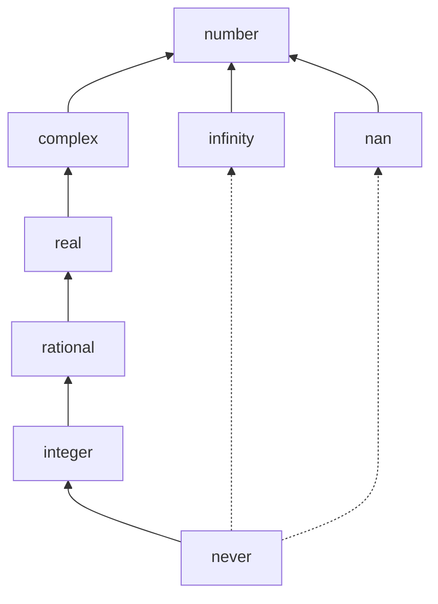

Each arrow points from a subtype to its supertype: every type from `integer`
up to `complex` holds finite numbers only, and `infinity` and `nan` meet them
at `number`. `never` has no values and is below every type, including the
ones not drawn here.

Any two types have a **join** (the narrowest type that covers both — the
join of `integer` and `real` is `real`) and a **meet** (the widest type
inside both). Joins and meets are the workhorses of the whole system: the
type of a mixed list is the join of its element types, and inference is built
out of these two moves.

### It is not Hindley–Milner

Languages in the ML family (OCaml, Haskell, Elm) use a different
foundation, called Hindley–Milner: types are compared for *equality* and
solved by unification, which buys two famous guarantees. Every expression
has a **principal type** — a single most general type that every other
valid type is a specialization of — and inference is **whole-program**:
the compiler sees the finished program at once, and a use of a function
far from its definition can determine the definition's type, with no
annotations anywhere.

This system deliberately trades those guarantees away, for two reasons.

First, subtyping and principal types pull against each other. In
Hindley–Milner, `integer` and `real` simply fail to unify; here, a
function declared `(T, T) -> T where T` called with an `integer` and a
`real` succeeds, solving `T` to their join (a `real`). That is the
behavior mathematics wants — but once many types are valid for an
expression, "the single most general one" stops being the useful answer,
and the engine makes pragmatic choices instead.

Second, there is no "whole program" to infer over. A session is
open-ended: definitions arrive one statement (or one cell) at a time, may
refer to names defined later, and may be redefined. The engine therefore
types what it has seen so far and refines as more arrives, rather than
solving a closed program once.

In character the system is closer to TypeScript or Go than to ML:
subtyping at the base, generics that are explicitly declared rather than
silently inferred, and types solved locally rather than globally.

### Generics are solved per call

At each call of a generic function, the engine collects what the arguments say
about each type variable and solves the variables on the spot, by joining that
evidence; the call's result type comes from substituting the solution into the
signature.

Subtyping also quietly absorbs a classic use of polymorphism: the empty
list needs no "for all" type — it is simply `list<never>`, and since
`never` is the bottom of the lattice (joining it with anything gives the
other type back), `join([], [1, 2])` comes out as `list<integer>`
with no quantifier anywhere.

For the representation a type declaration lowers to, see
[Type declarations](/implementation/#type-declarations).

## Diagnostics

An invalid type inside an annotation position surfaces as a
`type-annotation-error` diagnostic, offset-corrected to point at the
offending token within the type text (not at the `:` or the declaration
target):

<!-- epsil-test: expect-diagnostics -->

```epsil
x: notatype
```

produces a `type-annotation-error` diagnostic pointing at `notatype`.

---

# Epsil Declarations

Source: https://epsil.dev/declarations/

# Declarations

A declaration introduces a symbol into the current scope. Epsil has two
declaration keywords:

- **`let`** declares a **mutable** symbol.
- **`const`** declares an **immutable** symbol.

```epsil
let x = 5
const c = 6.28
```

Reach for `const` when the name stands for something fixed — a physical
constant, a conversion factor, a lookup table — so that an accidental write is
reported. Use `let` for anything that varies: accumulators, loop state, 
values you refine as you go.

A type annotation also **implies** a declaration, even without a keyword:

```epsil
x: real = 5
```

is a declaration of `x` with type `real`, exactly as if it had been written
`let x: real = 5`. The keyword is only mandatory for an **untyped**
declaration — that's what distinguishes a declaration from a plain
reassignment (see below).

## Destructuring declarations

A `let` or `const` may bind the components of a **tuple** in one statement:

```epsil
divmod(a, b) = (floor(a / b), a % b)
let (q, r) = divmod(17, 5)
(q, r)
// ➔ (3, 2)
```

The pattern is a parenthesized list of **at least two** elements, each a bare
symbol, a `_` (which skips that position), or a nested tuple pattern:

```epsil
let ((a, b), _, c) = ((1, 2), 99, 5)
a + b + c
// ➔ 8
```

The pattern is **irrefutable in form** — no literals, pins, or guards (use
[`match`](/control-flow/) for conditional destructuring). The value is
evaluated once; it must be a tuple of the same shape, otherwise the
declaration yields an `incompatible-type` **error value** and binds nothing.
A value whose type is a tuple type but that did not evaluate to a tuple, such
as `svd([[1, 2], [3, 4]])`, which stays unevaluated until `N`, yields the
error `unevaluated-tuple` instead. With `const`, every bound name is a
constant. An initializer is required, and a type annotation is not accepted
on a pattern. Duplicate names anywhere in one pattern are a diagnostic.

## Destructuring assignment

The same pattern may appear on the left of an assignment, to write bindings
that already exist instead of declaring new ones:

```epsil
let a = 1
let b = 2
(a, b) := (b, a)
(a, b)
// ➔ (2, 1)
```

The right side is evaluated **once, in full, before any target is written**,
so a swap means what it reads — `(a, b) := (b, a)` exchanges the two values
rather than assigning `b` to both. The same holds for a rotation
(`(a, b, c) := (c, a, b)`) and for the pair-carrying loop step that is the
usual reason to want this:

```epsil
let a = 0
let b = 1
for k in 1..10 {
  (a, b) := (b, a + b)
}
a
// ➔ 55
```

The pattern grammar is exactly the one above — at least two elements, each a
bare symbol, a `_` skipping that position, or a nested tuple pattern — and a
shape mismatch is the same error value (`incompatible-type` or
`unevaluated-tuple`), which writes **nothing**: the whole pattern is
matched before any target is written, so a mismatch nested under a position
that would have bound leaves that one alone too.

The differences from a destructuring `let` are the ones assignment always has:
the targets keep their identity and their declared type (a value that does not
fit a target's type is an error value), and assigning to a `const` fails.
Those two failures are found only by attempting the write, so unlike a shape
mismatch they are **not** atomic — targets earlier in the pattern have already
been written and stay written.

The assignment operator must be spelled `:=`. A statement-leading `(a, b) = …`
is a **comparison**, not an assignment — a parenthesized left side is not a
binding target, so the bare `=` reads as `Equal`. Because that is almost
always a typo for the destructuring assignment, it is
[diagnosed](/operators/).

## Declaring a type

A third declaration keyword, `type`, introduces a **type** name rather than a
symbol — and, with it, a constructor of the same name:

```epsil
type point = tuple<x: number, y: number>
type alias pair = tuple<number, number>
let p = point(1, 2)
let a: pair = (1, 2)
```

`type` declares a new, distinct type; `type alias` declares another name for
an existing one, and takes a type-parameter clause if it needs one
(`type alias Pair<T> = tuple<T, T>`). Unlike `let` and `const`, `type` is not
a reserved word — only these statement shapes claim it. See
[Declaring a type](/types/#declaring-a-type) for the whole story.

## Function-type annotations bind their parameter names

A parameter name **binds wherever it appears**. When a declaration's
annotation is a function type written out at the declaration site with named
parameters, those names become the parameters of the declared function — the
initializer is its **body**:

```epsil
const f : (x: number) -> number = x^2 + 2x + 1
f(3)
// ➔ 16
```

This is the same function as `= (x) => x^2 + 2x + 1`, and the same as the
definition form `f(x: number) -> number = x^2 + 2x + 1`. The initializer may
instead be an explicit lambda; the annotation's names must then agree with the
lambda's (a disagreement is a diagnostic, with a fixit) — or leave the
annotation's parameters unnamed, and let the lambda name them:

```epsil
const g : (number) -> number = (x) => x + 1
```

So a name appears in **one** place (or in both, agreeing) — never with two
meanings. These declared names are also what callers use to pass
[named arguments](/syntax/#named-arguments) — `f(x: 3)` — so
renaming a parameter is a visible change to the function's interface. When the annotation is named, the initializer is read as a pointwise
*body*; when it is unnamed, the initializer must *be* a function value, as in
`const h : (number) -> number = g`.

The names bind only where they are **written**: an annotation through a
`type alias` never binds (its names are documentation), a zero-parameter
signature has nothing to bind (`const t : () -> number = makeCounter()` keeps
meaning what it says), and for a curried signature only the **outermost**
arrow binds — `const add : (x: number) -> (y: number) -> number = (y) => x + y`
binds `x` around an explicit inner lambda. Generic (a `where` clause), effectful,
optional/variadic, and partially named signatures do not bind either; give
those an explicit lambda.

## Reassignment vs. declaration

A bare `x = 5` — no `let`/`const` keyword, no type annotation — is not
declaration syntax: it is an **assignment**, and it writes a variable that is
already declared:

```epsil
let x = 0
x = 5
```

An assignment never declares a name. An assignment to a name that no `let`,
`const` or parameter declares, and that no earlier program or the host
declared, is an error (`assignment-to-undeclared-variable`), at the top level
of a program as in a block or a function body. `let` introduces a mutable
binding.

## Variable bindings {#the-rules-of-block-locals}

The same declaration and assignment rules apply to a program and to block
locals. Two rules make sure a declared variable has a value when it is read:

1. **A declaration has a value.** `let x = v` or `let x: integer = v`
   declares `x` with its value. `let x: integer` with no value is an error
   (`declaration-without-value`). One declaration needs no value: at the
   top level of a program, a function type, when a `function` statement (or
   a definition `f(x) = …`) of the same name is in the program. The
   definition gives the name its value from the start of the program, so
   the declaration only gives the signature of the function:
   `let f: (integer) -> integer; function f(x) { x + 1 }; f(2)` is `3`. In
   a function body or a block, a function statement declares a local
   ([local functions](/control-flow#local-functions)), so the two
   statements are two declarations of `f` (`variable-redeclaration`): give
   the type with the value, `let f: (integer) -> integer = (x) => x + 1`.
   An assignment to
   a name that is not declared is an error
   (`assignment-to-undeclared-variable`), also in a branch of an `if` or a
   `match` and in the body of a loop: declare the name with a value before
   the branch. A `let` in a branch declares a local of the block of that
   branch. A use of a local in a statement before the statement that
   declares it is an error (`read-before-declaration`). A use of the local
   in the body of a function literal is not checked, because the body runs
   when the function is called, and the check does not follow calls: in
   `function g() { let f = () => t; let v = f(); let t = 1; v }`, the call
   `f()` reads `t` before its declaration.
2. **An assignment is a statement, not a value.** `f(a := 2)` is an error
   (`assignment-in-operand`), and `a := b := 5` is a syntax error
   (`chained-assignment`): write two statements. A block whose last statement
   is an assignment or a declaration has the value `Nothing`; end the block
   with the name to give its value.

A mutable variable can be assigned again after its declaration, also in a
branch, a loop body or a nested block. Assignment preserves the binding's
type. An explicit annotation is its contract; otherwise the initializer's
type is widened: a number gives `number`, a string or character gives
`string`, a boolean gives `boolean`, and the elements of a list, set or
tuple widen the same way. So `let s = 0` then `s = s + 0.5` is valid, while
`let s = 0` then `s = "x"` is `assignment-type-mismatch`. A variable whose
initializer has no known type keeps `unknown`.

An unannotated variable initialized with a function, or with a name known to
hold a function, has type `function`. Each function value retains its own
parameter annotations, defaults, closure and effects. Those properties do
not become a permanent contract for the variable:

```epsil
let f = (n: integer) => n + 1
f = (s: string) => s
f("a")
// ➔ "a"
```

A later function assignment is checked against `function`, and a call is
checked against the function value being called. A nonfunction value cannot
replace it. To require one signature for every replacement, annotate the
variable explicitly, for example `let f: (integer) -> integer = (x) => x + 1`.
A `const` still rejects every assignment, including a replacement function.

`epsil check` reports declaration errors and statically known incompatible
writes before evaluation. It does not run a program to discover an unknown
value. A statement rejected during preparation gives an error value.

At the top level, `let` and `const` create names in the session scope. All
statements are prepared before any executes: types and protocols come
first, then function definitions with their paired signature declarations,
then the remaining statements in source order. A direct use before a later
`let` or `const` is an error here too. Assignment preserves the declared
contract: `let a = 1; a = "x"; a` reports `assignment-type-mismatch` and
finishes with `1`, because the failed assignment leaves `a` unchanged.

| Program                                    | Result                                 |
| ------------------------------------------ | -------------------------------------- |
| `let a = 1; let b = a + 1; b`              | `2`                                    |
| `let a = 1; b = a + 1; b`                  | error: `assignment-to-undeclared-variable` |
| `let s = 0; for i in 1..3 { s = s + i }; s` | `6`                                   |
| `let a = 1; if c { a = 2 }; a`             | `2` when `c` is true, else `1`         |
| `let a: integer; if c { a = 1 }; a`        | error: `declaration-without-value`     |
| `let f: (integer) -> integer; function f(x) { x + 1 }; f(2)` | `3` |
| `let f: (integer) -> integer; f(2)`        | error: `declaration-without-value`     |
| `if c { a = 1 }; a`                        | error: `assignment-to-undeclared-variable` |
| `do { if c { a = 1 }; a }`                 | error: `assignment-to-undeclared-variable` |
| `do { let a = 1; a = "x"; a }`             | error: `assignment-type-mismatch`      |
| `let a = 0; f(a := 2) + a`                 | error: `assignment-in-operand`         |
| `do { let b = 2 }`                         | `Nothing`                              |

An assignment in a function body writes the variable that is in scope where
the function is **defined**: a parameter, a local of the body, a local of an
enclosing function, or a name of the program. A local of a function body is
declared with `let` or `const`, and each call of the function gets its own
local. Such a local is not a variable outside the function, so a write to it
is not the `scope` effect, and the function needs no effect specifier:

```epsil
function g(k) { let t = k + 1; t }
let t = 0
[g(1), g(2), t]
// ➔ [2, 3, 0]
```

A use of such a local before its declaration is an error that is found
before the program runs:

```epsil
function g(k) { let u = t; let t = k; u }
```

A closure that reads a local reads it when it is called, so
`do { let f = () => t; let t = 1; f() }` gives `1`. The body of a loop keeps
the locals of an enclosing block from one iteration to the next, so the
second iteration reads the value that the first one assigned.

An assignment to a name that an enclosing scope declares when the function
is defined — a top-level `let`, a parameter or a
local of an enclosing function — writes that binding. In a
function body, this is the `scope` effect, which must be declared (see
[Effect specifiers](/control-flow#effect-specifiers)):

```epsil
let n = 0
function bump() scope { n = n + 1; n }
[bump(), bump(), n]
// ➔ [1, 2, 2]
```

The declarations of a program are known when its function bodies are
prepared, including variables declared later in the text. A function can
therefore assign such a variable when called after its initialization:

```epsil
function g(k) scope { t = k + 1; t }
let t = 0
[g(1), t]
// ➔ [2, 2]
```

An explicit function-type annotation must admit the function's effects:

```epsil
let n = 0
let bump: () scope -> number = () => do { n = n + 1; n }
[bump(), bump(), n]
// ➔ [1, 2, 2]
```

An unannotated function-valued variable has type `function`; the value
carries its inferred effects. It does not need a separate `scope`
annotation on the variable, whether it is declared in a program or a block:

```epsil
let n = 0
let bump = () => do { n = n + 1; n }
[bump(), bump(), n]
// ➔ [1, 2, 2]
```

Reassigning a symbol that was declared `const` produces an
[error value](/evaluation/#errors-are-values), not a parse error or a
thrown exception:

```epsil
const c = 1
c = 2
```

`c = 2` still parses as a perfectly ordinary assignment; the failure happens at
evaluation time, and its result is an error value. Because the `const` is in the
same program, `epsil check` also reports the assignment before anything runs
(`constant-assignment`), wherever it is: at the top level, in a block, a loop
body or a function body. This holds for a `const` at any depth, and for each
name of a destructuring `const`. A function defined before a `const` of the
same block is included, because the `const` of a block is declared when the
block starts: an assignment in the function writes the constant when the
call comes after the `const`. An assignment to a `let` or a parameter that shadows
the constant is not reported.

A declaration without an initializer is an error, except for the paired
top-level function signature described above. For a mutable variable
without an annotation, the initializer determines a widened binding type:
`let x = 5` declares `x` as `number`, allowing later numeric assignments.

Constness is a property of the **binding**, not of the type: `const` says that
*this name* will not be written again, and says nothing about the value it
holds — there is no such thing as a constant type. See
[Declarations](/implementation/#declarations) for the underlying
representation.

## Scoping

Declarations live in the current scope. A program (a notebook cell or a
chain of cells sharing one engine scope) declares at the top level; a block
introduced by `if`/`else`/`while`/`for`, or a function body, pushes its own
lexical scope, so a `let`/`const` inside a block does not leak into the
enclosing scope.

A top-level `function` statement defines its name for the **whole program**,
including statements before its definition. In a block or function body,
a function statement declares a local from that statement onward; see
[Local functions](/control-flow/#local-functions).

```epsil
let a = g(3)
function g(k) { k^2 }
a
// ➔ 9
```

A variable initialized with a function follows the ordinary declaration
order. In `let a = h(1); let h = (x) => x + 1; a`, the first statement is
`read-before-declaration`; a later function-valued initializer does not make
that earlier call valid. Reassigning an already declared function variable
takes effect when the assignment executes.

A call reads the function that its name denotes **where the call is
written**. A function of the same name defined in another scope does not
change which function the call runs; assigning another function to that same
name does.

A name is declared **once within a program or block**. A second `let` or
`const` of the same name, or a declaration that repeats a parameter or loop
index of the same scope, is `variable-redeclaration`. At the top level the
first declaration stands and later sibling statements still run:

```epsil
function f(x) {
  let x = x + 1   // error: x is a parameter of f
  x
}
```

To update a binding, assign to it (`x = x + 1`); to hold a second value,
choose another name. A `let` in a **nested** block is not a re-declaration:
it shadows the outer name for that block, and its initializer reads the outer
value.

```epsil
let t = 1
for k in 1..3 {
  if k > 1 {
    let t = t * 2   // shadows the outer t; reads 1, so t is 2 here
    t
  }
}
```

Across programs — a rerun notebook cell or a later REPL line — a top-level
`let` or `const` may replace an earlier declaration and establish a new
type. For example, a later `let value = "text"` can replace an earlier
`let value = 1`. A subsequent assignment `value = 2` keeps the new `string`
contract, fails, and leaves `value` equal to `"text"`. Redeclaration creates
a new contract; assignment writes a value under the existing contract.

[Type declarations](/types/) are the exception: types (and their
constructors) are **global** — a `type` statement is only allowed at the top
level of a program, and the declared name means the same thing everywhere on
the engine.

`let` and `const` are the binding keywords. Destructuring declarations
(`let (x, y) = t`) and destructuring assignments (`(x, y) := t`) are described
above.

## Compound assignment {#compound-assignment}

`s += e` adds `e` to the variable `s`: it is `s = s + e`. `L[i] += e` adds `e`
to an element of a list: it is `L[i] = L[i] + e`, with the positions that
`L[i] = v` accepts (`m[j, i] += e`, `m[j][i] += e`). Each position is
evaluated once, before `e`.

```epsil-live
let L = [1, 2, 3]
L[2] += 10
L
// ➔ [1, 12, 3]
```

Any other target (a field `p.x`, a call, a string position) is the error
`add-to-target`. `+=` is the only compound assignment. In the body of a
[`parallel for` loop](/control-flow/#parallel-loops), it adds a
contribution to a variable declared outside the loop. The MathJSON form is
`["AddTo", target, e]`.

---

# Epsil Operators

Source: https://epsil.dev/operators/

# Operators

Most operators are infix operators: they have two operands, a left-hand side
(lhs) operand and a right-hand side operand (rhs).

An infix operator can either have whitespace before and after the operator or
have no whitespace neither before nor after the operator.

Infix operators have a precedence that indicate how strongly they bind to their
operand and a left or right associativity.

A few operators are prefix operators: they only have a right-hand side. Prefix
operators are followed immediately by their operand: they cannot be separated by
whitespace.

A postfix operator (`!`, `Factorial`) has only a left-hand side and follows it
immediately: like a prefix operator, it cannot be separated from its operand by
whitespace.

:::info

The whitespace rules are necessary to support unambiguous parsing of expressions
spanning multiple lines without requiring a separator between expressions

:::

The table below is the complete set of operators, with their spelling,
precedence and associativity — if a symbol is not listed there, it is not an
operator.

## Precedence

The operator at the root of the parse tree has the lowest precedence.

Precedence tiers are numbered in gaps of 10, **loosest to tightest** — a
higher number binds **tighter**. Operators in the same tier have the same
precedence (for example `+` and `-`, or `*` and `/`).

| Tier | Operator            | ASCII  | Fancy | Kind   | Associativity |
| ---- | -------------------- | ------ | ----- | ------ | ------------- |
| 10   | Assign                | `:=`   |       | infix  | right         |
| —    | Assign _or_ Equal     | `=`    |       | infix  | positional    |
| 15   | MapsTo                | `=>`   | `⇒`   | infix  | right         |
| 18   | Coalesce              | `??`   |       | infix  | right         |
| 20   | Pipe                  | `\|>`  |       | infix  | left          |
| 20   | Pipe                  | `~>`   |       | infix  | left          |
| 30   | KeyValuePair          | `->`   | `→`   | infix  | left          |
| 40   | Or                    | `\|\|` | `⋁`   | infix  | left          |
| 50   | And                   | `&&`   | `⋀`   | infix  | left          |
| 60   | Equal                 | `==`   |       | infix  | n-ary chain   |
| 60   | Same                  | `===`  |       | infix  | n-ary chain   |
| 60   | NotEqual              | `!=`   | `≠`   | infix  | n-ary chain   |
| 60   | Less                  | `<`    |       | infix  | n-ary chain   |
| 60   | Greater               | `>`    |       | infix  | n-ary chain   |
| 60   | LessEqual             | `<=`   | `⩽`   | infix  | n-ary chain   |
| 60   | GreaterEqual          | `>=`   | `⩾`   | infix  | n-ary chain   |
| 60   | Element               | `in`   | `∈`   | infix  | n-ary chain   |
| 60   | Element (type test)   | `is`   |       | infix  |               |
| 60   | NotElement            | `!in`  | `∉`   | infix  | n-ary chain   |
| 65   | Range                 | `..`   | `‥`   | infix  | left          |
| 70   | Add                   | `+`    |       | infix  | left          |
| 70   | Subtract              | `-`    | `−`   | infix  | left          |
| 80   | Multiply              | `*`    | `×`   | infix   | left          |
| 80   | Divide                | `/`    | `÷`   | infix   | left          |
| 80   | Mod                   | `%`    |       | infix   | left          |
| 90   | Negate                | `-`    | `−`   | prefix  |               |
| 90   | Not                   | `!`    | `¬`   | prefix  |               |
| 100  | Power                 | `^`    |       | infix   | right         |
| 100  | Power                 | `**`   |       | infix   | right         |
| 101  | Sqrt, Root            |        | `√` `∛` `∜` | prefix |          |
| 110  | Factorial             | `!`    |       | postfix |               |
| 110  | AssertPresent         | `?!`   | `⁈`   | postfix |               |
| 110  | Power                 |        | `x²` `xⁿ⁺¹` | postfix |        |
| 110  | Subscript             |        | `xₖ₊₁` | postfix |              |

Postfix calls and indexing (`f(x)`, `xs[i]`) bind tighter than every entry in
this table — they are handled directly by the parser rather than through the
operator table, since they are not spelled with an operator symbol.

The qualified name `std::name` is not in the table either. It is one
primary, like a name: `std::floor(x)` is a call of `std::floor`, and
`std::pi^2` is the square of `std::pi`. See
[Qualified names](#qualified-names).

The three Unicode-only rows — the radical signs, and the superscript and
subscript runs — have no ASCII spelling. By default the serializer writes the
ASCII forms `sqrt(x)`, `x ^ 2` and `Subscript(x, k + 1)`. In its
fancy-symbol mode (the `fancySymbols` option of `serializeEpsil`, or
`epsil --epsil --fancy-symbols`) it writes `√x`, `∛x`, `∜x`, and an
integer-literal exponent as a superscript (`x²`, `x⁻¹`); a symbolic exponent
keeps `^`, and a subscript expression keeps `Subscript(…)`. See
[Radical signs](#radical-signs) and
[Superscripts and subscripts](#scripts).

The conditional expression `a if c else b` is not an operator row either, but
it has a place in this order: between `KeyValuePair` (30) and `Or` (40), so it
binds looser than every operator that computes and tighter than the forms that
bind or pair (`=`, `=>`, `|>`, `->`). See
[Control Flow](/control-flow/#the-conditional-expression-a-if-c-else-b).

## The whitespace rule

An infix operator must have whitespace on **both** sides or on **neither**
side. A prefix operator must have **no** whitespace before its operand. These
rules let a multi-line program parse deterministically without a separator
between every expression:

```epsil
a + b     // infix addition
a+b       // same: whitespace on neither side
```

<!-- epsil-test: expect-diagnostics -->

```epsil
a +b
```

Here `+` has whitespace before but not after: it is **not** treated as infix.
The expression `a` ends there; `+b` is left over on the same line with no
separator before it, which is a diagnostic (`unexpected-symbol`) rather than a
silently-inferred sequence — see [Statements and Sequencing](/syntax/).
On its own line (after a linebreak or `;`), `+b` is a valid new statement:
unary `+` is the identity, so `a` and `+b` are simply two statements.

```epsil
a+ b
```

Here `+` has whitespace after but not before: an **asymmetric** case. The
parser recovers as infix `Add` but reports an
`asymmetric-operator-whitespace` diagnostic (with a fix-it), since this is
more useful to the author than silently ending the statement.

## Pipe: `|>` and `~>` {#pipe}

`x |> f` is `f(x)`. Chained, it lets a sequence of transformations be read in
the order they happen instead of inside-out:

```epsil-live
[3, 1, 2] |> sort |> reverse
// ➔ [3, 2, 1]
```

A stage that takes more than one argument is written as a call, with `_` in the
slot the piped value fills:

```epsil-live
1..10 |> filter(_, n => n % 2 == 1) |> map(n => n^2, _) |> sum
// ➔ 165
```

The `_` may be left out: a call stage that is missing required arguments
receives the piped value in the first slot its type fits, so
`xs |> take(10)` means `xs |> take(_, 10)` and `xs |> map(f)` means
`xs |> map(f, _)` (the mapping function is `map`'s first argument). This
only fills a hole — a call that is already complete keeps its ordinary
meaning, and an explicit `_` anywhere in the call says exactly where the
piped value goes.

A stage may also be a **lambda**, written inline without parentheses — after
`|>` the arrow binds tighter than the pipe, and the lambda's body ends at the
next `|>`. A pipe is a call written the other way round: `xs |> f` is
`f(xs)`, for a lambda as for a named function. So when the piped value is a
list (or a range), a one-parameter lambda whose body uses its parameter as a
**scalar** (`x^2`, `x + 1`) is applied **to each element**, at every depth of
a nested list, as calling it on the list does; `_^2` is shorthand for such a
lambda. A set, a tuple (a point) or a string is passed whole. The following
three pipelines are equivalent:

```epsil-live
1..oo |> take(_, 10) |> map(_^2, _) |> sum
// ➔ 385
```

```epsil
1..oo |> take(10) |> x => x^2 |> sum
1..oo |> take(10) |> _^2 |> sum
```

Note the two readings of `_`: in a **call** stage it is the piped value
(`take(_, 10)`); in an **operator-written** stage (`_^2`, `_ + 1`) it is the
parameter of the lambda. A lambda that uses its parameter as a
**collection** receives the whole value, as the same call would:
`xs |> l => length(l)` and `xs |> (l: list<number>) => length(l)` are the
length of `xs`. A named function stage is called the same way: `xs |> sum`
sums the collection.

A pipe hands its stage exactly **one** value, so a stage that declares more
than one parameter is a `pipe-stage-arity` error rather than a partial
application — a leftover function is never what a pipeline was written to
produce:

```epsil
[100, 200] |> (x, y, z) => x + y + z
// ✘ A pipe passes its stage exactly 1 value; `(x, y, z) => …` declares 3
```

The fix is the **call** form above, with `_` marking the piped value's slot
(`xs |> fold(f, 0, _)`). The same applies to a named stage: `xs |> add` on a
two-parameter `add` is this error, not a partially applied `add`.

When the piped value is a collection whose elements are tuples and you want to
name their components, use a **tuple pattern** parameter — the extra
parentheses are what make it one parameter taking a pair:

```epsil-live
[(1, 2), (3, 4)] |> ((p, q)) => p + q
// ➔ [3, 7]
```

`|>` and `~>` are aliases for `Pipe` and sit at the **loosest** precedence
tier, right below `Assign` — looser than arithmetic, relational, and boolean
operators (Elixir-style). It is left-associative, so `a |> f |> g` is `g(f(a))`:

```epsil
a + b |> f       // (a + b) |> f
a || b |> f      // (a || b) |> f
let x = a |> f   // let x = (a |> f)
```

<ReadMore path="/control-flow/#pipelines">
When to reach for a **pipeline** — and when a nested call or a named
intermediate reads better.
</ReadMore>

## Absence coalescing: `??` {#absence-coalescing}

`a ?? b` is `Coalesce(a, b)`: the value of `a` unless `a` is **absent**
(`missing` or `NaN`), in which case the value of `b`. It is lazy — `b` is not
evaluated when `a` is present.

```epsil
let timeout = config.timeout ?? 30
let first = xs[1] ?? 0
```

`??` discharges **absence**. It does _not_ rescue an `Error`: an error operand
is an error, not a missing value, and propagates.

A function does not accept an absent value at a parameter annotated with a
non-numeric type, and a declared type cannot name `missing`. With
`function f(p: string)` and `xs: list<string>`, the read `xs[i]` is typed
`string`, and the call `f(xs[i])` is an `incompatible-type` error when `i`
is past the end. Write `f(xs[i] ?? "")` to give a fallback, or leave the
parameter without an annotation and test `isMissing(p)` in the body. A
parameter with no annotation receives the absent value, and a parameter
annotated with a numeric type (`number`, `integer`, `real`) reads it as
`NaN`, which such a parameter accepts. A read past the end of a list of
points is a point whose coordinates are `NaN`: when no point matches,
`first(filter(xs, c => c[1] > 5))` is `(NaN, NaN)`, which a parameter
`p: tuple<number, number>` accepts. `??` and `isMissing` read such a point
as absent: `ps[i] ?? (0, 0)` is `(0, 0)` when
`i` is past the end.

It is right-associative, so a chain falls through left to right:

```epsil
a ?? b ?? c      // Coalesce(a, Coalesce(b, c))
```

Its precedence (18) sits between `=>` and `|>`, which fixes the two groupings
that matter:

```epsil
xs |> f ?? 0     // (xs |> f) ?? 0 — the default is for the pipeline's RESULT
x => x.a ?? 0   // x => (x.a ?? 0) — the default is inside the body
```

Like `|>`, it is looser than `->`, so a dictionary value needs parentheses:

<!-- epsil-test: expect-diagnostics -->

```epsil
{a -> 1, b -> x ?? 2}
```

Write `{a -> 1, b -> (x ?? 2)}` instead. It is also looser than `||` and `&&`
(the C# position), so `a ?? b || c` is `a ?? (b || c)`.

## Presence assertion: `?!` {#presence-assertion}

`x?!` is `AssertPresent(x)`: the value of `x`, or an `expected-present` error
when `x` is **absent** (`missing`, or `NaN`, which is also the value of an
indeterminate form such as `0/0`). It is the third way to discharge a possibly absent value, beside a
fallback (`??`) and a guard (`isMissing`): use it where absence is a violated
precondition and an invented replacement would hide a bug.

```epsil
function f(p: string) { p }
let xs: list<string> = ["a", "b"]
let i = 2
f(xs[i]?!)         // "b"; with i = 5, Error("expected-present", …)
```

The type of `xs[i]?!` is the type of `xs[i]` (`string`): a read is typed by
the element it reads, and the absent value is not part of its type. The
assertion turns an absent value into an error at the read, before it reaches
a parameter or a declaration. Only the value itself is checked, never the cells of a
collection: `xs?!` asserts that the list is there, not that no cell is
absent. `Nothing` is the value of an empty block, not an absent datum, and
passes through; an error operand propagates unchanged.

`?!` is a postfix operator at the factorial's precedence (110). It must abut
its operand, like `!`, and a following operator needs a space, because an
operator run is one token: write `x?! + 1`, not `x?!+1` (as `3! + 1`, not
`3!+1`). `⁈` (U+2048) is an alias. A postfix operand is parenthesized when
serialized: `(n!)?!`, `(x?!)!`.

Compiled code raises on the absent branch (JavaScript, the interval
JavaScript target) with the
message `expected-present: <operand> is absent`; the check is left out when
the operand's type already excludes absence (a declared length with a literal
index, a type without `nan`). A shader target (GLSL) cannot raise:
there the assertion compiles as the identity and the absent value flows on
as `NaN`, and a later absence test on the value keeps its own rule.

## Type test: `is`

`x is integer` tests at runtime whether a value inhabits a type. It is the
same test a `match` type pattern performs, and lowers to the same
`Element(value, type)` expression:

```epsil
x is integer
x is string && y is boolean
```

The right operand is a **type name**, not an expression, so a typo is a
parse-time diagnostic rather than a comparison against an undeclared symbol.
This first version resolves **simple named types** only: a compound type
(`!error`, `integer | string`, `list<integer>`) parses but reports
`type-pattern-unsupported`, exactly as the equivalent typed pattern does.

`is` is a **contextual** word, not a reserved one — it is recognized only
between an operand and a type name, so `let is = 5` and `f(is)` remain legal.

Since `is` and `in` express the same membership test, a program written back
out from its parsed form uses `in` for both.

## Anonymous functions: `=>` {#anonymous-functions}

The mapsto operator constructs an anonymous function:

```epsil
x => x^2
(x, y) => x + y
```

It is right-associative, so `x => y => x + y` constructs a function that
returns another function. It binds tighter than assignment but more loosely
than the other expression operators, so `f = x => x + 1` assigns the complete
function to `f`. Typed parameters can be written in parentheses:

```epsil
(x: integer) => x + 1
```

A parameter can instead be a **tuple pattern**, written with a second pair of
parentheses. It is still ONE parameter — it takes one argument, a tuple, and
binds a name to each component:

```epsil
[(True, True), (True, False)] |> map(((p, q)) => p && q, _)
// ➔ [true, false]
```

The doubled parentheses are the whole difference: `(p, q) => p && q` is the
two-parameter function it has always been, and `((p, q)) => p && q` is the
one-parameter function that takes a pair apart. Patterns mix with plain
parameters and nest, exactly as in
[`let (a, b) = v`](/declarations/#destructuring-declarations) — bare
names, `_` to skip a position, nested `(…)` patterns, and nothing else (a
literal or a per-element type annotation is a diagnostic):

```epsil
(x, (p, q)) => x + p + q   // two parameters, the second destructured
((a, (b, c))) => a + b + c // one parameter, nested
((p, _)) => p              // one parameter, second component discarded
```

The argument must be a tuple of the pattern's shape; anything else yields an
error value (`incompatible-type`, or `unevaluated-tuple` for a value that has
a tuple type but did not evaluate to a tuple), the same one the destructuring
`let` produces. A destructuring lambda is interpreted, never compiled: no
compile target lowers the tuple match, so a compiled context falls back
rather than emit code that binds the wrong names.

**Callbacks and arity.** An ordinary call with too few arguments partially
applies the function — `f(1)` on a two-parameter `f` is a function awaiting
the second argument. Inside a collection operator that never happens: the
operator decides how many arguments the callback receives (`map` supplies
one element per source collection, `filter`/`any`/`all`/`count`/`takeWhile`
supply one, `reduce`/`fold` supply the accumulator and the element), and a
lambda whose parameter count cannot match is a `callback-arity` error at
parse/canonicalization time rather than a list of leftover closures. The
message names both sides and, for the pair case, the fix:

```epsil
map((p, q) => p + q, [(1, 2), (3, 4)])
// error: Map calls its callback with 1 argument (each element of the
// collection); `(p, q) => p + q` declares 2 parameters. To take a pair
// apart, use a tuple pattern parameter: ((p, q)) => …
```

`sort` (a key or a comparator) and `iterate` (`f(previous)` or
`f(index, previous)`) accept either of their two arities; a `() => …`
literal is a constant and fits any slot. A callback whose arity is not
statically known — a value typed `function` or `callback<…>`, a generic
function — is not checked here and is applied as before.

The `MapsTo` name in the table is internal to parsing: it names the operator,
not the function value the expression produces.

The same arrow separates a `match` case's pattern from its body
(`pattern [if guard] => body`) — one glyph meaning "yields", in both places.
Nothing is ambiguous: a case reserves the first `=>` at its own level for
itself, so a pattern and a guard always end there, while a case BODY is an
ordinary expression in which `=>` builds a lambda:

```epsil
match n {
  0 => x => x + 1   // body is the lambda `x => x + 1`
  n if n > 0 => n   // guard is `n > 0`, body is `n`
}
```

A lambda genuinely wanted inside a pattern or a guard is parenthesized:
`n if (f => f)(n) => n`.

The Unicode arrows `⇒` (U+21D2) and `↦` (U+21A6) are both accepted as input
aliases for `=>`. `⇒` is the one the serializer emits — for a lambda and for a
`match` case alike — in its fancy-symbol mode; `↦`, the traditional
mathematical mapsto glyph, is accepted but never produced.

Earlier versions spelled this arrow `|->`. That spelling now reports the
`mapsto-arrow-legacy` diagnostic, with a fixit rewriting it to `=>`; the
expression is still parsed as the function it meant.

A `->` whose left side is shaped like a parameter list — `(x, y) -> x + y`,
`(n: integer) -> n^2`, `f = x -> x + 1` — is diagnosed as a wrong-arrow typo
(with a fixit) and recovered as the intended function: `->` builds a
`key -> value` pair, and none of those shapes is a valid key.

A bare name before `->` in a call argument is the key of a rule argument, in
every argument position: `f(GridLines -> 1, Axes -> 2)` passes two
`KeyValuePair` arguments, as `f(x, GridLines -> 1)` does. When the parameter
at that position expects a function, the rule is reported as the same
wrong-arrow typo, with a fixit to `=>`: `map(x -> x^2, xs)` passes a
key-value pair where `map` expects a function. That call is not recovered as
`map(x => x^2, xs)`; apply the fixit.

## Ranges: `..` {#ranges}

The range operator is a compact spelling of a two-argument `Range`:

```epsil
1..5          // Range(1, 5)
1..n - 1      // Range(1, n - 1)
k in 1..5     // k in Range(1, 5)
```

It binds tighter than relational operators and more loosely than addition and
subtraction. The Unicode two-dot leader `‥` is an input alias. Serialization
uses `Range(a, b)`, and a stepped range continues to use the three-argument
call `Range(a, b, step)`.

## Qualified names: `::` {#qualified-names}

`std::name` is the definition of `name` in the standard library, also where
a binding of the program shadows the name. The name takes either spelling:
`std::pi` and `std::Pi` are the constant π.

```epsil
function f() { let Pi = 3; std::pi + Pi }
f()
// ➔ 3 + pi
```

```epsil
let floor = 7
std::floor(2.5) + floor
// ➔ 9
```

The `::` must follow the module name with no space, as the `.` of a field
follows its base. `std` is the only module name; any other name before `::`
is the error `unknown-module`. A qualified name does not nest (`std::a::b`
is an error). See [Naming Conventions](/naming/) for the rules of
shadowing.

## Spread: `...` {#spread}

A prefix `...` splices a value's elements into the surrounding sequence. It
is accepted in two positions — a **call argument list** and a **list
literal** — and the three-dot token is distinct from the range operator
`..`; anywhere else `...` is a diagnostic. (In a `match` pattern, `...rest`
is the same idea in reverse: it *collects* the remaining elements.)

In a **call argument list**, `...` spreads a tuple into the call's
arguments: the tuple's elements become ordinary positional arguments.

```epsil
f(...t)          // t's elements become f's arguments
f(1, ...t, q)    // splices between positional arguments
g(...p, ...q)    // several spreads splice in order
max(...t)        // variadic built-ins accept spreads
```

In a call, only **tuples** spread — argument lists are tuple-shaped, so a
`List` (or any other value) is an `incompatible-type` error. A literal tuple
splices immediately; a symbolic argument is spliced when the call evaluates,
and until then the call stays symbolic (the spread never binds positionally
to a single parameter).

In a **list or set literal**, `...` splices a collection — a list, a set, a
range:

```epsil-live
let xs = [1, 2]
[...xs, 3, ...(4..6)]
// ➔ [1, 2, 3, 4, 5, 6]
```

```epsil-live
let s = {2, 3}
{1, ...s, ...[3, 4]}
// ➔ Set(1, 2, 3, 4)
```

The splice happens at canonicalization: literal collections splice
immediately, and a symbolic or lazy segment lowers to the equivalent
`join` expression — a lone spread `[...xs]` is `join(xs)`, the list
materialization of `xs`, and an infinite segment stays lazy
(`[...(1..oo), 5] |> Take(3)` is `[1, 2, 3]`). A literal is a value, so
when it is evaluated, every finite segment is listed, also a lazy one:
`[...take(xs, 1), 9]` is a plain list, not a `join` recipe. An element
that is a finite lazy collection is listed too (`[1..3, 4]` is
`[[1, 2, 3], 4]`). Set literals deduplicate as usual.

**Tuples do not spread here** — a tuple is a unit (a point, a pair), and
splicing it would quietly discard that; spreading one is a `spread-tuple`
error. To use a tuple's elements, convert explicitly:
`[...ListFrom(t), 3]`. A scalar operand is one element (`[...5]` is
`[5]`), and a string operand contributes its characters (`[..."ab", 1]` is
`["a", "b", 1]`). Note the mirror-image rule in calls: argument lists are
tuple-shaped, so there exactly tuples spread.

In a **dictionary literal**, `...` merges the entries of a dictionary.
Entries combine left to right and a **later entry wins** on a key
collision — so a literal entry after a spread overrides it, the usual
defaults idiom:

```epsil-live
let defaults = {"verbose" -> false, "depth" -> 3}
{...defaults, "verbose" -> true}
// ➔ {"verbose" -> true, "depth" -> 3}
```

(Duplicate **literal** keys are different: they are almost certainly typos,
so they keep the literal rule — first wins, with a
`duplicate-dictionary-key` diagnostic.)

A brace of *only* spreads has nothing to mark it as a dictionary, so it is
read as a **set**-spread. To write a pure merge, lead with the bare `->`
marker (the same marker as the empty dictionary `{->}`):

```epsil
{...a, ...b}        // a SET containing the elements of a and b
{->, ...d1, ...d2}  // a dictionary merge of d1 and d2
```

## Unary prefix: `-` and `!` {#unary-prefix}

`-` (`Negate`) and `!` (`Not`) are prefix operators. They must abut their
operand with no whitespace:

```epsil
-x        // negation
!a        // logical not
!!a       // double negation — `!!` lexes as one token that peels into two
```

`Negate`/`Not` bind looser than `Power`, so a leading minus does not reach
inside an exponent:

```epsil
-x^2      // -(x^2), not (-x)^2
```

A unary minus applied directly to a number literal folds into the literal
rather than becoming a negation:

```epsil
-2        // the literal -2, not a negation of 2
```

Unary `+` is accepted the same way but is the identity: `+(2 + 1)` is just
`2 + 1`.

## Power: `^` and `**` {#power}

`Power` is the tightest operator in the table and is **right-associative**.
`**` is an accepted alias for `^` (same table row, same precedence):

```epsil
x^2       // exponentiation
x**2      // the same
2^3^2     // 2^(3^2) — right-associative
```

Because `Power` binds tighter than `Multiply`/`Divide`:

```epsil
x^1/2     // (x^1)/2, not x^(1/2)
```

## Radical signs: `√`, `∛`, `∜` {#radical-signs}

A radical sign is a prefix operator: `√x` is `sqrt(x)`, `∛x` is `root(x, 3)`,
`∜x` is `root(x, 4)`. Its operand is what a function call would take — a
primary with its postfix clauses and scripts, or another prefix operator — but
not an infix operator:

```epsil
√3          // Sqrt(3)
√(x + 1)    // Sqrt(x + 1)
√x²         // Sqrt(x^2) — the script belongs to the operand
√f(x)       // Sqrt(f(x))
√√2         // Sqrt(Sqrt(2))
-√2         // Negate(Sqrt(2))
√x^2        // Sqrt(x)^2 — `^` does not
√x + 1      // Sqrt(x) + 1
```

This is how Lean reads `√`, and it keeps `√2x` the "√2 times x" every reader
expects (see [Invisible multiplication](#invisible-multiplication)). Unlike `-`
and `!`, a radical sign may be separated from its operand by whitespace
(`√ 2`): it has no infix reading, so there is nothing for the whitespace to
disambiguate.

## Superscripts and subscripts {#scripts}

A run of superscript characters written against an operand is its exponent:

```epsil
x²          // x^2
x¹⁰         // x^10
x⁻¹         // x^(-1)
xⁿ⁺¹        // x^(n + 1)
xʸ          // x^y
(x + 1)²    // (x + 1)^2
f(x)²       // f(x)^2
2²          // 2^2
```

The exponent may use the superscript digits `⁰`–`⁹`, the signs `⁺` `⁻`, the
parentheses `⁽` `⁾`, and the superscript Latin letters (`ⁱ`, `ⁿ`, `ˣ`, `ʸ`,
…). A script binds like the postfix factorial — tighter than `^` and than the
prefix minus — and composes with `!` in written order:

```epsil
-x²         // -(x^2)
2x²         // 2·(x^2)
2^x²        // 2^(x^2)
x²^3        // (x^2)^3
x²!         // (x^2)!
3!²         // (3!)^2
```

A subscript run of letters and digits directly after a name is part of the
name (`xₙ` is the symbol `x_n`; see [Naming](/naming/#subscripts)). Any
other subscript run — one holding a sign or a parenthesis, or one written
after a non-symbol operand — is a `Subscript`:

```epsil
xₖ₊₁        // Subscript(x, k + 1)
(a + b)ₖ    // Subscript(a + b, k)
xₙ²         // (x_n)^2
```

A `Subscript` whose index evaluates to an integer or a symbol names the same
symbol the folded spelling names: with `k = 3`, `xₖ₊₁` evaluates to `x_4`, and
to the value of `x_4` if it has one. An index that stays unknown, or is not an
integer, keeps the expression symbolic.

Like the factorial, a script must **abut** its operand: `x ²` ends the
expression at `x`, and the stray `²` is a diagnostic. A run that is not an
expression (`x⁺`) is diagnosed at the run.

## Modulo: `%` {#modulo}

`%` is `Mod`, an infix operator at the multiplicative tier (the same
precedence as `*` and `/`), left-associative:

```epsil
a % b       // remainder
a + b % c   // a + (b % c)
a % b % c   // (a % b) % c — left-associative
```

## Factorial: postfix `!` {#factorial}

`!` in **postfix** position is `Factorial`. Position disambiguates it from the
prefix `!` (`Not`): a `!` that abuts the preceding operand is a factorial
(`x!`), while a `!` at the start of an operand is `Not` (`!x`).

```epsil
5!          // factorial
n!          // factorial
!x          // prefix not, unchanged
```

`Factorial` binds tighter than `Power` (tier 110 vs. 100), so it reaches inside
a `Power` operand, and a leading minus stays outside it:

```epsil
2^3!        // 2^(3!)
3! ^ 2      // (3!)^2
-3!         // -(3!)
```

It also applies after a parenthesized expression, a call, or an index:

```epsil
(a + b)!    // factorial of the sum
f(x)!       // factorial of the result
```

Like a prefix operator, a postfix `!` must **abut** its operand: `x!` is a
factorial, but `x !y` is not — the space before `!` ends the `x` expression,
leaving `!y` (a prefix `Not`) with no separator, which is a diagnostic. Because
the lexer maximal-munches a run of operator characters into one token, a `!`
directly followed by another operator character is not seen as a lone `!`
(write `3! ^ 2`, not `3!^2`; `x! + 1`, not `x!+1`). The `!=` (`NotEqual`) and
`!in` (`NotElement`) operators are unaffected: the lexer keeps `!=` whole and
`!in` is recognized as a compound before the postfix `!`.

## Invisible multiplication

A number literal immediately followed — with **no** whitespace — by a symbol
or an opening parenthesis is read as an implicit `Multiply`:

```epsil
2x        // 2 * x
3x^3      // 3·(x^3)
2i        // 2 * i, where `i` is the imaginary unit
2(2 + 1)  // 2 * (2 + 1)
```

A number literal under radical signs and superscript exponents is a numeric
coefficient too, so it leads (and continues) an invisible multiplication
exactly as a bare literal does, and a radical sign may follow a literal:

```epsil
2√3       // 2 * Sqrt(3)
√2x       // Sqrt(2) * x
√2(x + 1) // Sqrt(2) * (x + 1)
2²x       // 2^2 * x
2√3x      // 2 * Sqrt(3) * x
```

Only the glyph spellings qualify: `Sqrt(2)x` and `2^2x` are still diagnostics.

Note that a **symbol** immediately followed by `(` is a **function call**, not
an invisible multiplication: `x(2+1)` calls `x`, and `(a+b)(2+1)` calls the
value of `a+b`. Only a *number* on the left means multiplication. See
[Calls and Indexing](/syntax/).

Whitespace between the number and the symbol suppresses invisible
multiplication and is instead a statement boundary: `2 1/2` is a diagnostic
(`unexpected-symbol`), not `2 * (1/2)`.

## Chained relational operators

Relational operators (precedence tier 60) are **chainable**, matching how
mathematicians write inequalities: `a < b < c` means what it looks like, and so
does a chain that mixes operators —

```epsil
a < b <= c
```

means `a < b && b <= c`. A mixed chain is rewritten into that pairwise
conjunction before it is evaluated, so both kinds of chain have the usual
mathematical chained-comparison semantics. Both kinds also short-circuit like
`&&`: the operands are evaluated left to right and evaluation stops at the
first adjacent pair that is false, so in `a < b < c` the operand `c` is not
evaluated when `a < b` is false.

## Logic operators

- `&&` (`And`), `||` (`Or`), `!` (`Not`), with the fancy Unicode forms `⋀`,
  `⋁`, `¬`.
- `&&` binds tighter than `||`, matching the tiers above.
- Both **short-circuit**: the operands are evaluated left to right and
  evaluation stops at the first operand that decides the result — the first
  `false` for `&&`, the first `true` for `||`. The remaining operands do not
  run, so `k <= n && xs[k] > 0` never reads `xs[k]` when `k` is out of range,
  and `false && f()` never calls `f()`. An operand that fails (its value is
  an error) does not stop the evaluation, and an operand after it can still
  decide: with `function g(x) { 1/x }`, `g("a") > 0 || true` is `true`, as
  `true || g("a") > 0` is, and `g("a") > 0 && false` is `false`. When no
  operand decides, the result is the error of the first operand that
  failed. Because the written order is
  meaningful, `&&`/`||` operands are never reordered by canonicalization. The
  exception is an element-wise application — an operand that is a list of
  booleans (`[true, false] && xs`) makes the result a list, cell by cell, and
  every operand is then evaluated once.

The word forms `and`, `or`, and `not`, and the equivalence infix operator
`<=>`, are reserved but not implemented. The token `=>` is not available as
logical implication: it is the mapsto arrow (see
[Anonymous functions](#anonymous-functions)), which is also what separates a
`match` pattern from its result.

## Assignment vs. equality

Three spellings, two meanings:

- **`:=` always assigns.** It never compares.
- **`==` always compares** (and `===` is `Same`, structural identity).
  A third comparison tier asks the prover whether the two sides are equal
  for **every** value of their free variables:
  `identicallyEqual(sin(t)^2 + cos(t)^2, 1)` is `True`, where `==` leaves
  the equation as an inert condition. It is deliberately spelled as a call,
  never as an operator — the equivalence glyphs `≡`, `≢`, and `≣` are
  rejected outright, because their bar counts cross the `=`-run lengths
  (`≡` has three bars, `≣` four) and a visual transliteration would
  silently land on the wrong tier.
- **`=` is positional.** It assigns when it is the top-level operator of a
  **statement** whose left side is a binding target — a name, or a field/index
  path rooted at one. Everywhere else it compares.

So a statement assigns:

```epsil
let count = 0
count = 5
count = count + 1
```

…while the same `=` inside any larger expression is an equation, which is what
a reader of mathematics expects:

```epsil
solve(x^2 = 4, x)        // Equal — the equation, not an assignment
if a = true { 1 } else { 2 }
[a = 1, b = 2]
```

This is why `=` needs no parentheses to be safe in a condition: `if a = true`
cannot silently assign, and the C footgun does not exist in Epsil.

As a comparison, `=` binds at the relational tier (60) like `==`, so
`if x = 5 && y` groups as `(x = 5) && y`. As an assignment it binds loosest
(10), taking the whole right-hand side.

Three consequences worth knowing:

**A function head defines the function.** As a statement, `f(x) = body`
defines the function `f`, and `f(x) := body` is the same definition. This also
applies to typed parameters, a return type and literal-pattern clauses
(`f(0) := 1`).

**A non-binding left side compares, even as a statement.** `x^2 = 4` on its own
line is the equation, because `x^2` is not a name. A bare name always assigns,
so write `==` when you mean the equation:

```epsil
let y = 0
y == 2 * x + 1           // the equation
y = 2 * x + 1            // assigns to y
```

**A chain is diagnosed.** `a = b = 5` would assign `a` the *boolean* `b == 5`,
which is never what a chained assignment means:

<!-- epsil-test: expect-diagnostics -->

```epsil
a = b = 5
```

Write `a := b := 5` to chain the assignment, or `a = (b = 5)` if the comparison
really was intended.

**A tuple pattern with a bare `=` is diagnosed.** A parenthesized left side is
not a binding target, so `(a, b) = (b, a)` is a *comparison* of two tuples
whose result is discarded — the swap it looks like silently does nothing:

<!-- epsil-test: expect-diagnostics -->

```epsil
(a, b) = (b, a)
```

Write `(a, b) := (b, a)` to
[destructure](/declarations/#destructuring-assignment), or `==` if the
comparison really was intended. The diagnostic is narrow: it fires only when
the left side is shaped exactly like a destructuring pattern (bare names, `_`,
nested tuples), so a genuine tuple equation with computed components —
`(x + 1, y) = t` — stays silent.

**A body that is only `name = value` is a warning when nothing reads its value.**
The body of a `match` case, of a conditional branch or of a lambda is not a
statement, so its `=` compares, and the variable keeps its value:

```epsil
let a = 0
match 1 { 1 => a = 2 }
a
```

Write `1 => do { a = 2 }` to assign, or `1 => a == 2` if the comparison was
meant. A body whose value is read (`let r = match k { 1 => a = 2 }`, a lambda
passed to `map`), and an equation of a free name, of a constant, of a parameter
or of a pattern variable stay silent. See
[`equation-not-assignment`](/errors/#equation-not-assignment).

**An assignment in a condition is a warning.** `:=` is unconditional, so it
reaches a condition where a bare `=` no longer can — and Epsil has no
`if init; cond` form, so the assigned value *is* the test:

```epsil
if flag := true { 1 }   // warning: assign-in-condition
```

It is a warning rather than an error, since `:=` is the deliberate spelling.
It fires only where a value is consumed as a boolean — an `if`/`while`
condition — not for `f(a := 1)` or `[a := 1]`, which are unambiguous.

**Serialization uses the explicit spellings.** An expression written back out
by the formatter or serializer always uses `:=` for assignment and `==` for
comparison, never a bare `=` — so a round-trip is exact regardless of position.
`=` is an input convenience.

---

# Epsil Evaluation

Source: https://epsil.dev/evaluation/

# Evaluation

A whole program is prepared before any statement executes. Types and
protocols come first, then function definitions with their paired signature
declarations, then all remaining statements in source order. Statements are
evaluated **sequentially** in that canonical order, and the program's value
is the **last statement's** value:

```epsil
let x = 5
x = x + 3
x
// ➔ 8
```

No scope is pushed around the whole program: declarations persist across
statements, and across cells in a notebook or inputs in a REPL that share one
session. Blocks and function bodies still push their own lexical scopes (see
[Control Flow](/control-flow/)). A later program may redeclare a
session name and establish a new type; assignment keeps the existing
binding's contract. See [Declarations](/declarations/).

## Symbolic by default

Values stay **exact** unless you ask otherwise. A transcendental of an exact
argument stays symbolic —

```epsil
ln(2)
```

evaluates to the symbolic `ln(2)` (the MathJSON `["Ln", 2]`), not a decimal
approximation.

**Numeric approximation is explicit**, via `N(expr)` — it is a function
call, not a language mode:

```epsil
N(ln(2))
```

evaluates to `0.6931471805599453…`.

## Values and bindings

Epsil keeps apart two things many languages blur together:

- A **value** — a number, a string, a list, a dictionary, a function — is
  **immutable**. Once it exists, nothing anywhere can change it.
- A **binding** — the association between a name and a value — is the part
  that changes. `let` introduces a binding you may reassign; `const` one you
  may not. See [Declarations](/declarations/).

Everything below follows from those two sentences.

**There is no in-place modification.** An assignment to an element,
`xs[2] = 9`, does not change the list: it builds a new list and rebinds the
name, as `xs = replaceAt(xs, 2, 9)` does. Another name that holds the old
list keeps it:

```epsil
let xs = [1, 2, 3]
let ys = xs
xs[2] = 9
[xs, ys]
// ➔ [[1, 9, 3], [1, 2, 3]]
```

So the target must be a name that the program can assign: with
`const xs = [1, 2, 3]`, `xs[2] = 9` is the error `constant-assignment`. An
element of a nested list has the same form, `m[2][1] = 9` or `m[2, 1] = 9`,
which rebinds `m`.

A write that cannot give a list is an error, and the name keeps its value. A
position past the end, zero or not an integer is the error `out-of-range`
(`xs[5] = 9` when `xs` has three elements); the length of a string is its
number of characters. A target with no value is the error
`assignment-to-list-element`, and a target that is a number is the error
`incompatible-type` that `replaceAt` gives. A string and
a tuple are written as `replaceAt` writes them, and give a list: with
`s = "abc"`, `s[1] = "z"` gives the list of characters `["z", "b", "c"]`. A
string position (`xs["a"] = 9`) is the error `assignment-to-list-element`,
reported before the program runs, because `replaceAt` takes only an integer
position. A
position that is a name with no value (`xs[k] = 9` with `k` unknown) leaves
the write unevaluated, and `xs` holds it.

Operators never modify what you hand them — `append`, `sort`, `join`,
`map`, `filter` all return a **new** collection:

```epsil
let xs = [3, 1, 2]
let ys = sort(xs)
(xs, ys)
// ➔ ([3, 1, 2], [1, 2, 3])
```

**Reassigning one name never disturbs another.** Two names holding the same
value are independent, because there is no way to reach a value *through* a
name and alter it:

```epsil
let a = [1, 2, 3]
let b = a
a = [9, 9, 9]
b
// ➔ [1, 2, 3]
```

This is what makes a value safe to pass around: no function you call, and no
name you assign to, can change a collection out from under you. There are no
references, no aliasing and no object identity — two collections are the same
when they have the same contents, and that is all `==` ever asks:

```epsil
[1, 2, 3] == [1, 2, 3]
// ➔ true
```

**A parameter is a binding of its own.** A function may reassign its
parameter; the caller's binding is untouched:

```epsil
function reset(v) {
  v = 0
  v
}
let n = 7
let r = reset(n)
(n, r)
// ➔ (7, 0)
```

**A closure captures the binding, not a snapshot of its value.** This is the
one place where the distinction is directly visible. A function that refers
to an outer name reads that name's *current* value each time it runs:

```epsil
let x = 1
f() = x
x = 2
f()
// ➔ 2
```

Each call of an enclosing function creates fresh bindings, so closures made
by separate calls have separate state, while closures made by the same call
share it:

```epsil
function counter() {
  let n = 0
  function bump() scope { n = n + 1; n }
  bump
}
let c1 = counter()
let c2 = counter()
(c1(), c1(), c2())
// ➔ (1, 2, 1)
```

`c1` and `c2` count independently.

`bump` writes to `n`, which belongs to the enclosing call rather than to
`bump` itself. Writing to a binding outside the function is the `scope`
effect, and it must be declared — without the specifier the definition is
rejected and `counter()` never produces a callable. See
[Effect specifiers](/control-flow#effect-specifiers). A local of the
function body is declared with `let`: each call gets its own binding, a later
declaration of the same name is not written, and it is not the `scope` effect
(see
[Reassignment vs. declaration](/declarations/#reassignment-vs-declaration)):

```epsil
function step(k) { let s = k * 2; s + 1 }
let s = 10
(step(1), step(2), s)
// ➔ (3, 5, 10)
```

A read of such a local before its declaration in the function body
(`function step(k) { let r = s; let s = k; r }`) is the
`read-before-declaration` error, and an assignment to a name that is not
declared (`function g(c) { if c { t = 1 }; t }`) is the
`assignment-to-undeclared-variable` error; `epsil check` reports both before
the program runs.

Reach for `const` when a name should not move at all. Constness is a property
of the *binding*, not of the value it holds — every value is immutable
already — and writing to one yields an `Error` value rather than quietly
taking effect:

```epsil
const c = 1
c = 2
```

## Arguments are values — unless the function holds them {#arguments-are-values-unless-the-function-holds-them}

A call evaluates its arguments first and hands the function their values:
with `let a = 3`, `f(a + 1)` receives `4`. A function declared with the
`hold` prefix instead receives each argument **as written** — canonicalized
and bound in the caller's scope, but not evaluated — and evaluates it only
where its body reads it, so it can inspect the expression (`head(e)`),
transform it, or decide whether to evaluate it at all:

```epsil
let a = 3
hold f(e) = head(e)
f(a + 1)
// ➔ Add
```

Every parameter of a `hold` function is held (there is no per-parameter
form), and a parameter read twice is evaluated twice — read it once into a
`let` when that matters. See
[Hold functions](/control-flow/#hold-functions).

## Collections: literals are values, pipelines are generators

A collection **literal** — a list `[…]`, set `{…}`, tuple `(…)`, or
dictionary — evaluates its elements when the statement executes. Assigning
one to a variable stores a snapshot of the element *values*:

```epsil
let k = 1
let xs = [k, k + 1]
k = 10
xs
// ➔ [1, 2]
```

A spread inside a list literal, `[...xs, k]`, is a snapshot too: the literal
holds the elements of each finite spread operand, also of a lazy one such as
`take(xs, 2)`. Only an infinite spread (`[...1..oo]`) stays a lazy list. See
the [Style Guide](/style/#building-a-list-one-element-at-a-time) before
growing a list in a loop.

```epsil
let ys = [1, 2, 3, 4]
[...take(ys, 1), 9, ...drop(ys, 2)]
// ➔ [1, 9, 3, 4]
```

Lazy collection **operators** — `Range`, `map`, `filter`, `take`, `join` —
are *generators*: their operands (bounds, sources, functions) are evaluated
when the expression is, but enumeration is deferred until the collection is
materialized (displayed, indexed, aggregated, or iterated).

An **assignment** is a snapshot for them too. When the right-hand side of a
`let` or an `=` is a finite lazy collection that reads a variable, the
statement stores the list of its elements, computed with the values the
variables have at that statement:

```epsil
let xs = [1, 2, 3]
let ys = filter(xs, c => c > 1)
xs = filter(xs, c => c > 2)
(xs, ys)
// ➔ ([3], [2, 3])
```

Two lazy collections stay lazy when they are assigned: one with no last
element (`filter(1..oo, p)`), which cannot be listed, and one that reads no
variable (`map(f, 1..1000000)`), which nothing can change. A `filter` over a
dictionary also stays lazy. Such a collection is made as a call is: a
variable that is one of its operands (`xs` in `filter(xs, p)`, `f` in
`map(f, xs)`) gives the value that it holds at that statement, and its inline
function is a closure. The closure reads a local of the block or the
function that made the collection, and a global, when an element is
computed, so a later assignment of the variable is seen:

```epsil
let k = 3
let big = filter(1..oo, c => c > k)
k = 10
first(big)
// ➔ 11
```

To keep the elements that the collection has at a statement, list them
there: a finite part of it is listed by `listFrom`.

```epsil
let k = 3
let big = filter(1..oo, c => c > k)
let firsts = listFrom(take(big, 3))
k = 10
firsts
// ➔ [4, 5, 6]
```

A lazy collection that is not assigned (an argument, an operand) still reads
program state **at materialization time**, like a generator in Python.

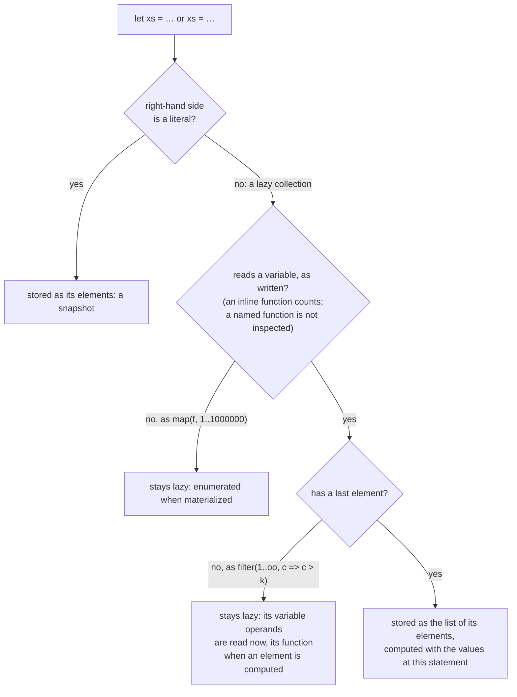

The test "reads a variable" looks at the expression as written, and does not
look inside a named user function. An inline function that reads a variable
makes the `map` read it, so the assignment stores the elements. A named
function that reads the same variable does not: the `map` stays lazy, and
its elements are computed when they are read, with the value the variable
has then.

```epsil
let n = 1
let v = map((k) => k * n, 1..3)
n = 10
v
// ➔ [1, 2, 3]
```

```epsil
let n = 1
function scale(k) { k * n }
let v = map(scale, 1..3)
n = 10
v
// ➔ [10, 20, 30]
```

To get the elements with the value of `n` at the `let`, write the function
inline, or make a list literal of the elements:
`let v = [...map(scale, 1..3)]` gives `[1, 2, 3]` after `n = 10`.

## Errors are values

Per [Principles](/principles/), "errors are values": a *runtime*
problem — a type error, an out-of-domain argument, reassigning a `const` —
becomes an `Error` value that propagates outward through the enclosing
expressions and becomes their result, not a thrown exception. A program never
throws to its host for an ordinary runtime problem. Each top-level statement
fails on its own, so an invalid statement or a thrown runtime error does not
prevent later siblings from running:

```epsil
let z = "a" + 1
5
// ➔ 5, with diagnostics for the invalid statement
```

A nested block or function body stops at its error instead of continuing its
remaining statements. Cancellation stops the program; it is not an ordinary
statement failure.

*Parse*-time problems are different: a malformed program surfaces as a
**diagnostic**, not as a value. So do the few execution-time problems that are
really about the source, not the computation — a gated host pragma, or an
`#error` directive (see below).

Because only the **last** statement's value is the program's result, an error
value produced by an earlier statement would otherwise vanish silently. Each
*non-final* statement that evaluates to an error value therefore also emits
a `runtime-error` diagnostic — for example an assignment to an element past
the end of a list (`xs[5] = 9` when `xs` has three elements), or reassigning
a library constant such as
`Pi`. A same-program `const` write rejected during preparation is already
reported by the static check and is not reported a second time at runtime.

The same applies inside a block: a statement of a loop body, a function body
or an `if` branch whose value is discarded and holds an error is reported, once
for each place in the source. So is the list of a `for` loop or comprehension
header, which no statement holds: in `for x in [1, 1 / "a", 3] { n = n + 1 }`
the loop runs three turns, and the list `[1, 1 / "a", 3]` is reported, also
when the body does not use `x`. A header that is a variable (`for x in xs`) is
not reported again: the statement that gave `xs` its value is. A comprehension
is evaluated when its elements are read, so its header is reported only when
the program reads the list. A `map` or `filter` also reads its list later, but
a statement such as `let ys = map((u) => u, [1, 1 / "a", 3])` is reported at
once, because each read of `ys` gives the error.

A program constructs an error value of its own with `RuntimeError`:

```epsil-live
function reciprocal(x) {
  if x == 0 { RuntimeError("zero-has-no-reciprocal") } else { 1 / x }
}
[reciprocal(4), reciprocal(0)]
// ➔ [1/4, Error("zero-has-no-reciprocal")]
```

The call evaluates to `Error("zero-has-no-reciprocal")`, which a caller takes
apart with [`if let`](/control-flow/#if-let) or
[`match`](/control-flow/#match) like any other error value. The
argument is a code string, or an `ErrorCode("code", details…)` when the
error carries data.

Do not write `Error("…")` for this. A written `Error(…)` is a *static*
diagnostic — the node the engine itself inserts where a program is wrong,
such as a type mismatch — and it marks the whole expression around it as
invalid: a function whose body spells `Error("neg")` never gets defined. The
two spellings make the distinction explicit: `Error` is a problem *with the
program*, `RuntimeError` is a failure *produced by running it*.

## Console input and output

`print` writes its operands to the host console — the terminal for the
command-line tools, the developer console in a browser — separated by
spaces and followed by a newline. Strings print their content, without the
quotes; every other value prints its ordinary textual form. It evaluates to
`nothing`:

```epsil
let x = 6
print("x is", x * 7)
// prints: x is 42
```

`input` reads one line of text and evaluates to it as a string, without the
trailing newline. An optional operand is a prompt, displayed before
reading. In a terminal it reads from the terminal (piped standard input
works too); in a browser it opens the `prompt()` dialog. At end-of-input —
or when the dialog is canceled — it evaluates to `nothing`; on a host with
no interactive input at all, the call stays symbolic.

```text
> let name = input("Who? ")
Who? Arno
> print("Hello,", name)
Hello, Arno
```

`print` and `input` are the lowercase spellings of the `Print` and `Input`
operators, like `sin` for `Sin` — not keywords — so a local declaration of
`print` shadows the command like any other library name. See
[Naming](/naming/).

## Pragma security

`#env(...)` and `#navigator(...)` read state from the host process (or the
browser) at parse time. Because a notebook document can be shared or opened
in an unfamiliar environment, both are **gated off by default**:

<!-- epsil-test: expect-diagnostics -->

```epsil
#env("HOME")
```

by default produces a `host-pragma-disabled` diagnostic and no host read — the
pragma evaluates to `nothing`. A host can opt back in and let `#env`/
`#navigator` read as documented in [Pragmas](/pragmas/).

The benign pragmas — `#line`, `#column`, `#url`, `#filename`, `#date`,
`#time` — always work; they don't read anything sensitive from the host.

`#error(...)` never crashes the host embedding the program: it becomes an
`error-directive` diagnostic, so a single bad cell is contained.

## Interruptibility

A host can give an evaluation an explicit time budget, and independent
count-based bounds on iteration and recursion depth. A breached limit becomes
an error value (or an `evaluation-canceled` diagnostic when it happens in a
non-final statement) — see
[Execution](/implementation/#execution) for how a host sets one.

The two kinds of limit end differently:

- An expired **time budget ends the program**. The budget is one deadline for
  the whole run, so once it has passed no later statement could run either:
  the statement that hit it becomes the last one executed, the program's
  value is its `Error("Timeout exceeded", "timeout")`, and the statements
  after it are not evaluated. Statements that completed before the expiry keep
  their effects. The deadline is checked before every statement (and before
  every statement of the static pass), so a program of many cheap statements
  is bounded too, not only one whose single statement runs long.
- A breached **count-based cap** (`iterationLimit`, `recursionLimit`) is
  per-construct: the next statement gets a fresh allowance, so the program
  continues past it. The statement that breached evaluates to the error value,
  and — because a loop is imperative — whatever it assigned before the breach
  stays assigned. A program that reads such a variable afterwards therefore
  sees a *partial* result alongside the `evaluation-canceled` diagnostic.

An Epsil program has **no iteration limit** by default: a loop runs until it
ends, and a program that does not end is a valid program. The time budget is
the bound a host should use. The engine's own default iteration limit (1024
turns of a loop or of a lazy walk) is removed on an engine the first time it
runs an Epsil program, and it stays removed for everything that engine
evaluates afterwards, so that a lazy collection the program returns can be
read in full.

```epsil
let total = 0
for i in 1..5000 { total = total + i * 2 }
total
// ➔ 25005000
```

A host that wants a count-based bound assigns `ce.iterationLimit` before it
runs a program. An assigned limit is kept and applies to Epsil programs: a
loop that exceeds it stops with `iteration-limit-exceeded`, and the host must
then surface `diagnostics` with `value`, because the variables the loop
assigned hold a partial result. The recursion limit (256 nested calls of user
functions by default) always applies.

These limits are cooperative. A browser that evaluates untrusted or potentially
unbounded programs should run Epsil in a Web Worker it can terminate from the
outside. See
[Execution Constraints](/compute-engine/guides/execution-constraints/) for the
complete cancellation model.

---

# Epsil Control Flow

Source: https://epsil.dev/control-flow/

# Control Flow

## Functions

A function can be defined in two forms, which mean the same thing.

The **math style** is a single expression:

```epsil
f(x) = x + 1
```

```epsil
f(x, y) = x + y
```

`:=` is a synonym of `=` here: `f(x) := x + 1` is the same definition.

The **block style** wraps the body in a statement block, whose value is its
last expression:

```epsil
function f(x) { x + 1 }
```

Parameters can carry a type annotation (`f(x: real) = …`), and the block
form accepts a return-type annotation after the parameter list 
(`function f(x) -> real { … }`). Parameter types are enforced when
the function is called. Return types are retained in the function signature;
the current runtime does not validate the inferred type of every returned
value against that annotation.

```epsil
f(x: real) = x + 1
```

### Default values {#default-values}

A parameter can have a **default value**, written `= value` after its name
and its optional type annotation. A call that leaves the argument out gets
the default:

```epsil
function scaled(x: number, factor: number = 2) -> number { x * factor }
```

`scaled(3)` is `6` and `scaled(3, 5)` is `15`. The same spelling works in
every form of definition, and in an anonymous function:

```epsil
scaled(x, factor = 2) = x * factor
```

```epsil
(x, factor: number = 2) => x * factor
```

The call is completed when it is read, so `scaled(3)` and `scaled(3, 2)` are
the same expression, and the signature of the function shows the default:
`(x: number, factor: number = 2) -> number`. A named argument can skip a
parameter that has a default: with
`function f(x, density: number = 1, factor: number = 2)`, the call
`f(3, factor: 5)` is `f(3, 1, 5)`.

A default value is one of:

- a number, with an optional sign (`2`, `-1`, `0.5`, `NaN`, `-oo`);
- a string (`"auto"`), without interpolation;
- `true` or `false`;
- the empty list `[]` or the empty dictionary `{}` (in a parameter list, `{}`
  is the empty dictionary, not the empty set);
- a constant: a library constant (`pi`, `Integers`), or a symbol declared
  constant before the function is defined: a constant that the host
  declared, a `const` of an earlier program on the same engine, or a `const`
  of the same program, in the same block or an enclosing one, written before
  the function, with any value (`const W = 5; function f(k = W) { k + 1 }`
  gives `f()` = 6, and `const L = [1]; function g(k = L) { k }` gives `g()`
  = `[1]`);
- a symbol that the parameter type lists
  (`mode: symbol<Auto> | symbol<Manual> = Auto`).

A default is a constant. A symbol that names a variable (a `let` of the
program), or a symbol that is not declared and that no `symbol<…>` parameter
type lists, is not a default value: write a constant, or pass the argument.
At the top level of a program, a function statement is defined before the
other statements run, so a `const` written after it is not a constant for its
defaults:
`function f(k = W) { k + 1 }; const W = 5` is an error. A known limitation:
a constant declaration that the host canonicalizes and does not run makes its
name a constant for a later default. On an engine where `W` is a variable,
canonicalize `["Declare", "W", {"value": 5, "constant": "True"}]` without
evaluating it: `(k = W) => k` is then accepted as a constant default, and a
call of it reads the variable `W`. The parameters with a
default come after the parameters without one. A function with a rest parameter (`...xs`) has no defaults.

A default fills an argument that the call leaves out, and nothing else: an
argument that the call supplies is passed to the body as it is, also when it
is `missing` or `NaN`. Write `f(x ?? 2)` to replace an absent argument.

Any other default is the diagnostic `default-value-invalid`, and so is a
default that names a parameter of the same list (`(x, k = x) => …`), a
default that is `Nothing`, and a default on a function with a rest
parameter. A symbol default that is not constant is the static error
`expected-a-literal-default`, reported when the function is defined. A default is not supported yet in a function with several
clauses (a [literal parameter](#multiple-clauses-literal-parameters) makes
one), on a [`bind` parameter](#bound-variable-parameters-bind), or in a
[protocol](/protocols/) requirement.

### Which form to use

The three spellings differ only in ergonomics, so pick by the shape of the
body:

- **Math style** (`f(x) = …`) for a formula that fits on one line. It is how
  the definition would be written on paper, and it is the right default for
  mathematical code.
- **Block style** (`function f(x) { … }`) once the body needs more than an
  expression — a local `let`, a `match`, a loop. It is also the only form that
  carries a name *and* a multi-statement body.
- **Anonymous** (`x => …`) when the function is an argument to another
  function and a name would add nothing: `map(x => x^2, xs)`.

An anonymous function can have a multi-statement body too, by making that body
a [`do` block](#do-block-expressions) — but at that point a named `function` is
usually clearer.

### Local functions {#local-functions}

A function statement in a function body or a block declares a **local** of
that block, as `let` does: a variable whose value is the function, from the
statement on. It can be called after its statement, and two local functions
can call each other, since a call in a body runs when the function is called:

```epsil
function area(r) {
  function sq(x) { x * x }
  3 * sq(r)
}
area(2)
// ➔ 12
```

```epsil
function parity(n) {
  function isEven(k) { if k == 0 { true } else { isOdd(k - 1) } }
  function isOdd(k) { if k == 0 { false } else { isEven(k - 1) } }
  isEven(n)
}
parity(10)
// ➔ true
```

A call of a local function before its statement is the error
`read-before-declaration`, as a read of a `let` before its declaration. A
second function statement of the same name in the block, or a `let` of that
name, is the error `variable-redeclaration`: a local function has one clause,
and the [clauses](#multiple-clauses-literal-parameters) of a function, and a
signature declared before its definition (`let f: (integer) -> integer`
then `function f(x) { … }`), are for the top level of a program. In a block,
give the type with the value:

```epsil
function g() {
  let h: (integer) -> integer = (x) => x + 1
  h(2)
}
g()
// ➔ 3
```

The type of a local function is its declared type, or `function` when it has
none, and a call of it is typed from that type.

### Effect specifiers

A definition can state the effects that calling it may perform. The specifier
sits after the parameter list and before the return arrow:

```epsil
function roll(n) random -> integer { random(1..n) }
```

The ten effect labels are `console`, `entropy`, `environment`, `fs_read`,
`fs_write`, `network`, `random`, `scope`, `state`, and `time`. Several
labels may be listed with spaces. `pure` explicitly promises no effects; `any` means the
effects are unknown. `pure` and `any` must appear alone.

Without a specifier, effects are inferred from the body and may change when
the definition is replaced. A written specifier is a contract: the body's
inferred effects must be a subset of it. A pure body may satisfy a broader
contract, but a body that performs an undeclared effect is rejected.

The block form may omit the return annotation (`function f() random { … }`),
in which case its declared result is `unknown`. In the math form, a written
effect specifier must be followed by a return arrow:

```epsil
roll(n) random -> integer = random(1..n)
```

See [Effect Specifiers](/compute-engine/guides/types/#effect-specifiers) for
subtyping, callback checks, and the distinction between inferred and declared
effects.

### Multiple clauses (literal parameters)

A parameter can be a **literal** — a number, string, boolean, `Infinity`,
`-Infinity`, or `NaN` (the spellings that are literals in expression
position; `oo` is an input alias for `Infinity`. A constant *name* like
`Pi` is a symbol and stays a parameter name — writing `f(Pi) = …` binds a
parameter named `Pi` and draws an advisory `parameter-shadows-constant`
diagnostic). Definition statements **accumulate**: defining the same name again
with a different parameter list adds a *clause* rather than replacing the
function, and a call dispatches to the most specific clause that matches
its arguments (declaration order only breaks ties between equally specific
clauses). A non-finite literal clause matches only itself — `f(NaN) = 0`
handles exactly `NaN`; a `f(x: real)` clause never captures it:

```epsil
f(NaN) = 0
f(Infinity) = 1
f(x: number) = x + 1
f(Infinity) + f(NaN)
// ➔ 1
```

```epsil
fib(0) = 0
fib(1) = 1
fib(n: integer) = fib(n - 1) + fib(n - 2)
fib(10)
// ➔ 55
```

Redefining a clause with the *same* parameter list replaces just that
clause — so re-running an edited definition behaves as expected. A plain
assignment (`f = x => …`) still replaces the whole binding, clauses and
all.

A literal parameter behaves as an anonymous parameter constrained to that exact
value — the clause is selected only when the argument *is* that value.

If no clause matches the evaluated arguments, the call is a
`no-matching-clause` error. To inspect the clause set of a function, use
`about`:

```epsil
f(0) = 1
f(n: integer) = n + 1
about(f)
```

The listing shows one line per clause, in declaration order, and annotates
clauses that overlap an earlier one of equal specificity as well as clauses
made unreachable by more specific ones covering their whole (finite)
domain.

### Hold functions

By default a call **evaluates its arguments first**, and the function sees
their values: with `let a = 3`, `f(a + 1)` receives `4`. A function that
needs to see what the caller *wrote* — the expression `a + 1`, to inspect it,
transform it, serialize it, or decide whether to evaluate it at all — is
declared with the `hold` prefix, in either form:

```epsil
hold f(e) = head(e)
hold function twice(e) { let v = e; v + v }
```

In a hold function every parameter is bound to its argument **as written**
(canonicalized and bound in the caller's scope, but not evaluated — so
`f(1 + 1)` receives the canonical `2`, while `f(a + 1)` receives `a + 1`).
Reading
the parameter in an ordinary position evaluates the argument *there*, so
`hold twice(e) = e + e` computes `e` on each read (call-by-name); read it
once into a local — `let v = e` — to evaluate once. A structural operator sees
the expression itself:

```epsil
let a = 3
hold f(e) = head(e)
f(a + 1)
// ➔ Add          (an ordinary function would answer Integer: it receives 4)
```

Because the argument is never evaluated by the call, a hold function can
decide whether it runs at all — here `random()` draws only when the
condition is false:

```epsil
hold unless(cond, body) = if !cond { body } else { nothing }
unless(a > 5, random())
```

`hold` applies to the **whole definition** — every parameter is held — and
it maps to the engine's `lazy` operator flag: the definition is installed as
a `lazy` operator, and `DefineFunction` carries it as the attribute
`{hold: True}`. Three consequences:

- A hold function is **single-clause**: a literal parameter selects a clause
  by an argument's *value*, which a hold function never has, so
  `hold f(0) = …` is refused (`hold-literal-parameter`), and a second clause
  of a hold function — hold or not — at a different parameter list is refused
  (`hold-single-clause`). Redefining the lone clause replaces it as usual.
- Parameter types are checked against the **argument expression's** type
  (`hold k(e: integer) = …` admits `k(n + 1)` and refuses `k("s")`).
- The effects of an argument are the caller's business: they contribute to
  the call exactly as they would under an ordinary function, since the body
  may evaluate the argument.

`hold` is a contextual keyword, like `type`: it claims a statement only as
the prefix of a function definition, and stays a legal identifier everywhere
else (`let hold = 5`, `hold(2)`). Anonymous functions have no hold form.

### Bound-variable parameters: `bind`

A hold function can define its own **binder** — an operator like `sum` or
`D` that takes a variable to bind. Mark the parameter that receives the
variable with `bind`:

```epsil
hold mySum(body, bind i, n) = sum(body, (i, 1, n))
mySum(k^2, k, 3)
// ➔ 14
```

The caller passes a **symbol** at a `bind` position (anything else is a
`bind-symbol-expected` error), and the function's parameter is *substituted*
by that symbol throughout the body — including where the body's own binder
uses it, so `sum(body, (i, 1, n))` becomes `sum(k^2, (k, 1, 3))` and the
sum runs over the caller's `k`. The call declares that symbol in its own
scope, exactly as `sum` does with its index: a `let k = 5` outside the call
does not leak in, and `mySum(k * j, j, 3)` with `k = 5` is `30`. `bind` is
contextual (`f(bind) = …` declares an ordinary parameter named `bind`) and
requires `hold` (`bind-requires-hold`): a bound variable can only be received
unevaluated. Every parameter of the function is held; `bind` says which of
them names a variable.

The substitution is by **name**, and deliberately reaches inside the body's
own binders (that is what ties `sum`'s index to the caller's variable), so it
also reaches any *other* use of that name in the body: do not reuse a `bind`
parameter's name for an unrelated local or index inside the same function.

### Algebraic properties

A user-defined operator can declare the algebraic properties the engine
uses when it canonicalizes a call, in the same slot as the effect specifier:

```epsil
function op(a, b) commutative associative -> number { a + b + 1 }
op(2, op(1, 3))     // ➔ 8 — sorted, flattened to op(1, 2, 3), folded pairwise
conj(z) involution -> number = -z
conj(conj(w))       // ➔ w
```

- **`commutative`** — the operands of a call are sorted into canonical order.
- **`associative`** — nested calls flatten (`op(a, op(b, c))` is `op(a, b,
  c)`); the function is written binary and a longer call is folded from the
  left, `op(op(a, b), c)`.
- **`idempotent`** — `f(f(x))` is `f(x)`.
- **`involution`** — `f(f(x))` is `x`.

The words are contracts, not checks: declaring `commutative` on a body that
is not commutative gives whatever the canonical order produces. In the math
form the slot must be followed by a return arrow (`op(a, b) commutative ->
number = …`), like an effect specifier. `commutative`/`associative` need at
least two parameters (`associative` exactly two), `idempotent`/`involution`
exactly one; a `hold` function cannot carry them (its calls are neither
reordered nor flattened); every clause of a multi-clause function must state
the same ones. `about(op)` lists them.

### Documenting a function

A **doc comment** — `///` lines or a `/** … */` block — written immediately
before a definition becomes the function's *description*: it is shown by
`about(f)`, by an editor hover, and it is the one comment that survives a
serialization round trip (it comes back as `///` lines). Ordinary `//`
comments are not attached.

```epsil
/// Doubles its argument.
/// Accepts anything `*` accepts.
twice(x) = 2x
about(twice)
```

### Anonymous functions

An anonymous function uses the ASCII mapsto arrow `=>` (`⇒` in fancy-symbol
output, and `↦` is accepted as input too);
`->` itself is taken by `KeyValuePair` and by function types in annotations,
so the two arrows never collide. The same `=>` separates a `match` case from
its body — one arrow, meaning "yields", in both places (see
[Guards](#guards)):

```epsil
x => x + 1
```

```epsil
(x, y) => x + y
```

A mapsto binds loosely enough to sit on the right-hand side of an
assignment:

```epsil
let f = x => x + 1
```

A lambda can take **no** parameters — an empty parameter list `()` before the
arrow:

```epsil
() => 42
```

The last parameter can be a **rest parameter**, written `...name`. It has no
position of its own: it binds one name to a tuple of every argument after the
parameters before it, and that tuple is empty when the call supplies none. So a
lambda with a rest parameter accepts any number of arguments:

```epsil
(a, ...rest) => (a, rest)
```

Applied to `(1, 2, 3)` this yields `(1, (2, 3))`; applied to `(1)` it yields
`(1, ())`. Spreading the tuple back into a call — the `...` of a call argument
list — passes the collected arguments on unchanged, which is what a wrapper
needs:

```epsil
(...args) => Conjugate(g(...args))
```

A named definition takes a rest parameter in the same position and with the
same meaning, in the equation form and in the braced form alike:

```epsil
h(a, ...rest) = Length(rest)
```

```epsil
function h(a, ...rest) {
  Length(rest)
}
```

Either one behaves exactly like `let h = (a, ...rest) => Length(rest)`, and the
name it declares reports the arity it really accepts — `h` above has the type
`(a: unknown, any*) -> integer`, "one argument or more".

Only the last parameter may be a rest parameter, and it carries no type
annotation. A rest parameter is an interpreted-only feature: `compile()`
refuses a function that has one, because no compile target collects the
trailing arguments.

Writing `->` where a function was meant — `(x, y) -> x + y`,
`(n: integer) -> n^2` — is a diagnosed typo: the parser suggests `=>` with a
fixit and recovers as the intended function, so the program still runs. And
when a declaration's annotation is a function type with named parameters, the
lambda can be omitted entirely — `const f : (x: number) -> number = x^2 + 1`
binds `x` from the annotation. See
[Function-type annotations](/declarations/#function-type-annotations-bind-their-parameter-names).

## `if` / `else` {#if-else}

`if`/`else` is an **expression**, not a statement — it evaluates to a value:

```epsil
if x > 0 { 1 } else { 2 }
```

The `else` branch is optional:

```epsil
if x > 0 { 1 }
```

`else if` chains nest, so an `if` in `else` position is just another
conditional:

```epsil
if x > 0 { 1 } else if x < 0 { 2 } else { 3 }
```

A `{ }` block's value is its last expression — the same block semantics
as a multi-statement program (see [Blocks](#blocks) below).

### The conditional expression `a if c else b`

When both branches are single expressions, the braces are noise. The
conditional form spells the same conditional without them:

```epsil
let x = 5
10 if x > 3 else 20
// ➔ 10
```

It is the *same* conditional as `if`/`else` — only the branches differ: plain
expressions instead of blocks, so it introduces no scope and no statement can
appear in a branch.

Three rules follow from where it sits in the grammar:

**The `else` is required.** It is what ends the condition, and a missing branch
would leave the false case with no value to name. `1 if c` is an error; use the
block form (`if c { 1 }`) when there is nothing to return.

**It binds looser than every operator that computes, but tighter than the four
that bind or pair — `=`, `=>`, `|>` and `->`.** So the whole conditional is the
right-hand side of an assignment, the body of a function, or the value of a
dictionary entry, and no parentheses are needed around a comparison:

```epsil
let scale = 2
let tag = n => "big" if n * scale > 10 else "small"
tag(6)
// ➔ "big"
```

```epsil
let n = 7
{ "value" -> n, "parity" -> "odd" if n % 2 == 1 else "even" }
// ➔ {"value" -> 7, "parity" -> "odd"}
```

Going the other way — a conditional used as an operand — does need
parentheses, since `1 if c else 2 + 3` reads as `1 if c else (2 + 3)`:

```epsil
(10 if 3 > 0 else 20) + 5
// ➔ 15
```

**Chains nest to the right,** so there is no `else if` spelling to learn:

```epsil
let n = 0
"zero" if n == 0 else "negative" if n < 0 else "positive"
// ➔ "zero"
```

One layout rule: the `if` must be on the **same line** as the value before it.
A line break separates statements, so an `if` that starts a line always begins
a new `if`-statement, never a continuation of the line above.

## `match`

`match` is an **expression** that inspects the structure of a subject against
a sequence of `pattern => body` cases and evaluates to the body of the first
matching case:

```epsil
match x {
  0 => "zero"
  _ => "other"
}
```

Unlike `if`/`Which`, `match` is **structural** and **total**: it always
selects a case, it never stays inert. A literal pattern (`0`) matches
structurally, and `_` is the anonymous wildcard, matching anything — with a
symbolic (unbound) `x` as the subject above, `match` selects the `_` case: `x`
is structurally not `0`, even though it *could* be zero semantically. Use
`if`/`Which` when you want that kind of semantic case-split instead.

A list pattern matches a list *value* whatever produced it: `rest(xs)`,
`drop(xs, 1)` or `Range(1, 3)` evaluate to a lazy collection rather than a
list literal, and the case holding the list pattern reads it as a list —
element by element for the positions the pattern names, at any nesting, with
a copy only for a named `...rest`. (A copy of more than 100 000 elements is
refused, and the case then does not match.)

The final catch-all may also be spelled `otherwise`, a synonym for a bare
`_` pattern (it takes a guard the same way, and binds nothing):

```epsil
match x {
  0 => "zero"
  otherwise => "other"
}
```

`otherwise` is contextual, not reserved: it means the wildcard only when it
is the entire pattern of a case. Anywhere else — including inside a
structured pattern like `[otherwise, 2]` — it is an ordinary identifier, and
a bare identifier in a nested pattern position *binds* (next section).

### Bindings

A bare identifier in pattern position **binds** a new variable to the value
at that position — for *any* name, including ones that happen to name an
engine constant (`e`, `i`, `pi`). A pattern is parsed as an ordinary
expression first, so this applies inside nested patterns too:

```epsil
match p {
  (x, e) => x + e
}
```

Matching `(2, 7)` against this case binds `x` to `2` and `e` to `7` — the
body's `e` is the captured value, not `exponentialE`. Because a bare binding
matches unconditionally, a *non-final* case consisting of just a binding (or
`_`) makes every case after it unreachable; this is flagged as a
`match-irrefutable-case` diagnostic (a final catch-all is expected and not
flagged):

<!-- epsil-test: expect-diagnostics -->

```epsil
match x {
  Pi => 1
  0 => 2
}
```

This does **not** match the constant π — `pi` in pattern position binds a new
variable named `pi`, shadowing the constant, and the diagnostic is the safety
net for that: it fires because the `Pi => 1` case is non-final and matches
anything, not because `pi` is a reserved name. To test against the value of
the constant, use a pin.

### Pins

`== expr` matches the subject against the **value** of `expr`, evaluated in
the enclosing scope — this is how to test a symbolic constant or a runtime
variable, since a bare identifier always binds instead:

```epsil
match x {
  == pi => "is-pi"
  _ => "no"
}
```

```epsil
match x {
  == limit => 1
  _ => 0
}
```

A pin is resolved at match time, and a pinned name may equally be a constant or
a runtime variable — the parser cannot tell the two apart lexically, and does
not need to. A pin of a *literal* (`== 5`) simply matches structurally, the
same as writing the literal directly; `Infinity`/`NaN` are numeric literals in
Epsil, so `== Infinity` is a literal pin too, with no binding trap to avoid.

### Or-alternatives

`p₁ | p₂ | …` at the **top level** of a case pattern matches if any
alternative matches; a guard, if present, applies after whichever alternative
matched:

```epsil
match x {
  1 | 2 | == pi => "small"
  _ => "big"
}
```

Alternatives must be **binding-free** — `_` is fine (`[0, _] | [_, 0]`), but a
named binding inside an alternative (`a | 2 => …`) is a
`match-alternative-binding` diagnostic, since there is no single value for
the body to bind `a` to when the alternatives disagree on shape.

### Range patterns

`lo..hi` in pattern position is an **inclusive numeric membership test**: the
case is selected when the subject is a real number or an infinity and
`lo ≤ subject ≤ hi`.
The call spelling `Range(lo, hi)` means exactly the same thing — the pattern
form keys on the operator, not on how it was written:

```epsil
match x {
  0..9 => "digit"
  10..99 => "two digits"
  _ => "big"
}
```

Both endpoints are included, and they are compared with the same tolerance
`match` uses for every other number leaf, so a subject a hair outside an
endpoint still selects the case. Only a number **on the real line** matches: a
symbol, a collection, a string, a complex number with a nonzero imaginary part
and `NaN` all fall through to the next case.

Bounds must be **numeric literals** — negated literals and `Infinity` /
`-Infinity` included, so `0..Infinity` reads as "any nonnegative number":

```epsil
match x {
  0..Infinity => "nonnegative"
  _ => "negative"
}
```

A bound that is a bare identifier (which would otherwise *bind*, like any
identifier in pattern position), a computed expression, or `NaN` is a
`range-pattern-bounds` diagnostic; a stepped range is a `range-pattern-step`
diagnostic; and a range whose lower bound exceeds its upper bound is a
`range-pattern-empty` diagnostic (that case can never match). Use a guard when
a bound is not a literal:

<!-- epsil-test: expect-diagnostics -->

```epsil
match x {
  0..limit => "in"
  _ => "out"
}
```

Write instead:

```epsil
match x {
  n if n >= 0 && n <= limit => "in"
  _ => "out"
}
```

A range pattern binds nothing, so it is legal inside an or-alternative, and a
guard on a range case can only reference names from the enclosing scope:

```epsil
match x {
  0..9 | 100..109 => "in"
  _ => "out"
}
```

Two consequences worth knowing. First, this is a **carve-out**: a `Range`
*value* can no longer be matched structurally in pattern position — write
`== Range(1, 10)` (a pin) to compare against the range value itself. Second,
a range nested inside a list, tuple or dictionary pattern keeps its ordinary
structural meaning; membership applies at the top level of a case pattern (or
of an or-alternative). A `Range` whose bounds are not literals is likewise
still an ordinary structural pattern.

Because a run of operator characters lexes as one token, a **negative upper
bound needs a space**: write `0 .. -1`, not `0..-1` (the same maximal-munch
rule that makes `3! ^ 2` require its space). The formatter always spaces `..`
in pattern position for this reason.

### Guards

`pattern if guard => body` adds a boolean condition, checked after the
pattern matches and after its bindings are in scope:

```epsil
match n {
  n if n > 3 => "big"
  _ => "small"
}
```

If the guard is undecidable for a symbolic subject, the case falls through to
the next one — consistent with `match`'s totality, a guard never leaves the
whole expression inert.

The case arrow `=>` is the same arrow that builds an anonymous function, so a
guard ends at the first `=>` written at the case's own level: in
`n if valid => n` the guard is `valid` and the body is `n`, never the lambda
`valid => n`. A lambda genuinely wanted in a pattern or a guard is
parenthesized — `n if (f => f)(n) => n` — which costs nothing, since a bare
lambda as a guard is a function value and therefore always true. A case BODY
has no such restriction: `0 => x => x + 1` is a case whose result is a lambda.

### Destructuring

List, tuple, and dictionary patterns decompose the subject and bind their
elements:

```epsil
match xs {
  [first, ...rest] => first
}
```

```epsil
match p {
  (x, y) => x
}
```

```epsil
match p {
  {x -> px, y -> py} => px + py
}
```

`...rest` (or bare `...`) captures the remaining elements of a list pattern;
at most one rest is allowed per pattern — a second one is a
`match-multiple-rest` diagnostic.

Dictionary pattern keys are literal (not patternized); the values are full
patterns — bindings, literals, pins, or nested shapes. Dictionary matching is
**open**: a case matches when the subject is a dictionary that has *at least*
the named keys, each with a matching value; extra subject keys are ignored. A
subject missing any named key falls through to the next case. So

```epsil
match {x -> 3, y -> 4, z -> 5} {
  {x -> px, y -> py} => px + py
  _ => 0
}
```

binds `px = 3` and `py = 4` (the extra `z` key is ignored) and evaluates to
`7`.

### Typed bindings

`name: type` binds like a bare identifier, plus an implicit type guard,
conjoined with any explicit guard:

```epsil
match n {
  n: integer if n > 0 => "positive integer"
  _ => "other"
}
```

### Algebraic patterns

Because a pattern is parsed as an ordinary expression, matching on operator
structure comes for free — a pattern like `a + b` dispatches on the addition
operator and captures its operands, with the same commutative matching the
rule system already uses for sums and products:

```epsil
match z {
  a + b if a > 0 => a
  _ => 0
}
```

This is symbolic destructuring, evaluated by the engine's general pattern
matcher — it works when evaluating a `match` expression, but such patterns
are not supported by `compile()`; compiling a `match` with an operator
pattern fails closed, naming the offending pattern in the error. A typed
binding, by contrast, compiles when its type has a faithful test on the
JavaScript value model — the machine numbers, strings and booleans, literal
values, numeric ranges, unions of those, and the variants and sums a `type`
statement declares when they are tagged and not generic; a binding typed
`!error`, or with a collection, record, erased-sum or generic-sum type, keeps
failing closed.

### No match

If no case matches, `match` evaluates to an `Error` value tagged
`'match-no-case'` carrying the subject, rather than throwing or silently
producing `nothing` — errors are ordinary values in Epsil (see
[Evaluation](/evaluation/)):

```epsil
match 3 {
  0 => "zero"
}
```

Evaluating this expression yields `Error("match-no-case", 3)`.

### Exhaustiveness

When the subject's type is **closed** — a sum declared with `type light = red |
green | yellow` (see [Types](/types/)), or `boolean` — `epsil check` and
a program run both report a `match-not-exhaustive` warning if some value of
that type reaches no case, spelling each uncovered value as the pattern that
would match it:

```epsil
type light = red | green | yellow
function canGo(t: light) -> boolean {
  match t {
    green() => true
  }
}
// warning: The "match" on a "light" value has no case for red(), yellow()
```

A case covers a value only when it matches it unconditionally: a constructor
pattern whose operands are all bindings, `_` or `...` (`node(v, cs)`,
`node(v, ...)`), a typed binding (`g: green`, or `x: light` for the whole
sum), a wildcard or bare binding, or an or-alternative of those. A case with
an `if` guard, a literal operand (`jnum(0)`) or a pin (`== value`) is
conditional and counts for nothing, since the check does not reason about
conditions. The subject's type is read from its annotation — a parameter, a
typed `let`/`const`, or a typed `match` binding — and only a type the check
can enumerate from a declaration is ever reported: an unannotated subject, an
ordinary type like `integer`, or a union with a member that is not a variant
(`light | nothing`) stays silent. It is a warning, not an error: the program
still runs, and an uncovered subject evaluates to the `match-no-case` error
value above.

Silence is not a proof of totality. A `boolean` subject that stays symbolic
(an undecided comparison such as `x < 3` with `x` unknown) is neither `true`
nor `false`, and a declared name with no value (`let u: light` without an
initializer) is not one of its constructors; both reach no case even when
every alternative is covered. A final `_` case handles them.

### `if let` {#if-let}

When one case is what matters and everything else is the fallback, `if let`
spells the test as a conditional. The pattern is any `match` pattern; the
block runs with the pattern's bindings in scope when the subject matches, and
the `else` branch — optional, and chainable with `else if` — when it does not:

```epsil-live
let point = (2, 5)
if let (x, y) = point { x * y } else { 0 }
// ➔ 10
```

It is sugar over `match`: the statement above is
`match point { (x, y) => do { x * y }; _ => do { 0 } }`, and the two forms
lower to the same expression. Without an `else`, a subject that does not
match evaluates to `missing`, as a false `if` without an `else` does.

The form earns its keep with a typed binding, which is how a result that may
have failed is taken apart without a `match` block:

```epsil-live
function head(xs: list) {
  match xs {
    [h, ...] => h
  }
}
if let h: !error = head([]) { h } else { "empty" }
// ➔ "empty"
```

`head([])` has no matching case, so it evaluates to a `match-no-case` error
value; the typed binding `h: !error` refuses it and the `else` branch runs.
With `head([4, 5])`, `4` binds to `h`. The same test reads absence:
`if let v: !missing = First(xs) { … }` binds `v` only when the list has a
first element.

A function that fails on purpose returns
[`RuntimeError`](/evaluation/#errors-are-values):

```epsil-live
function reciprocal(x) {
  if x == 0 { RuntimeError("zero-has-no-reciprocal") } else { 1 / x }
}
if let r: !error = reciprocal(0) { r } else { "no reciprocal" }
// ➔ "no reciprocal"
```

`if let` chains with `else if` in either direction, and a plain `if` can
follow an `if let`:

```epsil-live
let v = [1]
if let [] = v { "empty" } else if let [x] = v { x } else { "many" }
// ➔ 1
```

A pattern that cannot fail — a bare name or `_` with no type — makes the
`else` branch dead code; that is what `let` is for, and it is reported as an
`if-let-irrefutable` warning. There is no guard slot: to test a condition on
the bound values, nest an `if` in the block. Bindings are scoped to the
block, as in a `match` case.

### `if`, `a if c else b`, or `match`? {#choosing-a-conditional}

All three produce a value, so the choice is about what you are branching *on*.

Branch on a **condition** — something that is true or false — with `if`. Use
the block form when a branch needs more than one statement, and the
[conditional expression](#the-conditional-expression-a-if-c-else-b) when both
branches are single expressions and the braces are just noise:

```epsil-live
let n = -3
"negative" if n < 0 else "zero" if n == 0 else "positive"
// ➔ "negative"
```

Branch on the **shape** of a value — how it is built, and what is inside it —
with `match`. It tests structure and binds the pieces in the same step, which
an `if` chain cannot do without taking the value apart by hand:

```epsil-live
let v = [1, 2]
match v {
  [] => "empty"
  [x] => "one item"
  [_, ...] => "several items"
}
// ➔ "several items"
```

When only one shape matters — a non-empty list, a value that is not an
error — [`if let`](#if-let) tests it as a conditional, and the `else` takes
everything else.

Two differences are worth remembering when the subject may be symbolic.
`match` is **structural**: a symbolic `x` is not `0`, even though it might turn
out to be zero, so it takes the wildcard case. And `match` is **total**: it
always selects a case (or returns a `match-no-case` error), where an `if` on an
undecidable condition can stay inert. When you want the semantic question —
"is this actually zero?" — use `if`.

## Loops

There is one loop keyword form for each of the two common shapes. Both are
evaluated **for effect**, not for their value — a loop's value is `nothing`.
Value-producing iteration over a collection belongs to the library functions
`map`/`filter`/`reduce`, not to a loop statement.

`while cond { … }` repeats its body until the condition becomes false:

```epsil
while x > 0 { x }
```

A condition that is neither `true` nor `false` ends the loop with an
`incompatible-type` error, reported as a runtime error: in
`let i = 1; while i <= n { i = i + 1 }` with `n` free, `i <= n` has no
value, and the loop stops with `i` still `1`. The condition must be decided at
each turn, the first one included: the body does not run to give a name its
value, so initialize each variable that the condition reads.

`while let pattern = subject { … }` is the loop form of [`if let`](#if-let):
each turn matches the subject against the pattern and runs the body with the
pattern's bindings in scope, and the first turn on which the subject does not
match ends the loop. It consumes a list one element at a time:

```epsil-live
let xs = [1, 2, 3]
let s = 0
while let [h, ...t] = xs { s = s + h; xs = [t] }
s
// ➔ 6
```

The pattern is any `match` pattern, so a typed binding drains a function that
may fail: `while let h: !error = head(xs) { … }` runs while `head(xs)` is not
an error value. `break` and `continue` in the body apply to this loop. It is
sugar over `while` and `match`: the loop above is
`while true { match xs { [h, ...t] => do { s = s + h; xs = [t] }; _ => do { break } } }`,
and the two forms lower to the same expression. A pattern that cannot fail —
a bare name or `_` with no type — makes the loop end only on a `break`; that
is `while true` with a `let` in the body, and it is reported as a
`while-let-irrefutable` warning.

`for x in xs { … }` binds the loop variable to each element in turn:

```epsil
for x in xs { x }
```

The loop variable is a binding of the loop. An assignment to it in the body
changes it for the rest of that iteration only: the next iteration binds it
to the next element. Such an assignment does not write a variable outside
the loop, so in a function body it is not the `scope` effect, and the name
after the loop is not the loop variable. Compiled code does not compile such
a loop; the interpreter runs it.

The loop variable may be a **tuple pattern**, using the same grammar as
[`let (a, b) = v`](/declarations/#destructuring-declarations) — bare
names, `_` to skip a position, nested `(…)` patterns:

```epsil
let s = 0
for (p, q) in [(1, 2), (3, 4)] { s = s + p * q }
s
// ➔ 14
```

Each element must be a tuple of the pattern's shape; one that is not stops
the loop with the `incompatible-type` error value as its result, the same one
the destructuring `let` produces.

`in` is contextual: only the loop-variable `in` introduces the iterator
clause. A second, later `in` in the collection expression is still the
ordinary membership operator, so `for x in a in b { … }` iterates over the
value of `a in b`:

```epsil
for x in a in b { x }
```

A `for` loop runs for its effects. To build a collection from an iteration,
write a **comprehension** — the same clause inside a list or brace literal,
optionally with an `if` guard:

```epsil
[x^2 for x in 1..10 if x % 2 == 1]
// ➔ [1, 9, 25, 49, 81]
```

See [Comprehensions](/syntax/#comprehensions).

### Parallel loops {#parallel-loops}

`parallel for x in xs { … }` runs the body once for each element, as `for`
does, but the passes are independent: they can run in any order, and a later
version of the engine can split them between workers. The value is `nothing`.

```epsil-live
let L = [0, 0, 0]
parallel for k in 1..6 { L[k % 3 + 1] += k }
L
// ➔ [9, 5, 7]
```

To make the result the same for any order of the passes, the body follows
these rules. `epsil check` reports each one with its own code:

- The body can declare and change its own locals. It can change a variable
  declared outside the loop only with
  [`+=`](/declarations/#compound-assignment): `s += e` or `L[i] += e`.
  Any other write, such as `L[c] = v` or `L = replaceAt(L, c, v)`, is
  `parallel-outer-write`.
- A variable that the body changes with `+=` is an **accumulator**. Each pass
  adds its contributions, and the value after the loop is the value before it
  plus all the contributions. With exact numbers the result does not depend
  on the order of the passes; with machine floating-point numbers, it can
  differ in rounding. A read of an accumulator in a pass gives an
  unspecified value. `epsil check` reports a read written by name in the
  body, also in a function literal written in the body (`L[c] += L[d]`,
  `if s > 3 { … }`), as `parallel-accumulator-read`. A read by another
  route, such as a function that the body calls, `parse("s")` or a function
  of the host, is not reported, and its value is unspecified too. The
  interpreter and the JavaScript target run the passes in order, and such a
  read gives the value that the earlier passes gave. A target that runs the
  passes in parallel declines a pass that reads an accumulator (see the
  examples after this list). A loop with no accumulator, and a parallel
  comprehension, can call any function.
- The effects of the body can only be `random` (see
  [effect specifiers](#effect-specifiers)): a `print` in the body is
  `parallel-effect`. The effects are the ones that the engine infers, also
  for the functions that the body calls: a function that the program defines
  has the effects of its body, and a loop variable or a parameter whose type
  is a function type has the effects of that type. So
  `parallel for f in [() => print(1)] { f() }` is `parallel-effect`. One case
  is not seen: a call of a function value whose type is not known, such as a
  function that an unannotated parameter holds, is inferred `pure`, whatever
  function it holds. So `function run(fs) { parallel for f in fs { f() } }`
  is accepted. Annotate the parameter with the effects that it admits
  (`function run(fs: list<() any -> any>) { … }`) to have the loop refused.
  A top-level `function` statement is prepared before the loop, even when
  its definition is written after it, so its effects are checked too.
- No `break`, `continue` or `return` leaves the loop (`parallel-exit`). An
  inner loop of the body can use `break` and `continue`.

The domain `xs` is read to its end before the first pass, and it is not a
part of the passes: it can read an accumulator, and a `+=` in it does not make
its target an accumulator. A domain that is computed as it is read, such as
`map((x) => s, 1..3)`, gives the values of before the loop.

A read of an accumulator written by name is reported by `epsil check`:

```epsil
let s = 0
parallel for k in 1..3 { if s < 2 { s += k } }   // parallel-accumulator-read
```

A read through a function is not reported, and its value is unspecified.
Today the interpreter and the JavaScript target give 11 for `s` here (the
passes add 1, 3 and 7), but this value is not guaranteed:

```epsil
let s = 0
function total() { s }
parallel for k in 1..3 { s += total() + k }   // not reported
s                                             // unspecified (11 today)
```

To use values that the passes need, compute them before the loop:

```epsil-live
let s = 0
let T = [k^2 for k in 1..3]
parallel for k in 1..3 { s += T[k] }
s
// ➔ 14
```

Inside `WithRandomSeed`, each pass draws from its own random frame, derived
from the seed, the position of the pass in the domain, and one draw of the
enclosing frame. So the values of a pass do not depend on the other passes:
the third element is the same in these two lists.

```epsil
WithRandomSeed(7, [random() parallel for k in 1..3])
WithRandomSeed(7, [random() parallel for k in 1..5])
```

This applies to the direct draws of a pass, a `random()` that the pass
evaluates. The draws of a lazy view inside a pass, such as
`sum([random() for j in 1..2])`, are not specified, because the caches of a
view are shared by the passes; to get the draws of each pass, build the list
directly, as `[random(), random()]` or with a loop that appends.

The **parallel comprehension** puts `parallel` before the first `for` of a
comprehension. It is the list of the comprehension, in the order of the
domain, and its passes follow the same rules; its body changes no variable
declared outside it, also with `+=` (`parallel-comprehension-write`):

```epsil-live
[k^2 parallel for k in 1..4]
// ➔ [1, 4, 9, 16]
```

Only the first clause can be `parallel` (`parallel-clause-not-first`); the
other clauses run in order inside each pass. Unlike a plain comprehension,
which is a lazy collection, a parallel comprehension is evaluated at once.

`parallel` is a contextual keyword: it is read as a keyword only before `for`,
and it stays an identifier everywhere else. The statement lowers to
`["ParallelLoop", body, ["Element", "x", "xs"]]`, and the comprehension to
`["ParallelComprehension", body, …clauses]`. Compiled to JavaScript, the
passes run in order, with the same direct draws as the interpreter. The
other compile targets do not compile them.

**On worker threads.** A host that compiles a program to JavaScript can call
`runAsync()` on the result in place of `run()`. When the engine has a worker
pool, `runAsync()` gives each worker one range of consecutive passes of a
`parallel for`, and adds the sums of the workers to the accumulators. A loop
that does not meet the conditions of the compiler runs in order, as with
`run()`; a loop that reads an accumulator is one of these. Three conditions
depend on how the program is written:

- The domain is a range, `a..b`, not a list.
- Each accumulator is a number or a list of numbers, declared with `let` in
  the function or block that holds the loop, and the loop changes it only
  with `+=`.
- The loop is a statement of a function (also inside an `if`, a `for` or a
  `while`), and the program calls that function as a statement, as the value
  of `let a = f(…)` or of `a = f(…)`, or as its last value. A call in an
  operand, `f(…) + 1`, runs the loop in order: write `let a = f(…)`, then
  `a + 1`.

This function meets the three conditions:

```epsil-live
function count(H: list<integer>, n: integer) -> list<integer> {
  let L = H
  parallel for k in 1..n { L[k % 3 + 1] += 1 }
  L
}
count([0, 0, 0], 9)
// ➔ [3, 3, 3]
```

The other conditions, the threshold of 20 000 passes, and the values (an
accumulator of integers gives the value of `run()`, one of real numbers can
differ in rounding) are in the
[compile guide](/compute-engine/guides/compiling/#parallel-loops-on-worker-threads-runasync).

## Pipelines

`x |> f` means exactly `f(x)`. For a single call that is a wash — `sqrt(2)`
says it better than `2 |> Sqrt`. What the pipe buys you is **reading order**
once several transformations are applied one after another.

Here is the same computation — keep the passing scores, curve them, take the
average — written three ways.

Nested calls:

```epsil-live
let scores = [88, 42, 95, 61, 73]
mean(map(s => s + 5, filter(scores, s => s >= 60)))
// ➔ 337/4
```

Named intermediates:

```epsil-live
let scores = [88, 42, 95, 61, 73]
let passing = filter(scores, s => s >= 60)
let curved = map(s => s + 5, passing)
mean(curved)
// ➔ 337/4
```

A pipeline:

```epsil-live
[88, 42, 95, 61, 73] |> filter(s => s >= 60) |> s => s + 5 |> mean
// ➔ 337/4
```

All three compute the same value. They differ in what the reader has to do.
The nested form is written **inside-out**: to follow it you find `scores` in
the middle and unwind outward, discovering only at the end that the last step
is an average. The pipeline is written in the order the steps happen, and the
subject comes first. The `let` version reads in that order too, at the price of
naming two values that exist only to be handed to the next line.

### The placeholder `_` {#pipe-placeholder}

A stage that needs only the piped value is named bare:

```epsil-live
16 |> sqrt |> N
// ➔ 4
```

A stage that takes **more than one** argument is written as a call, with `_`
marking the slot the piped value fills. It does not have to be the first
argument:

```epsil-live
[3, 1, 2] |> sort |> take(_, 2)
// ➔ [1, 2]
```

The `_` may be left out entirely: a call that is missing required arguments
receives the piped value in the first slot its type fits — first for a
collection piped into `take(3)`, second for one piped into the
callback-first `map(f)` — so these are the same pipeline:

```epsil
[1, 2, 3] |> map(n => n^2, _)      // [1, 4, 9]
[1, 2, 3] |> map(n => n^2)         // [1, 4, 9] — implicit argument
```

The implicit argument only fills a hole. A call that is already complete is
never rewritten: `xs |> f(y)` applies the *value* of `f(y)` to `xs`, exactly
as if the pipe were not there.

A one-parameter **lambda** stage over a collection is applied to each
element (an implicit `map`), so the pipeline above can shed its `map`
entirely — `[1, 2, 3] |> n => n^2` and `[1, 2, 3] |> _^2` also produce
`[1, 4, 9]`. See [the pipe operator](/operators/#pipe) for the exact
rules.

### Choosing between a pipeline and a nested call

Reach for a pipeline when:

- there are **three or more** steps, and
- each step consumes the whole result of the one before it, and
- the intermediate values have no name worth inventing.

Prefer a nested call when the expression is **mathematical** rather than a
sequence of stages. `sqrt(1 + x^2)` is how the formula is written on paper;
`1 + x^2 |> Sqrt` is the same value spelled worse. One or two calls rarely
benefit either way — `mean(xs)` needs no pipe.

Prefer named intermediates when a value is **used twice**, deserves a name that
explains what it is, or is worth inspecting while you develop. A pipeline is a
straight line: it cannot fork, so the moment a result feeds two places, give it
a `let`.

### Precedence

`|>` sits at the loosest tier of all the computing operators, so a stage may be
an arbitrary arithmetic or boolean expression without parentheses, and a
pipeline is the whole right-hand side of an assignment:

```epsil
a + b |> f        // (a + b) |> f
a || b |> f       // (a || b) |> f
let x = a |> f    // let x = (a |> f)
```

It is left-associative, so `a |> f |> g` is `g(f(a))`, which is what reading it
left to right suggests. `~>` is an alias for `|>`; the two are the same
operator, and a program written back out uses `|>`. See
[Operators](/operators/#pipe) for the table entry.

## Blocks

A `{ … }` that immediately follows a keyword (`function`/`if`/`else`/
`while`/`for`) is a **statement block**, and is distinct from the `{ … }`
**collection** grammar (set/dictionary literals). A bare `{ … }` with no
introducing keyword is always the collection grammar, so `{ 1, 2 }` on its own
is a set.

Each block pushes its own lexical scope. A block's value is its last
expression; an empty block's value is `nothing`. An error stops the block.
A whole program uses `Program` instead: it stays in its caller's scope,
prepares types/protocols and functions first, and continues with the next
top-level statement after an ordinary error:

```epsil
if a { }
```

Statements inside a block are separated the same way as top-level
statements — a linebreak or a `;`:

```epsil
if a { 1; 2; 3 }
```

Blocks nest freely:

```epsil
if a { if b { 1 } }
```

### `do { … }` block expressions {#do-block-expressions}

To use a statement block **in expression position** — where a bare `{ … }`
would be the collection grammar — prefix it with `do`. `do { … }` opens a
statement block usable anywhere an expression can appear: a lambda body, an
assignment right-hand side, a function argument. Its value is its last
statement, and it pushes its own lexical scope, exactly like a keyword-led
block:

```epsil
let y = do { let t = 3; t + 1 }
```

Because a lambda body is an ordinary expression, `x => do { … }` gives a
lambda the same multi-statement body a named `function` has — so a closure
whose body runs several statements is written with `do`:

```epsil
counter => do { counter = counter + 1; counter }
```

A `do` **not** followed by `{` is an `opening-bracket-expected` diagnostic.

## `break` and `continue`

`break` leaves the innermost enclosing loop; `continue` skips to its next
iteration.

```epsil
for x in [1, 2, 3, 4] {
  if x > 3 { break }
  if x == 2 { continue }
  f(x)
}
```

They are valid anywhere inside a loop body — directly, or nested in an `if`, a
`match` case, or a `do` block:

```epsil
for x in xs {
  match x {
    0 => continue
    _ => f(x)
  }
}
```

Outside a loop they are a `control-outside-loop` diagnostic:

<!-- epsil-test: expect-diagnostics -->

```epsil
if x > 1 { break }
```

The loop context **resets at every function and lambda boundary**. A `break`
written inside a function or lambda defined in a loop body does not target
that loop — it is outside a loop, and diagnosed:

<!-- epsil-test: expect-diagnostics -->

```epsil
for x in xs {
  function h() { break }
}
```

This boundary is not a style rule; it follows from how the engine propagates a
break out of a block (see
[Loops and control transfer](/implementation/#loops-and-control-transfer)).

Only the value-less forms are surface syntax. A break that makes the loop
evaluate to a value has no Epsil spelling yet; it is bundled with the ruling on
a general `return`. Serialized back, `break` and `continue` appear in their
call form (`Break()`, `Continue()`), like the loop they belong to.

## `return`

`return` is **not implemented**: Epsil's expression-oriented style (an `if` is
a value, a block's value is its last expression) doesn't need an explicit
`return` yet. It is listed among the words the language reserves the right to
claim later, but nothing claims it today — so `return` is an ordinary
identifier and carries no control-flow meaning at all, rather than producing a
diagnostic. Prefer not to use it as a name.

---

# Epsil Protocols

Source: https://epsil.dev/protocols/

# Protocols

A **protocol** names a set of operations. A type **conforms** to a protocol
by providing an implementation of each of them, and a call to a protocol
function then runs the implementation for the value it is given — `compare`
means one thing for strings and another for numbers, and each call picks the
right one at run time.

Protocols are how code gets written once against "anything that supports
these operations": a `smallest` that works for every comparable type, a
formatter that works for everything hashable. The alternative — a
multi-clause function with one clause per type — requires editing the
function each time a type is added. With a protocol, adding a type means
declaring its conformance, and every existing call site picks it up.

## Declaring a protocol

A `protocol` declaration lists function and property requirements —
signatures only, no bodies:

```epsil
protocol Comparable {
  function compare(self: Self, other: Self) -> "<" | "=" | ">"
}
```

Inside a protocol, the type `Self` stands for whichever type conforms. The
**first parameter of every protocol function must be `Self`** — it is the
value the call dispatches on. Writing the first parameter without a type
means the same thing (`function compare(self, other: Self)`); explicitly
typing it as anything else is the `protocol-self-required` error.

Protocols are engine-global, like [named types](/types/): a protocol
declared anywhere is visible everywhere after, and declaring one inside a
local scope is `protocol-scope-invalid`. Re-executing a `protocol`
statement — the notebook pattern — replaces the previous declaration and
revalidates every implementation against the new requirements.

A protocol may also be empty. Such a **marker protocol** documents a
semantic promise rather than an operation set, and a bare conformance
declaration completes it:

```epsil
protocol Copyable {}
type string is Copyable
```

## Conforming a type

The `is` keyword declares that a type conforms, and a braced block after it
supplies the implementations:

```epsil-live
protocol Comparable {
  function compare(self: Self, other: Self) -> "<" | "=" | ">"
}

type string is Comparable {
  function compare(self: string, other: string) -> "<" | "=" | ">" {
    if (self < other) { "<" } else if (self > other) { ">" } else { "=" }
  }
}

compare("crimson", "cyan")
// ➔ "<"
```

In an implementation, `Self` and the conforming type's own name are
synonyms — `compare(self: Self, …)` and `compare(self: string, …)` declare
the same thing.

The conforming type must be a **named, concrete type**: a built-in
(`string`, `integer`, `list<integer>`) or a [declared nominal
type](/types/#nominal-type). A union, an anonymous tuple or
record shape, or a `type alias` name cannot conform
(`protocol-conformance-target-invalid`) — wrap the shape in a nominal type
first. A sum type is the one exception, and it is a spelling, not a new
kind of conformer: see [Conforming a sum type](#conforming-a-sum-type). A
new nominal type can declare its conformance in the same statement:

```epsil-live
protocol Area { function area(self: Self) -> number }

type Circle = tuple<radius: number> is Area {
  function area(self: Circle) -> number { pi * self.radius^2 }
}

area(Circle(1)) == pi
// ➔ true
```

Conformance may also be declared **ahead of** its implementation — declare
in one statement (or one notebook cell), implement in a later one. Until
the implementation arrives the conformance is *pending*: each program run
that leaves it pending ends with a `protocol-implementation-pending`
warning, and dispatching through it produces the ordinary
`protocol-implementation-missing` error value.

An implementation block is checked as it lands: a member the protocol does
not declare is `protocol-member-unknown` (with a "did you mean"), a missing
one is `protocol-implementation-missing`, and a signature that does not
match the requirement — after substituting the conforming type for `Self` —
is `protocol-signature-mismatch`. Parameter types may be *wider* than the
requirement and the result *narrower*; parameter names are not significant
for matching. Implementing the same protocol twice for one type in a single
program is `protocol-implementation-duplicate`; a later run replaces.

### Conforming a sum type {#conforming-a-sum-type}

A sum type (`type light = red | green | yellow`) is a name for the union of
its variants, and a union cannot conform. Write the conformance for the sum
anyway: it declares the conformance once **for each variant**, with the
same implementation block, and `Self` is that variant in each of them. It
is the same as writing the block once per variant:

```epsil-live
protocol Area { function area(self: Self) -> number }

type shape = circle(r: number) | square(s: number)

type shape is Area {
  function area(self: Self) -> number {
    match self {
      circle(r) => 3 * r * r
      square(s) => s * s
    }
  }
}

area(square(3))
// ➔ 9
```

Because the conformance is per variant, dispatch is unchanged: a value of
any variant finds the implementation, and each variant may still be given
its own block instead.

Three rules follow from that:

- If a variant already has its own implementation of the protocol, the sum
  block is a second implementation of that variant:
  `protocol-implementation-duplicate`, naming the variant. Nothing is
  registered — the sum spelling is all or nothing.
- A variant the sum gains **later** — a second `type shape = … | triangle`
  statement in a later program or notebook cell — is given the same
  implementation as it is declared.
- A generic sum (`type tree<T> = leaf | node(value: T, kids: list<tree<T>>)`)
  cannot be written this way: each variant is declared with only the type
  parameters its own payload uses, so there is no one spelling that fits
  every variant. Write the conformance for each variant.

## Extending a protocol

A protocol can **extend** other protocols: it has every requirement of its
parents plus its own, and a type that conforms to it conforms to each of
its ancestors too. Write the parents after `extends`, separated by commas
(`protocol FloorRing extends LinearOrder, Ring {}`). One implementation
block supplies the members of the whole hierarchy:

```epsil-live
protocol PartialOrder {
  function compare(self: Self, other: Self) -> integer
}
protocol FloorOrder extends PartialOrder {
  function floor(self: Self) -> integer
}

type Money = tuple<cents: integer> is FloorOrder {
  function compare(self: Money, other: Money) -> integer { self.cents - other.cents }
  function floor(self: Money) -> integer { self.cents }
}

compare(Money(250), Money(100))
// ➔ 150
```

`Money` now conforms to `FloorOrder` and to `PartialOrder`: a function
written for `where T is PartialOrder` accepts a `Money`, and `compare`
dispatches to the implementation above.

The rules:

- **Parents first.** A parent must be declared before the protocol that
  extends it; an unknown parent is `protocol-unknown`, and a protocol cannot
  extend itself through its parents (`protocol-extends-cycle`). A parent
  may be listed even when another parent already extends it (a diamond is
  allowed).
- **One block for the hierarchy.** The block of `type T is FloorOrder { … }`
  implements the members of `FloorOrder` and of every ancestor. A member
  that an ancestor requires and the block leaves out is
  `protocol-implementation-missing`, and nothing is registered: "the
  `PartialOrder` protocol, which `FloorOrder` extends, expects a definition
  of `compare`". An ancestor that `T` already conforms to — declared
  earlier, or inherited from a supertype — needs no members in the block. A
  member that an ancestor implemented in an earlier block of the same
  program is `protocol-implementation-duplicate`; put each member in one
  block.
- **A member name is declared by one protocol of a hierarchy.** A protocol
  cannot declare a member that one of its ancestors declares
  (`protocol-member-inherited`), and it cannot extend two parents that both
  reach a member of the same name (`protocol-extends-member-conflict`).
  Two protocols that are not related may still share a member name, as
  before.
- **An extension is never removed.** Running a `protocol` statement again
  can add parents, and every type that conforms to the protocol then
  conforms to the new parents too; it cannot drop one
  (`protocol-extends-removal`). Start a new engine to drop it.
- **A qualified name names the protocol that declares the member.**
  `PartialOrder.compare` and `x.(PartialOrder.compare)(y)` reach `compare`;
  `FloorOrder.compare` is `protocol-member-unknown`, with the hint "write
  `PartialOrder.compare`".

When an edited program moves a member from a protocol to its parent, run
the parent's statement first, then the descendant's statement without the
member. Until the descendant's statement runs, the end of each run reports
`protocol-extends-member-conflict` for it.

## Calling a protocol function

A protocol function is called like any function. The implementation is
chosen by the **runtime type of the first argument**, and the most specific
conformance wins:

```epsil-live
protocol Describable { function describe(self: Self) -> string }
type number is Describable { function describe(self) -> string { "a number" } }
type integer is Describable { function describe(self) -> string { "an integer" } }

(describe(3), describe(2.5))
// ➔ ("an integer", "a number")
```

Subtypes inherit conformance: with only the `number` implementation
declared, `describe(3)` still answers `"a number"` — an `integer` *is* a
`number`, and the `number` implementation witnesses it. Declaring the
`integer` implementation as well, as above, is not a conflict: it is a more
specific implementation, and values that are integers get it. (Two
conformances whose types overlap without one containing the other are
rejected — `protocol-conformance-overlap` — because a value in the
intersection would have no best implementation.)

Calling a protocol function on a value with **no** applicable
implementation produces the `protocol-implementation-missing` error value;
a call whose receiver's type cannot be decided yet simply stays symbolic
until it can.

In full, a call of a protocol member resolves as follows (the shadowing and
ambiguity cases are described in the next two sections):

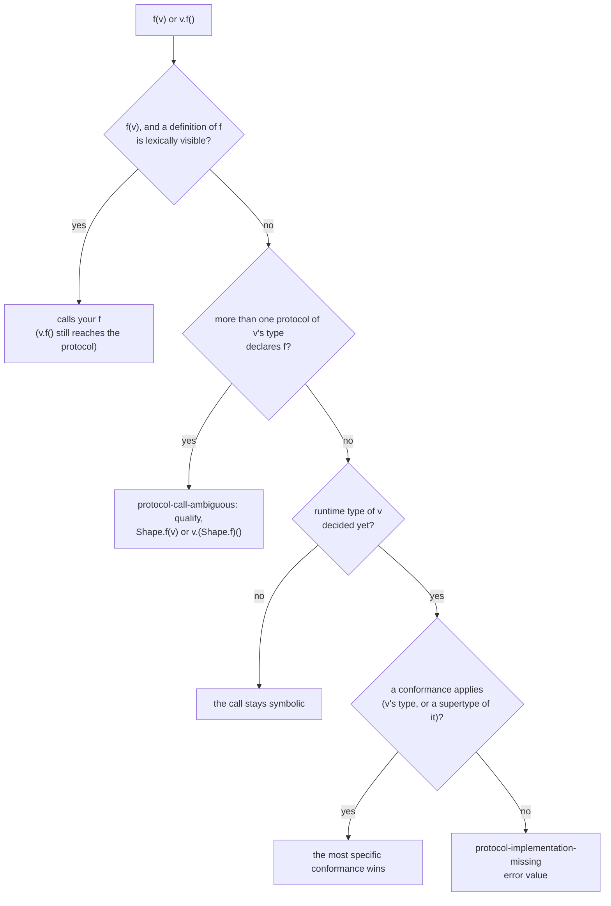

### When the bare name is taken, qualify

A library function does not take the bare name. A protocol function member
shadows the lowercase spelling of a library function of the same name, as a
user `function` does: after the `protocol` statement, a bare `floor(m)`
calls the protocol member. The library function stays reachable by its
capitalized name, `Floor(x)`.

```epsil-live
protocol Rounded { function floor(self: Self) -> integer }
type Money = tuple<cents: integer>
type Money is Rounded { function floor(self: Money) -> integer { self.cents } }

(floor(Money(3)), Floor(2.5))
// ➔ (3, 2)
```

Two situations take the bare name away. A definition of your own of the
same name (a `function`, a `let`, a parameter) that is lexically visible
**shadows** protocol members — your `size` wins over any protocol's, and
your `function floor` wins over `Rounded.floor`. And two protocols can both
declare a member that applies to the same receiver, making the bare call
ambiguous. Both have the same escape hatch: qualify the member with the
protocol's name (`Rounded.floor(m)`).

```epsil
compare("a", "b")
// -> protocol-call-ambiguous: `compare` applies to a value of type
//    `string` through `Comparable(string)` and `Comparator(string)`.
//    Use a qualified name to narrow the one you meant.

Comparable.compare("a", "b")   // ➔ "<" — just Comparable's
Comparator.compare("a", "b")   // ➔ -1  — just Comparator's
```

A misspelled protocol name is reported only when some protocol declares the
member: with only `Comparator` declared, `Comparble.compare("a", "b")` is
`protocol-unknown`. When no protocol declares the member, the name is an
ordinary free symbol, and the call stays unevaluated, as `x.compare("a", "b")`
does: `Comparble.compare("a", "b")` is then
`Apply(Field(Comparble, "compare"), "a", "b")`, with no diagnostic.

The qualified name is also a first-class **value** — pass it wherever a
function is expected:

```epsil-live
protocol Negatable { function negated(self: Self) -> Self }
type number is Negatable { function negated(self) -> number { -self } }

map(Negatable.negated, [1, 2, 3])
// ➔ [-1, -2, -3]
```

[Named arguments](/syntax/#named-arguments) work with protocol
functions in both spellings, and the call dispatches on the argument bound
to the declared first parameter wherever it is written:
`tag(prefix: "n", self: 5)` and `Tagged.tag(prefix: "n", self: 5)` both
dispatch on `5`.

### The dot form: `c.area()` {#dot-call}

A protocol function can also be called **with the dot**, the value first:
`c.area()` is exactly `area(c)`, and `c.scale(2)` is `scale(c, 2)`. The
value before the dot becomes the first argument, which is the argument the
call dispatches on. Because any expression can be the receiver, calls
chain from left to right:

```epsil-live
protocol Shape {
  function area(self: Self) -> number
  function scale(self: Self, k: number) -> Self
}
type Circle = tuple<r: number> is Shape {
  function area(self: Circle) -> number { pi * self.r^2 }
  function scale(self: Circle, k: number) -> Circle { Circle(self.r * k) }
}

let c = Circle(1)
(c.area(), c.scale(2).area(), c.scale(k: 2))
// ➔ (pi, 4pi, Circle(2))
```

The parentheses are what make the dot a call. Without them, `c.area` is a
field or [property](#properties) read, and on a `function` member it is
the `protocol-function-not-a-field` error; `c.area` is never a function
value that remembers `c`. And the dot reaches **members** only: a field, a
property, or a protocol function. A library function or a plain function is
not a member of anything, so `xs.Sort()` is the error
`dot-call-not-a-protocol-function`; write `sort(xs)`, or chain such calls
with the [pipe](/operators/#pipe), `xs |> sort |> reverse`.

Two details follow from the rest of the language. A field the receiver's
type declares wins over a protocol function of the same name, so on a
record or object whose field `f` holds a function, `v.f(2)` still calls the
stored function. And a number literal never takes a dot (`5.name()` reads as
`5.` followed by `name()`, the same rule that makes `2.x` a multiplication):
bind the number to a name first.

When two protocols the type conforms to declare the same member, the bare
call and the dot form are both `protocol-call-ambiguous`; the qualified
dot form names the protocol: `c.(Shape.area)()`. And because the dot names
a member, it reaches the protocol even when a definition of your own has
taken the bare name (see [above](#when-the-bare-name-is-taken-qualify)):
with your own `area` in scope, `area(c)` calls yours and `c.area()` still
calls the protocol's.

## Properties

A protocol can require **properties**, read with ordinary field syntax.
`readonly` requires a getter; `readwrite` a getter and a setter:

```epsil-live
protocol Signed { readonly sign: string }

type number is Signed {
  get sign(self) -> string { if (self < 0) { "-" } else { "+" } }
}

let x = -12
x.sign
// ➔ "-"
```

A `get` implementation takes `self` and returns the property's type. A
`set` implementation takes `self` and the new value, stores it, and
**returns the receiver**:

```epsil-live
protocol Nameable { readwrite name: string }

type Person = object{first: string, last: string} is Nameable {
  get name(self) -> string { "\(self.first) \(self.last)" }
  set name(self, value: string) -> Person {
    self.first = value
    self
  }
}

let p = Person(first: "Ada", last: "Lovelace")
p.name = "Augusta"        // stores into p — every reference to it sees the change
p.name
// ➔ "Augusta Lovelace"
```

### The mutability gate

`Person` above is an **object** type, and that is required rather than
incidental: a writable property is meaningful only on a mutable object,
so a protocol that can modify state — one with at least one `readwrite`
property, or a function member whose declared effects include `state` —
can be conformed to only by object types. A protocol with only
`readonly` properties and no declared `state` can be conformed to by any
type, as `Signed` is by `number` above.

```epsil
protocol Identifiable { readwrite id: string }
type Badge = record{id: string} is Identifiable
// ➔ protocol-requires-object: the `Identifiable` protocol has settable
//   properties. `Badge` is a record, and records are immutable; declare
//   `Badge` as an object type to conform.
```

A **bare** requirement never gates — its effects are derived from
whatever conformers exist, so a record may conform to a bare-function
protocol with a pure implementation — and an explicit `pure` member never
gates either, since the empty effect set is not `state`.

Assigning to a property is a **store**, and the assignment evaluates to
the value assigned. The target does not have to be a variable: any
expression that evaluates to an object can be stored into, so
`xs[1].name = "Ada"` works when the list holds objects, and a `const`
binding is no obstacle either — the store writes the object, never the
binding. On a record, a tuple or any other immutable value it is
`immutable-value-assignment`, which names the two ways forward: build an
updated copy, or declare the type as `object{…}`. Providing a `set`
implementation for a `readonly` property is
`protocol-property-readonly-set`, and so is a write through the read-only
protocol view — the qualified `p.(Named.name) = v`, or the unqualified
`p.name = v` when `name` is a computed property. A `readonly` requirement
that a stored FIELD satisfies is a different matter: `readonly` constrains
that protocol's view of the field, not the object, so a holder of the object
can still write the field directly. That asymmetry is deliberate for now and
is under review (see the `readonly` entry in `ROADMAP.md`).

If two protocols declare a property with the same name, the qualified
form disambiguates, for reads and for writes alike:
`person.(Nameable.name)` and `person.(Nameable.name) = "Ada"`.

## Conditional conformance

A parameterized type can conform **only when its arguments do**. The head
names the type's variables, and the trailing `where` clause constrains
them:

```epsil-live
protocol Summable { function total(self: Self) -> number }
type integer is Summable { function total(self) -> number { self } }

type list<T> is Summable where T is Summable {
  function total(self: list<T>) -> number {
    reduce(self, (acc, x) => acc + total(x), 0)
  }
}

(total([1, 2, 3]), total([[1, 2], [3]]))
// ➔ (6, 6)
```

`list<integer>` conforms because `integer` does; `list<string>` does not,
unless `string` is made `Summable` too. The conformance is recursive for
free — `list<list<integer>>` conforms because `list<integer>` does, as the
second call shows.

### No effect specifiers on a conditional member

A member of a **conditional** conformance may not carry an
[effect specifier](/control-flow/#effect-specifiers). Its effects are
inferred from its body instead:

```epsil
protocol Summable { function total(self: Self) -> number }

type list<T> is Summable where T: number {
  function total(self: Self) pure -> number { sum(self) }
}
```

That is refused when the conformance is declared, with
`protocol-conditional-member-effects`. Drop the `pure` and the same block
works — and `total([1, 2, 3])` answers `6`.

The restriction is specific to the conditional form. A conformance to a
ground type accepts specifiers on every member:

```epsil-live
protocol Summable { function total(self: Self) -> number }

type Box = object{n: integer} is Summable {
  function total(self: Self) pure -> number { self.n }
}

total(Box(n: 5))
// ➔ 5
```

The reason is that a conditional conformance's `Self` stands for a whole
family of types (`list<T>`, not one type), and a specifier has to be recorded
against a concrete receiver. The restriction is expected to lift; until then
the failure is reported at the declaration rather than at the call.

## Requiring conformance in a signature

A generic function can require its type variable to conform, with the `is`
slot of the [`where` clause](/types/#generic-functions):

```epsil-live
protocol Comparable {
  function compare(self: Self, other: Self) -> "<" | "=" | ">"
}
type string is Comparable {
  function compare(self, other: Self) -> "<" | "=" | ">" {
    if (self < other) { "<" } else if (self > other) { ">" } else { "=" }
  }
}

function smallest(a: T, b: T) -> T where T is Comparable {
  if (compare(a, b) == "<") { a } else { b }
}

smallest("pear", "fig")
// ➔ "fig"
```

Multiple protocols are an *and*, joined with `&`:
`where T is Comparable & Hashable`. A call whose solved type does not
conform is rejected — `smallest(True, False)` above reports
`protocol-constraint-unsatisfied`, naming the protocol and the type.

A protocol name is **not a type**: `function sort(xs: list<Comparable>)`
is `protocol-in-type-position`, and the diagnostic shows the constrained
spelling to use instead.

## Diagnostics

The protocol diagnostics carry their explanation in the message itself —
each names the protocol, the type, and the way out. The full set of codes,
grouped by when they fire:

- **Declaring**: `protocol-member-keyword-missing`,
  `protocol-self-required`, `protocol-scope-invalid`,
  `protocol-name-expected` (no protocol name after `extends` or a comma),
  `protocol-unknown` (a parent that is not a declared protocol),
  `protocol-extends-cycle`, `protocol-extends-removal`,
  `protocol-member-inherited` (a member an ancestor already declares),
  `protocol-extends-member-conflict` (two protocols of one hierarchy declare
  the same member name; also reported at the end of a run after a
  replacement causes it, until it is resolved).
- **Conforming**: `protocol-conformance-target-invalid`,
  `protocol-target-unknown`, `protocol-conformance-overlap`,
  `protocol-implementation-split` (an implementation block on a
  multi-protocol `is A & B` — provide one block per protocol),
  `protocol-requires-object` (the mutability gate: a protocol that can
  modify state, conformed to by a non-object type),
  `protocol-implementation-pending` (a warning).
- **Implementing**: `protocol-implementation-missing`,
  `protocol-implementation-duplicate`, `protocol-member-unknown`,
  `protocol-signature-mismatch`, `protocol-property-readonly-set`,
  `protocol-conditional-member-effects` (an effect specifier on a member of a
  conditional conformance).
- **Calling**: `protocol-call-ambiguous`, `protocol-property-ambiguous`,
  `protocol-constraint-unsatisfied`, `protocol-in-type-position`,
  `immutable-value-assignment` (a property store on a value).

---

# Epsil Pragmas

Source: https://epsil.dev/pragmas/

# Pragmas

Pragmas are source forms evaluated by the Epsil parser rather than at run time.
A pragma is replaced by its value while the program is being read, before
execution begins.

## Environment Variables

Environment variables are defined in the host process when Epsil is parsed
under Node.js. In Unix, they are set using a
shell-specific syntax (`export VARIABLE=value` in bash shells, for example).

Environment variables are not normally available when parsing takes place in a
browser.

Use `#env()` to read an environment variable:

<!-- epsil-test: expect-diagnostics -->

```epsil
#env("DEBUG")
```

Some common environment variables include:

- `NO_COLOR`: if set, color output to the terminal should be avoided
- `TERM`: describe the capabilities of the output terminal, e.g.
  `xterm-256color`
- `HOME`: path to the user home directory
- `TEMP`: path to a temporary file directory

`#env()` reads host state and is therefore disabled by default: without
opting in, it produces a `host-pragma-disabled` diagnostic and the value
`nothing`. A trusted host can enable it.

### Navigator Properties

Navigator properties are available when parsing takes place in a browser.

Use `#navigator()` to read a property of the browser's `navigator` object. Like
`#env()`, it is disabled unless the host opts in. It returns `nothing` when the
browser property is
not available.

<!-- epsil-test: expect-diagnostics -->

```epsil
#navigator("userAgent")
```

## Parser Messages

`#error()` stops parsing, and reports an `error-directive` diagnostic:

<!-- epsil-test: expect-diagnostics -->

```epsil
#error("File cannot be compiled")
```

`#warning()` does not write to the console and does not add a diagnostic. It
evaluates at parse time to its message string, allowing parsing to continue:

```epsil
#warning("TODO: Implement function")
```

## Other Pragmas

The following pragmas are replaced with the indicated value:

- `#line`: the current source line number. The first line is line 1.
- `#column`: the current column number. The first column is column 1.
- `#url`: the source URL the host supplied for the program, or `nothing` when
  none was.
- `#filename`: the final path component of the source URL, or `nothing` when no
  URL was supplied.
- `#date`: the current date in the `YYYY-MM-DD` format.
- `#time`: the current time in the `HH:MM:SS` format.

These six pragmas are always available. Epsil does not currently implement a
pragma for overriding the source location.

---

# Epsil Syntax

Source: https://epsil.dev/syntax/

# Epsil Syntax

## Notation

In the grammar below, the following notation is used:

- An arrow (→) marks grammar productions and can be read as "can consist of"
- Syntactic categories are written in lowercase italic (_newline_) on both sides
  of a production rule.
- Placeholders for recursive syntactic categories are indicated by _···_.
- Literal words and punctuation are indicated in bold (**+**) or as a Unicode
  codepoint (U+00A0) or as a Unicode codepoint range (U+2000-U+200A).
- Alternatives are indicated by a vertical bar (|)
- Optional elements are indicated in square brackets
- Elements that can repeat 1 or more times are indicated by a trailing plus sign
- Elements that can repeat 0 or more times are indicated by a trailing star sign
- Elements that can repeat 0 or more times, separated by a another element are
  indicated with a trailing hash sign, followed by the separator. If no
  separator is provided, the comma (,) is implied.

## Grammar overview

The productions below describe the source forms accepted by the current
parser. The Unicode identifier rules are described under
[Symbols](/literals/#symbols), and the type following a `:` or return
arrow is parsed using the
[Compute Engine type language](/compute-engine/guides/types/). Detailed
`match` patterns are documented under
[Control Flow](/control-flow/#match).

_quoted-text-item_ → U+0000-U+0009 U+000B-U+000C U+000E-U+0021 U+0023-U+2027
U+202A-U+D7FF | U+E000-U+10FFFF

_linebreak_ → (U+000A \[U+000D\]) | U+000D | U+2028 | U+2029

_unicode-char_ → _quoted-text-item_ | _linebreak_ | U+0022

_pattern-syntax_ → U+0021-U+002F | U+003A-U+0040 | U+005b-U+005E | U+0060 |
U+007b-U+007e | U+00A1-U+00A7 | U+00A9 | U+00AB-U+00AC | U+00AE | U+00B0-U+00B1
| U+00B6 | U+00BB | U+00BF | U+00D7 | U+00F7 | U+2010-U+203E | U+2041-U+2053 |
U+2190-U+2775 | U+2794-U+27EF | U+3001-U+3003 | U+3008-U+3020 | U+3030 | U+FD3E
| U+FD3F | U+FE45 | U+FE46

_inline-space_ → U+0009 | U+0020

_pattern-whitespace_ → _inline-space_ | U+000A | U+000B | U+000C | U+000D |
U+0085 | U+200E | U+200F | U+2028 | U+2029

_whitespace_ → _pattern-whitespace_ | U+0000 | U+00A0 | U+1680 | U+180E |
U+2000-U+200A | U+202f | U+205f | U+3000

_line-comment_ → **`//`** (_unicode-char_)\* _linebreak_)

_block-comment_ → **`/*`** (((_unicode-char_)\* _linebreak_)) | _block-comment_)
**`*/`**

_digit_ → U+0030-U+0039 | U+FF10-U+FF19

_hex-digit_ → _digit_ | U+0041-U+0046 | U+0061-U+0066 | U+FF21-FF26 |
U+FF41-U+FF46

_binary-digit_ → U+0030 | U+0031 | U+FF10 | U+FF11

_numerical-constant_ → **`NaN`** | **`Infinity`** | **`+Infinity`** |
**`-Infinity`** | **`oo`** | **`+oo`** | **`-oo`**

(`oo` is an input alias for `Infinity`; the serializer always emits the
canonical `Infinity` spelling.)

_base-10-exponent_ → (**`e`** | **`E`**) \[_sign_\](_digit_)+

_base-2-exponent_ → (**`p`** | **`P`**) \[_sign_\](_digit_)+

_exponent_ → _base-10-exponent_ | _base-2-exponent_

_binary-number_ → **`0b`** (_binary-digit_)+ \[**`.`** (_binary-digit_)+
\]\[_exponent_\]

_hexadecimal-number_ → **`0x`** (_hex-digit_)+ \[**`.`** (_hex-digit_)+
\]\[_base-2-exponent_\]

_decimal-number_ → (_digit_)+ \[**`.`** (_digit_)+ \]\[_exponent_\]

The digit runs of a number literal may contain **`_`** grouping separators
(`1_000`, `0xFF_FF`); an underscore is ignored and never begins or ends a
run. A _hexadecimal-number_ takes only a _base-2-exponent_ because `e` and
`E` are hexadecimal digits, so they cannot double as an exponent marker.

_sign_ → **`+`** | **`-`**

_signed-number_ → _numerical-constant_ | (\[_sign_\] (_binary-number_ |
_hexadecimal-number_ | _decimal-number_))

_symbol_ → _verbatim-symbol_ | _inline-symbol_

_verbatim-symbol_ → **`` ` ``** _symbol-start_ (_symbol-continue_)\*
**`` ` ``**

The content of a _verbatim-symbol_ is taken literally: no escape sequences
are applied, and it must still be a valid symbol name. The form exists to
write symbols whose name is a reserved word, e.g. `` `while` ``.

_inline-symbol_ → _symbol-start_ (_symbol-continue_)\*

_symbol-start_ and _symbol-continue_ follow the Unicode profile described
under [Symbols](/literals/#symbols). Reserved words are not accepted as
_inline-symbol_; use the verbatim form.

_escape-expression_ → **`\(`** _expression_ **`)`**

_single-line-string_ → **`"`** (_escape-sequence_ | _escape-expression_ |
_quoted-text-item_)\* **`"`**

_multiline-string_ → **`"""`** _multiline-string-line_ **`"""`**

_extended-string_ → (**`#`**)+ **`"`** (_unicode-char_)\* **`"`** (**`#`**)+

The number of trailing **`#`** must match the number of leading **`#`** that
opened the literal (`#"…"#`, `##"…"##`, …). No escape sequences are applied
inside an extended string, so it can hold `"` and `\` literally.

_string_ → _single-line-string_ | _multiline-string_ | _extended-string_

String escapes, interpolation, multiline indentation and continuation are
specified in [Literals](/literals/#strings).

_parenthesized_ → **`(`** _expression_ **`)`**

_list_ → **`[`** \[(_expression_)#**`,`**\] **`]`** | **`[`** _expression_ _comprehension-clauses_ **`]`**

_set_ → **`{`** \[(_expression_)#**`,`**\] **`}`** | **`{`** _expression_ _comprehension-clauses_ **`}`**

_dictionary_ → **`{`** \[(_key-value-pair_)#**`,`**\] **`}`** | **`{->}`** | **`{`** _key-value-pair_ _comprehension-clauses_ **`}`**

_key-value-pair_ → _expression_ **`->`** _expression_

_comprehension-clauses_ → \[**`parallel`**\] **`for`** (_comprehension-clause_)#**`,`**

_comprehension-clause_ → (_symbol_ | _tuple-pattern_) **`in`** _expression_ \[**`if`** _expression_\]

_block_ → **`{`** \[(_statement_)#_statement-separator_\] **`}`**

_do-block_ → **`do`** _block_

_latex-island_ → **`$`** (_unicode-char_ | **`\$`**)\* **`$`**

_pragma_ → **`#line`** | **`#column`** | **`#url`** | **`#filename`** |
**`#date`** | **`#time`** | _pragma-call_

_pragma-call_ → (**`#env`** | **`#navigator`** | **`#warning`** |
**`#error`**) **`(`** \[(_expression_)#**`,`**\] **`)`**

_if-expression_ → **`if`** (_expression_ | **`let`** _pattern_ **`=`**
_expression_) _block_ \[**`else`** (_block_ | _if-expression_)\]

_match-expression_ → **`match`** _expression_ **`{`** _match-case_+ **`}`**

_primary_ → _signed-number_ | _symbol_ | _string_ | _pragma_ |
_latex-island_ | _parenthesized_ | _list_ | _set_ | _dictionary_ |
_do-block_ | _if-expression_ | _match-expression_

_call-clause_ → **`(`** \[(_argument_)#**`,`**\] **`)`**

_argument_ → \[**`...`**\] _expression_

_index-clause_ → **`[`** (_expression_)#**`,`** **`]`**

_field-clause_ → **`.`** _symbol_
&nbsp;&nbsp;&nbsp;&nbsp;— the `.` must abut the base; not after a number
literal

_member-call-clause_ → _field-clause_ _call-clause_
&nbsp;&nbsp;&nbsp;&nbsp;— the `(` must abut the member name; a protocol
function called on the base, `c.area(2)`

_postfix-expression_ → _primary_ (_member-call-clause_ | _call-clause_ |
_index-clause_ | _field-clause_ | **`!`**)\*

_expression_ → _primary_ | _prefix-expression_ | _infix-expression_ |
_postfix-expression_

_prefix-expression_ → (**`-`** | **`!`**) _expression_

_infix-expression_ → _expression_ _operator_ _expression_

_literal-parameter_ → _signed-number_ | _string_ | **`true`** | **`false`**
&nbsp;&nbsp;&nbsp;&nbsp;— a string literal parameter cannot contain interpolation

_parameter_ → _symbol_ \[**`:`** _type_\] | _literal-parameter_

_parameters_ → **`(`** \[(_parameter_)#**`,`**\] **`)`**

_effect-label_ → **`console`** | **`entropy`** | **`environment`** |
**`fs_read`** | **`fs_write`** | **`network`** | **`random`** |
**`scope`** | **`state`** | **`time`**

_effect-specifier_ → **`pure`** | **`any`** | (_effect-label_)+
&nbsp;&nbsp;&nbsp;&nbsp;— labels are space-separated; duplicates are rejected;
**`pure`** and **`any`** cannot be combined with another word

_declaration_ → (**`let`** | **`const`**) _symbol_
\[**`:`** _type_\] \[**`=`** _expression_\] |
(**`let`** | **`const`**) _tuple-pattern_ **`=`** _expression_ |
_symbol_ **`:`** _type_ \[**`=`** _expression_\]

_tuple-pattern_ → **`(`** (_symbol_ | _tuple-pattern_)#**`,`** **`)`**
&nbsp;&nbsp;&nbsp;&nbsp;— at least two elements; `_` skips a position

_math-function-signature_ → **`->`** _type_ |
_effect-specifier_ **`->`** _type_

_type-parameter_ → _symbol_ \[**`:`** _type_\]
&nbsp;&nbsp;&nbsp;&nbsp;— the bound must be a ground type (it may not mention
another type parameter)

_type-parameter-clause_ → **`<`** (_type-parameter_)#**`,`** **`>`**
&nbsp;&nbsp;&nbsp;&nbsp;— at least one parameter (`<>` is rejected); duplicate
names are rejected; the names scope over the definition's HEAD only (its
parameters, effect specifier, and return type), not over its body

_function-definition_ → \[**`hold`**\] _symbol_ _parameters_
\[_math-function-signature_\] **`=`** _expression_ |
\[**`hold`**\] **`function`** _symbol_ \[_type-parameter-clause_\] _parameters_
\[_effect-specifier_\] \[**`->`** _type_\] _block_
&nbsp;&nbsp;&nbsp;&nbsp;— the `<…>` clause is claimed only by the
**`function`** form: `f<T>(x) = x` is genuinely ambiguous with a relational
expression, so the math form does not take it; the **`hold`** prefix
(a contextual keyword — `hold` is an ordinary identifier elsewhere) makes a
definition whose arguments are bound unevaluated, see
[Hold functions](/control-flow/#hold-functions); it does not combine
with a type-parameter clause or a literal parameter. A parameter of a `hold`
definition may be marked **`bind`** (`hold mySum(body, bind i, n)`): it
receives a symbol, the bound variable. The _effect-specifier_ slot also
accepts the algebraic words **`commutative`**, **`associative`**,
**`idempotent`**, **`involution`** (definition attributes, not effects). A
doc comment (`///` lines or `/** … */`) immediately before a definition is
its description

_type-declaration_ → **`type`** **`alias`** _symbol_
\[_type-parameter-clause_\] **`=`** _type_ |
**`type`** _symbol_ \[_type-parameter-clause_\] **`=`** _type_
&nbsp;&nbsp;&nbsp;&nbsp;— both forms take a clause (a variance marker such
as `out T` is legal only on the bare, nominal, form). The clause names scope
over the definition only, and each must be used in it. Types are global, so
a _type-declaration_ is only valid at the top level of a program — inside a
block or function body it is the `type-declaration-not-top-level` error

_while-statement_ → **`while`** (_expression_ | **`let`** _pattern_ **`=`**
_expression_) _block_

_for-statement_ → **`for`** _symbol_ **`in`** _expression_ _block_

_statement_ → _declaration_ | _type-declaration_ | _function-definition_ |
_while-statement_ | _for-statement_ | _expression_

_statement-separator_ → **`;`** | _linebreak_

_shebang_ → **`#!`** (unicode-char)\* (_linebreak | \_eof_)

_epsil_ → (\[_shebang_\] (_statement_)#_statement-separator_ \[_eof_\])

The Pratt (precedence-climbing) grammar for `_infix-expression_`,
`_prefix-expression_`, and `_postfix-expression_` — the operator set, its
precedence, and its associativity — is documented as a table in
[Operators](/operators/) rather than spelled out production by
production; the whitespace rule described there (an infix operator has
whitespace on both sides or neither; a prefix operator has no whitespace after
it, and a postfix operator none before it) is part of this grammar, not a
separate lexical concern.

## Statements and sequencing

A program is a sequence of statements separated by a linebreak or a `;`. Two
expressions on the same line with no separator between them is **not** a
silent sequence — it is a diagnostic:

<!-- epsil-test: expect-diagnostics -->

```epsil
1 2
```

```
Error: unexpected-symbol "2"
```

A multi-statement program is a sequence, evaluated in order, whose value is the
value of its last statement. `;` is interchangeable with a linebreak as a
separator, so these two programs are identical:

```epsil
a
2
```

```epsil
a; 2
```

## Primary expressions

A primary is the leaf of the expression grammar — the thing an operator or a
call/index applies to. The primary forms are:

- a number: `2`, `3.14`, `0x1F`, `0b101`
- a symbol: `x`, `Add`
- a verbatim symbol: `` `while` ``
- a string: `"hello"`
- a pragma: `#env("HOME")`
- a parenthesized expression: `(2 + 3)`
- a list: `[1, 2, 3]`
- a set: `{1, 2, 3}`
- a dictionary: `{one -> 1, two -> 2}`
- a `do { … }` block expression: `do { let t = 3; t + 1 }`
- a `$…$` LaTeX island: `$\frac{1}{2}$` — see
  [LaTeX Islands](/literals/#latex-islands)
- a function call: `f(x, y)`
- an index expression: `xs[i]`
- a field access: `p.x`

## Calls, indexing and field access

A call is a symbol (or another primary) immediately followed — with **no**
whitespace — by a parenthesized, comma-separated argument list:

```epsil
f(x, y)
f()
```

An argument may be prefixed with `...` to spread a tuple's elements into the
call's arguments (`...` is also valid in list, set, and dictionary
literals, where it splices non-tuple collections — see
[Spread](/operators/#spread)):

```epsil
f(...p)
f(1, ...p)
```

The callee does not have to be a bare symbol. A parenthesized expression, or
the result of another call, can be called too:

```epsil
(getF())(x)
(a + b)(2+1)
```

### Named arguments

An argument can be passed by the name of the parameter it is for, written
`name: value`. Named arguments may be given in any order, and may follow
positional arguments — but never precede them:

```epsil
function interest(principal: number, rate: number) -> number {
  principal * rate
}

interest(principal: 1000, rate: 0.05)   // ➔ 50
interest(rate: 0.05, principal: 1000)   // ➔ 50 — order-free
interest(1000, rate: 0.05)              // ➔ 50 — positional prefix is fine
interest(rate: 0.05, 1000)              // ✘ positional after named
```

The names checked are the ones the callee's **declaration** carries — a
`function` definition's parameters, a
[named function-type annotation](/declarations/#function-type-annotations-bind-their-parameter-names),
an annotated lambda (including one assigned to a name,
`f := (x: number, y: string) => x + 3` then `f(y: "ok", x: 1)`), or a
protocol member's requirement (both the bare call
`compare(other: y, self: x)` and the qualified
`Comparable.compare(other: y, self: x)`, which dispatch on `self`
wherever it is written). An inline lambda applied directly reads its
names from the expression itself — `((x: number) => x + 1)(x: 5)` is
`6`, and unannotated parameters work there too,
`((x, y) => x - y)(y: 2, x: 10)` is `8`.

A function stored in a field of a record or a dictionary takes names in
two cases. When the record is a `const`, its field cannot change, so the
call is the same as a call of the function in the field: its names, and
its `lazy` flag for a host operator, apply. When the record's declared
type gives the field a signature with named parameters, the names come
from that type, and the variable can later hold another record of the
same type:

```epsil
function scale(x: number, factor: number) -> number { x * factor }

const ns = {S -> scale}
ns.S(factor: 5, x: 3)              // ➔ 15 — the same as scale(factor: 5, x: 3)

let r: record{S: (x: number, factor: number) -> number} = {S -> scale}
r.S(factor: 5, x: 3)               // ➔ 15 — names from the type of r
```

Through a variable typed only `dictionary<function>`, the field's
parameter names are not known, and a named call is an error.

A parameter without a declared name is positional-only, and a callee
whose parameter names the engine cannot read cannot take named
arguments at all: a forward reference (a call *before* the statement
that pins the callee's signature), a value typed only as `function`,
or an **unannotated** lambda reached through a binding —
`h := (x, y) => …` then `h(x: 1, y: 2)` declines, because type
inference drops the parameter names; annotate the parameters to call
it by name. A misspelled name gets a "did you mean" pointing at the
closest declared one.

A call that names any argument is a **complete** call: optional
parameters may simply be omitted, but a missing required parameter is an
error — a named call never turns into a partial application — and a
variadic tail cannot be filled (nor can `...` spread arguments mix with
names). Partial application and spreads remain available through purely
positional calls.

When a function has several clauses or overloads, a named argument is
also a **branch selector**: a clause that does not declare the written
name is never chosen, even if the argument's value would have selected
it. With clauses `(z: 0)`, `(o: 1)` and `(n: integer)`, the call
`f(n: 0)` runs the general `n` clause with the argument `0`, while
`f(0)` runs the `z: 0` base clause. Among the clauses that do declare
the written names, selection works exactly as for a positional call. If
the surviving overloads read the same names in different orders and
nothing else tells them apart, the call is an error asking you to be
explicit — call it positionally.

Note the disambiguations: `f(a := 1)` passes the *assignment* `a := 1`
as an ordinary argument (the token is `:=`, not `:`), and each
diagnostic these rules produce has an extended explanation under
`epsil doc <code>` (e.g. `epsil doc argument-name-unknown`).

Indexing is a primary immediately followed — with no whitespace — by a
bracketed index expression. Indexing is **1-based** (`xs[1]` is the first
element):

```epsil
xs[i]
f(x)[0]
```

Field access is a primary immediately followed — with no whitespace — by a
`.` and a symbol. Chains associate left, and a field value can be called like
any other computed callee:

```epsil
p.x
a.b.c
p.x(2)
```

A number literal never takes a field: the lexer folds a trailing dot into
the number, so `2.x` is the multiplication `2. * x`, and `1..5` stays a
range. See [Types](/types/#values-of-a-new-type-are-opaque) for what
`p.x` means on values of declared types, records and dictionaries.

A field clause immediately followed — again with no whitespace — by a
parenthesized argument list is a **member call**: `c.area()` calls the
protocol function `area` with `c` as its first argument, the same call as
`area(c)`, and `c.scale(2)` is `scale(c, 2)`. Only a protocol function is
reached this way; on a value whose type declares a field of that name, the
form keeps meaning "read the field, then call what it holds" (`p.x(2)`
above). The parenthesized read `(c.area)(2)` is that field read applied to
arguments, never a member call. See
[Protocols](/protocols/#dot-call).

In all three cases the `(`, `[` or `.` must directly abut the
callee/indexed expression: whitespace before it means the form is a
separate primary (or, for `.`, a diagnosed stray token), not a
call/index/field — the same whitespace-sensitivity that governs operators.

## Collections, tuples, and dictionaries

- **List**: `[a, b]`; `[]` is the empty list.
- **Set**: `{a, b}`; `{}` is the empty set.
- **Tuple**: `(a, b)`. A single parenthesized element, `(a)`, is just the
  parenthesized expression `a`, not a one-element tuple; `()` is a diagnostic
  (`expression-expected`) — there is no empty tuple — **except** immediately
  before a mapsto arrow, where `() => expr` is a zero-parameter lambda.
- **Dictionary**: `{k -> v}`; an unquoted key becomes a string key. The empty
  dictionary is spelled `{->}`, not `{}` (which is the empty set).

`{ … }` is disambiguated by looking at the first element once it has been
parsed: if it is followed by a top-level `->`, the whole `{ … }` is a
dictionary and every subsequent element must also be a `key -> value` pair;
otherwise `{ … }` is a set.

A `{` in expression position is therefore **always** a collection literal (set
or dictionary); to open a statement block in expression position, prefix it
with `do`. `do { … }` is a block expression — a statement sequence whose value
is its last statement — while a bare `{ … }` stays a set/dictionary. See
[Blocks](/control-flow/#blocks).

```epsil
{ one -> 1, two -> 2 }
```

### Comprehensions

A `for` clause after the first (and only) element of a list or brace literal
makes it a **comprehension**. The bracket picks the collection kind, exactly
as it does for a literal:

```epsil
[x^2 for x in 1..10 if x % 2 == 1]        // list: [1, 9, 25, 49, 81]
{x % 3 for x in 1..10}                     // set: {1, 2, 0}
{s -> length(s) for s in ["ab", "cde"]}    // dictionary: {"ab" -> 2, "cde" -> 3}
```

Each clause is `binding in collection`, optionally followed by `if guard`;
several clauses are separated by commas and nest left to right, so a later
collection may use an earlier binding:

```epsil
[(x, y) for x in 1..3, y in 1..x]
// ➔ [(1, 1), (2, 1), (2, 2), (3, 1), (3, 2), (3, 3)]
[p + q for (p, q) in [(1, 2), (-3, 4)] if p > 0]
// ➔ [3]
```

The binding is a name or a tuple destructuring pattern, with the same grammar
as the `for` statement. The bound names are visible in the guard, in the later
clauses and in the body, and nowhere outside the brackets. An element is kept
only when its guard evaluates to `true`; a guard that cannot be decided
excludes the element. An element that does not match a tuple pattern is the
`incompatible-type` error value in its position, and the comprehension goes
on with the next element: `[p + q for (p, q) in [(1, 2), 5, (3, 4)]]` has
three elements, the second one the error. (A `for` loop stops on such an
element.)

A list comprehension is the engine's `Comprehension`, a lazy collection like
`map`, `filter` and a range: it enumerates when it is indexed, aggregated or
iterated. A set comprehension deduplicates its values. In a dictionary
comprehension the key is an **expression** — it is evaluated, and must produce
a string — unlike the unquoted key of a literal `{one -> 1}`, which is the
string `"one"`. A repeated key keeps the last value.

The collection and the guard are read above the conditional expression, so a
conditional, a pipeline, a `??` or a `->` in either position must be
parenthesized: `[x for x in (xs |> sort)]`. The body is an ordinary expression
and needs no parentheses: `[x if x > 0 else 0 for x in xs]`.

The lowering is the engine's `Comprehension` with one `Element` clause per
`in`, and the guard as the clause's third operand:

```epsil
[x^2 for x in xs if x > 0]
// ➔ ["Comprehension", ["Power", "x", 2], ["Element", "x", "xs", ["Greater", "x", 0]]]
{x for x in xs}          // ➔ ["SetFrom", ["Comprehension", "x", ["Element", "x", "xs"]]]
{k -> v for (k, v) in ps} // ➔ ["DictionaryFrom", ["Comprehension", ["Tuple", "k", "v"], ["Element", ["Tuple", "k", "v"], "ps"]]]
```

With `parallel` before the first `for`, the comprehension is a **parallel
comprehension** (`[f(k) parallel for k in 1..n]`, lowered to
`ParallelComprehension`): its passes can run in any order. See
[Parallel loops](/control-flow/#parallel-loops).

Trailing commas are allowed in every collection form (lists, sets, tuples,
dictionaries, and call/index argument lists) — friendly to notebook editing
and diffs:

```epsil
[1, 2, 3,]    // same as [1, 2, 3]
```

A bare, top-level comma-separated sequence with no enclosing delimiter (for
example `1, 2, 3` on its own) is **not** a sequence literal — it is a
diagnostic. A sequence is written only as an explicit call, `Sequence(1, 2, 3)`.

## Round-trips

Reading a program and writing it back out reproduces its meaning, but not
necessarily its spelling. A few forms have one canonical rendering: numbers get
a single spelling (with `_` digit grouping), a division is always written with
an explicit `/`, `2x` keeps its juxtaposed form where that re-reads
unambiguously (but `2(x+1)` and `(x+y)(3+4)` keep an explicit `*`, since a
juxtaposed group would read as a call), and `is` is written as `in` — the two
spell the same membership test.

Comments are **not** preserved by a round-trip — see
[Comments](/comments/). For the exact list of normalizations, see
[Round-trip and serialization normalizations](/implementation/#round-trip-and-serialization-normalizations).

## Relationship to the loose math parser

Epsil is a **programming-language** syntax. The Compute Engine also ships a
*loose math parser* that reads LaTeX/ASCII-math notation. The two share a few
surface forms but are **not** the same language: in Epsil a juxtaposed name is
a single identifier (`sin` is one symbol, not `s·i·n`), `f(x, y)` is a function
call rather than a product, and `**` is exponentiation. Do not assume a snippet
means the same thing to both. See
[Relationship to the loose math parser](/implementation/#relationship-to-the-loose-math-parser)
for a form-by-form comparison.

---

# Epsil Errors

Source: https://epsil.dev/errors/

# Epsil Errors

Every Epsil diagnostic carries a stable, kebab-case code — `static-type-error`,
`mapsto-arrow-expected` — shown after the message in the editor and by
`epsil check`. The sections below are the extended explanations for the codes
that have more to say than their message already does; they are the same text
`epsil doc <code>` prints. In Visual Studio Code, clicking a
diagnostic's code opens its section on this page.

## `spread-tuple`

A spread (`...x`) in a list or set literal was given a tuple. Tuples are units — a point, a pair — so they do not splice into a surrounding collection; the spread would silently do nothing, which is why it is rejected instead.

To use a tuple's elements as list elements, convert explicitly: `ListFrom(t)` is the list of t's elements, so `[...ListFrom(t), 3]` splices them. (In a CALL argument list the rule is reversed: argument lists are tuple-shaped, so there `f(...t)` spreads exactly tuples.)

## `incompatible-type`

A value's type does not match what its context requires — a typed declaration (`let x: string = …`) whose initializer has a different type, an argument outside a function's signature, or a value that fails a type ascription.

The message reads "expected `T`, got `U`": T is what the context requires, U is what the value actually has. A site may follow — "at `x`" quotes the offending subexpression. A type like `list<string^5>` is a list of exactly 5 strings; `integer` is a whole number, finite like every bare numeric type name.

The check runs twice by design: once statically, when the program is canonicalized (reported before anything runs), and again during evaluation, where the mismatch becomes an error value that propagates outward (see `epsil doc runtime-error`).

## `expected-present`

A presence assertion `x?!` (`AssertPresent(x)`) was evaluated on an absent value: `missing`, `NaN`, or an indeterminate form such as `0/0`. The assertion says "this value is present, fail otherwise", and it failed; the error names the operand as written.

An absent value is a data state, not a bug in itself: an index out of range (`xs[i]`), a `first(filter(…))` that found nothing, a restricted value whose condition did not hold. Decide what the program should do when it happens. Write `x ?? fallback` to replace the absent value, test it with `isMissing(x)` and branch, or keep the assertion where absence really is a violated precondition and let the error propagate (`if let v: !error = …` catches it). `Nothing` is the value of an empty block, not an absent datum, and passes the assertion.

## `no-product-between-points`

Two points (tuples) were multiplied, and there is no implicit product between points. Multiplication of a point by a SCALAR is defined — it scales each component — and so is adding two points of the same arity, but `(1, 2) * (3, 4)` has no single meaning, so the engine rejects it rather than guessing.

Say which product you mean. `Dot(a, b)` is the inner product (`(1,2)·(3,4)` is 11) and is defined whenever the two points have the same number of components. `Cross(a, b)` is the cross product, defined only for two 3-component points; the message names it only when both operands have three components, because for a pair of plane points it would just produce an `incompatible-dimensions` error instead.

Juxtaposition, `\cdot` and `\times` all parse to the same multiplication, so writing `a \times b` between two points does not select the cross product — spell `Cross(a, b)` for that.

## `no-division-by-point`

A point (tuple) was used as a divisor. Dividing a point BY a scalar is defined — it scales each component, so `(4, 6) / 2` is `(2, 3)` — but there is no reciprocal of a point, so neither `x / (1, 2)` nor `(1, 2) / (3, 4)` has a meaning to give them.

If you meant to scale by the reciprocal of one component, index it: `p / q[1]`. If you meant a component-wise quotient, build it explicitly from the components.

## `return-in-expression-body`

A `Return` appears in an operand of `Sum`, `Product`, `Integrate`, `D`, `ND`, `NIntegrate`, `Limit` or `NLimit` (the operator is named in the error): in the body, a bound or a variable. These operands are expressions, computed once per index value or integration point, not statement blocks of the enclosing function, so a `Return` there has no function to end. Before, it stayed in the value: `Sum(1 + Return("q"), (k, 1, 2))` was `2 + 2Return("q")`.

To leave a function early, test the condition outside the operator and return from the function body. A `Return` inside a function literal in the body (`Sum(Apply(x ↦ { return 2x }, k), (k, 1, 3))`) ends that function and is allowed.

## `missing`

A function was called with fewer arguments than its signature requires; the error marks the position of the argument that was not provided.

Check the signature with `epsil doc <FunctionName>`. Optional parameters never produce this error — only required ones do.

## `unexpected-argument`

A function was called with more arguments than its signature accepts; the quoted value is the first extra one.

Check the signature with `epsil doc <FunctionName>`. A common cause is passing a collection's elements separately where the function expects the collection itself (or the reverse).

## `callback-arity`

A collection operator was given a callback that declares a different number of parameters than the operator passes it — `Map((p, q) => p + q, xs)`, where Map applies the callback to one element at a time.

An ordinary call may supply fewer arguments than a function declares: `f(1)` on a two-parameter `f` is partial application, and yields a function awaiting the rest. Inside a collection operator that is never what was meant, because the OPERATOR decides how many arguments the callback receives — so `Map` would build a list of leftover functions rather than a list of results. The check is therefore specific to operator-owned callback slots; ordinary calls still curry.

If the elements are pairs (or tuples) and the callback meant to take one apart, write the parameter as a tuple pattern: `Map(((p, q)) => p + q, pairs)` — the extra parentheses make it ONE parameter that is destructured, not two parameters.

A few operators read the callback's arity as a choice between two modes and accept either: `Sort` takes a unary sort key or a binary comparator, and `Iterate` takes `f(previous)` or `f(index, previous)`. Those report this error only when the callback matches neither.

A pipe stage is checked on the same grounds but reports `pipe-stage-arity`, because the remedy there is different.

## `pipe-stage-arity`

A pipe stage declares a number of parameters it can never be called with — `[100, 200] |> (x, y, z) => x + y + z`. A pipe passes its stage exactly one value, so only a stage that accepts one argument can be applied.

As with a callback slot, an ordinary call may supply fewer arguments than a function declares — `f(1)` on a two-parameter `f` is partial application — but a pipe is not an ordinary call: the piped value is the whole argument list, so a leftover function is never the result the pipeline was written to produce.

A stage that genuinely takes several arguments is written as a CALL, with `_` marking the slot the piped value fills: `xs |> Fold(f, 0, _)`. The `_` may be left out when the call is missing exactly one required argument, so `xs |> Take(10)` means `xs |> Take(_, 10)`.

If the piped value is a collection whose elements are tuples and the stage meant to take one apart, write the parameter as a tuple pattern — `pairs |> ((p, q)) => p + q` — where the extra parentheses make it ONE parameter that is destructured.

## `argument-name-unknown`

A call passed an argument by name (`f(rate: 0.05)`), but the called function declares no parameter with that name; the message lists the names it does declare, and a "did you mean" points at the closest one.

Only parameters that carry a name in the function's declaration can be addressed by name — an unnamed parameter is positional-only. Check the signature with `epsil doc <FunctionName>`.

## `argument-order-invalid`

In a call that mixes positional and named arguments, all positional arguments must come first: once one argument is named, every later argument must be named too.

`f(1, rate: 0.05)` is fine; `f(rate: 0.05, 1)` is this error — after `rate:` there is no position left for a bare `1` to occupy unambiguously.

## `argument-name-duplicate`

The same parameter was supplied twice — either two named arguments used the same name, or a named argument repeats a parameter that an earlier positional argument already filled.

In `f(1000, principal: 2000)` the first positional argument already occupies `principal`, so naming it again is this error, not an override.

## `argument-names-unavailable`

A call passed arguments by name, but the called function has no declaration the engine can read parameter names from — it is undefined, a local function not yet declared, or held in a variable whose declared type gives no parameter names (`function`, or a signature such as `(number, number) -> number`).

Named arguments are checked against the declaration the call resolves through; with no declaration visible there is nothing to check the names against. For a variable, only its declared type counts, never the function it holds now: that function can change after the call is written. Call it positionally, move the definition before the call, or declare the variable with a signature that names its parameters (`let g: (x: number, y: number) -> number = …`).

The same error covers an OVERLOADED function whose overloads accept the call but disagree about which argument fills which parameter — the names then pick an argument order rather than just an implementation, and the engine will not guess. Call it positionally, or give the overloads distinct parameter types.

## `argument-names-required`

The called function requires every argument to be written with its parameter's name (`Person(firstName: "Alan", age: 42)`); the message lists the names, in declaration order.

Object-type constructors are the functions in this shape. An object type's fields are frequently several of the same type, so a positional call that transposed two of them would be accepted in silence and build a wrong object with no error anywhere. Because the arguments are named, their order does not matter.

## `argument-optional-skipped`

A named argument supplied an optional parameter while an optional parameter declared before it was left out.

Arguments are matched to declared positions, and there is no way to leave a hole in the argument list — so an optional parameter can only be named when every optional parameter declared before it is also supplied (by position or by name). Supply the earlier optional too, or omit both.

A parameter with a default value is never the cause: when a named argument skips it, it takes its default. With `function f(x, density: number = 1, factor: number = 2)`, the call `f(3, factor: 5)` is `f(3, 1, 5)`. Only an optional parameter WITHOUT a default (`number?` in a declared signature) leaves a hole.

## `default-value-invalid`

A parameter's default value (the part after `=` in `function f(x, k: number = 2)` or `(x, k = 2) => …`) is not one the language accepts here. A default is a constant: a number (with an optional sign), a string, `true` or `false`, the empty list `[]`, the empty dictionary `{}`, a constant (a constant of the library, `Integers`, `Pi`, or a symbol declared constant before the function is defined) or a symbol that the parameter type lists (`mode: symbol<Auto> | symbol<Manual> = Auto`) — a value that the signature can store and print, as in `(x: number, k: number = 2) -> number`. A default fills an argument that the call leaves out, and nothing else.

The message gives the reason:
- Any other expression (`k = x + 1`, `xs = [1, 2]`) has no spelling in a signature. For a computed or non-empty default, leave the parameter required and pass the value at each call.
- A symbol that names a variable (`k = n`, `k = weights`), or that is not declared and is not listed by a `symbol<…>` parameter type, is refused: a default is a constant, and such a symbol would be read when the call runs. Write a constant, or pass the argument.
- A default that names a parameter of the same list (`(x, k = x) => …`) is refused.
- A function with a rest parameter (`(x, k = 2, ...rest) => …`) has no defaults: drop the default or the rest parameter.
- `Nothing` and `Missing` are refused: `Nothing` is the value of an empty block, not an argument value, and `Missing` is a result only, not a value that a call supplies.
- A `bind` parameter of a `hold` definition cannot have a default: it names a variable that the caller writes.
- A default beside a literal parameter (`function f(0, k = 2)`) is refused: a literal parameter makes the definition a clause of a multi-clause function, and a default in a multi-clause function is not supported yet, because the clause that receives a call is not always known when the call is completed with the default. For the same reason, adding a second clause to a function with a default (or a clause with a default to a function that has several) is refused when the definition runs.

## `zero-index`

Indexing is 1-based: `xs[1]` is the first element of a collection and `xs[n]` the n-th, so the literal index 0 never names an element (it yields NaN).

The last element is `xs[-1]` — negative indices count from the end, which is usually what a 0-index habit is reaching for.

## `mapsto-arrow-expected`

`->` and `=>` are different operators: `->` pairs a key with a value (the key must be a string, as in a dictionary entry) and also writes function TYPES in annotations (`(number) -> number`), while `=>` is the mapsto arrow that builds a function value.

So `(x) -> x^2` reads as a key-value pair with a malformed key, not a lambda. Write `(x) => x^2` for the function; the fixit in the diagnostic applies exactly that rewrite.

In a call, `name -> value` is a rule argument — a key-value pair whose key is the name, as in `f(GridLines -> 1, Axes -> 2)`. So `map(x -> x^2, xs)` passes a key-value pair where `map` expects a function, and the diagnostic names the argument. Write `map(x => x^2, xs)`; the fixit applies that rewrite too.

## `mapsto-arrow-legacy`

`|->` was the mapsto arrow in earlier versions of the language. It is now spelled `=>`, the same arrow a `match` case uses for its body — one glyph, meaning "yields", in both places.

Write `x => x + 1`; the fixit in the diagnostic replaces the arrow for you. The expression was parsed as the function it was meant to be, so any other diagnostic reported here is a separate problem. (Function TYPES and dictionary entries are unaffected: they keep `->`, as in `(number) -> number` and `{k -> v}`.)

## `chained-assignment`

An assignment is a statement, not a value, so assignments do not chain. In `a = b = 5` the OUTER `=` assigns and the inner one compares: `a` would receive the boolean of `b = 5`. In `a := b := 5` the inner assignment is an operand, which is not allowed.

Write two statements, `b := 5; a := b`, or `a := (b == 5)` if the comparison was the intent.

## `assign-in-condition`

Inside a condition, `:=` assigns — and the assigned value, not a comparison, becomes the test: `if flag := true { … }` sets flag and then tests `true`.

Use `==` to compare, or perform the assignment on its own line before the condition. (A bare `=` in a condition already compares, so only an explicit `:=` reaches this diagnostic.)

## `floor-division-comment`

`//` starts a line comment, not floor division — everything after it on the line is ignored, which silently truncates an expression like `a // b`.

Use `Floor(a / b)` for the integer quotient.

## `control-outside-loop`

`break` and `continue` are only valid directly inside a `while` or `for` body — and the loop context resets at every function and lambda boundary, so a `break` inside a lambda DEFINED in a loop is still outside the loop.

To stop a pipeline early, restructure with a condition or a Take/Filter stage instead of breaking out of a callback.

## `match-not-exhaustive`

A `match` whose subject has a CLOSED type — a sum declared with `type light = red | green | yellow`, or `boolean` — has no case for some of the values the subject can hold; the message spells each uncovered value as the pattern that would match it (`yellow()`, `node(_, _)`, `false`). Such a subject evaluates to the `match-no-case` error value, which is rarely what was meant.

Add a case for each uncovered value, or a final `_` case if they share a result. A case covers a value only when it matches it UNCONDITIONALLY: a constructor pattern whose operands are all wildcards or bindings (`node(v, cs)`, `node(v, ...)`), a typed binding (`x: green`), a wildcard or bare binding, or an or-alternative of those. A case with an `if` guard, a literal operand (`lit(0)`) or a pin (`== value`) is conditional and counts for nothing, because the check does not reason about conditions.

The check reads the subject's type from its annotation — a parameter (`function f(t: light)`), a typed `let`/`const`, or a typed `match` binding — and only ever reports a type it can enumerate from a declaration. A subject without an annotation, or of an open type (`integer`, `string`, a union with a member that is not a variant such as `light | nothing`), is never reported. It is a warning: the program still runs.

No warning does not make the `match` total. A `boolean` subject that stays symbolic (an undecided comparison) is neither `true` nor `false`, and a declared name with no value (`let u: light` without an initializer) is not one of its constructors; both reach no case even when every alternative is covered. A final `_` case handles them.

## `equation-not-assignment`

In expression position `=` is an equation, and only a statement assigns. So in `let a = 0; match 1 { 1 => a = 2 }; a` the case body compares `a` with `2`, nothing reads the result, and `a` stays `0`.

Write `1 => do { a = 2 }` to assign, or `1 => a == 2` if the comparison was meant. The same applies to `{ a = 2 }` as a body, which is a set that holds an equation. A named `function` statement that writes an outer variable must declare the `scope` effect. An explicit function-type annotation on a variable must admit that effect too: `let f: (number) scope -> nothing = x => do { a = 2 }`. An unannotated function-valued variable keeps type `function`; its value carries its effects.

The warning applies to the whole body of a `match` case, of a branch of a conditional expression and of a function, when the left side is a variable that the program declares, other than a constant, and nothing reads the value of the body. The body of a function counts as unread when each read of the function's name is a call whose value is discarded. A body whose value is read (`let r = match k { 1 => a = 2 }`, a lambda passed to `map` or `solve`, the last statement of the program) and an equation of a free name, of a constant, of a parameter or of a pattern variable get no warning. It is a warning: the program still runs.

## `symbol-expected`

A name was required at this position — after `let` or `const`, as a `for` loop's variable, as a function's or parameter's name — but something else was found there (`let = 42`).

A subtler cause: the word written there is one the grammar itself consumes. `for = 3` is not an assignment to a variable named `for` — the `for` starts a for-loop, and the loop machinery then finds no variable name. To use such a word as a name anyway, spell it verbatim, wrapped in backquote characters: "let `for` = 3" (see `epsil doc reserved-word`).

## `reserved-word`

A word the language reserves was used where it cannot be a plain identifier. Two cases share this code: an active keyword where an expression was expected — `y = while` reads as the start of a `while` loop, not as a value named `while` — and a literal word (`true`, `false`, `Infinity`, `oo`, `NaN`) used to NAME a binding (`let NaN = 1`): a literal can never be a binding name, in any position.

Only the words the grammar actually consumes today are rejected. The longer documented reservation list (`set`, `with`, `label`, …) stays fully usable — a future construct claims its word contextually where possible (as `type` and `alias` do), so those words may never be taken at all.

The verbatim form always works: the name wrapped in backquote characters, "let `while` = 3", is an ordinary symbol in every position. Note that a BINDING position may accept an active keyword bare (`let while = 3` binds), but the bound name is then unreachable in expressions — `while + 1` reads as a loop again — so the verbatim spelling is the only robust one.

## `asymmetric-operator-whitespace`

An operator was written with whitespace on one side only — `a+ b`. An operator with whitespace on both sides or neither is infix (`a + b`, `a+b`); one with whitespace only BEFORE it starts a new statement instead (`a +b` is the value `a`, then the prefix expression `+b`). The asymmetric middle case matches neither reading, so it is flagged — and recovered as infix, which is almost always what was meant. The quick fix restores the symmetry.

The spacing rule is what lets line breaks alone separate statements: the parser decides where an expression ends from the spacing, so a program without semicolons still parses exactly one way. The same abutment idea splits postfix from prefix `!`: `x!` (abutting) is Factorial, while `x !y` ends the expression `x` and starts the prefix Not `!y`.

## `duplicate-dictionary-key`

A dictionary literal repeats a key: in `{"a" -> 1, "a" -> 2}` the second entry conflicts with the first. Within one uninterrupted run of literal entries, keys are unique by construction — a repeated key there is a typo or a leftover, never an override, so it is reported instead of silently picking one of the two values. (Under error recovery the FIRST entry is the one that remains.)

A spread is an override boundary: `{"a" -> 1, ...d, "a" -> 2}` is legal, and the second `"a"` deliberately overrides whatever the spread brought in — last wins, no diagnostic. And only literal keys are checked: a key computed at runtime cannot collide until the dictionary is actually built.

## `parameter-name-mismatch`

A lambda and its type annotation name the same parameter differently — `const f: (a: number) -> number = (b) => b`. A parameter name binds wherever it is written, so the annotation's `a` and the lambda's `b` would both claim the same slot, and the engine will not guess which one the body meant.

Rename one side so the two agree — the quick fix renames the annotation's parameters to match the lambda's — or leave the annotation's parameters unnamed (`(number) -> number`): an annotation's parameter names are optional documentation, while the lambda's are the real binding.

## `absence-marker-binding`

A binding names one of the absence markers `Nothing` or `Missing`: a `let`, a `const`, an assignment, a function, a parameter, a loop variable or a `match` pattern. The engine recognizes these markers by their name wherever they appear — an arithmetic operand named `Nothing` is refused as a non-number, and an arithmetic operand named `Missing` is read as absent — so a binding of one of them could never behave like the value it holds. With `Module` (see `epsil doc module-binding`), they are the only library names that cannot be rebound in any scope. Every other one, including `Pi` and `Square`, is shadowed by a user binding, with one exception: at the top level of a program, a `let` or `const` of a library constant that results carry by name (`Pi`, `ExponentialE`, `GoldenRatio`) is refused with a run-time error, because a result built with the library constant would read the user value when its MathJSON is boxed again.

Choose another name. In a `match`, a bare name is a new variable, not a comparison: to test for the marker, write `== Missing`.

## `module-binding`

A binding names `Module`: a `let`, a `const`, an assignment, a function, a parameter, a loop variable, a `match` pattern or the index of a `sum`. `Module` is the operator of every qualified name: `std::pi` is `["Module", "Pi"]` in MathJSON. It cannot be rebound in any scope. The static check reports every such binding. A `let`, a `const`, an assignment or a `function` statement also defines nothing when it runs, and it evaluates to a `module-binding` error value. A parameter, a loop variable, a pattern or an index named `Module` is still bound when the program runs, but no binding changes what a qualified name reads: the head of a qualified name always reads the library operator `Module`.

Choose another name.

## `variable-redeclaration`

A `let` or `const` declares a name that the same scope already declares: an earlier `let`/`const` of the same block or program, a parameter of the function whose body this is, or the index of the loop whose body this is. In `function f(x) { let x = x + 1 … }` the second `x` is such a re-declaration.

A second declaration in one scope is a mistake in practice — a `let` where an assignment was meant, or a copied line — and the language cannot tell it from a legitimate second run of the same statement (a loop body on its next turn), so it used to overwrite the binding without a word. To update a binding, assign to it: `x = x + 1`. To hold a second value, choose another name.

A `let` in a NESTED block is not a re-declaration: `for k in xs { if c { let k = 1 … } }` and a closure body that declares a name its enclosing scope also has are ordinary shadowing, and stay legal. The initializer of such a shadowing `let` reads the OUTER name. Across programs — a rerun notebook cell or a later REPL line — a top-level `let` or `const` may replace an earlier declaration and establish a new type. Assignment instead preserves the current binding and its contract. Only a repeat within one program is reported.

## `read-before-declaration`

A statement of a program or block uses a variable before the statement that declares it. A variable is declared by a `let` or a `const`. This includes a variable initialized with a function: `let a = h(1); let h = (x) => x + 1; a` uses `h` too early. A top-level `function` statement is different: it is prepared before the other statements and can be called above its definition. In `do { let a = k; let k = 2; a }` the first statement reads `k`, which the block declares only in the next statement. In `do { k = 5; let k = 2 }` the first statement assigns it.

The error is found before the program runs. Move the declaration before the first use, or give the local another name. The initializer of a `let` is not such a use: `let t = t * 2` in a nested block reads the OUTER `t`. A use in a function literal is not such a use either, because it runs when the function is called: a function can read a variable that a later statement of the program or block declares.

## `declaration-without-value`

A `let` or a `const` declares a name without a value: `let x: integer`. A declaration gives the name its value, so that a read of the name never finds a local with no value. Write the value in the declaration: `let x: integer = 0`. To give the value later in a branch, declare the name with a first value before the branch: `let t = 0; if c { t = 1 }`. One declaration needs no value: at the top level of a program, the signature of a function that a `function` statement of the same name defines, `let f: (integer) -> integer; function f(x) { x + 1 }`. In a function body or a block, a function statement declares a local, so give the type with the value: `let f: (integer) -> integer = (x) => x + 1`.

## `declaration-below-statement`

A `let` or a `const` is in a branch of an `if` or a `match`, or in the body of a loop, without a block around it. A local is declared by a statement of a block or of a function body, and is a local of that block in all of it. Write the declaration as a statement of the block: `let t = 0; if c { t = 1 }; t`, or put the branch in a block when the name is a local of the branch only: `if c { let t = 1; f(t) }`.

## `assignment-to-undeclared-variable`

An assignment writes a variable that is declared, and never declares one. In `do { t = 1; t }`, `t` has no declaration. Declare the variable with `let` or `const` in the block, or at the top level of the program, before the assignment: `do { let t = 1; t }`. A name declared by an earlier program on the same engine, or by the host, is declared.

## `assignment-to-library-function`

A definition in math style, `Sin(x) := 5` or `Sin(x) = 5`, has the name of a function of the library. At the top level of a program it would replace that function for every later computation on the engine: a later LaTeX `\sin(0)` would give `5`. The statement is refused there and in a block or a function body too, and it defines no function.

To define a function of your own, give it another name: `mySin(x) := 5`. A name with an initial lowercase letter, `sin(x) := 5`, is a name of the program: it hides the library function `Sin` only where the program writes `sin`. To replace the library function on purpose, write a `function` statement: `function Sin(x) { 5 }`. A math-style definition after that statement in the same block adds to that function: `function Sin(x) { 5 }` then `Sin(0) := 7`. In a block inside it, the definition is accepted too, and defines a local function that hides it.

`At(xs, k) := v` is not a definition: it assigns to the element `k` of the list `xs`, as `xs[k] := v` does.

## `assignment-to-list-element`

An assignment to a list element, `xs[i] = v`, gives `xs` a new list with the element replaced, as `xs = replaceAt(xs, i, v)` does. This error is a write that cannot give a list, and the variable keeps its value.

The target is a name with no value (`ys[1] = 9` with `ys` not declared). The position is a string (`xs["a"] = 1`): `replaceAt` takes only an integer position, and `epsil check` reports this before anything runs.

A string and a tuple are written as `replaceAt` writes them, and give a list: with `s = "abc"`, `s[1] = "z"` gives the list of characters `["z", "b", "c"]`. A position past the end, zero or not an integer is the error `out-of-range`; the length of a string is its number of characters. A target that is a number, or a position that selects a number (`xs[1, 1] = 5` when `xs` is a flat list), is the error `incompatible-type` of `replaceAt`.

## `add-to-target`

The target of `+=` is not a variable or a list element. `s += e` is `s = s + e`, and `L[i] += e` is `L[i] = L[i] + e`, with the positions that `L[i] = v` accepts: `m[j, i] += e` and `m[j][i] += e` are the same element.

A field (`p.x += 1`), a call (`f(x) += 1`) and a string position (`d["a"] += 1`) are not accepted. Write the assignment in full, `p.x = p.x + 1`, where that form is valid.

## `parallel-clause-not-first`

In a comprehension, only the first clause can be `parallel`: `[f(x, y) parallel for x in xs, y in ys]`. The first clause gives the passes, which can run in any order; the other clauses run in order inside each pass, so they cannot be parallel.

To run the inner clause in parallel instead, make it the first clause, or write a parallel comprehension inside the body: `[[f(x, y) parallel for y in ys] for x in xs]`.

## `parallel-outer-write`

The body of a `parallel for` loop changes a variable that is declared outside the loop, and the change is not a `+=`. The passes of a parallel loop can run in any order, so a write such as `L[c] = v`, `s = s + 1` or `L = replaceAt(L, c, v)` would give a result that depends on that order.

Write the change as `+=`: `L[c] += 1`, `s += x`. A variable that the body changes with `+=` is an accumulator: each pass adds its contributions, and the final value is the value before the loop plus all the contributions. The body can declare and change its own locals with `let` and `=`.

## `parallel-accumulator-read`

The body of a `parallel for` loop reads a variable that it also changes with `+=` (an accumulator). While the loop runs, the value of an accumulator depends on which passes have run, so a read of it in the body gives an unspecified value. (This is the rule of the Dex language and of OpenMP.)

`epsil check` reports a read written by name in the body, also in a function literal written in the body: `L[c] += L[d]` and `if s > 3 { … }`. A read by another route cannot be found before the program runs, and is not reported: a function that the body calls (`s += total(k)` with `function total(x) { s + x }`), `parse("s")`, a function of the host. Its value is still unspecified. The interpreter and the JavaScript target run the passes in order and give the value that this order gives, but a target that runs the passes in parallel declines such a loop, and a later version can give another value.

Read the value after the loop. To use a value of the list from before the loop, copy it first: `let H = L` before the loop, then `L[c] += H[d]` in the body.

## `parallel-effect`

The body of a parallel loop or a parallel comprehension can have only the `random` effect. Its passes can run in any order, so an effect such as `console` (`print`) or `state` would happen in an order that is not specified. The message lists the effects that the engine inferred for the body, also for the functions that it calls: a function of the program has the effects of its body, and a loop variable or a parameter whose type is a function type has the effects of that type. `any` means that the body calls a function that can have any effect.

Move the effect out of the loop: collect the values with a parallel comprehension, then print them after it. A random draw is accepted: inside `WithRandomSeed`, each pass draws from its own frame, so the values do not depend on the order of the passes.

A call of a function value whose type is not known, such as a function that an unannotated parameter holds, is inferred `pure`: in `function run(fs) { parallel for f in fs { f() } }`, a `print` in a function of `fs` is not seen. Annotate the parameter with the effects that it admits (`fs: list<() any -> any>`) to have such a loop checked.

## `parallel-exit`

A `break`, `continue` or `return` in the body of a parallel loop would leave the loop, or skip the rest of a pass, in an order that depends on how the passes run. A parallel loop always runs every pass.

An inner loop of the body can use `break` and `continue`: they leave or skip that inner loop only. To skip the rest of a pass, put it in an `if`.

## `parallel-comprehension-write`

The body of a parallel comprehension changes a variable that is declared outside it. A parallel comprehension gives one element for each pass and changes nothing else, also with `+=`.

To add to a variable in each pass, use the statement form: `parallel for x in xs { s += f(x) }`. The body of the comprehension can declare and change its own locals in a `do { … }` block.

## `assignment-in-operand`

An assignment is a statement, not a value. In `f(a := 2)` and in `x = (a := 2) + 1` the assignment is an operand of another expression. Write the assignment as a statement of its own, then use the name: `a := 2; f(a)`. The compound assignment `+=` is an assignment too: write `s += 1; f(s)`, not `f(s += 1)`.

## `assignment-type-mismatch`

An assignment gives a variable a value outside its binding type, at the top level as in a block. The type is its explicit annotation (`let n: integer = 0`), or else the type of its first value, widened: a number gives `number`, a string gives `string`, a boolean gives `boolean`, and the elements of a list, a set or a tuple widen the same way. So `let s = 0` then `s = s + 0.5` is valid, and `let s = 0` then `s = "x"` is this error. An unannotated function initializer gives the variable type `function`, rather than fixing the initializer’s full signature: another function value is allowed, but a nonfunction is not. Each function value keeps its own annotations and checks its arguments when called. Use another name for a value of another type, or redeclare the name in a later program to establish a new contract.

## `constant-assignment`

A value was assigned to a constant: a name bound by `const`, or a constant of the library such as `Pi`. In `const c = 1` followed by `c = 2`, the assignment is refused and `c` keeps the value `1`. The same holds for an assignment of a function literal (`const k = (n) => n + 1` then `k = (s) => s`) and for each name of a destructuring assignment (`(a, c) := (3, 4)` writes neither `a` nor `c`).

`epsil check` reports an assignment to a `const` of the same program (at any depth, and each name of a destructuring `const`) before anything runs, wherever the assignment is: at the top level, in a block, a loop body or a function body. The run does not report it a second time. A function defined before a `const` of the same block is included, because the `const` of a block is declared when the block starts: an assignment in the function writes the constant when the call comes after the `const`. The declarations of a program are prepared together, so a function defined before a top-level `const` resolves that binding too. Moving the function above the declaration does not make the constant writable. A constant write that is not reported statically is reported when the assignment runs, as a `runtime-error` with this code.

To change the value, declare the name with `let` instead of `const`. To hold a second value, choose another name, or declare a local that shadows the constant: `let c = 2` in a function body or a block makes a new binding, and an assignment to it is valid. An indexed assignment such as `c[1] = 2` is the rebinding `c = replaceAt(c, 1, 2)`, so it is an assignment to `c` too, and gives this error.

A host that calls `ce.assign()` on a constant gets a thrown error with the same message, whose `code` property is `constant-assignment`.

## `function-redefinition`

Two clauses of one function in a single program have the same dispatch domain, so the second would silently replace the first — `f(x) = x` followed by `f(x) = 2 * x`. Parameter NAMES are not part of a clause's identity: `g(n) = n` then `g(m) = 2 * m` collides all the same, so renaming a parameter never resolves this error.

Only replacement is refused. Clauses that dispatch on genuinely different domains accumulate — a different arity (`k(x)` and `k(x, y)`), different parameter types (`h(x: integer)` and `h(x: string)`), or a literal pattern (`g(0) = 99` alongside `g(x) = x`). That is what multi-clause definitions are for.

The boundary is the program (one file, one cell). Within it, a same-domain redefinition is a mistake with no possible intent. Interactively, re-running an edited definition as a SEPARATE program — a later notebook cell, the next REPL line — replaces the earlier one; that is the intended redefinition gesture, and is legal.

In a function body or a block, a function statement declares a local, a variable that holds one function: a second definition of the name in the same block, with any domain, is the error `variable-redeclaration`, as two `let` of one name are. `epsil check` reports it, and the block is invalid: in `function g() { f(y) = 1; f(x) = 3; f(0) }`, `g` is not defined. A definition in a nested block, or in a function body, of a name of an enclosing scope is not a redefinition: it makes a local function that shadows the outer one. A statement that runs more than once, such as a definition in a loop body, does not collide with itself.

## `type-redefinition`

One program declares the same type name twice. A sum type's variant names count as names its statement declares, so a variant colliding with a later `type` statement reports this too.

The boundary is the program (one file, one cell): within it, a second declaration of a name is a mistake with no possible intent. To redefine a type interactively, re-run the edited declaration as a SEPARATE program (a later cell) — across programs, redefinition is the intended gesture and is legal. `protocol` declarations follow the same rule (see `epsil doc protocol-redefinition`).

## `protocol-redefinition`

One program declares the same protocol name twice — the protocol counterpart of `epsil doc type-redefinition`, with the same rule and the same boundary.

Within one program a redeclaration is a mistake; re-running an edited declaration as a separate program (a later notebook cell) replaces the earlier one and is the intended interactive gesture.

## `type-declaration-not-top-level`

A `type` statement appears inside a block or a function body. Types are engine-global — a type's name, constructor and conformances are visible to the whole session, never scoped to a block — so a nested declaration would promise a locality it cannot deliver. Declare the type at the top level of the program.

`protocol` declarations follow the same rule (see `epsil doc protocol-declaration-not-top-level`).

## `protocol-function-not-a-field`

A protocol's `function` member was read with a dot, as if it were a field or a property.

A protocol declares two kinds of member, and they are used differently. A `function` member is CALLED, with the receiver as its first argument: `span(b)`, or with the dot and parentheses, `b.span()`. A `readonly` or `readwrite` member is a PROPERTY, read with a dot and no parentheses: `b.area`. So `b.span` — no parentheses — is a spelling mistake rather than a missing field — the name exists, on a protocol the value conforms to. The parentheses are what make the dot a call; `b.span` is never a function value bound to `b`.

The mirror mistake, calling a property (`area(b)`), is reported as `protocol-property-not-callable`.

## `unknown-field`

A field was read, with a dot (`r.b`) or with a key (`r["b"]`), and the value has no field of that name.

A record type lists every field of its values: `record{a: integer, b: string}` holds the values with the keys `a` and `b`, and no other key. So with `r: record{a: integer}`, `r.b` is refused before the program runs. A field that a value can leave out is declared optional, with a `?` after its type: with `r: record{a: integer, b: string?}`, `r.b` is a `string`, and it reads as `Missing` when the value has no key `b` (as `NaN` for a numeric field).

A value that can have any keys is a dictionary: declare it `dictionary<V>`, and read a key with `d["b"]`.

An object, or a value of a declared type, also has a fixed list of fields; the message names them.

## `dot-call-not-a-protocol-function`

A function that is not a protocol member was called with a dot, as in `xs.Sort()`.

The dot reaches the MEMBERS of a value: its fields, its protocol properties, and — with parentheses — its protocol functions. `c.area()` calls the protocol function `area` with `c` as its first argument, and is the same call as `area(c)`. A library function or a plain user function is not a member of anything, so it is not reached this way: write the call directly, `Sort(xs)`, or pipe the value into it, `xs |> Sort`. Pipelines are the spelling for chaining such functions: `xs |> Sort |> Reverse`.

To make a function callable with the dot, declare it in a `protocol` and conform the type to that protocol.

## `protocol-declaration-not-top-level`

A `protocol` statement appears inside a block or a function body. Protocols, like types, are engine-global (see `epsil doc type-declaration-not-top-level`), so protocol declarations are legal only at the top level of a program.

## `runtime-error`

Runtime problems in Epsil are VALUES, not exceptions: a failing subexpression evaluates to an Error value, which propagates outward through the enclosing expressions. Nothing is thrown, and the rest of the program keeps running.

The parenthesized chain in the message ("in Characters argument 1, in Map argument 2") is the propagation path, innermost first — where the error was born, then the calls it traveled through. The caret in the report points at the innermost location the source can show.

Only the last statement's value is a program's result, so an error produced by an EARLIER statement would vanish silently; that is why it is reported as a diagnostic. The final statement's error simply is the program's value.

A program produces an error value of its own with `RuntimeError("code")` (or `RuntimeError(ErrorCode("code", details))`). Do not write `Error("code")` for that: a written `Error` is a STATIC diagnostic node and marks the expression around it as invalid, so a function whose body spells one is never defined.

## `capability-denied`

The program used a capability of the host — the quoted name, for example `console` for `print` and `input` — and the host that runs the program does not allow it. The call evaluates to this error value instead of reaching the host; nothing was printed or read.

Which capabilities a program may use is a decision of the embedding application, not of the program: an application that runs programs it does not trust denies the capabilities they must not reach. There is nothing to fix in the program except to remove the call, or to run the program in a host that allows the capability.

For the author of the host: capabilities are the handlers of `ce.effects`. A handler set to `null` is a denial; `ce.withEffects({ console: null }, () => …)` denies one for the duration of a callback.

## `static-type-error`

This problem was detected before anything ran, when the program was canonicalized — the same analysis `epsil check` performs.

A static diagnostic never suppresses evaluation: the program still runs exactly as written (errors are values — see `epsil doc runtime-error`), so the same mistake may be reported a second time by the run itself. The label distinguishes the tiers: "Type error"/"Static error" for the pre-run analysis, "Runtime error" for the run.

## `unknown-module`

A qualified name `m::x` names a module that does not exist. The only module is `std`, the standard library: `std::pi` is the library constant `Pi`, and `std::floor(2.5)` calls the library function `Floor`, also where the program binds `pi` or `floor` to something else.

A qualified name reads a name of a module, and `.` reads a field of a value: to read a field of a variable `m`, write `m.x`.

## `not-a-library-name`

A qualified name `std::x` names a definition of the standard library, and the library defines no `x`. Both spellings of a library name are valid after `std::`: `std::pi` and `std::Pi` are the constant `Pi`. A name of the program is never a library name, so `std::` cannot reach a variable or a function that the program defines.

The program still runs, and the qualified name evaluates to a `not-a-library-name` error value.

## `qualified-call-arguments-canonical`

A call of a library function was made with arguments that were already canonical, where the program binds the name of the function, and the library function holds or binds an argument: the index `k` of a sum, the branches of an `If`. The MathJSON `["Apply", ["Module", "Sum"], "k", ["Limits", "k", 1, 3]]` (the Epsil `std::sum(k, k in 1..3)`) is valid: the engine reads the arguments as written. A callee in another form that becomes the library function only when it is canonicalized, such as `["Apply", ["Sequence", ["Module", "Sum"]], …]`, gets the arguments after they were canonicalized in the scope of the call, where the index `k` is a variable of that scope. So the call is an error.

Write the callee as `["Module", name]`, in parentheses (`["Delimiter", ["Module", name]]`) or not. A library function whose arguments are all values (`Floor`, `Equal`, `List`) accepts canonical arguments, and is called with any form of the callee.

## `unknown-protocol`

A conformance test named a protocol that does not exist: `Conforms(x, "Hashble")` where no `protocol Hashble` was ever declared. A name that does not exist is a mistake to surface, so it is an error — never a quiet `False`, which would make a typo indistinguishable from a genuine non-conformance.

This error comes from the `Conforms` operator, whose protocol names ride as strings and so are only checkable when it runs. The `is` spelling of the same test (`x is Hashable`) resolves the name when the program is parsed, so a typo there is reported earlier, as a parse-time diagnostic, and never reaches this error.

## `polytype-comparison-unsupported`

A type comparison was given a QUANTIFIED type — a generic signature with a `where` clause, such as the type of a built-in like `Sort` — and comparing those is not supported: `Subtype`, the dynamic test (`x is T`, `MatchesType`), and `Conforms` all reject a quantified operand rather than guess.

Deciding whether one generic signature is a subtype of another engages existential matching — "is there an instantiation that works" — which is a different, harder question than the ground-type compatibility these operators answer. A quantified type is still a legal VALUE (`Type(Sort)` observes one, prints it, and round-trips through `TypeFrom`/`StringFrom`); only comparing it is rejected.

To ask about a SPECIFIC use of a generic, compare the instantiated ground type instead — the type of an actual call's argument or result.

---

# Epsil Standard Library

Source: https://epsil.dev/library/

# Epsil Standard Library

The 725 functions and constants of the standard library, by category.
Each row gives a name, its signature (for a function) or its kind and type
(for a constant or variable), and the first sentence of its description —
the same description `epsil doc <name>` prints in full and the editor
shows as a hover. The full description and the executed examples of every
definition are on the category's reference page, linked from each heading.

To search the library by concept rather than by name, use
`epsil doc <keywords>` (see the [CLI](/cli/)); the
[guide for agents](/for-agents/) lists the names most often needed.

- [Core](#core) — 121 definitions · [full reference](/reference/core/)
- [Control structures](#control-structures) — 16 definitions · [full reference](/reference/control-structures/)
- [Logic](#logic) — 27 definitions · [full reference](/reference/logic/)
- [Collections](#collections) — 125 definitions · [full reference](/reference/collections/)
- [Colors](#colors) — 20 definitions · [full reference](/reference/colors/)
- [Regular expressions](#regular-expressions) — 4 definitions · [full reference](/reference/regexp/)
- [Relations](#relations) — 30 definitions · [full reference](/reference/relop/)
- [Arithmetic](#arithmetic) — 104 definitions · [full reference](/reference/arithmetic/)
- [Fractals](#fractals) — 2 definitions · [full reference](/reference/fractals/)
- [Trigonometry](#trigonometry) — 42 definitions · [full reference](/reference/trigonometry/)
- [Calculus](#calculus) — 24 definitions · [full reference](/reference/calculus/)
- [Polynomials](#polynomials) — 18 definitions · [full reference](/reference/polynomials/)
- [Combinatorics](#combinatorics) — 12 definitions · [full reference](/reference/combinatorics/)
- [Number theory](#number-theory) — 62 definitions · [full reference](/reference/number-theory/)
- [Special functions](#special-functions) — 19 definitions · [full reference](/reference/special-functions/)
- [Linear algebra](#linear-algebra) — 46 definitions · [full reference](/reference/linear-algebra/)
- [Statistics](#statistics) — 35 definitions · [full reference](/reference/statistics/)
- [Units](#units) — 7 definitions · [full reference](/reference/units/)
- [Physics](#physics) — 11 definitions · [full reference](/reference/physics/)

## Core

The [Core reference](/reference/core/) has the full description and the examples of each definition.

| Epsil | MathJSON | Signature | Summary |
|:------|:---------|:----------|:--------|
| `about` | `About` | `(any) -> dictionary<any>` | Return information about an expression as a dictionary: its kind (symbol, constant, function, number, string, expression), its static type and, when applicable, its name, value, signature, clause listing, attributes (the algebraic flags… |
| `angle` | `Angle` | `(any+) -> number` | Angle mark / measure (`\angle ABC`, `\varangle XYZ`, `∠ABC`) — opaque typed head; not evaluated. |
| — | `Annotated` | `(expression, dictionary<any>) -> expression` | Attach metadata or style annotations to an expression. |
| `apply` | `Apply` | `(name: any, arguments: any*) -> unknown` | Apply a function to a list of arguments |
| `applyWhole` | `ApplyWhole` | `(name: any, arguments: any*) -> unknown` | Apply a function to arguments, each bound whole (engine-internal). |
| `arbitraryConstant` | `ArbitraryConstant` | `(integer) -> number` | ArbitraryConstant(k): an arbitrary number, the k-th of a result: a |
| `arbitraryInteger` | `ArbitraryInteger` | `(integer) -> integer` | ArbitraryInteger(k): an arbitrary integer, the k-th of a result: the |
| `arc` | `Arc` | `(any+) -> number` | Arc / wide-hat accent measure (`\widehat{ABC}`) — opaque typed head; not evaluated. |
| — | `AssertPresent` | `(any) -> unknown` | Assert that a value is present: return it unchanged, or an `expected-present` error when it is ABSENT (`Missing`, `NaN`, or a point whose coordinates are all `NaN`). |
| — | `Assign` | `(expression \| symbol, any) scope -> any` | Assign a value to a symbol or define a sequence. |
| `assume` | `Assume` | `(any) scope -> string` | Record an assumption about a symbol. |
| `baseForm` | `BaseForm` | `(T, (number \| string)?) -> T where T: number` | `BaseForm(expr, base=10)` |
| — | `Block` | `(unknown*) -> unknown` | Evaluate a sequence of expressions in a local scope, **sequentially**. |
| — | `BuiltinFunction` | `(string \| symbol) -> symbol` | Return a built-in function symbol by name. |
| `canonicalForm` | `CanonicalForm` | `(any, symbol*) -> any` | Return the canonical form of an expression |
| `caseFold` | `CaseFold` | `(character \| string) -> string` | CaseFold(s): a case-folded form of `s`, for case-insensitive comparison — `CaseFold(a) == CaseFold(b)` tests equality ignoring case. |
| `characterFrom` | `CharacterFrom` | `(character \| string) -> character` | CharacterFrom(s): the character `s` denotes. |
| `characters` | `Characters` | `(character \| string) -> list<character>` | Characters(s): split a string into a list of user-perceived characters (grapheme clusters). |
| — | `Coalesce` | `(any+) -> unknown` | Return the first operand that is not ABSENT (`Missing`, `NaN`, or a point whose coordinates are all `NaN`), evaluated left-to-right. |
| — | `Colon` | `(any, any) -> expression` | Type annotation (`a : b`) — opaque typed head. |
| `composition` | `Composition` | `(function*) -> function` | The composition of functions, applied right to left: `Composition(f, g, h)(x)` is `f(g(h(x)))` |
| `conforms` | `Conforms` | `(subject: any, protocols: string+) -> boolean` | True iff the subject conforms to EVERY named protocol. |
| — | `Declare` | `(symbol, type: (string \| symbol)?, value: any?, attributes: dictionary<any>?) scope -> any` | Declare a symbol in the current scope, optionally assigning a type and an initial value. |
| — | `DeclareConformance` | `(target: string \| symbol, protocols: any, whereClauseOrImplementation: any?, implementation: dictionary<any>?) scope -> nothing` | Declare that a type CONFORMS to one or more protocols — the lowering of the Epsil `type string is Hashable & Comparable` statement. |
| — | `DeclareProtocol` | `(string \| symbol, members: dictionary<any>?, parents: any?) scope -> nothing` | Declare a PROTOCOL: a set of function and property requirements a type may declare itself to satisfy. |
| — | `DeclareSumType` | `(string \| symbol, any*) scope -> nothing` | Declare a SUM TYPE: N nominal variants plus the transparent union that names them, in one statement — the lowering of the Epsil sugar `type node = lit(num: number) \| plus(op1: node, op2: node)`. |
| — | `DeclareType` | `(string \| symbol, type: string \| symbol \| type, attributes: dictionary<any>?) scope -> nothing` | Declare a type. |
| — | `DefineFunction` | `(symbol, function, dictionary<any>?) scope -> nothing` | Define one clause of a (possibly multi-clause) function: `DefineFunction(f, Function(body, params…))`. |
| — | `Delimiter` | `(any, string?) -> any` | Group expressions with explicit delimiters. |
| `digitsFrom` | `DigitsFrom` | `(character \| string, (character \| integer \| string)?) -> integer` | Return an integer representation of the string `s` in base `base`. |
| `error` | `Error` | `(expression<ErrorCode> \| string, expression?) -> nothing` | Represent an error expression. |
| — | `ErrorCode` | `(string, any*) -> error` | Structured error code with optional arguments. |
| `evaluate` | `Evaluate` | `(any) -> unknown` | Evaluate an expression. |
| `evaluateAt` | `EvaluateAt` | `(function, lower: expression, upper: expression) -> unknown` | Evaluate a function at one point or between two bounds. |
| `findRoot` | `FindRoot` | `(any, any, dictionary?) -> dictionary` | FindRoot(equations, params): numerically find parameter values that |
| — | `Function` | `(expression, (function \| symbol)*) -> function` | Function(body, param1, param2, …): a function literal. |
| `geometricVector` | `GeometricVector` | `(any, any) -> expression` | Geometric vector (directed segment between two points) — opaque typed head. |
| `graphemeClusters` | `GraphemeClusters` | `(character \| string) -> list<character>` | A collection of grapheme clusters from a string. |
| `head` | `Head` | `(any) -> symbol` | Return the head of an expression, the name of the operator |
| — | `Hold` | `(any) -> unknown` | Hold an expression, preventing it from being canonicalized or evaluated until `ReleaseHold` is applied to it |
| — | `HoldValues` | `(any, any?) -> expression` | HoldValues(body): evaluate `body` with its assigned free symbols |
| — | `HorizontalSpacing` | `(number) -> nothing` | Horizontal spacing annotation. |
| `identity` | `Identity` | `(T) -> T where T` | Return the argument unchanged |
| — | `IndexedSequence` | `(any, symbol, any, any?) -> expression` | Indexed sequence `\{a_n\}_{n=1}^{\infty}` — inert head `IndexedSequence(term, index, lower, upper?)`; not evaluated. |
| `input` | `Input` | `(prompt: string?) console -> nothing \| string` | Read one line of text from the host: the terminal in a command-line host, the `prompt()` dialog in a browser. |
| `integerString` | `IntegerString` | `(integer, integer?, integer?) -> string` | `IntegerString(n, base=10, length)` return a string representation of the integer `n` in base `base`. |
| — | `InvisibleOperator` | `function` | Implicit operator used for juxtapositions such as function application or multiplication. |
| `isError` | `IsError` | `(any) -> boolean` | True if the expression is an `Error` value, or a frozen expression embedding one (`"a" + 1`). |
| `isMissing` | `IsMissing` | `(any) -> boolean` | True for `Missing`, `NaN`, or a point whose coordinates are all `NaN`, regardless of provenance. |
| — | `Latex` | `(any+) -> string` | Serialize an expression to LaTeX |
| — | `LatexString` | `(string) -> string` | Value preserving type conversion/tag indicating the string is a LaTeX string |
| — | `MatchesType` | `(subject: any, type: string \| type) -> boolean` | True iff the first operand, EVALUATED, is a value of the given type — the engine form of the Epsil `x is T` test and of `match` type patterns, which both lower here. |
| `missing` | `Missing` | variable `missing` | A value that is absent but whose position is preserved (Julia `missing`, R `NA`); the sole member of the `missing` type. |
| — | `Module` | `(symbol) -> unknown` | The definition of a name in the standard library, also where a local definition shadows the name |
| — | `N` | `(any, (integer \| list<number>)?) -> unknown` | N(expr): numerically evaluate an expression |
| `nSolve` | `NSolve` | `(any, any*) -> list` | NSolve(equation, unknown): the solutions of an equation as floats. |
| — | `NamedArgument` | `(string, any) -> nothing` | NamedArgument(name, value): one named argument of a call (Epsil |
| `nothing` | `Nothing` | variable `nothing` | The value of an empty block or of a statement with no value; the sole member of the unit type. |
| `numberFrom` | `NumberFrom` | `(character \| string, base: (character \| integer \| string)?) -> number` | NumberFrom(s): the number the string `s` denotes — optional surrounding whitespace, an optional sign, then ASCII digits with an optional "." fraction and an optional e/E exponent, or one of "oo", "+oo", "-oo", "NaN", "Indeterminate". |
| `numericApproximation` | `NumericApproximation` | `(any) -> unknown` | Numerically evaluate an expression, as the `.N()` method does (engine-internal). |
| — | `Object` | `(any, string?) -> unknown` | Provenance head for the snapshot of a mutable object: `["Object", <record>, "'TypeName'"]`. |
| — | `Optional` | `(any, any) -> nothing` | Optional(param, default): a parameter of a function literal with a |
| — | `OverParen` | `(any+) -> expression` | Over-paren accent (`\overparen{BC}`) — opaque typed head; not evaluated. |
| `padEnd` | `PadEnd` | `(character \| string, n: integer, pad: (character \| string)?) -> string` | PadEnd(s, n, pad=" "): `s` padded at the END to `n` characters by repeating `pad` (its final copy truncated on a character boundary). |
| `padStart` | `PadStart` | `(character \| string, n: integer, pad: (character \| string)?) -> string` | PadStart(s, n, pad=" "): `s` padded at the START to `n` characters by repeating `pad` (its final copy truncated on a character boundary). |
| `parallel` | `Parallel` | `(any, any) -> expression` | Parallelism relation (`AB \parallel CD`) — opaque typed head; not evaluated. |
| `parse` | `Parse` | `(string) -> any` | Parse a LaTeX string and evaluate to a corresponding expression |
| `perpendicular` | `Perpendicular` | `(any, any) -> expression` | Perpendicularity relation (`AB \perp CD`) — opaque typed head; not evaluated. |
| — | `Pipe` | `(value, function) -> unknown` | Apply a function to a value: `Pipe(x, f)` evaluates to `f(x)`. |
| `polygon` | `Polygon` | `(any+) -> expression` | Polygon primitive — opaque typed head. |
| `prime` | `Prime` | `(T, integer?) -> T where T` | Derivative or prime notation (`f'`, `f^{(n)}`) — opaque typed head until a derivative library handler runs. |
| `print` | `Print` | `(any*) console -> nothing` | Print the operands to the host console, separated by spaces and followed by a newline. |
| `program` | `Program` | `(unknown*) -> unknown` | Evaluate a program in the caller scope, continuing after statement errors. |
| — | `ProtocolMember` | `(protocol: string, member: string, arguments: any*) -> unknown` | Invoke a protocol member on a value — the lowering of a QUALIFIED protocol call (`Comparable.compare(x, y)` in Epsil, whose parse, a `MemberCall` on the protocol name, canonicalizes to `Apply(Field(Comparable, "compare"), x, y)`). |
| — | `ProtocolProperty` | `(protocol: string, property: string, receiver: any, value: any?) -> unknown` | Read (or write) a protocol PROPERTY through a NAMED protocol — the lowering of the qualified field form `person.(Nameable.name)` (protocols design P6, amending the D16 field grammar). |
| `quadrilateral` | `Quadrilateral` | `(any+) -> expression` | Quadrilateral mark (`\square ABCD`) — opaque typed head; not evaluated. |
| `random` | `Random` | `((collection<any> \| set<real>)?) random -> any` | Random(): non-deterministic real in [0, 1) |
| `randomChoice` | `RandomChoice` | `((T, number) random -> T where T: string) & ((collection<any> \| set<real>, number) random -> list<any>)` | RandomChoice(domain, k): a list of k independent draws from `domain`, with replacement. |
| `randomExpression` | `RandomExpression` | `() entropy -> expression` | Generate a random expression. |
| — | `ReleaseHold` | `(any) -> unknown` | Release an expression held by `Hold` |
| `replaceAll` | `ReplaceAll` | `(any, any+) -> any` | ReplaceAll(expr, rules): apply one or more replacement rules to `expr`, |
| — | `Rule` | `(match: expression, replace: expression, predicate: function?) -> expression` | Pattern replacement rule. |
| — | `RuntimeError` | `(expression<ErrorCode> \| string) -> never` | Construct an error value when evaluated: the runtime counterpart of a written `Error(…)`, which is a static diagnostic node. |
| `segment` | `Segment` | `(any+) -> expression` | Segment primitive — opaque typed head. |
| — | `Sequence` | `function` | Ordered sequence of expressions. |
| — | `Signature` | `(symbol) -> nothing \| string` | Return the signature string of an operator. |
| `simplify` | `Simplify` | `(any, any?) -> expression` | Simplify(expr): simplify an expression. |
| `solve` | `Solve` | `(any, any*) -> list` | Solve(equation, unknown): the list of solutions of an equation for the |
| `sphere` | `Sphere` | `(any+) -> expression` | Sphere primitive — opaque typed head. |
| — | `Spread` | `(any) -> unknown` | Spread(t): splice the elements of the tuple `t` into the enclosing |
| — | `String` | `(any*) -> string` | A string created by joining its arguments. |
| `stringCompare` | `StringCompare` | `(character \| string, character \| string) -> integer` | StringCompare(a, b): -1 when `a` sorts before `b`, 0 when they are equal, 1 when `a` sorts after `b`. |
| `stringFrom` | `StringFrom` | `(any, format: string?) -> string` | StringFrom(value, format?): create a string from `value`. |
| `stringJoin` | `StringJoin` | `(collection<character \| string>, separator: (character \| string)?) -> string` | StringJoin(xs): join the elements of the finite collection `xs` (strings or characters) into a string. |
| `stringRepeat` | `StringRepeat` | `(character \| string, n: integer) -> string` | StringRepeat(s, n): `n` copies of the string `s`, concatenated. |
| `stringReplace` | `StringReplace` | `((character \| string, character \| string, character \| string, count: integer?) -> string) & ((character \| string, regexp, character \| string, count: integer?) -> string) & ((character \| string, regexp, function, count: integer?) -> string)` | StringReplace(s, target, replacement): replace every non-overlapping occurrence of `target` in `s`, scanning left to right over whole characters. |
| `stringSplit` | `StringSplit` | `((character \| string, (character \| string)?) -> list<string>) & ((character \| string, regexp) -> list<string>)` | StringSplit(s): split a string on runs of whitespace (the Unicode White_Space code points), dropping empty parts. |
| — | `Subscript` | `(collection<any>, any) -> any` | Subscript notation for indexing or compound symbols. |
| — | `Subtype` | `(subtype: string \| type, supertype: string \| type) -> boolean` | True iff the FIRST operand is a subtype of the second — `Subtype("integer", "number")` is `True`, `Subtype("number", "integer")` is `False`. |
| `symbol` | `Symbol` | `function` | Construct a new symbol with a name formed by concatenating the arguments |
| `tail` | `Tail` | `(any) -> collection` | Return the tail of an expression, the operands of the expression |
| — | `Text` | `(any*) -> string` | A sequence of strings, annotated expressions and other Text expressions |
| `timing` | `Timing` | `(value, repeat: integer?) -> tuple<number, value>` | `Timing(expr)` evaluates `expr` and returns a pair: the time the evaluation took, in microseconds, then the value; read them as `Timing(expr)[1]` and `Timing(expr)[2]`. |
| `to` | `To` | `(any, any) -> nothing` | Action arrow / mapping (`a \to b`) — opaque typed head. |
| `toLowerCase` | `ToLowerCase` | `(character \| string) -> string` | ToLowerCase(s): the string `s` mapped to lower case using the Unicode default (locale-independent) mappings. |
| `toUpperCase` | `ToUpperCase` | `(character \| string) -> string` | ToUpperCase(s): the string `s` mapped to upper case using the Unicode default (locale-independent) mappings. |
| `triangle` | `Triangle` | `(any+) -> expression` | Triangle primitive — opaque typed head. |
| `trim` | `Trim` | `(character \| string, chars: (character \| collection<character \| string> \| string)?) -> string` | Trim(s): remove leading and trailing whitespace (the Unicode White_Space characters). |
| `trimEnd` | `TrimEnd` | `(character \| string, chars: (character \| collection<character \| string> \| string)?) -> string` | TrimEnd(s): remove trailing whitespace (the Unicode White_Space characters). |
| `trimStart` | `TrimStart` | `(character \| string, chars: (character \| collection<character \| string> \| string)?) -> string` | TrimStart(s): remove leading whitespace (the Unicode White_Space characters). |
| `type` | `Type` | `(any) -> type` | The STATIC type of an expression, as a type value: `Type(3)` is `TypeFrom("integer")`. |
| `typeFrom` | `TypeFrom` | `(text: string) -> type` | A type expression as a first-class value, constructed from its text: `TypeFrom("list<integer>")`. |
| — | `Typed` | `(any, string \| symbol) -> unknown` | Ascribe a type to an expression. |
| — | `Unevaluated` | `(any) -> unknown` | Prevent an expression from being evaluated |
| `unicodeScalars` | `UnicodeScalars` | `(character \| string) -> list<integer>` | A collection of Unicode scalars from a string, same as UTF-32 |
| `utf16` | `Utf16` | `(character \| string) -> list<integer>` | A collection of UTF-16 code units from a string. |
| `utf8` | `Utf8` | `(character \| string) -> list<integer>` | A collection of UTF-8 code units from a string. |
| — | `Wildcard` | `(symbol) -> symbol` | Single-expression pattern wildcard. |
| — | `WildcardOptionalSequence` | `(symbol) -> symbol` | Pattern wildcard matching zero or more expressions. |
| — | `WildcardSequence` | `(symbol) -> symbol` | Pattern wildcard matching one or more expressions. |
| `withRandomSeed` | `WithRandomSeed` | `(real \| string, any) -> expression` | WithRandomSeed(seed, body): evaluate `body` with a random seed frame |

## Control structures

The [Control structures reference](/reference/control-structures/) has the full description and the examples of each definition.

| Epsil | MathJSON | Signature | Summary |
|:------|:---------|:----------|:--------|
| — | `AddTo` | `(expression, any) scope -> any` | Compound assignment: `AddTo(s, e)` is `Assign(s, Add(s, e))`, and `AddTo(At(L, i, …), e)` is `Assign(L, ReplaceAt(L, i, …, Add(At(L, i, …), e)))`, with each position evaluated once, before `e`. |
| — | `Alternatives` | `(expression+) -> nothing` | Inside a `Match` pattern, `Alternatives(p1, p2, …)` matches if any alternative matches. |
| — | `Break` | `(value: any?) -> nothing` | Exit the enclosing loop immediately, optionally with a value (`Break(v)`) that becomes the loop value. |
| — | `Comprehension` | `(body: expression, iterators: expression+) -> list` | Value-producing comprehension: evaluate `body` in nested iteration over one or more `Element` clauses and collect the results into a list. |
| — | `Condition` | `(expression, symbol?) -> boolean` | Test whether a value satisfies one or more conditions. |
| — | `Continue` | `() -> nothing` | Skip to the next iteration of the enclosing loop. |
| `fixedPoint` | `FixedPoint` | `(function, initial: any, maxIterations: integer?) -> unknown` | Apply a function repeatedly, starting from an initial value, until two successive values are the same: `FixedPoint(f, x)` is the first of `f(x)`, `f(f(x))`, … that `f` maps to itself. |
| — | `If` | `(expression, expression, expression?) -> any` | `If(c, e1, e2)` evaluates to `e1` when `c` is `True` and to `e2` otherwise; without `e2` it is the absent value of the domain of `e1` when `c` is `False`: `NaN` for a number, `Missing` otherwise, as for a restriction `e1\{c\}`, which… |
| — | `Loop` | `(body: expression, iterators: expression*) -> any` | Imperative loop, evaluated **for effect**. |
| — | `Match` | `(expression, expression+) -> unknown` | Structural pattern match. |
| — | `MatchCase` | `(expression, expression, expression?) -> nothing` | A case of a `Match`: `MatchCase(pattern, body)` or `MatchCase(pattern, guard, body)`. |
| — | `ParallelComprehension` | `(body: expression, iterators: expression+) random -> list` | Parallel comprehension: `ParallelComprehension(body, Element(x, xs), …)` is the list that `Comprehension` with the same operands gives, but the passes of the first clause can run in any order. |
| `parallelDomain` | `ParallelDomain` | `(collection: any) random -> any` | The domain of the passes of a parallel loop (engine-internal). |
| — | `ParallelLoop` | `(body: expression, iterators: expression+) random -> any` | Parallel loop, evaluated **for effect**: `ParallelLoop(body, Element(x, coll))` evaluates `body` once for each element of `coll` (a pass), and the passes can run in any order. |
| — | `Pin` | `(expression) -> nothing` | Inside a `Match` pattern, `Pin(expr)` matches the value of `expr` (evaluated at match time) rather than its structure. |
| — | `Which` | `(expression+) -> unknown` | `Which(c1, e1, c2, e2, …)` evaluates to the value of the first `e` whose condition `c` is `True`, and to `Missing` when no condition is `True`. |

## Logic

The [Logic reference](/reference/logic/) has the full description and the examples of each definition.

| Epsil | MathJSON | Signature | Summary |
|:------|:---------|:----------|:--------|
| — | `And` | `(boolean+) -> boolean` | Logical conjunction (AND): true when all operands are true. |
| `boole` | `Boole` | `(boolean) -> integer` | Return 1 if the argument is true, 0 otherwise. |
| `equivalent` | `Equivalent` | `(boolean, boolean) -> boolean` | Logical equivalence (if and only if): true when both operands have the same truth value. |
| `exists` | `Exists` | `(value, boolean) -> boolean` | Existential quantifier (there exists): true when the predicate holds for at least one value. |
| `existsUnique` | `ExistsUnique` | `(value, boolean) -> boolean` | Unique existential quantifier (there exists exactly one value satisfying the predicate). |
| — | `False` | constant `boolean` | The boolean truth value false. |
| `forAll` | `ForAll` | `(value, boolean) -> boolean` | Universal quantifier (for all): true when the predicate holds for every value. |
| `implies` | `Implies` | `(boolean, boolean) -> boolean` | Logical implication: false only when the antecedent is true and the consequent is false. |
| `isSatisfiable` | `IsSatisfiable` | `(boolean) -> boolean` | Check satisfiability using brute-force enumeration. |
| `isTautology` | `IsTautology` | `(boolean) -> boolean` | Check if expression is a tautology using brute-force enumeration. |
| `kroneckerDelta` | `KroneckerDelta` | `(value+) -> integer` | Return 1 if the arguments are equal, 0 otherwise. |
| `minimalCNF` | `MinimalCNF` | `(boolean) -> boolean` | Convert to minimal CNF using Quine-McCluskey. |
| `minimalDNF` | `MinimalDNF` | `(boolean) -> boolean` | Convert to minimal DNF using Quine-McCluskey. |
| `nand` | `Nand` | `(boolean+) -> boolean` | Logical NAND: the negation of AND (n-ary). |
| `nor` | `Nor` | `(boolean+) -> boolean` | Logical NOR: the negation of OR (n-ary). |
| — | `Not` | `(boolean) -> boolean` | Logical negation (NOT). |
| `notExists` | `NotExists` | `(value, boolean) -> boolean` | Negated existential quantifier (there does not exist): true when the predicate holds for no value. |
| `notForAll` | `NotForAll` | `(value, boolean) -> boolean` | Negated universal quantifier (not for all): true when the predicate fails for at least one value. |
| — | `Or` | `(boolean+) -> boolean` | Logical disjunction (OR): true when at least one operand is true. |
| — | `Predicate` | `(symbol, value+) -> boolean` | Apply a predicate to arguments, returning a boolean |
| `primeImplicants` | `PrimeImplicants` | `(boolean) -> list` | Find all prime implicants using Quine-McCluskey. |
| `primeImplicates` | `PrimeImplicates` | `(boolean) -> list` | Find all prime implicates using Quine-McCluskey. |
| `toCNF` | `ToCNF` | `(boolean) -> boolean` | Convert a boolean expression to conjunctive normal form (CNF), an AND of ORs. |
| `toDNF` | `ToDNF` | `(boolean) -> boolean` | Convert a boolean expression to disjunctive normal form (DNF), an OR of ANDs. |
| — | `True` | constant `boolean` | The boolean truth value true. |
| `truthTable` | `TruthTable` | `(boolean) -> list` | Generate truth table for expression. |
| `xor` | `Xor` | `(boolean+) -> boolean` | Exclusive or: true when an odd number of operands are true |

## Collections

The [Collections reference](/reference/collections/) has the full description and the examples of each definition.

| Epsil | MathJSON | Signature | Summary |
|:------|:---------|:----------|:--------|
| `adjoin` | `Adjoin` | `(set<any>, any+) -> set` | The ring obtained by adjoining one or more elements to a base ring. |
| `all` | `All` | `(collection<T>, predicate: ((T) any -> boolean)?) -> boolean where T` | Return True if the predicate holds for every element of the collection (or if every element is True when no predicate is given). |
| `any` | `Any` | `(collection<T>, predicate: ((T) any -> boolean)?) -> boolean where T` | Return True if the predicate holds for at least one element of the collection (or if any element is True when no predicate is given). |
| `append` | `Append` | `(collection<any>, any+) -> collection` | Add one or more elements to the end of a collection. |
| `argMax` | `ArgMax` | `(indexed_collection<T>, key: ((T) any -> unknown)?) -> integer where T` | Return the 1-based index of the element that maximizes the given key function (or the element itself when no key is given). |
| `argMin` | `ArgMin` | `(indexed_collection<T>, key: ((T) any -> unknown)?) -> integer where T` | Return the 1-based index of the element that minimizes the given key function (or the element itself when no key is given). |
| — | `At` | `(value: any, index: (boolean \| character \| indexed_collection<any> \| number \| string)+) -> unknown` | Access an element of an indexed collection. |
| `chunk` | `Chunk` | `((S, integer) -> list<string> where S: string) & ((indexed_collection, integer) -> list<list>)` | Split the collection into `k` nearly equal-sized groups. |
| `chunkBy` | `ChunkBy` | `((S, key: (character) any -> unknown) -> list<string> where S: string) & ((indexed_collection<T>, key: (T) any -> unknown) -> list<list<T>> where T: any)` | Split the collection into maximal runs of consecutive elements over which the key function yields the same value. |
| `closed` | `Closed` | `(number) -> number` | Closed(x): the endpoint x of an Interval, marked as included. |
| `complement` | `Complement` | `(set<any>+) -> set` | Return the elements of the first set that are not in any of the subsequent sets. |
| `complexNumbers` | `ComplexNumbers` | constant `set<complex>` | The set of all finite complex numbers. |
| `contains` | `Contains` | `(collection<any>, element: any) -> boolean` | Return True if the collection contains the given element (structural identity, like `===`), False otherwise. |
| `containsSequence` | `ContainsSequence` | `(indexed_collection<T>, indexed_collection<T>) -> boolean where T` | Return `True` when `needle` occurs as a contiguous subsequence of the indexed collection. |
| `count` | `Count` | `(collection<any>, any?, any?) -> infinity \| integer` | `Count(xs)`: the number of elements in the collection. |
| `countIf` | `CountIf` | `(collection<T>, predicate: (T) any -> boolean) -> integer where T` | Return the number of elements in the collection satisfying the predicate. |
| `cycle` | `Cycle` | `(list<any>) -> list` | Produce an infinite sequence by cycling through the elements of a finite collection. |
| `dedup` | `Dedup` | `(collection<any>) -> collection` | Return the collection with consecutive duplicate elements collapsed to a single element. |
| `deleteAt` | `DeleteAt` | `((T, integer) -> T where T: string) & ((indexed_collection<T>, integer) -> list<T> where T: any) & ((dictionary<V>, string) -> dictionary<V> where V: any)` | Return a copy of the indexed collection with the element at the 1-based `index` removed. |
| — | `Dictionary` | `(tuple<string, unknown>*) -> dictionary` | A collection of key -&gt; value entries with string keys (`{x -> 1, y -> 2}` in Epsil). |
| `dictionaryFrom` | `DictionaryFrom` | `(collection<any>) -> dictionary` | Create a dictionary from the elements of a collection of (key, value) pairs. |
| `differences` | `Differences` | `(indexed_collection<any>) -> indexed_collection` | Return the successive differences of a collection: a collection whose k-th element is `x(k+1) − xk`, of length one less than the input. |
| `drop` | `Drop` | `((xs: T, count: number) -> T where T: string) & ((xs: indexed_collection<T>, count: number) -> list<T> where T: any)` | Return the indexed collection without its first `n` elements. |
| `dropWhile` | `DropWhile` | `(indexed_collection<T>, predicate: (T) any -> boolean) -> indexed_collection where T` | Return the collection with its leading elements for which the predicate returns True removed; the remaining elements are returned unfiltered. |
| — | `Element` | `(any, any, boolean?) -> boolean` | Test whether a value is an element of a collection. |
| `emptySet` | `EmptySet` | constant `set` | The empty set, a set containing no elements. |
| `endsWith` | `EndsWith` | `(indexed_collection<T>, suffix: indexed_collection<T>) -> boolean where T` | Return `True` when the indexed collection ends with `suffix` as a contiguous subsequence. |
| `extendedComplexNumbers` | `ExtendedComplexNumbers` | constant `set<complex \| infinity>` | The set of all complex numbers, including infinities. |
| `extendedIntegers` | `ExtendedIntegers` | constant `set<integer \| signed_infinity>` | The set of all integers, including infinities. |
| `extendedRationalNumbers` | `ExtendedRationalNumbers` | constant `set<rational \| signed_infinity>` | The set of all rational numbers, including infinities. |
| `extendedRealNumbers` | `ExtendedRealNumbers` | constant `set<real \| signed_infinity>` | The set of all real numbers, including infinities. |
| `field` | `Field` | `(value: any, field: string) -> unknown` | Access a named field of a value: `p.x` in Epsil. |
| `filter` | `Filter` | `(collection<T>, predicate: (T) any -> boolean) -> collection where T` | Return the elements of the collection for which the predicate function returns True. |
| `find` | `Find` | `(indexed_collection<T>, predicate: (T) any -> boolean) -> any where T: any` | Return the first element of the collection satisfying the predicate. |
| `first` | `First` | `(xs: indexed_collection<any>, default: any?) -> any` | The first element of a collection. |
| `flatMap` | `FlatMap` | `(collection<T>, mapping: (T) any -> U) -> list where T, U` | Map a function over a collection and concatenate the results into a single list, splicing collection-valued results and keeping scalar results as single elements. |
| `fold` | `Fold` | `(reducer: (unknown, T) any -> unknown, initial: value, collection<T>) -> value where T` | Fold a collection to a single value, applying a binary function f(accumulator, element) left to right from an initial value. |
| `groupBy` | `GroupBy` | `(collection<T>, key: (T) any -> unknown) -> dictionary<list> where T` | Partition the collection into a dictionary of lists based on the key returned by the function. |
| `imaginaryNumbers` | `ImaginaryNumbers` | constant `set<imaginary>` | The set of all imaginary numbers. |
| `indexOf` | `IndexOf` | `(indexed_collection<any>, any) -> integer` | Return the 1-based index of the first occurrence of value in collection, or 0 if not found. |
| `indexWhere` | `IndexWhere` | `(indexed_collection<T>, predicate: (T) any -> boolean) -> integer where T` | Return the 1-based index of the first element satisfying the predicate, or 0 if not found. |
| `insert` | `Insert` | `(indexed_collection<T>, integer, T) -> list<T> where T: any` | Return a copy of the indexed collection with `value` inserted before the 1-based `index`. |
| `integers` | `Integers` | constant `set<integer>` | The set of all finite integers. |
| `intersection` | `Intersection` | `(any+) -> set` | Return the intersection of one or more collections as a set. |
| `interval` | `Interval` | `(number, number) -> set<real>` | A set of real numbers between two endpoints. |
| `isEmpty` | `IsEmpty` | `(collection<any>) -> boolean` | Return True if the collection is empty, False otherwise. |
| `iterate` | `Iterate` | `(function, initial: any?) -> list` | Produce an infinite sequence by repeatedly applying a function to the previous value, starting with an initial value. |
| `join` | `Join` | `((T+) -> T where T: string) & ((collection<any>*) -> collection)` | Join the elements of some collections into a flat collection. |
| — | `KeyValuePair` | `(key: string, value: T) -> tuple<string, T> where T` | A key/value pair |
| `keys` | `Keys` | `(dictionary<any>) -> list<string>` | Return a list of the keys of a dictionary. |
| `last` | `Last` | `(xs: indexed_collection<any>, default: any?) -> any` | The last element of a collection. |
| `length` | `Length` | `(any) -> infinity \| integer` | Number of elements in a collection. |
| `linspace` | `Linspace` | `(start: number, end: number?, count: number?) -> list<number>` | A sequence of evenly spaced numbers between a start and end value, both endpoints included. |
| — | `List` | `(any*) -> list` | An ordered collection of elements (a list). |
| `listFrom` | `ListFrom` | `(value*) -> list` | Create a list from the elements of a collection. |
| — | `ListJoin` | `(collection<any>*) -> list` | Join the elements of some collections into a list. |
| `map` | `Map` | `(mapping: (T) any -> U, collection<T>+) -> indexed_collection where T, U` | Return the collection where each element has been transformed by the mapping function. |
| `maxBy` | `MaxBy` | `(collection<T>, key: (T) any -> unknown) -> value where T` | Return the element of the collection that maximizes the given key function. |
| — | `MemberCall` | `(receiver: any, member: string, arguments: any*) -> unknown` | Call the member `name` of a value with the value as its first argument: `c.area(2)` in Epsil. |
| `minBy` | `MinBy` | `(collection<T>, key: (T) any -> unknown) -> value where T` | Return the element of the collection that minimizes the given key function. |
| `most` | `Most` | `((T) -> T where T: string) & ((indexed_collection<T>) -> list<T> where T: any)` | Return the collection without the last element. |
| `negativeIntegers` | `NegativeIntegers` | constant `set<integer>` | The set of all negative integers. |
| `negativeNumbers` | `NegativeNumbers` | constant `set<real>` | The set of all negative real numbers. |
| `nonNegativeIntegers` | `NonNegativeIntegers` | constant `set<integer>` | The set of all non-negative integers. |
| `nonNegativeNumbers` | `NonNegativeNumbers` | constant `set<real>` | The set of all non-negative real numbers. |
| `nonPositiveIntegers` | `NonPositiveIntegers` | constant `set<integer>` | The set of all non-positive integers. |
| `nonPositiveNumbers` | `NonPositiveNumbers` | constant `set<real>` | The set of all non-positive real numbers. |
| — | `NotElement` | `(any, any) -> boolean` | Test whether a value is not an element of a collection. |
| — | `NotSubset` | `(lhs: any, rhs: any) -> boolean` | Test whether the first collection is not a strict subset of the second. |
| — | `NotSuperset` | `(lhs: any, rhs: any) -> boolean` | Test whether the first collection is not a strict superset of the second. |
| — | `NotSupersetEqual` | `(lhs: any, rhs: any) -> boolean` | Test whether the first collection is not a superset (possibly equal) of the second. |
| `numbers` | `Numbers` | constant `set<number>` | The set of all numbers. |
| `open` | `Open` | `(number) -> number` | Open(x): the endpoint x of an Interval, marked as excluded. |
| `ordering` | `Ordering` | `(indexed_collection<T>, order: (((T) any -> unknown) \| ((any, any) any -> boolean \| number))?) -> list<integer> where T: any` | Return the indexes that would sort the collection. |
| — | `Pair` | `(first: T, second: U) -> tuple<T, U> where T, U` | A tuple of two elements |
| `partition` | `Partition` | `(indexed_collection<T>, ((T) any -> boolean) \| integer, integer?) -> list<list<T>> where T: any` | Partition a collection into consecutive chunks each of size `n`; the trailing chunk may be shorter when `n` does not divide the length. |
| `pointList` | `PointList` | `(any+) -> any` | A list of points: zips collection components into a List of point-tuples (Desmos point-list idiom); a plain point when no component is a collection. |
| `pointX` | `PointX` | `(xs: collection<any> \| tuple) -> any` | The x-coordinate of a point, broadcasting over a list of points. |
| `pointY` | `PointY` | `(xs: collection<any> \| tuple) -> any` | The y-coordinate of a point, broadcasting over a list of points. |
| `pointZ` | `PointZ` | `(xs: collection<any> \| tuple) -> any` | The z-coordinate of a point, broadcasting over a list of points. |
| `position` | `Position` | `(indexed_collection<T>, predicate: (T) any -> boolean) -> list<integer> where T: any` | Return a list of indexes of elements in the collection satisfying the predicate. |
| `positiveIntegers` | `PositiveIntegers` | constant `set<integer>` | The set of all positive integers. |
| `positiveNumbers` | `PositiveNumbers` | constant `set<real>` | The set of all positive real numbers. |
| `primes` | `Primes` | constant `set<integer>` | The set of all prime numbers. |
| `quotientRing` | `QuotientRing` | `(set<any>, any) -> set` | The quotient of a ring by the ideal generated by the second argument. |
| `randomShuffle` | `RandomShuffle` | `((T) random -> T where T: string) & ((indexed_collection<T>) random -> list<T> where T: any)` | Randomize the order of the elements in the collection. |
| — | `Range` | `(number, number?, step: number?) -> list<number>` | A sequence of numbers from a start to an end value with an optional step. |
| `rangeOf` | `RangeOf` | `(indexed_collection<T>, indexed_collection<T>, from: integer?) -> missing \| range where T` | Return the 1-based inclusive index span of the first occurrence of `needle` as a contiguous subsequence of the indexed collection, or `Missing` when it does not occur. |
| `rationalNumbers` | `RationalNumbers` | constant `set<rational>` | The set of all finite rational numbers. |
| `realNumbers` | `RealNumbers` | constant `set<real>` | The set of all finite real numbers. |
| `reduce` | `Reduce` | `(collection<T>, reducer: (unknown, T) any -> unknown, initial: value?) -> value where T` | Reduce (fold) a collection to a single value by repeatedly applying a binary function, with an optional initial value. |
| `repeat` | `Repeat` | `(value: any, count: integer?) -> list` | Produce a sequence by repeating a single value. |
| `replaceAt` | `ReplaceAt` | `((indexed_collection<T>, integer, T) -> list<T> where T: any) & ((indexed_collection<any>, integer, integer, any+) -> list<any>)` | Return a copy of the indexed collection with the element at the 1-based `index` replaced by `value`. |
| `residueClass` | `ResidueClass` | `(any, any) -> residue` | An element of ℤ/nℤ: the class of the integer `k` modulo `n`. |
| `rest` | `Rest` | `((T) -> T where T: string) & ((indexed_collection<T>) -> list<T> where T: any)` | Return the collection without the first element. |
| `reverse` | `Reverse` | `((T) -> T where T: string) & ((T) -> T where T: list) & ((indexed_collection<T>) -> list<T> where T: any)` | Reverse the order of the elements of an indexed collection. |
| `rotateLeft` | `RotateLeft` | `((T, integer?) -> T where T: string) & ((T, integer?) -> T where T: list) & ((indexed_collection<T>, integer?) -> list<T> where T: any)` | Rotate the elements of the collection to the left by n positions. |
| `rotateRight` | `RotateRight` | `((T, integer?) -> T where T: string) & ((T, integer?) -> T where T: list) & ((indexed_collection<T>, integer?) -> list<T> where T: any)` | Rotate the elements of the collection to the right by n positions. |
| `scan` | `Scan` | `(indexed_collection<T>, reducer: (unknown, T) any -> unknown, initial: value?) -> indexed_collection where T` | Return the cumulative fold of a collection: a same-length collection whose k-th element is the running result of applying a binary function left to right (optionally seeded by an initial value). |
| `second` | `Second` | `(xs: indexed_collection<any>) -> any` | The second element of a collection. |
| — | `Set` | `(any*) -> set` | An unordered collection of distinct elements (a set). |
| `setFrom` | `SetFrom` | `(value*) -> set` | Create a set from the elements of a collection. |
| `setMinus` | `SetMinus` | `(set<any>, value*) -> set` | Return the set difference between the first set and subsequent values. |
| — | `Single` | `(value: T) -> tuple<T> where T` | A tuple with a single element |
| `slice` | `Slice` | `((value: T, span: range) -> T where T: string) & ((value: T, start: number, end: number) -> T where T: string) & ((value: indexed_collection<T>, span: range) -> list<T> where T: any) & ((value: indexed_collection<T>, start: number, end: number) -> list<T> where T: any)` | Return a contiguous run of elements from an indexed collection. |
| `sort` | `Sort` | `((T, order: (((character) any -> unknown) \| ((character, character) any -> boolean \| number))?) -> T where T: string) & ((indexed_collection<T>, order: (((T) any -> unknown) \| ((any, any) any -> boolean \| number))?) -> list<T> where T: any)` | Return the elements of the collection sorted according to the given comparison function. |
| `startsWith` | `StartsWith` | `(indexed_collection<T>, prefix: indexed_collection<T>) -> boolean where T` | Return `True` when the indexed collection begins with `prefix` as a contiguous subsequence. |
| `subset` | `Subset` | `(any, any*) -> boolean` | Test whether the first collection is a strict subset of the second. |
| `subsetEqual` | `SubsetEqual` | `(any, any*) -> boolean` | Test whether the first collection is a subset (possibly equal) of the second. |
| `superset` | `Superset` | `(any, any*) -> boolean` | Test whether the first collection is a strict superset of the second. |
| `supersetEqual` | `SupersetEqual` | `(any, any*) -> boolean` | Test whether the first collection is a superset (possibly equal) of the second. |
| `symmetricDifference` | `SymmetricDifference` | `(set<any>, set<any>) -> set` | Return the symmetric difference of two sets (elements in either set but not both). |
| `table` | `Table` | `(function, integer+) -> collection` | An alias for `Tabulate` (the preferred name) that additionally accepts |
| `tabulate` | `Tabulate` | `(generator: function, integer+) -> list` | Create a collection by applying a function to each index in the specified dimensions. |
| `take` | `Take` | `((xs: T, count: number) -> T where T: string) & ((xs: indexed_collection<T>, count: number) -> list<T> where T: any)` | Return the first `n` elements of an indexed collection. |
| `takeWhile` | `TakeWhile` | `(indexed_collection<T>, predicate: (T) any -> boolean) -> indexed_collection where T` | Return the leading elements of the collection for which the predicate returns True, stopping at the first element that does not. |
| `tally` | `Tally` | `(collection<T>) -> tuple<list<T>, list<integer>> where T` | Return a tuple with the unique elements of the collection and their respective counts. |
| `third` | `Third` | `(xs: indexed_collection<any>) -> any` | The third element of a collection. |
| — | `Triple` | `(first: T, second: U, third: V) -> tuple<T, U, V> where T, U, V` | A tuple of three elements |
| — | `Tuple` | `(any*) -> tuple` | A fixed number of heterogeneous elements. |
| `tupleFrom` | `TupleFrom` | `(value*) -> tuple` | Create a tuple from the elements of a collection. |
| `union` | `Union` | `(any+) -> set` | Return the union of two or more collections as a set. |
| `unique` | `Unique` | `((T) -> T where T: string) & ((T, test: (character, character) any -> boolean) -> T where T: string) & ((collection<T>) -> list<T> where T: any) & ((collection<T>, test: (T, T) any -> boolean) -> list<T> where T: any)` | Return a list of the unique elements of the collection. |
| `values` | `Values` | `(dictionary<any>) -> list` | Return a list of the values of a dictionary. |
| `zip` | `Zip` | `(indexed_collection<any>+) -> list` | Combine multiple collections element-wise into a list of tuples. |

## Colors

The [Colors reference](/reference/colors/) has the full description and the examples of each definition.

| Epsil | MathJSON | Signature | Summary |
|:------|:---------|:----------|:--------|
| `asHsl` | `AsHsl` | `(color \| string \| tuple) -> color` | Convert any color to HSL (hue degrees, s/l 0-1) |
| `asHsv` | `AsHsv` | `(color \| string \| tuple) -> color` | Convert any color to HSV (hue degrees, s/v 0-1) |
| `asOklab` | `AsOklab` | `(color \| string \| tuple) -> color` | Convert any color to OKLab |
| `asOklch` | `AsOklch` | `(color \| string \| tuple) -> color` | Convert any color to OKLCh |
| `asRgb` | `AsRgb` | `(color \| string \| tuple) -> color` | Convert any color to sRGB (channels 0-1) |
| `color` | `Color` | `(string) -> color` | Parse a CSS-style color string to an Oklch color |
| `colorContrast` | `ColorContrast` | `(color \| string \| tuple, color \| string \| tuple) -> number` | APCA contrast ratio between two colors |
| `colorDelta` | `ColorDelta` | `(color \| string \| tuple, color \| string \| tuple) -> number` | Perceptual color difference (ΔE_OK) between two colors |
| `colorFromColorspace` | `ColorFromColorspace` | `(color \| tuple, string) -> color` | Build a color from channel values in a named color space. |
| `colorMix` | `ColorMix` | `(color \| string \| tuple, color \| string \| tuple, number?) -> color` | Mix two colors in OKLCh space |
| `colorToColorspace` | `ColorToColorspace` | `(color \| string \| tuple, string) -> tuple` | Convert a color to components in a target color space |
| `colorToString` | `ColorToString` | `(color \| string \| tuple, string?) -> string` | Convert a color to a string in the specified format: "hex" (the default), "rgb", "hsl", "oklch", "srgb" (the same as "hex") or "display-p3" (the CSS spelling `color(display-p3 r g b)`). |
| `colormap` | `Colormap` | `(string, number?) -> color \| list<color>` | Sample colors from a named palette |
| `contrastingColor` | `ContrastingColor` | `(color \| string \| tuple, (color \| string \| tuple)?, (color \| string \| tuple)?) -> color` | Choose the foreground color with better APCA contrast against a background, answered as given: the interpreter keeps the color head the candidate was written with, and a compiled target answers the same color in its canonical form |
| `gamutMap` | `GamutMap` | `(color \| string \| tuple, string?) -> color` | Map a color into a target gamut, "srgb" (the default) or "display-p3", with the CSS Color 4 gamut-mapping algorithm: the OKLCh chroma is reduced, at constant lightness and hue, until the color is inside the gamut or until clipping each… |
| `hsl` | `Hsl` | `(number, number, number, number?) -> color` | HSL color (hue degrees, saturation/lightness 0-1, optional alpha) |
| `hsv` | `Hsv` | `(number, number, number, number?) -> color` | HSV color (hue degrees, saturation/value 0-1, optional alpha) |
| `oklab` | `Oklab` | `(number, number, number, number?) -> color` | OKLab color (L 0-1, a/b ~ -0.4..0.4, optional alpha) |
| `oklch` | `Oklch` | `(number, number, number, number?) -> color` | OKLCh color (L 0-1, C 0-~0.4, hue degrees, optional alpha) |
| `rgb` | `Rgb` | `(number, number, number, number?) -> color` | sRGB color (channels 0-1, optional alpha 0-1) |

## Regular expressions

The [Regular expressions reference](/reference/regexp/) has the full description and the examples of each definition.

| Epsil | MathJSON | Signature | Summary |
|:------|:---------|:----------|:--------|
| `isMatch` | `IsMatch` | `(subject: character \| string, pattern: regexp) -> boolean` | Whether a string contains a match for a regular expression. |
| `regExp` | `RegExp` | `(pattern: string, flags: string?) -> regexp` | A compiled regular expression, using the host JavaScript dialect. |
| `stringMatch` | `StringMatch` | `(subject: character \| string, pattern: regexp) -> nothing \| record` | The first match of a regular expression in a string, as a record. |
| `stringMatchAll` | `StringMatchAll` | `(subject: character \| string, pattern: regexp) -> list<record>` | Every non-overlapping match of a regular expression in a string, as a list of records. |

## Relations

The [Relations reference](/reference/relop/) has the full description and the examples of each definition.

| Epsil | MathJSON | Signature | Summary |
|:------|:---------|:----------|:--------|
| — | `Approx` | `(any, any*) -> boolean` | Approximate-equality relation (approximately equal). |
| — | `ApproxEqual` | `(any, any*) -> boolean` | Approximately-equal relation. |
| — | `ApproxNotEqual` | `(any, any*) -> boolean` | Approximately-not-equal relation. |
| `congruent` | `Congruent` | `(number, number, modulo: number) -> boolean` | Indicate that two expressions are congruent modulo a number |
| — | `Equal` | `(any, any) -> boolean` | Equality comparison (equal to). |
| — | `Greater` | `(any, any*) -> boolean` | Greater-than comparison (strictly greater than). |
| — | `GreaterEqual` | `(any, any*) -> boolean` | Greater-than-or-equal comparison (greater than or equal to). |
| `identicallyEqual` | `IdenticallyEqual` | `(any, any) -> boolean` | Identity comparison (`\equiv`). |
| `isSame` | `IsSame` | `(any, any) -> boolean` | Compare two expressions for structural equality |
| — | `Less` | `(any, any*) -> boolean` | Less-than comparison (strictly less than). |
| — | `LessEqual` | `(any, any*) -> boolean` | Less-than-or-equal comparison (less than or equal to). |
| — | `NotApprox` | `(any, any*) -> boolean` | Negated approximate-equality relation (not approximately equal). |
| — | `NotApproxEqual` | `(any*) -> unknown` | Negated approximately-equal relation. |
| — | `NotApproxNotEqual` | `(any, any*) -> boolean` | Negated approximately-not-equal relation. |
| — | `NotEqual` | `(any, any*) -> boolean` | Inequality comparison (not equal to). |
| — | `NotGreater` | `(any, any*) -> boolean` | Negated greater-than relation (not greater than). |
| — | `NotGreaterNotEqual` | `(any, any*) -> boolean` | Neither greater than nor equal to. |
| — | `NotLess` | `(any, any*) -> boolean` | Negated less-than relation (not less than). |
| — | `NotLessNotEqual` | `(any, any*) -> boolean` | Neither less than nor equal to. |
| — | `NotPrecedes` | `(any, any*) -> boolean` | Negated precedes relation (does not precede). |
| — | `NotSucceeds` | `(any, any*) -> boolean` | Negated succeeds relation (does not succeed). |
| — | `NotTilde` | `(any, any*) -> boolean` | Negated similarity relation (not similar). |
| — | `NotTildeEqual` | `(any, any*) -> boolean` | Negated approximately/asymptotically-equal relation (not approximately equal). |
| — | `NotTildeFullEqual` | `(any, any*) -> boolean` | Negated isomorphism/congruence relation (not isomorphic or congruent). |
| — | `Precedes` | `(any, any*) -> boolean` | Precedes relation in an ordering (comes before). |
| — | `Same` | `(any, any*) -> boolean` | Structural identity comparison (Epsil `===`). |
| — | `Succeeds` | `(any, any*) -> boolean` | Succeeds relation in an ordering (comes after). |
| — | `Tilde` | `(any, any*) -> boolean` | Generic similarity relation (`\sim`): similar geometric figures, asymptotic equivalence, or "is distributed as". |
| — | `TildeEqual` | `(any, any*) -> boolean` | Approximately or asymptotically equal |
| — | `TildeFullEqual` | `(any, any*) -> boolean` | Indicate isomorphism, congruence and homotopic equivalence |

## Arithmetic

The [Arithmetic reference](/reference/arithmetic/) has the full description and the examples of each definition.

| Epsil | MathJSON | Signature | Summary |
|:------|:---------|:----------|:--------|
| `abs` | `Abs` | `(complex \| infinity \| quantity) -> number` | Absolute value (magnitude) of a number. |
| `absArg` | `AbsArg` | `(complex \| infinity) -> tuple<+oo \| real, real>` | Tuple of magnitude and argument of a complex number. |
| — | `Add` | `(value+) -> value` | Sum of two or more values. |
| `airyAi` | `AiryAi` | `(complex \| infinity) -> number` | Airy function of the first kind |
| `airyAiPrime` | `AiryAiPrime` | `(complex \| infinity) -> number` | Derivative of the Airy function of the first kind |
| `airyBi` | `AiryBi` | `(complex \| infinity) -> number` | Airy function of the second kind |
| `airyBiPrime` | `AiryBiPrime` | `(complex \| infinity) -> number` | Derivative of the Airy function of the second kind |
| `arg` | `Arg` | `(complex \| infinity) -> number` | `Arg` is an alias for `Argument`, which is the preferred name. |
| `argument` | `Argument` | `(complex \| infinity) -> number` | Complex argument (phase angle) of a number, in the engine's angular unit. |
| `besselI` | `BesselI` | `(order: complex, complex \| infinity) -> number` | Modified Bessel function of the first kind |
| `besselJ` | `BesselJ` | `(order: complex, complex \| infinity) -> number` | Bessel function of the first kind |
| `besselK` | `BesselK` | `(order: complex, complex \| infinity) -> number` | Modified Bessel function of the second kind (Macdonald function) |
| `besselY` | `BesselY` | `(order: complex, complex \| infinity) -> number` | Bessel function of the second kind (Neumann function) |
| `beta` | `Beta` | `(complex \| infinity, complex \| infinity, (complex \| infinity)?, (complex \| infinity)?) -> number` | Euler beta function |
| `catalanConstant` | `CatalanConstant` | constant `real<0.915965594177219..0.9159655941772191>` = `0.915965594177219015055` | Catalan's constant G ≈ 0.9160. |
| `ceil` | `Ceil` | `(x: real \| signed_infinity \| ~oo, step: real?) -> real \| signed_infinity \| ~oo` | Rounds a number up to the next largest integer, or with a step to the least multiple of the step that is at least the number. |
| `chop` | `Chop` | `(T, real<0..>?) -> T where T: number` | Replace tiny numeric values with zero. |
| `clamp` | `Clamp` | `(real \| signed_infinity, real \| signed_infinity, real \| signed_infinity) -> real \| signed_infinity` | Clamp a value to the range [lo, hi] = min(max(x, lo), hi). |
| `complex` | `Complex` | `(real: number, imaginary: number) -> complex` | Construct a complex number from real and imaginary parts. |
| `complexInfinity` | `ComplexInfinity` | constant `number` = `~oo` | Complex infinity, a single unsigned infinity in the complex plane. |
| `complexRoots` | `ComplexRoots` | `(complex, integer) -> list<number>` | All n-th complex roots of a number. |
| `conjugate` | `Conjugate` | `(T) -> T where T: number` | Complex conjugate of a number, or the pointwise conjugate of a function. |
| — | `ContinuationPlaceholder` | constant `unknown` | This symbol indicates that some elements in a collection have been omitted, for example in a long list of numbers, or in an infinite set |
| `denominator` | `Denominator` | `(number) -> nothing \| number` | Denominator of an expression |
| `digamma` | `Digamma` | `(complex \| infinity) -> number` | Digamma function, the logarithmic derivative of the gamma function |
| `dirichletBeta` | `DirichletBeta` | `(complex \| infinity) -> number` | Dirichlet beta function β(s) = Σ_&#123;n≥0&#125; (−1)^n/(2n+1)^s = 4^(−s) (ζ(s, 1/4) − ζ(s, 3/4)), entire; β(1) = π/4, β(2) = G, β(+∞) = 1. |
| `dirichletEta` | `DirichletEta` | `(complex \| infinity) -> number` | Dirichlet eta function η(s) = Σ_&#123;n≥1&#125; (−1)^(n−1)/n^s = (1 − 2^(1−s)) ζ(s), entire; η(1) = ln 2, η(+∞) = 1. |
| `distance` | `Distance` | `(list<list<number>> \| list<number> \| list<tuple> \| tuple, list<list<number>> \| list<number> \| list<tuple> \| tuple) -> number` | Euclidean distance between two points, broadcasting over a list of points. |
| — | `Divide` | `(complex \| infinity, (complex \| infinity)+) -> number` | Quotient of a numerator and one or more denominators. |
| `elementMax` | `ElementMax` | `(real \| signed_infinity, (real \| signed_infinity)+) -> real \| signed_infinity` | Element-wise maximum: broadcasts scalars over collections (and zips collections), returning a collection; all-scalar arguments give a scalar. |
| `elementMin` | `ElementMin` | `(real \| signed_infinity, (real \| signed_infinity)+) -> real \| signed_infinity` | Element-wise minimum: broadcasts scalars over collections (and zips collections), returning a collection; all-scalar arguments give a scalar. |
| `enclosure` | `Enclosure` | `(nan \| real \| set<real> \| signed_infinity, (nan \| real \| signed_infinity)?) -> enclosure \| nan` | A closed interval [lo, hi] that encloses one real number, with interval arithmetic. |
| `eulerGamma` | `EulerGamma` | constant `real<0.5772156649015328..0.5772156649015329>` = `0.577215664901532860607` | The Euler–Mascheroni constant γ ≈ 0.5772. |
| `exp` | `Exp` | `(number) -> number` | Natural exponential function: e^x. |
| `exp2` | `Exp2` | `(number) -> number` | Base-2 exponential: 2^x |
| `exponentialE` | `ExponentialE` | constant `real<2.718281828459045..2.718281828459046>` = `2.71828182845904523536` | Euler's number e ≈ 2.71828, the base of the natural logarithm. |
| — | `Factorial` | `(complex \| infinity) -> number` | Factorial function: the product of all positive integers less than or equal to n |
| `factorial2` | `Factorial2` | `(complex \| infinity) -> number` | Double Factorial Function |
| `floor` | `Floor` | `(x: real \| signed_infinity \| ~oo, step: real?) -> real \| signed_infinity \| ~oo` | Rounds a number down to the nearest integer, or with a step to the greatest multiple of the step that is at most the number. |
| `fract` | `Fract` | `(real \| signed_infinity \| ~oo) -> real<0..1>` | Fractional part of a number: x - floor(x) |
| `gcd` | `GCD` | `(any*) -> number` | Greatest Common Divisor |
| `gamma` | `Gamma` | `(complex \| infinity, (complex \| infinity)?, (complex \| infinity)?) -> number` | Gamma function Γ(z); with two arguments, the upper incomplete gamma Γ(s, z) = ∫_z^∞ tˢ⁻¹ e⁻ᵗ dt; with three, Γ(s, z0) − Γ(s, z1). |
| `gammaLn` | `GammaLn` | `(complex \| infinity) -> number` | Natural logarithm of the gamma function. |
| `goldenRatio` | `GoldenRatio` | constant `real<1.618033988749894..1.618033988749895>` = `1/2 * (1 + sqrt(5))` | The golden ratio φ = (1+√5)/2 ≈ 1.618. |
| `half` | `Half` | constant `rational` = `1/2` | The rational number one half (1/2). |
| `harmonicNumber` | `HarmonicNumber` | `(complex \| infinity, (complex \| infinity)?) -> number` | Harmonic number H_n = Σ_&#123;k=1&#125;^n 1/k, exact at a non-negative integer and continued by ψ(n+1) + γ; with a second argument r, the generalized H_n^(r) = Σ_&#123;k=1&#125;^n 1/k^r = ζ(r) − ζ(r, n+1). |
| `heaviside` | `Heaviside` | `(real \| signed_infinity) -> rational<0..1>` | Heaviside step function. |
| `hurwitzZeta` | `HurwitzZeta` | `(complex \| infinity, complex \| infinity, integer?) -> number` | Hurwitz zeta function ζ(s,a) = Σ_&#123;n=0&#125;^∞ (n+a)^&#123;-s&#125; |
| `im` | `Im` | `(complex \| infinity) -> number` | `Im` is an alias for `Imaginary`, which is the preferred name. |
| `imaginary` | `Imaginary` | `(complex \| infinity) -> number` | Imaginary part of a complex number. |
| `imaginaryUnit` | `ImaginaryUnit` | constant `imaginary` = `i` | The imaginary unit, whose square is −1. |
| — | `Indeterminate` | constant `number` = `NaN` | An input spelling of NaN. |
| `infimum` | `Infimum` | `(value*) -> number` | Like Min, but defined for open sets. |
| `interpret` | `Interpret` | `(any) -> any` | Interpret a notational expression as its mathematical meaning. |
| `isComposite` | `IsComposite` | `(number) -> boolean` | `IsComposite(n)` returns `True` if `n` is a composite number |
| `isEven` | `IsEven` | `(number) -> boolean` | `IsEven(n)` returns `True` if `n` is an even number |
| `isOdd` | `IsOdd` | `(number) -> boolean` | `IsOdd(n)` returns `True` if `n` is an odd number |
| `isPrime` | `IsPrime` | `(number) -> boolean` | `IsPrime(n)` returns `True` if `n` is a prime number |
| `lcm` | `LCM` | `(any*) -> number` | Least Common Multiple |
| `lambertW` | `LambertW` | `(z: complex \| infinity, branch: integer?) -> number` | Lambert W function (product logarithm) |
| `lb` | `Lb` | `(number) -> number` | Base-2 Logarithm |
| `lerchPhi` | `LerchPhi` | `(complex, complex, complex) -> number` | Lerch transcendent Φ(z,s,a) = Σ_&#123;k=0&#125;^∞ zᵏ(k+a)^&#123;-s&#125; |
| `lg` | `Lg` | `(number) -> number` | Base-10 Logarithm |
| `ln` | `Ln` | `(complex \| infinity, base: (complex \| infinity)?) -> complex \| infinity` | Natural Logarithm |
| `log` | `Log` | `(complex \| infinity, base: (complex \| infinity)?) -> number` | Log(z, b = 10) = Logarithm of base b |
| `log10` | `Log10` | `(number) -> number` | Base-10 Logarithm |
| `log2` | `Log2` | `(number) -> number` | Base-2 Logarithm |
| `machineEpsilon` | `MachineEpsilon` | constant `real` = `2.220446049250313e-16` | The difference between 1 and the next larger floating point number (machine epsilon). |
| `max` | `Max` | `(value*) -> number` | Maximum of two or more numbers. |
| `measurement` | `Measurement` | `(value, value) -> measurement` | A nominal value carrying a 1σ absolute uncertainty. |
| `min` | `Min` | `(value+) -> number` | Minimum of two or more numbers. |
| — | `Mod` | `(real, real) -> real` | Modulo: the remainder of the floored division of x by y. |
| — | `Multiply` | `(number*) -> number` | Product of two or more values. |
| — | `NaN` | constant `number` = `NaN` | Not a Number, the result of a floating-point operation that is undefined or unrepresentable, such as 0.0/0.0, or of an exact form with no value, such as 0/0. |
| — | `Negate` | `(complex \| infinity) -> number` | Additive Inverse |
| `negativeInfinity` | `NegativeInfinity` | constant `-oo` = `-oo` | Negative infinity (−∞). |
| `numerator` | `Numerator` | `(number) -> nothing \| number` | Numerator of an expression |
| `numeratorDenominator` | `NumeratorDenominator` | `(number) -> nothing \| tuple<number, number>` | Sequence of Numerator and Denominator of an expression |
| — | `PlusMinus` | `(T, U) -> tuple<T, U> where T: value, U: value` | Plus or Minus |
| `polyGamma` | `PolyGamma` | `(order: integer, complex \| infinity) -> number` | Polygamma function, the n-th derivative of the digamma function |
| `positiveInfinity` | `PositiveInfinity` | constant `+oo` = `+oo` | Positive infinity (+∞). |
| — | `Power` | `(complex \| infinity, complex \| signed_infinity) -> number` | Exponentiation: raise a base to a power. |
| — | `PreDecrement` | `(number) -> number` | Decrement a number by one. |
| — | `PreIncrement` | `(number) -> number` | Increment a number by one. |
| `product` | `Product` | `(any, tuple*) -> number` | `Product(f, a, b)` computes the product of `f` from `a` to `b`. |
| `rational` | `Rational` | `((integer, integer) -> rational) \| ((real) -> rational)` | Construct a rational number from a numerator and denominator. |
| `rationalize` | `Rationalize` | `(real, real<0..>?) -> rational` | Approximate a real number by a rational. |
| `re` | `Re` | `(complex \| infinity) -> number` | `Re` is an alias for `Real`, which is the preferred name. |
| `real` | `Real` | `(complex \| infinity) -> number` | Real part of a complex number. |
| `remainder` | `Remainder` | `(T, T) -> T where T: number` | IEEE remainder: the signed remainder after dividing x by y, with the quotient rounded to the nearest integer (ties round toward +Infinity, matching JavaScript `Math.round`) |
| `root` | `Root` | `(complex \| infinity, complex \| infinity) -> number` | n-th root of a value. |
| `round` | `Round` | `(x: real \| signed_infinity \| ~oo, step: real?) -> real \| signed_infinity \| ~oo` | Rounds a number to the nearest integer, or with a step to the nearest multiple of the step. |
| `sign` | `Sign` | `(complex \| signed_infinity \| ~oo) -> complex` | Sign of a number: -1, 0, or 1 for a real; `z/\|z\|`, the point of the unit circle in its direction, for a complex `z`. |
| `smoothstep` | `Smoothstep` | `(real \| signed_infinity, real \| signed_infinity, real \| signed_infinity) -> nan \| real` | Smooth Hermite interpolation between 0 and 1 as x goes from e0 to e1: t²(3 − 2t) with t = Clamp((x − e0)/(e1 − e0), 0, 1). |
| `sqrt` | `Sqrt` | `(complex \| infinity) -> complex \| infinity` | Square Root |
| — | `Square` | `(number) -> number` | Square of a number: x^2. |
| — | `Subtract` | `(number+) -> number` | Difference between two or more values. |
| `sum` | `Sum` | `(any, tuple*) -> number` | `Sum(f, [a, b])` computes the sum of `f` from `a` to `b`; `Sum(L)` sums the elements of a collection `L`. |
| `supremum` | `Supremum` | `(value*) -> number` | Like Max, but defined for open sets. |
| `trigamma` | `Trigamma` | `(complex \| infinity) -> number` | Trigamma function, the derivative of the digamma function |
| `truncate` | `Truncate` | `(x: real \| signed_infinity \| ~oo, step: real?) -> real \| signed_infinity \| ~oo` | Rounds a number towards zero (removes the fractional part), or with a step to the multiple of the step nearest to the number in the direction of zero. |
| `zeta` | `Zeta` | `(complex \| infinity, (complex \| infinity)?) -> number` | Riemann zeta function; with two arguments, Wolfram's generalized zeta: for a real a, ζ(s,a) = Σ_&#123;n=0&#125;^∞ \|n+a\|^&#123;-s&#125; (a term with n+a = 0 omitted, except at s = 0, where ζ(0,a) = 1/2 - a), which is HurwitzZeta(s,a) for a &gt; 0; for a complex… |
| — | `e` | constant `real<2.718281828459045..2.718281828459046>` = `e` | Euler's number e ≈ 2.71828, the base of the natural logarithm. |
| — | `i` | constant `imaginary` = `i` | The imaginary unit, whose square is −1. |

## Fractals

The [Fractals reference](/reference/fractals/) has the full description and the examples of each definition.

| Epsil | MathJSON | Signature | Summary |
|:------|:---------|:----------|:--------|
| `julia` | `Julia` | `(complex, complex, integer) -> real` | Smooth escape-time value for a Julia set with parameter c. |
| `mandelbrot` | `Mandelbrot` | `(complex, integer) -> real` | Smooth escape-time value for the Mandelbrot set. |

## Trigonometry

The [Trigonometry reference](/reference/trigonometry/) has the full description and the examples of each definition.

| Epsil | MathJSON | Signature | Summary |
|:------|:---------|:----------|:--------|
| `arccos` | `Arccos` | `(complex \| quantity) -> number` | Arccosine, the inverse cosine function. |
| `arccot` | `Arccot` | `(complex \| quantity \| signed_infinity) -> number` | Arccotangent, the inverse cotangent function. |
| `arccsc` | `Arccsc` | `(complex \| infinity \| quantity) -> number` | Arccosecant, the inverse cosecant function. |
| `arcosh` | `Arcosh` | `(complex \| quantity \| signed_infinity) -> number` | Inverse hyperbolic cosine (area hyperbolic cosine). |
| `arcoth` | `Arcoth` | `(complex \| infinity \| quantity) -> number` | Inverse hyperbolic cotangent (area hyperbolic cotangent). |
| `arcsch` | `Arcsch` | `(complex \| infinity \| quantity) -> number` | Inverse hyperbolic cosecant (area hyperbolic cosecant). |
| `arcsec` | `Arcsec` | `(complex \| infinity \| quantity) -> number` | Arcsecant, the inverse secant function. |
| `arcsin` | `Arcsin` | `(complex \| quantity) -> number` | Arcsine, the inverse sine function. |
| `arctan` | `Arctan` | `(complex \| quantity \| signed_infinity) -> number` | Inverse tangent. |
| `arctan2` | `Arctan2` | `(y: real \| signed_infinity, x: real \| signed_infinity) -> real` | Two-argument arctangent giving the angle of a vector. |
| `arsech` | `Arsech` | `(complex \| quantity \| signed_infinity) -> number` | Inverse hyperbolic secant (area hyperbolic secant). |
| `arsinh` | `Arsinh` | `(complex \| quantity \| signed_infinity) -> number` | Inverse hyperbolic sine (area hyperbolic sine). |
| `artanh` | `Artanh` | `(complex \| quantity \| signed_infinity) -> number` | Inverse hyperbolic tangent (area hyperbolic tangent). |
| `cos` | `Cos` | `(complex \| quantity) -> number` | Cosine of an angle. |
| `cosIntegral` | `CosIntegral` | `(complex \| infinity) -> number` | Cosine integral: γ + ln(x) + ∫₀ˣ (cos(t)−1)/t dt. |
| `cosh` | `Cosh` | `(complex \| quantity \| signed_infinity) -> number` | Hyperbolic cosine. |
| `coshIntegral` | `CoshIntegral` | `(complex \| infinity) -> number` | Hyperbolic cosine integral: γ + ln\|x\| + ∫₀ˣ (cosh(t)−1)/t dt. |
| `cot` | `Cot` | `(complex \| quantity) -> number` | Cotangent, the reciprocal of tangent. |
| `coth` | `Coth` | `(complex \| quantity \| signed_infinity) -> number` | Hyperbolic cotangent, the reciprocal of hyperbolic tangent. |
| `csc` | `Csc` | `(complex \| quantity) -> number` | Cosecant, the reciprocal of sine. |
| `csch` | `Csch` | `(complex \| quantity \| signed_infinity) -> number` | Hyperbolic cosecant, the reciprocal of hyperbolic sine. |
| `dms` | `DMS` | `(number, number?, number?) -> number` | Construct an angle from degrees, minutes, and seconds. |
| `degrees` | `Degrees` | `(real) -> real` | Convert an angle in degrees. |
| `fresnelC` | `FresnelC` | `(complex \| signed_infinity) -> complex` | Fresnel cosine integral. |
| `fresnelS` | `FresnelS` | `(complex \| signed_infinity) -> complex` | Fresnel sine integral. |
| `haversine` | `Haversine` | `(real) -> number` | Haversine function. |
| `hypot` | `Hypot` | `(infinity \| real, infinity \| real) -> +oo \| nan \| real` | Hypotenuse length: sqrt(x^2 + y^2). |
| `inverseFunction` | `InverseFunction` | `(function) -> function` | Inverse of a function. |
| `inverseHaversine` | `InverseHaversine` | `(real) -> number` | Inverse haversine function. |
| `pi` | `Pi` | constant `real<3.141592653589793..3.141592653589794>` = `3.14159265358979323846` | The constant π ≈ 3.14159, the ratio of a circle's circumference to its diameter. |
| `sec` | `Sec` | `(complex \| quantity) -> number` | Secant, the reciprocal of cosine. |
| `sech` | `Sech` | `(complex \| quantity \| signed_infinity) -> number` | Hyperbolic secant, the reciprocal of hyperbolic cosine. |
| `sin` | `Sin` | `(complex \| quantity) -> number` | Sine of an angle. |
| `sinIntegral` | `SinIntegral` | `(complex \| infinity) -> number` | Sine integral: ∫₀ˣ sin(t)/t dt. |
| `sinc` | `Sinc` | `(complex \| signed_infinity) -> complex` | Unnormalized sinc function: sin(x)/x with sinc(0)=1. |
| `sinh` | `Sinh` | `(complex \| quantity \| signed_infinity) -> number` | Hyperbolic sine. |
| `sinhIntegral` | `SinhIntegral` | `(complex \| infinity) -> number` | Hyperbolic sine integral: ∫₀ˣ sinh(t)/t dt. |
| `tan` | `Tan` | `(complex \| quantity) -> number` | Tangent of an angle. |
| `tanh` | `Tanh` | `(complex \| quantity \| signed_infinity) -> number` | Hyperbolic tangent. |
| `trigExpand` | `TrigExpand` | `(value) -> value` | Expand trigonometric and hyperbolic functions of sums and integer multiples of angles. |
| `trigReduce` | `TrigReduce` | `(value) -> value` | Rewrite products and integer powers of trigonometric and hyperbolic functions as a linear combination of functions of multiple angles (the inverse of TrigExpand). |
| `trigToExp` | `TrigToExp` | `(value) -> value` | Rewrite trigonometric and hyperbolic functions in terms of the complex exponential, exactly. |

## Calculus

The [Calculus reference](/reference/calculus/) has the full description and the examples of each definition.

| Epsil | MathJSON | Signature | Summary |
|:------|:---------|:----------|:--------|
| `bigO` | `BigO` | `(value) -> number` | Landau big-O remainder term. |
| `circleContour` | `CircleContour` | `(center: complex, radius: real, orientation: integer?) -> expression` | Closed circle: center, positive radius, optional orientation (+1 or -1). |
| `circularIntegrate` | `CircularIntegrate` | `(function, limits+) -> number` | Closed-path integral. |
| `contourIntegrate` | `ContourIntegrate` | `(expression, variable: symbol, contour: expression) -> number` | Symbolic integral over an explicit closed contour or the real line (`RealLineContour`), using the residue theorem. |
| — | `D` | `(expression, variables: symbol*) -> expression` | Symbolic partial derivative with respect to one or more variables. |
| `dSolve` | `DSolve` | `(expression, symbol, symbol) -> expression` | Symbolic differential equation solver. |
| `derivative` | `Derivative` | `(function, order: number*) -> function` | Derivative operator that returns a derivative function. |
| `integrate` | `Integrate` | `(function, limits+) -> list<tuple> \| number \| tensor \| tuple` | Symbolic integral with optional bounds. |
| `interpolatingFunction` | `InterpolatingFunction` | `(list<any>, number?) -> number` | Piecewise-quartic dense-output interpolant of a numeric ODE solution (produced by `NDSolveFunction`). |
| `jacobianMatrix` | `JacobianMatrix` | `(any, any?) -> value` | JacobianMatrix(fs, vars): the matrix of partial derivatives |
| `limit` | `Limit` | `(function, point: number, direction: number?) -> number` | Limit of a function. |
| — | `Limits` | `(index: symbol, lower: value, upper: value) -> tuple` | Limits of a function |
| `nd` | `ND` | `(function, at: number) -> list<number> \| number \| tuple` | Numerical derivative evaluated at a point. |
| `ndSolve` | `NDSolve` | `(expression, symbol, limits: symbol \| tuple, number, number?) -> list` | Numerical differential equation solver. |
| `ndSolveFunction` | `NDSolveFunction` | `(expression, symbol, limits: symbol \| tuple, number) -> function` | Numerically solve an ordinary differential equation and return the solution as an applicable function (a `Function` literal wrapping an `InterpolatingFunction`), usable at any point of the integration interval. |
| `nIntegrate` | `NIntegrate` | `(function, lower: number, upper: number) -> number` | Numerical approximation of a definite integral. |
| `nLimit` | `NLimit` | `(function, point: number, direction: number?) -> number` | Numerical approximation of the limit of a function. |
| `normal` | `Normal` | `(value) -> value` | Strip Big-O remainder terms from a series, yielding the truncated polynomial. |
| `polygonContour` | `PolygonContour` | `(vertices: list<complex>, orientation: integer?) -> expression` | Simple closed polygon: a list of complex vertices in traversal order, with optional orientation override (+1 or -1). |
| `rSolve` | `RSolve` | `(expression, symbol, symbol) -> expression` | Symbolic recurrence equation solver. |
| `realLineContour` | `RealLineContour` | `(principalValue: boolean?) -> expression` | The real axis from minus infinity to infinity. |
| `rectangleContour` | `RectangleContour` | `(lowerLeft: complex, upperRight: complex, orientation: integer?) -> expression` | Closed rectangle: lower-left and upper-right complex corners, optional orientation (+1 or -1). |
| `residue` | `Residue` | `(expression, variable: symbol, point: value) -> number` | Residue of a function at a point (the coefficient of (x-a)⁻¹ in its Laurent expansion) |
| `series` | `Series` | `(expression, variable: symbol?, point: value?, order: number?) -> number` | Taylor series expansion of an expression about a point (or an asymptotic expansion at ±∞), including Laurent, Puiseux (fractional-power), and log-aware expansions at poles and branch points. |

## Polynomials

The [Polynomials reference](/reference/polynomials/) has the full description and the examples of each definition.

| Epsil | MathJSON | Signature | Summary |
|:------|:---------|:----------|:--------|
| `algebraicGenerator` | `AlgebraicGenerator` | `(list<number>) -> number` | An abstract generator of Q[t]/(m), specified by ascending rational coefficients of an irreducible polynomial m. |
| `apart` | `Apart` | `(value, symbol?) -> value` | Alias for PartialFraction. |
| `cancel` | `Cancel` | `(value, symbol?) -> value` | Cancel common polynomial factors in the numerator and denominator of a rational expression. |
| `coefficientList` | `CoefficientList` | `(value, symbol?) -> list<value>` | Return the list of coefficients of a polynomial, from highest to lowest degree. |
| `discriminant` | `Discriminant` | `(value, symbol?) -> value` | Return the discriminant of a polynomial. |
| `distribute` | `Distribute` | `(value) -> value` | Distribute multiplication over addition |
| `expand` | `Expand` | `(value) -> value` | Expand out products and positive integer powers |
| `expandAll` | `ExpandAll` | `(value) -> value` | Recursively expand out products and positive integer powers |
| `factor` | `Factor` | `(value, symbol?, value?) -> value` | Factor a polynomial expression into a product of irreducible factors. |
| `partialFraction` | `PartialFraction` | `(value, symbol?) -> value` | Decompose a rational expression into partial fractions. |
| `polynomial` | `Polynomial` | `(list<value>, symbol) -> value` | Construct a polynomial from a list of coefficients (highest to lowest degree) and a variable. |
| `polynomialDegree` | `PolynomialDegree` | `(value, symbol?) -> integer` | Return the degree of a polynomial with respect to a variable. |
| `polynomialGCD` | `PolynomialGCD` | `(a: value, b: value, variable: symbol?) -> value` | Return the greatest common divisor of two polynomials. |
| `polynomialQuotient` | `PolynomialQuotient` | `(dividend: value, divisor: value, variable: symbol?) -> value` | Return the quotient of polynomial division of dividend by divisor. |
| `polynomialRemainder` | `PolynomialRemainder` | `(dividend: value, divisor: value, variable: symbol?) -> value` | Return the remainder of polynomial division of dividend by divisor. |
| `polynomialRoots` | `PolynomialRoots` | `(value, symbol?) -> set<value>` | Return the roots of a polynomial expression. |
| `resultant` | `Resultant` | `(a: value, b: value, variable: symbol?) -> value` | Return the resultant of two polynomials with respect to a variable. |
| `together` | `Together` | `(value) -> value` | Combine rational expressions into a single fraction |

## Combinatorics

The [Combinatorics reference](/reference/combinatorics/) has the full description and the examples of each definition.

| Epsil | MathJSON | Signature | Summary |
|:------|:---------|:----------|:--------|
| `bellNumber` | `BellNumber` | `(integer, number?) -> number` | Compute the Bell number B(n), the number of partitions of a set of n elements. |
| `binomial` | `Binomial` | `(complex \| infinity, complex \| infinity) -> number` | Compute the binomial coefficient C(n, k) = n! / (k! |
| `cartesianProduct` | `CartesianProduct` | `(set<any>+) -> set` | Return the Cartesian product of input sets. |
| `choose` | `Choose` | `(n: complex \| infinity, m: complex \| infinity) -> number` | Binomial coefficient: number of ways to choose k items from n. |
| `combinations` | `Combinations` | `((S, integer) -> list<string> where S: string) & ((collection, integer) -> list<list>)` | Return all k-element combinations of a collection. |
| `fibonacci` | `Fibonacci` | `(integer, number?) -> number` | Compute the nth Fibonacci number. |
| `integerPartitions` | `IntegerPartitions` | `(integer, any?, list<integer>?, integer?) -> list<list<integer>>` | Return the partitions of n, each a list of its positive parts in non-increasing order, in reverse lexicographic order. |
| `multinomial` | `Multinomial` | `(integer+) -> integer` | Compute the multinomial coefficient for multiple integers. |
| `permutations` | `Permutations` | `((S, integer?) -> list<string> where S: string) & ((collection, integer?) -> list<list>)` | Return all permutations of length k (default full length) of a collection. |
| `pochhammer` | `Pochhammer` | `(complex \| infinity, complex \| infinity) -> number` | Rising factorial (Pochhammer symbol) (a)_k = a(a+1)…(a+k-1). |
| `powerSet` | `PowerSet` | `(set<any>) -> set` | Return the power set of a set (set of all subsets). |
| `subfactorial` | `Subfactorial` | `(integer) -> integer` | Compute the number of derangements (subfactorial) of n items. |

## Number theory

The [Number theory reference](/reference/number-theory/) has the full description and the examples of each definition.

| Epsil | MathJSON | Signature | Summary |
|:------|:---------|:----------|:--------|
| `bernoulliB` | `BernoulliB` | `(integer) -> rational` | Return the nth Bernoulli number Bₙ as an exact rational, using the convention B₁ = -1/2. |
| `carmichaelLambda` | `CarmichaelLambda` | `(integer) -> integer` | Return the Carmichael function λ(n) (the reduced totient): the smallest positive integer `m` such that `a^m ≡ 1 (mod n)` for every `a` coprime to `n`. |
| `catalanNumber` | `CatalanNumber` | `(real) -> number` | Return the nth Catalan number `C(n) = (2n)! / ((n+1)! · n!)`: 1, 1, 2, 5, 14, 42, … Defined for `n ≥ 0`. |
| `chineseRemainder` | `ChineseRemainder` | `(collection<any>, collection<any>, integer?) -> integer` | Solve a system of simultaneous congruences: return the smallest non-negative integer `x` such that `x ≡ residues[i] (mod moduli[i])` for every `i`. |
| `continuedFraction` | `ContinuedFraction` | `(real, integer?) -> list<integer \| list<integer>>` | Return the continued-fraction expansion of `x` as a list of integer terms `[a0, a1, …]`. |
| `digitCount` | `DigitCount` | `(integer, integer?, integer?, integer?) -> integer \| list<integer>` | Count digits of `n` in the given `base` (default 10); the sign of `n` is ignored. |
| `digitSum` | `DigitSum` | `(integer, integer?, integer?) -> integer` | Return the sum of the digits of `n` in the given `base` (default 10). |
| `dirichletCharacter` | `DirichletCharacter` | `(integer, integer, integer) -> number` | The Dirichlet character χ_j(n) modulo `k`, the `j`-th of the φ(k) characters (Wolfram's indexing, `j = 1` the principal character). |
| `dirichletL` | `DirichletL` | `(integer, integer, number) -> number` | The Dirichlet L-function L(s, χ) = Σ χ(n)/nˢ (n ≥ 1) of the character χ_j modulo `k` (`DirichletCharacter(k, j, ·)`): `k^(−s) Σ_{r=1}^{k} χ(r) ζ(s, r/k)`. |
| `divides` | `Divides` | `(integer, integer) -> boolean` | `Divides(a, b)` returns `True` if `a` divides `b` (i.e. |
| `divisorSigma` | `DivisorSigma` | `(integer, integer) -> rational` | The divisor function σ_k(n) = Σ_&#123;d \| n&#125; dᵏ over the positive divisors of `n`. σ₀ counts divisors, σ₁ sums them. |
| `divisors` | `Divisors` | `(integer) -> list<integer>` | Return the sorted list of positive divisors of an integer `n`. |
| `eulerE` | `EulerE` | `(integer, number?) -> number` | Return the nth Euler number Eₙ (1, 0, -1, 0, 5, 0, -61, …) for `EulerE(n)`, or the Euler polynomial Eₙ(x) for `EulerE(n, x)`. |
| `eulerPhi` | `EulerPhi` | `(integer) -> integer` | `EulerPhi` is an alias for `Totient`, which is the preferred name. |
| `eulerian` | `Eulerian` | `(integer, integer) -> integer` | Eulerian number A(n, m): number of permutations of &#123;1..n&#125; with exactly m ascents. |
| `extendedGCD` | `ExtendedGCD` | `(integer, integer, integer*) -> tuple` | Return the extended GCD of `a` and `b` as a tuple `(g, x, y)` where `g = gcd(a, b)` is non-negative and `a·x + b·y = g` (Bézout coefficients). |
| `factorInteger` | `FactorInteger` | `(rational) -> list<tuple<integer, integer>>` | Return the prime factorization of an integer `n` as a list of `[prime, exponent]` tuples, ordered by ascending prime. |
| `fromContinuedFraction` | `FromContinuedFraction` | `(collection<any>) -> number` | Reconstruct the value of a continued fraction given its list of integer terms `[a0, a1, …]`. |
| `fromDigits` | `FromDigits` | `(collection<any>, number?) -> number` | Reconstruct a number from its digits (most-significant first) in the given `base` (default 10). |
| `integerDigits` | `IntegerDigits` | `(integer, integer?, integer?) -> list<integer>` | Return the digits of `n` in the given `base` (default 10), most-significant first. |
| `integerSqrt` | `IntegerSqrt` | `(integer) -> integer` | Return the integer square root of `n`, i.e. the largest integer `m` such that `m² ≤ n`. |
| `isAbundant` | `IsAbundant` | `(integer) -> boolean` | True if n is an abundant number (sum of divisors &gt; 2n). |
| `isCenteredSquare` | `IsCenteredSquare` | `(integer) -> boolean` | True if n is a centered square number. |
| `isHappy` | `IsHappy` | `(integer) -> boolean` | True if n is a happy number, a number which eventually reaches 1 when the number is replaced by the sum of the square of each digit |
| `isOctahedral` | `IsOctahedral` | `(integer) -> boolean` | True if n is an octahedral number. |
| `isPerfect` | `IsPerfect` | `(integer) -> boolean` | Returns "True" if n is a perfect number, a positive integer which equals the sum of all its divisors. |
| `isPerfectPower` | `IsPerfectPower` | `(integer) -> boolean` | Return `"True"` if `n` is a perfect power `a^b` for integers `a` and `b ≥ 2` (a negative `n` requires an odd exponent). |
| `isSquare` | `IsSquare` | `(integer) -> boolean` | True if n is a perfect square. |
| `isSquareFree` | `IsSquareFree` | `(rational) -> boolean` | Return `"True"` if `n` is square-free (not divisible by any perfect square &gt; 1). |
| `isTriangular` | `IsTriangular` | `(integer) -> boolean` | True if n is a triangular number. |
| `jacobiSymbol` | `JacobiSymbol` | `(integer, integer) -> integer` | The Jacobi symbol (a/n) for an odd `n > 0`. |
| `legendreSymbol` | `LegendreSymbol` | `(integer, integer) -> integer` | The Legendre symbol (a/p) for an odd prime `p`. |
| `lucas` | `Lucas` | `(integer) -> integer` | `Lucas` is an alias for `LucasL`, which is the preferred name. |
| `lucasL` | `LucasL` | `(integer) -> integer` | Return the nth Lucas number: `LucasL(0)` is 2, `LucasL(1)` is 1, and `LucasL(n) = LucasL(n-1) + LucasL(n-2)`. |
| `modularInverse` | `ModularInverse` | `(integer, integer) -> integer` | Return the modular multiplicative inverse of `a` modulo `m`: the integer `x` with `a·x ≡ 1 (mod m)`. |
| `moebiusMu` | `MoebiusMu` | `(integer) -> integer` | Return the Möbius function μ(n): 0 if `n` is divisible by a perfect square &gt; 1, otherwise (-1) raised to the number of distinct prime factors. |
| `multiplicativeOrder` | `MultiplicativeOrder` | `(integer, integer, list<integer>?) -> integer` | The multiplicative order of `a` modulo `n`: the smallest `k > 0` such that `a^k ≡ 1 (mod n)`. |
| `nPartition` | `NPartition` | `(integer) -> integer` | Number of integer partitions of n, for n ≥ 0; it is 0 for n &lt; 0. |
| `nextPrime` | `NextPrime` | `(real, integer?) -> integer` | Return the smallest prime greater than `n`. |
| `notDivides` | `NotDivides` | `(integer, integer) -> boolean` | `NotDivides(a, b)` returns `True` if `a` does not divide `b`, corresponding to the notation `a ∤ b`. |
| `nthPrime` | `NthPrime` | `(integer) -> integer` | Return the nth prime number (1-based): `NthPrime(1)` is 2, `NthPrime(2)` is 3, … |
| `partitionsP` | `PartitionsP` | `(integer) -> integer` | `PartitionsP` is an alias for `NPartition`, which is the preferred name. |
| `partitionsQ` | `PartitionsQ` | `(integer) -> integer` | Number of partitions of n into distinct parts (equivalently, into odd parts), q(n); it is 0 for n &lt; 0. |
| `powerMod` | `PowerMod` | `(list<rational> \| rational, list<rational> \| rational, integer \| list<integer>) -> integer \| list<integer>` | Return `a^b mod m` (modular exponentiation). |
| `powerModList` | `PowerModList` | `(list<rational> \| rational, list<rational> \| rational, integer \| list<integer>) -> list<integer> \| list<list<integer>>` | Return the sorted list of every `x` in [0, m) with `x^r ≡ a^s (mod m)`, for the exponent `s/r`. |
| `primeFactors` | `PrimeFactors` | `(integer) -> list<integer>` | Return the sorted list of distinct prime factors of an integer `n`. |
| `primeNu` | `PrimeNu` | `(integer) -> integer` | Return ω(n), the number of distinct prime factors of `n`. |
| `primeNumber` | `PrimeNumber` | `(integer) -> integer` | The nth prime number. |
| `primeOmega` | `PrimeOmega` | `(integer) -> integer` | Return Ω(n), the number of prime factors of `n` counted with multiplicity. |
| `primePi` | `PrimePi` | `(real) -> integer` | Return π(n), the prime-counting function: the number of primes less than or equal to `n`. |
| `primitiveRoot` | `PrimitiveRoot` | `(integer) -> integer` | The smallest primitive root modulo `n` (a generator of the multiplicative group of integers mod `n`), or undefined if none exists (which happens unless `n` is 1, 2, 4, pᵏ, or 2pᵏ for an odd prime p). |
| `primitiveRootList` | `PrimitiveRootList` | `(integer) -> list<integer>` | The sorted list of all primitive roots modulo `n`: the generators of the multiplicative group of integers mod `n`. |
| `radical` | `Radical` | `(integer) -> integer` | Return the radical of `n` (its square-free kernel): the product of its distinct prime factors. |
| `randomPrime` | `RandomPrime` | `(integer, integer?) random -> integer` | Return a random prime. |
| `rationalReconstruction` | `RationalReconstruction` | `(integer, integer) -> rational` | The rational `p/q` with `p ≡ a·q (mod m)` and `\|p\|, q ≤ ⌊√((m − 1)/2)⌋`, the unique such fraction in lowest terms when it exists (Wang's algorithm). |
| `sigma0` | `Sigma0` | `(integer) -> integer` | Number of positive divisors of n. |
| `sigma1` | `Sigma1` | `(integer) -> integer` | Sum of positive divisors of n. |
| `sigmaMinus1` | `SigmaMinus1` | `(integer) -> rational` | Sum of reciprocals of positive divisors of n. |
| `stirling` | `Stirling` | `(integer, integer) -> integer` | Stirling number of the second kind S(n, m): ways to partition n elements into m non-empty subsets. |
| `stirlingS1` | `StirlingS1` | `(integer, integer) -> integer` | Signed Stirling number of the first kind s(n, m): the coefficient of x^m in the falling factorial x(x−1)…(x−n+1). |
| `stirlingS2` | `StirlingS2` | `(integer, integer) -> integer` | `StirlingS2` is an alias for `Stirling`, which is the preferred name. |
| `totient` | `Totient` | `(integer) -> integer` | Euler's totient function φ(n): count of positive integers ≤ n that are coprime to n, for n ≥ 1; φ(0) = 0 and φ(−n) = φ(n). |

## Special functions

The [Special functions reference](/reference/special-functions/) has the full description and the examples of each definition.

| Epsil | MathJSON | Signature | Summary |
|:------|:---------|:----------|:--------|
| `agm` | `AGM` | `(complex \| infinity, (complex \| infinity)?) -> number` | Arithmetic-geometric mean. |
| `appellF1` | `AppellF1` | `(complex \| infinity, complex \| infinity, complex \| infinity, complex \| infinity, complex \| infinity, complex \| infinity) -> number` | Appell hypergeometric function F₁(a; b₁, b₂; c; x, y), double series for \|x\|, \|y\| &lt; 1. |
| `barnesG` | `BarnesG` | `(complex \| infinity) -> number` | The Barnes G-function, the double gamma function G(z+1) = Γ(z)·G(z), G(1) = 1. |
| `clausenCl` | `ClausenCl` | `(integer, real) -> number` | Clausen function Clₙ(θ) of integer order n ≥ 1 and real θ: Im Liₙ(e^&#123;iθ&#125;) = Σ sin(kθ)/kⁿ for even n, Re Liₙ(e^&#123;iθ&#125;) = Σ cos(kθ)/kⁿ for odd n. |
| `dedekindEta` | `DedekindEta` | `(complex \| infinity) -> number` | Dedekind eta function η(τ), Im(τ) &gt; 0. |
| `eisensteinE` | `EisensteinE` | `(number, complex \| infinity) -> number` | Normalized Eisenstein series Eₛ(τ) of even weight s ≥ 2, Im(τ) &gt; 0. |
| `ellipticE` | `EllipticE` | `(complex \| infinity, (complex \| infinity)?) -> number` | Elliptic integral of the second kind: complete E(m) with one argument, incomplete E(φ\|m) with two (amplitude first, parameter convention m = k², as in Mathematica). |
| `ellipticF` | `EllipticF` | `(complex \| infinity, complex \| infinity) -> number` | Incomplete elliptic integral of the first kind F(φ\|m) (amplitude first, parameter convention m = k², as in Mathematica). |
| `ellipticK` | `EllipticK` | `(complex \| infinity) -> number` | Complete elliptic integral of the first kind K(m), parameter convention m = k². |
| `ellipticPi` | `EllipticPi` | `(complex \| infinity, complex \| infinity, (complex \| infinity)?) -> number` | Elliptic integral of the third kind: complete Π(n\|m) with two arguments, incomplete Π(n; φ\|m) with three (characteristic first, amplitude second, parameter convention m = k², as in Mathematica). |
| `expIntegralEi` | `ExpIntegralEi` | `(complex \| infinity) -> number` | Exponential integral Ei(x) = PV ∫_&#123;−∞&#125;^x eᵗ/t dt. |
| `hypergeometric1F1` | `Hypergeometric1F1` | `(complex \| infinity, complex \| infinity, complex \| infinity) -> number` | Kummer confluent hypergeometric function ₁F₁(a; b; z) = M(a, b, z). |
| `hypergeometric2F1` | `Hypergeometric2F1` | `(complex \| infinity, complex \| infinity, complex \| infinity, complex \| infinity) -> number` | Gauss hypergeometric function ₂F₁(a, b; c; z). |
| `jacobiTheta` | `JacobiTheta` | `(number, complex \| infinity, complex \| infinity, number?) -> number` | Jacobi theta function θⱼ(z, τ), j ∈ &#123;1,2,3,4&#125;, nome q = e^&#123;iπτ&#125; (Fungrim convention). |
| `logBarnesG` | `LogBarnesG` | `(complex \| infinity) -> number` | The logarithm of the Barnes G-function, continued analytically with `LogGamma`: its imaginary part is not principal on the negative axis. −∞ at the zeros of G, the non-positive integers. |
| `logGamma` | `LogGamma` | `(complex \| infinity) -> number` | The analytic continuation of ln Γ(z), with its branch cut on (−∞, 0]; not `GammaLn`, the principal logarithm of Γ(z), which jumps by 2πi across the zeros of Im Γ. |
| `logIntegral` | `LogIntegral` | `(complex \| infinity) -> number` | Logarithmic integral li(x) = PV ∫₀ˣ dt/ln t = Ei(ln x). |
| `polyLog` | `PolyLog` | `(complex \| infinity, complex \| infinity) -> number` | Polylogarithm Liₛ(z) = Σ_&#123;k≥1&#125; zᵏ/kˢ, at any real or complex order s. |
| `stieltjesGamma` | `StieltjesGamma` | `(integer, number?) -> number` | Generalized Stieltjes constants γₙ(a), the Laurent coefficients of ζ(s, a) at s = 1: ζ(s, a) = 1/(s−1) + Σₙ (−1)ⁿ γₙ(a)(s−1)ⁿ/n!. |

## Linear algebra

The [Linear algebra reference](/reference/linear-algebra/) has the full description and the examples of each definition.

| Epsil | MathJSON | Signature | Summary |
|:------|:---------|:----------|:--------|
| `adjugateMatrix` | `AdjugateMatrix` | `(matrix) -> matrix` | Adjugate (classical adjoint) of a square matrix. |
| `characteristicPolynomial` | `CharacteristicPolynomial` | `(matrix, any?) -> expression` | Characteristic polynomial det(x·I − A) of a square matrix (monic). |
| `choleskyDecomposition` | `CholeskyDecomposition` | `(matrix) -> matrix` | Cholesky decomposition of a positive-definite matrix. |
| `conjugateTranspose` | `ConjugateTranspose` | `(value, axis1: integer?, axis2: integer?) -> value` | Conjugate transpose (Hermitian adjoint) of a matrix or tensor. |
| `cross` | `Cross` | `(tuple \| vector, tuple \| vector) -> tuple \| vector` | Cross product of two 3-vectors. |
| `degree` | `Degree` | `(value) -> integer` | Degree of an object |
| `det` | `Det` | `(matrix) -> number` | `Det` is an alias for `Determinant`, which is the preferred name. |
| `determinant` | `Determinant` | `(matrix) -> number` | Determinant of a square matrix. |
| `diagonal` | `Diagonal` | `(value) -> value` | Extract a matrix diagonal or build a diagonal matrix. |
| `dimension` | `Dimension` | `(value) -> integer` | Dimension of an object |
| `dot` | `Dot` | `(list<tuple> \| matrix \| tuple \| vector, list<tuple> \| matrix \| tuple \| vector) -> value` | Dot product (vector inner product) or matrix product. |
| `eigen` | `Eigen` | `(matrix) -> tuple` | Eigenvalue-eigenvector decomposition of a square matrix. |
| `eigenvalues` | `Eigenvalues` | `(matrix) -> list` | Eigenvalues of a square matrix. |
| `eigenvectors` | `Eigenvectors` | `(matrix) -> list` | Eigenvectors of a square matrix. |
| `fill` | `Fill` | `(value: any, integer+) -> list` | List or tensor with each element equal to a value. |
| `flatten` | `Flatten` | `(value, (+oo \| integer)?) -> list` | Flatten a tensor or collection into a list. |
| `hadamardProduct` | `HadamardProduct` | `(matrix \| vector, matrix \| vector) -> matrix \| vector` | Hadamard (element-wise) product of two vectors or matrices of the same shape. |
| `hom` | `Hom` | `(value*) -> value` | Hom-set of morphisms between objects |
| `identityMatrix` | `IdentityMatrix` | `(integer) -> matrix` | n-by-n identity matrix. |
| `inverse` | `Inverse` | `(matrix) -> matrix` | Multiplicative inverse of a square matrix. |
| `isDiagonal` | `IsDiagonal` | `(value) -> boolean` | Whether the matrix is diagonal (all off-diagonal entries are zero). |
| `isSquareMatrix` | `IsSquareMatrix` | `(value) -> boolean` | Whether the value is a square matrix. |
| `isSymmetric` | `IsSymmetric` | `(value) -> boolean` | Whether the matrix is symmetric (A equals its transpose). |
| `kernel` | `Kernel` | `(value) -> list` | Kernel (null space) of a linear map |
| `luDecomposition` | `LUDecomposition` | `(matrix) -> tuple` | LU decomposition of a square matrix. |
| `linearSolve` | `LinearSolve` | `(matrix, matrix \| vector) -> value` | Solve the linear system A·x = b for x. |
| `matrix` | `Matrix` | `(matrix, string?, string?) -> matrix` | Matrix constructor and canonicalizer. |
| `matrixMultiply` | `MatrixMultiply` | `(matrix \| vector, matrix \| vector) -> matrix \| number \| vector` | Matrix and vector multiplication. |
| `matrixPower` | `MatrixPower` | `(matrix, real) -> matrix` | Square matrix raised to a power. |
| `matrixRank` | `MatrixRank` | `(value) -> integer` | Rank of a matrix (number of linearly independent rows/columns). |
| `norm` | `Norm` | `(list<tuple> \| number \| tensor \| tuple, (+oo \| real \| string)?) -> +oo \| nan \| real` | Vector or matrix norm. |
| `ones` | `Ones` | `(integer+) -> list` | List or tensor filled with ones. |
| `onesMatrix` | `OnesMatrix` | `(integer, integer?) -> matrix` | Matrix filled with ones. |
| `pseudoInverse` | `PseudoInverse` | `(matrix) -> matrix` | Moore-Penrose pseudoinverse of a matrix. |
| `qrDecomposition` | `QRDecomposition` | `(matrix) -> tuple` | QR decomposition of a matrix. |
| `rank` | `Rank` | `(value) -> integer` | The length of the shape of the expression. |
| `reshape` | `Reshape` | `(value, tuple) -> value` | Reshape a tensor or collection to a target shape. |
| `rowReduce` | `RowReduce` | `(matrix) -> matrix` | Reduced row echelon form (RREF) of a matrix. |
| `svd` | `SVD` | `(matrix) -> tuple` | Singular value decomposition of a matrix. |
| `shape` | `Shape` | `(value) -> tuple` | Return the shape tuple of an expression. |
| `singularValues` | `SingularValues` | `(matrix) -> list` | The singular values of a matrix, sorted in descending order (including any zero values). |
| `trace` | `Trace` | `(number \| tensor, axis1: integer?, axis2: integer?) -> number \| tensor` | Trace of a matrix or pair of tensor axes. |
| `transpose` | `Transpose` | `(value, axis1: integer?, axis2: integer?) -> value` | Transpose a matrix or swap two tensor axes. |
| `vector` | `Vector` | `(any+) -> vector` | Construct a column vector. |
| `zeroMatrix` | `ZeroMatrix` | `(integer, integer?) -> matrix` | Matrix filled with zeros. |
| `zeros` | `Zeros` | `(integer+) -> list` | List or tensor filled with zeros. |

## Statistics

The [Statistics reference](/reference/statistics/) has the full description and the examples of each definition.

| Epsil | MathJSON | Signature | Summary |
|:------|:---------|:----------|:--------|
| `betaRegularized` | `BetaRegularized` | `(complex \| infinity, complex \| infinity, complex \| infinity, (complex \| infinity)?) -> number` | Regularized incomplete beta function I_x(a, b); with four arguments, I_z1(a, b) − I_z0(a, b) |
| `binCounts` | `BinCounts` | `(collection<number>, list<number> \| number) -> list<number>` | Count the number of elements falling into each bin. |
| `binomialDistribution` | `BinomialDistribution` | `(integer<0..>, real<0..1>) -> expression<BinomialDistribution>` | Binomial distribution: number of successes in n independent trials, each with success probability p. |
| `cdf` | `CDF` | `(distribution, real \| signed_infinity) -> nan \| real<0..1>` | Cumulative distribution function P(X ≤ x) of a distribution. |
| `correlation` | `Correlation` | `(collection<number \| tuple>, collection<number>?) -> nan \| real<-1..1>` | Pearson's correlation coefficient of paired data, given as two equal-length collections or one collection of (x, y) pairs. |
| `covariance` | `Covariance` | `(collection<number \| tuple>, collection<number>?) -> nan \| real` | Sample covariance (n − 1 denominator) of paired data, given as two equal-length collections or one collection of (x, y) pairs. |
| `erf` | `Erf` | `(complex \| signed_infinity, (complex \| signed_infinity)?) -> complex` | Gauss error function; with two arguments, Erf(z1) − Erf(z0) |
| `erfInv` | `ErfInv` | `(complex \| infinity, (complex \| infinity)?) -> number` | Inverse of the error function; with two arguments, the x with Erf(z0, x) = z, that is ErfInv(z + Erf(z0)) |
| `erfc` | `Erfc` | `(complex \| signed_infinity) -> complex` | Complementary error function: 1 - Erf(x) |
| `erfi` | `Erfi` | `(complex \| signed_infinity) -> complex \| signed_infinity` | Imaginary error function: -i·Erf(i·x) |
| `exponentialDistribution` | `ExponentialDistribution` | `(real<0<..>) -> expression<ExponentialDistribution>` | Exponential distribution with rate parameter λ. |
| `findFit` | `FindFit` | `(any, any, any, any, dictionary?) -> dictionary` | Nonlinear least-squares fit of a model to data. |
| `gammaRegularized` | `GammaRegularized` | `(complex \| infinity, complex \| infinity, (complex \| infinity)?) -> number` | Regularized upper incomplete gamma function Q(a, z) = Γ(a, z)/Γ(a); with three arguments, Q(a, z0) − Q(a, z1) |
| `histogram` | `Histogram` | `(collection<number>, list<number> \| number) -> list<tuple<number, integer>>` | Compute a histogram of the values in a collection. |
| `interquartileRange` | `InterquartileRange` | `((collection<number> \| number)+) -> +oo \| nan \| real<0..>` | Interquartile range (Q3 - Q1) of a collection. |
| `kurtosis` | `Kurtosis` | `((collection<number> \| number)+) -> nan \| real` | Kurtosis of a collection of numbers. |
| `linearRegression` | `LinearRegression` | `(any+) -> tuple<number, number>` | Least-squares linear fit b0 + b1·x. |
| `mean` | `Mean` | `((collection<number> \| distribution \| number)+) -> number` | Arithmetic mean (average) of a collection of numbers. |
| `median` | `Median` | `((collection<number> \| number)+) -> nan \| real \| signed_infinity` | Median of a collection of numbers. |
| `mode` | `Mode` | `((collection<number> \| number)+) -> nan \| real \| signed_infinity` | Most frequently occurring value in a collection. |
| `normalDistribution` | `NormalDistribution` | `(real, real<0<..>) -> expression<NormalDistribution>` | Normal (Gaussian) distribution with mean μ and standard deviation σ. |
| `pdf` | `PDF` | `(distribution, real \| signed_infinity) -> nan \| real<0..>` | Probability density (continuous) or mass (discrete) function of a distribution, evaluated at x. |
| `poissonDistribution` | `PoissonDistribution` | `(real<0<..>) -> expression<PoissonDistribution>` | Poisson distribution with rate parameter λ. |
| `polynomialFit` | `PolynomialFit` | `(any+) -> list<number>` | Least-squares polynomial fit of the given degree. |
| `populationCovariance` | `PopulationCovariance` | `(collection<number \| tuple>, collection<number>?) -> nan \| real` | Population covariance (n denominator) of paired data, given as two equal-length collections or one collection of (x, y) pairs. |
| `populationStandardDeviation` | `PopulationStandardDeviation` | `((collection<number> \| number)+) -> nan \| real<0..>` | Population Standard Deviation of a collection of numbers. |
| `populationVariance` | `PopulationVariance` | `((collection<number> \| number)+) -> nan \| real<0..>` | Population variance of a collection of numbers. |
| `quantile` | `Quantile` | `(collection<any> \| distribution, real<0..1>) -> nan \| real \| signed_infinity` | Quantile (inverse CDF): the least x with CDF(x) ≥ p, for p in [0, 1]. |
| `quartiles` | `Quartiles` | `((collection<number> \| number)+) -> tuple<lower: nan \| real \| signed_infinity, mid: nan \| real \| signed_infinity, upper: nan \| real \| signed_infinity>` | Lower quartile, median, and upper quartile of a collection. |
| `randomSample` | `RandomSample` | `((T, number) random -> T where T: string) & ((indexed_collection, number) random -> list)` | RandomSample(xs, k): a list of k elements drawn from the indexed collection `xs`, without replacement. "Without replacement" is over POSITIONS, not values: on a multiset, repeats are expected — RandomSample([1, 1, 2], 2) can return [1, 1]. |
| `skewness` | `Skewness` | `((collection<number> \| number)+) -> nan \| real` | Skewness of a collection of numbers. |
| `slidingWindow` | `SlidingWindow` | `((S, integer, integer?) -> list<string> where S: string) & ((collection, integer, integer?) -> list<list>)` | Return overlapping sliding windows of fixed size over the collection. |
| `standardDeviation` | `StandardDeviation` | `((collection<number> \| distribution \| number)+) -> nan \| real<0..>` | Sample Standard Deviation of a collection of numbers. |
| `uniformDistribution` | `UniformDistribution` | `(real, real) -> expression<UniformDistribution>` | Continuous uniform distribution on the interval [a, b]. |
| `variance` | `Variance` | `((collection<number> \| distribution \| number)+) -> nan \| real<0..>` | Sample variance of a collection of numbers. |

## Units

The [Units reference](/reference/units/) has the full description and the examples of each definition.

| Epsil | MathJSON | Signature | Summary |
|:------|:---------|:----------|:--------|
| `isCompatibleUnit` | `IsCompatibleUnit` | `(value, value) -> value` | Check if two units have the same dimension |
| `quantity` | `Quantity` | `(value, value) -> quantity` | A value paired with a physical unit |
| `quantityMagnitude` | `QuantityMagnitude` | `(value) -> value` | Extract the numeric value from a quantity |
| `quantityUnit` | `QuantityUnit` | `(value) -> value` | Extract the unit from a quantity |
| `unitConvert` | `UnitConvert` | `(value, value) -> value` | Convert a quantity to a different compatible unit |
| `unitDimension` | `UnitDimension` | `(value) -> value` | Return the dimension vector of a unit |
| `unitSimplify` | `UnitSimplify` | `(value) -> value` | Simplify a quantity unit to a named derived unit if possible |

## Physics

The [Physics reference](/reference/physics/) has the full description and the examples of each definition.

| Epsil | MathJSON | Signature | Summary |
|:------|:---------|:----------|:--------|
| `avogadroConstant` | `AvogadroConstant` | constant `quantity` = `6.02214076e+23 mol^-1` | Avogadro constant |
| `boltzmannConstant` | `BoltzmannConstant` | constant `quantity` = `1.380649e-23 J/K` | Boltzmann constant |
| `elementaryCharge` | `ElementaryCharge` | constant `quantity` = `1.602176634e-19 C` | Elementary electric charge |
| `gasConstant` | `GasConstant` | constant `quantity` = `8.314462618 J/(K⋅mol)` | Molar gas constant |
| `gravitationalConstant` | `GravitationalConstant` | constant `quantity` = `6.6743e-11 m^3/(kg⋅s^2)` | Newtonian constant of gravitation |
| `mu0` | `Mu0` | constant `quantity` = `0.00000125663706212 N/A^2` | Vacuum permeability |
| `planckConstant` | `PlanckConstant` | constant `quantity` = `6.62607015e-34 J⋅s` | Planck constant |
| `speedOfLight` | `SpeedOfLight` | constant `quantity` = `299792458 m/s` | Speed of light in vacuum |
| `standardGravity` | `StandardGravity` | constant `quantity` = `9.80665 m/s^2` | Standard acceleration due to gravity |
| `stefanBoltzmannConstant` | `StefanBoltzmannConstant` | constant `quantity` = `5.670374419e-8 W/(K^4⋅m^2)` | Stefan-Boltzmann constant |
| `vacuumPermittivity` | `VacuumPermittivity` | constant `quantity` = `8.8541878128e-12 F/m` | Vacuum permittivity (electric constant) |

---

# Core Reference

Source: https://epsil.dev/reference/core/

# Core

The **core** library holds the operations that every program uses: the
markers for absent values, declarations and assignments, the inspection and
control of evaluation, comparison, errors, types as values, strings, and the
conversion to and from LaTeX. This introduction gives the concepts you need
before you read the entries.

## Syntax and library names

Many core definitions are the engine form of an Epsil construct. You write
the construct, and the engine receives the definition. The entries list these
definitions under their MathJSON name.

| Epsil syntax                          | Definition           |
| :------------------------------------ | :------------------- |
| `let x = 3`, `const c = 1`            | `Declare`            |
| `x = x + 1`                           | `Assign`             |
| `f(x) = x^2`, `function f(x) { … }`   | `DefineFunction`     |
| `x => x^2`                            | `Function`           |
| `xs \|> sort`                         | `Pipe`               |
| `f(...t)`                             | `Spread`             |
| `f(rate: 0.05)`                       | `NamedArgument`      |
| `x is integer`                        | `MatchesType`        |
| `type point = tuple<x: number, y: number>` | `DeclareType`   |
| `type shape = circle(r: number) \| square(s: number)` | `DeclareSumType` |
| `protocol Area { … }`                 | `DeclareProtocol`    |
| `type string is Copyable`             | `DeclareConformance` |

A library name with a lowercase Epsil spelling (`head` for `Head`,
`simplify` for `Simplify`, `missing` for `Missing`) is shown with that
spelling. A name without one (`Hold`, `HoldValues`, `Subtype`, `Latex`, `N`)
keeps its MathJSON spelling.

## Absent values

Three values mark that a value is absent. They do not behave the same way.

| Value       | Meaning                                                                   |
| :---------- | :------------------------------------------------------------------------ |
| `nothing`   | The value of an empty block or of a statement with no value. It is kept where it is written. |
| `missing`   | A position exists, but its value is absent (R `NA`, Julia `missing`).      |
| `NaN`       | A number that is not defined (Not a Number).                              |

`nothing` is kept where it is written, and an arithmetic operation on it is a
type error. `missing` keeps its position, and an arithmetic operation on it
gives `missing`:

```epsil
[12, nothing, 34]
// ➔ [12,nothing,34]
```

```epsil
[missing + 1, 2]
// ➔ [missing,2]
```

`isMissing` is true for `missing` and `NaN`. `Coalesce` returns
the first operand that is not absent:

```epsil
Coalesce(missing, NaN, 3, 4)
// ➔ 3
```

## Declaring, assigning and assuming

`let` declares a name whose value can change, and `const` declares a name
whose value cannot change. The `=` operator gives a new value to a name that
`let` declared. The value is evaluated when the assignment is evaluated.

```epsil
const c = 299792458
let t = 2
t = t + 1
c * t
// ➔ 899377374
```

Once a name has a type, a new value must be compatible with that type. A
name that has no value is a free symbol: it stays symbolic in expressions.

`assume` records a fact about a symbol, for example that it is positive. It
does not declare the symbol. It evaluates to a string that reports the
outcome: `"ok"` when the fact was recorded, `"tautology"` when the known
facts already imply it, `"contradiction"` when it conflicts with them, and
`"not-a-predicate"` when the argument is not a condition.

```epsil
[assume(x > 0), assume(x > -1), assume(x < 0), assume(42)]
// ➔ ["ok", "tautology", "contradiction", "not-a-predicate"]
```

`HoldValues` evaluates an expression as if some names had no value. The
declared type and the assumptions of each name still apply. With one
argument, every name that has a value is held. With a list as the second
argument, only the names in the list are held:

```epsil
let x = 5
let y = 2
(x + y, HoldValues(x + y), HoldValues(x + y, [y]))
// ➔ (7, x + y, y + 5)
```

## The structure of an expression

An expression has a **head**, the name of its operator, and a **tail**, its
operands. `head` and `tail` read the expression as it is written, before
the operands are evaluated:

```epsil
head(x^2)
// ➔ Power
```

```epsil
[tail(1 + x)]
// ➔ [1, x]
```

`Hold` keeps an expression in its written form: the expression is not
evaluated until `ReleaseHold` removes the `Hold`.

```epsil
Hold(1 + 2)
// ➔ Hold(1 + 2)
```

```epsil
ReleaseHold(Hold(1 + 2))
// ➔ 3
```

A function declared with `hold` receives each argument as it is written, not
its value. Its body can then inspect the expression:

```epsil
let a = 3
hold f(e) = head(e)
f(a + 1)
// ➔ Add
```

## Comparing expressions

The `==` operator compares **values**. It can use a tolerance, and it
approximates an exact value when that is necessary. The `===` operator
compares the expressions as they are **written** (after canonicalization).
It never uses a tolerance and never reads the value of a name.

```epsil
(sqrt(2) == 1.4142135623730951, sqrt(2) === 1.4142135623730951)
// ➔ (true, false)
```

```epsil
let x = 5
(x == 5, x === 5)
// ➔ (true, false)
```

`===` always gives `True` or `False`. `==` can stay unevaluated when the
answer is not known, for example `x == y` with two free symbols. `NaN` is not
equal to itself with `==`, but it is the same as itself with `===`:

```epsil
(NaN == NaN, NaN === NaN)
// ➔ (false, true)
```

## Exact evaluation and approximation

Evaluation is **exact**. A result that has no exact decimal form stays
symbolic:

```epsil
ln(2)
// ➔ ln(2)
```

`N` gives a numeric approximation. A second argument sets the number of
significant digits:

```epsil
N(ln(2))
// ➔ 0.693147180559945309417
```

```epsil
N(pi, 20)
// ➔ 3.1415926535897932385
```

`simplify` changes an expression to a simpler form, and `solve` finds the
values of an unknown that make an equation true:

```epsil
simplify(sin(x)^2 + cos(x)^2)
// ➔ 1
```

```epsil
solve(x^2 - 5x + 6 == 0, x)
// ➔ [3, 2]
```

## Errors are values

A problem at run time, such as an argument of the wrong type, does not stop
the program. It gives an `Error` value. The error goes up through the
expressions that contain it, and becomes their value. `isError` tests for an
error value:

```epsil
isError(ln("a"))
// ➔ true
```

To make an error value of your own, use `RuntimeError`. Its argument is a
code string, or an `ErrorCode("code", details…)` expression when the error
carries data. Do not write `Error(…)` for this: a written `Error` marks the
program itself as wrong.

```epsil
function reciprocal(x) {
  if x == 0 { RuntimeError("zero-has-no-reciprocal") } else { 1 / x }
}
[reciprocal(4), reciprocal(0)]
// ➔ [1/4, Error("zero-has-no-reciprocal")]
```

`NaN` is not an error. It is a number.

## Types as values

`type` gives the static type of an expression as a **type value**. The type
is as precise as the engine can make it: the type of `3` is the literal type
`3`, a subtype of `integer`.

```epsil
type(3)
// ➔ TypeFrom("3")
```

`typeFrom` makes a type value from its text, and `stringFrom` gives the text
of a type value. The `is` operator tests whether a value has a type, and
`Subtype` tests whether one type is a subtype of another:

```epsil
(3 is integer, 3 is string)
// ➔ (true, false)
```

```epsil
Subtype("integer", "real")
// ➔ true
```

## Strings

A string is a sequence of **characters**. A character is what a reader sees
as one character (a grapheme cluster), even when Unicode encodes it with
several code points. `length`, `characters` and the other string operations
count characters. `unicodeScalars`, `utf8` and `utf16` give the encoded
integers.

```epsil
characters("naïve")
// ➔ ["n", "a", "ï", "v", "e"]
```

Indexing a string gives a character. A character and the one-character string
with the same content are the same value, so every string operation accepts a
character where it accepts a string, and a dictionary accepts a character as a
key. The result is the result for the one-character string:

```epsil
toUpperCase("abc"[1])
// ➔ "A"
```

A string literal can include the value of an expression with `\(…)`:

```epsil
let n = 7
"n = \(n)"
// ➔ "n = 7"
```

## LaTeX

`Latex` converts an expression to a LaTeX string, and `parse` converts a
LaTeX string to an expression. In an extended string literal (`#"…"#`), a
backslash is an ordinary character, so LaTeX commands need no escapes:

```epsil
Latex(x^2 / 2)
// ➔ "\frac{x^2}{2}"
```

```epsil
parse(#"\frac{x}{2}"#)
// ➔ 1/2 * x
```

## Random numbers

The random functions take a **domain** to draw from, never a seed. To make
the draws reproducible, wrap the work in `withRandomSeed`, which makes every
draw inside it replay identically.

| Replacement | one draw | `k` draws |
| :-- | :-- | :-- |
| with replacement | `random(xs)` | `randomChoice(xs, k)` |
| without replacement | `random(xs)` | `randomSample(xs, k)` |
| all of them | | `randomShuffle(xs)` |

`random(xs)` and `randomChoice(xs, 1)` have the same distribution: with a
single draw, with and without replacement coincide. `randomChoice` returns a
list.

The generator, the seed folding, the agreement of interpreted, compiled and
GPU code, and the number of draws each function consumes are specified in the
[Randomness Model](https://github.com/cortex-js/compute-engine/blob/main/docs/RANDOMNESS-MODEL.md)
note.

### Migrating from the previous random operators

`RandomInteger`, `RandomList`, `RandomSeed`, `Sample` and `Shuffle` have been
removed, along with the `ce.randomSeed` property of the JavaScript API and
every `seed` argument. Each removed name gives an `operator-removed` error that
names its replacement, so a stored document fails visibly rather than
silently stopping to randomize.

| Was | Now |
| :-- | :-- |
| `Random(seed)` | `withRandomSeed(seed, random())` |
| `Random(n)`, `n > 0` | `random(0..n-1)` |
| `Random(m, n)`, `m < n` | `random(m..n-1)` |
| `RandomInteger(a, b)` | `random(a..b)` |
| `RandomList(n)` | `randomChoice(interval(0, 1), n)` |
| `RandomList(n, seed)` | `withRandomSeed(seed, randomChoice(interval(0, 1), n))` |
| `RandomSeed(s)` | `withRandomSeed(s, …)` around the work |
| `Sample(xs, k)` | `randomSample(xs, k)` |
| `Shuffle(xs)` | `randomShuffle(xs)` |
| `Shuffle(xs, seed)` | `withRandomSeed(seed, randomShuffle(xs))` |
| `ce.randomSeed = s` | `withRandomSeed(s, …)` |

Note the `-1` of the `Random(n)` and `Random(m, n)` rows: the old upper bound
was excluded, and a range includes both ends. The rows hold only in the
stated cases. Rewrite the other old calls (`n ≤ 0`, `m ≥ n`) by hand, because
a range with reversed bounds is a descending range, not an empty one.

## Functions

A function is a value: it can be an argument of a function, the result of a
function, or the value of a variable. Its type is a function signature, such
as `(real, integer) -> boolean`.

### Function literals

A **function literal** is written with `=>`: `x => 2 * x`,
`(x, y) => 2 * x + y`. Its parameters can have a type, a default value, a
rest parameter or a tuple pattern: see
[Anonymous functions](/operators/#anonymous-functions) and
[Functions](/control-flow/#functions). The body can be a `do` block, with
locals, loops and conditionals.

```epsil
function clamp(x, lo, hi) { min(max(x, lo), hi) }
[clamp(5, 0, 3), clamp(-1, 0, 3)]
// ➔ [3,0]
```

Compiled code calls a function only when it can see the function where the
call is written (see
[Function values](/compute-engine/guides/compiling/#function-values)).

### Shorthand function literals

A **shorthand function literal** is an expression whose parameters are not
listed. They are its wildcards, `_`, `_2`, …, or, when it has none, its
unknowns: the symbols that have no value.

```epsil
[apply(_ * _, 3), apply(_ + _2, 1, 2), apply(x * y, 2, 3)]
// ➔ [9,3,6]
```

When an unknown is the parameter, make sure that the symbol has no value in
the current scope. An expression with no wildcard and no unknown is a
constant function:

```epsil
apply(3, 5)
// ➔ 3
```

The unknowns of an expression become its parameters only when the
expression is known not to be a function. An expression whose type is
`unknown`, such as a call of a function with no definition, is kept as a
function value, and is applied once its value is known. Here `g(f)` is not
read as the function `f => g(f)`, because `g(f)` may itself be a function:

```epsil
apply(g(f), x)
// ➔ Apply(g(f), x)
let g = (a, b) => a + b
apply(g(f), x)
// ➔ f + x
```

Once `g` has a value, `g(f)` is `g` applied to its first argument, a
function of one argument. To apply a function whose result type is not
known as a shorthand, use a wildcard: `map(f(_), xs)` maps `f` over `xs`
whether or not `f` is defined.

The name of a library function is also a function value:

```epsil
[map(sin, [0, pi]), apply(max, 2, 3)]
// ➔ [[0,0],3]
```

### Anonymous functions

A function that is not bound to a name is an **anonymous function**. It is
often the argument of another function: `map(x => 2 * x, xs)`, or with a
wildcard, `map(_ * 2, xs)`. See
[Anonymous functions](/control-flow/#anonymous-functions).

### Evaluating a function literal

A function literal is applied by a call, or by [`apply`](#apply):

```epsil
[(x => x + 2)(11), apply(_ + 2, 4)]
// ➔ [13,6]
```

### Closures

A **closure** is a function literal that reads a variable of the scope
where it is defined. It captures the **binding** of the variable, not its
value at that time: when the function is applied, it reads the value that
the binding holds then, so an assignment made after the definition is
visible to the function.

```epsil
let a = 10
let f = (x) => a + x
a = 20
f(1)
// ➔ 21
```

A variable of the same name declared in **another** scope is another
binding, which the function does not read. Here the function captured the
inner `a`:

```epsil
let f = do { let a = 10; (x) => a + x }
let a = 100
f(1)
// ➔ 11
```

The same rule applies to a function called in the body: a call reads the
function that its name denotes where the call is written (see
[Scoping](/declarations/#scoping)).

### Broadcasting over collections

When a function whose parameters have scalar types is applied to a finite
list or range, the call is **broadcast**: the function is applied to each
element, and the result is a list. A function with several parameters is
applied element by element (zip semantics), and a scalar argument is
repeated for each element.

```epsil
f(x) = x^2 + 1
[f([1, 2, 3]), f(1..3)]
// ➔ [[2,5,10],[2,5,10]]
h(x, y) = x + y
[h([1, 2, 3], 10), h([1, 2, 3], [10, 20, 30])]
// ➔ [[11,12,13],[11,22,33]]
```

Broadcasting is decided by the **evaluated** argument, not by its written
form: an argument that evaluates to a list, such as a call of a function
that returns a list, broadcasts too.

```epsil
lst(n) = [n, -n]
k(x) = 1 if x > 0 else -1
k(lst(3))
// ➔ [1,-1]
```

The type of an application follows the same rule: applied to a list, the
result is a list of the result type; applied to an argument that may be a
list, such as a call whose result type is not known, it is
`broadcastable<R>`. For a function literal, `R` is the type of the body,
with each parameter typed as the element that the call maps over:

```epsil
f(x, y, z) = (-y, z, x)
type(f([1, 2], [3, 4], [5, 6]))
// ➔ TypeFrom("list<tuple<integer, integer, integer>>")
```

For a function with a declared signature, `R` is the declared result type.

### Tuple arguments

A function whose parameter has a **scalar** type (a number type or
`boolean`) is also applied to each component of a tuple argument, as
`sin((a, b))` is `(sin(a), sin(b))`. The result is a tuple, with one
component type for each component. A component that does not have the
parameter type is an error in its own component.

```epsil
g(u: real) = 2 * u
[g((a, b)), g([(1, 2), (3, 4)])]
// ➔ [(2a, 2b),[(2, 4),(6, 8)]]
```

A list of tuples is mapped over the list, then over each tuple. A parameter
with no type, or of type `string`, takes the tuple whole:

```epsil
((u) => 7)((a, b))
// ➔ 7
```

Compiled code gives the same tuple: an array on the `javascript` target,
and a `vecN` on the GLSL target.

### Opting out

To write a function that takes a list whole instead of each element,
declare the type of its parameter as `list<…>` or another collection type:

```epsil
len(L: list<number>) = length(L)
len([1, 2, 3])
// ➔ 3
```

The parameter of a function literal with no type annotation has the type
`unknown`, which is read as a scalar, so the function broadcasts unless its
body shows that the parameter is a collection.

The body shows it when it passes the parameter to an operator that takes a
whole collection: `mean`, `median`, `variance`, `standardDeviation`,
`mode`, `quartiles`, `max`, `min`, `sum`, `product`, `gcd`, `lcm`,
`flatten`, `listFrom`, `setFrom` or `tupleFrom`. A list argument then binds
whole. The parameter is followed through element-wise operators
(`mean(v^2)`, `sin(v)`), and through a call of another function whose
parameter binds whole, also a function assigned to a local of the body. A
scalar argument gives the scalar result.

```epsil
h(v) = mean(v^2)
[h([1, 2, 3]), h(2)]
// ➔ [14/3,4]
[((v) => sum(v^2))([1, 2, 3]), ((v) => max(v))([1, 2, 3])]
// ➔ [14,3]
function w(v) { let m = (t) => mean(t); m(v) }
w([1, 2, 3])
// ➔ 2
```

Only a use of the parameter itself counts. A local assigned from the
parameter is not followed, and the function is applied to each element:

```epsil
function w(v) { let u = v; mean(u) }
w([1, 2, 3])
// ➔ [1,2,3]
```

Declare the parameter as a collection to take the list whole. Compiled
JavaScript follows the same rule.

A function that passes a collection to itself at the position of a
parameter also takes that parameter whole, and the parameter is inferred as
`list<any>`:

```epsil
f(n, s) = s if n == 0 else f(n - 1, [1, 2])
f(1, [0])
// ➔ [1,2]
```

## Working with strings

A string is an indexed collection of its characters. It can be counted,
indexed from 1, iterated and searched with the functions of the
[collections](/reference/collections/) library, as a list can.

```epsil
[length("shop"), "abc"[2], first("abc"), last("abc")]
// ➔ [4,"b","a","c"]
```

A character is not the same thing as a Unicode scalar (a code point), and
neither is the same thing as a byte of an encoding. A string gives all three
views: the collection view is the characters, and the other two are reached
with the conversions of [Views of a string](#views-of-a-string).

Strings are normalized to Unicode **NFC** when they are made. The character
`é` written as one scalar (U+00E9) or as two (`e` and U+0301 COMBINING ACUTE
ACCENT) is the same string, of length 1. The emoji `👨‍🚀` is one character
made of three scalars, eleven UTF-8 bytes and five UTF-16 code units.

```epsil
["e\u{301}" == "é", length("e\u{301}")]
// ➔ [true,1]
length("👨‍🚀")
// ➔ 1
unicodeScalars("👨‍🚀")
// ➔ [128104,8205,128640]
utf8("👨‍🚀")
// ➔ [240,159,145,168,226,128,141,240,159,154,128]
utf16("👨‍🚀")
// ➔ [55357,56424,8205,55357,56960]
```

**Membership is character membership, not substring search.** `c in s` and
`contains(s, c)` ask whether `c` is one of the characters of `s`, as they do
for a list. `"ab"` is a substring of `"abc"`, not one of its characters. A
substring is searched with the functions of
[Searching for a substring](#searching-for-a-substring), which read their
second argument as a sequence of characters.

```epsil
isDigit(c) = c in "0123456789"
isDigit("7")
// ➔ true
[contains("abc", "b"), contains("abc", "ab")]
// ➔ [true,false]
containsSequence("abc", "ab")
// ➔ true
```

**Every string is well-formed Unicode.** A host string can hold an unpaired
UTF-16 surrogate, on which segmentation, UTF-8 encoding and equality are not
defined. Each string that enters the engine is scanned once, and each
unpaired surrogate is replaced with U+FFFD REPLACEMENT CHARACTER, so every
operation on a string has a result. In Epsil, an escape for a surrogate code
point is an error:

```epsil
unicodeScalars("\u{D800}")
// ➔ error: invalid unicode codepoint value: U+D800
```

### The `character` type

A **character** is exactly one user-perceived character: one NFC-normalized
grapheme cluster. It is a `scalar`, as `boolean` and `number` are.

`character` and `string` are **disjoint**: a character is not a
one-character string, and a string is not a character. A character has no
elements, so a function that descends into collections stops at a character.

`string` is not an alias of `list<character>` either. The two types have the
same element type and the same iteration, and neither is a subtype of the
other. They differ because grapheme segmentation is not stable under
concatenation: joining an `e` and a lone combining acute accent makes the
single character `é`, so a list of two characters becomes a string of one.

| Type | Relationship |
| :--- | :--- |
| `character` | `character <: scalar` |
| `string` | `string <: indexed_collection<character>` |
| `string` and `scalar` | Not a subtype: a `scalar` is a `boolean`, a `character` or a `number` |
| `string` and `list<character>` | Siblings: neither matches the other |
| `string` and `character` | Disjoint: neither matches the other |

**To get a character**, use [`characterFrom`](#characterfrom), or write a
string literal where a `character` is expected. A literal that is exactly one
grapheme cluster becomes that character, and any other literal is a type
error. Only a literal is converted: an expression of type `string` is not,
so write `characterFrom(s)`.

```epsil
let c: character = "a"
type(c)
// ➔ TypeFrom("character")
let d: character = "ab"
// ➔ error: Type error: The value ""ab"" of type "string" is not compatible with the declared type "character" in `let d: character = "ab"`
function f(c: character) { c }
let s = "a"
f(s)
// ➔ error: Type error: expected `character`, got `string` at `s` in `f(s)`
function f(c: character) { c }
let s = "a"
f(characterFrom(s))
// ➔ "a"
```

**Equality and ordering.** Two characters are equal when their NFC scalar
sequences are the same. A character is also equal to the one-character
string with the same content, which is why `c == "a"`, `"a" in "abc"` and
`indexOf("abc", "b")` need no conversion. The two types stay disjoint.
Characters are ordered by the code points of the cluster. The order is not
locale-aware, and will not be: the identity, membership and hashing of
values must be the same on every host.

```epsil
[characterFrom("a") == "a", "abc"[1] == "a", indexOf("abc", "b")]
// ➔ [true,true,2]
characterFrom("é") < characterFrom("z")
// ➔ false
```

A string function also accepts a character, as [Strings](#strings)
describes. A symbol with no declared type that is used where a string
function expects its string is inferred `character | string`.

### Views of a string

The default view of a string is its characters. For another decomposition,
ask for it:

| View | Function | Element | When to use it |
| :--- | :--- | :--- | :--- |
| Characters | [`characters`](#characters) (synonym `graphemeClusters`) | `character` | The decomposition that iteration and indexing use. Use it to freeze the segmentation into a list. Not guaranteed to be stable across Unicode versions; the slowest to compute. |
| Unicode scalars | [`unicodeScalars`](#unicodescalars) | `integer` code point | Stable and fast. For work on code points. Not for substring search or display. |
| UTF-8 | [`utf8`](#utf8) | `integer` byte | Work on an encoding: byte buffers, input and output, hashing. |
| UTF-16 | [`utf16`](#utf16) | `integer` code unit | Work on an encoding, with a UTF-16 host. |
| Substrings | [`stringSplit`](#stringsplit) | `string` | Splitting on whitespace or on a separator. `stringSplit(s, "")` splits into one-character strings, not characters, with the segmentation that `characters` uses. |

Unicode scalars are not an encoding: one character can be several scalars,
and each scalar is a different sequence of code units in each encoding.

### Searching for a substring

Substring search is the search for a contiguous subsequence, and the same
four functions do it for every indexed collection:
[`rangeOf`](/reference/collections/#rangeof),
[`containsSequence`](/reference/collections/#containssequence),
[`startsWith`](/reference/collections/#startswith) and
[`endsWith`](/reference/collections/#endswith). A string is the case where
the elements are characters.

They differ from [`contains`](/reference/collections/#contains) and
[`indexOf`](/reference/collections/#indexof), which search for one element:
their second argument is a sequence of elements, and both sides are compared
character by character. This is what makes them safe with grapheme clusters:
a needle cannot match across the boundary of a cluster, because whole
characters are compared.

```epsil
rangeOf("x\u{301}y", "x")
// ➔ missing
rangeOf("👨‍👩‍👧", "👩")
// ➔ missing
rangeOf("e\u{301}e", "e")
// ➔ [2]
```

The characters of `"x\u{301}y"` are `x́` and `y`, and `x` is not `x́` (U+0301
after `x` has no precomposed NFC form). `"👨‍👩‍👧"` is one character, a family
joined with zero-width joiners. In `"e\u{301}e"` the first `e` is part of
the character `é`, so the match is at index 2. A search on UTF-16 code units
would find a match in all three.

### Transforming a string

A string is not changed in place: these functions return a new string.
[`stringReplace`](#stringreplace) replaces substrings,
[`trim`](#trim), [`trimStart`](#trimstart) and [`trimEnd`](#trimend) remove
characters at the ends, [`stringRepeat`](#stringrepeat) repeats a string,
and [`padStart`](#padstart) and [`padEnd`](#padend) pad it to a length.

### Case

[`toUpperCase`](#touppercase) and [`toLowerCase`](#tolowercase) map a whole
string with the Unicode default mappings, which do not depend on a locale.
For a comparison that ignores case, compare the results of
[`caseFold`](#casefold).

### Strings stay whole under broadcast and flattening

A string is one value for the functions that spread over a collection:

- **Broadcast.** A function that broadcasts over a collection gets a string
  whole, not its characters. Otherwise every such function, `String`
  included, would map over the characters, and a function with a scalar
  parameter would be mapped instead of applied.
- **`flatten`.** A function that descends into nested collections stops at
  a string.

```epsil
String("ab", 1)
// ➔ "ab1"
String("x", [1, 2])
// ➔ ["x1","x2"]
[flatten(["ab", "cd"]), flatten("ab")]
// ➔ [["ab","cd"],["ab"]]
```

### Which operations return a string

Whether a collection function returns a `string` or a `list` for a string
follows from what the function does:

- A function whose result is a part or a reordering of the characters of
  its argument returns a **string**: `reverse`, `rest`, `most`, `take`,
  `drop`, `slice`, `unique`, `sort`, `rotateLeft`, `rotateRight`, `filter`,
  `takeWhile`, `dropWhile`, `dedup`, `deleteAt`, `randomShuffle`,
  `randomSample`.

  ```epsil
  [deleteAt("abcdef", 2), reverse("abc"), sort("banana")]
  // ➔ ["acdef","cba","aaabnn"]
  [unique("banana"), dedup("aabbbc"), filter("a1b2", c => c in "0123456789")]
  // ➔ ["ban","abc","12"]
  type(randomShuffle("abcdef"))
  // ➔ TypeFrom("string")
  ```

- A function whose result is a list of runs, each a stretch, a reordering
  or a part of the characters, returns a **`list<string>`**: `chunk`,
  `partition` (all its forms), `chunkBy`, `slidingWindow`, `permutations`,
  `combinations`. `tally` is not one of them: its first component holds the
  distinct elements, so they stay characters.

  ```epsil
  [chunk("abcdef", 2), partition("abcdef", 2)]
  // ➔ [["abc","def"],["ab","cd","ef"]]
  [slidingWindow("abcd", 2), combinations("abc", 2)]
  // ➔ [["ab","bc","cd"],["ab","ac","bc"]]
  tally("banana")
  // ➔ (["b","a","n"], [1,3,2])
  ```

- `map`, `flatMap`, `scan` and `zip` return a **list**, even when the
  function returns characters. Join the result with
  [`String`](#string) or [`stringJoin`](#stringjoin).

  ```epsil
  map(c => toUpperCase(c), "abc")
  // ➔ ["A","B","C"]
  String(map(c => toUpperCase(c), "abc"))
  // ➔ "ABC"
  ```

- A function whose result is not a collection of the same kind (`length`,
  `isEmpty`, `contains`, `count`, `any`, `all`, `indexOf`, `at`, `first`,
  `last`, `position`, `find`, `reduce`, `fold`) does on a string what it
  does on any indexed collection. In LaTeX, `|s|` of a string is its
  `count`, and the `count` of a string is serialized as `|s|`.

  ```epsil
  let n = parse(#"|\text{abc}|"#)
  n
  // ➔ 3
  Latex(parse(#"|\text{abc}|"#))
  // ➔ "\vert\text{abc}\vert"
  ```

- A set function reads a string argument as its characters. `setMinus` is
  the exception: its other arguments are the values to remove, so
  `setMinus(S, "ab")` removes the string `"ab"` from `S`, not the characters
  `a` and `b`.

  ```epsil
  union({1}, "ab")
  // ➔ Set(1, "b", "a")
  setMinus({1, "ab"}, "ab")
  // ➔ Set(1)
  ```

- A numeric function (`sum`, `product`, `mean`, `max`, `gcd`, …) does not
  read a string as its characters. A character is not a number, so the
  result is an error or stays unevaluated, never a wrong number.

  ```epsil
  sum("abc")
  // ➔ error: Runtime error: expected `number`, got `character`
  max("abc")
  // ➔ max("abc")
  ```

#### The re-segmentation caveat

A function that returns a string splits it into characters, works on the
characters, then joins them and splits the result again. The join can merge
two characters into one, so the result can have fewer characters than the
argument. This follows from grapheme segmentation:

- `String(characters(s)) == s`, always.
- `characters(String(cs))` can have fewer elements than `cs`: the character
  `e` and a lone combining acute accent, each a character, join into the one
  character `é`.
- So `reverse` can change the number of characters: a combining mark that
  followed one character can end up after another one.

```epsil
String(characters("héllo")) == "héllo"
// ➔ true
[length(["e", "\u{301}"]), length(String(["e", "\u{301}"]))]
// ➔ [2,1]
characters(reverse("\u{301}a"))
// ➔ ["á"]
```

To keep a segmentation that later operations cannot change, take it as a
list with [`characters`](#characters).

### Unicode-version stability

The boundaries of grapheme clusters are defined by
[Unicode Standard Annex #29](https://unicode.org/reports/tr29/), and can
change when the Unicode data of the host (ICU) is updated:

- The number of characters of an unusual cluster can differ between hosts.
  A test that checks such a count should name the Unicode version it
  assumes.
- A literal is converted to a `character` by the same segmentation, so an
  ICU update that changes the cluster count of a literal changes whether the
  program type-checks.

Unicode scalars and their UTF-8, UTF-16 and UTF-32 encodings are fixed and
stable. Only the character view can change.

### Compiling string operations

A string operation that cannot be compiled to a target with the same
character counts fails to compile, with a diagnostic, rather than counting
code units: see [Compiling](/compute-engine/guides/compiling/).

### Annotated expressions

An **annotated expression** carries metadata that does not change what the
expression means: the color or size of its text, a tooltip, a link. It can
annotate a string, and also a variable, an operator or a function, for
instance to highlight part of a formula. In LaTeX, `\textcolor` makes an
annotated expression. Annotated expressions are like the attributed strings
of other systems. See [`Annotated`](#annotated).

```epsil
parse(#"\textcolor{blue}{\pi}"#)
// ➔ Annotated(pi, {"color" -> "blue"})
Latex(parse(#"\textcolor{blue}{\pi}"#))
// ➔ "\textcolor{blue}{\pi}"
```

When `\textcolor` (or `\color`) wraps an operator alone, such as `=` in
`x \textcolor{red}{=} y`, the operator is parsed as usual and the color is
dropped: an annotation cannot be attached to an operator alone. A colored
operand, such as `\textcolor{red}{x + 1}`, is still annotated.

```epsil
parse(#"x \textcolor{red}{=} y"#)
// ➔ x == y
parse(#"\textcolor{red}{x + 1}"#)
// ➔ Annotated(x + 1, {"color" -> "red"})
```

### Text expressions

A `Text` expression is a sequence of strings, annotated expressions and other
`Text` expressions: formatted text, such as the result of parsing
`\text{Hello \textbf{world}}`. In LaTeX, the elements of a `Text` expression
are serialized one by one, each with the commands of its formatting.

```epsil
parse(#"\text{Hello \textcolor{blue}{world}}"#)
// ➔ Text("Hello ", Annotated("world", {"color" -> "blue"}))
Latex(parse(#"\text{Hello \textcolor{blue}{world}}"#))
// ➔ "\text{Hello }\textcolor{blue}{\text{world}}"
```

A `String` converts each of its arguments to text and joins them, so the
formatting of an annotated argument is lost. Evaluating a `Text` expression
gives the same plain string:

```epsil
String("Hello ", Annotated("world", {"color" -> "blue"}))
// ➔ "Hello world"
Text("Hello ", Annotated("world", {"color" -> "blue"}))
// ➔ "Hello world"
```

### Text and LaTeX

[`LatexString`](#latexstring) marks a string as a LaTeX fragment;
[`Latex`](#latex) serializes an expression to LaTeX, and [`parse`](#parse)
parses LaTeX. The functions of the [collections](/reference/collections/)
library apply to strings.

## Definitions

Each definition is listed under its Epsil spelling (the MathJSON name when
it has none), with its signature in the engine's type syntax. The
[Standard Library](/library/) page is the one-page index of every
category.

### about

`(any) -> dictionary<any>`

Return information about an expression as a dictionary: its kind (symbol, constant, function, number, string, expression), its static type and, when applicable, its name, value, signature, clause listing, attributes (the algebraic flags and `lazy`), description, examples, keywords, wikidata and url.

```epsil
about(pi)
// ➔ {"name" -> "Pi", "kind" -> "constant", "type" -> "real<3.141592653589793..3.141592653589794>", "description" -> "The constant π ≈ 3.14159, the ratio of a circle's circumference to its diameter.", "examples" -> ["N(Pi)","Cos(Pi)"], "wikidata" -> "Q167"}
```

The dictionary has these keys, when they apply:

- `kind`: `"symbol"`, `"constant"`, `"function"`,
  `"multi-clause function (n clauses)"`,
  `"hold function (arguments are bound unevaluated)"`, `"number"`,
  `"string"` or `"expression"`;
- `type`: the static type, as a string, as `type` gives it;
- `name`: the name of a symbol;
- `value`: the value, when it differs from the expression;
- `signature`: the signature of a function;
- `clauses`: the clauses of a multi-clause function, one string each, in
  declaration order, with their overlap and coverage;
- `attributes`: the algebraic attributes of a function, then `"lazy"` when
  it receives its arguments unevaluated;
- `examples`, `keywords`, `description`, `wikidata`, `url`: the
  documentation of the definition.

The type of a numeric constant is the `real` type narrowed to a range around
its value, and `real` is a finite real.

```epsil
about(pi)["type"]
// ➔ "real<3.141592653589793..3.141592653589794>"
```

<MathJson name="About">

`["About", expr]`.

```json example
["At", ["About", "Pi"], "'type'"]
// ➔ "real<3.141592653589793..3.141592653589794>"
```

</MathJson>

### angle

`(any+) -> number`

Angle mark / measure (`\angle ABC`, `\varangle XYZ`, `∠ABC`) — opaque typed head; not evaluated.

```epsil
angle(A, B, C)
// ➔ Angle(A, B, C)
```

<MathJson name="Angle" latex={["\\angle"]} />

### Annotated

`(expression, dictionary<any>) -> expression`

Attach metadata or style annotations to an expression.

```epsil
Annotated(x^2, {"color" -> "blue"})
// ➔ x^2
```

`Annotated(expr, attributes)` behaves as `expr` and carries metadata in the
dictionary `attributes`. The metadata has no effect on evaluation:
`Annotated` is inert and evaluates to `expr`. Use it to attach style or
meaning for display, such as a color, a tooltip or a highlight. See
[Annotated expressions](#annotated-expressions).

```epsil
Annotated(1 + 1, {"color" -> "red"})
// ➔ 2
```

#### Attributes

The LaTeX serializer reads these keys:

- `color`: a color name or a hex code, written with `\textcolor`.
- `backgroundColor`: a color name or a hex code, written with `\colorbox`.
- `mathStyle`: `"normal"` (display math), `"compact"` (inline math),
  `"script"` or `"scriptscript"`.
- `size`: a number from 1 to 10, where 5 is the normal size.
- `fontFamily`: `"monospace"` or `"sans-serif"`.
- `fontWeight`: `"bold"`.
- `fontStyle`: `"italic"` or `"normal"`.
- `border`: `True` for a box around the expression.

Other keys, such as `tooltip`, `link`, `language`, `cssClass` and `cssId`,
are kept with the expression for the application that displays it.

<MathJson name="Annotated">

`["Annotated", expr, ["Dictionary", …]]`, or with a `{dict: …}` object as
the second argument.

```json example
["Equal",
  "circumference",
  ["Multiply", 2, ["Annotated", "Pi", {"dict": {"color": "blue"}}], "r"]
]
```

In LaTeX, this is `\mathrm{circumference} = 2 \cdot \textcolor{blue}{\pi} \cdot r`.

</MathJson>

### apply

`(name: any, arguments: any*) -> unknown`

Apply a function to a list of arguments

```epsil
apply(sqrt, 16)
// ➔ 4
```

The function is a function literal, a name whose value is a function, or an
expression whose value is a function. An expression that is not a function
is read as a [shorthand function literal](#shorthand-function-literals).

A function applied to fewer arguments than it declares is a function of
the remaining ones:

```epsil
((x, y) => x + y)(1)
// ➔ (_) => Apply((x, y) => x + y, 1, _)
[((x, y) => x + y)(1)(2), apply(apply((x, y) => x + y, 1), 2)]
// ➔ [3,3]
```

A function applied to more arguments than it declares is an
`unexpected-argument` error:

```epsil
((x) => x)(1, 2)
// ➔ error: Runtime error: unexpected argument
```

Compiled code does not build a function value: a partial application or a
curried call does not compile, and the interpreter evaluates it instead
(see [Function values](/compute-engine/guides/compiling/#function-values)).

<MathJson name="Apply" latex={["apply"]}>

`["Apply", function, arg1, …]`. An expression with a compound head,
`[["g", "f"], "x"]`, is the same application as
`["Apply", ["g", "f"], "x"]`.

```json example
["Apply", ["Multiply", "_", "_"], 3]
// ➔ 9
["Apply", ["Function", ["Multiply", "x", "x"], "x"], 3]
// ➔ 9
["Apply", "Power", 2, 3]
// ➔ 8
["Apply", ["Apply", ["Function", ["Add", "x", "y"], "x", "y"], 1], 2]
// ➔ 3
```

In LaTeX, `\lhd` and `\rhd` apply a function to one argument on the left
or on the right: `f\lhd g \lhd x` and `x \rhd g \rhd f` are both
`["f", ["g", "x"]]`. `\rhd` is the [pipeline operator](#pipe).

A function operand that is a subscript on the index of a sum or a product
is read as the name of a term: `\sum_{k=1}^{2} f_k(x)` is
`["Sum", ["Apply", ["Subscript", "f", "k"], "x"], ["Limits", "k", 1, 2]]`,
which evaluates to `f_1(x) + f_2(x)`. Each term is read as the term written
alone: `f_1(x)` is a call when `f_1` is a function or has no definition, and
a product when `f_1` has a value. With `w_1 = 2` and `w_2 = 3`:

```json example
["Sum", ["Apply", ["Subscript", "w", "i"], 4], ["Limits", "i", 1, 2]]
// ➔ 20
```

</MathJson>

### applyWhole

MathJSON `ApplyWhole` · `(name: any, arguments: any*) -> unknown`

Apply a function to arguments, each bound whole (engine-internal).

### arbitraryConstant

`(integer) -> number`

ArbitraryConstant(k): an arbitrary number, the k-th of a result: a constant of integration, the free parameter of an identity. Inside one result, two calls with the same index are the same value, and two calls with different indexes are independent. It has no value.

`arbitraryConstant(k)` is any number, such as a constant of integration, and
`arbitraryInteger(k)` any integer, such as the parameter of a family of
solutions, in a result of `solve`, `dsolve` or `rsolve`. In one result, two
calls with the same index are the same value, and two calls with different
indexes are independent. A call has no value: it is not an unknown, it is not
declared in any scope, and an expression that holds one does not compile.

```epsil
[arbitraryConstant(1) - arbitraryConstant(1), arbitraryConstant(1) == arbitraryConstant(2)]
// ➔ [0,ArbitraryConstant(1) == ArbitraryConstant(2)]
```

The indexes of a result start at the first index that its input does not
use, so two separate results both use the index 1: renumber one before you
combine them.

<MathJson name="ArbitraryConstant">

`["ArbitraryConstant", k]`, `["ArbitraryInteger", k]`. In LaTeX, a call is
written in the command `\constant`, which shows only its argument:
`\constant{c_{1}}` is `ArbitraryConstant(1)` and `\constant{n_{1}}` is
`ArbitraryInteger(1)`; without it, `c_1` is a symbol. A renderer that does not
know the command needs `\newcommand{\constant}[1]{#1}`.

```json example
["Solve", ["Equal", ["Sin", "x"], 0], "x"]
// ➔ ["List", ["Multiply", "Pi", ["ArbitraryInteger", 1]]]
```

</MathJson>

### arbitraryInteger

MathJSON `ArbitraryInteger` · `(integer) -> integer`

ArbitraryInteger(k): an arbitrary integer, the k-th of a result: the parameter of a family of roots, of a diophantine or a congruence solution. Inside one result, two calls with the same index are the same value, and two calls with different indexes are independent. It has no value.

### arc

`(any+) -> number`

Arc / wide-hat accent measure (`\widehat{ABC}`) — opaque typed head; not evaluated.

```epsil
arc(A, B, C)
// ➔ Arc(A, B, C)
```

<MathJson name="Arc" latex={["\\widehat"]} />

### AssertPresent

`(any) -> unknown`

Assert that a value is present: return it unchanged, or an `expected-present` error when it is ABSENT (`Missing`, `NaN`, or a point whose coordinates are all `NaN`). `Nothing` is the value of an empty block, not an absent datum, and passes through; an error operand propagates. Epsil spells it `x?!`. Only the value itself is checked, never the cells of a collection.

```epsil
[1, 2][1]?!
// ➔ 1
```

### Assign

`(expression | symbol, any) scope -> any`

Assign a value to a symbol or define a sequence. The RHS is evaluated immediately and `ce.assign(name, val)` mutates the binding in the current scope chain. When used inside a `Block`, the assignment is visible to subsequent statements in the block (sequential semantics).

```epsil
let x = 3
x = x + 1
x
```

In Epsil, `x = v` assigns a declared variable. The value is evaluated when
the assignment is: a symbol that has a value at that moment is replaced by
the value. An assignment keeps the type of the variable, and a value of
another type is the error `assignment-type-mismatch`. An assignment to a name
that is not declared is the error `assignment-to-undeclared-variable`.

```epsil
let a = 1
let b = a
a = 2
b
// ➔ 1
let x: integer = 1
x = 2.5
// ➔ error: Static error: `x` has the type `integer`, and the value has the type `2.5` in `x := 2.5`
```

A function is assigned like any other value, `let double = x => 2 * x`, or
defined with `double(x) = 2 * x` (see
[Functions](/control-flow/#functions)). An assignment is not pure: it
changes the state of the engine.

```epsil
let double = x => 2 * x
double(4)
// ➔ 8
```

<MathJson name="Assign" latex={["\\coloneq"]}>

`["Assign", symbol, value]`. A symbol with no value stays symbolic in the
stored value, and has its current value when the assigned symbol is
evaluated: see
[When is the value captured?](/compute-engine/guides/augmenting/#when-is-the-value-captured).
The definition is looked up in the enclosing scopes. Outside every block (an
`Assign` that the host evaluates, or `ce.assign()`), an assignment to a name
with no definition declares it, with the type of the value. In a `Block`, a
function body or the body of a binder, it is the error
`assignment-to-undeclared-variable`.

An assignment is a statement, never an operand: `["f", ["Assign", "a", 2]]`
is the error `assignment-in-operand`. A block whose last statement is an
`Assign` has the value `Nothing`.

```json example
["Block", ["Assign", "x", 5], "x"]
// ➔ an assignment-to-undeclared-variable error
["Block", ["Declare", "x", "'unknown'", 5], "x"]
// ➔ 5
```

The value can be a function literal or a shorthand function literal. In
LaTeX, `\operatorname{double}(x) \coloneq 2x` and
`\operatorname{double} \coloneq x \mapsto 2x` are both:

```json example
["Assign", "double", ["Function", ["Multiply", "x", 2], "x"]]
```

</MathJson>

### assume

`(any) scope -> string`

Record an assumption about a symbol. Evaluates to the outcome as a string: "ok", "tautology", "contradiction", "not-a-predicate" or "internal-error".

```epsil
assume(x > 0)
```

The predicate is an equality, an inequality or a membership. Its symbols can
be undeclared, and assuming does not declare them. Every outcome is a value:
an argument that is not a predicate is not an error.

| Outcome | Meaning |
| :-- | :-- |
| `"ok"` | the assumption was recorded |
| `"tautology"` | the existing assumptions imply it |
| `"contradiction"` | it conflicts with the existing assumptions |
| `"not-a-predicate"` | the argument is not a proposition |
| `"internal-error"` | the assumption could not be processed |

```epsil
[assume(x > 0), assume(1 > 0), assume(1 < 0), assume(42)]
// ➔ ["ok","tautology","contradiction","not-a-predicate"]
```

`assume` is not a pure function: it changes the state of the engine. See
[Assumptions](/compute-engine/guides/assumptions/).

<MathJson name="Assume">

`["Assume", predicate]`.

```json example
["Assume", ["Element", "x", "Integers"]]
// ➔ "ok"
```

</MathJson>

### baseForm

`(T, (number | string)?) -> T where T: number`

`BaseForm(expr, base=10)`

`baseForm` evaluates to the number it represents, so a number written in a
base takes part in arithmetic. The base is an integer from 2 to 36, 10 by
default.

```epsil
baseForm(23, 2) + 1
// ➔ 24
baseForm(11, 2) * baseForm(5, 2)
// ➔ 55
```

#### Parsing

In LaTeX, a numeral with an integer subscript, such as `10111_2` or
`2748_{16}`, is parsed as `BaseForm` when every digit is valid in the base.
Otherwise it stays a `Subscript`.

```epsil
parse("10111_2")
// ➔ BaseForm(23, 2)
parse("19_2")
// ➔ Subscript(19, 2)
let q = parse("11_8 - 3_8 = 6_8")
q
// ➔ true
```

A symbol subscript, such as `161_b`, is parsed as `BaseForm` of the
polynomial of the digits in that base, so an equation in an unknown base can
be solved:

```epsil
parse("161_b")
// ➔ BaseForm(b^2 + 6b + 1, b)
let e = parse("161_b + 134_b = 315_b")
solve(e, b)
// ➔ [0,8]
```

<MathJson name="BaseForm">

`["BaseForm", value]`, `["BaseForm", value, base]`. In LaTeX, `BaseForm` is
written `value_{base}`, with the digits in the base, and a digit above 9 as
a letter: `["BaseForm", 42, 16]` is `\mathrm{2a}_{16}`.

```json example
["BaseForm", 23, 2]
// ➔ 23
```

</MathJson>

### Block

`(unknown*) -> unknown`

Evaluate a sequence of expressions in a local scope, **sequentially**. Each operand is evaluated in order; later operands observe side effects (`Assign`, `Declare`) of earlier operands. The block's value is the value of the last expression. Short-circuiting heads (`Return`, `Break`, `Continue`) terminate the sequence early.

IMPORTANT — consumers translating *simultaneous* action tuples (e.g. Desmos `(a → 1, b → a + 1)` where `b` reads the *pre-action* `a`) must rewrite to a snapshot-then-commit Block: bind each RHS to a fresh temp first, then assign the temps to the LHS symbols. See https://cortexjs.io/compute-engine/reference/control-structures/ for the canonical recipe.

In Epsil, a block is the `{ … }` after `if`, `else`, `for`, `while` and
`function`, and `do { … }` in an expression. A block creates a scope: its
declarations are not visible after it.

```epsil
do { let b = 2; b }
b
// ➔ b
```

The value of a block is the value of its last expression. When the last
statement is a declaration or an assignment, the value is `nothing`: end
the block with the name.

```epsil
do { let b = 2; b }
// ➔ 2
```

When a statement of the block evaluates to a `break`, a `continue` or a
`Return`, the block stops there, and its value is that statement.

Scoping is lexical. A nested scope (an inner block, a branch of an `if`, a
loop body) reads the variables of the enclosing block, and an assignment to
a variable of an enclosing block updates it. A `let` in the inner block
declares a new variable, which hides the outer one in the inner block.

```epsil
let a = 1
do { a = 2 }
a
// ➔ 2
let a = 1
do { let a = 2; a } + a
// ➔ 3
```

#### Declarations and assignments

A local of a block is made only by a declaration: `let`, `const`, or a
`function` statement. An assignment `x = v` writes the variable that is in
scope, and never makes one. An assignment to a name that no scope declares
is an error, at any depth of the block, in a function body, and in the body
of a binder.

```epsil
do { c = 5; c * 2 }
// ➔ error: Static error: `c` is not declared: write `let c = …` in `do {c := 5; c * 2}`
let c = 1
do { c = 5; c * 2 }
// ➔ 10
```

A `let` gives its variable a value. A `let` without a value is an error.

```epsil
do { let x; x }
// ➔ error: Static error: `x` is declared without a value: write `let x = …` in `do {let x; x}`
```

A local is not read before its declaration. The initial value of a
declaration reads the name outside the block:

```epsil
do { y; let y = 1 }
// ➔ error: Static error: `y` is used before the statement that declares it in this block in `do {y; let y = 1}`
let z = 9
do { let z = z + 1; z }
// ➔ 10
```

A second declaration of a name in one block is an error.

```epsil
do { let a = 1; let a = 2; a }
// ➔ error: Static error: variable redeclaration: a in `do {let a = 1; let a = 2; a}`
```

An assignment is a statement, never an operand: assignments do not chain.

```epsil
let a = 1
a = a = 2
// ➔ error: An assignment is a statement, not a value, so assignments do not chain; write two statements, "b := 5; a := b", or "a := (b == 5)" if the comparison was meant
```

A later assignment keeps the type of the local: its declared type, or the
type of its initial value. A number can become another number. A list
loses its fixed length and keeps the type of its elements; a tuple keeps
its number of components, whose types are widened. An empty list has
elements of an unknown type. Another type is an error.

```epsil
do { let x = 1; x = "a" }
// ➔ error: Static error: `x` has the type `number`, and the value has the type `string` in `do {let x = 1; x := "a"}`
let L = [1, 2]
L = [1, 2, 3]
L
// ➔ [1,2,3]
let L = [1, 2]
L = ["a"]
// ➔ error: Static error: `L` has the type `list<number>`, and the value has the type `list<string^1>` in `L := ["a"]`
let p = (1, 2)
p = (3, 4.5)
p
// ➔ (3, 4.5)
let p = (1, 2)
p = (1, 2, 3)
// ➔ error: Static error: `p` has the type `tuple<number, number>`, and the value has the type `tuple<integer, integer, integer>` in `p := (1, 2, 3)`
let L = []
L = ["a"]
L
// ➔ ["a"]
```

#### Local functions

A `function` statement in a block or in a function body declares a local
variable that holds the function, with the rules above: a call before the
statement is an error, and a second `function` statement or a `let` of the
same name is a redeclaration. The type of the local is the signature that
the statement writes, or `function`.

```epsil
function outer() { function inner(x) { x * 3 }; inner(2) }
outer()
// ➔ 6
do { g(2); function g(x) { x + 1 } }
// ➔ error: Static error: `g` is used before the statement that declares it in this block in `do {g(2); function g(x) {x + 1}}`
type(do { function g(x: integer) -> integer { x + 1 }; g })
// ➔ TypeFrom("(x: integer) -> integer")
```

#### Translating simultaneous assignments

A block is sequential: a later assignment sees the changes made by every
earlier statement. A source language with simultaneous assignments, such as
the Desmos action `(a → 1, b → a + 1)`, in which `b` reads the value of `a`
from before the action, cannot be translated statement by statement:

```epsil
let a = 5
let b = 0
do { a = 1; b = a + 1 }
(a, b)
// ➔ (1, 2)
```

Evaluate every right-hand side against the old values first, into fresh
locals of the block, then assign the results. The order of the assignments
then does not matter, because no temporary depends on a new value.

```epsil
let a = 5
let b = 0
do { let na = 1; let nb = a + 1; a = na; b = nb }
(a, b)
// ➔ (1, 6)
```

<MathJson name="Block">

`["Block", expr-1, …, expr-n]`.

```json example
["Block", ["Declare", "b", "'unknown'", 2]]
// ➔ Nothing

["Block", ["Declare", "b", "'unknown'", 2], "b"]
// ➔ 2

["Block", ["Declare", "c", "'unknown'", 5], ["Multiply", "c", 2]]
// ➔ 10

["Block", ["Assign", "c", 5], ["Multiply", "c", 2]]
// ➔ the error assignment-to-undeclared-variable, when no "c" is declared
//   outside the block. With a global "c", the block writes it, and is 10.
```

The error codes of the rules above are `assignment-to-undeclared-variable`,
`read-before-declaration`, `variable-redeclaration`,
`assignment-in-operand` and `assignment-type-mismatch`. A `["Declare"]`
without a value is the error `declaration-without-value`, except for the
signature of a function that a `["DefineFunction"]` of the same statement
list defines. A `["Declare"]` is a statement of the block itself: one that
is directly a branch of an `["If"]` or a `["Which"]`, the body of a
`["Loop"]` or a case of a `["Match"]` is the error
`declaration-below-statement`. An assignment in an operand,
`["f", ["Assign", "a", 2]]` or `["Assign", "t", ["Assign", "u", 1]]`, is
`assignment-in-operand`: write
`["Block", ["Declare", "a", "'unknown'", 2], ["f", "a"]]`. An `["Assign"]`
outside every `Block` and `Program`, one that the host evaluates, declares
the name in the current scope.

The function statement is `["DefineFunction", "g", …]`. The simultaneous
assignment above, with `a` and `b` declared before the block:

```json example
["Block",
  ["Declare", "_next_a", "'unknown'", 1],
  ["Declare", "_next_b", "'unknown'", ["Add", "a", 1]],
  ["Assign", "a", "_next_a"],
  ["Assign", "b", "_next_b"]]
```

In LaTeX, semicolons (`;` or `\;`) separate the statements of a `Block`:
`x \coloneq 3; x^2 + 1` parses to
`["Block", ["Declare", "x", "'unknown'", 3], ["Add", ["Power", "x", 2], 1]]`.
The first assignment of a name is its declaration, with a value. A `where`
clause gives bindings to an expression:
`x^2 + y^2 \keyword{where} x \coloneq 3,\; y \coloneq 4` parses to a `Block` that declares `x` and `y`
and ends with `["Add", ["Power", "x", 2], ["Power", "y", 2]]`.

</MathJson>

### BuiltinFunction

`(string | symbol) -> symbol`

Return a built-in function symbol by name.

```epsil
BuiltinFunction("Sqrt")(16)
// ➔ 4
```

### canonicalForm

`(any, symbol*) -> any`

Return the canonical form of an expression Can be used to sort arguments of an expression.

Sorting arguments of commutative functions is a weak form of canonicalization that can be useful in some cases, for example to accept "x+1" and "1+x" while rejecting "x+1" and "2x-x+1"

```epsil
canonicalForm(Hold(1 + x), "Order")
// ➔ Hold(x + 1)
```

With no form, `canonicalForm(expr)` is the canonical form of the expression.
With forms, it applies only those transformations, in order, and the result
is not canonical. Comparing two partial canonical forms with `isSame` is a
way to accept `x + 1` and `1 + x` but not `2 - 1 + x`.

```epsil
canonicalForm(Hold(3 + 2 + 1), "Order")
// ➔ Hold(1 + 2 + 3)
```

<MathJson name="CanonicalForm">

`["CanonicalForm", expr]`, `["CanonicalForm", expr, form1, form2, ...]`. The
forms:

- `Order`: sort the arguments of a commutative function.
- `Flatten`: flatten associative expressions, remove delimiters and splice
  `Sequence` expressions.
- `Number`: normalize number forms, such as `["Add", 2, ["Multiply", 3, "ImaginaryUnit"]]`
  to `["Complex", 2, 3]`, and reduce rationals.
- `InvisibleOperator`: replace an invisible operator by `Multiply` or a
  function application.
- `Multiply`: combine the coefficients and factors of a `Multiply`, and make a
  `Power` when possible.
- `Add`: remove the `0` of an `Add`, make a `Multiply` when possible, and turn
  `Subtract` and `Negate` into `Add` and `Multiply`.
- `Power`: turn `Exp`, `Square`, `Sqrt` and `Root` into `Power`.
- `Divide` applies `Power` to its operands.

```json example
["CanonicalForm", ["Add", 3, 2, 1], "Order"]
// ➔ ["Add", 1, 2, 3]
["CanonicalForm", ["Add", 1, ["Add", 2, 3]], "Flatten"]
// ➔ ["Add", 1, 2, 3]
["CanonicalForm", ["InvisibleOperator", 2, "x"], "InvisibleOperator"]
// ➔ ["Multiply", 2, "x"]
["CanonicalForm", ["Multiply", 2, 3, "x"], "Multiply"]
// ➔ ["Multiply", 6, "x"]
```

The `canonical` option of `ce.parse()` and `ce.expr()` takes the same forms.

</MathJson>

### caseFold

`(character | string) -> string`

CaseFold(s): a case-folded form of `s`, for case-insensitive comparison — `CaseFold(a) == CaseFold(b)` tests equality ignoring case. An approximation of Unicode full case folding.

```epsil
caseFold("Straße")
// ➔ "strasse"
```

```epsil
caseFold("Hello") == caseFold("HELLO")
// ➔ true
```

The folded form is a key for comparison, not text to display. `caseFold`
and `toLowerCase` differ where lower case depends on the context: the
lower case of `"ΟΔΟΣ"` ends with the final sigma `ς`, and its folded form
with the sigma `σ`, so the folded forms of both spellings are equal.

```epsil
[toLowerCase("ΟΔΟΣ"), caseFold("ΟΔΟΣ")]
// ➔ ["οδος","οδοσ"]
caseFold("ΟΔΟΣ") == caseFold("οδοσ")
// ➔ true
toLowerCase("ΟΔΟΣ") == toLowerCase("οδοσ")
// ➔ false
```

#### An approximation of Unicode case folding

The host has no case-folding function, so the fold is the lower case of the
upper case, with the final sigma (U+03C2) replaced by the sigma (U+03C3).
This gives the result of Unicode full case folding for Latin, Greek and
Cyrillic text, `ß` and `SS` included. It differs for a few characters that
Unicode's `CaseFolding.txt` maps in a special way, among them Cherokee and
some Turkic and Lithuanian sequences.

<MathJson name="CaseFold">

`["CaseFold", s]`.

```json example
["CaseFold", {str: "Straße"}]
// ➔ "strasse"

["Equal", ["CaseFold", {str: "ΟΔΟΣ"}], ["CaseFold", {str: "οδοσ"}]]
// ➔ "True"
```

</MathJson>

### characterFrom

`(character | string) -> character`

CharacterFrom(s): the character `s` denotes. `s` must be exactly one user-perceived character (one grapheme cluster) after NFC normalization; an empty or multi-character string is an error.

```epsil
characterFrom("é")
// ➔ "é"
```

One character means one grapheme cluster, not one code point: a
precomposed or a decomposed `é`, an emoji sequence joined with zero-width
joiners and a flag each qualify. An empty string or a string of several
characters is an error, never a truncation.

```epsil
characterFrom("👨‍👩‍👧")
// ➔ "👨‍👩‍👧"
characterFrom("e\u{301}") == characterFrom("é")
// ➔ true
characterFrom("ab")
// ➔ error: Type error: expected `character`, got `string` at `"ab"` in `characterFrom("ab")`
characterFrom("")
// ➔ error: Type error: expected `character`, got `string` at `""` in `characterFrom("")`
```

One cluster always segments to itself, so `characterFrom(String(c)) == c`
for every character `c`.

```epsil
let c = characterFrom("x")
characterFrom(String(c)) == c
// ➔ true
```

A string literal also becomes a character where a `character` is expected:
see [The `character` type](#the-character-type).

<MathJson name="CharacterFrom">

`["CharacterFrom", s]`. MathJSON has string literals but no character
literal, so `["CharacterFrom", "'x'"]` is also the form in which a character
is written: a character serializes to it, and it canonicalizes back to the
same character. A string literal converted to a character in Epsil is
written in this form too.

```json example
["CharacterFrom", {str: "x"}]
// ➔ ["CharacterFrom", "'x'"]

["Characters", {str: "abc"}]
// ➔ ["List", ["CharacterFrom", "'a'"], ["CharacterFrom", "'b'"], ["CharacterFrom", "'c'"]]
```

</MathJson>

### characters

`(character | string) -> list<character>`

Characters(s): split a string into a list of user-perceived characters (grapheme clusters). Synonym: GraphemeClusters. For stable integer decompositions see UnicodeScalars, Utf8 and Utf16. A non-string argument leaves the expression unevaluated.

```epsil
characters("héllo")
// ➔ ["h","é","l","l","o"]
```

A **grapheme cluster** is the smallest unit of text that a reader sees as
one character. It can be one Unicode scalar or several. The character `é`
can be one scalar (U+00E9, the precomposed form of NFC) or two (`e` U+0065
and the combining acute accent U+0301, the decomposed form of NFD), and both
are one grapheme cluster. An emoji such as `👩‍🚀` or a flag such as `🇫🇷` is
one grapheme cluster of several scalars.

| String | Characters | Unicode scalars |
| :--- | :--- | :--- |
| `é` (NFC) | `["é"]` | `[233]` |
| `é` (NFD) | `["é"]` | `[101, 769]` before NFC normalization, `[233]` after |
| `👩‍🎓` | `["👩‍🎓"]` | `[128105, 8205, 127891]` |

```epsil
[characters("e\u{301}"), characters("🇫🇷")]
// ➔ [["é"],["🇫🇷"]]
unicodeScalars("👩‍🎓")
// ➔ [128105,8205,127891]
```

The boundaries of grapheme clusters are defined by the Unicode Standard
([UAX #29](https://unicode.org/reports/tr29/)) and can change as characters,
scripts and emoji sequences are added. Unicode scalars and their UTF-8,
UTF-16 and UTF-32 encodings are fixed across Unicode versions (see
[Unicode-version stability](#unicode-version-stability)).

Iterating or indexing a string gives the same characters, so `characters` is
needed only for the list itself: to keep the segmentation from changing when
the characters are joined again (see
[The re-segmentation caveat](#the-re-segmentation-caveat)).
`String(characters(s)) == s` always holds; `characters(String(cs))` can have
fewer elements than `cs`.

`graphemeClusters` is a synonym, the original name of this function.

See also [`characterFrom`](#characterfrom), [`stringSplit`](#stringsplit),
[`utf8`](#utf8), [`utf16`](#utf16) and [`unicodeScalars`](#unicodescalars).

<MathJson name="Characters">

`["Characters", s]`, and its synonym `["GraphemeClusters", s]`. The elements
of the result are characters, so they are written in the `CharacterFrom`
form.

```json example
["Characters", {str: "ab"}]
// ➔ ["List", ["CharacterFrom", "'a'"], ["CharacterFrom", "'b'"]]
```

</MathJson>

### Coalesce

`(any+) -> unknown`

Return the first operand that is not ABSENT (`Missing`, `NaN`, or a point whose coordinates are all `NaN`), evaluated left-to-right. If every operand is absent, the last operand’s value is returned verbatim (still absent). `Nothing` passes through without selecting a fallback.

```epsil
Coalesce(missing, NaN, 3, 4)
// ➔ 3
```

### Colon

`(any, any) -> expression`

Type annotation (`a : b`) — opaque typed head.

<MathJson name="Colon" latex={[":"]} />

### composition

MathJSON `Composition` · `(function*) -> function`

The composition of functions, applied right to left: `Composition(f, g, h)(x)` is `f(g(h(x)))`

```epsil
composition(sin, exp)(0)
// ➔ sin(1)
```

```epsil
composition(f, g)(x)
// ➔ f(g(x))
```

### conforms

MathJSON `Conforms` · `(subject: any, protocols: string+) -> boolean`

True iff the subject conforms to EVERY named protocol. A `type` VALUE subject asks whether that type conforms (the branch is unambiguous because the `type` primitive itself declares no conformances); any other subject is evaluated once and its precise type is asked. This is the lowering of the Epsil `x is Hashable & Comparable` test. A valueless or unresolved subject stays symbolic; an unknown protocol name is an error; an Error-valued subject answers `False` (the `error` type declares no conformances). Conformance is monotone but late-bound: the answer reflects the registry at the moment of evaluation.

```epsil
protocol Copyable {}
type string is Copyable
conforms("abc", "Copyable")
```

### Declare

`(symbol, type: (string | symbol)?, value: any?, attributes: dictionary<any>?) scope -> any`

Declare a symbol in the current scope, optionally assigning a type and an initial value. An optional trailing attributes dictionary (with keys `type`, `value`, `constant` and `holdUntil`) can further describe the definition, e.g. to declare a constant. With a value, evaluates to that value; otherwise evaluates to `Nothing`.

```epsil
let x: integer = 5
x + 1
```

In Epsil, `let x = v` declares a variable and `const c = v` a constant:
[Declarations](/declarations/) gives the rules. A declaration has a value:
`let x` and `let x: integer` with no value are errors. A second declaration
of a name that the program or the block already declares is an error, also at
the top level of a program. A constant cannot be assigned.

```epsil
let x: integer
// ➔ error: Static error: `x` is declared without a value: write `let x = …` in `let x: integer`
const c = 299792458
c = 3
// ➔ error: Static error: cannot assign a value to the constant `c` in `c := 3`
```

<MathJson name="Declare">

`["Declare", symbol, type, value]`, `["Declare", symbol, attributes]`. A
standalone `Declare` with a value evaluates to that value; in a `Block`, a
`Declare` is a statement, and a block whose last statement is a `Declare` has
the value `Nothing`.

In a `Program` or a `Block`, a `Declare` with no value reserves a variable
that is initialized later. An explicit type fixes its type. Otherwise the
type is inferred from a single later initialization in the same sequence of
statements, before any use; the inference does not search branches, loops or
calls, and stops at a function application (`let x; x = 1` infers `number`,
`let x; x = 1 + 2` keeps `unknown`). A read before the initialization is the
error `read-before-initialization`. Outside these sequences, a `Declare`
without a value is the error `declaration-without-value`.

In a `Block`, a local is made only by a `Declare`, which must be a statement
of the block itself: in a branch of an `If`, in a loop body or in a case of a
`Match`, it is the error `declaration-below-statement`. A second `Declare` of
a name that the block declares is the error `variable-redeclaration`; at the
top level, a second `Declare` replaces the definition. A local cannot be read
before its declaration (`read-before-declaration`).

The attributes dictionary has the keys `type`, `value`, `constant` (`True`
for a constant) and `holdUntil` (`"never"`, `"evaluate"` or `"N"`: when the
value is substituted during evaluation, as for `Pi`). A positional type or
value takes precedence over the same key.

```json example
["Declare", "c", "integer", 299792458, ["Dictionary", ["KeyValuePair", "constant", "True"]]]
```

`Declare` is not a pure function: it changes the state of the engine. In
JavaScript, see [`ce.declare()`](/compute-engine/guides/augmenting/).

</MathJson>

### DeclareConformance

`(target: string | symbol, protocols: any, whereClauseOrImplementation: any?, implementation: dictionary<any>?) scope -> nothing`

Declare that a type CONFORMS to one or more protocols — the lowering of the Epsil `type string is Hashable & Comparable` statement. The target rides as a type-expression string and must be named and ground (not a union, an anonymous structural type or a `type alias` name); the protocols ride as a `List` of names. An optional trailing dictionary carries the implementation block, member name -&gt; function literal (property handlers under the mangled keys `__get__x` / `__set__x`); it may only accompany a SINGLE protocol. A CONDITIONAL conformance carries, ahead of that block, the source text of its trailing `where` clause as a string: the target is then a head pattern naming the variables the clause binds (`list<T>` with `"where T is Comparable"`). Conformance is monotone — it can be added but never removed — and a re-declaration is a no-op. Evaluates to `Nothing`.

```epsil
protocol Copyable {}
type string is Copyable
"abc" is Copyable
```

### DeclareProtocol

`(string | symbol, members: dictionary<any>?, parents: any?) scope -> nothing`

Declare a PROTOCOL: a set of function and property requirements a type may declare itself to satisfy. Protocols are engine-global (not lexically scoped) and are NOT types, so this is only valid at the top level of a program. The name is a symbol (or a string); the optional members ride as a dictionary of `member -> ["Pair", "function"|"readonly"|"readwrite", signature]`, with the signature as a type-expression string. A `function` member's first parameter must be typed `Self`, the substitution token standing for the conforming type. A protocol with no members is a SEMANTIC protocol (a marker). An optional third operand `["List", parent, …]` names the protocols this one EXTENDS: a type that conforms to it conforms to each of them, and its implementation block may implement their members. The members operand is then required (`["Dictionary"]` when there are none). Evaluates to `Nothing`.

```epsil
protocol Area { function area(self: Self) -> number }
type square = tuple<side: number> is Area {
  function area(self: square) -> number { self.side^2 }
}
area(square(3))
```

### DeclareSumType

`(string | symbol, any*) scope -> nothing`

Declare a SUM TYPE: N nominal variants plus the transparent union that names them, in one statement — the lowering of the Epsil sugar `type node = lit(num: number) | plus(op1: node, op2: node)`. The name is a symbol (or a string); each variant is a `["Tuple", name, payload]` pair whose payload is a type string (`"nothing"` for a nullary variant). An optional attributes dictionary at operand 1 — ahead of the variants — carries `typeParams -> "T"` for a generic sum, whose parameters are distributed to each variant by usage. The sum name is forward-registered before the variants are declared, so a payload may name it bare. A variant name that already names a type, is reserved, or is a builtin is rejected and NOTHING is declared. Types are engine-global, so this is only valid at the top level of a program. Evaluates to `Nothing`.

```epsil
type shape = circle(r: number) | square(s: number)
match square(3) {
  circle(r) => pi * r^2
  square(s) => s^2
}
```

### DeclareType

`(string | symbol, type: string | symbol | type, attributes: dictionary<any>?) scope -> nothing`

Declare a type. Types are engine-global (not lexically scoped), so this is only valid at the top level of a program — inside a block or function body it is an error. The name is a symbol (or a string) and the type a string holding a type expression, e.g. `"tuple<x: integer, y: integer>"`. The type is nominal by default; an optional trailing attributes dictionary with `alias -> True` makes it a structural alias instead, and an additional `typeParams -> "T, U: number"` entry makes it a GENERIC alias whose uses must be applied (`Pair<integer>`). The declaration also mints a value constructor of the same name — `["point", 1, 2]`, an inert tagged value for a nominal type, a checked identity for an alias — except for a `record` body, which mints none. Evaluates to `Nothing`.

```epsil
type point = tuple<x: number, y: number>
point(1, 2)
```

In Epsil, `type name = definition` declares a **nominal** type, and
`type alias name = definition` a **structural alias**: see
[Declaring a type](/declarations/#declaring-a-type). A value is compatible
with a nominal type only when its type is that type; any value that matches
the definition is compatible with an alias.

A type declaration also declares a **constructor**, a function of the same
name. A tuple definition gives one argument per element; another definition
gives one argument; a record definition gives no constructor, because the
order of its fields is not meaningful. A nominal constructor is inert: the
call is the value, and its type is the declared type. An alias constructor
checks its arguments and gives the plain value.

```epsil
type point = tuple<x: number, y: number>
type(point(1, 2))
// ➔ TypeFrom("point")
type alias pair = tuple<number, number>
pair(1, 2)
// ➔ (1, 2)
```

Types are global to the engine, so a type declaration is valid only at the
top level of a program. A declaration of a name that already has a value or
an operator registers nothing and is an error; a library name is shadowed.
Running a program again replaces its own type declarations.

```epsil
function f() { type t = integer; 1 }
// ➔ error: The type "t" is declared inside a block: types are global, so type declarations are only allowed at the top level of a program
```

<MathJson name="DeclareType">

`["DeclareType", name, type]`, `["DeclareType", name, type, attributes]`,
with the type as a string. The attribute `alias` set to `True` declares a
structural alias. The declaration takes effect when the expression is
canonicalized, so later statements can use the type, and it evaluates to
`Nothing`. The `mint` option of `ce.declareType()` has no attribute: this
operator always declares a constructor.

```json example
["DeclareType", "point", "'tuple<number, number>'", ["Dictionary", ["KeyValuePair", "alias", "True"]]]
```

</MathJson>

### DefineFunction

`(symbol, function, dictionary<any>?) scope -> nothing`

Define one clause of a (possibly multi-clause) function: `DefineFunction(f, Function(body, params…))`. Unlike `Assign` — which replaces the binding wholesale — `DefineFunction` ACCUMULATES: a clause with the same parameter domain replaces the earlier clause in place, any other clause is appended, and calls dispatch to the most specific clause admitting the arguments.

```epsil
fact(0) = 1
fact(n) = n * fact(n - 1)
fact(5)
```

### Delimiter

`(any, string?) -> any`

Group expressions with explicit delimiters.

```epsil
Delimiter(1 + 2)
// ➔ 3
```

`Delimiter` is inert: `Delimiter(expr)` evaluates to `expr`. It holds the
delimiters and separators with which `expr` is displayed. `expr` is a
function expression, usually a `Sequence`, not a symbol or a number.

The optional second argument is a string:

- One character: the separator.
- Two characters: the opening and the closing delimiters.
- Three characters: the opening delimiter, the separator and the closing
  delimiter.

The opening and closing delimiters are each one of the characters
`()[]{}<>|‖⌈⌉⌊⌋⌜⌝⌞⌟⎰⎱"`, and do not have to match: `")]"` is a valid pair. A
`.` as a delimiter means no delimiter. The separator is one of `,;.&:|-`,
U+00B7 MIDDLE DOT, U+2022 BULLET or U+2026 HORIZONTAL ELLIPSIS.

With no second argument, the delimiters depend on `expr`: `(,)` for a
`Sequence`, a tuple, `Single`, `Pair` or `Triple`, `[,]` for a list and
`{,}` for a set.

<MathJson name="Delimiter">

`["Delimiter", expr]`, `["Delimiter", expr, delim]`. In LaTeX, `expr` is
written between the delimiters, with the separator between its elements:
`["Delimiter", ["Sequence", 1, 2, 3], "'{;}'"]` is
`\lbrace1;2;3\rbrace`.

</MathJson>

### digitsFrom

`(character | string, (character | integer | string)?) -> integer`

Return an integer representation of the string `s` in base `base`.

```epsil
digitsFrom("ff", 16)
// ➔ 255
```

```epsil
digitsFrom("1010", 2)
// ➔ 10
```

The base is from 2 to 36, 10 by default. Whitespace before and after the
digits is ignored, and a sign is read. A `0x` or `0b` prefix selects base 16
or 2, whatever the base argument. An integer greater than $2^{53}$ stays
exact.

```epsil
[digitsFrom(" -42 "), digitsFrom("0xff"), digitsFrom("0b101", 10)]
// ➔ [-42,255,5]
digitsFrom("z", 36)
// ➔ 35
digitsFrom("123456789012345678901234567890")
// ➔ 123456789012345678901234567890
```

A digit that is not valid in the base is an `unexpected-digit` error, and a
base outside 2 to 36 an `unexpected-base` error.

```epsil
digitsFrom("12", 2)
// ➔ error: Runtime error: unexpected digit: 2 at `2`
digitsFrom("12", 37)
// ➔ error: Runtime error: unexpected base: 37 at `37`
```

See also [`integerString`](#integerstring), [`baseForm`](#baseform) and
[`numberFrom`](#numberfrom).

<MathJson name="DigitsFrom">

`["DigitsFrom", s]`, `["DigitsFrom", s, base]`.

```json example
["DigitsFrom", {str: "-42"}]
// ➔ -42

["DigitsFrom", {str: "0xff"}]
// ➔ 255
```

</MathJson>

### error

`(expression<ErrorCode> | string, expression?) -> nothing`

Represent an error expression.

```epsil
[1, RuntimeError("zero")]
// ➔ [1,Error("zero")]
```

An error is a value. When an argument of a function is an error, the result
is that error. See [Errors](/errors/) for the error codes, and the
[evaluation guide](/compute-engine/guides/evaluate/#errors) for the rules.

<MathJson name="Error">

`["Error", code, context]`, where `code` is a string or an `["ErrorCode"]`
expression, and `context` is optional.

An error that propagated out of the expression where it was raised carries a
breadcrumb of the operators it passed through: an `["ErrorTrace"]` that is
always the **last** operand of the `Error`. Each frame is
`["ErrorFrame", operator, index]`, where `index` is the position of the
operand the error came from, starting at 1. The frames read innermost first.
An error that did not propagate has no breadcrumb. So the breadcrumb is found
by its head, not by its position: code that reads the second operand as the
context must skip an `ErrorTrace` there. `toString()` and the LaTeX
serializer show a traced error like an untraced one.

```json example
["Add", ["Ln", "'a'"], 2]
// ➔ ["Error",
//      ["ErrorCode", "'incompatible-type'", "'number'", "'string'"],
//      "'a'",
//      ["ErrorTrace", ["ErrorFrame", "'Ln'", 1], ["ErrorFrame", "'Add'", 1]]]
```

</MathJson>

### ErrorCode

`(string, any*) -> error`

Structured error code with optional arguments.

```epsil
[1, RuntimeError(ErrorCode("out-of-range", 5))]
// ➔ [1,Error(ErrorCode("out-of-range", 5))]
```

### evaluate

`(any) -> unknown`

Evaluate an expression.

```epsil
evaluate(x + x)
// ➔ 2x
```

`evaluate` computes exactly; `N` gives a numeric approximation. A `Hold`
stays held: use `ReleaseHold`.

```epsil
[evaluate(Hold(1 + 1)), ReleaseHold(Hold(1 + 1))]
// ➔ [Hold(1 + 1),2]
```

See [Exact and numeric evaluation](/compute-engine/guides/numeric-evaluation/).

<MathJson name="Evaluate">

`["Evaluate", expr]`.

</MathJson>

### evaluateAt

`(function, lower: expression, upper: expression) -> unknown`

Evaluate a function at one point or between two bounds.

```epsil
evaluateAt(x => x^2, 1, 3)
// ➔ 8
```

The function is applied as `apply` applies it: a function literal, a name
whose value is a function, or an expression, which is read as a shorthand
function literal of its free variables. A point that is a tuple, with one
coordinate for each parameter, gives the value at that point of a function
of several variables. A point is never a partial application: with fewer
points than the function requires, the expression stays as written.

```epsil
evaluateAt(x => x^3 / 3, 0, 1)
// ➔ 1/3
evaluateAt((x, y) => x * y, (1, 2))
// ➔ 2
evaluateAt((x, y) => x * y, 1)
// ➔ ((x, y) => x * y)|_(1)
```

When the expression has several free variables, the point or the bounds are
for `x`. Write a function literal to name another variable:

```epsil
[evaluateAt(k * x, 2, 5), evaluateAt(t => k * t, 2, 5)]
// ➔ [3k,3k]
```

The value of a derivative at a point is the derivative evaluated there. The
value of a series at a point keeps its `BigO` remainder, also under `N`:
apply `normal` to the series to drop it. A value with no closed form stays
an unevaluated `evaluateAt`.

```epsil
evaluateAt(x => D(x^2, x), 3)
// ➔ 6
evaluateAt(x => series(sin(x), x, 0), 1)
// ➔ 101/120 + BigO(1)
```

<MathJson name="EvaluateAt" latex={[".","|"]}>

`["EvaluateAt", function, point]`, `["EvaluateAt", function, lower, upper]`.

```json example
["EvaluateAt", ["Function", ["Power", "x", 2], "x"], 3]
// ➔ 9
["EvaluateAt", ["Function", ["Divide", ["Power", "x", 3], 3], "x"], 0, 1]
// ➔ ["Rational", 1, 3]
```

In LaTeX, `\left.\left(x^2\right)\right|_{x=3}` is the value at 3, and
`\left.\left(\frac{x^3}{3}\right)\right|_{x=0}^{1}` the difference between
two bounds. `\left.\left(xy\right)\right|_{x=1, y=2}` is
`["EvaluateAt", ["Function", ["Multiply", "x", "y"], "x", "y"], ["Tuple", 1, 2]]`.
When the bracket does not name the variable, it is `x`:
`\left.kx\right|_{2}^{5}` is `3k`; write
`\left.\left(kt\right)\right|_{t=2}^{5}` for another variable.

The variable of a derivative, of a series or of an indefinite integral is
free in its result, so substituting a value for that variable gives an
`EvaluateAt`: `["D", ["Power", "x", 2], "x"]` with `x` replaced by `3` is
`["EvaluateAt", ["Function", ["D", ["Power", "x", 2], "x"], "x"], 3]`,
which evaluates to `6`.

</MathJson>

### findRoot

MathJSON `FindRoot` · `(any, any, dictionary?) -> dictionary`

FindRoot(equations, params): numerically find parameter values that zero the residuals. `equations` is an equation (`lhs == rhs`), a bare residual expression (read as `= 0`), or a list of either. `params` is a list of specs (a bare symbol, `(a, a0)`, or `(a, a0, lo, hi)` with box constraints), matching `FindFit`. Returns a record &#123;parameters, converged, stationary, residualNorm, iterations&#125;.

`converged` is true only at a root: every residual is within the engine's tolerance scaled by its own equation, `|r_i| ≤ tolerance · (1 + Σ_j |J_ij| · max(1, |θ_j|))`, with `J` the Jacobian and `θ` the parameters, so a minimum of the sum of squared residuals that is not a root (`a^2 + 1 = 0`) is `converged: False`.

When the residual is above `tolerance`, the residual itself must confirm the Jacobian term: with each parameter moved by `±2 · tolerance · max(1, |θ_j|)` toward and away from the zero, the change of the residual is the change the Jacobian predicts to within half, and the residual reaches `tolerance`, changes sign, or touches 0 to within the rounding of the parameters. So a steep equation with no root (`2 - sin(10^18 a) = 0`) is not `converged` either.

`stationary` is the solver's own stop test, true at such a minimum too; a stacked system of data rows next to an equation reads it as `FindFit` reads `converged`. An optional third argument is the options dictionary of `FindFit`: `{global: {b: [lo, hi]}}` searches the named parameters (at most two) over the range for the lowest sum of squared residuals of the whole system; the constant phase coefficients of the equations (`3.22` in `cos(3.22 b + c)`) space the grid as the span of a variable does for a fit. With a kernel pool on the engine (`ce.workers`), `evaluateAsync()` scans the grid on the workers.

```epsil
findRoot(x^2 - 2, [(x, 1)])
// ➔ {"parameters" -> {"x" -> 1.4142135624638652}, "converged" -> true, "residualNorm" -> 2.567368539985182e-10, "iterations" -> 4, "stationary" -> true}
```

### Function

`(expression, (function | symbol)*) -> function`

Function(body, param1, param2, …): a function literal.

A parameter is a symbol, `Typed(symbol, type)`, a rest parameter `Spread(symbol)` (last), a destructuring pattern `Tuple(…)`, or a parameter with a default value `Optional(param, default)`, where `param` is a symbol or `Typed(symbol, type)` and `default` is a number, a string, `True`, `False`, a symbol, `List()` or `Dictionary()`. The parameters with a default come after the required ones. A call that supplies the required parameters is a full call: each parameter it leaves out receives its default.

```epsil
(x => x^2 + 1)(3)
// ➔ 10
```

```epsil
((x, k = 2) => x * k)(3)
// ➔ 6
```

#### Typed parameters

A parameter with a type makes the literal a function with a named
signature, and the arguments are checked against the types when the
function is applied.

```epsil
type((x: integer) => x + 1)
// ➔ TypeFrom("(x: integer) -> integer")
((x: integer) => x + 1)(2.5)
// ➔ error: Type error: expected `integer`, got `2.5` at `2.5` in `apply((x: integer) => x + 1, 2.5)`
```

An argument with no value, whose type does not show that it fits, leaves
the application unevaluated, and a later evaluation checks the value. At a
parameter that admits every real number, the body is applied to a symbol
with no declared type.

```epsil
((x: integer) => x + 1)(m)
// ➔ Apply((x) => x + 1, m)
((x: real) => x^2)(y)
// ➔ y^2
```

`missing` at a parameter of a number type or a point type gives `missing`,
and the body does not run. A default value does not change this: a default
fills only an argument that the call leaves out. A `NaN` at a numeric
parameter, and a point of `NaN` coordinates at a point parameter, are
accepted: the body runs with them.

```epsil
map((x: integer) => x > 0, [1, missing])
// ➔ [true,missing]
((x: integer) => x + 1)(NaN)
// ➔ NaN
```

#### Return type

A return type sets the result type of the signature. When the function is
applied, a concrete result (a number, a string, a character, a boolean, or
a list or tuple of these) is checked against it. A symbolic value,
`missing`, `nothing`, `NaN` and an error value pass unchanged, and a real
float passes under `integer` or `rational`, so `N` of such a function gives
the float. Compiled code does not make this check.

```epsil
function g(n: integer) -> integer { n / 2 }
g(5)
// ➔ error: Runtime error: expected `integer`, got `rational<2.5..2.5>` at `5 / 2`
function g(n: integer) -> integer { n / 2 }
N(g(5))
// ➔ 2.5
```

A literal assigned to a name declared with a signature takes the declared
result as its return type, and is refused when the type of its body has no
value in common with that result (see
[Typed function literals](/compute-engine/guides/types/#typed-function-literals)).

#### Generic literals

A signature with a `where` clause makes the literal **generic** (see
[Generic functions](/types/#generic-functions)). A parameter whose type
names a type variable is checked against the bound of the variable, and
each application solves the variables from the arguments:

```epsil
let f: (T) -> T where T: number = (x) => x + x
f(21)
// ➔ 42
```

A `where` clause on the annotation of one parameter is not accepted: type
variables are introduced only by a clause on the whole signature.

<MathJson name="Function" latex={["\\mapsto"]}>

`["Function", body, param1, param2, …]`. `Function` is lazy: neither the
body nor the parameters are evaluated until the function is applied. In
LaTeX, `x \mapsto 2x` is `["Function", ["Multiply", "x", 2], "x"]`, and
`(x, y) \mapsto 2x + y` is
`["Function", ["Add", ["Multiply", "x", 2], "y"], "x", "y"]`.

A typed parameter is `["Typed", symbol, type]`, with the type a string
(`"'integer'"`) or a type-name symbol, which is normalized to a string.

```json example
["Function", ["Add", "x", 1], ["Typed", "x", "'integer'"]]
["Apply", ["Function", ["Add", "x", 1], ["Typed", "x", "'integer'"]], "m"]
// ➔ ["Apply", ["Function", ["Block", ["Add", "x", 1]], ["Typed", "x", "'integer'"]], "m"]
```

A parameter with a default value is `["Optional", parameter, default]`, and
a tuple pattern is a `["Tuple", …]` of parameter names, `_` to skip a
position, or nested patterns. A tuple pattern is one parameter:

```json example
["Apply",
  ["Function", ["Multiply", "k", "x"], "x",
    ["Optional", ["Typed", "k", "'number'"], 2]],
  3]
// ➔ 6
["Map",
  ["Function", ["Add", "p", "q"], ["Tuple", "p", "q"]],
  ["List", ["Tuple", 1, 2], ["Tuple", 3, 4]]]
// materializes to ["List", 3, 7]
```

A default that names a variable, such as `["Optional", "k", "n"]` with `n`
a variable, is the error `expected-a-literal-default`. The form
`["Typed", "k", "'number?'"]` is not accepted for a parameter: it is the
error `invalid-parameter-annotation`.

A return type is a `Typed` around the body. Canonicalization moves it inside
the body `Block`, around its last statement:

```json example
["Function", ["Typed", ["Add", "x", 1], "'integer'"], ["Typed", "x", "'integer'"]]
// canonical form:
["Function",
  ["Block", ["Typed", ["Add", "x", 1], "'integer'"]],
  ["Typed", "x", "'integer'"]]
```

A generic signature can be written as a signature string in place of the
parameter list, or as a whole-signature `Typed` on the body, which is the
canonical form. A parameter whose type names a type variable is erased to a
bare symbol; a ground one keeps its annotation.

```json example
["Function", ["Add", "x", "x"], "'(x: T) -> T where T: number'"]
["Function",
  ["Block", ["Typed", ["Add", "x", "x"], "'(x: T) -> T where T: number'"]],
  "x"]
```

In LaTeX, a parameter with no type followed by a parenthesized argument is
a call of the parameter, so a function can take a function as argument:
`(g \mapsto \int_0^1 g(x)\,dx)(t \mapsto t^2)` is `1/3`. The exception is an
argument that contains the parameter: `q \mapsto q(2q)` is the product
`2q^2`. A parameter with a number type is a value, and the juxtaposition is
a product: `((x\colon \mathrm{real}) \mapsto x(2))(3)` is `6`.

A literal with a tuple pattern, a rest parameter (`["Spread", name]`) or a
default value has no `\mapsto` notation: `(x, y) \mapsto xy` is a function
of two parameters, not of one pair. Its LaTeX is `\mathrm{Function}(…)` with
its MathJSON operands, which parses back to the same literal:
`\mathrm{Function}(xy, \mathrm{Tuple}(x, y))`. The other type annotations
are dropped in LaTeX. Wildcards in LaTeX are `\_` and `\operatorname{\_2}`:
`\_ + \operatorname{\_2}` is `["Add", "_", "_2"]`.

</MathJson>

### geometricVector

`(any, any) -> expression`

Geometric vector (directed segment between two points) — opaque typed head. Distinct from the column-vector `Vector` operator.

```epsil
geometricVector(A, B)
// ➔ GeometricVector(A, B)
```

<MathJson name="GeometricVector" latex={["\\operatorname{vector}"]} />

### graphemeClusters

MathJSON `GraphemeClusters` · `(character | string) -> list<character>`

A collection of grapheme clusters from a string. Synonym of Characters.

```epsil
graphemeClusters("héllo")
// ➔ ["h","é","l","l","o"]
```

### head

`(any) -> symbol`

Return the head of an expression, the name of the operator

```epsil
head(x^2)
// ➔ Power
```

A symbol is read through its value: with `x` assigned `a + 1`, `head(x)` is
`"Add"`. A symbol with no value has the head `"Symbol"`.

```epsil
let x = a + 1
[head(x), head(y)]
// ➔ [Add,symbol]
```

<MathJson name="Head">

`["Head", expr]`.

```json example
["Head", ["Add", 2, 3]]
// ➔ "Add"
```

</MathJson>

### Hold

`(any) -> unknown`

Hold an expression, preventing it from being canonicalized or evaluated until `ReleaseHold` is applied to it

```epsil
Hold(1 + 2)
// ➔ Hold(1 + 2)
```

### HoldValues

`(any, any?) -> expression`

HoldValues(body): evaluate `body` with its assigned free symbols shielded — each such symbol becomes a pure symbol (its declared type and in-scope assumptions apply, its assigned value does NOT) for the duration. The value-blind counterpart of evaluating `body` directly; analogous to Mathematica's `Block[{x}, …]`.

HoldValues(body, [x, y]): shield only the listed symbols (a List, Set, Tuple, or a single symbol); every other symbol resolves normally.

Constants (`Pi`, `ExponentialE`, …) are never shielded, assumptions survive the shield, and the global values are intact afterwards.

```epsil
let x = 5
let y = 2
(x + y, HoldValues(x + y), HoldValues(x + y, [y]))
```

`HoldValues(body)` evaluates `body` with its assigned free symbols shielded:
during the evaluation, each of them is a symbol with no value, but its type
and the assumptions about it still apply. With a second argument, a list or
a single symbol, only those symbols are shielded. Built-in constants are
never shielded, and the values are intact afterwards. This is Mathematica's
`Block[{x}, …]`.

```epsil
let x = 5
let a = 3
[together(1/x + a/x^2), HoldValues(together(1/x + a/x^2))]
// ➔ [8/25,(a + x) / x^2]
let x = 5
let a = 3
HoldValues(x^2 + a, [a])
// ➔ a + 25
```

`simplify` evaluates its argument first, so `HoldValues` is how an assigned
symbol stays symbolic through it:

```epsil
let w = 5
[simplify(abs(w)), HoldValues(simplify(abs(w)), w)]
// ➔ [5,|w|]
```

<MathJson name="HoldValues">

`["HoldValues", body]`, `["HoldValues", body, symbols]`, where `symbols` is a
`List`, `Set`, `Tuple` or a symbol.

</MathJson>

### HorizontalSpacing

`(number) -> nothing`

Horizontal spacing annotation.

### identity

MathJSON `Identity` · `(T) -> T where T`

Return the argument unchanged

```epsil
identity(x + 1)
// ➔ x + 1
```

### IndexedSequence

`(any, symbol, any, any?) -> expression`

Indexed sequence `\{a_n\}_{n=1}^{\infty}` — inert head `IndexedSequence(term, index, lower, upper?)`; not evaluated.

```epsil
IndexedSequence(1/n, n, 1, oo)
// ➔ {1 / n : n = 1..+oo}
```

The indexed family whose term is `term`, with the index ranging from `lower`,
up to `upper` when it is given. It is **inert**: `evaluate` and `simplify`
leave it unchanged, and it has no collection operations yet.

```epsil
IndexedSequence(1/n, n, 0)
// ➔ {1 / n : n = 0..}
simplify(IndexedSequence(1/n, n, 1, oo))
// ➔ {1 / n : n = 1..+oo}
```

<MathJson name="IndexedSequence">

`["IndexedSequence", term, index, lower]`,
`["IndexedSequence", term, index, lower, upper]`.

The LaTeX sequence-braces notation `\{a_n\}_{n=1}^{\infty}` parses to
`["IndexedSequence", ["a_", "n"], "n", 1, "PositiveInfinity"]`. The term is in
the operator-call form `["a_", "n"]`, so that the binding of the index is
kept. A set-membership subscript gives the least element of the set as the
lower bound: `\{a_n\}_{n\in\mathbb{N}}` is
`["IndexedSequence", ["a_", "n"], "n", 0]`. The bare braces `\{a_n\}` are
still a `Set`, and the parenthesized form `(a_n)_{n\in\mathbb{N}}` is not an
`IndexedSequence`. The expression round-trips through LaTeX.

</MathJson>

### input

MathJSON `Input` · `(prompt: string?) console -> nothing | string`

Read one line of text from the host: the terminal in a command-line host, the `prompt()` dialog in a browser. The optional operand is a prompt string, displayed before reading. Evaluates to the line read, without the trailing newline; to `Nothing` at end-of-input (or a canceled dialog). On a host with no interactive input, stays unevaluated. When the host denies console access, evaluates to a `capability-denied` error.

### integerString

`(integer, integer?, integer?) -> string`

`IntegerString(n, base=10, length)`       return a string representation of the integer `n` in base `base`.       With `length`, the digits of |n| are padded on the left with zeros,       or cut to the last `length` digits.

```epsil
integerString(255, 16)
// ➔ "ff"
```

```epsil
integerString(10, 2)
// ➔ "1010"
```

```epsil
integerString(5, 2, 8)
// ➔ "00000101"
```

The base is from 2 to 36, 10 by default. The sign is kept, and an integer
greater than $2^{53}$ stays exact. A base outside 2 to 36 is an
`out-of-range` error. A symbol with no value, as the integer or as the base,
leaves the call unevaluated.

```epsil
integerString(-42)
// ➔ "-42"
integerString(30!)
// ➔ "265252859812191058636308480000000"
integerString(5, 37)
// ➔ error: Runtime error: out of range: 2, 36, 37 at `37`
[integerString(x), integerString(5, b)]
// ➔ [IntegerString(x),IntegerString(5, b)]
```

With a length, the digits of the absolute value are padded with zeros on the
left, or cut to their last digits, and the sign is dropped. The length is at
most 1,000,000; a greater length leaves the call unevaluated.

```epsil
[integerString(-5, 2, 8), integerString(1234, 10, 2)]
// ➔ ["00000101","34"]
```

`integerString` broadcasts: applied to a list of integers, it returns a list
of strings.

```epsil
integerString([1, 2, 10], 2)
// ➔ ["1","10","1010"]
```

See also [`digitsFrom`](#digitsfrom) and [`baseForm`](#baseform).

<MathJson name="IntegerString">

`["IntegerString", n]`, `["IntegerString", n, base]`,
`["IntegerString", n, base, length]`.

```json example
["IntegerString", 255, 16]
// ➔ "ff"

["IntegerString", 5, 2, 8]
// ➔ "00000101"
```

</MathJson>

### InvisibleOperator

`function`

Implicit operator used for juxtapositions such as function application or multiplication.

```epsil
InvisibleOperator(2, x)
// ➔ 2x
```

### isError

`(any) -> boolean`

True if the expression is an `Error` value, or a frozen expression embedding one (`"a" + 1`). False otherwise. Total.

```epsil
isError(ln("a"))
// ➔ true
```

```epsil
isError(1 + 1)
// ➔ false
```

`isError` holds its argument, so the error is not propagated before it is
checked, and it always answers. An expression that embeds an error is
`True` too, but an error inside a collection is not reported: a collection
that holds an error is still a collection. `NaN` is not an error.

```epsil
[isError(1 + 1), isError(x), isError([1, ln("a")]), isError(NaN)]
// ➔ [false,false,false,false]
```

To read an error rather than detect it, use `type`, which gives `error`, or
an `Error(…)` case of a `match`.

<MathJson name="IsError">

`["IsError", expr]`.

```json example
["IsError", ["Ln", "'a'"]]
// ➔ "True"
```

</MathJson>

### isMissing

MathJSON `IsMissing` · `(any) -> boolean`

True for `Missing`, `NaN`, or a point whose coordinates are all `NaN`, regardless of provenance. `Nothing` is not an absent datum.

```epsil
[isMissing(missing), isMissing(NaN), isMissing(0)]
// ➔ [true,true,false]
```

### Latex

`(any+) -> string`

Serialize an expression to LaTeX

```epsil
Latex(sqrt(x) / 2)
// ➔ "\frac{\sqrt{x}}{2}"
```

```epsil
Latex(pi / 2)
// ➔ "\frac{\pi}{2}"
```

<MathJson name="Latex">

`["Latex", expr]` is a `LatexString`.

</MathJson>

### LatexString

`(string) -> string`

Value preserving type conversion/tag indicating the string is a LaTeX string

```epsil
parse(LatexString(#"\frac{1}{2}"#))
// ➔ 1/2
```

### MatchesType

`(subject: any, type: string | type) -> boolean`

True iff the first operand, EVALUATED, is a value of the given type — the engine form of the Epsil `x is T` test and of `match` type patterns, which both lower here. The subject is never unwrapped: a type VALUE is a value like any other, so `MatchesType(TypeFrom("integer"), "number")` is `False` while `MatchesType(TypeFrom("integer"), "type")` is `True`; the type-to-type question is `Subtype`. A settled subject is decided both ways; a valueless or unresolved subject answers from its static type when that decides it, and stays symbolic otherwise.

```epsil
MatchesType([1, 2], "list<integer>")
// ➔ true
```

### missing

MathJSON `Missing` · variable `missing`

A value that is absent but whose position is preserved (Julia `missing`, R `NA`); the sole member of the `missing` type.

```epsil
missing + 1
// ➔ missing
```

### Module

`(symbol) -> unknown`

The definition of a name in the standard library, also where a local definition shadows the name

```epsil
Module(Pi)
// ➔ pi
```

```epsil
apply(Module(Floor), 2.5)
// ➔ 2
```

`std::name` is the definition of `name` in the standard library, also where
a local definition shadows it. A call `std::floor(2.5)` follows the rules of
the library function. A name that the library does not define is an error.
`Module` itself cannot be declared or assigned. See
[Naming](/naming/).

```epsil
let pi = 3
std::pi + pi
// ➔ 3 + pi
Module(Floo)
// ➔ error: not a library name: Floo
```

<MathJson name="Module">

`["Module", name]`. A call of a library function is written with `Apply`:
`["Apply", ["Module", "Floor"], 2.5]`, whose canonical form is the plain call
bound to the library function. Its arguments read the definitions of the
scope. In a scope that shadows a library name, `.json` and `toMathJson()`
write the library definition as `["Module", "Pi"]`, so that the MathJSON has
the same value when it is read again in that scope. A second operand is
reserved, and is an error. LaTeX has no spelling: `["Module", "Pi"]` is
written `\pi`.

```json example
["Module", "Floo"]
// ➔ ["Error", "'not-a-library-name'", "Floo"]
```

</MathJson>

### N

`(any, (integer | list<number>)?) -> unknown`

N(expr): numerically evaluate an expression N(expr, precision): evaluate to `precision` significant digits N(expr, [precision, accuracy]): evaluate with a precision goal and an accuracy goal

```epsil
N(pi)
// ➔ 3.14159265358979323846
```

```epsil
N(1/3, 4)
// ➔ 0.3333
```

```epsil
N(exp(100), [positiveInfinity, 20])
// ➔ 2.688117141816135448412625551580013587361111877374192241519160862e+43
```

The value is computed with the requested digits plus a few guard digits,
then rounded, and it keeps these digits. The working precision of the engine
does not change, and a later operation on the result uses the working
precision.

```epsil
[N(pi, 20), N(1/3, 4), N(2) / 3]
// ➔ [3.1415926535897932385,0.3333,0.666666666666666666667]
```

With a list `[p, a]`, `N` aims at a precision goal `p` (correct significant
digits) or an accuracy goal `a` (an absolute error below `10^-a`), whichever
is met first; either can be `oo`. The engine doubles its precision until two
values agree within the goal. A goal that needs more than 1,000 digits, or
cannot be checked, leaves the expression unevaluated.

```epsil
N(1000pi, [10, 3])
// ➔ 3141.593
```

<MathJson name="N">

`["N", expr]`, `["N", expr, precision]`, `["N", expr, ["List", p, a]]`. The
result of `N` with a precision is a float, also when its value is an integer:
`["N", 2, 10]` is `2.0`. The elements of a list result are rounded floats,
and the constants of a symbolic result stay exact. The value of an exact
rational is a float, so `["N", ["Rational", 1, 3]]` has the type
`real<0.33..0.34>`; an integer stays an integer.

```json example
["N", ["Multiply", ["Power", 10, 10],
  ["Subtract", ["Exp", 100], ["Exp", ["Divide", 999999999999, ["Power", 10, 10]]]]],
  ["List", "PositiveInfinity", 20]]
// ➔ 2.688117141681729591326298974395630530648558808379370953675983977e+43
```

</MathJson>

### nSolve

MathJSON `NSolve` · `(any, any*) -> list`

NSolve(equation, unknown): the solutions of an equation as floats.

It is Mathematica `NSolve`: it takes the same operands as `Solve`, including domain specs and systems of equations, and gives the `N` of each solution of `Solve`:

`NSolve(x^2 == 2, x)` → `[1.414…, -1.414…]`. When `Solve` finds no solution set, `NSolve` stays unevaluated: for a polynomial `Solve` already gives numeric roots when there is no closed form, and `FindRoot` gives one local root from a start value.

```epsil
nSolve(x^2 == 2, x)
// ➔ [1.4142135623730950488,-1.4142135623730950488]
```

### NamedArgument

`(string, any) -> nothing`

NamedArgument(name, value): one named argument of a call (Epsil surface syntax: `f(rate: 0.05)`).

A parse-level carrier, like `Spread`, but one that never survives:

the enclosing call consumes it at canonicalization, permuting the written arguments into the order its callee declares.

Reaching this definition therefore means the carrier was NOT consumed — the callee supplied no parameter names to match — which is the `argument-names-unavailable` error.

```epsil
((x, y) => x - y)(y: 2, x: 10)
// ➔ 8
```

### nothing

variable `nothing`

The value of an empty block or of a statement with no value; the sole member of the unit type. A list keeps it as an element.

```epsil
[1, nothing, 2]
// ➔ [1,nothing,2]
```

`nothing` is kept where it is written, and an operation that needs a value
gives an `incompatible-type` error for it:

```epsil
[2, nothing, 3]
// ➔ [2,nothing,3]
1 + nothing
// ➔ error: Type error: expected `number`, got `nothing` at `nothing` in `1 + nothing`
```

<MathJson name="Nothing">

`"Nothing"`. An empty slot in LaTeX, such as `\lbrack 2, ,3 \rbrack`, is a
parse error: the slot holds `["Error", "'missing'"]`. A trailing comma,
`\lbrack 1, 2, \rbrack`, is dropped. The symbols `All` and `None` are inert
tags of the MathJSON format, with no value other than themselves.

</MathJson>

### numberFrom

`(character | string, base: (character | integer | string)?) -> number`

NumberFrom(s): the number the string `s` denotes — optional surrounding whitespace, an optional sign, then ASCII digits with an optional "." fraction and an optional e/E exponent, or one of "oo", "+oo", "-oo", "NaN", "Indeterminate". The integer part may be omitted before a fraction (".5" is 0.5); a trailing "." with no fraction digits ("5.") is not accepted. Any other text, including "", is an error value (never NaN).

NumberFrom(s, base): the integer `s` denotes in `base` (2 to 36); only integer numerals are accepted.

```epsil
numberFrom("3.25")
// ➔ 3.25
```

```epsil
numberFrom("ff", 16)
// ➔ 255
```

Unlike [`digitsFrom`](#digitsfrom), which reads integers only, `numberFrom`
reads fractions, exponents and the spellings of the infinities and `NaN`.

The grammar is fixed, so that hosts cannot differ: any amount of Unicode
`White_Space` before and after, an optional `+` or `-` sign, then either a
decimal numeral (ASCII digits, an optional `.` and fraction, an optional `e`
or `E` exponent) or one of the spellings `oo`, `+oo`, `-oo`, `NaN`,
`Indeterminate`.

| Input | Result | Why |
| :--- | :--- | :--- |
| `"42"`, `"-42"`, `"+7"`, `" 42 "` | `42`, `-42`, `7`, `42` | An integer numeral, with a sign and whitespace around it |
| `"3.14"`, `"1e-3"`, `"1.5e3"` | `3.14`, `0.001`, `1500` | A fraction and an exponent |
| `".5"` | `0.5` | A leading `.` needs no integer part |
| `"oo"`, `"+oo"`, `"-oo"`, `"NaN"`, `"Indeterminate"` | `+oo`, `+oo`, `-oo`, `NaN`, `NaN` | The spellings of Epsil for the infinities and NaN |
| `"5."` | `invalid-number` error | A `.` with no fraction digits after it is not a numeral |
| `""` | `invalid-number` error | The empty string is not a number |
| `"abc"`, `"12abc"` | `invalid-number` error | The **whole** string must be a numeral, not only its start |
| `"1/3"` | `invalid-number` error | Not a numeral: make the fraction with arithmetic |
| `"0x1f"`, `"1_000"`, `"Infinity"`, `"nan"` | `invalid-number` error | Not in the grammar: the spellings are exact, and case-sensitive |
| `"٣"` (Arabic-Indic three) | `invalid-number` error | ASCII digits only, so that digits that look alike cannot pass |

```epsil
[numberFrom(" +7 "), numberFrom("1e-3"), numberFrom(".5")]
// ➔ [7,0.001,0.5]
[numberFrom("oo"), numberFrom("-oo"), numberFrom("NaN")]
// ➔ [+oo,-oo,NaN]
numberFrom("5.")
// ➔ error: Runtime error: invalid number: 5. at `"5."`
numberFrom("٣")
// ➔ error: Runtime error: invalid number: ٣ at `"٣"`
```

A failure is always an error value, never `NaN`: `NaN` is the result of
reading `"NaN"`, so it cannot also mean that the reading failed.

```epsil
isError(numberFrom("12abc"))
// ➔ true
```

A numeral with no fraction and no exponent gives an exact integer. A numeral
with a fraction or an exponent gives an exact decimal, which `N`
approximates.

With a base (2 to 36), as for `digitsFrom`, only integer numerals are read:

```epsil
numberFrom("1010", 2)
// ➔ 10
numberFrom("1.5", 16)
// ➔ error: Runtime error: invalid number: 1.5 at `"1.5"`
numberFrom("11", 37)
// ➔ error: Runtime error: unexpected base: 37 at `37`
```

See also [`digitsFrom`](#digitsfrom), [`integerString`](#integerstring) and
[`String`](#string).

<MathJson name="NumberFrom">

`["NumberFrom", s]`, `["NumberFrom", s, base]`.

```json example
["NumberFrom", {str: "-1.5e2"}]
// ➔ -150

["NumberFrom", {str: "ff"}, 16]
// ➔ 255
```

</MathJson>

### numericApproximation

MathJSON `NumericApproximation` · `(any) -> unknown`

Numerically evaluate an expression, as the `.N()` method does (engine-internal).

### Object

`(any, string?) -> unknown`

Provenance head for the snapshot of a mutable object: `["Object", <record>, "'TypeName'"]`. The record holds the object's stored fields at the moment it was serialized; the second operand names the nominal type the object had. Not a constructor and not an ascription — it wraps data, it does not make an object.

### Optional

`(any, any) -> nothing`

Optional(param, default): a parameter of a function literal with a default value (Epsil surface syntax: `(x, k = 2) => x * k`).

A call that leaves out the argument of the parameter receives the default. `param` is a symbol or `Typed(symbol, type)`; `default` is a number, a string, `True`, `False`, a symbol, `[]` or `{}`.

A parse-level carrier, like `Spread`: only the parameter list of a `Function` literal reads it. Anywhere else it is the `unexpected-argument` error.

```epsil
((x, k = 2) => x * k)(3)
// ➔ 6
```

### OverParen

`(any+) -> expression`

Over-paren accent (`\overparen{BC}`) — opaque typed head; not evaluated.

```epsil
OverParen(B, C)
// ➔ OverParen(B, C)
```

<MathJson name="OverParen" latex={["\\overparen"]} />

### padEnd

MathJSON `PadEnd` · `(character | string, n: integer, pad: (character | string)?) -> string`

PadEnd(s, n, pad=" "): `s` padded at the END to `n` characters by repeating `pad` (its final copy truncated on a character boundary). Returned unchanged when `s` already has `n` or more characters. `n` must be a non-negative integer; an empty `pad` is an error; a non-string `pad` leaves the expression unevaluated.

```epsil
padEnd("abc", 6, ".")
// ➔ "abc..."
```

### padStart

`(character | string, n: integer, pad: (character | string)?) -> string`

PadStart(s, n, pad=" "): `s` padded at the START to `n` characters by repeating `pad` (its final copy truncated on a character boundary). Returned unchanged when `s` already has `n` or more characters. `n` must be a non-negative integer; an empty `pad` is an error; a non-string `pad` leaves the expression unevaluated.

```epsil
padStart("42", 5, "0")
// ➔ "00042"
```

`padStart` adds copies of the padding before the string and `padEnd` after
it, until the string has the given number of **characters**. A string that
already has that many characters or more is returned unchanged.

```epsil
[padStart("7", 3, "0"), padEnd("7", 3, "0"), padStart("abc", 2, "0")]
// ➔ ["007","700","abc"]
```

The padding is a space by default. A padding of several characters is
repeated, and its last copy is cut at a character boundary to fit exactly.

```epsil
padStart("ab", 3)
// ➔ " ab"
padEnd("ab", 7, "123")
// ➔ "ab12312"
padStart("ab", 4, "👨‍👩‍👧x")
// ➔ "👨‍👩‍👧xab"
```

The length must be a non-negative integer. An empty padding is an error:
it cannot reach the length, and returning the string unchanged would hide
the mistake.

```epsil
padStart("ab", 4, "")
// ➔ error: Runtime error: unexpected argument
```

Padding counts characters, not display columns: it does not align text in a
terminal or in a proportional font.

<MathJson name="PadStart">

`["PadStart", s, n]`, `["PadStart", s, n, pad]`, and likewise `PadEnd`.

```json example
["PadStart", {str: "7"}, 3, {str: "0"}]
// ➔ "007"

["PadEnd", {str: "ab"}, 7, {str: "123"}]
// ➔ "ab12312"
```

</MathJson>

### parallel

`(any, any) -> expression`

Parallelism relation (`AB \parallel CD`) — opaque typed head; not evaluated.

```epsil
parallel(l, m)
// ➔ Parallel(l, m)
```

<MathJson name="Parallel" latex={["\\parallel"]} />

### parse

`(string) -> any`

Parse a LaTeX string and evaluate to a corresponding expression

```epsil
parse(#"\frac{\pi}{2}"#)
// ➔ 1/2 * pi
```

```epsil
parse("\\frac{\\pi}{2}")
// ➔ 1/2 * pi
```

<MathJson name="Parse">

`["Parse", ["LatexString", "'\\frac{\\pi}{2}'"]]`.

</MathJson>

### perpendicular

`(any, any) -> expression`

Perpendicularity relation (`AB \perp CD`) — opaque typed head; not evaluated.

```epsil
perpendicular(l, m)
// ➔ Perpendicular(l, m)
```

<MathJson name="Perpendicular" latex={["\\perp"]} />

### Pipe

`(value, function) -> unknown`

Apply a function to a value: `Pipe(x, f)` evaluates to `f(x)`.

```epsil
Pipe([3, 1, 2], sort)
// ➔ [1,2,3]
```

```epsil
16 |> sqrt
// ➔ 4
```

The pipeline `|>` is described in [Pipe](/operators/#pipe) and
[Pipelines](/control-flow/#pipelines). The right-hand side must be a
function: a number, a string or a boolean is an `incompatible-type` error.
A name with no definition is not an error: the pipe gives a call, which
evaluates once the name has a definition. This differs from `apply`, which
reads a value that is not a function as a constant function.

```epsil
5 |> 3
// ➔ error: Type error: expected `function`, got `3` at `3` in `5 |> 3`
x |> f
// ➔ f(x)
```

A function whose variable can be inferred, such as `solve`, `D`, `series`
and the polynomial functions, can be a stage without the variable:

```epsil
x^2 == 4 |> solve
// ➔ [2,-2]
```

<MathJson name="Pipe" latex={["\\rhd"]}>

`["Pipe", value, function]` evaluates to `[function, value]`. A call stage
missing required arguments receives the value as its first argument, and a
unary function literal maps over a list:

```json example
["Pipe", ["Range", 1, 10], ["Take", 3]]
// ➔ ["Take", ["Range", 1, 10], 3]
["Pipe", ["List", 1, 2, 3], ["Function", ["Power", "x", 2], "x"]]
// ➔ ["List", 1, 4, 9]
```

In LaTeX, the pipe is `\rhd`, `\triangleright`, `\vartriangleright`, `⊳`
or `|>`. A `\square` in the right-hand side is the position of the piped
value (`_` in Epsil): `x^2 = 4 \rhd \operatorname{Solve}(\square, x)` is
`["Solve", ["Equal", ["Power", "x", 2], 4], "x"]`. A function command with
no argument, such as `\ln`, `\lb` or `\sqrt`, is a function value:
`12 \rhd \ln` is `\ln(12)`. The prefix form, `\rhd f` with no left-hand
side, is the function of one argument that applies `f` to it.

</MathJson>

### polygon

`(any+) -> expression`

Polygon primitive — opaque typed head.

```epsil
polygon(A, B, C, D)
// ➔ Polygon(A, B, C, D)
```

<MathJson name="Polygon" latex={["\\operatorname{polygon}"]} />

### prime

`(T, integer?) -> T where T`

Derivative or prime notation (`f'`, `f^{(n)}`) — opaque typed head until a derivative library handler runs.

```epsil
prime(f)
// ➔ Prime(f)
```

<MathJson name="Prime" latex={["^\\prime"]} />

### print

MathJSON `Print` · `(any*) console -> nothing`

Print the operands to the host console, separated by spaces and followed by a newline. String operands print their content (without quotes); other expressions print their text form. Evaluates to `Nothing`. On a host without a console, prints nothing. When the host denies console access, evaluates to a `capability-denied` error.

```epsil
print("Hello", 42)
```

### program

`(unknown*) -> unknown`

Evaluate a program in the caller scope, continuing after statement errors.

The source of an Epsil program, a file or the text of `epsil -e`, is a
`Program`. It evaluates its statements in the caller's scope, so its
declarations stay available after it: each entry of the REPL is a program,
and the next entry sees its declarations. A braced sequence inside a
program is a [`Block`](/reference/core/#block), whose declarations are
local.

Type and protocol declarations are prepared first, then the `function`
statements and the signatures that go with them, then the other statements
in source order. So a `function` statement can be called before it is
written, and its clauses can be spread over the program. A variable whose
value is a function follows the order of the statements instead.

```epsil
g(2)
function g(x) { x + 1 }
// ➔ 3
h(2)
let h = x => x + 1
// ➔ error: Static error: `h` is used before the statement that declares it in this block in `h(2)`
```

A declaration sets the contract of its variable. Without an annotation, a
variable whose value is a number has the type `number`, and one whose
value is a function has the type `function`. A function stored in a
variable keeps its own argument checks, defaults and closure, and a new
function assigned to the variable does not make a new contract. An
annotation is a contract too, and a `const` rejects every assignment.

```epsil
let x = 1
x = 2.5
x
// ➔ 2.5
let f = x => x + 1
f = x => x * 2
f(3)
// ➔ 6
let f = x => x + 1
f = 3
// ➔ error: Static error: `f` has the type `function`, and the value has the type `3` in `f := 3`
const c = 1
c = 2
// ➔ error: Static error: cannot assign a value to the constant `c` in `c := 2`
```

Two declarations of one name in one program are an error. A declaration
in a later program, such as the next entry of the REPL, can replace an
earlier declaration and give the name a new type.

```epsil
let a = 1
let a = 2
// ➔ error: Static error: variable redeclaration: a in `let a = 2`
```

The value of a program is the value of its last statement, or `nothing`
for an empty program and for one that ends with a declaration or an
assignment. An ordinary error in a statement is reported, and the next
statement is evaluated: the CLI then prints the error and exits with
status 1. A cancellation, such as the time limit, stops the program.

An assignment to a name that the program does not declare is an error:

```epsil
c = 5
c
// ➔ error: Static error: `c` is not declared: write `let c = …` in `c := 5`
```

<MathJson name="Program">

`["Program", statement-1, …, statement-n]`. The Epsil parser always returns
a `Program`, also for an empty source and for a single expression.

```json example
["Program", ["Declare", "b", "'unknown'", 2], "b"]
// ➔ 2, and b remains declared in the caller's scope
```

</MathJson>

### ProtocolMember

`(protocol: string, member: string, arguments: any*) -> unknown`

Invoke a protocol member on a value — the lowering of a QUALIFIED protocol call (`Comparable.compare(x, y)` in Epsil, whose parse, a `MemberCall` on the protocol name, canonicalizes to `Apply(Field(Comparable, "compare"), x, y)`). The first two operands name the protocol and the member; the rest are the call arguments. Dispatch is dynamic and restricted to the named protocol: the most specific conformance implementation for the runtime type of the first argument is invoked. Several equally specific implementations are `protocol-call-ambiguous`; none is `protocol-implementation-missing`; an argument whose type cannot decide the question leaves the call symbolic.

```epsil
protocol Negatable { function negated(self: Self) -> Self }
type number is Negatable { function negated(self) -> number { -self } }
Negatable.negated(5)
```

### ProtocolProperty

`(protocol: string, property: string, receiver: any, value: any?) -> unknown`

Read (or write) a protocol PROPERTY through a NAMED protocol — the lowering of the qualified field form `person.(Nameable.name)` (protocols design P6, amending the D16 field grammar). The first two operands name the protocol and the property; the third is the receiver. A fourth operand makes it a property STORE — the qualified write `person.(Nameable.name) = v` — which invokes the `set` accessor against the receiver, discards what it returns, and evaluates to the value assigned; a receiver that is not an object is `immutable-value-assignment`. Dispatch is dynamic and restricted to the named protocol: the most specific conformance implementation for the runtime type of the receiver is invoked.

```epsil
protocol Signed { readonly sign: string }
type number is Signed {
  get sign(self) -> string { if (self < 0) { "-" } else { "+" } }
}
let x = -12
x.(Signed.sign)
```

### quadrilateral

`(any+) -> expression`

Quadrilateral mark (`\square ABCD`) — opaque typed head; not evaluated.

```epsil
quadrilateral(A, B, C, D)
// ➔ Quadrilateral(A, B, C, D)
```

<MathJson name="Quadrilateral" latex={["\\square"]} />

### random

`((collection<any> | set<real>)?) random -> any`

Random(): non-deterministic real in [0, 1)

Random(Interval(a, b)): a real in [a, b) (endpoint markers ignored)

Random(Range(...)): an element of the range Random(xs): an element of the finite collection `xs`

```epsil
random()
```

```epsil
random(1..6)
```

`random` is not a pure function: it has the `random` effect, and it gives a
different value each time it is evaluated. Inside `withRandomSeed`, the block
as a whole is pure and replays.

- `random()` is a real number in `[0, 1)`.
- `random(interval(a, b))` is a real number in `[a, b)`. Open and closed
  ends are ignored: a floating-point draw cannot respect an open end.
- `random(m..n)` is an element of the range, which includes both ends. A
  range with reversed bounds descends.
- `random(xs)` is an element of the finite collection `xs`. The domain is not
  built: `random(1..1000000)` picks an index of the range.

`random` draws along the **first axis** of a nested collection, so
`random([[1, 2], [3, 4]])` is a row. A tuple is a finite indexed collection,
and `random` gives one of its elements. An unbounded or empty interval, an
infinite range or collection, and an empty collection are errors.

```epsil
random([])
// ➔ error: Runtime error: out of range: a non-empty collection, []
random([[1, 2], [3, 4]])
random(interval(-1, 1))
random([5, 2, 10, 18])
```

<MathJson name="Random">

`["Random"]`, `["Random", domain]`.

```json example
["Random", ["Range", 1, 6]]
// ➔ 4 (for example), a die roll
["Random", ["Interval", -1, 1]]
// ➔ -0.318… (for example)
```

</MathJson>

### randomChoice

`((T, number) random -> T where T: string) & ((collection<any> | set<real>, number) random -> list<any>)`

RandomChoice(domain, k): a list of k independent draws from `domain`, with replacement. `k` may exceed the size of the domain — that is what replacement means. Choosing from a string yields a string.

```epsil
randomChoice(["a", "b", "c"], 5)
```

The count `k` is a `number`, not an `integer`, so a computed count need not
be rounded first: it is rounded half toward `+oo` (`2.5` gives `3`, `-2.5`
gives `-2`). A negative or out-of-range count is an error, and `0` gives the
empty list. Only the `k` drawn elements are built, not the domain, so
`randomChoice(1..1000000000, 5)` is cheap.

```epsil
[randomChoice(1..6, 0), length(randomChoice(1..6, 2.5))]
// ➔ [[],3]
withRandomSeed(7, randomChoice(interval(0, 1), 4))
// ➔ [0.08483070468009213,0.19562714896013578,0.24148300073452322,0.750274109006007]
randomChoice(1..6, -1)
// ➔ error: Runtime error: out of range: a count in 0..1000000, -1
```

<MathJson name="RandomChoice">

`["RandomChoice", domain, k]`.

```json example
["RandomChoice", ["Range", 1, 6], 3]
// ➔ [4, 1, 4] (for example): repeats are expected
```

</MathJson>

### randomExpression

MathJSON `RandomExpression` · `() entropy -> expression`

Generate a random expression.

```epsil
randomExpression()
```

### ReleaseHold

`(any) -> unknown`

Release an expression held by `Hold`

```epsil
ReleaseHold(Hold(1 + 2))
// ➔ 3
```

### replaceAll

MathJSON `ReplaceAll` · `(any, any+) -> any`

ReplaceAll(expr, rules): apply one or more replacement rules to `expr`, then evaluate the result (Mathematica `expr /. rules`).

A rule is `Rule(lhs, rhs)`, or `lhs -> rhs` in LaTeX (parsed as `To`; in Epsil `->` builds a dictionary entry, which is not a rule). Several rules may be given as extra arguments or as a `List`/`Set` of rules; they are applied simultaneously in a single pass.

```epsil
replaceAll(x^2 + x, Rule(x, 3))
// ➔ 12
```

### Rule

`(match: expression, replace: expression, predicate: function?) -> expression`

Pattern replacement rule.

```epsil
replaceAll(x + y, Rule(x, 2))
// ➔ y + 2
```

### RuntimeError

`(expression<ErrorCode> | string) -> never`

Construct an error value when evaluated: the runtime counterpart of a written `Error(…)`, which is a static diagnostic node. Evaluates to `Error(code)`.

```epsil
isError(RuntimeError("oops"))
// ➔ true
```

### segment

`(any+) -> expression`

Segment primitive — opaque typed head.

```epsil
segment(A, B)
// ➔ Segment(A, B)
```

<MathJson name="Segment" latex={["\\operatorname{segment}"]} />

### Sequence

`function`

Ordered sequence of expressions.

```epsil
[0, Sequence(1, 2), 3]
// ➔ [0,1,2,3]
```

When a sequence is used where an element is expected, its elements are
spliced into the enclosing expression. The empty sequence splices to no
element.

```epsil
let s = Sequence(2, 3); [1, s, 4]
// ➔ [1,2,3,4]
[1, Sequence(), 2]
// ➔ [1,2]
```

`Nothing` is not an empty sequence. It is the value of an empty block or of a
statement with no value, and a collection keeps it as an element:

```epsil
[1, Nothing, 2]
// ➔ [1,nothing,2]
length([1, Nothing, 2])
// ➔ 3
```

<MathJson name="Sequence">

`["Sequence", ...elements]`.

```json example
["List", 1, ["Sequence", 2, 3], 4]
// ➔ ["List", 1, 2, 3, 4]

["List", 1, ["Sequence"], 2]
// ➔ ["List", 1, 2]

["List", 1, "Nothing", 2]
// ➔ ["List", 1, "Nothing", 2]
```

</MathJson>

### Signature

`(symbol) -> nothing | string`

Return the signature string of an operator.

```epsil
Signature(stringRepeat)
// ➔ "(character | string, n: integer) -> string"
```

### simplify

MathJSON `Simplify` · `(any, any?) -> expression`

Simplify(expr): simplify an expression.

Simplify(expr, assumptions): simplify under one or more boolean assumptions (e.g. `x > 0`), or a `List`/`And` of them. The assumptions hold only for the duration of the simplification.

```epsil
simplify(sin(x)^2 + cos(x)^2)
// ➔ 1
```

```epsil
simplify(sqrt(x^2), x > 0)
// ➔ x
```

### solve

`(any, any*) -> list`

Solve(equation, unknown): the list of solutions of an equation for the unknown. The equation may be an `Equal` expression or a bare expression (read as `= 0`), e.g. `Solve(x^2 - 1 == 0, x)` or `Solve(x^2 - 1, x)`.

The unknown may be omitted: it defaults to the equation's single free variable, or to `x` when there are several and one of them is `x`.

Solve([eq1, eq2, …], [x, y, …]): solve a system of equations; each solution is a tuple of values in the order of the variable list, e.g.

Solve([x + y == 3, x - y == 1], [x, y]) → [(2, 1)].

```epsil
solve(x^2 - 1 == 0, x)
// ➔ [1,-1]
```

```epsil
solve([x + y == 3, x - y == 1], [x, y])
// ➔ [(2, 1)]
```

`solve(equation, unknown)` is the list of the solutions. The equation is an
`==` equation, or an expression solved as equal to zero. With no unknown, it
is the single free variable of the equation, or `x` when there are several
and one of them is `x`, so a pipeline works without naming it. For a system,
give a list of equations and a list of unknowns: each solution is a tuple, in
the order of the unknowns. Linear systems are solved exactly.

```epsil
[solve([x + y == 3, x - y == 1], [x, y]), x^2 == 4 |> solve]
// ➔ [[(2, 1)],[2,-2]]
```

**A domain.** An unknown can be restricted to a domain, `x in 1..1000` or
`x in interval(a, b)`. The equation is solved symbolically, and its solutions
are filtered to the domain. A periodic family gives every member in the
domain. When no symbolic solution is found and the domain is finite and not
too large, `solve` checks each element exactly. With a condition, any
boolean expression is accepted. With several unknowns, each with a domain,
each solution is a tuple:

```epsil
solve(x^2 - 5x == -6, x in 1..1000)
// ➔ [3,2]
solve(x^3 + y^3 == 1729, x in 1..12, y in 1..12)
// ➔ [(1, 12),(9, 10),(10, 9),(12, 1)]
```

**Integer equations** are solved symbolically when every unknown ranges over
integers: linear equations in any number of unknowns, Pell equations
`x^2 - D y^2 = N`, and the Pythagorean equation `x^2 + y^2 = z^2`. This
reaches answers that checking each element cannot: the domain below has
`10^10` pairs. Over all integers, the result is a family with integer
parameters, `ArbitraryInteger(1)`, `ArbitraryInteger(2)`, … For the
Pythagorean equation, it is the two classical families, which hold every
integer solution.

```epsil
solve(x^2 - 29y^2 == 1, x in 1..100000, y in 1..100000)
// ➔ [(9801, 1820)]
solve(6x + 9y == 4, x in 1..100, y in 1..100)
// ➔ []
solve(3n + 4m == 7, n in Integers, m in Integers)
// ➔ [(-7 + 4ArbitraryInteger(1), 7 - 3ArbitraryInteger(1))]
```

The assumptions about an unknown, such as `assume(n > 0)`, filter the
solutions too.

**The result is complete or absent.** The list holds every solution in the
domain, and an empty list means that there is none. When the engine cannot
show that its list is complete, `solve` stays unevaluated: it never returns a
part of the solutions. An equation that holds for every value gives
`[ArbitraryConstant(1)]`, and an equation whose answer depends on another
unknown stays unevaluated.

```epsil
[solve(e^x == x + 2, x), solve(x == x, x), solve(a == 0, x)]
// ➔ [Solve(e^x == x + 2, x),[ArbitraryConstant(1)],Solve(a == 0, x)]
```

**Real or complex solutions.** With no declared type and no domain, a
polynomial equation gives all its roots, the complex ones too. A root is
exact when the polynomial has a closed form that the engine knows: a rational
root, a quadratic factor with rational coefficients, a pure power `x^n = c`,
or a polynomial in `x^g`; the other roots are floats. Any other equation
gives its real solutions only. A symbol other than the unknown, with no value
and no type, counts as real.

```epsil
[solve(x^2 + 1 == 0, x), solve(x^3 == 8, x)]
// ➔ [[i,-i],[2,-1 + sqrt(3)i,-1 - sqrt(3)i]]
[solve(e^x == -1, x), solve(abs(x - 1) == 3, x), solve(abs(x - a) == 2, x)]
// ➔ [[],[-2,4],[a - 2,a + 2]]
```

**Trigonometric equations** have infinitely many solutions. With no domain,
or over the real or complex numbers, the result is a list of families with an
integer parameter, `ArbitraryInteger(1)`. Families with the same solutions
become one family, and each factor of a product gives its families with its
own period. A condition on the unknown cannot remove members of a family, and
then `solve` stays unevaluated. Over a bounded domain, the result holds every
solution in the domain.

```epsil
solve(sin(x) == 1/2, x)
// ➔ [2pi * ArbitraryInteger(1) + 1/6 * pi,2pi * ArbitraryInteger(1) + 5/6 * pi]
[solve(sin(x) == 0, x), solve((x - 1) * sin(x) == 0, x)]
// ➔ [[pi * ArbitraryInteger(1)],[1,pi * ArbitraryInteger(1)]]
solve(sin(x) == 0, x in interval(0, 10))
// ➔ [0,pi,2pi,3pi]
```

**A decimal number in the equation.** The engine compares two numbers within
its tolerance (`1e-10` by default), so `10 == 10.0000000000001` is `True`.
Over the real or complex numbers, `solve` does not use the tolerance: the
solutions are the exact roots, with the decimal numbers as they are written.
Over a discrete domain, each element is checked with the tolerance.

```epsil
solve(x == 10.0000000000001, x in interval(-10, 10))
// ➔ []
solve(x == 10.0000000000001, x in -10..10)
// ➔ [10]
```

**When `solve` stays unevaluated**, the reason is usually one of these: the
unknown is both inside and outside a function that the solver cannot invert
(`e^x = x + 2`, `cos(x) = x`); a special function of the unknown
(`besselJ(0, x) = 0`); a trigonometric function of an argument that is not
linear in the unknown, with no bounded domain (`sin(x^2) = 0`); a polynomial
of degree 3 or more with symbolic coefficients; or, over a bounded domain,
too many solutions to list. Then:

- give a bounded domain, `x in interval(a, b)`: the engine uses interval
  arithmetic to prove that the domain has no other root;
- or use `findRoot` to find one solution numerically, near a start value.

```epsil
findRoot(e^x == x + 2, [(x, 1)])["converged"]
// ➔ true
```

<MathJson name="Solve">

`["Solve", equation]`, `["Solve", equation, unknown]`,
`["Solve", equation, spec1, spec2, ...]`, where a spec is a symbol,
`["Element", symbol, collection]`, or `["Element", symbol, collection, condition]`
with the indexing-set convention of `Sum`. In LaTeX, `x \in 1..1000` parses
to the `Element` form: `\operatorname{Solve}(x^2=4,\; x \in 1..1000)`.

```json example
["Solve", ["Equal", ["Power", "x", 2], 1], "x"]
// ➔ ["List", 1, -1]
["Solve",
  ["List", ["Equal", ["Add", "x", "y"], 3], ["Equal", ["Subtract", "x", "y"], 1]],
  ["List", "x", "y"]]
// ➔ ["List", ["Tuple", 2, 1]]
```

`Solve` is the operator form of the `expr.solve()` method of the JavaScript
API. For a periodic equation, `Solve` gives the families of solutions, and
`expr.solve()` the principal solutions. A root template added to
`ce.solveRules` is taken as a solution as it is.

</MathJson>

### sphere

`(any+) -> expression`

Sphere primitive — opaque typed head.

```epsil
sphere(O, r)
// ➔ Sphere(O, r)
```

<MathJson name="Sphere" latex={["\\operatorname{sphere}"]} />

### Spread

`(any) -> unknown`

Spread(t): splice the elements of the tuple `t` into the enclosing argument list (Epsil surface syntax: `f(...t)`).

A literal tuple splices at canonicalization; a symbolic argument is spliced by the enclosing call at evaluation (step 0 of the evaluate path), which re-validates the resulting arity.

```epsil
max(...(4, 9, 2))
// ➔ 9
```

### String

`(any*) -> string`

A string created by joining its arguments. The arguments are converted to their default string representation.

```epsil
String("x", 2)
// ➔ "x2"
```

```epsil
String(x, 2)
// ➔ "x2"
```

```epsil
String("Hello", ", ", "🌍", "!")
// ➔ "Hello, 🌍!"
String(42, " is the answer")
// ➔ "42 is the answer"
```

With exactly one argument that is a finite collection, `String` joins the
elements of the collection instead of broadcasting over them. This is what
makes `String(characters(s)) == s` hold. With one infinite collection, it
stays unevaluated.

```epsil
[String(characters("abc")), String([1, 2, 3])]
// ➔ ["abc","123"]
String(characterFrom("x"))
// ➔ "x"
String(1..oo)
// ➔ String(Range(1, +oo))
```

With more than one argument, `String` broadcasts over a collection argument,
and a string argument stays whole (see
[Strings stay whole under broadcast and flattening](#strings-stay-whole-under-broadcast-and-flattening)).

```epsil
String("x", [1, 2])
// ➔ ["x1","x2"]
String("ab", 1)
// ➔ "ab1"
```

<MathJson name="String" latex={["\\text"]}>

`["String", expr1, expr2, ...]`.

```json example
["String", {str: "Hello"}, {str: ", "}, {str: "🌍"}, {str: "!"}]
// ➔ "Hello, 🌍!"

["String", ["Characters", {str: "abc"}]]
// ➔ "abc"

["String", {str: "x"}, ["List", 1, 2]]
// ➔ ["List", "'x1'", "'x2'"]
```

</MathJson>

### stringCompare

`(character | string, character | string) -> integer`

StringCompare(a, b): -1 when `a` sorts before `b`, 0 when they are equal, 1 when `a` sorts after `b`. The order compares Unicode scalar sequences code point by code point (NOT UTF-16 code units, which would sort astral characters below U+E000..U+FFFF).

```epsil
stringCompare("apple", "banana")
// ➔ -1
```

The order is the order of the Unicode code points of the NFC forms, compared
one position at a time. A string that is a proper prefix of another comes
first. The order is not locale-aware, so that the identity of values, keys
and match plans is the same on every host. A locale-aware collation would be
a new argument, not a change to this order.

```epsil
stringCompare("ab", "abc")
// ➔ -1
stringCompare("e\u{301}", "é")
// ➔ 0
```

#### Where this differs from `<` {#where-this-differs-from}

`<` and the other comparison operators compare two strings by their UTF-16
code units. That puts the characters from U+10000 up, which are encoded with
surrogates from U+D800, before the characters from U+E000 to U+FFFF.
`stringCompare` puts them after, as their code points do. For all other
text, every character below U+D800 (Latin, Greek, Cyrillic, CJK), the two
orders are the same. Use `stringCompare` when the order must be that of the
code points.

```epsil
stringCompare("\u{E000}", "\u{1F600}")
// ➔ -1
"\u{E000}" < "\u{1F600}"
// ➔ false
```

<MathJson name="StringCompare">

`["StringCompare", a, b]`.

```json example
["StringCompare", {str: "a"}, {str: "b"}]
// ➔ -1

["StringCompare", {str: "ab"}, {str: "abc"}]
// ➔ -1
```

</MathJson>

### stringFrom

`(any, format: string?) -> string`

StringFrom(value, format?): create a string from `value`. With no format, a number or a list of numbers is read as Unicode scalar values (`StringFrom(65)` is `"A"`), and any other value is printed (`StringFrom(True)` is `"True"`). The formats are `"default"` (print the value), `"unicode-scalars"`, `"utf-8"` and `"utf-16"`.

```epsil
stringFrom(65)
// ➔ "A"
```

```epsil
stringFrom([72, 105])
// ➔ "Hi"
```

| Format | The argument is |
| :--- | :--- |
| (none) | A finite non-negative integer, or a list of them, is read as Unicode scalars. Any other value is printed. |
| `"default"` | Printed, as the default string representation of the value |
| `"utf-8"` | A collection of UTF-8 bytes |
| `"utf-16"` | A collection of UTF-16 code units |
| `"unicode-scalars"` | A collection of Unicode scalars (the same as UTF-32), or one Unicode scalar |

With no format, a number that cannot be a code point (`NaN`, an infinity, a
number that is not an integer, a negative number, a complex number) is
printed, as is any value that is not a number: a string, a boolean, a
symbol, an expression. To print an integer instead of decoding it, give the
`"default"` format.

```epsil
[stringFrom(128287), stringFrom([127467, 127479])]
// ➔ ["🔟","🇫🇷"]
stringFrom(128287, "default")
// ➔ "128287"
[stringFrom(-1), stringFrom(1.5), stringFrom(NaN)]
// ➔ ["-1","1.5","NaN"]
```

A **tuple** of numbers is not decoded, because a tuple holds the coordinates
of a point. Use a list, or give the `"unicode-scalars"` format.

```epsil
stringFrom((65, 66))
// ➔ "(65, 66)"
stringFrom((65, 66), "unicode-scalars")
// ➔ "AB"
```

The three encoding formats take a collection of integers (or, for
`"unicode-scalars"`, one integer). A string argument is an error: a string
is a collection of characters, not of code units. Convert it first with
[`utf8`](#utf8), [`utf16`](#utf16) or [`unicodeScalars`](#unicodescalars).

```epsil
stringFrom([72, 101, 108, 108, 111], "utf-8")
// ➔ "Hello"
stringFrom([55357, 56607], "utf-16")
// ➔ "🔟"
stringFrom("abc", "utf-8")
// ➔ error: Runtime error: expected `indexed_collection<integer>`, got `string`
```

<MathJson name="StringFrom">

`["StringFrom", value]`, `["StringFrom", value, format]`.

```json example
["StringFrom", 128287]
// ➔ "🔟"

["StringFrom", ["List", 127467, 127479]]
// ➔ "🇫🇷"

["StringFrom", 128287, {str: "default"}]
// ➔ "128287"

["StringFrom", ["List", 72, 101, 108, 108, 111], {str: "utf-8"}]
// ➔ "Hello"
```

</MathJson>

### stringJoin

`(collection<character | string>, separator: (character | string)?) -> string`

StringJoin(xs): join the elements of the finite collection `xs` (strings or characters) into a string.

StringJoin(xs, sep): the same, with `sep` between consecutive elements. The inverse of StringSplit. An empty collection joins to "", a one-element collection to that element. A non-text element, or a non-finite collection, leaves the expression unevaluated. For variadic concatenation use Join(a, b, …) or string interpolation.

```epsil
stringJoin(["a", "b", "c"], "-")
// ➔ "a-b-c"
```

`stringJoin` is the inverse of [`stringSplit`](#stringsplit), and does what
Python's `separator.join(parts)` does.

```epsil
stringJoin(["a", "b", "c"], ", ")
// ➔ "a, b, c"
[stringJoin([]), stringJoin(["a"]), stringJoin(characters("abc"))]
// ➔ ["","a","abc"]
```

Unlike [`String`](#string), which converts any argument to text,
`stringJoin` is strict: an element that is neither a string nor a character
is a type error when the type of the collection shows it. A collection that
is not finite leaves the expression unevaluated.

```epsil
stringJoin(["a", 1])
// ➔ error: Type error: expected `collection<character | string>`, got `list<integer | string>` at `["a", 1]` in `stringJoin(["a", 1])`
stringJoin(repeat("a"))
// ➔ StringJoin(Repeat("a"))
```

A string is the collection of its characters, so joining a string with a
separator puts the separator between its characters, as Python's
`sep.join(s)` does. A character is not a collection: put it in a list, or
use `String`.

```epsil
stringJoin("abc", "-")
// ➔ "a-b-c"
stringJoin(characterFrom("a"))
// ➔ error: Type error: expected `collection<character | string>`, got `character` at `characterFrom("a")` in `stringJoin(characterFrom("a"))`
```

#### Migrating from the variadic stringJoin

`stringJoin` used to take any number of strings and concatenate them:
`stringJoin("ab", "cd")` was `"abcd"`. It now takes one collection, and the
same call is still accepted with another meaning: the characters of `"ab"`
joined with the separator `"cd"`. There is no error, only a different
result, so check every call of `stringJoin` with more than one argument.

```epsil
stringJoin("ab", "cd")
// ➔ "acdb"
```

To concatenate a fixed number of strings, use
[`join`](/reference/collections/#join) or string interpolation, and keep
`stringJoin` for a collection to join.

```epsil
let a = "ab"
let b = "cd"
[join(a, b), "\(a)\(b)"]
// ➔ ["abcd","abcd"]
```

<MathJson name="StringJoin" latex={["\\lt\\gt"]}>

`["StringJoin", xs]`, `["StringJoin", xs, separator]`.

```json example
["StringJoin", ["List", {str: "a"}, {str: "b"}, {str: "c"}], {str: ", "}]
// ➔ "a, b, c"

["StringJoin", ["List"]]
// ➔ ""

["StringJoin", {str: "abc"}, {str: "-"}]
// ➔ "a-b-c"
```

</MathJson>

### stringRepeat

`(character | string, n: integer) -> string`

StringRepeat(s, n): `n` copies of the string `s`, concatenated. StringRepeat(s, 0) is "". A negative or non-integer `n` is an error.

```epsil
stringRepeat("ab", 3)
// ➔ "ababab"
```

The count must be a non-negative integer: a negative count is an error, and
a count that is not an integer is a type error. Like every concatenation,
the result is segmented again, so repeating a lone combining mark does not
multiply the number of characters.

```epsil
stringRepeat("ab", 0)
// ➔ ""
stringRepeat("ab", -1)
// ➔ error: Runtime error: unexpected argument
length(stringRepeat("\u{301}", 3))
// ➔ 1
```

The name is `stringRepeat`, not `repeat`, because
[`repeat`](/reference/collections/#repeat) makes an infinite collection.

<MathJson name="StringRepeat">

`["StringRepeat", s, n]`.

```json example
["StringRepeat", {str: "ab"}, 3]
// ➔ "ababab"
```

</MathJson>

### stringReplace

`((character | string, character | string, character | string, count: integer?) -> string) & ((character | string, regexp, character | string, count: integer?) -> string) & ((character | string, regexp, function, count: integer?) -> string)`

StringReplace(s, target, replacement): replace every non-overlapping occurrence of `target` in `s`, scanning left to right over whole characters.

StringReplace(s, target, replacement, count): replace at most `count` occurrences, from the left. An empty `target` is an error (the "insert at every boundary" behavior is deliberately not inherited); an empty `replacement` means deletion. `count` must be a positive integer.

StringReplace(s, pattern, replacement, count?): `target` may be a regular expression, matched with the host dialect. `$1`-style templates are NOT expanded in `replacement`.

StringReplace(s, pattern, f, count?): `replacement` may be a function, called with the same match record StringMatch returns, so each replacement can be computed from its captures.

```epsil
stringReplace("banana", "a", "o")
// ➔ "bonono"
```

```epsil
stringReplace("banana", "a", "o", 1)
// ➔ "bonana"
```

The occurrences of the target are found as [`rangeOf`](/reference/collections/#rangeof)
finds them, character by character, from left to right and without overlap.
The search moves past each match in the original string, so the text of a
replacement is never matched again.

```epsil
stringReplace("banana", "na", "")
// ➔ "ba"
stringReplace("aa", "a", "aa")
// ➔ "aaaa"
```

A target cannot match part of a character:

```epsil
stringReplace("x\u{301}y", "x", "z")
// ➔ "x́y"
```

Every occurrence is replaced, unless a count limits the replacements, from
the left; the count must be a positive integer. An empty target is an error:
inserting the replacement at every boundary, as the host's
`replaceAll("", x)` does, is not done. An empty replacement deletes the
target. When the string is not a string, such as a symbol with no value, the
expression stays unevaluated.

```epsil
stringReplace("a-b-c", "-", "+", 1)
// ➔ "a+b-c"
stringReplace("abc", "", "x")
// ➔ error: Runtime error: unexpected argument
stringReplace("abc", "a", "x", 0)
// ➔ error: Runtime error: unexpected argument
stringReplace(x, "a", "b")
// ➔ StringReplace(x, "a", "b")
```

A string target is always a literal sequence of characters. To replace the
matches of a regular expression, or to compute each replacement with a
function, see
[Patterns with stringSplit and stringReplace](/reference/regexp/#patterns-with-stringsplit-and-stringreplace).

<MathJson name="StringReplace">

`["StringReplace", s, target, replacement]`,
`["StringReplace", s, target, replacement, count]`.

```json example
["StringReplace", {str: "a-b-c"}, {str: "-"}, {str: "+"}]
// ➔ "a+b+c"

["StringReplace", {str: "a-b-c"}, {str: "-"}, {str: "+"}, 1]
// ➔ "a+b-c"
```

</MathJson>

### stringSplit

`((character | string, (character | string)?) -> list<string>) & ((character | string, regexp) -> list<string>)`

StringSplit(s): split a string on runs of whitespace (the Unicode White_Space code points), dropping empty parts.

StringSplit(s, sep): split a string on the separator string `sep` (empty parts are kept). An empty separator splits into user-perceived characters (grapheme clusters), like Characters. A non-string argument leaves the expression unevaluated.

StringSplit(s, pattern): split on each match of a regular expression, with the host dialect's own semantics — including splitting at a zero-width match. Captures are not interleaved into the result; use StringMatchAll for those.

```epsil
stringSplit("a,b,c", ",")
// ➔ ["a","b","c"]
```

```epsil
stringSplit("  one two  three ")
// ➔ ["one","two","three"]
```

With no separator, the string is split on runs of whitespace and empty parts
are dropped. Whitespace is the code points with the Unicode `White_Space`
property (U+0009 to U+000D, U+0020, U+0085, U+00A0, U+1680, U+2000 to
U+200A, U+2028, U+2029, U+202F, U+205F, U+3000), whatever the host's `\s`
matches.

```epsil
stringSplit("the quick  brown fox")
// ➔ ["the","quick","brown","fox"]
stringSplit("a\u{a0}b\tc")
// ➔ ["a","b","c"]
```

With a separator, the string is split at each occurrence of the separator,
and empty parts are kept.

```epsil
stringSplit("a,b,,c", ",")
// ➔ ["a","b","","c"]
```

An empty separator splits into grapheme clusters, as
[`characters`](#characters) does, but the parts are one-character
**strings**, not characters. To split into characters, use `characters`, or
iterate or index the string.

```epsil
stringSplit("abc", "")
// ➔ ["a","b","c"]
type(stringSplit("abc", "")[1])
// ➔ TypeFrom("string")
```

To split on the matches of a regular expression, see
[Patterns with stringSplit and stringReplace](/reference/regexp/#patterns-with-stringsplit-and-stringreplace).

<MathJson name="StringSplit">

`["StringSplit", s]`, `["StringSplit", s, separator]`.

```json example
["StringSplit", {str: "the quick  brown fox"}]
// ➔ ["List", "'the'", "'quick'", "'brown'", "'fox'"]

["StringSplit", {str: "a,b,,c"}, {str: ","}]
// ➔ ["List", "'a'", "'b'", "''", "'c'"]
```

</MathJson>

### Subscript

`(collection<any>, any) -> any`

Subscript notation for indexing or compound symbols.

```epsil
Subscript([10, 20, 30], 2)
// ➔ 20
```

The way LaTeX subscripts are read, as part of a name, as an index or as an
expression, is described in
[Subscripts and superscripts](/compute-engine/guides/latex-syntax/#subscripts-and-superscripts).

<MathJson name="Subscript" latex={["_"]} />

### Subtype

`(subtype: string | type, supertype: string | type) -> boolean`

True iff the FIRST operand is a subtype of the second — `Subtype("integer", "number")` is `True`, `Subtype("number", "integer")` is `False`. This is the same compatibility relation annotations and signatures use. Operands are type values or type text; a quantified (`where`) type is not comparable and errors.

```epsil
Subtype("integer", "number")
// ➔ true
```

### symbol

`function`

Construct a new symbol with a name formed by concatenating the arguments

```epsil
symbol("x", 2)
// ➔ x2
```

The symbol is not declared: it is a free variable.

```epsil
symbol(x, 2)
// ➔ x2
```

<MathJson name="Symbol">

`["Symbol", expr1, expr2, ...]`. To declare it, use `Declare` with a value:
`["Declare", ["Symbol", "x", 2], "real", 0]`.

</MathJson>

### tail

`(any) -> collection`

Return the tail of an expression, the operands of the expression

```epsil
[tail(max(a, b, c))]
// ➔ [a,b,c]
```

`tail` is a sequence, so in a list or a call its elements are spliced in. A
symbol is read through its value; a symbol with no value, or any value that
is not a compound expression, has no tail, and `tail` gives `nothing`.

```epsil
tail(2 + x)
// ➔ 2 x
let x = a + 1
[tail(x), tail(y)]
// ➔ [a,1,nothing]
```

<MathJson name="Tail">

`["Tail", expr]` is a `Sequence`, so it can change the head of an expression:

```json example
["Multiply", ["Tail", ["Add", 2, 3]]]
// ➔ ["Multiply", 2, 3]
```

</MathJson>

### Text

`(any*) -> string`

A sequence of strings, annotated expressions and other Text expressions

```epsil
Text("Total: ", 42)
// ➔ "Total: 42"
```

### timing

MathJSON `Timing` · `(value, repeat: integer?) -> tuple<number, value>`

`Timing(expr)` evaluates `expr` and returns a pair: the time the evaluation took, in microseconds, then the value; read them as `Timing(expr)[1]` and `Timing(expr)[2]`. `Timing(expr, n)` evaluates `expr` n times (at least 3), drops the fastest and the slowest run, and returns the mean time of the others

```epsil
timing(2 + 2)[2]
// ➔ 4
```

### to

`(any, any) -> nothing`

Action arrow / mapping (`a \to b`) — opaque typed head.

```epsil
replaceAll(x^2 + x, to(x, 3))
// ➔ 12
```

<MathJson name="To" latex={["\\to"]} />

### toLowerCase

MathJSON `ToLowerCase` · `(character | string) -> string`

ToLowerCase(s): the string `s` mapped to lower case using the Unicode default (locale-independent) mappings.

```epsil
toLowerCase("Hello World")
// ➔ "hello world"
```

### toUpperCase

`(character | string) -> string`

ToUpperCase(s): the string `s` mapped to upper case using the Unicode default (locale-independent) mappings. The character count can change ("ß" uppercases to "SS").

```epsil
toUpperCase("straße")
// ➔ "STRASSE"
```

`toUpperCase` and `toLowerCase` map the whole string, not each character on
its own, because case mapping depends on the context:

- **The number of characters can change.** The German `ß` is two characters
  in upper case.
- **The Greek final sigma depends on its position.** A `Σ` at the end of a
  word is `ς` in lower case, not `σ`.

```epsil
[length("straße"), length(toUpperCase("straße"))]
// ➔ [6,7]
toLowerCase("ΟΔΟΣ")
// ➔ "οδος"
```

There is no locale argument, so the Turkish dotless i is not available:
`toLowerCase("I")` is `"i"` on every host, which keeps canonical forms and
keys the same everywhere. To compare strings without regard to case, use
[`caseFold`](#casefold), not `toLowerCase`.

```epsil
toLowerCase("I")
// ➔ "i"
```

<MathJson name="ToUpperCase">

`["ToUpperCase", s]`, `["ToLowerCase", s]`.

```json example
["ToUpperCase", {str: "hello"}]
// ➔ "HELLO"

["ToLowerCase", {str: "HELLO"}]
// ➔ "hello"
```

</MathJson>

### triangle

`(any+) -> expression`

Triangle primitive — opaque typed head.

```epsil
triangle(A, B, C)
// ➔ Triangle(A, B, C)
```

<MathJson name="Triangle" latex={["\\operatorname{triangle}"]} />

### trim

`(character | string, chars: (character | collection<character | string> | string)?) -> string`

Trim(s): remove leading and trailing whitespace (the Unicode White_Space characters).

Trim(s, chars): remove leading and trailing characters that belong to `chars` — a SET of characters, given as a character, a string (meaning the set of that string's characters) or a collection whose elements each contribute their own characters.

```epsil
trim("  hi  ")
// ➔ "hi"
```

```epsil
trim("--hi--", "-")
// ➔ "hi"
```

`trim` removes characters at both ends, `trimStart` at the start only and
`trimEnd` at the end only. With no second argument, they remove the Unicode
`White_Space` characters, as [`stringSplit`](#stringsplit) defines them.

```epsil
[trim("  hi  "), trimStart("  hi  "), trimEnd("  hi  ")]
// ➔ ["hi","hi  ","  hi"]
trim("\u{a0}hi\u{3000}")
// ➔ "hi"
```

The second argument is a **set** of characters to remove, not a prefix or a
suffix. A string stands for the set of its characters.

```epsil
trim("abcba", "ab")
// ➔ "c"
trim("--hi..", ["-", "."])
// ➔ "hi"
```

To remove a literal prefix or suffix, test it with
[`startsWith`](/reference/collections/#startswith) or
[`endsWith`](/reference/collections/#endswith), and
[`drop`](/reference/collections/#drop) it.

<MathJson name="Trim">

`["Trim", s]`, `["Trim", s, chars]`, and likewise `TrimStart` and `TrimEnd`.

```json example
["Trim", {str: "xxhixx"}, {str: "x"}]
// ➔ "hi"
```

</MathJson>

### trimEnd

MathJSON `TrimEnd` · `(character | string, chars: (character | collection<character | string> | string)?) -> string`

TrimEnd(s): remove trailing whitespace (the Unicode White_Space characters).

TrimEnd(s, chars): remove trailing characters that belong to `chars` — a SET of characters, as for Trim.

```epsil
trimEnd("hi!!", "!")
// ➔ "hi"
```

### trimStart

MathJSON `TrimStart` · `(character | string, chars: (character | collection<character | string> | string)?) -> string`

TrimStart(s): remove leading whitespace (the Unicode White_Space characters).

TrimStart(s, chars): remove leading characters that belong to `chars` — a SET of characters, as for Trim.

```epsil
trimStart("007", "0")
// ➔ "7"
```

### type

`(any) -> type`

The STATIC type of an expression, as a type value: `Type(3)` is `TypeFrom("integer")`. The observer does not evaluate its operand, except a name with no declared type, which gives the widened type of the value it holds. Recover the text with `StringFrom(Type(x))`; in a string interpolation a type value renders as its text directly. BREAKING (2026-08-19, ruling R3 of `docs/TYPE-SYSTEM.md`): the result used to be a STRING, and `Type(x) == "some text"` is now always `False` — use `x is T`, `Subtype(Type(x), u)`, or compare `StringFrom` text.

```epsil
type("hi")
// ➔ TypeFrom("string")
```

```epsil
type([1, 2, 3])
// ➔ TypeFrom("vector<integer^3>")
```

The result is the **literal type** of the expression, the most precise type
of its value: the type of `2.4531` is `2.4531`, which widens to `real`, a
finite real. A name with a declared type gives that type. A name with no
declared type, such as an untyped parameter, gives the type of its value,
widened.

```epsil
type(2.4531)
// ➔ TypeFrom("2.4531")
function f(x) { type(x) }
f(1)
// ➔ TypeFrom("integer")
```

See [Types](/types/).

<MathJson name="Type">

`["Type", expr]`.

```json example
["Type", 2.4531]
// ➔ ["TypeFrom", "'2.4531'"]
```

</MathJson>

### typeFrom

MathJSON `TypeFrom` · `(text: string) -> type`

A type expression as a first-class value, constructed from its text: `TypeFrom("list<integer>")`. The value SETTLES at construction — the text is parsed, reduced, and stored back as its canonical form — so two values built from equivalent spellings (`"integer|real"`, `"real|integer"`) are the same value. `==` between two type values is mutual subtyping (it also equates an alias with its body); `==` between a type value and anything else, a string included, is `False`. Construction never touches the type registry: a forward reference (`type X`) or an unknown name is an error, not a registration.

```epsil
TypeFrom("integer | real") == TypeFrom("real")
// ➔ true
```

### Typed

`(any, string | symbol) -> unknown`

Ascribe a type to an expression. The type is asserted for the type system. At evaluation, a concrete value that does not conform to the type is an `incompatible-type` error; any other value is returned unchanged. Used to annotate `Function` literal parameters and return types.

```epsil
Typed(2 + 3, "integer")
// ➔ 5
```

`Typed(expr, type)` sets the static type of the expression. When it is
evaluated, a concrete value (a number, a string, a character, a boolean, or a
list or tuple of these) is checked against the type, and a value that does
not conform is an `incompatible-type` error. A symbolic value, `missing`,
`nothing`, `NaN` and an error pass unchanged. A float conforms to every type
that admits a real number, so the value of `N` passes under `integer`. A
character conforms where a string is declared.

```epsil
Typed(2 + 3, integer)
// ➔ 5
Typed("s", integer)
// ➔ error: Runtime error: expected `integer`, got `string` at `s`
```

<MathJson name="Typed">

`["Typed", expr, type]`, with the type as a string or a type name. Its main
use is to annotate the parameters and the result of a
[function literal](/compute-engine/reference/functions/#function).

</MathJson>

### Unevaluated

`(any) -> unknown`

Prevent an expression from being evaluated

### unicodeScalars

`(character | string) -> list<integer>`

A collection of Unicode scalars from a string, same as UTF-32

```epsil
unicodeScalars("A😀")
// ➔ [65,128512]
```

A **Unicode scalar** is a Unicode code point from U+0000 to U+10FFFF,
except the surrogates U+D800 to U+DFFF. Unicode scalars are the code units
of UTF-32.

A character can be several scalars: the emoji `👩‍🎓` is one character and
three scalars. The scalars are those of the NFC form of the string, so a
decomposed `é` gives the one scalar of the precomposed form. To make a
string from Unicode scalars, use [`stringFrom`](#stringfrom).

```epsil
unicodeScalars("👩‍🎓")
// ➔ [128105,8205,127891]
[unicodeScalars("é"), unicodeScalars("e\u{301}")]
// ➔ [[233],[233]]
stringFrom(unicodeScalars("👩‍🎓"))
// ➔ "👩‍🎓"
```

See also [`utf8`](#utf8), [`utf16`](#utf16) and
[`characters`](#characters).

<MathJson name="UnicodeScalars">

`["UnicodeScalars", s]`.

```json example
["UnicodeScalars", {str: "👩‍🎓"}]
// ➔ ["List", 128105, 8205, 127891]
```

</MathJson>

### utf16

`(character | string) -> list<integer>`

A collection of UTF-16 code units from a string.

```epsil
utf16("A😀")
// ➔ [65,55357,56832]
```

The values are UTF-16 code units, not Unicode scalars: a scalar above
U+FFFF is two code units. To make a string from UTF-16 code units, use
[`stringFrom(units, "utf-16")`](#stringfrom).

```epsil
utf16("👩‍🎓")
// ➔ [55357,56425,8205,55356,57235]
stringFrom(utf16("👩‍🎓"), "utf-16")
// ➔ "👩‍🎓"
```

See also [`utf8`](#utf8), [`unicodeScalars`](#unicodescalars) and
[`characters`](#characters).

<MathJson name="Utf16">

`["Utf16", s]`.

```json example
["Utf16", {str: "Hello"}]
// ➔ ["List", 72, 101, 108, 108, 111]
```

</MathJson>

### utf8

`(character | string) -> list<integer>`

A collection of UTF-8 code units from a string.

```epsil
utf8("A€")
// ➔ [65,226,130,172]
```

The values are UTF-8 bytes, not Unicode scalars. To make a string from
UTF-8 bytes, use [`stringFrom(bytes, "utf-8")`](#stringfrom).

```epsil
utf8("👩‍🎓")
// ➔ [240,159,145,169,226,128,141,240,159,142,147]
stringFrom(utf8("👩‍🎓"), "utf-8")
// ➔ "👩‍🎓"
```

See also [`utf16`](#utf16), [`unicodeScalars`](#unicodescalars) and
[`characters`](#characters).

<MathJson name="Utf8">

`["Utf8", s]`.

```json example
["Utf8", {str: "Hello"}]
// ➔ ["List", 72, 101, 108, 108, 111]
```

</MathJson>

### Wildcard

`(symbol) -> symbol`

Single-expression pattern wildcard.

```epsil
Wildcard(x)
// ➔ _x
```

### WildcardOptionalSequence

`(symbol) -> symbol`

Pattern wildcard matching zero or more expressions.

```epsil
WildcardOptionalSequence(x)
// ➔ ___x
```

### WildcardSequence

`(symbol) -> symbol`

Pattern wildcard matching one or more expressions.

```epsil
WildcardSequence(x)
// ➔ __x
```

### withRandomSeed

`(real | string, any) -> expression`

WithRandomSeed(seed, body): evaluate `body` with a random seed frame seeded by `seed` (a finite real or a string). The block replays identically, while repeated draws WITHIN the frame differ (the n-th draw is hash(seed, n)).

Scoping is dynamic: the frame is active through user-function calls, not just lexically inside `body`. Frames nest and the innermost wins.

Counters are per-frame, so a nested frame does not perturb its parent's subsequent draws.

Outside any frame, draws are live (non-deterministic).

```epsil
withRandomSeed(42, [random(1..6), random(1..6), random(1..6)])
// ➔ [5,3,5]
```

The seed must be a finite real number or a string. An infinite or undefined
seed is an `out-of-range` error. The seed is evaluated once, when the block
starts.

```epsil
[withRandomSeed(42, random()), withRandomSeed(42, random())]
// ➔ [0.7367300395263549,0.7367300395263549]
withRandomSeed(42, [random(), random()])
// ➔ [0.7367300395263549,0.4498528692283148]
withRandomSeed(oo, random())
// ➔ error: Runtime error: out of range: a finite real number or a string, +oo
```

Blocks nest, and the innermost wins. Each block counts its own draws, so a
nested block does not change the later draws of the block around it: below,
the first and third values are the first two values of the block seeded with
`1`.

```epsil
withRandomSeed(1, [random(), withRandomSeed(2, random()), random()])
// ➔ [0.9834569781146947,0.43120335189750414,0.20647662186831073]
```

Seed a row or a cell, not a whole document: with one block around a whole
document, a draw added near the top changes every value below it.

**A block around a lazy collection does not make it replay.** Only evaluation
draws, and a lazy collection is not evaluated until its elements are read.
By then the block has ended, so the draws are not seeded. The expression
looks seeded, and nothing reports the problem. Make the list inside the
block, with `listFrom`, and it replays:

```epsil
let a = withRandomSeed(3, [random() for k in 1..3])
let b = withRandomSeed(3, [random() for k in 1..3])
a[1] == b[1]
// ➔ false
let a = withRandomSeed(3, listFrom([random() for k in 1..3]))
let b = withRandomSeed(3, listFrom([random() for k in 1..3]))
a[1] == b[1]
// ➔ true
```

Reading the elements of the same lazy collection twice gives the same values:
the elements of one collection are cached. That is consistent reading, not
replay: the values are unseeded draws, and a new collection draws new ones.

`repeat(random(), n)` draws a new value for each element: a value that is
not pure is evaluated once per element (see
[`repeat`](/reference/collections/#repeat)).

```epsil
let r = repeat(random(), 3)
r[1] == r[2]
// ➔ false
```

<MathJson name="WithRandomSeed">

`["WithRandomSeed", seed, body]`. A string seed is a MathJSON string,
`"'cell-a7'"`.

```json example
["WithRandomSeed", 42, ["Random"]]
// ➔ 0.7367300395263549
["WithRandomSeed", "PositiveInfinity", ["Random"]]
// ➔ ["Error", ["ErrorCode", "'out-of-range'", "'a finite real number or a string'", "'+oo'"]]
```

</MathJson>

---

# Control structures Reference

Source: https://epsil.dev/reference/control-structures/

# Control structures

The 16 definitions of the control structures library, each with its Epsil spelling, its MathJSON name, its signature and its full description.

## Overview

The flow of a program is controlled by control structures: expressions
that define how a sequence of expressions is evaluated. The
[Control Flow](/control-flow/) page describes their Epsil syntax.

### Sequential control structure

A program and a block evaluate their statements one after the other. A
program is a [`Program`](/reference/core/#program), and a block `{ … }`
or `do { … }` is a [`Block`](/reference/core/#block).

### Conditional control structure

`if`, `a if c else b` and [`Which`](#which) evaluate an expression
depending on the value of a condition, and `match` depending on the
structure of a value.

### Loops

`for`, `while` and `parallel for` evaluate a body repeatedly, for effect.
[`fixedPoint`](#fixedpoint) applies a function repeatedly until its value
no longer changes.

### Controlling the flow of execution

`break` and [`Break(v)`](#break) leave a loop, and `continue` skips to its
next iteration.

## Restriction

An `if` without `else`, or the call `If(c, e)`, is a **restriction**: the
value of `e` where `c` is `true`, and the absent value of `e` where it is
`false` (`NaN` for a number, a point of `NaN` coordinates for a point,
`missing` for any other value). When `c` cannot be decided, the
restriction stays unevaluated.

```epsil
let x = 3
If(x > 0, x^2)
// ➔ 9
let x = -2
If(x > 0, x^2)
// ➔ NaN
If(x > 0, x^2)
// ➔ If(0 < x, x^2)
```

The type of a restriction is the type of `e`. The absent value is outside
that type, as `NaN` is outside `real`:

```epsil
type(If(x > 0, 5))
// ➔ TypeFrom("integer")
```

### A restriction of a collection

When `e` is a list and `c` is a single condition, the whole list is the
value: the result is the list when the condition is `true`, and `missing`
when it is `false`.

```epsil
If(true, [10, 20, 30])
// ➔ [10,20,30]
If(false, [10, 20, 30])
// ➔ missing
```

An operation that applies to each element of the list applies to the whole
restricted list: the condition stays on the outside. When the condition is
`false`, the result is `missing`, also for `2 * …` and `length`. `first` of
a false restricted list of points is the point `(NaN, NaN)`, while the
restricted list itself is `missing`.

```epsil
sin(If(0 < t, [1, 2, 3]))
// ➔ If(0 < t, [sin(1),sin(2),sin(3)])
let t = -1
sin(If(0 < t, [1, 2, 3]))
// ➔ missing
let t = -1
length(If(0 < t, [1, 2, 3]))
// ➔ missing
let t = -1
first(If(0 < t, [(1, 2), (3, 4)]))
// ➔ (NaN, NaN)
```

When `c` is a **list of conditions** (a mask), `e` is paired with the
conditions position by position, and the result is a list with one cell for
each pair. A cell is the element when its condition is `true`. When its
condition is `false`, the cell is `NaN` for a number, and a point whose
coordinates are `NaN` for a point.

```epsil
If([true, false, true], [10, 20, 30])
// ➔ [10,NaN,30]
If([true, false], [(1, 2), (3, 4)])
// ➔ [(1, 2),(NaN, NaN)]
```

The list of conditions is usually a comparison over the list itself:

```epsil
If([10, 20, 30] > 15, [10, 20, 30])
// ➔ [NaN,20,30]
```

The result keeps the positions of the elements: a masked element is not
removed. To remove the elements that do not satisfy a condition, use
[`filter`](/reference/collections/#filter).

**What is paired.** An ordered collection of numbers or points is paired
element by element: a list, a vector, a range, and a lazy collection such
as a `map` over a range. A number or a point is **one value**, repeated in
each cell: a point `(1, 2)` is not split into its coordinates. A matrix (a
list of lists), a set and a string are errors under a list of conditions.

```epsil
If([true, false], 5)
// ➔ [5,NaN]
If([true, false], (1, 2))
// ➔ [(1, 2),(NaN, NaN)]
If([true, false], {1, 2})
// ➔ error: Type error: expected `list<number | tuple> | number | tuple`, got `set<integer>` at `{1, 2}` in `If([True, False], {1, 2})`
```

**Different lengths.** When the types give both lengths and they differ,
the restriction is an `incompatible-dimensions` error, as for `+`. When a
length is known only from the value, the result has the length of the
shorter of the two operands.

```epsil
If([true, false], [10, 20, 30])
// ➔ error: Static error: incompatible dimensions at `2 vs 3` in `If([True, False], [10, 20, 30])`
If([true, false, true], filter(1..10, x => x > 8))
// ➔ [9,NaN]
```

**A collection that is infinite or of unknown length.** The collection is
paired with the conditions over the length of the list of conditions. Only
the elements that are necessary are read.

```epsil
If([true, false, true], 1..Infinity)
// ➔ [1,NaN,3]
```

**Elements that cannot be read yet.** If the elements of the collection
cannot be computed, the restriction stays unevaluated. This is the case for
a range with a bound that has no value, and for a symbol that is declared as
a list and has no value. The restriction evaluates when the elements can be
read.

```epsil
If([true, false], 1..n)
// ➔ If([true,false], Range(1, n))
let n = 5
If([true, false], 1..n)
// ➔ [1,NaN]
```

**A condition that cannot be determined.** A cell whose condition cannot be
determined stays a restriction of that one element. The other cells are
evaluated.

```epsil
If([true, 0 < t], [10, 20])
// ➔ [10,If(0 < t, 20)]
```

**Types.** The type of a restriction with a list of conditions is a list of
the element type, found from the types of the operands: `list<number>` for
numbers, because a masked number is `NaN`, and
`list<tuple<number, number>>` for points, because a masked point is a point
of `NaN` coordinates.

```epsil
type(If([true, false], [1, 2]))
// ➔ TypeFrom("list<number>")
type(If([true, false], [(1, 2), (3, 4)]))
// ➔ TypeFrom("list<tuple<number, number>>")
```

A name whose declared type admits both one value and a list of values,
such as `tuple<number, number> | list<tuple<number, number>>` (a point or
a list of points), is paired according to the value it holds: a point is
one value, and a list of points is paired element by element.

```epsil
let p: tuple<number, number> | list<tuple<number, number>> = (1, 2)
If([true, false], p)
// ➔ [(1, 2),(NaN, NaN)]
```

### Compiling a restriction

Compiled, a restriction with one condition is a ternary whose masked branch
is the absent value of the value's domain: `(cond ? e : NaN)` for a number,
on every target. On JavaScript, a restriction with a list of conditions
gives `NaN` for a masked number and `[NaN, NaN]` for a masked point: with
`V = [-1, 2]`, `If(V > 0, (1, 2))` runs to `[[NaN, NaN], [1, 2]]`.

## LaTeX syntax for control structures

Control structures are written in LaTeX with keywords. Each keyword can be
written in three equivalent ways, which may be mixed:

- `\keyword{if}`: the preferred form. It stays in math mode and renders
  with symmetric keyword spacing.
- `\text{if}`: the conventional form.
- `\operatorname{if}` (or `\mathrm{if}`): the operator-name spelling.

A keyword of several words is one token, such as `\keyword{for all}`.
`\keyword{…}` requires the rendering environment to define the `\keyword`
command; `\text{…}` and `\operatorname{…}` render everywhere.

The notation of each control structure is in the MathJSON part of its
entry: the inline `if` and the restriction braces under
[`If`](#if), `cases` under [`Which`](#which), `for … from … to … do` under
[`Loop`](#loop), the trailing `for` under
[`Comprehension`](#comprehension), and the semicolon blocks and `where`
bindings under [`Block`](/reference/core/#block). The
[compile guide](/compute-engine/guides/compiling/) describes how control
structures are compiled to JavaScript.

## Definitions

Each definition is listed under its Epsil spelling (the MathJSON name when
it has none), with its signature in the engine's type syntax. The
[Standard Library](/library/) page is the one-page index of every
category.

### AddTo

`(expression, any) scope -> any`

Compound assignment: `AddTo(s, e)` is `Assign(s, Add(s, e))`, and `AddTo(At(L, i, …), e)` is `Assign(L, ReplaceAt(L, i, …, Add(At(L, i, …), e)))`, with each position evaluated once, before `e`. In the body of a `ParallelLoop`, it adds a contribution to an accumulator, a variable declared outside the loop.

In Epsil, `AddTo` is written `s += v` and `L[i] += v`.

```epsil
let s = 1
s += 4
s
// ➔ 5
let L = [1, 2, 3]
L[2] += 10
L
// ➔ [1,12,3]
```

In the body of a [`parallel for`](/reference/control-structures/#parallelloop),
`+=` is the only way to change a variable declared outside the loop.

<MathJson name="AddTo">

`["AddTo", symbol, value]` and
`["AddTo", ["At", list, position-1, …], value]`.

```json example
["Block",
  ["Declare", "L", "'unknown'", ["List", 1, 2, 3]],
  ["AddTo", ["At", "L", 2], 10],
  "L"]
// ➔ [1, 12, 3]
```

</MathJson>

### Alternatives

`(expression+) -> nothing`

Inside a `Match` pattern, `Alternatives(p1, p2, …)` matches if any alternative matches. Alternatives must be binding-free.

### Break

`(value: any?) -> nothing`

Exit the enclosing loop immediately, optionally with a value (`Break(v)`) that becomes the loop value.

In Epsil, the bare `break` leaves the innermost loop; see
[`break` and `continue`](/control-flow/#break-and-continue). The keyword
has no value form. The call `Break(v)` leaves the loop and makes `v` the
value of the loop, in a `for`, a `while` or a `Loop`:

```epsil
let i = 0
while true { i += 1; if i > 3 { Break(i * 10) } }
// ➔ 40
```

The keyword `break` outside a loop is the `control-outside-loop`
diagnostic. The call `Break()` outside a loop does not evaluate: it is its
own value. A block that evaluates it stops there, and the value of the
block is `Break()`.

```epsil
Break()
// ➔ Break()
do { 1; Break(); 2 }
// ➔ Break()
```

<MathJson name="Break">

`["Break"]` and `["Break", value]`. The value of the enclosing `["Loop"]`
is `value`, or `Nothing` without one.

</MathJson>

### Comprehension

`(body: expression, iterators: expression+) -> list`

Value-producing comprehension: evaluate `body` in nested iteration over one or more `Element` clauses and collect the results into a list. Later clauses see earlier bindings; independent clauses produce a Cartesian product. A clause with a third operand, `Element(x, xs, cond)`, is a guard: only the elements for which `cond` evaluates to `True` are visited.

In Epsil, a comprehension is written `[body for x in xs]`. With one clause,
it is `map(x => body, xs)`.

```epsil
[x^2 for x in 1..3]
// ➔ [1,4,9]
```

Several clauses, separated by commas, run as nested loops: the first clause
is the outer loop. A later clause sees the names bound by the earlier ones,
so its collection can depend on them. Independent clauses give the Cartesian
product; dependent clauses give fewer combinations.

```epsil
[(x, y) for x in 1..2, y in 1..2]
// ➔ [(1, 1),(1, 2),(2, 1),(2, 2)]
[(x, y) for x in 1..3, y in 1..x]
// ➔ [(1, 1),(2, 1),(2, 2),(3, 1),(3, 2),(3, 3)]
```

A final `if` keeps only the combinations for which the condition is `True`.

```epsil
[x for x in 1..10 if isPrime(x)]
// ➔ [2,3,5,7]
```

The names bound by the clauses do not leak into the enclosing scope.

```epsil
let x = 5
[x^2 for x in 1..3]
x
// ➔ 5
```

A comprehension is a value, not control flow: `break`, `continue` and
`return` in the body are not caught by the comprehension. To iterate for an
effect instead of a result, use [`Loop`](/reference/control-structures/#loop).

A comprehension with `parallel` before its first `for` is a
[parallel comprehension](/reference/control-structures/#parallelcomprehension).

<MathJson name="Comprehension">

`["Comprehension", body, ["Element", x, xs], …]`. A clause with a third
operand, `["Element", x, xs, condition]`, keeps only the elements for which
the condition is `True`.

```json example
["Comprehension", ["Square", "x"], ["Element", "x", ["Range", 1, 3]]]
// ➔ ["List", 1, 4, 9]

["Comprehension",
  ["Tuple", "x", "y"],
  ["Element", "x", ["Range", 1, 3]],
  ["Element", "y", ["Range", 1, "x"]]]
// ➔ 6 tuples: (1,1), (2,1), (2,2), (3,1), (3,2), (3,3)
```

In LaTeX, a trailing `\operatorname{for}` (or `\keyword{for}`) produces a
`Comprehension`: `(x, y) \keyword{for} x = [1...3], y = [1...x]`.

The trailing `for` keyword of LaTeX binds looser than `,` and `=`, so the
body (`(x, y)` in `(x, y) \keyword{for} x = [1...3], y = [1...x]`) is
parsed before the keyword, and the clauses are parsed after it as
comma-separated `name = expr` pairs. Several clauses give a Cartesian
product, or an iteration shaped by the dependencies when a later clause
references an earlier one.

</MathJson>

### Condition

`(expression, symbol?) -> boolean`

Test whether a value satisfies one or more conditions.

### Continue

`() -> nothing`

Skip to the next iteration of the enclosing loop.

In Epsil, `continue` skips to the next iteration of the innermost loop;
see [`break` and `continue`](/control-flow/#break-and-continue). It takes
no argument.

```epsil
let s = 0
Loop(do { if k == 2 { Continue() }; s += k }, Element(k, 1..4))
s
// ➔ 8
```

The keyword `continue` outside a loop is the `control-outside-loop`
diagnostic. The call `Continue()` outside a loop does not evaluate: it is
its own value.

```epsil
Continue()
// ➔ Continue()
```

<MathJson name="Continue">

`["Continue"]`.

</MathJson>

### fixedPoint

`(function, initial: any, maxIterations: integer?) -> unknown`

Apply a function repeatedly, starting from an initial value, until two successive values are the same: `FixedPoint(f, x)` is the first of `f(x)`, `f(f(x))`, … that `f` maps to itself.

Two values are the same when they are structurally identical, or when they are numbers, one of them a float, that agree to the working precision (their difference is at most a few units of the last digit, relative to their size), or when they are lists or tuples of the same length whose elements are the same. A sequence of exact values stops only when two of them are identical.

Without a maximum, the call stays unevaluated when the iteration cannot converge: when a value contains the previous one (`FixedPoint(Cos, 1)`: `Cos(1)` is exact, and `Cos(Cos(1))` nests it), or when an exact number gains digits at each step. Start from a float (`FixedPoint(Cos, 1.0)`), or evaluate with `N`, for a numeric fixed point.

The optional third argument is the maximum number of applications, a positive integer. It defaults to the engine iteration limit, and then the call stays unevaluated if the iteration has not converged by that limit (raise `ce.iterationLimit` for a slower one). An Epsil program has no iteration limit unless the host sets one, so there an iteration that does not converge stops only at a maximum or at a time limit. When an explicit maximum is reached, the last value is returned.

```epsil
fixedPoint(x => (x + 2 / x) / 2, 1.0)
// ➔ 1.4142135623730950488
```

```epsil
fixedPoint(cos, 1.0)
// ➔ 0.739085133215160641631
```

The function can be written with the implicit argument `_`:

```epsil
fixedPoint(floor(_ / 2), 100)
// ➔ 0
```

With a maximum number of applications, the call returns the last value
when it reaches the maximum. Here `f` is applied five times to `1`:

```epsil
fixedPoint(x => x / 2 + 1, 1, 5)
// ➔ 63/32
```

[`reduce`](/reference/collections/#reduce) is the iteration over the
elements of a collection.

<MathJson name="FixedPoint">

`["FixedPoint", body, initial-value]` and
`["FixedPoint", body, initial-value, max-iterations]`. The body is a
function, or an expression that uses the implicit argument `"_"`.

</MathJson>

### If

`(expression, expression, expression?) -> any`

`If(c, e1, e2)` evaluates to `e1` when `c` is `True` and to `e2` otherwise; without `e2` it is the absent value of the domain of `e1` when `c` is `False`: `NaN` for a number, `Missing` otherwise, as for a restriction `e1\{c\}`, which parses to `If(c, e1)`. Only the selected expression is evaluated.
When `c` is a flat list of booleans (`L < 3` with `L` a list), the selection is made at each position and the value is a list: `If([True, False, True], 1, 0)` is `[1, 0, 1]`, and with `L = [1, 3, 5]`, `If(L < 3, L, 0)` is `[1, 0, 0]`. `If(c, e1, e2)` is `Which(c, e1, True, e2)`: see `Which` for the rules of element-wise selection. A condition that is a scalar selects an arm whole, also when the arm is a list.

In Epsil, `If` is written `if c { a } else { b }`, or
`a if c else b` when both branches are single expressions. The call form
`If(c, a, b)` is the same expression. A branch written in braces is a
block, so a `let` in it is local to the branch.

```epsil
let x = 2
if x > 0 { let y = x * 10; y + 1 } else { 0 }
// ➔ 21
```

Without an `else` branch, there is nothing to select when the condition is
`false`, and the value is the absent value of the branch: `NaN` for a
number, a point whose coordinates are all `NaN` for a point, and `missing`
for any other value. The type of the expression is the type of the branch.

```epsil
if false { 5 }
// ➔ NaN
if false { (1, 2) }
// ➔ (NaN, NaN)
if false { "a" }
// ➔ missing
type(If(x > 0, 5))
// ➔ TypeFrom("integer")
```

An `if` without `else` is also called a
[restriction](#restriction).

A condition with no value is `false`: the absent value `missing`, and a
comparison with an operand that has no value (`NaN`, `missing`, `1/0`).
`Which` reads its conditions the same way.

```epsil
if missing { 1 } else { 2 }
// ➔ 2
if missing > 0 { 1 } else { 2 }
// ➔ 2
```

A condition that cannot be decided, such as a comparison with a free
symbol, leaves the `if` unevaluated.

```epsil
if y > 0 { y } else { -y }
// ➔ If(0 < y, {y}, {-y})
```

Only the selected branch is evaluated. The branch that is not selected is
**dead code**: an error that its evaluation would produce never reaches the
value. Here the `else` branch would be a `match-no-case` error:

```epsil
if true { 5 } else { match 3 { 0 => 1 } }
// ➔ 5
```

The static check of a program runs before evaluation, and it checks every
branch: a type error in the branch that is not selected still stops the
program.

```epsil
if true { 5 } else { 1 / "a" }
// ➔ error: Type error: expected `number`, got `string` at `a` in `1 / "a"`
```

`if` expressions nest, and `else if` chains them. A function that returns
the absolute value of a number:

```epsil
f(x) = if x > 0 { x } else { -x }
[f(3), f(-2)]
// ➔ [3,2]
```

When the condition is a list of booleans, for example `L < 3` with `L` a
list, `if` selects **element by element** and the value is a list. See
[Element-wise selection](#element-wise-selection) under `Which`.

<MathJson name="If">

`["If", condition, expr-1]` and `["If", condition, expr-1, expr-2]`.

```json example
["If", "False", 5]
// ➔ NaN

["If", "False", ["Tuple", 1, 2]]
// ➔ (NaN, NaN)

["If", "False", "'a'"]
// ➔ Missing

["If", "Missing", 1, 2]
// ➔ 2

["If", ["Greater", "Missing", 0], 1, 2]
// ➔ 2
```

Only *evaluation* skips the branch that is not selected. The boxed
expression still carries the diagnostic of a malformed branch, so the error
is still reportable: `["If", "True", 5, ["Divide", "x"]]` evaluates to `5`
and boxes as `["If", "True", 5, ["Divide", "x", ["Error", "'missing'"]]]`.

The absolute value as a MathJSON function:

```json example
["Function", ["If", ["Greater", "n", 0], "n", ["Negate", "n"]], "n"]
```

A `["Declare"]` that is directly a branch of an `If` is the error
`declaration-below-statement`: declare the name before the `If`, or put the
declaration in a `["Block"]` branch. The Epsil braces make that block.

A single-branch `If` is a restriction. It is the parse of the restriction
braces `expr\{cond\}` and of a `where` condition:
`["If", ["Greater", "x", 0], ["Square", "x"]]` is
`x^2\text{ where }0\lt x`. A trailing `\{cond\}` after a complete
expression is a restriction: `f(x)\left\{0 < x < 2\right\}` parses to
`["If", ["Less", 0, "x", 2], ["f", "x"]]`. A standalone
`\{1, 2, 3\}` is still a `Set`. Stacked restriction braces parse to one `If`
whose condition is an `And`, in the order written:
`x\left\{x > 0\right\}\left\{x < 10\right\}` is
`["If", ["And", ["Less", 0, "x"], ["Less", "x", 10]], "x"]`. The serializer
writes a restriction with `where`, never with braces:
`x\text{ where }0\lt x, x\lt10`, which parses back to the same expression.

The inline `if` of LaTeX,
`\keyword{if} x > 0 \keyword{then} x \keyword{else} -x`, parses to
`["If", ["Less", 0, "x"], "x", ["Negate", "x"]]`. The `\keyword{else}`
part is optional.

Up to version 0.177.0 a restriction was the operator `["When", expr,
condition]`. `["When"]` is removed: in a MathJSON document it is now an
unknown operator, which does not evaluate. Write `["If", condition, expr]`
instead (the operands are in the other order).

</MathJson>

### Loop

`(body: expression, iterators: expression*) -> any`

Imperative loop, evaluated **for effect**. `Loop(body)` repeatedly evaluates `body` until it yields a `Break` or `Return`. `Loop(body, Element(x, coll), …)` iterates `body` in nested iteration over the Element clauses (later clauses see earlier bindings; independent clauses produce a Cartesian product). The loop value is `Nothing`, or the value carried by a `Break`/`Return`. For a value-producing comprehension use `Comprehension` or `Map`.

In Epsil, a `Loop` is written with `for` or `while`. `for x in xs { … }` is
`Loop(body, Element(x, xs))`. `while c { … }` is a `Loop` whose body starts
with `if !c { break }`, and `while true { … }` repeats its body until a
`break`.

```epsil
let counter = 0
while true {
  if counter >= 5 { break }
  counter += 1
}
counter
// ➔ 5
```

A loop runs **for effect**: its value is `nothing`. The bare `break` and
`continue` leave the loop and go to its next iteration. The call
`Break(v)` leaves the loop and makes `v` the value of the loop.

```epsil
let s = 0
for i in 1..6 {
  if i % 2 == 0 { continue }
  s += i
}
s
// ➔ 9
for i in 1..10 { if i > 3 { Break(i) } }
// ➔ 4
```

The loop variable does not leak into the enclosing scope.

```epsil
let x = 5
for x in 1..3 { }
x
// ➔ 5
```

A name that the body assigns is declared with a value before the loop. An
assignment to a name that no scope declares is an error. To use the result,
end the program or the block with the name:

```epsil
for i in 1..3 { t = i }
// ➔ error: Static error: `t` is not declared: write `let t = …` in `do {t := i}`
let s = 0
for i in 1..4 { s = s + i }
s
// ➔ 10
```

A `for` statement has one clause. For several clauses, nest the loops, or
write the call form with several `Element` clauses: they run as nested
loops, the first clause outermost, and a later clause sees the names that
the earlier ones bind, so its collection can depend on them.

```epsil
let s = 0
Loop(s += x * y, Element(x, 1..3), Element(y, 1..x))
s
// ➔ 25
```

A `Loop` with only a body is the `while(true)` of JavaScript and the
`While[True, …]` of Mathematica. A `Loop` with one `Element` clause is the
`forEach()` of JavaScript, and is close to the `Do[…]` of Mathematica. To
build a **list** from each pass, use a
[comprehension](/reference/control-structures/#comprehension), or
[`map`](/reference/collections/#map) and
[`filter`](/reference/collections/#filter). [`sum`](/reference/arithmetic/#sum)
and [`product`](/reference/arithmetic/#product) are specialized loops, and
[`reduce`](/reference/collections/#reduce) folds a collection without a
loop.

<MathJson name="Loop">

`["Loop", body]` evaluates `body` until it is a `["Break"]` or a
`["Return"]`. `["Loop", body, ["Element", name, collection], …]` evaluates
`body` once for each combination of the clauses. Inside `body`, `["Break"]`
or `["Break", value]` exits the loop, with `value` (or `Nothing`) as the
value of the `Loop`; `["Continue"]` skips to the next iteration; and
`["Return", value]` exits the loop and the enclosing `["Function"]`. A
`["Declare"]` that is directly the body is the error
`declaration-below-statement`.

```json example
["Loop", ["Print", ["Square", "_"]], ["Element", "_", ["Range", 5]]]
// ➔ 1 4 9 16 25 (printed); the Loop expression evaluates to Nothing

["Block",
  ["Declare", "s", "'unknown'", 0],
  ["Loop", ["Assign", "s", ["Add", "s", "i"]], ["Element", "i", ["Range", 1, 4]]],
  "s"]
// ➔ 10

["Block",
  ["Declare", "counter", "integer", 0],
  ["Loop",
    ["Block",
      ["If", ["Not", ["Less", "counter", 5]], ["Break"]],
      ["Assign", "counter", ["Add", "counter", 1]]
    ]
  ],
  "counter"
]
// ➔ 5
```

In LaTeX,
`\keyword{for} i \keyword{from} 1 \keyword{to} 10 \keyword{do} i^2`
parses to
`["Loop", ["Power", "i", 2], ["Element", "i", ["Range", 1, 10]]]`. It is an imperative loop, evaluated for effect: its value is
`Nothing`.

</MathJson>

### Match

`(expression, expression+) -> unknown`

Structural pattern match. `Match(subject, MatchCase(pattern, body), …)` evaluates `subject` once, then selects the first case whose pattern matches (structurally, `isSame`-like) and whose guard holds, applying its body to the captured values. Unlike `Which`, `Match` always decides: a symbolic subject that is not structurally a case still falls through to a wildcard case. No matching case yields `Error("match-no-case", subject)`.

The Epsil `match` expression, its patterns, guards and exhaustiveness check
are described on the [Control Flow](/control-flow/#match) page.

#### Error subjects

`match` also decides when the subject is an
[error value](/reference/core/#error): it is the construct for rescuing a
failed computation. Matching stays total, but an error is never handed to
a pattern that would pretend the failure has a shape: literal, range, pin
and structural cases all fail against an error subject, and it falls
through to `_` or to a binding.

```epsil
match RuntimeError("boom") {
  0 => "zero"
  [a] => "a list"
  _ => "rescued"
}
// ➔ "rescued"
```

An explicit `Error(…)` pattern is the exception: it takes the error apart
and binds its code and its context. This is the idiomatic rescue:

```epsil
match (match 3 { 0 => 1 }) {
  Error(code, s) => (code, s)
  _ => 0
}
// ➔ ("match-no-case", 3)
```

A guard can inspect the subject with
[`isError`](/reference/core/#iserror) or [`type`](/reference/core/#type):

```epsil
match RuntimeError("boom") {
  v if isError(v) => "failed"
  _ => "ok"
}
// ➔ "failed"
```

The trace that an error collects as it propagates is removed before
matching, so a pattern only sees the code and the context of the error.

#### Dispatch and compilation

A `match` over constant cases is dispatched in constant time, and
fixed-shape list, tuple and dictionary patterns are matched without the
general pattern matcher. Compiled to JavaScript, constant cases give a
comparison chain or a `switch` statement, and fixed-shape destructuring is
supported.

<MathJson name="Match">

`["Match", subject, case-1, …, case-n]`, where each case is
`["MatchCase", pattern, body]` or `["MatchCase", pattern, guard, body]`.

The pattern uses the wildcards of
[patterns and rules](/compute-engine/guides/patterns-and-rules/): `"_n"`
captures one value, `"__n"` a sequence, `"___n"` an optional sequence, and
`"_"` matches anything without capturing. The guard and the body reference
a capture by its **bare name** (`"n"` for `"_n"`). An Epsil binding `n` is
the wildcard `"_n"`, and the Epsil `otherwise` pattern is `"_"`.

```json example
["Match", ["List", 3, 4],
  ["MatchCase", ["List", "_a", "_b"], ["Add", "a", "b"]]
]
// ➔ 7

["Match", "x",
  ["MatchCase", 0, "'zero'"],
  ["MatchCase", "_", "'other'"]
]
// ➔ "other" — x could be 0 semantically, but is not structurally 0

["Match", 5,
  ["MatchCase", "_n", ["Greater", "n", 0], "'positive'"],
  ["MatchCase", "_", "'other'"]
]
// ➔ "positive"
```

Two auxiliary heads may appear inside a pattern: `["Pin", expr]` (the Epsil
`== expr`) matches the **value** of `expr`, evaluated when the match is
performed, and `["Alternatives", p-1, …, p-n]` (the Epsil `p1 | p2`), as a
case's pattern, matches if any alternative matches. The alternatives share
the case's guard and body and must not contain named captures.

```json example
["Match", 2,
  ["MatchCase", ["Alternatives", 1, 2, 3], "'small'"],
  ["MatchCase", ["Pin", "Pi"], "'pi'"],
  ["MatchCase", "_", "'big'"]
]
// ➔ "small"
```

A two-operand `["Range", lo, hi]` at the top level of a case's pattern, or
of one of its `["Alternatives"]`, is an inclusive numeric membership test.
The bounds must be numeric literals; `{"num": "+Infinity"}` and
`{"num": "-Infinity"}` are allowed. A `Range` with a symbolic bound or a
third *step* operand is not a membership test and keeps its ordinary
structural meaning in MathJSON; in Epsil, those spellings are parse
diagnostics. To compare a subject with a `Range` value, pin it:
`["Pin", ["Range", 1, 10]]`.

```json example
["Match", 5,
  ["MatchCase", ["Range", 1, 10], "'in range'"],
  ["MatchCase", "_", "'out of range'"]
]
// ➔ "in range"

["Match", "Pi",
  ["MatchCase", ["Range", 1, 10], "'in range'"],
  ["MatchCase", "_", "'not a number literal'"]
]
// ➔ "not a number literal"

["Match", ["Ln", "'a'"],
  ["MatchCase", ["Error", "_code"], "code"],
  ["MatchCase", "_", "'no error'"]
]
// ➔ ["ErrorCode", "'incompatible-type'", "'number'", "'string'"]

["Match", ["Ln", "'a'"],
  ["MatchCase", "_v", ["IsError", "v"], "'failed'"],
  ["MatchCase", "_", "'ok'"]
]
// ➔ "failed"
```

The trace that is removed before matching is the `["ErrorTrace"]` operand
of the error. If no case matches, the value is
`["Error", "'match-no-case'", subject]`.

Symbolic patterns, such as `["Add", "_a", 1]`, cannot be compiled: the
compilation fails with an error rather than producing incorrect code.

</MathJson>

### MatchCase

`(expression, expression, expression?) -> nothing`

A case of a `Match`: `MatchCase(pattern, body)` or `MatchCase(pattern, guard, body)`. The pattern holds engine wildcards; the body references the bound capture names.

### ParallelComprehension

`(body: expression, iterators: expression+) random -> list`

Parallel comprehension: `ParallelComprehension(body, Element(x, xs), …)` is the list that `Comprehension` with the same operands gives, but the passes of the first clause can run in any order. The other clauses run in order inside each pass. The body changes no variable declared outside it. Inside a `WithRandomSeed` frame, the comprehension consumes one draw index and each pass draws from its own frame (`docs/RANDOMNESS-MODEL.md`). Unlike `Comprehension`, it is evaluated at once to a `List`.

In Epsil, a parallel comprehension puts `parallel` before the first `for`
of a comprehension: `[f(x) parallel for x in xs]`. Its rules are described
under [Parallel loops](/control-flow/#parallel-loops).

```epsil
[k^2 parallel for k in 1..4]
// ➔ [1,4,9,16]
```

The body changes no variable declared outside it, also with `+=`:

```epsil
let s = 0
[s += k parallel for k in 1..3]
// ➔ error: The body of a parallel comprehension cannot change "s", which is declared outside it; use a "parallel for" loop with "+=" to add to a variable
```

<MathJson name="ParallelComprehension">

`["ParallelComprehension", body, ["Element", name, collection], …]`.

```json example
["ParallelComprehension", ["Square", "k"], ["Element", "k", ["Range", 1, 4]]]
// ➔ [1, 4, 9, 16]
```

</MathJson>

### parallelDomain

MathJSON `ParallelDomain` · `(collection: any) random -> any`

The domain of the passes of a parallel loop (engine-internal).

### ParallelLoop

`(body: expression, iterators: expression+) random -> any`

Parallel loop, evaluated **for effect**: `ParallelLoop(body, Element(x, coll))` evaluates `body` once for each element of `coll` (a pass), and the passes can run in any order. The body can change a variable declared outside the loop only with `AddTo` (an accumulator). A read of an accumulator in a pass gives an unspecified value. Inside a `WithRandomSeed` frame, the loop consumes one draw index and each pass draws from its own frame (`docs/RANDOMNESS-MODEL.md`). The value is `Nothing`.

In Epsil, a `ParallelLoop` is written `parallel for x in xs { … }`. Its
rules are described under
[Parallel loops](/control-flow/#parallel-loops).

```epsil
let L = [0, 0]
parallel for i in 1..5 { L[i % 2 + 1] += i }
L
// ➔ [6,9]
```

A write other than `+=` to a variable declared outside the loop, and a
`break`, `continue` or `return` that would leave the loop, are errors:

```epsil
let s = 0
parallel for k in 1..3 { s = s + k }
// ➔ error: The body of a "parallel for" loop can change "s", which is declared outside the loop, only with "+=": the passes can run in any order
```

The compiled JavaScript gives the values of the interpreter, also for a
pass that reads an accumulator. The other compile targets decline the
loop.

<MathJson name="ParallelLoop">

`["ParallelLoop", body, ["Element", name, collection]]`.

```json example
["Block",
  ["Declare", "L", "'unknown'", ["List", 0, 0]],
  ["ParallelLoop",
    ["AddTo", ["At", "L", ["Add", ["Mod", "i", 2], 1]], "i"],
    ["Element", "i", ["Range", 1, 5]]],
  "L"]
// ➔ [6, 9]
```

The draws of a lazy collection inside a pass, a `Comprehension` or a `Map`
whose function draws, are not specified. To get the draws of each pass,
build the list directly, for example as `["List", ["Random"], ["Random"]]`.

</MathJson>

### Pin

`(expression) -> nothing`

Inside a `Match` pattern, `Pin(expr)` matches the value of `expr` (evaluated at match time) rather than its structure.

### Which

`(expression+) -> unknown`

`Which(c1, e1, c2, e2, …)` evaluates to the value of the first `e` whose condition `c` is `True`, and to `Missing` when no condition is `True`. A last clause with the condition `True` is the default. Only the selected expression is evaluated.
Element-wise selection: when a condition is a flat list of booleans (`L < 3` with `L` a list), the selection is made at each position, as `numpy.select` does, and the value is a list. At each position, the first clause whose condition is `True` there gives the value: an expression that is a list gives its element at that position, any other expression gives its own value. With `L = [1, 3, 5]`, `Which(L < 2, 10, L < 4, L, True, 0)` is `[10, 3, 0]`. A selected expression whose type is a list and whose elements cannot be read yet (`foo(L)` with `foo` undeclared) keeps the `Which` symbolic.
  - A condition that is not a list applies to every position.
  - Every expression is a number, a point, or a flat list of numbers or of points with the length of the condition, and all have one kind. A nested list, a list of another length, a string and a list of strings are static errors, as is a condition that is a nested list or holds a `Missing` cell. A relation (a boolean) is accepted.
  - A position that no clause selects holds `NaN` for a number, a point whose coordinates are `NaN` for a point, and `Missing` for a boolean.

Epsil has no keyword for `Which`: write the call `Which(c1, e1, c2, e2, …)`,
or an `if`/`else if` chain. A `Which` with no condition that is `true`, the
call `Which()` included, has nothing to select, and its value is `missing`.

```epsil
let n = -10
Which(n > 0, n, n < 0, -n, true, 0)
// ➔ 10
Which(false, 1, false, 2)
// ➔ missing
Which()
// ➔ missing
type(Which(x > 0, 1, x < 0, -1))
// ➔ TypeFrom("integer | missing")
```

The expressions that are not selected are **dead code**, as for `if`: an
error that their evaluation would produce never reaches the value.

```epsil
Which(false, match 3 { 0 => 1 }, true, 7)
// ➔ 7
```

`Which(c1, e1, c2, e2, …)` is the chain
`if c1 { e1 } else if c2 { e2 } …` without a final `else`, except that
when no condition is `true` its value is `missing`, also when the
expressions are numbers. It is the `switch` statement of JavaScript and
the `Which[]` function of Mathematica.

#### Element-wise selection

A condition can also be a **list of booleans**, such as the result of a
comparison of a list with a number: with `L = [1, 3, 5]`, `L < 3` is
`[true, false, false]`. Then `Which` and `if` select **at each position of
the list**, and the value is a list of the same length.

```epsil
If([true, false, true], 1, 0)
// ➔ [1,0,1]
let L = [1, 3, 5]
If(L < 3, L, 0)
// ➔ [1,0,0]
```

At each position, the first clause whose condition is `true` at that
position gives the value of that position. The rules:

- **An expression that is a list gives its element at the position**; an
  expression that is not a list gives its own value at every position. In
  the second example, position 1 takes element 1 of `L`, and the other
  positions take `0`. When a selected expression has the type of a list
  but its elements cannot be read yet, the selection stays symbolic.
- **A condition that is not a list applies to every position.**
- **Every list has the length of the condition.** Another length is an
  `incompatible-dimensions` error, as for `+`.
- **All expressions have one kind of element**: numbers, or points
  (`(x, y)`). A number beside a point is an error. Other values are
  accepted. A position that no clause selects is `false` for a relation (a
  region is not drawn there) and a color with `NaN` channels for a color.
  For any other value it is `missing`.
- **A position that no clause selects** holds `NaN` for a number, and a
  point whose coordinates are `NaN` for a point. A plot skips a `NaN`
  point. A number cell or a point cell is never `missing`.
- **Only the selected expressions are evaluated**, each one once.

```epsil
let L = [1, 3, 5]
Which(L < 2, foo(L), true, 0)
// ➔ Which([true,false,false], foo([1,3,5]), true, 0)
Which([true, false], 1, true, 3)
// ➔ [1,3]
let L = [1, 3, 5]
If(L < 3, [10, 20], 0)
// ➔ error: Static error: incompatible dimensions at `3 vs 2` in `[10, 20] if L < 3 else 0`
If([true, false], x > 0)
// ➔ [0 < x,false]
If([true, false], Rgb(1, 0, 0))
// ➔ [Rgb(1, 0, 0),Rgb(NaN, NaN, NaN)]
let L = [1, 3, 5]
If(L < 3, L)
// ➔ [1,NaN,NaN]
If([true, false], (1, 2))
// ➔ [(1, 2),(NaN, NaN)]
```

These are errors, found from the types before any evaluation (a type error,
or `incompatible-dimensions` for two lengths):

- a condition that is a list of lists, such as the comparison of a matrix
  with a number: with `M = [[1, 2], [3, 4]]`, `If(M < 3, M, 0)`;
- a condition with a `missing` element: `If([true, missing, false], 1, 0)`;
- an expression whose elements are lists:
  `If([true, false], [[1], [2]], 0)`;
- a string, or a list of strings, under a list of conditions, because a
  string has no value for a position that is not selected:
  `If(L < 3, "small")`;
- a set under a list of conditions;
- a number beside a point.

```epsil
let L = [1, 3, 5]
Which(L < 2, (1, 2), true, 5)
// ➔ error: Type error: expected `list<tuple> | tuple`, got `5` at `5` in `Which(L < 2, (1, 2), True, 5)`
```

A relation, such as `x > 0`, is accepted under a list of conditions: it is
the region of a plot restricted at each position.

A condition that is a single `true` or `false` keeps the ordinary behavior,
even when an expression is a list. A list is selected element by element
only when the condition is a list.

```epsil
If(true, [1, 3, 5], 0)
// ➔ [1,3,5]
If(false, [10, 20, 30])
// ➔ missing
```

<MathJson name="Which" latex={["cases"]}>

`["Which", condition-1, expr-1, …, condition-n, expr-n]`.

```json example
["Block",
  ["Declare", "n", "'unknown'", -10],
  ["Which", ["Greater", "n", 0], "n", ["Less", "n", 0], ["Negate", "n"], "True", 0]
]
// ➔ 10

["Which", "False", ["Divide", "x"], "True", 7]
// ➔ 7

["If", ["Less", "L", 3], "L", 0]
// ➔ [1, 0, 0]          with L = [1, 3, 5]

["Which", ["Less", "L", 2], 10, ["Less", "L", 4], "L", "True", 0]
// ➔ [10, 3, 0]         with L = [1, 3, 5]
```

As with `If`, only *evaluation* skips an expression that is not selected;
the boxed expression still carries its diagnostic.

A `["Which"]` is equivalent to this nested `["If"]`:

```json example
["If", ["Equal", condition-1, "True"], expr-1,
    ["If", ["Equal", condition-2, "True"], expr-2,
    ... ["If", ["Equal", condition-n, "True"],
          expr-n,
          "Missing"
    ]
  ]
]
```

The `cases` environment of LaTeX parses to a `Which`, with
`\text{otherwise}` as the condition `True`:
`\begin{cases} x & \text{if } x > 0 \\ -x & \text{if } x < 0 \\ 0 & \text{otherwise} \end{cases}`
is
`["Which", ["Less", 0, "x"], "x", ["Less", "x", 0], ["Negate", "x"], "True", 0]`.

</MathJson>

---

# Logic Reference

Source: https://epsil.dev/reference/logic/

# Logic

The 27 definitions of the logic library, each with its Epsil spelling, its MathJSON name, its signature and its full description.

## Logical operators

`&&` (`And`), `||` (`Or`) and `!` (`Not`) are operators; their precedence is
in the table of [Operators](/operators/#precedence). The other connectives
are functions: `xor`, `nand`, `nor`, `implies` and `equivalent`. `xor`,
`nand` and `nor` take any number of operands: `xor` is true when an odd
number of them are true, `nand` is the negation of `&&` and `nor` the
negation of `||`.

```epsil
[xor(true, false), nand(true, true), nor(false, false)]
// ➔ [true,false,true]
xor(true, true, true)
// ➔ true
```

`&&`, `||`, `nand`, `nor` and `implies` **short-circuit**: their operands
are evaluated left to right, in the order written, and evaluation stops at
the first operand that decides the result: the first `false` for `&&` and
`nand`, the first `true` for `||` and `nor`, a `false` antecedent for
`implies`. The remaining operands are not evaluated, and for that reason
these operands are never reordered. `xor` and `equivalent` cannot
short-circuit: every operand affects the result, so an operand that fails
makes the result an error.

```epsil
function g(x) { 1/x }
[implies(false, g("a") > 0), nand(false, g("a") > 0)]
// ➔ [true,true]
function g(x) { 1/x }
nor(true, g("a") > 0)
// ➔ false
function g(x) { 1/x }
equivalent(true, g("a") > 0)
// ➔ error: Runtime error: expected `number`, got `string` at `a`
```

An operand that fails does not stop a short-circuit operator, and an operand
after it can still decide. [Logic operators](/operators/#logic-operators)
gives the rule, and the element-wise form, in which an operand that is a
list of booleans makes the result a list.

```epsil
[true, false] && [true, true]
// ➔ [true,false]
```

### Boolean simplification

A boolean expression is simplified with these laws when it is evaluated:

| Law | Rule | Epsil |
| :--- | :--- | :--- |
| Absorption | $A \land (A \lor B) \to A$ | `A && (A \|\| B)` is `A` |
| Absorption | $A \lor (A \land B) \to A$ | `A \|\| (A && B)` is `A` |
| Idempotence | $A \land A \to A$ | `A && A` is `A` |
| Idempotence | $A \lor A \to A$ | `A \|\| A` is `A` |
| Complementation | $A \land \lnot A \to \bot$ | `A && !A` is `false` |
| Complementation | $A \lor \lnot A \to \top$ | `A \|\| !A` is `true` |
| Identity | $A \land \top \to A$ | `A && true` is `A` |
| Identity | $A \lor \bot \to A$ | `A \|\| false` is `A` |
| Domination | $A \land \bot \to \bot$ | `A && false` is `false` |
| Domination | $A \lor \top \to \top$ | `A \|\| true` is `true` |
| Double negation | $\lnot\lnot A \to A$ | `!!A` is `A` |

```epsil
[A && (A || B), A || (A && B), A && A && B]
// ➔ [A,A,A && B]
[A && !A, A || !A, A && true, A || false, A && false, A || true, !!A]
// ➔ [false,true,A,A,false,true,A]
```

## First-order logic

### Quantifiers

The quantifiers are functions: `forAll` (universal), `exists`
(existential), `existsUnique` (exactly one), and the negated quantifiers
`notForAll` and `notExists`. Each takes a condition and a proposition. The
condition is the variable being quantified over, a symbol, or `x in S`,
which also gives the set of values that the variable can take. The variable
is local to the proposition.

### Quantifier evaluation

A quantifier is decided by trying each value when the condition is
`x in S` and `S` is finite: a set, a list, or a range `a..b`, the integers
from `a` to `b`. The domain has at most 1000 elements. Over a larger range,
the elements are not tried: the quantifier is decided only from the bounds of
the range, when they decide it, and otherwise stays unevaluated.

An `interval(a, b)` is a set of real numbers, with bounds that are open or
closed, so its elements cannot be tried. For the integers from `a` to `b`,
write the range `a..b`. The engine still tries the integers of an interval
with integer bounds, which gives a wrong answer when the condition holds only
for a value that is not an integer: `exists(x in interval(1, 2), x == 1.5)`
is False.

```epsil
[forAll(x in {1, 2, 3}, x > 0), exists(x in [1, 2, 3], x > 2)]
// ➔ [true,true]
forAll(n in 1..10, n < 10)
// ➔ false
exists(n in 1..1000, n == 1000)
// ➔ true
exists(n in 1..2000, n == 1500)
// ➔ Exists(Element(n, Range(1, 2000)), n == 1500)
[forAll(n in 1..2000, n > 0), forAll(n in 1..2000, n < 1500)]
// ➔ [true,ForAll(Element(n, Range(1, 2000)), n < 1500)]
```

Over an empty domain, `forAll` is true and `exists` is false.

```epsil
[forAll(x in {}, x > 0), exists(x in {}, x > 0)]
// ➔ [true,false]
```

Nested quantifiers of the same kind are evaluated over the Cartesian
product of their domains.

```epsil
forAll(x in {1, 2}, forAll(y in {1, 2}, x + y > 0))
// ➔ true
exists(x in {1, 2}, exists(y in {1, 2}, x + y == 4))
// ➔ true
```

When the domain is not finite, or there is no domain, these simplifications
apply: a quantifier whose proposition is `true` or `false` is that value,
and a quantifier whose proposition does not contain the variable is that
proposition. Otherwise the quantifier stays unevaluated, unless the
proposition can be decided for every value.

```epsil
[forAll(x, true), exists(x, false), forAll(x, y > 0)]
// ➔ [true,false,0 < y]
forAll(x, x + 1 > x)
// ➔ true
exists(x, x^2 == 1)
// ➔ Exists(x, x^2 == 1)
```

### Negated quantifiers

`notForAll(c, p)` is true when `p` fails for at least one value, and
`notExists(c, p)` when `p` holds for no value. They are evaluated like
`forAll` and `exists`. `!` applied to a quantifier is kept as a negation.

```epsil
[notForAll(x in {1, 2, 3}, x > 1), notExists(x in {1, 2, 3}, x > 5)]
// ➔ [true,true]
!forAll(x, x > 1)
// ➔ !ForAll(x, 1 < x)
```

## LaTeX syntax for logic

### Constants

| MathJSON | LaTeX | Notation |
| :--- | :--- | :--- |
| `True` | `\top` | $$ \top $$ |
| `True` | `\mathsf{T}` | $$ \mathsf{T} $$ |
| `True` | `\operatorname{True}` | $$ \operatorname{True} $$ |
| `False` | `\bot` | $$ \bot $$ |
| `False` | `\mathsf{F}` | $$ \mathsf{F} $$ |
| `False` | `\operatorname{False}` | $$ \operatorname{False} $$ |

### LaTeX logical operators

| MathJSON | LaTeX | Notation | Description |
| :--- | :--- | :--- | :--- |
| `And` | `p \land q` | $$ p \land q $$ | Conjunction |
| `And` | `p \wedge q` | $$ p \wedge q $$ | |
| `And` | `p \operatorname{and} q` | $$ p \operatorname{and} q $$ | |
| `Or` | `p \lor q` | $$ p \lor q $$ | Disjunction |
| `Or` | `p \vee q` | $$ p \vee q $$ | |
| `Or` | `p \operatorname{or} q` | $$ p \operatorname{or} q $$ | |
| `Xor` | `p \veebar q` | $$ p \veebar q $$ | Exclusive or |
| `Nand` | `p \barwedge q` | $$ p \barwedge q $$ | Not and |
| `Nor` | `p ⊽ q` | | Not or |
| `Not` | `\lnot p` | $$ \lnot p $$ | Negation |
| `Not` | `\neg p` | $$ \neg p $$ | |
| `Not` | `\operatorname{not}(p)` | $$ \operatorname{not}(p) $$ | |
| `Equivalent` | `p \iff q` | $$ p \iff q $$ | Equivalence |
| `Equivalent` | `p \Leftrightarrow q` | $$ p \Leftrightarrow q $$ | |
| `Equivalent` | `p \leftrightarrow q` | $$ p \leftrightarrow q $$ | |
| `Equivalent` | `p \Longleftrightarrow q` | $$ p \Longleftrightarrow q $$ | |
| `Equivalent` | `p \longleftrightarrow q` | $$ p \longleftrightarrow q $$ | |
| `Implies` | `p \implies q` | $$ p \implies q $$ | Implication |
| `Implies` | `p \Rightarrow q` | $$ p \Rightarrow q $$ | |
| `Implies` | `p \Longrightarrow q` | $$ p \Longrightarrow q $$ | |
| `Implies` | `p \longrightarrow q` | $$ p \longrightarrow q $$ | |
| `Proves` | `p \vdash q` | $$ p \vdash q $$ | Provability |
| `Entails` | `p \vDash q` | $$ p \vDash q $$ | Entailment |
| `Satisfies` | `p \models q` | $$ p \models q $$ | Satisfaction |

`Equivalent` serializes as `\iff`, and `Nor` as `⊽`. `\equiv` is not a
notation of `Equivalent`: it parses as `IdenticallyEqual`, the mathematical
identity operator.

### Operator precedence

The logical operators bind looser than the comparison and arithmetic
operators, so `x = 1 \lor y = 2` parses as `(x = 1) \lor (y = 2)`.

| Precedence | Operators | Example |
| :--- | :--- | :--- |
| 880 | `Not` (`\lnot`, `\neg`) | `\lnot p` |
| 245 | Comparisons (`=`, `<`, `>`, `\leq`, `\geq`, `\neq`) | `x = 1` |
| 240 | Set relations (`\subset`, `\subseteq`, `\in`, …) | `x \in S` |
| 235 | `And` (`\land`, `\wedge`) | `p \land q` |
| 232 | `Xor`, `Nand`, `Nor` | `p \veebar q` |
| 230 | `Or` (`\lor`, `\vee`) | `p \lor q` |
| 220 | `Implies` (`\implies`, `\Rightarrow`) | `p \implies q` |
| 219 | `Equivalent` (`\iff`, `\Leftrightarrow`) | `p \iff q` |
| 200 | Quantifiers (`\forall`, `\exists`) | `\forall x, P(x)` |

- `p \land q \lor r` parses as `(p \land q) \lor r`.
- `p \lor q \implies r` parses as `(p \lor q) \implies r`.
- `\lnot` applies only to the atom that follows it: `\lnot p \land q`
  parses as `(\lnot p) \land q`. To negate a conjunction, write
  `\lnot(p \land q)`.

### Arrow notation

`\to` and `\rightarrow` are reserved for the notation of a mapping, as in
`f: A \to B`, and parse as `To`, not `Implies`. For an implication, use
`\implies`, `\Rightarrow` or `\Longrightarrow`.

### Quantifier scope

A quantifier binds tightly, as is usual in first-order logic: its scope is
the formula that immediately follows it and stops at a logical connective.
`\forall x. P(x) \implies Q(x)` parses as `(∀x. P(x)) ⇒ Q(x)`:

```json example
["Implies", ["ForAll", "x", ["Predicate", "P", "x"]], ["Q", "x"]]
```

`P(x)`, inside the quantifier, is a `Predicate`; `Q(x)`, outside it, is an
ordinary function application. To include the connective in the scope, use
parentheses: `\forall x. (P(x) \implies Q(x))` parses as

```json example
["ForAll", "x", ["Implies", ["Predicate", "P", "x"], ["Predicate", "Q", "x"]]]
```

The LaTeX parser of the JavaScript API has an option that makes the scope
extend to the end of the expression instead; see the
[Logic guide](/compute-engine/guides/logic/).

## Definitions

Each definition is listed under its Epsil spelling (the MathJSON name when
it has none), with its signature in the engine's type syntax. The
[Standard Library](/library/) page is the one-page index of every
category.

### And

`(boolean+) -> boolean`

Logical conjunction (AND): true when all operands are true. Short-circuits: operands are evaluated left to right and evaluation stops at the first `False`.

<MathJson name="And" latex={["\\land"]} />

### boole

`(boolean) -> integer`

Return 1 if the argument is true, 0 otherwise. Also known as the Iverson bracket

<MathJson name="Boole" latex={["[","]"]} />

### equivalent

`(boolean, boolean) -> boolean`

Logical equivalence (if and only if): true when both operands have the same truth value.

<MathJson name="Equivalent" latex={["\\iff"]} />

### exists

`(value, boolean) -> boolean`

Existential quantifier (there exists): true when the predicate holds for at least one value.

`exists` is a logical quantifier, not a collection function: it takes a
condition and a proposition, not a collection and a predicate, and it binds a
variable. To ask whether an element of a collection satisfies a predicate,
use [`any`](/reference/collections/#any).

The first argument introduces the variable: a symbol, or `x in S`. With a
finite `S`, the proposition is decided by trying each element.

```epsil
exists(x in {5, 2, 10, 18}, x > 15)
// ➔ true
exists(x in {5, 2, 10}, x > 15)
// ➔ false
exists(x, x > 15)
// ➔ Exists(x, 15 < x)
```

The variable is local to the proposition and shadows a symbol of the same
name outside it, so a value assigned to that symbol does not enter the
proposition.

```epsil
let x = 100
exists(x in {5, 2, 10}, x > 15)
// ➔ false
```

See also [`notExists`](/reference/logic/#notexists) and
[`existsUnique`](/reference/logic/#existsunique).

`exists(x, p)`, with no domain, stays unevaluated unless the proposition
does not contain `x` or can be decided for every value: see
[Quantifier evaluation](#quantifier-evaluation).

<MathJson name="Exists" latex={["\\exists"]}>

`["Exists", condition, proposition]`. The condition is a symbol or
`["Element", variable, domain]`.

```json example
["Exists", ["Element", "x", ["Set", 5, 2, 10, 18]], ["Greater", "x", 15]]
// ➔ "True"
```

`["Exists", "x", proposition]` quantifies over all values of `x`.

```json example
["Exists", "x", ["Equal", ["Square", "x"], 1]]
["Exists", ["Element", "x", "RealNumbers"], ["Equal", ["Square", "x"], 1]]
```

In LaTeX, the condition and the proposition are separated by a comma, a
colon or `\mid`, or the proposition is in parentheses after the condition:
`\exists x, x^2 = 1`, `\exists x: x^2 = 1`, `\exists x \mid x^2 = 1` and
`\exists x(x^2 = 1)` are the same expression.

</MathJson>

### existsUnique

`(value, boolean) -> boolean`

Unique existential quantifier (there exists exactly one value satisfying the predicate).

`existsUnique(x in S, p)` is true when exactly one element of `S`
satisfies `p`. It is evaluated over a finite domain like
[`exists`](/reference/logic/#exists).

```epsil
existsUnique(x in {1, 2, 3}, x == 2)
// ➔ true
existsUnique(x in {1, 2, 3}, x > 1)
// ➔ false
existsUnique(x, x > 1)
// ➔ ExistsUnique(x, 1 < x)
```

<MathJson name="ExistsUnique" latex={["\\exists!"]}>

`["ExistsUnique", condition, proposition]`.

```json example
["ExistsUnique", ["Element", "x", ["Set", 1, 2, 3]], ["Equal", "x", 2]]
// ➔ "True"
```

In LaTeX, `\exists! x, x^2 = 1`.

</MathJson>

### False

constant `boolean`

The boolean truth value false.

<MathJson name="False" latex={["\\bot"]} />

### forAll

`(value, boolean) -> boolean`

Universal quantifier (for all): true when the predicate holds for every value.

`forAll` is a logical quantifier, not a collection function. Like
[`exists`](/reference/logic/#exists), it binds the variable that its first
argument introduces, and with `x in S` over a finite `S` it is decided by
trying each element. To ask whether every element of a collection satisfies
a predicate, use [`all`](/reference/collections/#all).

```epsil
forAll(x in {5, 2, 10, 18}, x > 0)
// ➔ true
forAll(x in {5, 2, 10, 18}, x > 5)
// ➔ false
```

See also [`notForAll`](/reference/logic/#notforall).

A proposition that holds for every value is decided without a domain:

```epsil
forAll(x, x + 1 > x)
// ➔ true
```

<MathJson name="ForAll" latex={["\\forall"]}>

`["ForAll", condition, proposition]`.

```json example
["ForAll", ["Element", "x", ["Set", 5, 2, 10, 18]], ["Greater", "x", 0]]
// ➔ "True"
```

In LaTeX, `\forall x \in \{1, 2, 3\}, x > 0` parses to
`["ForAll", ["Element", "x", ["Set", 1, 2, 3]], ["Greater", "x", 0]]`.

The condition is a symbol, or `["Element", variable, domain]`.

```json example
["ForAll", "x", ["Greater", ["Add", "x", 1], "x"]]
// ➔ "True"
["ForAll", ["Element", "x", "RealNumbers"], ["Greater", ["Square", "x"], 0]]
```

In LaTeX, the condition and the proposition are separated by a comma, a
colon or `\mid`, or the proposition is in parentheses after the condition:
`\forall x, x + 1 > x`, `\forall x: x + 1 > x`, `\forall x \mid x + 1 > x`
and `\forall x(x + 1 > x)` are the same expression. The condition can give
the domain: `\forall x \in \R, x + 1 > x`.

</MathJson>

### implies

`(boolean, boolean) -> boolean`

Logical implication: false only when the antecedent is true and the consequent is false. Short-circuits: a `False` antecedent decides (`True`) without evaluating the consequent.

<MathJson name="Implies" latex={["\\implies"]} />

### isSatisfiable

`(boolean) -> boolean`

Check satisfiability using brute-force enumeration. O(2^n) complexity, max 20 variables.

#### Satisfiability and tautology

An expression is **satisfiable** when an assignment of truth values to its
variables makes it true, and a **tautology** when every assignment makes it
true. `isSatisfiable` and `isTautology` try every assignment. With more
than 20 variables, they stay unevaluated.

```epsil
isSatisfiable(A && !A)
// ➔ false
isSatisfiable(A || B)
// ➔ true
isSatisfiable(A || !A)
// ➔ true
```

A contradiction is not satisfiable; a tautology is.

<MathJson name="IsSatisfiable">

`["IsSatisfiable", expression]`.

```json example
["IsSatisfiable", ["And", "A", ["Not", "A"]]]
// ➔ "False"
```

</MathJson>

### isTautology

`(boolean) -> boolean`

Check if expression is a tautology using brute-force enumeration. O(2^n) complexity, max 20 variables.

Like [`isSatisfiable`](/reference/logic/#issatisfiable), `isTautology`
tries every assignment, and stays unevaluated with more than 20 variables.

```epsil
isTautology(A || !A)
// ➔ true
isTautology(equivalent(!!A, A))
// ➔ true
isTautology(equivalent(!(A && B), !A || !B))
// ➔ true
isTautology(implies(A && implies(A, B), B))
// ➔ true
isTautology(A)
// ➔ false
```

<MathJson name="IsTautology">

`["IsTautology", expression]`.

```json example
["IsTautology", ["Or", "A", ["Not", "A"]]]
// ➔ "True"
```

</MathJson>

### kroneckerDelta

`(value+) -> integer`

Return 1 if the arguments are equal, 0 otherwise. With a single argument n, this is δ_&#123;n,0&#125;: 1 if n = 0, 0 otherwise.

<MathJson name="KroneckerDelta" latex={["\\delta_"]} />

### minimalCNF

`(boolean) -> boolean`

Convert to minimal CNF using Quine-McCluskey. Max 12 variables.

`minimalCNF` finds the prime implicates of the expression and selects a
minimal cover of them: the result is a CNF with the fewest disjunctions.
[`toCNF`](/reference/logic/#tocnf) does not guarantee that. See
[Prime implicants and minimal normal forms](#prime-implicants-and-minimal-normal-forms).

```epsil
minimalCNF((A || B) && (A || !B))
// ➔ A
minimalCNF(xor(A, B))
// ➔ (A || B) && (!A || !B)
```

<MathJson name="MinimalCNF">

`["MinimalCNF", expression]`.

```json example
["MinimalCNF", ["And", ["Or", "A", "B"], ["Or", "A", ["Not", "B"]]]]
// ➔ "A"
```

</MathJson>

### minimalDNF

`(boolean) -> boolean`

Convert to minimal DNF using Quine-McCluskey. Max 12 variables.

`minimalDNF` finds the prime implicants of the expression and selects a
minimal cover of them: the result is a DNF with the fewest conjunctions.
[`toDNF`](/reference/logic/#todnf) does not guarantee that. See
[Prime implicants and minimal normal forms](#prime-implicants-and-minimal-normal-forms).

```epsil
minimalDNF((A && B) || (A && !B) || (!A && B))
// ➔ B || A
minimalDNF((A && B) || (A && !B))
// ➔ A
minimalDNF((A && B) || (!A && C) || (B && C))
// ➔ !A && C || A && B
minimalDNF(A || !A)
// ➔ true
```

<MathJson name="MinimalDNF">

`["MinimalDNF", expression]`.

```json example
["MinimalDNF", ["Or", ["And", "A", "B"], ["And", "A", ["Not", "B"]]]]
// ➔ "A"
```

</MathJson>

### nand

`(boolean+) -> boolean`

Logical NAND: the negation of AND (n-ary). Short-circuits: operands are evaluated left to right and evaluation stops at the first `False`.

<MathJson name="Nand" latex={["\\barwedge"]} />

### nor

`(boolean+) -> boolean`

Logical NOR: the negation of OR (n-ary). Short-circuits: operands are evaluated left to right and evaluation stops at the first `True`.

<MathJson name="Nor" latex={["⊽"]} />

### Not

`(boolean) -> boolean`

Logical negation (NOT).

<MathJson name="Not" latex={["\\lnot"]} />

### notExists

`(value, boolean) -> boolean`

Negated existential quantifier (there does not exist): true when the predicate holds for no value.

<MathJson name="NotExists" latex={["\\lnot\\exists"]} />

### notForAll

`(value, boolean) -> boolean`

Negated universal quantifier (not for all): true when the predicate fails for at least one value.

<MathJson name="NotForAll" latex={["\\lnot\\forall"]} />

### Or

`(boolean+) -> boolean`

Logical disjunction (OR): true when at least one operand is true. Short-circuits: operands are evaluated left to right and evaluation stops at the first `True`.

<MathJson name="Or" latex={["\\lor"]} />

### Predicate

`(symbol, value+) -> boolean`

Apply a predicate to arguments, returning a boolean

#### Predicates

A predicate is a function whose value is a boolean. In a quantifier, a
predicate can be any function of the program:

```epsil
function P(x) { x > 0 }
forAll(x in {1, 2}, P(x))
// ➔ true
function P(x) { x > 0 }
exists(x in {-1, -2}, P(x))
// ➔ false
```

`Predicate(P, x)` is the predicate `P` applied to `x`, kept as a formula: it
is not evaluated, even when `P` is a function.

```epsil
function P(x) { x > 0 }
Predicate(P, 2)
// ➔ Predicate(P, 2)
```

<MathJson name="Predicate">

`["Predicate", name, ...args]` distinguishes the application of a predicate
from a function call in a formula of first-order logic.

```json example
["Predicate", "P", "x"]
["Predicate", "Q", "a", "b"]
```

It serializes to LaTeX as a function application: `P(x)`.

In LaTeX, inside the scope of a quantifier, a single uppercase letter
followed by parentheses parses as a `Predicate`: `\forall x, P(x)` is
`["ForAll", "x", ["Predicate", "P", "x"]]`, and `\exists x, Q(x, y)` is
`["Exists", "x", ["Predicate", "Q", "x", "y"]]`. Outside a quantifier, `P(x)`
parses as a function application, `["P", "x"]`, so `D(f, x)` is the
derivative `D` and `N(\sqrt{10})` the numeric evaluation `N`. Inside a
quantifier these names are predicates too: `\forall x, D(x)` is
`["ForAll", "x", ["Predicate", "D", "x"]]`. A predicate with a name of more
than one letter, or a lowercase one, is a function that the program
declares.

</MathJson>

### primeImplicants

`(boolean) -> list`

Find all prime implicants using Quine-McCluskey. Max 12 variables.

#### Prime implicants and minimal normal forms

`primeImplicants`, `primeImplicates`, `minimalDNF` and `minimalCNF` use the
Quine-McCluskey algorithm. With more than 12 variables, they stay
unevaluated.

A **prime implicant** of an expression is a conjunction of literals that
implies the expression and that is no longer an implicant when any literal
is removed from it. The result is a list of them.

```epsil
primeImplicants((A && B) || (A && !B))
// ➔ [A]
primeImplicants(A || B)
// ➔ [B,A]
primeImplicants(xor(A, B))
// ➔ [!A && B,A && !B]
primeImplicants((A && B) || (!A && C) || (B && C))
// ➔ [!A && C,B && C,A && B]
```

A contradiction has no prime implicants.

```epsil
primeImplicants(A && !A)
// ➔ []
```

<MathJson name="PrimeImplicants">

`["PrimeImplicants", expression]`.

```json example
["PrimeImplicants", ["Xor", "A", "B"]]
// ➔ ["List", ["And", ["Not", "A"], "B"], ["And", "A", ["Not", "B"]]]
```

</MathJson>

### primeImplicates

`(boolean) -> list`

Find all prime implicates using Quine-McCluskey. Max 12 variables.

A **prime implicate** of an expression is a disjunction of literals that
the expression implies and that is no longer an implicate when any literal
is removed from it. Prime implicates are the dual of prime implicants: they
are the clauses of a minimal CNF. The result is a list of them. See
[Prime implicants and minimal normal forms](#prime-implicants-and-minimal-normal-forms).

```epsil
primeImplicates(A && B)
// ➔ [A,B]
primeImplicates(A || B)
// ➔ [A || B]
primeImplicates(xor(A, B))
// ➔ [A || B,!A || !B]
```

<MathJson name="PrimeImplicates">

`["PrimeImplicates", expression]`.

```json example
["PrimeImplicates", ["And", "A", "B"]]
// ➔ ["List", "A", "B"]
```

</MathJson>

### toCNF

`(boolean) -> boolean`

Convert a boolean expression to conjunctive normal form (CNF), an AND of ORs.

#### Normal forms

A **literal** is a variable or its negation. The **conjunctive normal form**
(CNF) of an expression is a conjunction (`&&`) of disjunctions (`||`) of
literals, such as `(A || B) && (!A || C)`. The **disjunctive normal form**
(DNF) is a disjunction of conjunctions of literals, such as
`A && B || !A && C`.

`toCNF` applies:

- De Morgan's laws: $\lnot(A \land B) \equiv \lnot A \lor \lnot B$
- Distribution: $(A \land B) \lor C \equiv (A \lor C) \land (B \lor C)$
- Implication elimination: $A \to B \equiv \lnot A \lor B$
- Equivalence elimination:
  $A \leftrightarrow B \equiv (\lnot A \lor B) \land (\lnot B \lor A)$

```epsil
toCNF((A && B) || C)
// ➔ (A || C) && (B || C)
toCNF(implies(A, B))
// ➔ !A || B
toCNF(!(A && B))
// ➔ !A || !B
toCNF(equivalent(A, B))
// ➔ (!A || B) && (!B || A)
toCNF(xor(A, B))
// ➔ (A || B) && (!A || !B)
```

The result is not always the shortest CNF: see
[`minimalCNF`](/reference/logic/#minimalcnf).

<MathJson name="ToCNF">

`["ToCNF", expression]`.

```json example
["ToCNF", ["Or", ["And", "A", "B"], "C"]]
// ➔ ["And", ["Or", "A", "C"], ["Or", "B", "C"]]
```

</MathJson>

### toDNF

`(boolean) -> boolean`

Convert a boolean expression to disjunctive normal form (DNF), an OR of ANDs.

`toDNF` applies:

- De Morgan's laws: $\lnot(A \lor B) \equiv \lnot A \land \lnot B$
- Distribution: $(A \lor B) \land C \equiv (A \land C) \lor (B \land C)$
- Implication and equivalence elimination, as
  [`toCNF`](/reference/logic/#tocnf) does

```epsil
toDNF((A || B) && C)
// ➔ A && C || B && C
toDNF(!(A || B))
// ➔ !A && !B
toDNF(implies(A, B))
// ➔ !A || B
```

The result is not always the shortest DNF: see
[`minimalDNF`](/reference/logic/#minimaldnf).

<MathJson name="ToDNF">

`["ToDNF", expression]`.

```json example
["ToDNF", ["And", ["Or", "A", "B"], "C"]]
// ➔ ["Or", ["And", "A", "C"], ["And", "B", "C"]]
```

</MathJson>

### True

constant `boolean`

The boolean truth value true.

<MathJson name="True" latex={["\\top"]} />

### truthTable

`(boolean) -> list`

Generate truth table for expression. O(2^n) complexity, max 10 variables.

The result is a list of rows. The first row holds the names of the
variables, in alphabetical order, followed by `"Result"`. Each other row
holds one assignment of the variables and the value of the expression,
from all `False` to all `True`. With more than 10 variables (1024 rows),
`truthTable` stays unevaluated.

```epsil
truthTable(A && B)
// ➔ [["A","B","Result"],[false,false,false],[false,true,false],[true,false,false],[true,true,true]]
truthTable(!A)
// ➔ [["A","Result"],[false,true],[true,false]]
```

<MathJson name="TruthTable">

`["TruthTable", expression]`. The names in the first row are strings.

```json example
["TruthTable", ["And", "A", "B"]]
// ➔ ["List", ["List", "'A'", "'B'", "'Result'"],
//      ["List", "False", "False", "False"], ["List", "False", "True", "False"],
//      ["List", "True", "False", "False"], ["List", "True", "True", "True"]]
```

</MathJson>

### xor

`(boolean+) -> boolean`

Exclusive or: true when an odd number of operands are true

<MathJson name="Xor" latex={["\\veebar"]} />

---

# Collections Reference

Source: https://epsil.dev/reference/collections/

# Collections

A **collection** groups several elements into one value. This page lists
every operation on collections. This introduction gives the concepts you need
before you read the entries: the kinds of collection, indexed and non-indexed
collections, finite and infinite collections, lazy and eager collections, and
element types.

## Kinds of collection

| Kind         | Epsil literal          | Description                                                 |
| :----------- | :--------------------- | :---------------------------------------------------------- |
| list         | `[1, 2, 3]`            | Elements in order, read by index. Duplicates are allowed.  |
| set          | `{1, 2, 3}`            | Unique elements, not in order.                              |
| tuple        | `(1, "a")`             | A fixed number of elements, each with its own type.         |
| dictionary   | `{"a" -> 1, "b" -> 2}` | Key-value pairs. The keys are strings.                      |
| range        | `1..10`                | Numbers from a start to an end, with an optional step.      |
| string       | `"hello"`              | The characters of the text, in order.                       |

A set literal removes duplicates and stores its elements in the canonical
order, so two sets with the same elements are written, printed and walked
alike. The empty set is `{}`, and the empty dictionary is `{->}`:

```epsil
{3, 1, 3, 2}
// ➔ Set(1, 2, 3)
```

Collections are **immutable**. An operation never changes a collection: it
returns a new one.

```epsil
let xs = [1, 2, 3]
let ys = append(xs, 4)
xs
// ➔ [1, 2, 3]
```

A string is a collection of its characters, so `length`, `reverse`, `sort`,
`filter` and most other operations apply to it. An operation that selects or
reorders the characters of a string (`reverse`, `take`, `sort`, `unique`,
`filter`) returns a string. An operation that transforms the elements (`map`,
`flatMap`, `scan`, `zip`) returns a list.

```epsil
reverse("stressed")
// ➔ "desserts"
```

```epsil
filter("banana", c => c != "a")
// ➔ "bnn"
```

## Indexed and non-indexed collections

An **indexed** collection has its elements in a fixed order, and you can read
an element by its position. Lists, tuples, ranges and strings are indexed.

A **non-indexed** collection has no positions. You can enumerate its elements
and test membership, but you cannot read an element by index. Sets and
dictionaries are non-indexed. You read a dictionary value by its key.

The first element has index `1`. A negative index counts from the end of a
finite collection: `-1` is the last element, `-2` the element before it.

```epsil
[2, 5, 7, 11][3]
// ➔ 7
```

```epsil
[2, 5, 7, 11][-3]
// ➔ 5
```

```epsil
{a -> 1, b -> 2}["b"]
// ➔ 2
```

An index that is out of range does not stop the program. It gives an absence
marker: `NaN` when the elements are numbers, `Missing` otherwise. See
[at](#at) for the details.

Membership works on every collection:

```epsil
3 in {1, 2, 3}
// ➔ true
```

## Nested collections

The elements of a collection are its **top-level** elements. A matrix (a list
of lists) is a collection of rows. So `count` of a matrix is its number of
rows, and `first` is its first row:

```epsil
count([[2, 3, 4], [6, 7, 9]])
// ➔ 2
```

```epsil
first([[2, 3, 4], [6, 7, 9]])
// ➔ [2, 3, 4]
```

To read one entry of a nested collection, give one index per level:

```epsil
[[2, 3, 4], [6, 7, 9]][2, 3]
// ➔ 9
```

The [Linear Algebra](/reference/linear-algebra/) page has the
operations on vectors, matrices and tensors.

## Finite and infinite collections

A collection can be **finite** (it has a definite number of elements) or
**infinite**. `1..oo` is the positive integers, and the number sets such as
`integers`, `realNumbers` and `primes` are infinite sets.

```epsil
count(1..oo)
// ➔ +oo
```

## Lazy and eager collections

An **eager** collection has all its elements computed when it is made. The
list, set, tuple and dictionary literals are eager.

A **lazy** collection computes an element only when something reads it. A
range, `map`, `filter`, `take`, a comprehension, `cycle`, `iterate` and
`repeat` make lazy collections. Because of this, you can work with an
infinite collection when you read only a finite part of it:

```epsil
1..oo |> filter(isPrime) |> take(10) |> listFrom
// ➔ [2, 3, 5, 7, 11, 13, 17, 19, 23, 29]
```

Only the first ten primes are computed here. The elements of a lazy
collection are computed on the first read and kept, so a second read of the
same collection does not compute them again. The kept elements are computed
again when a value they depend on changes.

**To materialize** a lazy collection, that is to compute all its elements and
make an eager collection, use [listFrom](#listfrom) or [setFrom](#setfrom):

```epsil
listFrom(1..10)
// ➔ [1, 2, 3, 4, 5, 6, 7, 8, 9, 10]
```

When a lazy collection is printed, only its first elements are computed. An
ellipsis shows that more elements follow:

```epsil
map(x => x^2, 1..oo)
// ➔ [1, 4, 9, 16, 25, …]
```

### Use a range, not a number set, as an infinite indexed source

`integers` and the other number sets are **sets**. They have no order and no
indexes. The operations that need an indexed collection (`at`, `take`,
`drop`, `first`, `second`, `third`, `last`, `rest`, `most`) reject them with
an `incompatible-type` error. `filter` keeps the kind of its source, so
`filter(integers, x => x > 0)` is a set too.

For an infinite source that you can index and take from, use `1..oo`. To test
membership in a number set, use `in`:

```epsil
filter(1..30, x => x in primes)
// ➔ [2, 3, 5, 7, 11, 13, 17, 19, 23, 29]
```

### The materialization cap

The engine setting `maxCollectionSize` (default `10000`) limits how many
elements a lazy collection can have when the engine changes it into a list
by itself, for example to print or evaluate a result. Such an automatic
conversion keeps the lazy form when the list would be larger. You can still
read the elements one at a time, and operations such as `length` still work.
An explicit conversion with `listFrom` or `setFrom` does not check the
setting: `listFrom(1..20000)` makes the whole list.

```epsil
repeat(7, 3)
// ➔ [7, 7, 7]
```

```epsil
repeat(7, 20000)
// ➔ Repeat(7, 20000)
```

```epsil
length(repeat(7, 20000))
// ➔ 20000
```

The cap applies only to materialization. An operation applied to each element
of a lazy collection (such as `+` over a range) is not limited by it.

## Element types

The type of a collection includes the type of its elements: `list<integer>`,
`set<string>`, `tuple<integer, string>`, `dictionary<number>`. A dictionary
with a fixed set of known keys has a record type, such as
`record{x: integer}`. A list of numbers with a known length has a vector type,
such as `vector<integer^3>`.

```epsil
(type([1, 2, 3]), type({1, 2}), type((1, "a")), type({x -> 1}))
// ➔ (TypeFrom("vector<integer^3>"), TypeFrom("set<integer>"), TypeFrom("tuple<integer, string>"), TypeFrom("record{x: integer}"))
```

When the elements have different types, the element type is their union:

```epsil
type(["a", 1])
// ➔ TypeFrom("list<integer | string>")
```

In a signature, `collection` means any collection, indexed or not, finite or
infinite. `indexed_collection` means a collection that you can read by index,
such as a list, a tuple, a range or a string.

## Functions as arguments

Many operations take a function: a predicate for `filter`, `any` or
`countIf`, a key for `sort` or `groupBy`, a reducer for `reduce`. You can
write it as an anonymous function, `x => x > 5`, or as an expression with the
placeholder `_`, `_ > 5`:

```epsil
countIf([5, 2, 10, 18], _ > 5)
// ➔ 2
```

The pipe `|>` passes a collection to the next operation, so a sequence of
operations reads from left to right. The collection fills the argument slot
the operation is missing: `xs |> filter(isPrime)` is `filter(xs, isPrime)`,
and `xs |> map(f)` is `map(f, xs)`, because the function is `map`'s first
argument. A
[comprehension](/syntax/#comprehensions) is another way to make a
filtered and transformed list:

```epsil
1..10 |> filter(isPrime) |> map(x => x^2)
// ➔ [4, 9, 25, 49]
```

```epsil
[x^2 for x in 1..10 if x % 2 == 1]
// ➔ [1, 9, 25, 49, 81]
```

See [Pipe](/operators/#pipe) for the complete rules of the pipe.

## Definitions

Each definition is listed under its Epsil spelling (the MathJSON name when
it has none), with its signature in the engine's type syntax. The
[Standard Library](/library/) page is the one-page index of every
category.

### adjoin

MathJSON `Adjoin` · `(set<any>, any+) -> set`

The ring obtained by adjoining one or more elements to a base ring.

`Adjoin(Integers, Sqrt(2))` is ℤ[√2]; `Adjoin(Integers, ["Complex", 0, 1])` is the Gaussian integers ℤ[i]; `Adjoin(Integers, "x")` is the polynomial ring ℤ[x].

Inert: the adjunction is not expanded, and membership in it is not decided.

```epsil
adjoin(integers, sqrt(2))
// ➔ Adjoin(integers, sqrt(2))
```

### all

`(collection<T>, predicate: ((T) any -> boolean)?) -> boolean where T`

Return True if the predicate holds for every element of the collection (or if every element is True when no predicate is given).

```epsil
all([2, 4, 6], x => x % 2 == 0)
// ➔ true
```

Without a predicate, the elements are read as booleans. `all` stops at the
first element that fails the predicate, so it can answer `False` for an
infinite collection.

```epsil
all([1, 2, 3], x => x > 2)
// ➔ false
all(1..oo, x => x < 5)
// ➔ false
```

`all` of an empty collection is `True`. When the answer depends on elements
that cannot be decided, `all` stays unevaluated.

```epsil
all([])
// ➔ true
all([a, b], x => x > 0)
// ➔ All([a,b], (x) => 0 < x)
```

<MathJson name="All">

`["All", xs]`, `["All", xs, predicate]`.

```json example
["All", ["List", 1, 2, 3], ["Function", ["Greater", "x", 0], "x"]]
// ➔ "True"

["All", ["Range", 1, "PositiveInfinity"], ["Function", ["Less", "x", 5], "x"]]
// ➔ "False"
```

</MathJson>

### any

`(collection<T>, predicate: ((T) any -> boolean)?) -> boolean where T`

Return True if the predicate holds for at least one element of the collection (or if any element is True when no predicate is given).

To test membership of a specific value, use `Contains(xs, v)` — the structural-identity specialization `Any(xs, (e) => e === v)`.

```epsil
any([1, 3, 4], x => x % 2 == 0)
// ➔ true
```

Without a predicate, the elements are read as booleans. `any` stops at the
first element that satisfies the predicate, so it can answer `True` for an
infinite collection.

```epsil
any([False, True, False])
// ➔ true
any(1..oo, x => x > 5)
// ➔ true
```

`any` of an empty collection is `False`. When the answer depends on
elements that cannot be decided, `any` stays unevaluated.

```epsil
any([])
// ➔ false
any([a, b], x => x > 0)
// ➔ Any([a,b], (x) => 0 < x)
```

To test whether a collection holds one value, use
[`contains`](#contains), which compares by structural identity, not with the
tolerant `==`.

<MathJson name="Any">

`["Any", xs]`, `["Any", xs, predicate]`.

```json example
["Any", ["List", 1, 2, 3], ["Function", ["Greater", "x", 2], "x"]]
// ➔ "True"

["Any", ["Range", 1, "PositiveInfinity"], ["Function", ["Greater", "x", 5], "x"]]
// ➔ "True"
```

</MathJson>

### append

`(collection<any>, any+) -> collection`

Add one or more elements to the end of a collection.

```epsil
append([1, 2], 3, 4)
// ➔ [1,2,3,4]
```

Collections are immutable: `append` returns a new collection and does not
change its argument.

<MathJson name="Append">

`["Append", xs, element, …]`.

```json example
["Append", ["List", 1, 2], 3]
// ➔ ["List", 1, 2, 3]
```

</MathJson>

### argMax

`(indexed_collection<T>, key: ((T) any -> unknown)?) -> integer where T`

Return the 1-based index of the element that maximizes the given key function (or the element itself when no key is given).

```epsil
argMax([3, 9, 2])
// ➔ 2
```

With a key function, the keys are compared; without one, the elements. On a
tie, the first index wins. `argMax` stays unevaluated on an empty or
infinite collection, or when a comparison cannot be decided.

```epsil
[argMax([5, 2, 10, 18]), argMax([-3, 1, -2], abs)]
// ➔ [4,1]
argMax(1..oo)
// ➔ ArgMax(Range(1, +oo))
```

<MathJson name="ArgMax">

`["ArgMax", xs]`, `["ArgMax", xs, key]`.

```json example
["ArgMax", ["List", -3, 1, -2], ["Function", ["Abs", "x"], "x"]]
// ➔ 1
```

</MathJson>

### argMin

`(indexed_collection<T>, key: ((T) any -> unknown)?) -> integer where T`

Return the 1-based index of the element that minimizes the given key function (or the element itself when no key is given).

```epsil
argMin([3, 9, 2])
// ➔ 3
```

With a key function, the keys are compared; without one, the elements. On a
tie, the first index wins. `argMin` stays unevaluated on an empty or
infinite collection, or when a comparison cannot be decided.

```epsil
[argMin([5, 2, 10, 18]), argMin([-3, 1, -2], abs)]
// ➔ [2,2]
```

<MathJson name="ArgMin">

`["ArgMin", xs]`, `["ArgMin", xs, key]`.

```json example
["ArgMin", ["List", -3, 1, -2], ["Function", ["Abs", "x"], "x"]]
// ➔ 2
```

</MathJson>

### At

`(value: any, index: (boolean | character | indexed_collection<any> | number | string)+) -> unknown`

Access an element of an indexed collection.

If the index is negative, it is counted from the end.

Multiple indices can be provided to access nested collections (e.g., matrices).

If the index is a finite collection of booleans, returns the elements where the mask is True (a mask is a filter over the positions up to the shorter of the mask and the collection; a `Missing` or `NaN` member keeps nothing).

If the index is a finite collection of integers, returns the elements at those indices, preserving position: an out-of-range index yields the absence marker, it is not dropped.

Out-of-band access (an out-of-range index, or a dictionary key that is not present) yields a POSITION-PRESERVING marker: `NaN` when the collection’s elements are numeric, `Missing` otherwise. It never yields `Nothing`, which would erase the position.

An index that is provably not an integer (`2.5`, `3/2`, `5 + √17`), as a scalar or as an entry of an index list, selects no element and yields the same marker. An index that cannot be decided (an unknown, an exact constant within rounding of an integer) leaves `At` unevaluated.

```epsil
[10, 20, 30][2]
// ➔ 20
```

```epsil
[10, 20, 30][-1]
// ➔ 30
```

`xs[i]` is `At(xs, i)`. Indexes start at 1, and a negative index counts from
the end, -1 being the last element.

#### Several indexes

With several indexes, they are applied in order, one level of nesting each:
`m[2, 1]` and `m[2][1]` select the same element of a matrix. Indexing a matrix
once gives a row, which can be indexed again.

```epsil
[[1, 2], [3, 4]][2, 1]
// ➔ 3
[[1, 2], [3, 4]][2][1]
// ➔ 3
```

#### A list of indexes or a mask

When the index is a list of integers, the result is the list of the elements
at those positions. An out-of-range position gives the absence marker in its
place.

```epsil
[10, 20, 30, 40, 50][[1, 3, 5]]
// ➔ [10,30,50]
[10, 20, 30, 40, 50][[1, 3, 9]]
// ➔ [10,30,NaN]
```

When the index is a list of booleans, it is a mask: the result is the
elements where the mask is `True`, in order. The mask is read up to the
shorter of its length and the length of the collection: a shorter mask keeps
nothing past its end, and a longer one is read only as far as the collection
goes. A `Missing` or `NaN` member keeps nothing, as `False` does.

```epsil
[10, 20, 30, 40][[True, False, True, False]]
// ➔ [10,30]
[10, 20, 30, 40][[True, False, True]]
// ➔ [10,30]
[10, 20, 30][[False, True, False, True, True]]
// ➔ [20]
[10, 20, 30, 40][[True, Missing, True, NaN]]
// ➔ [10,30]
```

An index with a member that is neither a boolean nor `Missing` or `NaN` is a
list of indexes. So is an index of `Missing` and `NaN` members only: it gives
an absence marker for each member.

```epsil
[10, 20, 30][[1, Missing]]
// ➔ [10,NaN]
[10, 20, 30][[Missing, NaN]]
// ➔ [NaN,NaN]
```

#### Out-of-range index

An index outside the collection, including `0`, is not an error. The result
is an **absence marker** drawn from the element type: `NaN` for a numeric
collection, a point whose coordinates are all `NaN` for a collection of
points, and `Missing` otherwise. `first` and `last` of an empty collection
are out of range too.

```epsil
[5, 2, 10, 18][99]
// ➔ NaN
["a", "b"][99]
// ➔ missing
[(1, 2), (3, 4)][5]
// ➔ (NaN, NaN)
first([])
// ➔ missing
```

The marker is not part of the static type of an access: the engine cannot in
general know that an index is in range, and the type describes the values
that are present. When the index is a literal that is provably out of range,
the type is the type of the marker.

```epsil
function f(n) { type([5, 2, 10, 18][n]) }
f(1)
// ➔ TypeFrom("integer")
type([5, 2, 10, 18][99])
// ➔ TypeFrom("nan")
type(["a", "b"][99])
// ➔ TypeFrom("missing")
```

Test for an absent value with [`isMissing`](/reference/core/#ismissing), or
replace it with [`Coalesce`](/reference/core/#coalesce), before computing on
it. These, and [`AssertPresent`](/reference/core/#assertpresent), read a
point whose coordinates are all `NaN` as absent, as they read `NaN` and
`Missing`. The `x` coordinate of an absent point is `NaN`. See
[Absent values](/reference/core/#absent-values).

```epsil
Coalesce(["a", "b"][99], "none")
// ➔ "none"
let ps = [(1, 2)]; [isMissing(ps[5]), Coalesce(ps[9], (0, 0))]
// ➔ [true,(0, 0)]
let ps = [(1, 2)]; AssertPresent(ps[5])
// ➔ error: Runtime error: expected present at `At("ps", 5)`
let ps = [(1, 2)]; pointX(ps[5])
// ➔ NaN
```

#### Filtering with a condition

A comparison of a list with a scalar (`<`, `<=`, `>`, `>=`, `==`, `!=`) is
applied to each element and gives a list of booleans. As an index, that list
is a mask, so `L[L > 0]` keeps the positive elements.

```epsil
let L = [-1, 2, -3, 4]; L > 0
// ➔ [false,true,false,true]
let L = [-1, 2, -3, 4]; L[L > 0]
// ➔ [2,4]
```

The condition need not be about the filtered list. It can test another list,
which is read as a mask up to the shorter of the two lengths, or the
positions, computed from a range; here, all the elements but the `k`-th:

```epsil
let L = [1, 2, 3, 4, 5]; let K = [1, 0, 1]; L[K == 1]
// ➔ [1,3]
let L = [1, 2, 3, 4, 5]; let k = 2; L[abs((1..length(L)) - k) > 0]
// ➔ [1,3,4,5]
```

A comparison of **two** collections is not elementwise: it compares the whole
values.

```epsil
[1, 2, 3] == [1, 2, 3]
// ➔ true
```

#### Indexing a matrix or a tensor

A matrix has one index per axis: the first selects the row and the second
the column, and a tensor of rank 3 takes three indexes. A negative index
counts from the end of its own axis, so `A[2, -1]` is the last element of
the second row, and `A[-1]` is the last row.

```epsil
let A = [[5, 2, 10, 18], [1, 2, 3, 4]]
[A[2, -1], A[-1]]
// ➔ [4,[1,2,3,4]]
[[[1, 2], [3, 4]], [[5, 6], [7, 8]]][2, 1, 2]
// ➔ 6
```

To read a column, index the transpose:

```epsil
transpose([[1, 2], [3, 4]])[2]
// ➔ [2,4]
```

<MathJson name="At" latex={["["]}>

`["At", xs, index]`, `["At", xs, ...indexes]`, `["At", xs, indexes]` (a
collection of integers), `["At", xs, mask]` (a collection of booleans).

```json example
["At", ["List", 5, 2, 10, 18], -2]
// ➔ 10

["At", ["List", ["List", 1, 2], ["List", 3, 4]], 2, 1]
// ➔ 3

["At", ["List", 10, 20, 30, 40], ["List", "True", "False", "True", "False"]]
// ➔ ["List", 10, 30]
```

In LaTeX, the bracket notation `v[n]` is always `["At", "v", "n"]`, and
`L[L>0]` filters `L`. When a symbol is declared with a collection type, a
subscript is an `At` too: with `v` declared `list<number>`, `v_n` is
`["At", "v", "n"]`, `v_{n+1}` is `["At", "v", ["Add", "n", 1]]` and `v_{p,q}`
is `["At", "v", "p", "q"]`. The type of the `At` expression is the element
type of the collection, so `v_n` has type `number` and can be used in
arithmetic. In LaTeX, a bare `i` is the imaginary unit: use another index
symbol, such as `k`.

```json example
["At", ["List", ["List", 5, 2, 10, 18], ["List", 1, 2, 3, 4]], 2, -1]
// ➔ 4
```

In LaTeX, `\mathbf{A}\lbrack 2, 3\rbrack` is `["At", "A_bold", 2, 3]`.

</MathJson>

### chunk

`((S, integer) -> list<string> where S: string) & ((indexed_collection, integer) -> list<list>)`

Split the collection into `k` nearly equal-sized groups. See `Partition` for splitting into fixed-size chunks.

```epsil
chunk([1, 2, 3, 4, 5, 6], 3)
// ➔ [[1,2],[3,4],[5,6]]
```

To split a collection into parts of a given size, use
[`partition`](#partition). From a string, each group is a string.

```epsil
chunk([1, 2, 3, 4, 5], 2)
// ➔ [[1,2,3],[4,5]]
chunk("abcdef", 2)
// ➔ ["abc","def"]
```

<MathJson name="Chunk">

`["Chunk", xs, count]`.

```json example
["Chunk", ["List", 1, 2, 3, 4, 5], 2]
// ➔ ["List", ["List", 1, 2, 3], ["List", 4, 5]]
```

</MathJson>

### chunkBy

`((S, key: (character) any -> unknown) -> list<string> where S: string) & ((indexed_collection<T>, key: (T) any -> unknown) -> list<list<T>> where T: any)`

Split the collection into maximal runs of consecutive elements over which the key function yields the same value.

Returns a list of lists. Unlike `GroupBy`, only adjacent elements are grouped, so a key value that recurs after a different run starts a new chunk.

```epsil
chunkBy([1, 3, 2, 4, 5], x => x % 2)
// ➔ [[1,3],[2,4],[5]]
```

From a string, each run is a string, so the result is a `list<string>`. The
same rule holds for `slidingWindow`, `permutations` and `combinations`.

```epsil
chunkBy([1, 1, 2, 2, 2, 1], x => x)
// ➔ [[1,1],[2,2,2],[1]]
chunkBy("aabbc", x => x)
// ➔ ["aa","bb","c"]
```

<MathJson name="ChunkBy">

`["ChunkBy", xs, key]`.

```json example
["ChunkBy", ["List", 1, 1, 2, 2, 2, 1], ["Function", "x", "x"]]
// ➔ ["List", ["List", 1, 1], ["List", 2, 2, 2], ["List", 1]]
```

</MathJson>

### closed

MathJSON `Closed` · `(number) -> number`

Closed(x): the endpoint x of an Interval, marked as included. A marker with no value of its own; Interval normalizes it away.

```epsil
1 in interval(0, closed(1))
// ➔ true
```

### complement

`(set<any>+) -> set`

Return the elements of the first set that are not in any of the subsequent sets.

```epsil
listFrom(complement({1, 2, 3, 4}, {2, 4}))
// ➔ [1,3]
```

<MathJson name="Complement" latex={["^{\\complement}"]} />

### complexNumbers

constant `set<complex>`

The set of all finite complex numbers.

```epsil
2 + 3i in complexNumbers
// ➔ true
```

<MathJson name="ComplexNumbers" latex={["\\mathbb{C}"]} />

### contains

`(collection<any>, element: any) -> boolean`

Return True if the collection contains the given element (structural identity, like `===`), False otherwise. An absent element is found where the same marker sits: `Contains([1, NaN], NaN)` is True.

Equivalent to `Any(xs, (e) => e === v)`; use `Any` to test an arbitrary predicate instead of a specific value.

```epsil
contains([1, 2, 3], 2)
// ➔ true
```

Over a list or a tuple, the comparison is structural identity, as for
[`isSame`](/reference/relop/#issame). To test a predicate instead of one
value, use [`any`](#any).

A symbol with no value is a different expression from a number, even when
the symbol could hold that number, so `contains` answers `False`. To leave
the answer open until the symbols have values, use `in`
([`Element`](#element)), which stays unevaluated:

```epsil
contains([a, b], 3)
// ➔ false
3 in [a, b]
// ➔ Element(3, [a,b])
```

Over a set, `contains` is a membership test, as `in` is: two numbers with no
unknowns are compared by value (with the engine's tolerance when one of them
is inexact), and a value with an unknown leaves the answer open.

```epsil
[contains({1, 2, 3}, e), contains({1, 2, 3}, 2.0)]
// ➔ [false,true]
contains({1, 2, 3}, x)
// ➔ Contains(Set(1, 2, 3), x)
```

`contains` tests for one element. To test for a run of several consecutive
elements, a sublist or a substring, use
[`containsSequence`](#containssequence).

```epsil
[contains("abc", "ab"), containsSequence("abc", "ab")]
// ➔ [false,true]
```

<MathJson name="Contains">

`["Contains", xs, value]`.

```json example
["Contains", ["List", 5, 2, 10, 18], 10]
// ➔ "True"

["Contains", ["Set", 1, 2, 3], "x"]
// ➔ ["Contains", ["Set", 1, 2, 3], "x"]
```

</MathJson>

### containsSequence

`(indexed_collection<T>, indexed_collection<T>) -> boolean where T`

Return `True` when `needle` occurs as a contiguous subsequence of the indexed collection.

Unlike `Contains`, which tests membership of a single element, the needle is read as a sequence: `ContainsSequence("abc", "ab")` is `True` while `Contains("abc", "ab")` is `False`.

```epsil
containsSequence([1, 2, 3, 4], [2, 3])
// ➔ true
```

For a needle that is not empty, `containsSequence` is `True` when
[`rangeOf`](#rangeof) does not answer `Missing`. An empty needle is `True`:
the empty sequence is a subsequence of every collection. This is the one
rule that differs from `rangeOf`, which must reject an empty needle because
it returns a span.

```epsil
containsSequence([1, 2, 3], [3, 2])
// ➔ false
containsSequence([1, 2, 3], [])
// ➔ true
```

`containsSequence` is not [`contains`](#contains), which tests for one
element: `contains("abc", "ab")` is `False`, because `"ab"` is not one of
the characters of the string.

```epsil
[containsSequence("abc", "bc"), containsSequence("abc", "ac")]
// ➔ [true,false]
containsSequence("abc", "")
// ➔ true
```

<MathJson name="ContainsSequence">

`["ContainsSequence", xs, needle]`.

```json example
["ContainsSequence", ["List", 1, 2, 3], ["List", 2, 3]]
// ➔ "True"
```

```json example
["ContainsSequence", {str: "abc"}, {str: "bc"}]
// ➔ "True"
```

</MathJson>

### count

`(collection<any>, any?, any?) -> infinity | integer`

`Count(xs)`: the number of elements in the collection.

`Count(xs, v)`: how many elements are structurally the same as `v`.

`Count(xs, p)`: how many elements satisfy the predicate `p`.

```epsil
count([1, 2, 1, 3, 1], 1)
// ➔ 3
```

With one argument, `count` is the number of elements, as
[`length`](#length) is. Of a matrix (a list of lists), it is the number of
rows.

```epsil
[count([[1, 2], [3, 4]]), count({1, 2}), count("abc")]
// ➔ [2,2,3]
```

#### Counting a value

With a second argument that is not a function, `count` is the number of
elements that are the same as that value. The comparison is structural
identity, as for [`isSame`](/reference/relop/#issame) and
[`contains`](#contains). Numbers compare by exact value, so `0.5` counts as
an occurrence of `1/2`.

```epsil
[count([1, 2, 2, 3, 2], 2), count([1, 2, 2, 3], 5)]
// ➔ [3,0]
count([1/2, 0.5, 1], 1/2)
// ➔ 2
```

A third argument counts the parts equal to the value at some levels of a
nested collection: `n` is the levels 1 to `n`, `[n]` the level `n` only,
`[from, to]` a range of levels, and `oo` every level.

```epsil
count([[1, 1], 1], 1, 2)
// ➔ 3
[count([[1, [1]], 1], 1, [2]), count([[1, [1]], 1], 1, oo)]
// ➔ [1,3]
```

#### Counting with a predicate

With a second argument that is a function, `count` is the number of
elements that satisfy it. The predicate must return `True` or `False` for
each element, as for [`filter`](#filter). An expression with `_` is a
predicate; a value without `_`, such as `True`, is counted as a value.

```epsil
count([1, 2, 3, 4, 5], _ > 2)
// ➔ 3
count([True, False, True], True)
// ➔ 2
```

The forms with two or three arguments need a finite collection; over an
unbounded one, `count` stays unevaluated.

```epsil
count(1..oo, 2)
// ➔ Count(Range(1, +oo), 2)
```

<MathJson name="Count">

`["Count", xs]`, `["Count", xs, value]`, `["Count", xs, value, levels]`,
`["Count", xs, predicate]`.

```json example
["Count", ["List", 1, 2, 2, 3, 2], 2]
// ➔ 3

["Count", ["List", ["List", 1, 1], 1], 1, 2]
// ➔ 3

["Count", ["List", 1, 2, 3, 4, 5], ["Greater", "_", 2]]
// ➔ 3
```

In LaTeX, `|S|`, `\#S`, `\operatorname{card}(S)` and `\operatorname{Card}(S)`
of a set or a string parse to `["Count", "S"]`, and `Count` of a set or a
string serializes as `|S|`: `["Count", ["Set", 1, 2]]` is
`\vert\lbrace1, 2\rbrace\vert`. Of a list, `|L|` is the element-wise absolute
value, and `\#` alone is the symbol `hash`.

</MathJson>

### countIf

`(collection<T>, predicate: (T) any -> boolean) -> integer where T`

Return the number of elements in the collection satisfying the predicate.

```epsil
countIf([1, 4, 9, 16], x => x > 5)
// ➔ 2
```

<MathJson name="CountIf">

`["CountIf", xs, predicate]`.

```json example
["CountIf", ["List", 5, 2, 10, 18], ["Greater", "_", 5]]
// ➔ 2
```

</MathJson>

### cycle

`(list<any>) -> list`

Produce an infinite sequence by cycling through the elements of a finite collection.

```epsil
take(cycle([1, 2]), 5)
// ➔ [1,2,1,2,1]
```

The seed collection must be finite. Use [`take`](#take) to get a finite
number of elements.

```epsil
cycle(1..3)
// ➔ [1,2,3,1,2,...]
take(cycle(1..3), 7)
// ➔ [1,2,3,1,2,3,1]
```

<MathJson name="Cycle">

`["Cycle", seed]`.

```json example
["Take", ["Cycle", ["List", 5, 7, 2]], 5]
// ➔ ["List", 5, 7, 2, 5, 7]
```

</MathJson>

### dedup

`(collection<any>) -> collection`

Return the collection with consecutive duplicate elements collapsed to a single element.

Only immediately-adjacent equal elements are removed; unlike `Unique`, a value that recurs after a different element is kept.

```epsil
dedup([1, 1, 2, 2, 1])
// ➔ [1,2,1]
```

`dedup` is lazy: the elements are computed when they are read. A string
gives a string.

```epsil
dedup("aabba")
// ➔ "aba"
```

<MathJson name="Dedup">

`["Dedup", xs]`.

```json example
["Dedup", ["List", 1, 1, 2, 2, 1]]
// ➔ ["List", 1, 2, 1]
```

</MathJson>

### deleteAt

`((T, integer) -> T where T: string) & ((indexed_collection<T>, integer) -> list<T> where T: any) & ((dictionary<V>, string) -> dictionary<V> where V: any)`

Return a copy of the indexed collection with the element at the 1-based `index` removed.

A negative index counts from the end. An out-of-range, zero, or non-integer index leaves the expression unevaluated.

Deleting from a string yields a string.

On a dictionary or a record, `DeleteAt(d, key)` returns a copy without the entry of the string `key`; `d` does not change. A key that is not there gives the value unchanged. The type of a record loses the field (`record{a: integer, b: string?}` gives `record{a: integer}`); with a key known only at evaluation, every field of the record becomes optional.

A value of a declared (nominal) record type is not a collection, so `DeleteAt` refuses it, as `At` does.

```epsil
deleteAt([1, 2, 3, 4], 2)
// ➔ [1,3,4]
```

```epsil
deleteAt({a -> 1, b -> "x"}, "b")
// ➔ {"a" -> 1}
```

The collection is not changed. An index out of range, or a symbol, leaves
the call unevaluated. The result has the kind of the source, so deleting
from a string gives a string.

```epsil
deleteAt([1, 2, 3], 7)
// ➔ DeleteAt([1,2,3], 7)
[deleteAt("abcdef", 2), deleteAt("abcdef", -1)]
// ➔ ["acdef","abcde"]
```

On a dictionary, a key that is not there gives the dictionary unchanged. A
record type loses the field.

```epsil
deleteAt({a -> 1, b -> "x"}, "zz")
// ➔ {"a" -> 1, "b" -> "x"}
type(deleteAt({a -> 1, b -> "x"}, "b"))
// ➔ TypeFrom("record{a: integer}")
```

<MathJson name="DeleteAt">

`["DeleteAt", xs, index]`, `["DeleteAt", dictionary, key]`.

```json example
["DeleteAt", ["List", 1, 2, 3], -1]
// ➔ ["List", 1, 2]

["DeleteAt", {dict: {a: 1, b: "x"}}, {str: "b"}]
// ➔ {dict: {a: 1}}
```

</MathJson>

### Dictionary

`(tuple<string, unknown>*) -> dictionary`

A collection of key -&gt; value entries with string keys (`{x -> 1, y -> 2}` in Epsil).

```epsil
{"a" -> 1, "b" -> 2}["b"]
// ➔ 2
```

### dictionaryFrom

`(collection<any>) -> dictionary`

Create a dictionary from the elements of a collection of (key, value) pairs.

```epsil
dictionaryFrom([("a", 1), ("b", 2)])
// ➔ {"a" -> 1, "b" -> 2}
```

The collection must be a finite collection of `(key, value)` pairs, each key
a string. When several pairs have the same key, the last one wins.

```epsil
dictionaryFrom([("a", 1), ("a", 9), ("b", 2)])
// ➔ {"a" -> 9, "b" -> 2}
```

This is how a dictionary literal with spread entries is evaluated: the
entries are joined and passed to `dictionaryFrom`, so a later entry,
written or spread, replaces an earlier one. `{->, ...d1, ...d2}` merges two
dictionaries. The same key written twice in one literal is an error instead.

```epsil
let defaults = {"verbose" -> False, "depth" -> 2}
{...defaults, "verbose" -> True}
// ➔ {"verbose" -> true, "depth" -> 2}
{"a" -> 1, "a" -> 2}
// ➔ error: duplicate dictionary key: a
```

There is no `recordFrom`: a record and a dictionary differ only in their
type. The type of a `dictionaryFrom` call is `dictionary`; a literal with
the same entries is a record.

```epsil
type(dictionaryFrom([("a", 1), ("b", "x")]))
// ➔ TypeFrom("dictionary")
type({"a" -> 1, "b" -> "x"})
// ➔ TypeFrom("record{a: integer, b: string}")
```

<MathJson name="DictionaryFrom">

`["DictionaryFrom", pairs]`. A `Dictionary` literal with `["Spread", d]`
entries is evaluated as a `DictionaryFrom` of the joined entries.

```json example
["DictionaryFrom", ["List", ["Tuple", "'a'", 1], ["Tuple", "'b'", 2]]]
// ➔ {"dict": {"a": 1, "b": 2}}
```

</MathJson>

### differences

`(indexed_collection<any>) -> indexed_collection`

Return the successive differences of a collection: a collection whose k-th element is `x(k+1) − xk`, of length one less than the input.

```epsil
differences([1, 4, 9, 16])
// ➔ [3,5,7]
```

The differences are exact: integers and rationals stay exact. `differences`
is lazy, so it also applies to an infinite collection.

```epsil
differences([1/2, 1/3, 1/4])
// ➔ [-1/6,-1/12]
take(differences(1..oo), 3)
// ➔ [1,1,1]
```

<MathJson name="Differences">

`["Differences", xs]`.

```json example
["Differences", ["List", 1, 4, 9, 16]]
// ➔ ["List", 3, 5, 7]
```

</MathJson>

### drop

`((xs: T, count: number) -> T where T: string) & ((xs: indexed_collection<T>, count: number) -> list<T> where T: any)`

Return the indexed collection without its first `n` elements.

A negative `n` counts from the end: `Drop(xs, -n)` is the collection without its last `n` elements.

A count past the length is clamped: the result is empty.

```epsil
drop([1, 2, 3, 4, 5], 2)
// ➔ [3,4,5]
```

```epsil
drop([1, 2, 3, 4, 5], -2)
// ➔ [1,2,3]
```

A count of 0 gives the whole collection, and a count past the length, in
either direction, gives the empty collection. Of a string, the result is a
string.

```epsil
drop([5, 2, 10, 18], -10)
// ➔ []
drop("hello", -2)
// ➔ "hel"
```

A negative count needs the length of the collection. When the length is not
known or is infinite, the expression stays unevaluated. A positive count
applies to an infinite collection too.

```epsil
drop(1..oo, -2)
// ➔ Drop(Range(1, +oo), -2)
drop(1..oo, 2)
// ➔ [3,4,5,6,7,...]
```

See [`take`](#take) for the first `n` elements.

<MathJson name="Drop">

`["Drop", xs, n]`.

```json example
["Drop", ["List", 5, 2, 10, 18], 2]
// ➔ ["List", 10, 18]

["Drop", ["List", 5, 2, 10, 18], 10]
// ➔ ["List"]
```

</MathJson>

### dropWhile

`(indexed_collection<T>, predicate: (T) any -> boolean) -> indexed_collection where T`

Return the collection with its leading elements for which the predicate returns True removed; the remaining elements are returned unfiltered.

```epsil
dropWhile([1, 2, 3, 10, 4], x => x < 5)
// ➔ [10,4]
```

`dropWhile` is lazy. Once an element fails the predicate, the predicate is not
applied again: the rest of the collection is returned as it is.

```epsil
dropWhile([1, 2, 3, 10, 1], x => x < 5)
// ➔ [10,1]
take(dropWhile(1..oo, x => x < 4), 3)
// ➔ [4,5,6]
```

See [`takeWhile`](#takewhile) for the leading elements.

<MathJson name="DropWhile">

`["DropWhile", xs, predicate]`.

```json example
["DropWhile", ["List", 1, 2, 3, 10, 1], ["Function", ["Less", "x", 5], "x"]]
// ➔ ["List", 10, 1]
```

</MathJson>

### Element

`(any, any, boolean?) -> boolean`

Test whether a value is an element of a collection. Optional third argument is a boolean expression (condition) for filtered iteration in Sum/Product.

Element supports two modes of operation:
1. Set membership: Element(3, [List, 1, 2, 3]) checks if 3 is in the list
2. Type-style membership: Element(x, integer) checks if x has type integer

Type-style membership works with:
- Mathematical sets: Integers, RealNumbers, ComplexNumbers, etc.
- Type names: integer, rational, real, number, positive_integer, etc.
- Invalid type names remain unevaluated (e.g., Element(2, "Booleans"))

```epsil
3 in {1, 2, 3}
// ➔ true
```

<MathJson name="Element" latex={["\\in"]} />

### emptySet

constant `set`

The empty set, a set containing no elements.

```epsil
isEmpty(emptySet)
// ➔ true
```

<MathJson name="EmptySet" latex={["\\emptyset"]} />

### endsWith

`(indexed_collection<T>, suffix: indexed_collection<T>) -> boolean where T`

Return `True` when the indexed collection ends with `suffix` as a contiguous subsequence.

On a string the suffix is matched character by character, so a suffix that would begin inside a grapheme cluster does not match. An empty suffix matches everything.

```epsil
endsWith([1, 2, 3], [2, 3])
// ➔ true
```

An empty suffix is `True`. `endsWith` reads the end of the collection, so it
needs a collection of known length; otherwise it stays unevaluated.

```epsil
endsWith(1..oo, [2, 3])
// ➔ EndsWith(Range(1, +oo), [2,3])
```

A suffix that would begin inside a grapheme cluster does not match: the only
character of `"e\u{301}"` is `é`, which is not the combining accent.

```epsil
endsWith("hello", "lo")
// ➔ true
endsWith("e\u{301}", "\u{301}")
// ➔ false
```

<MathJson name="EndsWith">

`["EndsWith", xs, suffix]`.

```json example
["EndsWith", ["List", 1, 2, 3], ["List", 2, 3]]
// ➔ "True"
```

```json example
["EndsWith", {str: "hello"}, {str: "lo"}]
// ➔ "True"
```

</MathJson>

### extendedComplexNumbers

constant `set<complex | infinity>`

The set of all complex numbers, including infinities.

```epsil
complexInfinity in extendedComplexNumbers
// ➔ true
```

<MathJson name="ExtendedComplexNumbers" latex={["\\overline\\C"]} />

### extendedIntegers

constant `set<integer | signed_infinity>`

The set of all integers, including infinities.

```epsil
Infinity in extendedIntegers
// ➔ true
```

<MathJson name="ExtendedIntegers" latex={["\\overline\\Z"]} />

### extendedRationalNumbers

constant `set<rational | signed_infinity>`

The set of all rational numbers, including infinities.

```epsil
-Infinity in extendedRationalNumbers
// ➔ true
```

<MathJson name="ExtendedRationalNumbers" latex={["\\overline\\Q"]} />

### extendedRealNumbers

constant `set<real | signed_infinity>`

The set of all real numbers, including infinities.

```epsil
-Infinity in extendedRealNumbers
// ➔ true
```

<MathJson name="ExtendedRealNumbers" latex={["\\overline\\R"]} />

### field

`(value: any, field: string) -> unknown`

Access a named field of a value: `p.x` in Epsil.

On a record or dictionary value, `Field(d, "x")` behaves exactly as `d["x"]` (`At` semantics, including the absence marker for a key a dictionary may not have).

On a value of a NOMINAL type whose definition body has named fields (a record body, or a named-tuple body), the field is resolved through the type definition — the sanctioned accessor window of the nominal-types design (D6/§4.5b D16). This does not make the value a collection: `First(p)` and `p["x"]` keep rejecting.

A field name that is not in a record/named-tuple definition is a static defect (the result type is `error`); on an unknown-typed operand the expression stays symbolic.

Record types are closed: on an operand of a record type, a field name that the type does not list is refused when the expression is boxed (`unknown-field`). An optional field (`b: string?`) that the value leaves out reads as the absent value of its type: `Missing`, or `NaN` for a numeric field.

```epsil
{x -> 1, y -> 2}.y
// ➔ 2
```

On a value of a nominal type whose definition has named fields, a record body
or a named-tuple body, the field is read through the definition. This does not
make the value a collection: `first(p)` and `p["x"]` are still rejected. A
name that is not a field of the definition is an error.

```epsil
type Circle = tuple<radius: number>
Circle(2).radius
// ➔ 2
type Circle = tuple<radius: number>
Circle(2).area
// ➔ error: Runtime error: `area` is not a field at `Circle(2)`
type Circle = tuple<radius: number>
first(Circle(2))
// ➔ error: Type error: expected `indexed_collection`, got `Circle` at `Circle(2)` in `first(Circle(2))`
```

On an operand whose type is unknown, `Field` stays symbolic:

```epsil
q.x
// ➔ Field(q, "x")
```

<MathJson name="Field">

`["Field", value, field]`. On a record or a dictionary,
`["Field", d, "'x'"]` is `["At", d, "'x'"]`, including the absence marker for
a key that the dictionary does not have.

```json example
["Field", ["Dictionary", ["KeyValuePair", "'a'", 10]], "'a'"]
// ➔ 10
```

</MathJson>

### filter

`(collection<T>, predicate: (T) any -> boolean) -> collection where T`

Return the elements of the collection for which the predicate function returns True.

Equivalent to `[x for x in xs if p(x)]`.

```epsil
filter([1, 2, 3, 4, 5, 6], x => x % 2 == 0)
// ➔ [2,4,6]
```

An indexed collection (a list, a tuple or a range) gives a `list` of the
elements that are kept, never the shape or the length of the source, since
filtering changes the length. A set gives a set.

```epsil
[filter((5, 2, 10), _ < 10), filter(1..6, isPrime)]
// ➔ [[5,2],[2,3,5]]
filter({5, 2, 10, 18}, _ < 10)
// ➔ Set(2, 5)
```

The predicate must return a boolean:

```epsil
filter([1, 2, 3], x => x)
// ➔ error: Type error: expected `(integer) any -> boolean`, got `(x: integer) -> integer` at `Function(do {x}, x)` in `filter([1, 2, 3], Function(x, x))`
```

<MathJson name="Filter">

`["Filter", xs, predicate]`.

```json example
["Filter", ["List", 5, 2, 10, 18], ["Less", "_", 10]]
// ➔ ["List", 5, 2]
```

</MathJson>

### find

`(indexed_collection<T>, predicate: (T) any -> boolean) -> any where T: any`

Return the first element of the collection satisfying the predicate. When no element satisfies it, return the absent value of the domain of the elements: `NaN` for numbers, a point whose coordinates are all `NaN` for points, and `Missing` otherwise.

```epsil
find([1, 4, 9, 16], x => x > 5)
// ➔ 9
```

When no element satisfies the predicate, the result is the value that a read
out of range of the same collection gives. Use
[`Coalesce`](/reference/core/#coalesce) to give a default.

```epsil
find([5, 2, 10, 18], _ > 100)
// ➔ NaN
find([(1, 2), (3, 4)], p => first(p) > 9)
// ➔ (NaN, NaN)
find(["a", "b"], s => s == "z")
// ➔ missing
Coalesce(find([5, 2, 10, 18], _ > 100), 0)
// ➔ 0
```

<MathJson name="Find">

`["Find", xs, predicate]`.

```json example
["Find", ["List", 5, 2, 10, 18], ["Greater", "_", 9]]
// ➔ 10

["Find", ["List", 5, 2, 10, 18], ["Greater", "_", 100]]
// ➔ "NaN"
```

</MathJson>

### first

`(xs: indexed_collection<any>, default: any?) -> any`

The first element of a collection.

```epsil
first([7, 8, 9])
// ➔ 7
```

`first(xs)` is `xs[1]`. With a second argument, that argument is the value
when the collection is empty; without it, the value is the absence marker of
[`At`](#at).

```epsil
first((x, y))
// ➔ x
first([], 0)
// ➔ 0
```

<MathJson name="First">

`["First", xs]`, `["First", xs, default]`.

```json example
["First", ["List", 5, 2, 10, 18]]
// ➔ 5

["First", ["List"], 0]
// ➔ 0
```

</MathJson>

### flatMap

`(collection<T>, mapping: (T) any -> U) -> list where T, U`

Map a function over a collection and concatenate the results into a single list, splicing collection-valued results and keeping scalar results as single elements.

```epsil
flatMap([1, 2, 3], x => [x, x])
// ➔ [1,1,2,2,3,3]
```

A result that is a collection is spliced into the output. A result that is
not a collection is kept as one element; it is not an error.

```epsil
flatMap([1, 2, 3], x => 1..x)
// ➔ [1,1,2,1,2,3]
flatMap([1, 2, 3], x => 2 * x)
// ➔ [2,4,6]
```

`flatMap` is lazy: the elements are computed when they are read.

<MathJson name="FlatMap">

`["FlatMap", xs, f]`.

```json example
["FlatMap", ["List", 1, 2, 3], ["Function", ["List", "x", "x"], "x"]]
// ➔ ["List", 1, 1, 2, 2, 3, 3]
```

</MathJson>

### fold

`(reducer: (unknown, T) any -> unknown, initial: value, collection<T>) -> value where T`

Fold a collection to a single value, applying a binary function f(accumulator, element) left to right from an initial value.

```epsil
fold((a, b) => a + b, 0, [1, 2, 3, 4])
// ➔ 10
```

`fold` is [`reduce`](#reduce) with the function first. Without an initial
value, it starts from the first element: `fold(f, xs)` is `reduce(xs, f)`.

```epsil
fold((acc, x) => acc * 10 + x, 0, [1, 2, 3])
// ➔ 123
fold(max, [3, 9, 2])
// ➔ 9
```

<MathJson name="Fold">

`["Fold", f, initial, xs]`, `["Fold", f, xs]`.

```json example
["Fold", "Add", 0, ["List", 1, 2, 3, 4]]
// ➔ 10

["Fold", "Add", ["Sqrt", 2], ["List"]]
// ➔ ["Sqrt", 2]
```

</MathJson>

### groupBy

`(collection<T>, key: (T) any -> unknown) -> dictionary<list> where T`

Partition the collection into a dictionary of lists based on the key returned by the function.

```epsil
groupBy(["apple", "fig", "pear", "kiwi"], length)
// ➔ {"3" -> ["fig"], "4" -> ["pear","kiwi"], "5" -> ["apple"]}
```

The keys of a dictionary are strings, so the key that the function returns
is converted to a string.

```epsil
groupBy([1, 2, 3, 4], isEven)
// ➔ {"False" -> [1,3], "True" -> [2,4]}
```

<MathJson name="GroupBy">

`["GroupBy", xs, key]`.

```json example
["GroupBy", ["List", 1, 2, 3, 4], ["IsEven", "_"]]
// ➔ {"dict": {"False": [1, 3], "True": [2, 4]}}
```

</MathJson>

### imaginaryNumbers

constant `set<imaginary>`

The set of all imaginary numbers.

```epsil
3i in imaginaryNumbers
// ➔ true
```

<MathJson name="ImaginaryNumbers" latex={["\\imaginaryI\\R"]} />

### indexOf

`(indexed_collection<any>, any) -> integer`

Return the 1-based index of the first occurrence of value in collection, or 0 if not found. The comparison is structural, so an absent value is found where the same marker sits: `IndexOf([1, NaN], NaN)` is 2. Stays unevaluated when the collection cannot be searched (a symbol with no value, an unbounded source with no match).

```epsil
indexOf([10, 20, 30], 20)
// ➔ 2
```

`indexOf` searches for one element, so in a list of lists the value is a
whole row. To search for a run of several consecutive elements, a sublist or
a substring, use [`rangeOf`](#rangeof).

```epsil
[indexOf([5, 2, 10, 2], 2), indexOf([5, 2, 10, 2], 42)]
// ➔ [2,0]
indexOf([[1, 2], [3, 4]], [3, 4])
// ➔ 2
```

<MathJson name="IndexOf">

`["IndexOf", xs, value]`.

```json example
["IndexOf", ["List", 5, 2, 10, 2], 2]
// ➔ 2
```

</MathJson>

### indexWhere

`(indexed_collection<T>, predicate: (T) any -> boolean) -> integer where T`

Return the 1-based index of the first element satisfying the predicate, or 0 if not found. Stays unevaluated when the collection cannot be searched (a symbol with no value, an unbounded source with no match).

```epsil
indexWhere([1, 4, 9, 16], x => x > 5)
// ➔ 3
```

```epsil
[indexWhere([5, 2, 10, 18], _ > 9), indexWhere([5, 2, 10, 18], _ > 99)]
// ➔ [3,0]
```

<MathJson name="IndexWhere">

`["IndexWhere", xs, predicate]`.

```json example
["IndexWhere", ["List", 5, 2, 10, 18], ["Greater", "_", 9]]
// ➔ 3
```

</MathJson>

### insert

`(indexed_collection<T>, integer, T) -> list<T> where T: any`

Return a copy of the indexed collection with `value` inserted before the 1-based `index`.

`index` may range from 1 to n+1 (n+1 appends). A negative index counts from the end, with -1 appending at the end (Elixir semantics).

An out-of-range, zero, or non-integer index leaves the expression unevaluated.

```epsil
insert([1, 2, 4], 3, 3)
// ➔ [1,2,3,4]
```

The element at the index and the elements after it move one position to the
right; the index `n + 1` appends. A negative index counts from the end:
`-1` appends, and `-2` inserts before the last element.

```epsil
[insert([1, 2, 3], 2, 99), insert([1, 2, 3], 4, 99)]
// ➔ [[1,99,2,3],[1,2,3,99]]
[insert([1, 2, 3], -1, 99), insert([1, 2, 3], -2, 99)]
// ➔ [[1,2,3,99],[1,2,99,3]]
```

The collection is not changed. An index out of range, or a symbol, leaves
the call unevaluated.

```epsil
insert([1, 2, 3], 9, 99)
// ➔ Insert([1,2,3], 9, 99)
```

<MathJson name="Insert">

`["Insert", xs, index, value]`.

```json example
["Insert", ["List", 1, 2, 3], 2, 99]
// ➔ ["List", 1, 99, 2, 3]
```

</MathJson>

### integers

constant `set<integer>`

The set of all finite integers.

```epsil
-7 in integers
// ➔ true
```

<MathJson name="Integers" latex={["\\mathbb{Z}"]} />

### intersection

`(any+) -> set`

Return the intersection of one or more collections as a set.

```epsil
intersection({1, 2, 3}, {2, 3, 4})
// ➔ Set(2, 3)
```

<MathJson name="Intersection" latex={["\\cap"]} />

### interval

`(number, number) -> set<real>`

A set of real numbers between two endpoints. The endpoints may or may not be included.

```epsil
0.5 in interval(0, 1)
// ➔ true
```

An interval is a set of real numbers. Each bound is included unless it is
wrapped in `Open`. `Closed` marks an included bound explicitly. An infinite
bound is never included: `+oo` is not a real number. The integers between two
bounds are a range instead, written `a..b`.

```epsil
[0 in interval(0, 1), 1.5 in interval(1, 2), 1.5 in 1..2]
// ➔ [true,true,false]
[0 in interval(Open(0), 1), 1 in interval(0, Open(1))]
// ➔ [false,false]
[5 in interval(0, oo), oo in interval(0, oo)]
// ➔ [true,false]
type(interval(0, 1))
// ➔ TypeFrom("set<real>")
```

An interval cannot be enumerated. A quantifier over one is not decided by
trying its elements: see
[Quantifier evaluation](/reference/logic/#quantifier-evaluation).

<MathJson name="Interval">

`["Interval", a, b]`, with `["Open", a]` or `["Closed", a]` for a bound:
`["Interval", ["Open", 0], 1]` is the interval from 0 to 1 without 0. In
LaTeX, `[a, b]` is closed, `(a, b)` and `]a, b[` are open, and `[a, b)` and
`(a, b]` are half-open. See the notation table of the
[Sets](/compute-engine/reference/sets/) reference.

</MathJson>

### isEmpty

`(collection<any>) -> boolean`

Return True if the collection is empty, False otherwise.

```epsil
isEmpty([])
// ➔ true
```

A symbol that is not known to be a collection leaves the answer open. A
string is a collection of characters.

```epsil
[isEmpty([5, 2, 10, 18]), isEmpty("Hello"), isEmpty("")]
// ➔ [false,false,true]
isEmpty(x)
// ➔ IsEmpty(x)
```

<MathJson name="IsEmpty">

`["IsEmpty", xs]`.

```json example
["IsEmpty", ["List"]]
// ➔ "True"
```

</MathJson>

### iterate

`(function, initial: any?) -> list`

Produce an infinite sequence by repeatedly applying a function to the previous value, starting with an initial value.

The function is invoked as `f(index, acc)`: `index` is the 1-based position of the element being produced, and `acc` is the previous element — the `initial` value when producing element 1. Element `k` is therefore `f(k, element(k-1))`.

A function whose type says it is UNARY is applied to the accumulator alone (`Iterate(2 * _, 1)` produces `[2, 4, 8, 16, …]`); a statically-unknown arity keeps the two-argument form.

```epsil
take(iterate(x => 2x, 1), 5)
// ➔ [2,4,8,16,32]
```

The initial value is not an element of the collection: element 1 is the
function applied to it. With no initial value, it is `Nothing`. Use
[`take`](#take) to get a finite number of elements.

A function with two parameters receives the 1-based index and the previous
element; here the factorials. A function with one parameter, including the
`_` shorthand, receives the previous element only.

```epsil
take(iterate((n, acc) => n * acc, 1), 5)
// ➔ [1,2,6,24,120]
take(iterate(_ * 2, 1), 5)
// ➔ [2,4,8,16,32]
take(iterate(x => [x]), 2)
// ➔ [[nothing],[[nothing]]]
```

<MathJson name="Iterate">

`["Iterate", f]`, `["Iterate", f, initial]`.

```json example
["Take", ["Iterate", ["Add", "_", 2], 7], 5]
// ➔ ["List", 9, 11, 13, 15, 17]

["Take", ["Iterate", ["Function", ["Multiply", "n", "acc"], "n", "acc"], 1], 5]
// ➔ ["List", 1, 2, 6, 24, 120]
```

</MathJson>

### join

`((T+) -> T where T: string) & ((collection<any>*) -> collection)`

Join the elements of some collections into a flat collection.

A tuple operand is appended as a single element, not spliced.

A scalar operand is appended as a single element too: `Join([1, 2], 3)` is `[1, 2, 3]`.

When every operand is a string, the result is their concatenation as a string: `Join` is the variadic string concatenation.

```epsil
join([1, 2], [3, 4])
// ➔ [1,2,3,4]
```

```epsil
join("ab", "cd")
// ➔ "abcd"
```

Collections are immutable: `join` returns a new collection and does not
change its arguments.

When the arguments are of different kinds, the result is a list of the
elements of the first collection followed by those of the next ones. When
any argument is a set, the result is a set, and an element that occurs more
than once is kept once.

```epsil
join([5, 2, 10, 18], [1, 2, 3])
// ➔ [5,2,10,18,1,2,3]
[join({1, 2}, {2, 3}), join({1, 2}, [2, 3])]
// ➔ [Set(1, 2, 3),Set(1, 2, 3)]
```

The kind of the result depends on the arguments, not on the context. When
one argument is not a string, a string argument contributes its characters.

```epsil
join("ab", characters("cd"))
// ➔ ["a","b","c","d"]
```

To join the elements of one collection of strings into a string, with an
optional separator, use [`stringJoin`](/reference/core/#stringjoin).

When every argument is a string, the result is their concatenation, a
string. The result is segmented again, so it can have fewer characters than
the arguments together (see
[The re-segmentation caveat](/reference/core/#the-re-segmentation-caveat)).

```epsil
join("ab", "cd", "ef")
// ➔ "abcdef"
[join("e", "\u{301}"), length(join("e", "\u{301}"))]
// ➔ ["é",1]
```

String interpolation also concatenates a few strings: `"\(a)\(b)"`. It
converts each value to text, where `join` concatenates strings only and
reads any other argument as a collection or an element.

```epsil
join("ab", 1)
// ➔ ["a","b",1]
```

<MathJson name="Join">

`["Join", xs, ys, …]`.

```json example
["Join", ["List", 5, 2, 10, 18], ["List", 1, 2, 3]]
// ➔ ["List", 5, 2, 10, 18, 1, 2, 3]

["Join", ["Set", 1, 2], ["List", 2, 3]]
// ➔ ["Set", 1, 2, 3]

["Join", {str: "ab"}, {str: "cd"}]
// ➔ "abcd"
```

```json example
["Join", {str: "ab"}, {str: "cd"}, {str: "ef"}]
// ➔ "abcdef"

["Join", {str: "ab"}, ["Characters", {str: "cd"}]]
// ➔ ["List", ["CharacterFrom", "'a'"], ["CharacterFrom", "'b'"], ["CharacterFrom", "'c'"], ["CharacterFrom", "'d'"]]
```

</MathJson>

### KeyValuePair

`(key: string, value: T) -> tuple<string, T> where T`

A key/value pair

```epsil
Dictionary(KeyValuePair("a", 1), KeyValuePair("b", 2))
// ➔ {"a" -> 1, "b" -> 2}
```

### keys

`(dictionary<any>) -> list<string>`

Return a list of the keys of a dictionary.

```epsil
keys({"a" -> 1, "b" -> 2})
// ➔ ["a","b"]
```

The keys are in the iteration order of the dictionary, which is the order of
the entries.

```epsil
keys({"b" -> 1, "a" -> 2})
// ➔ ["b","a"]
```

<MathJson name="Keys">

`["Keys", dictionary]`.

```json example
["Keys", ["Dictionary", ["KeyValuePair", "'a'", 1], ["KeyValuePair", "'b'", 2]]]
// ➔ ["List", "'a'", "'b'"]
```

</MathJson>

### last

`(xs: indexed_collection<any>, default: any?) -> any`

The last element of a collection.

```epsil
last([7, 8, 9])
// ➔ 9
```

`last(xs)` is `xs[-1]`. With a second argument, that argument is the value
when the collection is empty.

```epsil
last([], 0)
// ➔ 0
```

<MathJson name="Last">

`["Last", xs]`, `["Last", xs, default]`.

```json example
["Last", ["List", 5, 2, 10, 18]]
// ➔ 18
```

</MathJson>

### length

`(any) -> infinity | integer`

Number of elements in a collection. Returns +oo for an infinite collection (an unbounded Range, `Integers`, `Repeat(5)`, an interval), as `Count` does, an `incompatible-type` error for an operand that is decidably not a collection, `Missing` for an absent operand, and stays unevaluated for a collection whose size is not known (a `Filter` over an infinite source).

```epsil
length([5, 6, 7])
// ➔ 3
```

```epsil
length("hello")
// ➔ 5
```

An unbounded collection has an infinite length, which is why the result type
is `infinity | integer`: the type `integer` is finite. A symbol with no
value stays unevaluated, and a value that is not a collection is an error.

```epsil
length(1..oo)
// ➔ +oo
length(x)
// ➔ Length(x)
length(5)
// ➔ error: Runtime error: expected `collection`, got `5` at `5`
```

The length of `Missing` is `Missing`. A list that holds `Missing` keeps its
length.

```epsil
length(Missing)
// ➔ missing
length([1, Missing])
// ➔ 2
```

For a collection, `length` and [`count`](#count) give the same result.

<MathJson name="Length">

`["Length", xs]`.

```json example
["Length", ["List", 5, 2, 10, 18]]
// ➔ 4
```

</MathJson>

### linspace

`(start: number, end: number?, count: number?) -> list<number>`

A sequence of evenly spaced numbers between a start and end value, both endpoints included.

```epsil
linspace(0, 1, 5)
// ➔ [0,0.25,0.5,0.75,1]
```

The name is short for "linearly spaced", after the
[MATLAB function](https://mathworks.com/help/matlab/ref/linspace.html). It is
like `Range`, but the third argument is the number of elements instead of the
step. With no count, there are 50 elements. With one argument, the argument
is the upper bound and the lower bound is 1. The bounds can be descending.

```epsil
count(linspace(3, 10))
// ➔ 50
take(linspace(2), 3)
// ➔ [1,1.0204081632653061,1.0408163265306123]
linspace(10, 1, 10)
// ➔ [10,9,8,7,6,5,4,3,2,1]
```

When a bound is an infinity or `NaN`, the samples cannot be computed and the
collection has no value: a read such as `sum`, `count`, `max`, an index or
`Element` stays unevaluated. With a count of 0 there are no samples, and the
collection is empty whatever the bounds.

```epsil
count(linspace(0, oo, 3))
// ➔ Count(Linspace(0, +oo, 3))
count(linspace(0, oo, 0))
// ➔ 0
```

Compiled code gives `NaN` for a collection that has no value.

<MathJson name="Linspace">

`["Linspace", upper]`, `["Linspace", lower, upper]`,
`["Linspace", lower, upper, count]`.

```json example
["Linspace", 1, 10, 5]
// ➔ ["List", 1, 3.25, 5.5, 7.75, 10]

["Count", ["Linspace", 0, "PositiveInfinity", 0]]
// ➔ 0
```

</MathJson>

### List

`(any*) -> list`

An ordered collection of elements (a list).

```epsil
List(1, 2, 3)
// ➔ [1,2,3]
```

A list is an **indexed** collection: its elements are in order, and an element
may be repeated. The type of a list is `list<T>`, where `T` is the type of its
elements; `list` is short for `list<any>`.

A **vector** is a list of numbers, and a **matrix** is a list of rows, each
row a list of numbers. See the [Linear Algebra](/reference/linear-algebra/)
library for the operations on vectors, matrices and tensors.

```epsil
[[1, 2, 3], [4, 5, 6]]
// ➔ [[1,2,3],[4,5,6]]
```

#### Spread

`...xs` in a list literal splices the elements of the collection `xs` into the
list. An element that is not spread is kept as written, also when it is a
collection.

```epsil
let xs = [1, 2]; [...take(xs, 1), 9, ...drop(xs, 1)]
// ➔ [1,9,2]
let xs = [1, 2]; [...xs, 1..3]
// ➔ [1,2,Range(1, 3)]
```

A string is an indexed collection of characters, so it spreads into its
characters. A tuple is a unit and does not spread: convert it with
[`listFrom`](/reference/collections/#listfrom) first. A scalar spreads as
itself.

```epsil
[..."ab", "c"]
// ➔ ["a","b","c"]
[...(1, 2)]
// ➔ error: Runtime error: spread tuple at `(1, 2)`
[...5, 6]
// ➔ [5,6]
```

The list becomes a plain list when every spread operand is a finite
collection and the total number of elements is within the materialization
cap. An infinite operand keeps the list lazy:

```epsil
[...(1..oo)]
// ➔ [1,2,3,4,5,...]
take([...(1..oo)], 3)
// ➔ [1,2,3]
```

A set literal accepts spread elements the same way, and removes duplicates. A
dictionary literal merges spread dictionaries; on a key that occurs twice, the
later entry wins.

```epsil
{1, ...[2, 2, 3]}
// ➔ Set(1, 2, 3)
let d = {"a" -> 1, "b" -> 2}; {...d, "a" -> 5}
// ➔ {"a" -> 5, "b" -> 2}
```

<MathJson name="List" latex={["[","]"]}>

`["List", ...elements]`. A matrix is a `List` of rows:
`["List", ["List", 1, 2, 3], ["List", 4, 5, 6], ["List", 7, 8, 9]]`.

A `["Spread", xs]` element splices `xs` at canonicalization. A literal list
splices immediately; a symbolic or lazy operand lowers to the equivalent
`ListJoin` expression (a lone spread `["List", ["Spread", "xs"]]` is
`["ListJoin", "xs"]`). When the literal is evaluated, the `ListJoin` becomes a
`List` once every spread operand is a finite collection and the total number
of elements is within `ce.maxCollectionSize`.

```json example
["List", ["Spread", ["List", 1, 2]], 3]
// ➔ ["List", 1, 2, 3]

["List", ["Spread", ["Range", 1, "PositiveInfinity"]]]
// ➔ ["ListJoin", ["Range", 1, "PositiveInfinity"]]
```

In LaTeX, a list is `\lbrack 42, 3.14, x, y \rbrack`, and an element
`Nothing` is `\mathrm{Nothing}`. A list of lists can also be written with a
`;` separator, `\lbrack 1, 2, 3 ; 4, 5, 6 \rbrack`, and a matrix with an
environment such as `\begin{pmatrix} 1 & 2 \\ 3 & 4 \end{pmatrix}`. The
`Delimiter` function changes the delimiters and separator used to serialize a
list: `["Delimiter", xs, "<;>"]` serializes `["List", 5, 2, 10, 18]` as
`\langle5;2;10;18\rangle`.

</MathJson>

### listFrom

`(value*) -> list`

Create a list from the elements of a collection.

```epsil
listFrom({1, 2}, 3..4)
// ➔ [1,2,3,4]
```

Materializing a collection evaluates all its elements and stores them, so
the collection must be finite; over an infinite collection, `listFrom` stays
unevaluated. A string is a collection of characters.

```epsil
listFrom(1..3)
// ➔ [1,2,3]
listFrom("abc")
// ➔ ["a","b","c"]
listFrom(1..oo)
// ➔ ListFrom(Range(1, +oo))
```

<MathJson name="ListFrom">

`["ListFrom", xs]`.

```json example
["ListFrom", ["Range", 1, 3]]
// ➔ ["List", 1, 2, 3]
```

</MathJson>

### ListJoin

`(collection<any>*) -> list`

Join the elements of some collections into a list.

This is the canonical form of a list literal with a spread: `[...a, 0]` is `ListJoin(a, [0])`.

The result is a list whatever the kind of the operands: the elements of a set operand are included in the iteration order of the set, without deduplication.

A tuple operand is included as a single element, and so is a scalar operand.

```epsil
ListJoin(Set(3, 1), [0])
// ➔ [1,3,0]
```

### map

`(mapping: (T) any -> U, collection<T>+) -> indexed_collection where T, U`

Return the collection where each element has been transformed by the mapping function.

With a single collection, equivalent to `[f(x) for x in xs]`. With multiple collections, combines them element-wise (like `zipWith`): 

`Map(f, xs, ys) = [f(x1, y1), f(x2, y2), …]`, with the length of the shortest input. The mapping function is always the FIRST argument.

```epsil
map(x => x^2, [1, 2, 3])
// ➔ [1,4,9]
```

The function is the first argument, followed by one or more collections.
With several collections, the function receives one element of each, and the
result has the length of the shortest collection.

```epsil
map(_ * 2, [5, 2, 10, 18])
// ➔ [10,4,20,36]
map((x, y) => x + y, [1, 2, 3], [10, 20])
// ➔ [11,22]
```

#### The number of arguments of a callback

The number of collections is the number of arguments the function receives.
A function literal, or a function with a known signature, whose number of
parameters cannot match it is a `callback-arity` error before evaluation.

```epsil
map((p, q) => p + q, [1, 2, 3])
// ➔ error: Static error: Map calls its callback with 1 argument (each element of the collection); `(p, q) => p + q` declares 2 parameters in `map(Function(p + q, p, q), [1, 2, 3])`
```

The same rule holds for every function that takes a callback:

- `filter`, `any`, `all`, `count`, `takeWhile`, `flatMap` and their kin
  pass one argument, the element.
- `reduce`, `fold` and `scan` pass two, the accumulator and the element.
- `tabulate` passes one index per dimension.
- `sort` and `ordering` accept a key (one argument) or a comparator (two),
  and `iterate` accepts `f(previous)` or `f(index, previous)`.

A function with no parameter, such as `() => 42`, is a constant and is
accepted at any number of arguments. To take a pair apart, use a tuple
parameter, `((p, q)) => …`, which is one parameter.

```epsil
map(() => 42, [1, 2])
// ➔ [42,42]
map(((p, q)) => p + q, [(1, 2), (3, 4)])
// ➔ [3,7]
```

#### Elements the function cannot accept

An element that the function cannot accept is kept as an error cell, and the
other elements are mapped.

```epsil
map(sqrt, [16, "banana"])
// ➔ [4,Error(ErrorCode("incompatible-type", "number", "string"), "banana")]
```

An absent element (`Missing`) gives `Missing` under a numeric function, and
an `incompatible-type` error cell under a text function such as
`toUpperCase`. A function with a parameter declared as a number or a point
gives `Missing` for an absent element, without running its body.

```epsil
map(x => sqrt(x), [16, Missing, 81])
// ➔ [4,missing,9]
map((x: integer) => x > 0, [1, Missing])
// ➔ [true,missing]
```

<MathJson name="Map">

`["Map", f, xs]`, `["Map", f, xs, ys, …]`. A tuple parameter is
`["Function", body, ["Tuple", "p", "q"]]`.

```json example
["Map", ["Function", ["Add", "x", 1], "x"], ["List", 5, 2, 10, 18]]
// ➔ ["List", 6, 3, 11, 19]

["Map",
  ["Function", ["Add", "x", "y"], "x", "y"],
  ["List", 1, 2, 3],
  ["List", 10, 20, 30]]
// ➔ ["List", 11, 22, 33]

["Map", ["Function", ["Add", "p", "q"], "p", "q"], ["List", 1, 2, 3]]
// ➔ ["Error", ["ErrorCode", "'callback-arity'", ...]]

["Map", "ToUpperCase", ["List", "'a'", "Missing"]]
// ➔ ["List", "'A'", ["Error", ["ErrorCode", "'incompatible-type'", ...], "Missing"]]
```

</MathJson>

### maxBy

`(collection<T>, key: (T) any -> unknown) -> value where T`

Return the element of the collection that maximizes the given key function.

```epsil
maxBy(["pear", "fig", "apple"], length)
// ➔ "apple"
```

The result is an element, not its key. On a tie, the first element wins.
`maxBy` stays unevaluated on an empty or infinite collection, or when a
comparison of keys cannot be decided.

```epsil
[maxBy([-3, 1, -2], abs), maxBy([2, -2, 1], abs)]
// ➔ [-3,2]
maxBy([a, b], abs)
// ➔ MaxBy([a,b], abs)
```

<MathJson name="MaxBy">

`["MaxBy", xs, key]`.

```json example
["MaxBy", ["List", -3, 1, -2], ["Function", ["Abs", "x"], "x"]]
// ➔ -3
```

</MathJson>

### MemberCall

`(receiver: any, member: string, arguments: any*) -> unknown`

Call the member `name` of a value with the value as its first argument: `c.area(2)` in Epsil.

A parse-level node. Canonicalization rewrites it to `Apply(Field(c, "area"), 2)` when the receiver's type declares a field `area` (a stored function is called), or to the bare protocol call `area(c, 2)` when `area` is a protocol function member; a canonical expression never contains it.

### minBy

`(collection<T>, key: (T) any -> unknown) -> value where T`

Return the element of the collection that minimizes the given key function.

```epsil
minBy(["pear", "fig", "apple"], length)
// ➔ "fig"
```

The result is an element, not its key. On a tie, the first element wins.
`minBy` stays unevaluated on an empty or infinite collection, or when a
comparison of keys cannot be decided.

```epsil
minBy([-3, 1, -2], abs)
// ➔ 1
```

<MathJson name="MinBy">

`["MinBy", xs, key]`.

```json example
["MinBy", ["List", -3, 1, -2], ["Function", ["Abs", "x"], "x"]]
// ➔ 1
```

</MathJson>

### most

`((T) -> T where T: string) & ((indexed_collection<T>) -> list<T> where T: any)`

Return the collection without the last element.

If the collection has only one element, return an empty collection.

```epsil
most([7, 8, 9])
// ➔ [7,8]
```

`most(xs)` is `drop(xs, -1)`. Of a string, it is a string.

```epsil
most("hello")
// ➔ "hell"
```

<MathJson name="Most">

`["Most", xs]`.

```json example
["Most", ["List", 5, 2, 10, 18]]
// ➔ ["List", 5, 2, 10]
```

</MathJson>

### negativeIntegers

constant `set<integer>`

The set of all negative integers.

```epsil
-3 in negativeIntegers
// ➔ true
```

<MathJson name="NegativeIntegers" latex={["\\mathbb{Z}_{<0}"]} />

### negativeNumbers

constant `set<real>`

The set of all negative real numbers.

```epsil
-0.5 in negativeNumbers
// ➔ true
```

<MathJson name="NegativeNumbers" latex={["\\mathbb{R}_{<0}"]} />

### nonNegativeIntegers

constant `set<integer>`

The set of all non-negative integers.

```epsil
0 in nonNegativeIntegers
// ➔ true
```

<MathJson name="NonNegativeIntegers" latex={["\\mathbb{N}"]} />

### nonNegativeNumbers

constant `set<real>`

The set of all non-negative real numbers.

```epsil
0 in nonNegativeNumbers
// ➔ true
```

<MathJson name="NonNegativeNumbers" latex={["\\mathbb{R}_{\\geq0}"]} />

### nonPositiveIntegers

constant `set<integer>`

The set of all non-positive integers.

```epsil
0 in nonPositiveIntegers
// ➔ true
```

<MathJson name="NonPositiveIntegers" latex={["\\mathbb{Z}_{\\le0}"]} />

### nonPositiveNumbers

constant `set<real>`

The set of all non-positive real numbers.

```epsil
0 in nonPositiveNumbers
// ➔ true
```

<MathJson name="NonPositiveNumbers" latex={["\\mathbb{R}_{\\le0}"]} />

### NotElement

`(any, any) -> boolean`

Test whether a value is not an element of a collection.

```epsil
4 !in {1, 2, 3}
// ➔ true
```

<MathJson name="NotElement" latex={["\\notin"]} />

### NotSubset

`(lhs: any, rhs: any) -> boolean`

Test whether the first collection is not a strict subset of the second.

```epsil
NotSubset({1, 4}, {1, 2, 3})
// ➔ true
```

<MathJson name="NotSubset" latex={["\\nsubset"]} />

### NotSuperset

`(lhs: any, rhs: any) -> boolean`

Test whether the first collection is not a strict superset of the second.

```epsil
NotSuperset({1, 2}, {1, 2, 3})
// ➔ true
```

<MathJson name="NotSuperset" latex={["\\nsupset"]} />

### NotSupersetEqual

`(lhs: any, rhs: any) -> boolean`

Test whether the first collection is not a superset (possibly equal) of the second.

```epsil
NotSupersetEqual({1, 2}, {1, 2, 3})
// ➔ true
```

### numbers

MathJSON `Numbers` · constant `set<number>`

The set of all numbers.

```epsil
2 + 3i in numbers
// ➔ true
```

### open

MathJSON `Open` · `(number) -> number`

Open(x): the endpoint x of an Interval, marked as excluded. A marker with no value of its own.

```epsil
0 in interval(open(0), 1)
// ➔ false
```

### ordering

`(indexed_collection<T>, order: (((T) any -> unknown) | ((any, any) any -> boolean | number))?) -> list<integer> where T: any`

Return the indexes that would sort the collection.

```epsil
ordering([30, 10, 20])
// ➔ [2,3,1]
```

The optional function is a key or a comparator, as for [`sort`](#sort).
Indexing the collection with its ordering gives the sorted collection: an
index can be a list of indexes.

```epsil
ordering(["pear", "fig", "apple"], length)
// ➔ [2,1,3]
[5, 2, 10, 18][ordering([5, 2, 10, 18])]
// ➔ [2,5,10,18]
```

<MathJson name="Ordering">

`["Ordering", xs]`, `["Ordering", xs, order]`.

```json example
["Ordering", ["List", 5, 2, 10, 18]]
// ➔ ["List", 2, 1, 3, 4]

["At", ["List", 5, 2, 10, 18], ["Ordering", ["List", 5, 2, 10, 18]]]
// ➔ ["List", 2, 5, 10, 18]
```

</MathJson>

### Pair

`(first: T, second: U) -> tuple<T, U> where T, U`

A tuple of two elements

```epsil
Pair(1, 2)
// ➔ (1, 2)
```

### partition

`(indexed_collection<T>, ((T) any -> boolean) | integer, integer?) -> list<list<T>> where T: any`

Partition a collection into consecutive chunks each of size `n`; the trailing chunk may be shorter when `n` does not divide the length.

With a third argument `step`, produce sliding windows of length `n` whose starts are `step` apart, keeping only complete windows.

With a predicate function instead of an integer, split into two groups: elements for which the predicate is true, and those for which it is false.

Asymmetry: with no `step`, the trailing partial chunk is included; with an explicit `step`, only complete windows are returned.

See `Chunk` for splitting into a given number of nearly-equal groups.

```epsil
partition([1, 2, 3, 4, 5], 2)
// ➔ [[1,2],[3,4],[5]]
```

```epsil
partition([1, 2, 3, 4, 5], x => x % 2 == 0)
// ➔ [[2,4],[1,3,5]]
```

To split a collection into a given number of groups, use [`chunk`](#chunk).

```epsil
partition([1, 2, 3, 4, 5], 2, 1)
// ➔ [[1,2],[2,3],[3,4],[4,5]]
```

From a string, each part (a chunk, a window or a group) is a string, so the
result is a `list<string>`.

```epsil
[partition("abcd", 2), partition("abcde", 2, 2)]
// ➔ [["ab","cd"],["ab","cd"]]
```

<MathJson name="Partition">

`["Partition", xs, size]`, `["Partition", xs, size, step]`,
`["Partition", xs, predicate]`.

```json example
["Partition", ["List", 1, 2, 3, 4, 5], 2]
// ➔ ["List", ["List", 1, 2], ["List", 3, 4], ["List", 5]]

["Partition", ["List", 1, 2, 3, 4, 5, 6], ["IsEven", "_"]]
// ➔ ["List", ["List", 2, 4, 6], ["List", 1, 3, 5]]
```

</MathJson>

### pointList

`(any+) -> any`

A list of points: zips collection components into a List of point-tuples (Desmos point-list idiom); a plain point when no component is a collection.

```epsil
pointList([1, 2, 3], [4, 5, 6])
// ➔ [(1, 4),(2, 5),(3, 6)]
```

<MathJson name="PointList" latex={["\\operatorname{PointList}"]} />

### pointX

MathJSON `PointX` · `(xs: collection<any> | tuple) -> any`

The x-coordinate of a point, broadcasting over a list of points.

```epsil
pointX((3, 4))
// ➔ 3
```

```epsil
pointX([(1, 2), (3, 4)])
// ➔ [1,3]
```

### pointY

MathJSON `PointY` · `(xs: collection<any> | tuple) -> any`

The y-coordinate of a point, broadcasting over a list of points.

```epsil
pointY((3, 4))
// ➔ 4
```

### pointZ

MathJSON `PointZ` · `(xs: collection<any> | tuple) -> any`

The z-coordinate of a point, broadcasting over a list of points.

```epsil
pointZ((3, 4, 5))
// ➔ 5
```

### position

`(indexed_collection<T>, predicate: (T) any -> boolean) -> list<integer> where T: any`

Return a list of indexes of elements in the collection satisfying the predicate.

```epsil
position([1, 4, 9, 16], x => x > 5)
// ➔ [3,4]
```

<MathJson name="Position">

`["Position", xs, predicate]`.

```json example
["Position", ["List", 5, 2, 10, 18], ["Greater", "_", 5]]
// ➔ ["List", 3, 4]
```

</MathJson>

### positiveIntegers

constant `set<integer>`

The set of all positive integers.

```epsil
0 in positiveIntegers
// ➔ false
```

<MathJson name="PositiveIntegers" latex={["\\mathbb{N}^*"]} />

### positiveNumbers

constant `set<real>`

The set of all positive real numbers.

```epsil
0 in positiveNumbers
// ➔ false
```

<MathJson name="PositiveNumbers" latex={["\\mathbb{R}_{>0}"]} />

### primes

constant `set<integer>`

The set of all prime numbers.

```epsil
filter(1..30, x => x in primes)
// ➔ [2,3,5,7,11,13,17,19,23,29]
```

<MathJson name="Primes" latex={["\\mathbb{P}"]} />

### quotientRing

MathJSON `QuotientRing` · `(set<any>, any) -> set`

The quotient of a ring by the ideal generated by the second argument.

`QuotientRing(Integers, n)` is ℤ/nℤ, the integers modulo `n`.

For an integer literal `n` ≥ 1 it is a finite collection with `n` elements, and `Count` answers. A symbolic modulus, or a base other than `Integers`, stays inert.

The elements of ℤ/nℤ are `ResidueClass(0, n)` … `ResidueClass(n - 1, n)`, which it lists, and the element type is `value`. `Element(ResidueClass(k, n), ℤ/nℤ)` is `True`. An integer is not an element: `Element(7, ℤ/5ℤ)` is `False`, because 7 is a representative of a class, not the class.

```epsil
quotientRing(integers, 5)
// ➔ QuotientRing(integers, 5)
```

### randomShuffle

`((T) random -> T where T: string) & ((indexed_collection<T>) random -> list<T> where T: any)`

Randomize the order of the elements in the collection. Shuffling a string yields a string. Wrap the call in `WithRandomSeed(seed, ...)` to make it deterministic.

```epsil
randomShuffle([1, 2, 3, 4])
```

There is no seed argument: wrap the call in
[`withRandomSeed`](/reference/core/#withrandomseed) to get the same
permutation on every evaluation.

```epsil
withRandomSeed(42, randomShuffle([5, 2, 10, 18]))
// ➔ [5,18,2,10]
```

A permutation needs every element, so the collection is materialized. A
collection of more than 1,000,000 elements is refused with an `out-of-range`
error.

```epsil
randomShuffle(1..2000000)
// ➔ error: Runtime error: out of range: a collection of at most 1000000 elements, 2000000
```

A permutation of a string is a string, built from the characters of the
source, as for `reverse` and `take`. The same holds for
[`randomSample`](/reference/statistics/#randomsample).

```epsil
randomShuffle("abcdef")
```

<MathJson name="RandomShuffle">

`["RandomShuffle", xs]`. The old name `Shuffle` is no longer defined.

```json example
["WithRandomSeed", 42, ["RandomShuffle", ["List", 5, 2, 10, 18]]]
// ➔ the same permutation on every evaluation
```

</MathJson>

### Range

`(number, number?, step: number?) -> list<number>`

A sequence of numbers from a start to an end value with an optional step.

```epsil
1..5
// ➔ [1,2,3,4,5]
```

```epsil
Range(1, 10, 3)
// ➔ [1,4,7,10]
```

`a..b` is `Range(a, b)`. With one argument, the argument is the upper bound
and the lower bound is 1. With no step, the step is 1, or -1 when the lower
bound is greater than the upper bound. A step of the wrong sign gives an
empty range.

```epsil
Range(7)
// ➔ [1,2,3,4,5,6,7]
5..2
// ➔ [5,4,3,2]
Range(10, 1, -3)
// ➔ [10,7,4,1]
Range(5, 2, 1)
// ➔ []
```

#### Element type

The type of the elements follows the step. With no step or an integer step,
the range is a `list<integer>`. A step that is not an integer, or that is a
constant expression such as `pi/4`, gives a `list<real>`, and a step that is a
symbol with no value gives a `list<number>`.

```epsil
type(Range(0, 1, 0.25))
// ➔ TypeFrom("list<real>")
type(Range(0, 1, s))
// ➔ TypeFrom("list<number>")
```

An exact rational bound or step gives exact elements. A float bound or step,
or a constant expression as the step, gives floats, and `N` of the range gives
floats.

```epsil
Range(0, 1, 1/3)
// ➔ [0,1/3,2/3,1]
sum(Range(0, 1, 1/3))
// ➔ 2
Range(0, 1, pi/4)
// ➔ [0,0.7853981633974483]
N(Range(0, 1, 1/3))
// ➔ [0,0.3333333333333333,0.6666666666666666,1]
```

#### Index spans

A range whose bounds are integers, at least 1, ascending, one apart, is a
contiguous run of valid 1-based indexes: its type is the narrower `range`, an
**index span**. Every other range keeps the `list` types above.

```epsil
[type(2..5), type(Range(7))]
// ➔ [TypeFrom("range"),TypeFrom("range")]
type(Range(1, 10, 2))
// ➔ TypeFrom("list<integer>")
type(Range(5, 2))
// ➔ TypeFrom("list<integer>")
type(Range(0, 5))
// ➔ TypeFrom("list<integer>")
```

A `range` is still an `indexed_collection<integer>`, so a function that
accepts a list of integers accepts it. A function that reads an index span,
such as [`slice`](#slice), can require a `range`, and so reject a descending
or stepped range.

A `range` is an index span. It is not a mathematical interval, which is
[`interval`](/reference/collections/#interval), and not the statistical range
of a data set, which is `max(xs) - min(xs)`.

#### Infinite ranges

The upper bound can be `oo`: the range is then a lazy, unbounded collection.
Its elements are integers, but its type is not `range`, because an index span
is a finite run of positions. `length` gives its extent.

```epsil
type(1..oo)
// ➔ TypeFrom("list<integer>")
length(1..oo)
// ➔ +oo
take(1..oo, 3)
// ➔ [1,2,3]
```

<MathJson name="Range" latex={[".."]}>

`["Range", upper]`, `["Range", lower, upper]`, `["Range", lower, upper, step]`.

```json example
["Range", 3, 9]
// ➔ ["List", 3, 4, 5, 6, 7, 8, 9]

["Range", 1, 10, 2]
// ➔ ["List", 1, 3, 5, 7, 9]

["Range", 0, 1, ["Rational", 1, 3]]
// ➔ ["List", 0, ["Rational", 1, 3], ["Rational", 2, 3], 1]
```

In LaTeX, a range is `\operatorname{range}(…)`, the infix `..`, or an
ellipsis inside a list literal: `[1...9]` (the endpoints only),
`[1, 3, ..., 9]` (the step is inferred from the first two samples, here 2) or
`[0, 0.1, 0.2, ..., 1]` (an inferred float step). The ellipsis is `...`,
`\ldots` or `\dots`. Every sample before the ellipsis must agree with the
inferred step, within `ce.tolerance`; `[0, 0.1, 0.5, \ldots, 1]` is a parse
error. Outside a list literal, an ellipsis parses as the
`ContinuationPlaceholder` symbol.

</MathJson>

### rangeOf

`(indexed_collection<T>, indexed_collection<T>, from: integer?) -> missing | range where T`

Return the 1-based inclusive index span of the first occurrence of `needle` as a contiguous subsequence of the indexed collection, or `Missing` when it does not occur.

The search starts at index `from` (1 by default) and the span is always expressed in the original collection's indices, so `RangeOf(xs, needle, Last(r) + 1)` finds the next non-overlapping occurrence and the loop ends at `Missing`.

On a string the needle is matched character by character, so a match never begins or ends inside a grapheme cluster.

```epsil
rangeOf([10, 20, 30, 40], [30, 40])
// ➔ [3,4]
```

The span is a 1-based inclusive range of indexes. Printed by itself, it shows
each of its indexes; inside a list, it shows as a `Range`.

```epsil
rangeOf([9, 7, 5, 3], [7, 5])
// ➔ [2,3]
[rangeOf("hello world", "o w"), rangeOf("hello", "e")]
// ➔ [Range(5, 7),Range(2, 2)]
rangeOf([9, 7, 5, 3], [7, 3])
// ➔ missing
```

`rangeOf` and its three companions [`containsSequence`](#containssequence),
[`startsWith`](#startswith) and [`endsWith`](#endswith) read their second
argument as a sequence of elements. This is what separates them from
[`contains`](#contains) and [`indexOf`](#indexof):

| Question | Function |
| :--- | :--- |
| Is `v` one of the elements? | `contains(xs, v)` |
| At what index is the element `v`? | `indexOf(xs, v)` |
| Do these elements occur consecutively? | `containsSequence(xs, needle)` |
| At what indexes? | `rangeOf(xs, needle)` |

With nested lists, one function for both questions could not tell
`indexOf([[1, 2], [3, 4]], [3, 4])`, the element equal to `[3, 4]`, from the
subsequence 3 then 4.

#### Searching from an index

The optional third argument is the index where the search starts, 1 by
default. The span is always in the indexes of the whole collection, so the
next match that does not overlap starts at `last(r) + 1` (or `first(r) + 1`
to allow overlaps), and a loop that runs until `Missing` finds all of them.

```epsil
let xs = [1, 2, 1, 2, 1]
let r = rangeOf(xs, [1, 2])
rangeOf(xs, [1, 2], last(r) + 1)
// ➔ [3,4]
```

| Case | Result |
| :--- | :--- |
| The needle does not occur | `Missing` |
| The start index is past the end | `Missing`, never an error: a match at the very end can produce `length(xs) + 1` |
| The start index is less than 1, or not an integer | An error |
| The needle is empty | An error: an empty span cannot be written (`1..0` is the descending range from 1 to 0) |
| The collection or the needle is infinite, or of unknown length | Unevaluated: the search would not end when the needle does not occur |

```epsil
rangeOf([9, 7, 5, 3], [3], 5)
// ➔ missing
rangeOf([9, 7, 5, 3], [7], 0)
// ➔ error: Runtime error: out of range: an index of 1 or more, 0
rangeOf([9, 7, 5, 3], [])
// ➔ error: Runtime error: out of range: a non-empty needle, []
rangeOf(1..oo, [7, 5])
// ➔ RangeOf(Range(1, +oo), [7,5])
```

#### With slice

When the needle is found, `slice(xs, rangeOf(xs, needle))` has the elements
of the needle. [`slice`](#slice) gives `Missing` for the `Missing` of a
failed search, so the two compose without a test in between. Test the result
with [`isMissing`](/reference/core/#ismissing) or replace it with
[`Coalesce`](/reference/core/#coalesce).

```epsil
slice([9, 7, 5, 3], rangeOf([9, 7, 5, 3], [7, 5]))
// ➔ [7,5]
slice([9, 7, 5, 3], rangeOf([9, 7, 5, 3], [1]))
// ➔ missing
```

On a string the elements are characters, so the search is character by
character and the span is in character indexes. The
[strings reference](/compute-engine/reference/strings/#rangeof) describes
how this case treats grapheme clusters.

```epsil
rangeOf("hello", "ll")
// ➔ [3,4]
```

On a string, the comparison is between whole characters, so a needle never
matches across the boundary of a grapheme cluster (see
[Searching for a substring](/reference/core/#searching-for-a-substring)).
The span prints as the list of its indexes.

```epsil
rangeOf("hello world", "o w")
// ➔ [5,6,7]
slice("hello world", rangeOf("hello world", "o w"))
// ➔ "o w"
rangeOf("abcabc", "bc", 4)
// ➔ [5,6]
rangeOf("abcabc", "bc", 6)
// ➔ missing
```

The needle can be a collection of another kind than the subject: a string
searched with a list of characters gives a span in the character indexes of
the string.

```epsil
rangeOf("abc", characters("bc"))
// ➔ [2,3]
slice("abc", rangeOf("abc", characters("bc")))
// ➔ "bc"
```

When the needle is found, `slice(xs, rangeOf(xs, needle))` has the elements
of the needle, in order. It is not `== needle` in every case: `slice` keeps
the kind of `xs`, so with a string subject and a list of characters as the
needle, one side is a string and the other a list, which are never equal.
When the needle and the subject are of the same kind, they are equal.

<MathJson name="RangeOf">

`["RangeOf", xs, needle]`, `["RangeOf", xs, needle, from]`. The span is a
`Range`.

```json example
["RangeOf", ["List", 9, 7, 5, 3], ["List", 7, 5]]
// ➔ ["Range", 2, 3]

["Slice", ["List", 9, 7, 5, 3], ["RangeOf", ["List", 9, 7, 5, 3], ["List", 7, 5]]]
// ➔ ["List", 7, 5]
```

```json example
["RangeOf", {str: "hello world"}, {str: "o w"}]
// ➔ ["Range", 5, 7]

["RangeOf", {str: "abc"}, {str: "z"}]
// ➔ "Missing"
```

</MathJson>

### rationalNumbers

constant `set<rational>`

The set of all finite rational numbers.

```epsil
sqrt(2) in rationalNumbers
// ➔ false
```

<MathJson name="RationalNumbers" latex={["\\mathbb{Q}"]} />

### realNumbers

constant `set<real>`

The set of all finite real numbers.

```epsil
i in realNumbers
// ➔ false
```

<MathJson name="RealNumbers" latex={["\\mathbb{R}"]} />

### reduce

`(collection<T>, reducer: (unknown, T) any -> unknown, initial: value?) -> value where T`

Reduce (fold) a collection to a single value by repeatedly applying a binary function, with an optional initial value.

```epsil
reduce([1, 2, 3, 4], (a, b) => a * b)
// ➔ 24
```

`reduce` is a left fold: the function is applied to the first two elements,
then to that result and the next element, and so on. With an initial value,
the first step applies it to the initial value and the first element.

The initial value is evaluated once, at the first step or when the
collection is empty, and the function receives its value, not the expression
as written. Without an initial value, an empty collection gives `Nothing`.

```epsil
reduce([1, 2, 3], (a, b) => a - b, 10)
// ➔ 4
reduce([], (a, b) => a + b, 1 + 4 % 3)
// ➔ 2
reduce([], (a, b) => a + b) == Nothing
// ➔ true
```

The name of a function of two arguments can stand for the function.

```epsil
reduce([5, 2, 10, 18], max)
// ➔ 18
```

[`fold`](#fold) is the same fold with the function first. See also
[`fixedPoint`](/reference/control-structures/#fixedpoint), which iterates
without a collection.

<MathJson name="Reduce">

`["Reduce", xs, f]`, `["Reduce", xs, f, initial]`. The name of an operator,
such as `"Add"`, stands for the function of two arguments.

```json example
["Reduce", ["List", 5, 2, 10, 18], "Add"]
// ➔ 35

["Reduce", ["List", 5, 2, 10, 18], ["Function", ["Add", "_1", "_2"]]]
// ➔ 35

["Reduce", ["List"], "Add", ["Add", 1, ["Mod", 4, 3]]]
// ➔ 2
```

</MathJson>

### repeat

`(value: any, count: integer?) -> list`

Produce a sequence by repeating a single value. With 1 argument, returns an infinite sequence; with 2 arguments (value, count), returns a finite list of `count` copies. A value that is not pure (`Random()`) is evaluated once per element, in order, and each read of an element of a lazy `Repeat` evaluates it again.

```epsil
repeat(0, 3)
// ➔ [0,0,0]
```

The result has the type `list<T>`, where `T` is the type of the value.
For a pure `x`, `repeat(x)` is `cycle([x])`; see [`cycle`](#cycle).
A value that is not pure, such as `random()`, is evaluated once per element,
in order: `repeat(random(), 3)` is three different numbers. A pure value is
evaluated once.

```epsil
type(repeat(False, 3))
// ➔ TypeFrom("list<boolean>")
repeat(1)
// ➔ [1,1,1,1,1,...]
take(repeat(7), 3) == take(cycle([7]), 3)
// ➔ true
```

<MathJson name="Repeat">

`["Repeat", value]`, `["Repeat", value, count]`.

```json example
["Repeat", 42, 5]
// ➔ ["List", 42, 42, 42, 42, 42]
```

</MathJson>

### replaceAt

`((indexed_collection<T>, integer, T) -> list<T> where T: any) & ((indexed_collection<any>, integer, integer, any+) -> list<any>)`

Return a copy of the indexed collection with the element at the 1-based `index` replaced by `value`.

A negative index counts from the end. An out-of-range, zero, or non-integer index leaves the expression unevaluated.

With more than one position, as `At` takes them, the last operand is the value, and each position selects one level of a nested collection (e.g., a matrix).

```epsil
replaceAt([1, 2, 3], 2, 20)
// ➔ [1,20,3]
```

```epsil
replaceAt([[1, 2], [3, 4]], 2, 1, 9)
// ➔ [[1,2],[9,4]]
```

The collection is not changed. An index out of range, or a symbol, at any
level, leaves the call unevaluated. More positions than the collection has
levels is an error.

```epsil
replaceAt([[1, 2], [3, 4]], -1, -1, 9)
// ➔ [[1,2],[3,9]]
replaceAt([[1, 2], [3, 4]], 5, 1, 9)
// ➔ ReplaceAt([[1,2],[3,4]], 5, 1, 9)
replaceAt([1, 2, 3], 1, 1, 9)
// ➔ error: Runtime error: expected `indexed_collection<integer>`, got `1` at `1`
```

A replacement does not change the length of a list. When the value fits the
element type, the result has the type of the collection, so a `vector<3>`
stays a `vector<3>`. Otherwise the element type widens to include the value,
and the result type has no length.

```epsil
type(replaceAt([1, 2, 3], 2, 9))
// ➔ TypeFrom("vector<integer^3>")
type(replaceAt([1, 2, 3], 2, "a"))
// ➔ TypeFrom("list<integer | string>")
```

The form with more than one position compiles to JavaScript only, and only
when the type of the collection shows a list at each level it writes: a
`list<list<number>>` or a `matrix` compiles, and a `list<any>`, or a list
that can hold a string or `Missing` as a row, does not. See
[Compiling expressions](/compute-engine/guides/compiling/).

<MathJson name="ReplaceAt">

`["ReplaceAt", xs, index, value]`, `["ReplaceAt", xs, i, j, …, value]`.

```json example
["ReplaceAt", ["List", 1, 2, 3], 2, 99]
// ➔ ["List", 1, 99, 3]

["ReplaceAt", ["List", ["List", 1, 2], ["List", 3, 4]], 2, 1, 9]
// ➔ ["List", ["List", 1, 2], ["List", 9, 4]]
```

</MathJson>

### residueClass

`(any, any) -> residue`

An element of ℤ/nℤ: the class of the integer `k` modulo `n`.

The canonical form reduces `k` into 0…n−1, so `ResidueClass(7, 5)` is `ResidueClass(2, 5)`, and two classes are equal when their canonical forms are. `n` must be an exact integer literal ≥ 1, and `k` an exact integer (or a rational with a denominator that is a unit mod `n`); any other call stays inert, a float `k` or `n` included.

Sums, differences, products and integer powers of classes of one modulus are classes. An exact integer or rational next to a class is read in its ring: `ResidueClass(5, 7) + 3` is `ResidueClass(1, 7)`. A float is not. Arithmetic on classes of different moduli stays unevaluated. The inverse, a division and a negative power need a unit: when `gcd(k, n) ≠ 1` they stay unevaluated.

Classes are not ordered, and `Mod` is not this: `Mod(7, 5)` is the integer remainder 2. The elements of `QuotientRing(Integers, n)` are the classes `ResidueClass(0, n)` … `ResidueClass(n - 1, n)`.

LaTeX: `\overline{k}_{n}`, for integer literals `k` and `n ≥ 1`.

```epsil
residueClass(7, 5)
// ➔ ResidueClass(2, 5)
```

```epsil
residueClass(5, 7) + residueClass(4, 7)
// ➔ ResidueClass(2, 7)
```

```epsil
1 / residueClass(3, 7)
// ➔ ResidueClass(5, 7)
```

The canonical form reduces `k` into `[0, n)`. A rational `k` whose
denominator is coprime to `n` is read as `u · v⁻¹` in the ring. A float, a
symbolic `k` or `n`, or a modulus less than 1 stays inert.

```epsil
[residueClass(7, 5), residueClass(-1, 7)]
// ➔ [ResidueClass(2, 5),ResidueClass(6, 7)]
residueClass(1/3, 7)
// ➔ ResidueClass(5, 7)
[residueClass(2.5, 5), residueClass(x, 5)]
// ➔ [ResidueClass(2.5, 5),ResidueClass(x, 5)]
```

Two classes with the same modulus and the same reduced `k` are equal.
Classes are not ordered.

```epsil
residueClass(7, 5) == residueClass(2, 5)
// ➔ true
residueClass(1, 3) < residueClass(2, 3)
// ➔ ResidueClass(1, 3) < ResidueClass(2, 3)
```

#### Arithmetic

Sums, differences, products and integer powers of classes with one modulus
are classes. An exact integer, or a rational whose denominator is coprime to
the modulus, is read in the ring. An inverse, a quotient or a negative power
needs `gcd(k, n) = 1`; otherwise the expression stays symbolic.

```epsil
residueClass(5, 7) + residueClass(4, 7)
// ➔ ResidueClass(2, 7)
residueClass(5, 7) + 3
// ➔ ResidueClass(1, 7)
residueClass(3, 7)^100
// ➔ ResidueClass(4, 7)
1 / residueClass(3, 7)
// ➔ ResidueClass(5, 7)
1 / residueClass(2, 4)
// ➔ 1 / ResidueClass(2, 4)
```

A class of another modulus, a float or an infinity is never combined with a
class: the expression stays symbolic. The rules of the numbers do not apply
to a class: `c / c` is not cancelled to 1 when `c` has no inverse.

```epsil
residueClass(1, 5) + residueClass(1, 7)
// ➔ ResidueClass(1, 5) + ResidueClass(1, 7)
residueClass(3, 7) * 1.5
// ➔ 1.5 * ResidueClass(3, 7)
let c = residueClass(2, 4)
c / c
// ➔ ResidueClass(2, 4) / ResidueClass(2, 4)
```

`solve`, `D` and `integrate` stay symbolic for an expression that holds a
class.

```epsil
D(residueClass(3, 7) * x, x)
// ➔ D(x * ResidueClass(3, 7), x)
```

The ring itself, `quotientRing(Integers, n)`, is the finite collection of
its `n` classes; see
[`quotientRing`](/reference/collections/#quotientring). `a % n` is the
integer remainder, not a class: `7 % 3` is 1.

```epsil
[k for k in quotientRing(Integers, 3)]
// ➔ [ResidueClass(0, 3),ResidueClass(1, 3),ResidueClass(2, 3)]
```

<MathJson name="ResidueClass">

`["ResidueClass", k, n]`. In LaTeX, a class is written `\overline{k}_{n}`
with integer literals `k` and `n`, and it serializes back the same way. A
bare `\overline{7}` is `["Conjugate", 7]`, and `\overline{z}_1` is
`["Subscript", ["Conjugate", "z"], 1]`. The ring is written
`\mathbb{Z}/n\mathbb{Z}` or `\mathbb{Z}_n`.

```json example
["ResidueClass", 7, 5]
// ➔ ["ResidueClass", 2, 5]

["ResidueClass", -1, 7]
// ➔ ["ResidueClass", 6, 7]

["ResidueClass", ["Rational", 1, 3], 7]
// ➔ ["ResidueClass", 5, 7]

["Equal", ["ResidueClass", 7, 5], ["ResidueClass", 2, 5]]
// ➔ "True"

["Add", ["ResidueClass", 5, 7], ["ResidueClass", 4, 7]]
// ➔ ["ResidueClass", 2, 7]

["Divide", 1, ["ResidueClass", 2, 4]]
// ➔ ["Divide", 1, ["ResidueClass", 2, 4]]

["Mod", 7, 3]
// ➔ 1
```

</MathJson>

### rest

`((T) -> T where T: string) & ((indexed_collection<T>) -> list<T> where T: any)`

Return the collection without the first element.

If the collection has only one element, return an empty collection.

```epsil
rest([7, 8, 9])
// ➔ [8,9]
```

`rest(xs)` is `drop(xs, 1)`. Of a string, it is a string.

```epsil
rest("hello")
// ➔ "ello"
take(rest(1..oo), 3)
// ➔ [2,3,4]
```

<MathJson name="Rest">

`["Rest", xs]`.

```json example
["Rest", ["List", 5, 2, 10, 18]]
// ➔ ["List", 2, 10, 18]
```

</MathJson>

### reverse

`((T) -> T where T: string) & ((T) -> T where T: list) & ((indexed_collection<T>) -> list<T> where T: any)`

Reverse the order of the elements of an indexed collection.

```epsil
reverse([1, 2, 3])
// ➔ [3,2,1]
```

A list keeps its type, its shape included: a `vector<3>` reversed is a
`vector<3>`. A string gives a string. Any other indexed collection, such as a
tuple or a range, gives a `list` of the same elements: a reversed tuple would
have its element types in the wrong order, and a reversed range is
descending, which the `range` type excludes.

```epsil
[reverse("abc"), reverse((1, "a", 2)), reverse(1..4)]
// ➔ ["cba",[2,"a",1],[4,3,2,1]]
type(reverse([1, 2, 3]))
// ➔ TypeFrom("vector<integer^3>")
```

`reverse` is lazy: the reversed collection is not built until its elements
are read.

<MathJson name="Reverse">

`["Reverse", xs]`.

```json example
["Reverse", ["List", 5, 2, 10, 18]]
// ➔ ["List", 18, 10, 2, 5]
```

</MathJson>

### rotateLeft

`((T, integer?) -> T where T: string) & ((T, integer?) -> T where T: list) & ((indexed_collection<T>, integer?) -> list<T> where T: any)`

Rotate the elements of the collection to the left by n positions.

```epsil
rotateLeft([1, 2, 3, 4])
// ➔ [2,3,4,1]
```

The second argument is the number of positions, 1 by default. A string gives
a string.

```epsil
[rotateLeft([5, 2, 10, 18], 2), rotateLeft("abcd", 1)]
// ➔ [[10,18,5,2],"bcda"]
```

<MathJson name="RotateLeft">

`["RotateLeft", xs]`, `["RotateLeft", xs, count]`.

```json example
["RotateLeft", ["List", 5, 2, 10, 18], 2]
// ➔ ["List", 10, 18, 5, 2]
```

</MathJson>

### rotateRight

`((T, integer?) -> T where T: string) & ((T, integer?) -> T where T: list) & ((indexed_collection<T>, integer?) -> list<T> where T: any)`

Rotate the elements of the collection to the right by n positions.

```epsil
rotateRight([1, 2, 3, 4])
// ➔ [4,1,2,3]
```

The second argument is the number of positions, 1 by default. A string gives
a string.

```epsil
rotateRight([5, 2, 10, 18], 1)
// ➔ [18,5,2,10]
```

<MathJson name="RotateRight">

`["RotateRight", xs]`, `["RotateRight", xs, count]`.

```json example
["RotateRight", ["List", 5, 2, 10, 18], 1]
// ➔ ["List", 18, 5, 2, 10]
```

</MathJson>

### scan

`(indexed_collection<T>, reducer: (unknown, T) any -> unknown, initial: value?) -> indexed_collection where T`

Return the cumulative fold of a collection: a same-length collection whose k-th element is the running result of applying a binary function left to right (optionally seeded by an initial value).

```epsil
scan([1, 2, 3, 4], (a, b) => a + b)
// ➔ [1,3,6,10]
```

Unlike [`reduce`](#reduce), which returns only the final value, `scan`
returns every intermediate value: its `n`-th element is the fold of the
first `n` elements. With an initial value, the first element is
`f(initial, x1)`.

```epsil
scan([3, 1, 4, 1, 5], max)
// ➔ [3,3,4,4,5]
scan([1, 2, 3, 4], (a, b) => a + b, 100)
// ➔ [101,103,106,110]
```

`scan` is lazy: the elements are computed when they are read.

<MathJson name="Scan">

`["Scan", xs, f]`, `["Scan", xs, f, initial]`.

```json example
["Scan", ["List", 1, 2, 3, 4], "Add"]
// ➔ ["List", 1, 3, 6, 10]
```

</MathJson>

### second

`(xs: indexed_collection<any>) -> any`

The second element of a collection.

```epsil
second([7, 8, 9])
// ➔ 8
```

`second(xs)` is `xs[2]`.

```epsil
second((x, y))
// ➔ y
```

<MathJson name="Second">

`["Second", xs]`.

```json example
["Second", ["Tuple", "x", "y"]]
// ➔ "y"
```

</MathJson>

### Set

`(any*) -> set`

An unordered collection of distinct elements (a set).

```epsil
{3, 1, 2, 1}
// ➔ Set(1, 2, 3)
```

A set is a **non-indexed** collection of distinct elements. The type of a set
is `set<T>`; `set` is short for `set<any>`. A repeated element is kept once:
two elements are the same when `IsSame` says they are.

```epsil
{12, 15, 17, 12, 15}
// ➔ Set(12, 15, 17)
```

The elements of a set have no order. An enumeration returns them in an
arbitrary order, and two enumerations may return them in different orders.
The elements of a set are counted in constant time.

`...xs` in a set literal splices the elements of `xs`, with the same rules as
in a [list literal](#list): a string spreads into its characters, and a tuple
does not spread.

```epsil
{...{1, 2}, 3}
// ➔ Set(1, 2, 3)
```

<MathJson name="Set" latex={["{","}"]}>

`["Set", ...elements]`.

```json example
["Set", 12, 15, 17, 12, 15]
// ➔ ["Set", 12, 15, 17]

["Set", 1, ["Spread", ["List", 2, 2, 3]]]
// ➔ ["Set", 1, 2, 3]
```

In LaTeX, `\lbrace 12, 15, 17 \rbrace`.

</MathJson>

### setFrom

`(value*) -> set`

Create a set from the elements of a collection.

```epsil
setFrom([1, 2, 2, 3])
// ➔ Set(1, 2, 3)
```

The collection must be finite. An element that occurs more than once is
kept once.

```epsil
setFrom(1..3)
// ➔ Set(1, 2, 3)
```

<MathJson name="SetFrom">

`["SetFrom", xs]`.

```json example
["SetFrom", ["Range", 1, 3]]
// ➔ ["Set", 1, 2, 3]
```

</MathJson>

### setMinus

`(set<any>, value*) -> set`

Return the set difference between the first set and subsequent values.

```epsil
setMinus({1, 2, 3, 4}, 2, 4)
// ➔ Set(1, 3)
```

<MathJson name="SetMinus" latex={["\\setminus"]} />

### Single

`(value: T) -> tuple<T> where T`

A tuple with a single element

```epsil
Single(5)
// ➔ (5)
```

### slice

`((value: T, span: range) -> T where T: string) & ((value: T, start: number, end: number) -> T where T: string) & ((value: indexed_collection<T>, span: range) -> list<T> where T: any) & ((value: indexed_collection<T>, start: number, end: number) -> list<T> where T: any)`

Return a contiguous run of elements from an indexed collection.

Given `start` and `end` (1-based, inclusive), a negative index is counted from the end and out-of-bounds indices are clamped.

Given a `range` (an ascending index span such as `2..4`), returns the elements at those indices: `Slice(xs, r)` is `Slice(xs, First(r), Last(r))`.

```epsil
slice([10, 20, 30, 40, 50], 2, 4)
// ➔ [20,30,40]
```

`slice` is lazy. A `start` past the end, or after `end`, gives an empty
result. Of a string, the result is a string.

```epsil
slice([5, 2, 10, 18], -3, -1)
// ➔ [2,10,18]
slice([5, 2, 10, 18], 5, 9)
// ➔ []
slice("hello", 2, 4)
// ➔ "ell"
```

#### With a range

`slice(xs, r)` is `slice(xs, first(r), last(r))`, with the same clamping. The
range must be a [`range`](#range): an ascending, finite span of 1-based
indexes with step 1. A descending or stepped range is not a `range`, and the
expression stays unevaluated: read as bounds it would contradict its own
elements, since `slice(xs, 3, 2)` is empty while `Range(3, 2)` is `[3, 2]`. To
gather elements at any indexes, in any order, index with a list of indexes
(see [`At`](#at)).

```epsil
slice([5, 2, 10, 18], 3..9)
// ➔ [10,18]
let xs = [5, 2, 10, 18]; slice(xs, Range(3, 2))
// ➔ Slice([5,2,10,18], Range(3, 2))
```

An absent span gives `Missing`, as every function of `Missing` does. A span
from [`rangeOf`](/reference/collections/#rangeof), which is `Missing` when
the needle is absent, can therefore be sliced with no test in between:

```epsil
slice([9, 7, 5, 3], rangeOf([9, 7, 5, 3], [7, 5]))
// ➔ [7,5]
slice([9, 7, 5, 3], rangeOf([9, 7, 5, 3], [1, 2]))
// ➔ missing
```

<MathJson name="Slice">

`["Slice", xs, start, end]`, `["Slice", xs, span]`.

```json example
["Slice", ["List", 5, 2, 10, 18], 2, 3]
// ➔ ["List", 2, 10]

["Slice", ["List", 5, 2, 10, 18], ["Range", 2, 3]]
// ➔ ["List", 2, 10]
```

</MathJson>

### sort

`((T, order: (((character) any -> unknown) | ((character, character) any -> boolean | number))?) -> T where T: string) & ((indexed_collection<T>, order: (((T) any -> unknown) | ((any, any) any -> boolean | number))?) -> list<T> where T: any)`

Return the elements of the collection sorted according to the given comparison function.

```epsil
sort([3, 1, 2])
// ➔ [1,2,3]
```

```epsil
sort(["pear", "fig", "apple"], length)
// ➔ ["fig","pear","apple"]
```

The collection must be indexed: a set has no positions to permute, and
sorting one is an `incompatible-type` error. A string sorts its characters
and gives a string.

```epsil
sort("dcba")
// ➔ "abcd"
sort({3, 1, 2})
// ➔ error: Type error: expected `indexed_collection`, got `set<integer>` at `{1, 2, 3}` in `sort({3, 1, 2})`
```

#### The order function

The optional function is read by its number of parameters.

A **comparator** of two parameters, `(a, b) => …`, returns a negative number
when `a` comes before `b`, zero when they are equivalent, and a positive
number otherwise. It can also return a boolean: `True` means that `a` comes
first, which is what a body such as `a > b` gives.

```epsil
sort([3, 1, 2], (a, b) => b - a)
// ➔ [3,2,1]
sort([1, 2, 3], (a, b) => a > b)
// ➔ [3,2,1]
```

A **key function** of one parameter sorts the elements in ascending order of
their key. The sort is stable: elements with equal keys keep their order.

```epsil
sort([-3, 1, -2, 3, 2], abs)
// ➔ [1,-2,2,-3,3]
```

<MathJson name="Sort">

`["Sort", xs]`, `["Sort", xs, order]`.

```json example
["Sort", ["List", 18, 5, 2, 10]]
// ➔ ["List", 2, 5, 10, 18]

["Sort", ["List", 3, 1, 2], ["Function", ["Subtract", "b", "a"], "a", "b"]]
// ➔ ["List", 3, 2, 1]

["Sort", ["List", -3, 1, -2], ["Abs", "_"]]
// ➔ ["List", 1, -2, -3]
```

</MathJson>

### startsWith

`(indexed_collection<T>, prefix: indexed_collection<T>) -> boolean where T`

Return `True` when the indexed collection begins with `prefix` as a contiguous subsequence.

On a string the prefix is matched character by character, so a prefix that would end inside a grapheme cluster does not match. An empty prefix matches everything.

```epsil
startsWith([1, 2, 3], [1, 2])
// ➔ true
```

An empty prefix is `True`. Over an infinite collection, `startsWith` stays
unevaluated.

```epsil
startsWith("hello", "he")
// ➔ true
startsWith(1..oo, [1, 2])
// ➔ StartsWith(Range(1, +oo), [1,2])
```

A prefix that would end inside a grapheme cluster does not match: the first
and only character of `"👨‍👩‍👧"` is the whole family, not `👨`.

```epsil
startsWith("👨‍👩‍👧", "👨")
// ➔ false
startsWith("hello", "")
// ➔ true
```

<MathJson name="StartsWith">

`["StartsWith", xs, prefix]`.

```json example
["StartsWith", ["List", 1, 2, 3], ["List", 1, 2]]
// ➔ "True"
```

```json example
["StartsWith", {str: "hello"}, {str: "he"}]
// ➔ "True"
```

</MathJson>

### subset

`(any, any*) -> boolean`

Test whether the first collection is a strict subset of the second.

```epsil
subset({1, 2}, {1, 2, 3})
// ➔ true
```

<MathJson name="Subset" latex={["\\subset"]} />

### subsetEqual

`(any, any*) -> boolean`

Test whether the first collection is a subset (possibly equal) of the second.

```epsil
subsetEqual({1, 2, 3}, {1, 2, 3})
// ➔ true
```

<MathJson name="SubsetEqual" latex={["\\subseteq"]} />

### superset

`(any, any*) -> boolean`

Test whether the first collection is a strict superset of the second.

```epsil
superset({1, 2, 3}, {1, 2})
// ➔ true
```

<MathJson name="Superset" latex={["\\supset"]} />

### supersetEqual

`(any, any*) -> boolean`

Test whether the first collection is a superset (possibly equal) of the second.

```epsil
supersetEqual({1, 2}, {1, 2})
// ➔ true
```

<MathJson name="SupersetEqual" latex={["\\supseteq"]} />

### symmetricDifference

`(set<any>, set<any>) -> set`

Return the symmetric difference of two sets (elements in either set but not both).

```epsil
symmetricDifference({1, 2, 3}, {2, 3, 4})
// ➔ Set(1, 4)
```

<MathJson name="SymmetricDifference" latex={["\\triangle"]} />

### table

`(function, integer+) -> collection`

An alias for `Tabulate` (the preferred name) that additionally accepts Mathematica-style iterator specs, e.g. `Table(i^2, {i, n})` (`i` from 1 to `n`), `Table(i^2, {i, 1, n})` or `Table(i, {i, lo, hi, step})`, and the equivalent tuple spelling `Table(i^2, (i, 1, n))`.

```epsil
table(i^2, (i, 1, 5))
// ➔ [1,4,9,16,25]
```

Each iterator spec names an index and its bounds, and the body is evaluated
once for each value of the index. A spec is written with parentheses or with
braces: `(k, 1, 5)` and `{k, 1, 5}` are the same. A fourth element is a step.

```epsil
table(k^2, {k, 1, 5})
// ➔ [1,4,9,16,25]
table(k, (k, 1, 10, 4))
// ➔ [1,5,9]
```

Several specs iterate as nested loops, the first spec outermost, and give a
nested list:

```epsil
table(i * j, (i, 1, 2), (j, 1, 3))
// ➔ [[1,2,3],[2,4,6]]
```

With a function and no iterator spec, `table` is
[`tabulate`](#tabulate):

```epsil
table(i => i^2, 5)
// ➔ [1,4,9,16,25]
```

The two spellings of a spec are interchangeable in the other functions that
take one, step included. `integrate` has no step, so it does not read a spec
of four elements as a range in either spelling.

```epsil
[sum(k, (k, 1, 10, 2)), sum(k, {k, 1, 10, 2})]
// ➔ [25,25]
integrate(x, (x, 0, 1, 2))
// ➔ int(x)
```

<MathJson name="Table">

`["Table", f, d1, d2, ...]`, `["Table", body, spec1, ...specs]`. A spec is a
`Tuple` or a `Set`: `["Tuple", "k", 1, 5]` or `["Set", "k", 1, 5]`.

```json example
["Table", ["Square", "k"], ["Tuple", "k", 1, 5]]
// ➔ ["List", 1, 4, 9, 16, 25]

["Table", ["Multiply", "i", "j"], ["Tuple", "i", 1, 2], ["Tuple", "j", 1, 3]]
// ➔ ["List", ["List", 1, 2, 3], ["List", 2, 4, 6]]
```

</MathJson>

### tabulate

`(generator: function, integer+) -> list`

Create a collection by applying a function to each index in the specified dimensions.

```epsil
tabulate((i, j) => i * j, 2, 3)
// ➔ [[1,2,3],[2,4,6]]
```

Indexes start at 1. The function receives one index for each dimension, and
with several dimensions the result is a nested list. Any number of dimensions
is accepted, and a dimension of 0 gives an empty list.

```epsil
tabulate(i => i^2, 5)
// ➔ [1,4,9,16,25]
tabulate(Add, 2, 2, 3)
// ➔ [[[3,4,5],[4,5,6]],[[4,5,6],[5,6,7]]]
tabulate((i, j) => i + j, 2, 0)
// ➔ [[],[]]
```

To give every element the same value, use
[`fill`](/reference/linear-algebra/#fill).

<MathJson name="Tabulate">

`["Tabulate", f, d1, d2, ...]`.

```json example
["Tabulate", ["Function", ["Square", "i"], "i"], 5]
// ➔ ["List", 1, 4, 9, 16, 25]

["Tabulate", ["Function", ["Add", "i", "j"], "i", "j"], 2, 3]
// ➔ ["List", ["List", 2, 3, 4], ["List", 3, 4, 5]]
```

</MathJson>

### take

`((xs: T, count: number) -> T where T: string) & ((xs: indexed_collection<T>, count: number) -> list<T> where T: any)`

Return the first `n` elements of an indexed collection.

A negative `n` counts from the end: `Take(xs, -n)` is the last `n` elements.

A count past the length is clamped: the result is the whole collection.

```epsil
take([1, 2, 3, 4, 5], 2)
// ➔ [1,2]
```

```epsil
take([1, 2, 3, 4, 5], -2)
// ➔ [4,5]
```

`take` is lazy. A count of 0 gives the empty collection, and a count past the
length, in either direction, gives the whole collection. Of a string, the
result is a string.

```epsil
take([5, 2, 10, 18], -10)
// ➔ [5,2,10,18]
take("hello", -2)
// ➔ "lo"
```

A negative count needs the length of the collection. When the length is not
known or is infinite, the expression stays unevaluated.

```epsil
take(1..oo, -2)
// ➔ Take(Range(1, +oo), -2)
```

See [`drop`](#drop) for the elements after the first `n`.

<MathJson name="Take">

`["Take", xs, n]`.

```json example
["Take", ["List", 5, 2, 10, 18], -2]
// ➔ ["List", 10, 18]

["Take", "'hello'", -2]
// ➔ "'lo'"
```

</MathJson>

### takeWhile

`(indexed_collection<T>, predicate: (T) any -> boolean) -> indexed_collection where T`

Return the leading elements of the collection for which the predicate returns True, stopping at the first element that does not.

```epsil
takeWhile([1, 2, 3, 10, 4], x => x < 5)
// ➔ [1,2,3]
```

`takeWhile` is lazy and stops at the first element that fails the predicate,
which is not included. It therefore works on an infinite collection.

```epsil
takeWhile(1..oo, x => x < 4)
// ➔ [1,2,3]
```

See [`dropWhile`](#dropwhile) for the elements that remain.

<MathJson name="TakeWhile">

`["TakeWhile", xs, predicate]`.

```json example
["TakeWhile", ["List", 1, 2, 3, 10, 1], ["Function", ["Less", "x", 5], "x"]]
// ➔ ["List", 1, 2, 3]
```

</MathJson>

### tally

`(collection<T>) -> tuple<list<T>, list<integer>> where T`

Return a tuple with the unique elements of the collection and their respective counts.

```epsil
tally(["a", "b", "a", "c", "a"])
// ➔ (["a","b","c"], [3,1,1])
```

The first list holds each distinct element once, in the order of its first
occurrence; the second list holds the number of occurrences of each.

```epsil
tally([5, 2, 10, 18, 5, 2, 5])
// ➔ ([5,2,10,18], [3,2,1,1])
```

<MathJson name="Tally">

`["Tally", xs]`.

```json example
["Tally", ["List", 5, 2, 10, 18, 5, 2, 5]]
// ➔ ["Tuple", ["List", 5, 2, 10, 18], ["List", 3, 2, 1, 1]]
```

</MathJson>

### third

`(xs: indexed_collection<any>) -> any`

The third element of a collection.

```epsil
third([7, 8, 9])
// ➔ 9
```

`third(xs)` is `xs[3]`.

<MathJson name="Third">

`["Third", xs]`.

```json example
["Third", ["List", 5, 2, 10, 18]]
// ➔ 10
```

</MathJson>

### Triple

`(first: T, second: U, third: V) -> tuple<T, U, V> where T, U, V`

A tuple of three elements

```epsil
Triple(1, 2, 3)
// ➔ (1, 2, 3)
```

### Tuple

`(any*) -> tuple`

A fixed number of heterogeneous elements. Nothing retains its slot, and a tuple whose coordinates are all Missing remains a tuple.

```epsil
(1, "a", True)
// ➔ (1, "a", true)
```

### tupleFrom

`(value*) -> tuple`

Create a tuple from the elements of a collection.

```epsil
tupleFrom([1, 2, 3])
// ➔ (1, 2, 3)
```

The collection must be finite.

```epsil
tupleFrom(1..3)
// ➔ (1, 2, 3)
```

<MathJson name="TupleFrom">

`["TupleFrom", xs]`.

```json example
["TupleFrom", ["Range", 1, 3]]
// ➔ ["Tuple", 1, 2, 3]
```

</MathJson>

### union

`(any+) -> set`

Return the union of two or more collections as a set.

```epsil
union({1, 2}, {2, 3})
// ➔ Set(1, 2, 3)
```

<MathJson name="Union" latex={["\\cup"]} />

### unique

`((T) -> T where T: string) & ((T, test: (character, character) any -> boolean) -> T where T: string) & ((collection<T>) -> list<T> where T: any) & ((collection<T>, test: (T, T) any -> boolean) -> list<T> where T: any)`

Return a list of the unique elements of the collection.

```epsil
unique([1, 2, 1, 3, 2])
// ➔ [1,2,3]
```

The elements keep the order of their first occurrence: `unique(xs)` is
`first(tally(xs))`.

```epsil
unique([5, 2, 10, 18, 5, 2, 5])
// ➔ [5,2,10,18]
```

With a test of two arguments, an element is kept unless the test holds
between an element kept before it and it. A string, with or without a test,
gives a string.

```epsil
unique([1, 2, 3, 4], (a, b) => a % 2 == b % 2)
// ➔ [1,2]
unique("abcab")
// ➔ "abc"
```

<MathJson name="Unique">

`["Unique", xs]`, `["Unique", xs, test]`.

```json example
["Unique", ["List", 5, 2, 10, 18, 5, 2, 5]]
// ➔ ["List", 5, 2, 10, 18]
```

</MathJson>

### values

`(dictionary<any>) -> list`

Return a list of the values of a dictionary.

```epsil
values({"a" -> 1, "b" -> 2})
// ➔ [1,2]
```

The values are in the iteration order of the dictionary, the order of the
[`keys`](#keys).

<MathJson name="Values">

`["Values", dictionary]`.

```json example
["Values", ["Dictionary", ["KeyValuePair", "'a'", 1], ["KeyValuePair", "'b'", 2]]]
// ➔ ["List", 1, 2]
```

</MathJson>

### zip

`(indexed_collection<any>+) -> list`

Combine multiple collections element-wise into a list of tuples. The result has the length of the shortest input. Nothing retains its coordinate and source position; a row whose coordinates are all Missing remains a tuple.

```epsil
zip([1, 2, 3], ["a", "b", "c"])
// ➔ [(1, "a"),(2, "b"),(3, "c")]
```

The `n`-th tuple holds the `n`-th element of each collection. The result has
the length of the shortest collection. Its type is
`list<tuple<T1, …, Tn>>`, where each `Ti` is the element type of a
collection (`unknown` for a collection with no element type).

```epsil
zip([1, 2], ["a", "b"], [True, False, True])
// ➔ [(1, "a", true),(2, "b", false)]
type(zip([1, 2], ["a", "b"]))
// ➔ TypeFrom("list<tuple<integer, string>>")
```

<MathJson name="Zip">

`["Zip", xs, ys, …]`.

```json example
["Zip", ["List", 1, 2, 3], ["List", 4, 5, 6]]
// ➔ ["List", ["Tuple", 1, 4], ["Tuple", 2, 5], ["Tuple", 3, 6]]
```

</MathJson>

---

# Colors Reference

Source: https://epsil.dev/reference/colors/

# Colors

The 20 definitions of the colors library, each with its Epsil spelling, its MathJSON name, its signature and its full description.

## Definitions

Each definition is listed under its Epsil spelling (the MathJSON name when
it has none), with its signature in the engine's type syntax. The
[Standard Library](/library/) page is the one-page index of every
category.

### asHsl

`(color | string | tuple) -> color`

Convert any color to HSL (hue degrees, s/l 0-1)

<MathJson name="AsHsl" latex={["\\operatorname{asHsl}"]} />

### asHsv

`(color | string | tuple) -> color`

Convert any color to HSV (hue degrees, s/v 0-1)

<MathJson name="AsHsv" latex={["\\operatorname{asHsv}"]} />

### asOklab

`(color | string | tuple) -> color`

Convert any color to OKLab

<MathJson name="AsOklab" latex={["\\operatorname{asOklab}"]} />

### asOklch

`(color | string | tuple) -> color`

Convert any color to OKLCh

<MathJson name="AsOklch" latex={["\\operatorname{asOklch}"]} />

### asRgb

`(color | string | tuple) -> color`

Convert any color to sRGB (channels 0-1)

<MathJson name="AsRgb" latex={["\\operatorname{asRgb}"]} />

### color

`(string) -> color`

Parse a CSS-style color string to an Oklch color

The result is an `oklch` color with three or four channels: the lightness L
(0 to 1), the chroma C, the hue H in degrees, and an optional alpha (0 to
1). `asRgb` gives its sRGB channels, and `colorToString` its hex string.

```epsil
color("#f00")
// ➔ Oklch(0.6279553606145515, 0.25768330773615683, 29.2338851923426)
[asRgb(color("#f00")), colorToString(color("#f00"))]
// ➔ [Rgb(1, 0, 0),"#ff0000"]
```

The string is one of:

- a hex color: `#rgb`, `#rrggbb` or `#rrggbbaa` (`"#f00"`, `"#ff0000"`,
  `"#ff000080"`);
- an RGB color: `rgb(r, g, b)` or `rgba(r, g, b, a)`
  (`"rgba(255, 0, 0, 0.5)"`);
- an HSL color: `hsl(h, s%, l%)` or `hsla(h, s%, l%, a)`
  (`"hsl(0, 100%, 50%)"`);
- an OKLCh color: `oklch(l% c h)` or `oklch(l% c h / a)`
  (`"oklch(50% 0.3 240)"`);
- a named color (see below), or `"transparent"`.

The string is read as an sRGB color with 8 bits for each channel, so an
alpha of `0.5` is read as `128/255`, about `0.502`:

```epsil
colorToColorspace(color("rgba(255, 0, 0, 0.5)"), "rgb")
// ➔ (1, 0, 0, 0.5019607843137255)
```

An `oklch(…)` string is read the same way, and today it loses a chroma or a
hue that is outside the sRGB gamut. To make an exact OKLCh color, call
`oklch`:

```epsil
oklch(0.5, 0.3, 240)
// ➔ Oklch(0.5, 0.3, 240)
```

A string that is not a color is an `incompatible-type` error.

#### Named colors

The names are not those of CSS: `red` is `#d7170b`, and `gray` and `pink`
are not names. Case is ignored.

```epsil
[colorToString(color("red")), colorToString(color("midnight"))]
// ➔ ["#d7170b","#2c4670"]
```

| Color Name | Swatch | Color Name | Swatch |
| :--- | :--- | :--- | :--- |
| `red` | <div style={{display: 'inline-block', width: '20px', height: '20px', backgroundColor: '#d7170b', border: '1px solid #ccc', borderRadius: '3px'}}></div> | `orange` | <div style={{display: 'inline-block', width: '20px', height: '20px', backgroundColor: '#fe8a2b', border: '1px solid #ccc', borderRadius: '3px'}}></div> |
| `yellow` | <div style={{display: 'inline-block', width: '20px', height: '20px', backgroundColor: '#ffc02b', border: '1px solid #ccc', borderRadius: '3px'}}></div> | `lime` | <div style={{display: 'inline-block', width: '20px', height: '20px', backgroundColor: '#63b215', border: '1px solid #ccc', borderRadius: '3px'}}></div> |
| `green` | <div style={{display: 'inline-block', width: '20px', height: '20px', backgroundColor: '#21ba3a', border: '1px solid #ccc', borderRadius: '3px'}}></div> | `teal` | <div style={{display: 'inline-block', width: '20px', height: '20px', backgroundColor: '#17cfcf', border: '1px solid #ccc', borderRadius: '3px'}}></div> |
| `cyan` | <div style={{display: 'inline-block', width: '20px', height: '20px', backgroundColor: '#13a7ec', border: '1px solid #ccc', borderRadius: '3px'}}></div> | `blue` | <div style={{display: 'inline-block', width: '20px', height: '20px', backgroundColor: '#0d80f2', border: '1px solid #ccc', borderRadius: '3px'}}></div> |
| `indigo` | <div style={{display: 'inline-block', width: '20px', height: '20px', backgroundColor: '#63c', border: '1px solid #ccc', borderRadius: '3px'}}></div> | `purple` | <div style={{display: 'inline-block', width: '20px', height: '20px', backgroundColor: '#a219e6', border: '1px solid #ccc', borderRadius: '3px'}}></div> |
| `magenta` | <div style={{display: 'inline-block', width: '20px', height: '20px', backgroundColor: '#eb4799', border: '1px solid #ccc', borderRadius: '3px'}}></div> | `black` | <div style={{display: 'inline-block', width: '20px', height: '20px', backgroundColor: '#000', border: '1px solid #ccc', borderRadius: '3px'}}></div> |
| `white` | <div style={{display: 'inline-block', width: '20px', height: '20px', backgroundColor: '#ffffff', border: '1px solid #ccc', borderRadius: '3px'}}></div> | `dark-grey` | <div style={{display: 'inline-block', width: '20px', height: '20px', backgroundColor: '#666', border: '1px solid #ccc', borderRadius: '3px'}}></div> |
| `grey` | <div style={{display: 'inline-block', width: '20px', height: '20px', backgroundColor: '#A6A6A6', border: '1px solid #ccc', borderRadius: '3px'}}></div> | `light-grey` | <div style={{display: 'inline-block', width: '20px', height: '20px', backgroundColor: '#d4d5d2', border: '1px solid #ccc', borderRadius: '3px'}}></div> |
| `brown` | <div style={{display: 'inline-block', width: '20px', height: '20px', backgroundColor: '#8c564b', border: '1px solid #ccc', borderRadius: '3px'}}></div> | `olive` | <div style={{display: 'inline-block', width: '20px', height: '20px', backgroundColor: '#8a8f2a', border: '1px solid #ccc', borderRadius: '3px'}}></div> |
| `midnight` | <div style={{display: 'inline-block', width: '20px', height: '20px', backgroundColor: '#2c4670', border: '1px solid #ccc', borderRadius: '3px'}}></div> | `sky` | <div style={{display: 'inline-block', width: '20px', height: '20px', backgroundColor: '#d2dce9', border: '1px solid #ccc', borderRadius: '3px'}}></div> |
| `carbon` | <div style={{display: 'inline-block', width: '20px', height: '20px', backgroundColor: '#111111', border: '1px solid #ccc', borderRadius: '3px'}}></div> | `charcoal` | <div style={{display: 'inline-block', width: '20px', height: '20px', backgroundColor: '#333333', border: '1px solid #ccc', borderRadius: '3px'}}></div> |
| `slate` | <div style={{display: 'inline-block', width: '20px', height: '20px', backgroundColor: '#555555', border: '1px solid #ccc', borderRadius: '3px'}}></div> | `graphite` | <div style={{display: 'inline-block', width: '20px', height: '20px', backgroundColor: '#777777', border: '1px solid #ccc', borderRadius: '3px'}}></div> |
| `stone` | <div style={{display: 'inline-block', width: '20px', height: '20px', backgroundColor: '#999999', border: '1px solid #ccc', borderRadius: '3px'}}></div> | `ash` | <div style={{display: 'inline-block', width: '20px', height: '20px', backgroundColor: '#E6E6E6', border: '1px solid #ccc', borderRadius: '3px'}}></div> |
| `mist` | <div style={{display: 'inline-block', width: '20px', height: '20px', backgroundColor: '#F3F3F3', border: '1px solid #ccc', borderRadius: '3px'}}></div> | `snow` | <div style={{display: 'inline-block', width: '20px', height: '20px', backgroundColor: '#FFFFFF', border: '1px solid #ccc', borderRadius: '3px'}}></div> |

<MathJson name="Color">

`["Color", string]`. The result is an `Oklch` expression.

```json example
["Color", "'#f00'"]
// ➔ ["Oklch", 0.628, 0.258, 29.234]
["Color", "'rgba(255, 0, 0, 0.5)'"]
// ➔ ["Oklch", 0.628, 0.258, 29.234, 0.502]
["Color", "'red'"]
// ➔ ["Oklch", 0.559, 0.22, 29.619]
["AsRgb", ["Color", "'red'"]]
// ➔ ["Rgb", 0.843, 0.09, 0.043]
```

</MathJson>

### colorContrast

MathJSON `ColorContrast` · `(color | string | tuple, color | string | tuple) -> number`

APCA contrast ratio between two colors

### colorDelta

`(color | string | tuple, color | string | tuple) -> number`

Perceptual color difference (ΔE_OK) between two colors

<MathJson name="ColorDelta" latex={["\\operatorname{colorDelta}"]} />

### colorFromColorspace

`(color | tuple, string) -> color`

Build a color from channel values in a named color space. The result is a color on every route — the color head of the named space when evaluated, the target's color value when compiled. To read the channels back out, call ColorToColorspace(color, space)

The result is the color of the named space: `rgb`, `hsl`, `hsv`, `oklch` or
`oklab`, with an alpha when the tuple has a fourth component. The color
space names are those of [`colorToColorspace`](#colortocolorspace).

```epsil
colorFromColorspace((0, 1, 0.5), "hsl")
// ➔ Hsl(0, 1, 0.5)
[asRgb(colorFromColorspace((0, 1, 0.5), "hsl")), colorFromColorspace((1, 0, 0, 0.5), "rgb")]
// ➔ [Rgb(1, 0, 0),Rgb(1, 0, 0, 0.5)]
```

<MathJson name="ColorFromColorspace">

`["ColorFromColorspace", components, space]`. The result is an `Rgb`,
`Hsl`, `Hsv`, `Oklch` or `Oklab` expression.

```json example
["ColorFromColorspace", ["Tuple", 0, 1, 0.5], "'hsl'"]
// ➔ ["Hsl", 0, 1, 0.5]
["AsRgb", ["ColorFromColorspace", ["Tuple", 0, 1, 0.5], "'hsl'"]]
// ➔ ["Rgb", 1, 0, 0]
```

</MathJson>

### colorMix

MathJSON `ColorMix` · `(color | string | tuple, color | string | tuple, number?) -> color`

Mix two colors in OKLCh space

### colorToColorspace

`(color | string | tuple, string) -> tuple`

Convert a color to components in a target color space

The color space is `"rgb"`, `"hsl"`, `"hsv"`, `"oklch"` or `"oklab"`
(`"lab"` is the same as `"oklab"`); case is ignored. The color is a color
value, a color string or a tuple of sRGB channels. The result is a tuple,
with a fourth component for an alpha other than 1.

```epsil
[colorToColorspace("#f00", "hsl"), colorToColorspace("#f00", "hsv")]
// ➔ [(0, 1, 0.5),(0, 1, 1)]
colorToColorspace("#f00", "oklab")
// ➔ (0.6279553606145515, 0.22486306106597417, 0.12584629853073503)
```

An sRGB channel outside [0, 1] is extended sRGB: it describes a color
outside the sRGB gamut, which a Display-P3 display can show. The
conversions among `rgb`, `oklab` and `oklch` keep it:

```epsil
let c = colorToColorspace(rgb(1.2, 0, 0), "oklch")
asRgb(colorFromColorspace(c, "oklch"))
// ➔ Rgb(1.2000000000000004, 0, 0)
```

HSV and HSL describe only the sRGB gamut. Their saturation, value and
lightness are clamped to [0, 1], and an infinite one reads as its bound. An
extended sRGB color is first mapped into the sRGB gamut, as
[`gamutMap`](#gamutmap) maps it: the OKLCh chroma is reduced at constant
lightness and hue. The channels are not clipped one by one, so the HSL hue
of `rgb(1.2, 0, 0)` is not 0:

```epsil
colorToColorspace(rgb(1.2, 0, 0), "hsl")
// ➔ (6.455435134724467, 1, 0.6695605539773027)
colorToColorspace(hsl(0, oo, 0.5), "rgb")
// ➔ (1, 0, 0)
```

A `NaN` channel, an infinite hue, and an infinite sRGB, OKLab or OKLCh
channel are an `incompatible-type` error. An unknown color space is an
`expected-value` error.

<MathJson name="ColorToColorspace">

`["ColorToColorspace", color, space]`. The result is a `Tuple`.

```json example
["ColorToColorspace", "'#f00'", "'hsl'"]
// ➔ ["Tuple", 0, 1, 0.5]
```

</MathJson>

### colorToString

MathJSON `ColorToString` · `(color | string | tuple, string?) -> string`

Convert a color to a string in the specified format: "hex" (the default), "rgb", "hsl", "oklch", "srgb" (the same as "hex") or "display-p3" (the CSS spelling `color(display-p3 r g b)`). The hex, rgb, hsl and srgb formats map the color into the sRGB gamut, and display-p3 maps it into the Display-P3 gamut, with the CSS Color 4 gamut mapping: the OKLCh chroma is reduced at constant lightness and hue. The channels are not clipped one by one. The oklch format has no gamut and is not mapped

### colormap

`(string, number?) -> color | list<color>`

Sample colors from a named palette

- With only a name, the result is the list of the colors of the palette.
- With an integer `n` of 2 or more, it is a list of `n` colors at evenly
  spaced positions, from the first color of the palette to the last.
- With a number `t` between 0 and 1, it is the color at position `t`. A
  position below 0 is read as 0, and one above 1 as 1.

Between two colors of the palette, the color is interpolated in OKLCh. This
applies to the categorical palettes too: `colormap("tycho11", 3)` is the
first, middle and last colors, not the first three.

```epsil
map(colorToString, colormap("viridis", 3))
// ➔ ["#440154","#21918d","#fde725"]
colorToString(colormap("viridis", 0.5))
// ➔ "#21918d"
map(colorToString, colormap("tycho11", 3))
// ➔ ["#4e79a7","#9c755f","#c07bc4"]
count(colormap("tycho11"))
// ➔ 11
```

An unknown palette name is an `expected-value` error. A request for more
than 10,000 colors stays unevaluated.

#### Available palettes

##### Sequential

These palettes are perceptually uniform, for ordered data. Each one also has
a `-reversed` variant (`viridis-reversed`).

| Name | |
| :--- | :--- |
| `viridis` | <div style={{display: 'inline-block', width: '300px', height: '32px', borderRadius: '4px', verticalAlign: 'middle', background: 'linear-gradient(to right, #440154, #482475, #414487, #355f8d, #2a788e, #21908d, #22a884, #42be71, #7ad151, #bddf26, #fde725)'}} /> |
| `inferno` | <div style={{display: 'inline-block', width: '300px', height: '32px', borderRadius: '4px', verticalAlign: 'middle', background: 'linear-gradient(to right, #000004, #1b0c41, #4a0c6b, #781c6d, #a52c60, #cf4446, #ed6925, #fb9b06, #f7d13d, #fcffa4)'}} /> |
| `magma` | <div style={{display: 'inline-block', width: '300px', height: '32px', borderRadius: '4px', verticalAlign: 'middle', background: 'linear-gradient(to right, #000004, #1c1044, #491078, #792282, #a3307e, #cd4071, #f1605d, #fd9668, #fde3a5, #fcfdbf)'}} /> |
| `plasma` | <div style={{display: 'inline-block', width: '300px', height: '32px', borderRadius: '4px', verticalAlign: 'middle', background: 'linear-gradient(to right, #0d0887, #4b03a1, #7d03a8, #a41e9a, #c43e7f, #df6263, #f58c46, #fbbe23, #f0f921)'}} /> |
| `turbo` | <div style={{display: 'inline-block', width: '300px', height: '32px', borderRadius: '4px', verticalAlign: 'middle', background: 'linear-gradient(to right, #30123b, #434eba, #4687fb, #22c5e2, #18e0bd, #65fd69, #acfb38, #e7d739, #fd8d27, #a41301, #7a0403)'}} /> |
| `cividis` | <div style={{display: 'inline-block', width: '300px', height: '32px', borderRadius: '4px', verticalAlign: 'middle', background: 'linear-gradient(to right, #00204d, #00336f, #31446b, #545a6c, #757575, #979178, #bbae6f, #d7c463, #f6dd4d, #ffea46)'}} /> |
| `rocket` | <div style={{display: 'inline-block', width: '300px', height: '32px', borderRadius: '4px', verticalAlign: 'middle', background: 'linear-gradient(to right, #03051a, #31183b, #591e50, #821e5a, #ab185a, #d11f4c, #ef5640, #f6a67e, #faebdd)'}} /> |
| `mako` | <div style={{display: 'inline-block', width: '300px', height: '32px', borderRadius: '4px', verticalAlign: 'middle', background: 'linear-gradient(to right, #0b0405, #211423, #342447, #3b2e5d, #403b78, #414488, #3d5296, #366fa0, #3490a8, #3bafad)'}} /> |
| `grey` | <div style={{display: 'inline-block', width: '300px', height: '32px', borderRadius: '4px', verticalAlign: 'middle', background: 'linear-gradient(to right, #000000, #ffffff)'}} /> |
| `cmocean-phase` | <div style={{display: 'inline-block', width: '300px', height: '32px', borderRadius: '4px', verticalAlign: 'middle', background: 'linear-gradient(to right, #a8780d, #c75f35, #db4066, #dc25ad, #c041e5, #9168f4, #5285dc, #2093ac, #0c987c, #409839, #8b860d, #9b7f0d)'}} /> |

##### Diverging

These palettes are symmetric around a neutral midpoint. Each one also has a
`-reversed` variant (`roma-reversed`).

| Name | |
| :--- | :--- |
| `roma` | <div style={{display: 'inline-block', width: '300px', height: '32px', borderRadius: '4px', verticalAlign: 'middle', background: 'linear-gradient(to right, #033198, #81d7d7, #ffffff, #d2d17e, #7e1700)'}} /> |
| `rdbu` | <div style={{display: 'inline-block', width: '300px', height: '32px', borderRadius: '4px', verticalAlign: 'middle', background: 'linear-gradient(to right, #053061, #2166ac, #4393c3, #92c5de, #d1e5f0, #f7f7f7, #fddbc7, #f4a582, #d6604d, #b2182b, #67001f)'}} /> |
| `coolwarm` | <div style={{display: 'inline-block', width: '300px', height: '32px', borderRadius: '4px', verticalAlign: 'middle', background: 'linear-gradient(to right, #3b4cc0, #6788ee, #9abbff, #c9d8ef, #edd1d2, #f7a789, #e26952, #b40426)'}} /> |
| `vik` | <div style={{display: 'inline-block', width: '300px', height: '32px', borderRadius: '4px', verticalAlign: 'middle', background: 'linear-gradient(to right, #0b3c78, #9bc7e4, #f7f7f7, #e88fa0, #5a0c2e)'}} /> |
| `broc` | <div style={{display: 'inline-block', width: '300px', height: '32px', borderRadius: '4px', verticalAlign: 'middle', background: 'linear-gradient(to right, #2c557f, #b5cfe3, #f7f7f7, #e4b0b0, #6b1a2b)'}} /> |

##### Categorical

These palettes are for discrete categories with no order. They have no
`-reversed` variant.

| Name | |
| :--- | :--- |
| `tycho11` | <div style={{display: 'inline-block', verticalAlign: 'middle'}}>{['#4e79a7', '#f28e2b', '#59a14f', '#e15759', '#b07aa1', '#9c755f', '#ff9da7', '#edc948', '#76b7b2', '#6b8fd6', '#c07bc4'].map(c => <div key={c} style={{display: 'inline-block', width: '27px', height: '32px', backgroundColor: c}} />)}<br/><small>Default categorical palette. Provides very good perceptual separation for up to 8 colors.</small></div> |
| `tycho-dark11` | <div style={{display: 'inline-block', verticalAlign: 'middle'}}>{['#78a6d9', '#ffae54', '#7ddc7a', '#ff7a7a', '#d29be0', '#c49a84', '#ffb3bf', '#ffe066', '#7fd6d0', '#8fb4ff', '#e199eb'].map(c => <div key={c} style={{display: 'inline-block', width: '27px', height: '32px', backgroundColor: c}} />)}<br/><small>A variant of Tycho 11 optimized for dark backgrounds.</small></div> |
| `tycho-robust11` | <div style={{display: 'inline-block', verticalAlign: 'middle'}}>{['#4e79a7', '#f28e2b', '#2ca58d', '#d13a3c', '#b07aa1', '#9c755f', '#ff9da7', '#e3c13b', '#5fb8b2', '#6b8fd6', '#c07bc4'].map(c => <div key={c} style={{display: 'inline-block', width: '27px', height: '32px', backgroundColor: c}} />)}<br/><small>Reinforced variant that improves separability under color vision deficiency and low-contrast environments.</small></div> |
| `tycho-soft11` | <div style={{display: 'inline-block', verticalAlign: 'middle'}}>{['#8fb1d4', '#f6b878', '#8ecf86', '#f08a8b', '#d3a9cc', '#c3a492', '#ffc6cc', '#f3e08a', '#a8d8d4', '#a9c0ea', '#e0b4e4'].map(c => <div key={c} style={{display: 'inline-block', width: '27px', height: '32px', backgroundColor: c}} />)}<br/><small>Low-contrast palette with soft tones, for filled areas and dashboards. Less suitable for thin lines.</small></div> |
| `tycho-soft-dark11` | <div style={{display: 'inline-block', verticalAlign: 'middle'}}>{['#78a6d9', '#ffae54', '#7ddc7a', '#ff7a7a', '#d29be0', '#c49a84', '#ffb3bf', '#ffe066', '#7fd6d0', '#8fb4ff', '#e199eb'].map(c => <div key={c} style={{display: 'inline-block', width: '27px', height: '32px', backgroundColor: c}} />)}<br/><small>Soft-contrast palette for charcoal backgrounds, for both lines and filled surfaces.</small></div> |
| `tycho-bold11` | <div style={{display: 'inline-block', verticalAlign: 'middle'}}>{['#2f6fb0', '#ff7a00', '#2fa23a', '#e02f2f', '#9b4db5', '#7f4f38', '#ff6f86', '#f2c200', '#2daaa3', '#4c79e0', '#b84ac6'].map(c => <div key={c} style={{display: 'inline-block', width: '27px', height: '32px', backgroundColor: c}} />)}<br/><small>High-contrast palette with strong separation, for thin lines and dense line charts.</small></div> |
| `tycho-bold-dark11` | <div style={{display: 'inline-block', verticalAlign: 'middle'}}>{['#4f93ff', '#ff8c1a', '#33c94a', '#ff4f4f', '#b86bff', '#a86a4a', '#ff7f9e', '#ffd400', '#2ec9c1', '#6f9bff', '#cc5bd9'].map(c => <div key={c} style={{display: 'inline-block', width: '27px', height: '32px', backgroundColor: c}} />)}<br/><small>High-contrast palette for dark backgrounds, for thin strokes.</small></div> |
| `tableau10` | <div style={{display: 'inline-block', verticalAlign: 'middle'}}>{['#1f77b4', '#ff7f0e', '#2ca02c', '#d62728', '#9467bd', '#8c564b', '#e377c2', '#7f7f7f', '#bcbd22', '#17becf'].map(c => <div key={c} style={{display: 'inline-block', width: '30px', height: '32px', backgroundColor: c}} />)}<br/><small>The Tableau 10 palette, also the default of Matplotlib.</small></div> |
| `mathematica10` | <div style={{display: 'inline-block', verticalAlign: 'middle'}}>{['#5E81B5', '#E19C24', '#8FB131', '#EB6235', '#8778B3', '#C56E1A', '#5E9EC9', '#B23A3A', '#4C9F70', '#C979B7'].map(c => <div key={c} style={{display: 'inline-block', width: '30px', height: '32px', backgroundColor: c}} />)}<br/><small>Palette inspired by the default colors of Wolfram Mathematica.</small></div> |
| `cupertino10` | <div style={{display: 'inline-block', verticalAlign: 'middle'}}>{['#007AFF', '#FF9500', '#34C759', '#FF3B30', '#AF52DE', '#FF2D55', '#30B0C7', '#5856D6', '#A2845E', '#32ADE6', '#00C7BE'].map(c => <div key={c} style={{display: 'inline-block', width: '27px', height: '32px', backgroundColor: c}} />)}<br/><small>Apple system palette for light appearance (11 colors).</small></div> |
| `cupertino-dark10` | <div style={{display: 'inline-block', verticalAlign: 'middle'}}>{['#0A84FF', '#FF9F0A', '#30D158', '#FF453A', '#BF5AF2', '#FF375F', '#40C8E0', '#5E5CE6', '#AC8E68', '#64D2FF', '#00D1C1'].map(c => <div key={c} style={{display: 'inline-block', width: '27px', height: '32px', backgroundColor: c}} />)}<br/><small>Apple system palette for dark appearance (11 colors).</small></div> |
| `kelly22` | <div style={{display: 'inline-block', verticalAlign: 'middle'}}>{['#fdfdfd', '#1d1d1d', '#ebce2b', '#702c8c', '#db6917', '#96cde6', '#ba1c30', '#c0bd7f', '#7f7e80', '#5fa641', '#d485b2', '#4277b6', '#df8461', '#463397', '#e1a11a', '#91218c', '#e8e948', '#7e1510', '#92ae31', '#6f340d', '#d32b1e', '#2b3514'].map(c => <div key={c} style={{display: 'inline-block', width: '13.6px', height: '32px', backgroundColor: c}} />)}<br/><small>22 colors of maximum contrast, for data with many categories.</small></div> |
| `spectrum12` | <div style={{display: 'inline-block', verticalAlign: 'middle'}}>{['#4148cc', '#db3c80', '#12b5b0', '#ff8c14', '#848aff', '#78e16e', '#1e78f0', '#ebcd00', '#beeb3c', '#7828d2', '#cd5f00', '#00915f'].map(c => <div key={c} style={{display: 'inline-block', width: '25px', height: '32px', backgroundColor: c}} />)}<br/><small>12 colors across the visible spectrum.</small></div> |

<MathJson name="Colormap">

`["Colormap", name]`, `["Colormap", name, n]`, `["Colormap", name, t]`.
The name is a string.

```json example
["Colormap", "'viridis'", 5]
["Colormap", "'viridis'", 0.5]
```

</MathJson>

### contrastingColor

MathJSON `ContrastingColor` · `(color | string | tuple, (color | string | tuple)?, (color | string | tuple)?) -> color`

Choose the foreground color with better APCA contrast against a background, answered as given: the interpreter keeps the color head the candidate was written with, and a compiled target answers the same color in its canonical form

### gamutMap

MathJSON `GamutMap` · `(color | string | tuple, string?) -> color`

Map a color into a target gamut, "srgb" (the default) or "display-p3", with the CSS Color 4 gamut-mapping algorithm: the OKLCh chroma is reduced, at constant lightness and hue, until the color is inside the gamut or until clipping each channel changes the color by less than a just noticeable difference (ΔE_OK 0.02). A lightness of 1 or more gives white, and 0 or less gives black. A color already inside the gamut is returned unchanged. The result is an Rgb color, in sRGB coordinates also for "display-p3": its channels are in [0, 1] for "srgb", and for "display-p3" they can be outside [0, 1] (extended sRGB) for a color that is inside the Display-P3 gamut but outside the sRGB gamut. Color values themselves have no gamut: only this operator and the string output map a color

### hsl

`(number, number, number, number?) -> color`

HSL color (hue degrees, saturation/lightness 0-1, optional alpha)

<MathJson name="Hsl" latex={["\\operatorname{hsl}"]} />

### hsv

`(number, number, number, number?) -> color`

HSV color (hue degrees, saturation/value 0-1, optional alpha)

<MathJson name="Hsv" latex={["\\operatorname{hsv}"]} />

### oklab

`(number, number, number, number?) -> color`

OKLab color (L 0-1, a/b ~ -0.4..0.4, optional alpha)

<MathJson name="Oklab" latex={["\\operatorname{oklab}"]} />

### oklch

`(number, number, number, number?) -> color`

OKLCh color (L 0-1, C 0-~0.4, hue degrees, optional alpha)

<MathJson name="Oklch" latex={["\\operatorname{oklch}"]} />

### rgb

`(number, number, number, number?) -> color`

sRGB color (channels 0-1, optional alpha 0-1)

<MathJson name="Rgb" latex={["\\operatorname{rgb}"]} />

---

# Regular expressions Reference

Source: https://epsil.dev/reference/regexp/

# Regular expressions

The 4 definitions of the regular expressions library, each with its Epsil spelling, its MathJSON name, its signature and its full description.

## Definitions

Each definition is listed under its Epsil spelling (the MathJSON name when
it has none), with its signature in the engine's type syntax. The
[Standard Library](/library/) page is the one-page index of every
category.

### isMatch

`(subject: character | string, pattern: regexp) -> boolean`

Whether a string contains a match for a regular expression.

The subject contains a match when any part of it matches: to match the
whole subject, anchor the pattern with `^` and `$`.

```epsil
[isMatch("abc123", regExp("[0-9]+")), isMatch("abc123", regExp("^[0-9]+$"))]
// ➔ [true,false]
```

<MathJson name="IsMatch">

`["IsMatch", subject, pattern]`.

```json example
["IsMatch", "'abc123'", ["RegExp", "'[0-9]+'"]]
// ➔ "True"
```

</MathJson>

### regExp

`(pattern: string, flags: string?) -> regexp`

A compiled regular expression, using the host JavaScript dialect.

The pattern is written most readably as a raw string literal: `RegExp(#"[0-9]+"#)`.

#### Regular expressions

A regular expression is a compiled pattern, made by `regExp` and used by
[`isMatch`](#ismatch), [`stringMatch`](#stringmatch),
[`stringMatchAll`](#stringmatchall), and the pattern forms of
`stringSplit` and `stringReplace`.

A pattern is easiest to read as an extended string literal, which has no
escape sequences, so a backslash is a backslash:
`regExp(#"[0-9]+(\.[0-9]+)?"#)`.

The dialect is JavaScript's, all of it: backreferences, lookahead and
lookbehind work. Matching is always aware of code points. Compiled
JavaScript uses the same engine, so compiled code and the interpreter give
the same matches.

```epsil
isMatch("abab", regExp(#"(ab)\1"#))
// ➔ true
isMatch("price: 42", regExp(#"(?<=: )\d+"#))
// ➔ true
```

:::warning[A pattern can take unbounded time, and cannot be interrupted]
Matching a regular expression backtracks. Some patterns that look ordinary
take a time **exponential** in the length of the subject: the classic
example is `regExp(#"(a+)+$"#)` against a string of about thirty `a`s that
does not match.

The engine **cannot stop this**. Deadlines are checked between evaluation
steps, and a match is one step, so no time limit or abort signal ends it:
the call runs to its end, or hangs.

Matching a pattern you wrote against data you control is safe. When the
pattern **or** the subject can come from somewhere you do not control, it is
a path for a denial of service, and the engine does not protect you from it.
:::

#### The regexp type

`regexp` is **disjoint from `string`**: a string cannot be given where a
pattern is expected. Otherwise every string argument would become a
pattern, and `"a.c"` would stop meaning `a.c`.

```epsil
type(regExp(#"[0-9]+"#))
// ➔ TypeFrom("regexp")
isMatch("abc", "b")
// ➔ error: Type error: expected `regexp`, got `string` at `b` in `isMatch("abc", "b")`
```

A pattern that is not valid is an error where it is written, not at the
first match.

```epsil
regExp(#"[0-9"#)
// ➔ error: Runtime error: invalid value: not a valid regular expression at `"[0-9"`
```

#### Flags

The flags are a string of letters: `i` (ignore case), `m` (`^` and `$` match
at each line), `s` (`.` matches a line break), `d` (record the indexes of
captures), `u` or `v` (Unicode mode). The flags `g` and `y` are
**rejected**: they hold a position in the subject that changes at each
match, so a value with one of them would give a different answer depending
on its last match. Use [`stringMatchAll`](#stringmatchall) for every match.

```epsil
isMatch("ABC", regExp("b", "i"))
// ➔ true
isMatch("a\nb", regExp("a.b", "s"))
// ➔ true
regExp("a", "g")
// ➔ error: Runtime error: invalid value: the 'g' flag carries mutable match state and is not allowed on a value; use StringMatchAll at `"g"`
```

Two patterns are the same value when their pattern text and their flags are
the same.

```epsil
regExp("a.c") == regExp("a.c")
// ➔ true
```

#### Patterns with stringSplit and stringReplace

[`stringSplit`](/reference/core/#stringsplit) and
[`stringReplace`](/reference/core/#stringreplace) take a `regexp` where they
take a separator or a target, with the semantics of the host, splitting at a
match of length zero included. Captures are not put in the result of
`stringSplit`: use [`stringMatchAll`](#stringmatchall) for them.

```epsil
stringSplit("a1b22c", regExp(#"[0-9]+"#))
// ➔ ["a","b","c"]
stringSplit("a1b", regExp(#"(\d)"#))
// ➔ ["a","b"]
stringReplace("a1b22c", regExp(#"[0-9]+"#), "#")
// ➔ "a#b#c"
```

A `$1` in a string replacement is not replaced by the capture. To compute
each replacement from the match, give a **function** as the replacement:
it is called with the match record of [`stringMatch`](#stringmatch).

```epsil
stringReplace("ab", regExp("(a)"), "$1$1")
// ➔ "$1$1b"
stringReplace("ab cd", regExp("[a-z]+"), m => toUpperCase(m["match"]))
// ➔ "AB CD"
```

`isMatch`, and `stringReplace` with a literal pattern and a string
replacement, can be compiled to JavaScript; the other regular-expression
operations cannot: see [Compiling](/compute-engine/guides/compiling/).

<MathJson name="RegExp">

`["RegExp", pattern]`, `["RegExp", pattern, flags]`.

```json example
["RegExp", "'[0-9]+'"]

["StringSplit", "'a1b22c'", ["RegExp", "'[0-9]+'"]]
// ➔ ["List", "'a'", "'b'", "'c'"]

["StringReplace", "'a1b22c'", ["RegExp", "'[0-9]+'"], "'#'"]
// ➔ "'a#b#c'"

["StringReplace", "'ab cd'", ["RegExp", "'[a-z]+'"],
  ["Function", ["ToUpperCase", ["At", "m", "'match'"]], "m"]]
// ➔ "'AB CD'"
```

</MathJson>

### stringMatch

`(subject: character | string, pattern: regexp) -> nothing | record`

The first match of a regular expression in a string, as a record.

The record holds `match`, `range`, `groups` and `names`; the result is `Nothing` when there is no match.

| Field | Value |
| :--- | :--- |
| `match` | The text of the match |
| `range` | Its span in the subject, a range of character indexes |
| `groups` | The numbered captures, in order: `Missing` for a group that did not take part in the match |
| `names` | The named captures, as a dictionary |

```epsil
stringMatch("abc123", regExp(#"[0-9]+"#))
// ➔ {"match" -> "123", "range" -> Range(4, 6), "groups" -> [], "names" -> {->}}
stringMatch("2026-11", regExp(#"(?<y>\d+)-(?<m>\d+)"#))["names"]
// ➔ {"y" -> "2026", "m" -> "11"}
stringMatch("ab", regExp(#"(x)?b"#))["groups"]
// ➔ [missing]
stringMatch("abc", regExp(#"[0-9]+"#)) == Nothing
// ➔ true
```

The `range` field is what makes a match work with the other string
functions. Its indexes count **characters** (grapheme clusters), as every
other string function does, not UTF-16 code units.

```epsil
let m = stringMatch("abc123", regExp(#"[0-9]+"#))
slice("abc123", m["range"])
// ➔ "123"
```

#### The range field is not always there

A pattern can match part of a character. `👨‍👩‍👧` is one character of several
code points, and a pattern can match the `👩` inside it. No span of whole
characters is exactly that text, so the record has no `range` field, and
reading it gives `Missing`. The `match` field still holds the text. Test
`range` before slicing with it.

```epsil
let m = stringMatch("👨‍👩‍👧", regExp("👩"))
[m["match"], isMissing(m["range"])]
// ➔ ["👩",true]
```

<MathJson name="StringMatch">

`["StringMatch", subject, pattern]`.

```json example
["Slice", "'abc123'", ["At", ["StringMatch", "'abc123'", ["RegExp", "'[0-9]+'"]], "'range'"]]
// ➔ "'123'"
```

</MathJson>

### stringMatchAll

`(subject: character | string, pattern: regexp) -> list<record>`

Every non-overlapping match of a regular expression in a string, as a list of records.

Each record has the same shape as `StringMatch`.

```epsil
let ms = stringMatchAll("a1b22c", regExp(#"[0-9]+"#))
map(m => m["match"], ms)
// ➔ ["1","22"]
let ms = stringMatchAll("a1b22c", regExp(#"[0-9]+"#))
ms[2]["range"]
// ➔ [4,5]
```

<MathJson name="StringMatchAll">

`["StringMatchAll", subject, pattern]`.

```json example
["StringMatchAll", "'a1b22c'", ["RegExp", "'[0-9]+'"]]
```

</MathJson>

---

# Relations Reference

Source: https://epsil.dev/reference/relop/

# Relations

The 30 definitions of the relations library, each with its Epsil spelling, its MathJSON name, its signature and its full description.

## Order and absent values

An ordered comparison (`<`, `<=`, `>`, `>=`) with an operand that has no
order is `False`: `NaN`, a pole such as `1/0` (complex infinity), and a
complex number that is not real. So an `if` whose condition compares such a
value takes its other branch. `!=` is not affected, and a comparison with a
free symbol stays unevaluated. The signed infinities are ordered as usual.

```epsil
1/0 > 0
// ➔ false
if 1/0 > 0 { 1 } else { 0 }
// ➔ 0
i > 0
// ➔ false
1/0 != 0
// ➔ true
0 < oo
// ➔ true
x > 0
// ➔ 0 < x
```

A comparison with `missing` is read as with `NaN`: an ordered comparison is
`False`, and `!=` is `True`. A comparison of two lists with a `missing`
element is `False`. Any other function of `missing` gives `missing`, and
`sum`, `product`, `max` and `mean` of a list with a `missing` element are
`missing`. Read an absent value with `isMissing` or `Coalesce` before you
compute with it: see [Absent values](/reference/core/#absent-values).

```epsil
[missing < 0, missing != 0, [1, missing] == [1, missing]]
// ➔ [false,true,false]
[sum([1, missing]), max([1, missing]), mean([1, missing])]
// ➔ [missing,missing,missing]
```

The three kinds of equality, `===` (the same expression), `==` (the same
value) and identical equality (the same value for every value of the free
variables), are compared in
[Comparing expressions](/compute-engine/guides/symbolic-computing/#comparing-expressions).

## Definitions

Each definition is listed under its Epsil spelling (the MathJSON name when
it has none), with its signature in the engine's type syntax. The
[Standard Library](/library/) page is the one-page index of every
category.

### Approx

`(any, any*) -> boolean`

Approximate-equality relation (approximately equal).

<MathJson name="Approx" latex={["\\approx"]} />

### ApproxEqual

`(any, any*) -> boolean`

Approximately-equal relation.

<MathJson name="ApproxEqual" latex={["\\approxeq"]} />

### ApproxNotEqual

`(any, any*) -> boolean`

Approximately-not-equal relation.

### congruent

`(number, number, modulo: number) -> boolean`

Indicate that two expressions are congruent modulo a number

`congruent(a, b, m)` is `True` when `a` and `b` are congruent modulo `m`.

```epsil
congruent(26, 11, 5)
// ➔ true
```

<MathJson name="Congruent">

`["Congruent", a, b, modulus]`. In LaTeX: `26 \equiv 11 \pmod{5}`.

```json example
["Congruent", 26, 11, 5]
// ➔ True
```

</MathJson>

### Equal

`(any, any) -> boolean`

Equality comparison (equal to).

<MathJson name="Equal" latex={["="]} />

### Greater

`(any, any*) -> boolean`

Greater-than comparison (strictly greater than).

<MathJson name="Greater" latex={["\\gt"]} />

### GreaterEqual

`(any, any*) -> boolean`

Greater-than-or-equal comparison (greater than or equal to).

<MathJson name="GreaterEqual" latex={["\\ge"]} />

### identicallyEqual

`(any, any) -> boolean`

Identity comparison (`\equiv`).

True iff the operands are equal for every value of their free variables.

`identicallyEqual(a, b)` is `True` when the two expressions have the same
value for every value of their free variables. It applies symbolic
transformations, expansion and simplification, and evaluates both
expressions at sample points. A `True` that rests on sampling is a very
strong indication, not a proof: this is the only comparison that can answer
from sampling. It is three-valued: `True`, `False`, or unevaluated when the
identity can neither be shown nor refuted, which includes expressions that
only differ at the sample points.

```epsil
[identicallyEqual((x + 1)^2, x^2 + 2x + 1), identicallyEqual(1, 2)]
// ➔ [true,false]
identicallyEqual(sin(x), cos(x))
// ➔ IdenticallyEqual(sin(x), cos(x))
```

<MathJson name="IdenticallyEqual" latex={["\\equiv"]}>

`["IdenticallyEqual", a, b]`, the operator form of the
`expr.isIdenticallyEqual()` method. In LaTeX, `\equiv` or `≡`:
`(x+1)^2 \equiv x^2 + 2x + 1`. A `\equiv` followed by `\pmod{n}` is a
congruence, and parses as `Congruent`.

</MathJson>

### isSame

`(any, any) -> boolean`

Compare two expressions for structural equality

`isSame(a, b)` is `True` when the two expressions are written the same way,
without canonicalization. To compare their values, use `==`; to compare them
structurally but ignoring the order of the arguments of a commutative
function, compare their `canonicalForm(…, "Order")`.

```epsil
[isSame(2 + 3, 2 + 3), isSame(1 + 1, 2)]
// ➔ [true,false]
```

<MathJson name="IsSame">

`["IsSame", a, b]`.

</MathJson>

### Less

`(any, any*) -> boolean`

Less-than comparison (strictly less than).

<MathJson name="Less" latex={["\\lt"]} />

### LessEqual

`(any, any*) -> boolean`

Less-than-or-equal comparison (less than or equal to).

<MathJson name="LessEqual" latex={["\\le"]} />

### NotApprox

`(any, any*) -> boolean`

Negated approximate-equality relation (not approximately equal).

<MathJson name="NotApprox" latex={["\\not\\approx"]} />

### NotApproxEqual

`(any*) -> unknown`

Negated approximately-equal relation.

<MathJson name="NotApproxEqual" latex={["\\not\\approxeq"]} />

### NotApproxNotEqual

`(any, any*) -> boolean`

Negated approximately-not-equal relation.

### NotEqual

`(any, any*) -> boolean`

Inequality comparison (not equal to).

<MathJson name="NotEqual" latex={["\\ne"]} />

### NotGreater

`(any, any*) -> boolean`

Negated greater-than relation (not greater than).

<MathJson name="NotGreater" latex={["\\ngtr"]} />

### NotGreaterNotEqual

`(any, any*) -> boolean`

Neither greater than nor equal to.

<MathJson name="NotGreaterNotEqual" latex={["\\ngeqq"]} />

### NotLess

`(any, any*) -> boolean`

Negated less-than relation (not less than).

<MathJson name="NotLess" latex={["\\nless"]} />

### NotLessNotEqual

`(any, any*) -> boolean`

Neither less than nor equal to.

<MathJson name="NotLessNotEqual" latex={["\\nleqq"]} />

### NotPrecedes

`(any, any*) -> boolean`

Negated precedes relation (does not precede).

<MathJson name="NotPrecedes" latex={["\\nprec"]} />

### NotSucceeds

`(any, any*) -> boolean`

Negated succeeds relation (does not succeed).

<MathJson name="NotSucceeds" latex={["\\nsucc"]} />

### NotTilde

`(any, any*) -> boolean`

Negated similarity relation (not similar).

<MathJson name="NotTilde" latex={["\\nsim"]} />

### NotTildeEqual

`(any, any*) -> boolean`

Negated approximately/asymptotically-equal relation (not approximately equal).

### NotTildeFullEqual

`(any, any*) -> boolean`

Negated isomorphism/congruence relation (not isomorphic or congruent).

<MathJson name="NotTildeFullEqual" latex={["\\ncong"]} />

### Precedes

`(any, any*) -> boolean`

Precedes relation in an ordering (comes before).

<MathJson name="Precedes" latex={["\\prec"]} />

### Same

`(any, any*) -> boolean`

Structural identity comparison (Epsil `===`).

True iff every adjacent pair of operands is structurally identical.

`a === b`, also written `≣`, is `True` when the canonical forms of the
operands are the same expression. It always answers, with no tolerance and
no numeric approximation of an exact value. It never reads the value of a
symbol: with `x` assigned `5`, `x === 5` is `False` and `x == 5` is `True`.
Numbers compare by exact value, not by notation. With more operands it is a
chain: `a === b === c`.

```epsil
[sqrt(2) === 1.4142135623730951, sqrt(2) == 1.4142135623730951, 0.5 === 1/2]
// ➔ [false,true,true]
let x = 5
[x === 5, x == 5]
// ➔ [false,true]
```

`==` is the comparison of values: it can stay unevaluated when the answer is
not known, because `x == y` is a condition. Because `===` always answers, it
has no exception for `NaN`, also inside a collection, and a list is compared
as a whole, not element by element.

```epsil
[x === y, x == y]
// ➔ [false,x == y]
[NaN === NaN, NaN == NaN, [NaN] === [NaN], [NaN] == [NaN]]
// ➔ [true,false,true,false]
```

`isSame` compares the operands as written, and `===` their canonical forms:
`isSame(1 + 1, 2)` is `False`, but `1 + 1 === 2` is `True`.

<MathJson name="Same">

`["Same", a, b, ...]`, the operator form of the `expr.isSame()` method.

```json example
["Same", ["Sqrt", 2], 1.4142135623730951]
// ➔ "False"
["Same", "NaN", "NaN"]
// ➔ "True"
```

</MathJson>

### Succeeds

`(any, any*) -> boolean`

Succeeds relation in an ordering (comes after).

<MathJson name="Succeeds" latex={["\\succ"]} />

### Tilde

`(any, any*) -> boolean`

Generic similarity relation (`\sim`): similar geometric figures, asymptotic equivalence, or "is distributed as". Inert: stays symbolic.

<MathJson name="Tilde" latex={["\\sim"]} />

### TildeEqual

`(any, any*) -> boolean`

Approximately or asymptotically equal

<MathJson name="TildeEqual" latex={["\\simeq"]} />

### TildeFullEqual

`(any, any*) -> boolean`

Indicate isomorphism, congruence and homotopic equivalence

<MathJson name="TildeFullEqual" latex={["\\cong"]} />

---

# Arithmetic Reference

Source: https://epsil.dev/reference/arithmetic/

# Arithmetic

The **arithmetic** library holds the numeric operations: the arithmetic
operators, powers and roots, exponentials and logarithms, rounding, the
number-theory predicates, sums and products, the special functions (gamma,
zeta, Bessel, Airy), the parts of a complex number, and the numeric constants.
This introduction gives the concepts you need before you read the entries.

## Operators and precedence

Most arithmetic is written with operators. You write the operator, and the
engine receives the definition. The entries list these definitions under their
MathJSON name.

| Epsil syntax | Definition  | Meaning                                  |
| :----------- | :---------- | :--------------------------------------- |
| `a + b`      | `Add`       | Sum                                      |
| `a - b`      | `Subtract`  | Difference                               |
| `-a`         | `Negate`    | Additive inverse                         |
| `a * b`      | `Multiply`  | Product                                  |
| `a / b`      | `Divide`    | Quotient                                 |
| `a % b`      | `Mod`       | Remainder of the floored division        |
| `a ^ b`, `a ** b` | `Power` | Exponentiation                          |
| `n!`         | `Factorial` | Factorial                                |
| `√x`, `∛x`   | `Sqrt`, `Root` | Square root and cube root             |

From the loosest to the tightest, the arithmetic operators group in this
order: `+` and `-`, then `*`, `/` and `%`, then the prefix `-`, then `^`, then
the postfix `!`. The operators of one tier group from the left, except `^`,
which groups from the right. A prefix `-` binds looser than `^`, so `-3^2` is
`-(3^2)`.

```epsil
[2 + 3 * 4, (2 + 3) * 4, 7 / 2 * 2, 2^3^2, -3^2, 2 * 3!]
// ➔ [14, 20, 7, 512, -9, 12]
```

An infix operator must have a space on both sides or on neither side. The
[Operators](/operators/) page gives the full table and the whitespace
rule.

## Exact and numeric evaluation

The engine keeps a value **exact** when it can. A fraction stays a fraction, a
radical stays a radical, and a function of an exact argument with no closed
form stays symbolic. `N` gives the numeric value:

```epsil
[1/3 + 1/6, sqrt(8), ln(2), ln(8, 2)]
// ➔ [1/2, 2sqrt(2), ln(2), 3]
```

```epsil
[N(1/3), N(sqrt(8)), N(ln(2))]
// ➔ [0.333333333333333333333, 2.8284271247461900976, 0.693147180559945309417]
```

A number written with a decimal point or an exponent, such as `2.5` or
`1.5e3`, is a floating-point number. A function of a floating-point argument
gives a floating-point value:

```epsil
[ln(2), ln(2.5), sqrt(2), sqrt(2.5)]
// ➔ [ln(2), 0.916290731874155065184, sqrt(2), 1.581138830084189666]
```

`N` takes an optional number of significant digits:

```epsil
N(sqrt(2), 50)
// ➔ 1.4142135623730950488016887242096980785696718753769
```

Use `rational` to change a float to the nearest simple fraction:

```epsil
[rational(0.42), rational(1.25)]
// ➔ [21/50, 5/4]
```

## Kinds of numbers

The numeric types form a chain: every `integer` is a `rational`, every
`rational` is a `real`, and every `real` is a `complex`. `number` is the widest
numeric type. It holds the finite numbers, the infinities and `NaN`. Test the
type of a value with `is`:

```epsil
[5 is integer, 1/2 is integer, 1/3 is rational, sqrt(2) is rational, sqrt(2) is real]
// ➔ [true, false, true, false, true]
```

The types `integer`, `rational`, `real` and `complex` hold **finite** values
only. An infinity is a `number`, but it is not a `real`:

```epsil
[oo is real, oo is number]
// ➔ [false, true]
```

A complex number is written with the imaginary unit `i`. The square root of a
negative number is imaginary, and the real root of a negative number is real:

```epsil
[(1 + 2i) * (3 - i), sqrt(-4), root(-8, 3)]
// ➔ [(5 + 5i), 2i, -2]
```

`re`, `im`, `abs`, `arg` and `conjugate` give the parts of a complex number:

```epsil
[re(3 + 4i), im(3 + 4i), abs(3 + 4i), conjugate(3 + 4i)]
// ➔ [3, 4, 5, (3 - 4i)]
```

## The canonical form of sums and products

The engine puts every sum and product in a **canonical form** before it
evaluates it. This has visible effects:

- The exact numbers of a sum or product are combined: `x + 2 + 3` becomes
  `x + 5`.
- Equal terms are collected, and equal factors become a power.
- The operands are sorted in a fixed order, so `x + 1` and `1 + x` are the
  same expression.

```epsil
[x + 2 + 3 + x, 2 * x + 3 * x - x, x * x * 2 * y]
// ➔ [2x + 5, 4x, 2y * x^2]
```

A product of sums stays **factored**, and a power of a sum is not expanded.
Use `expand` to multiply them out:

```epsil
[(a + b) * (c + d), expand((a + b) * (c + d))]
// ➔ [(a + b) * (c + d), a * c + b * c + a * d + b * d]
```

```epsil
[(a + b)^2, expand((a + b)^2)]
// ➔ [(a + b)^2, a^2 + b^2 + 2a * b]
```

A sum still collects like terms, and to do this it opens a factored term:

```epsil
a + b + 2 * (a + b)
// ➔ 3a + 3b
```

When `x` has no value, `x / x` becomes `1` and `x - x` becomes `0`. The
first rule assumes that `x` is not zero.

```epsil
[x / x, x - x]
// ➔ [1, 0]
```

## Infinity and NaN

A result can leave the finite numbers in two ways, and the engine keeps them
apart.

- A **pole**, such as a nonzero number divided by zero, gives complex
  infinity (`complexInfinity`, displayed as `~oo`): an infinity with no
  direction. Arithmetic on a signed
  infinity (`oo`, `-oo`) gives a signed infinity.
- An **indeterminate form**, such as `0/0`, `oo - oo` or `oo * 0`, gives
  `NaN`: a question with no value.

```epsil
[1/0, 0/0, oo + 1, oo - oo, oo * 0, 1/oo]
// ➔ [~oo, NaN, +oo, NaN, NaN, 0]
```

`NaN` propagates: a numeric function of `NaN` is `NaN`. This is true for
evaluation as well as for `N`.

```epsil
[NaN + 1, sqrt(NaN), NaN % 2]
// ➔ [NaN, NaN, NaN]
```

## Rounding and remainders

`floor` rounds down, `ceil` rounds up, `truncate` rounds toward zero, and
`round` rounds to the nearest integer, with a tie rounded away from zero (a
host can choose another rule with the engine setting `roundingTies`):

```epsil
[floor(-2.5), ceil(-2.5), truncate(-2.5), round(-2.5)]
// ➔ [-3, -2, -2, -3]
```

With a second argument, `floor`, `ceil`, `truncate` and `round` round to a
multiple of that step instead of an integer. `floor(x, step)` is the greatest
multiple of the step that is at most `x`, whatever the sign of the step, and
`round(x, step)` the nearest multiple. To round to `n` decimal places, the
step is `10^-n`:

```epsil
[floor(226, 10), ceil(226, 10), truncate(-226, 10), round(226, 10), round(3.14159, 1/100)]
// ➔ [220, 230, -220, 230, 157/50]
```

There are two remainders. `a % b` (`Mod`) takes the sign of the divisor `b`.
`remainder(a, b)` rounds the quotient to the nearest integer, so its result
can be negative when `b` is positive:

```epsil
[7 % 3, -7 % 3, 7 % -3, remainder(-7, 3)]
// ➔ [1, 2, -2, -1]
```

## Sums and products

`sum` and `product` have three forms.

With a collection, they add or multiply its elements. When some elements are
not numbers, the result is a sum or a product:

```epsil
[sum([5, 7, 11]), sum([5, 7, x, y]), product([5, 7, 11])]
// ➔ [23, x + y + 12, 385]
```

With a body and a bound `(k, lower, upper)`, they add or multiply the body
for each integer `k` from `lower` to `upper`:

```epsil
[sum(k + 1, (k, 1, 10)), product(k + 1, (k, 1, 10))]
// ➔ [65, 39916800]
```

With a body and an indexing set `k in S`, the index takes each value of the
set:

```epsil
sum(n^2, n in {1, 2, 3})
// ➔ 14
```

A sum over an infinite range has an exact value when it is a known convergent
series, such as a p-series, a geometric series or the exponential series.
Otherwise it stays symbolic, and `N` gives a numeric approximation.

```epsil
[sum(1/k^2, (k, 1, oo)), sum((1/2)^k, (k, 0, oo)), sum(x^k/k!, (k, 0, oo))]
// ➔ [1/6 * pi^2, 2, e^x]
```

A sum with a symbolic bound stays a sum when it is evaluated. `simplify`
replaces it by a closed form when it knows one:

```epsil
simplify(sum(k^2, (k, 1, n)))
// ➔ 1/6 * (2n^3 + 3n^2 + n)
```

## Constants

| Epsil          | Value                | Meaning                                         |
| :------------- | :------------------- | :---------------------------------------------- |
| `e`            | 2.718281828…         | Euler's number, the base of the natural logarithm |
| `i`            | `sqrt(-1)`           | The imaginary unit                              |
| `oo`, `-oo`    |                      | Positive and negative infinity                  |
| `complexInfinity` |                   | Complex infinity, with no direction             |
| `NaN`          |                      | Not a number                                    |
| `goldenRatio`  | 1.618033988…         | `(1 + sqrt(5)) / 2`                             |
| `eulerGamma`   | 0.577215664…         | The Euler–Mascheroni constant                   |
| `catalanConstant` | 0.915965594…      | Catalan's constant                              |
| `machineEpsilon` | 2.220446049…e-16   | The distance from 1 to the next larger machine float |

A constant is exact. `N` gives its numeric value:

```epsil
[ln(e^3), N(goldenRatio)]
// ➔ [3, 1.6180339887498948482]
```

The constant `pi` and the trigonometric functions are in the
[Trigonometry](/reference/trigonometry/) library.

## Complex numbers

The imaginary unit `i` (MathJSON `ImaginaryUnit`) is a solution of
$x^2 + 1 = 0$. A complex number $z = a + bi$ has a real part `a` and an
imaginary part `b`, which `real` and `imaginary` return. `abs` and
`argument` give its polar form: the distance from the origin to the
point that represents it in the complex plane, and the angle from the
positive real axis to that point.

```epsil
[i^2, e^(i * pi)]
// ➔ [-1,-1]
let z = 3 + 4i
real(z) + imaginary(z) * i
// ➔ (3 + 4i)
abs(1 + i) * e^(i * argument(1 + i))
// ➔ (1 + i)
```

## Definitions

Each definition is listed under its Epsil spelling (the MathJSON name when
it has none), with its signature in the engine's type syntax. The
[Standard Library](/library/) page is the one-page index of every
category.

### abs

`(complex | infinity | quantity) -> number`

Absolute value (magnitude) of a number.

```epsil
[abs(-3), abs(3 - 4i)]
// ➔ [3,5]
```

The magnitude of a complex number is the distance from the origin to the
point that represents it in the complex plane:

$$
|z| = \sqrt{(\Re z)^2 + (\Im z)^2}
$$

```epsil
[abs(-3 + 4i), sqrt((-3)^2 + 4^2)]
// ➔ [5,5]
[abs(1 + i), abs(i), abs(oo)]
// ➔ [sqrt(2),1,+oo]
```

`abs` of a list is the list of the magnitudes of its elements:

```epsil
abs([3, -4])
// ➔ [3,4]
```

<MathJson name="Abs" latex={["|"]}>

`["Abs", z]`. In LaTeX: `|z|` or `\operatorname{abs}(z)`.

```json example
["Abs", ["Complex", 3, 4]]
// ➔ 5
```

</MathJson>

### absArg

`(complex | infinity) -> tuple<+oo | real, real>`

Tuple of magnitude and argument of a complex number.

```epsil
[absArg(1 + i), absArg(-2)]
// ➔ [(sqrt(2), 1/4 * pi),(2, pi)]
```

The tuple `(abs(z), argument(z))` is the polar representation of `z`. The
argument is in the angular unit of the engine, as for `argument`.

$$
3 + 4i = 5 (\cos \theta + i \sin \theta) = 5 e^{i\theta},
\quad \theta = \arctan \tfrac{4}{3} \approx 0.9273
$$

```epsil
absArg(3 + 4i)
// ➔ (5, arctan(4/3))
N(absArg(3 + 4i))
// ➔ (5, 0.927295218001612232427)
let (r, t) = absArg(3 + 4i)
r
// ➔ 5
```

<MathJson name="AbsArg">

`["AbsArg", z]` evaluates to a `Tuple`.

```json example
["AbsArg", ["Complex", 3, 4]]
// ➔ ["Tuple", 5, ["Arctan", ["Rational", 4, 3]]]
```

</MathJson>

### Add

`(value+) -> value`

Sum of two or more values.

```epsil
1 + x + 2 + x
// ➔ 2x + 3
```

#### Vectors, matrices and tensors

With a vector, a matrix or a tensor, `+` adds the elements at the same
position, and a scalar is added to every element. A sum can mix several
matrices and scalars. The operands that are not scalars must have the same
shape. See
[Arithmetic and broadcasting](/reference/linear-algebra/#arithmetic-and-broadcasting).

```epsil
[[1, 2], [3, 4]] + 10 + [[5, 6], [7, 8]]
// ➔ [[16,18],[20,22]]
[7, 11] + 3
// ➔ [10,14]
[1, 2] + [1, 2, 3]
// ➔ error: Runtime error: incompatible dimensions at `2 vs 3`
```

The elements can be symbols, and exact elements, such as rationals and
radicals, stay exact:

```epsil
[[a, b], [c, d]] + [[1, 2], [3, 4]]
// ➔ [[a + 1,b + 2],[c + 3,d + 4]]
[[1/2, sqrt(2)]] + [[1/3, sqrt(2)]]
// ➔ [[5/6,2sqrt(2)]]
```

A tuple of numbers is added element by element too, and the sum is a tuple.
A tuple and a list cannot be added:

```epsil
(1, 2, 3) + (3, 5, 6)
// ➔ (4, 7, 9)
(1, 2) + [3, 4]
// ➔ error: Type error: expected `tuple`, got `list<number>` in `(1, 2) + [3, 4]`
```

<MathJson name="Add" latex={["+"]}>

```json example
["Add",
  ["List", ["List", 1, 2], ["List", 3, 4]],
  10,
  ["List", ["List", 5, 6], ["List", 7, 8]]]
// ➔ ["List", ["List", 16, 18], ["List", 20, 22]]

["Add",
  ["List", ["List", ["Rational", 1, 2], ["Rational", 1, 3]]],
  ["List", ["List", ["Rational", 1, 2], ["Rational", 1, 3]]]]
// ➔ ["List", ["List", 1, ["Rational", 2, 3]]]

["Add",
  ["List", ["List", 1, 2, 3], ["List", 4, 5, 6]],
  ["List", ["List", 1, 2], ["List", 3, 4]]]
// ➔ ["Error", "'incompatible-dimensions'", "'2x2 vs 2x3'"]
```

In LaTeX, a vector can be written `(1, 2, 3)` or `[1, 2, 3]`:
`(1,2,3)+(3,5,6)` is `(4, 7, 9)`.

</MathJson>

### airyAi

`(complex | infinity) -> number`

Airy function of the first kind

```epsil
N(airyAi(1))
// ➔ 0.135292416312881415524
```

$\operatorname{Ai}$ is the solution of the Airy equation that decays
exponentially for a positive $x$ and oscillates for a negative $x$. Its
value at 0 is exact:

```epsil
airyAi(0)
// ➔ 1 / (Gamma(2/3) * 3^(2/3))
[N(airyAi(-2)), airyAi(+oo), airyAi(-oo)]
// ➔ [0.227407428201685575992,0,0]
```

#### Airy functions

Airy functions are solutions of the Airy differential equation:

$$
\frac{d^2 y}{dx^2} - xy = 0
$$

They arise in physics, in particular in quantum mechanics and optics.

`airyAi`, `airyBi`, `airyAiPrime` and `airyBiPrime` evaluate numerically
at a real or a complex argument with `N`, and without `N` when the argument
is a float. Compiled code computes them for a real argument only.

```epsil
[airyAi(0.0), airyAi(1.0)]
// ➔ [0.35502805388781723926,0.135292416312881415524]
N(airyAi(1 + i))
// ➔ (0.060458308371838146 - 0.15188956587718141i)
```

Above machine precision, `airyAi` and `airyBi` of a real argument are
computed to the engine precision. Past $|x| = 10^4$, and for `airyBi` past
about $x = 130$, the call stays unevaluated.

```epsil
[N(airyAi(20000)), N(airyBi(140))]
// ➔ [AiryAi(20000),AiryBi(140)]
N(airyBi(100))
// ➔ 6.04122399667020139901e+288
```

The derivative of an Airy function stays within the Airy family:

```epsil
[D(airyAi(x), x), D(airyAiPrime(x), x), D(airyBiPrime(x), x)]
// ➔ [AiryAiPrime(x),x * AiryAi(x),x * AiryBi(x)]
```

See also: [Airy function](https://en.wikipedia.org/wiki/Airy_function),
[DLMF 9.2](http://dlmf.nist.gov/9.2).

<MathJson name="AiryAi" latex={["\\operatorname{Ai}"]}>

`["AiryAi", x]`. In LaTeX: `\operatorname{Ai}(x)`.

```json example
["N", ["AiryAi", ["Complex", 1, 1]]]
// ➔ 0.060458308371838146 - 0.15188956587718141i
```

</MathJson>

### airyAiPrime

`(complex | infinity) -> number`

Derivative of the Airy function of the first kind

```epsil
N(airyAiPrime(0))
// ➔ -0.2588194037928068
```

$\operatorname{Ai}'$ satisfies $\operatorname{Ai}''(x) = x\operatorname{Ai}(x)$,
so the derivative of an Airy expression stays within the Airy family. Its
value at 0 is exact:

```epsil
[airyAiPrime(0), D(airyAiPrime(x), x)]
// ➔ [-1 / (Gamma(1/3) * root(3)(3)),x * AiryAi(x)]
```

See also: [Airy function](https://en.wikipedia.org/wiki/Airy_function),
[DLMF 9.2](http://dlmf.nist.gov/9.2).

<MathJson name="AiryAiPrime">

`["AiryAiPrime", x]`. In LaTeX: `\operatorname{Ai}'(x)`.

```json example
["N", ["AiryAiPrime", 0]]
// ➔ -0.2588194037928068
```

</MathJson>

### airyBi

`(complex | infinity) -> number`

Airy function of the second kind

```epsil
N(airyBi(0))
// ➔ 0.614926627446000735151
```

$\operatorname{Bi}$ is the solution of the Airy equation that grows
exponentially for a positive $x$ and oscillates for a negative $x$. Its
value at 0 is exact:

```epsil
airyBi(0)
// ➔ 1 / (Gamma(2/3) * root(6)(3))
[N(airyBi(-2)), airyBi(+oo)]
// ➔ [-0.412302587956398488083,+oo]
```

See [Airy functions](/reference/arithmetic/#airy-functions) for the
evaluation of the four Airy functions.

See also: [Airy function](https://en.wikipedia.org/wiki/Airy_function),
[DLMF 9.2](http://dlmf.nist.gov/9.2).

<MathJson name="AiryBi" latex={["\\operatorname{Bi}"]}>

`["AiryBi", x]`. In LaTeX: `\operatorname{Bi}(x)`.

```json example
["N", ["AiryBi", 0]]
// ➔ 0.614926627446000735151
```

</MathJson>

### airyBiPrime

`(complex | infinity) -> number`

Derivative of the Airy function of the second kind

```epsil
N(airyBiPrime(0))
// ➔ 0.4482883573538264
```

$\operatorname{Bi}'$ satisfies $\operatorname{Bi}''(x) = x\operatorname{Bi}(x)$.
Its value at 0 is exact:

```epsil
[airyBiPrime(0), D(airyBiPrime(x), x)]
// ➔ [root(6)(3) / Gamma(1/3),x * AiryBi(x)]
```

See also: [Airy function](https://en.wikipedia.org/wiki/Airy_function),
[DLMF 9.2](http://dlmf.nist.gov/9.2).

<MathJson name="AiryBiPrime">

`["AiryBiPrime", x]`. In LaTeX: `\operatorname{Bi}'(x)`.

```json example
["N", ["AiryBiPrime", 0]]
// ➔ 0.4482883573538264
```

</MathJson>

### arg

MathJSON `Arg` · `(complex | infinity) -> number`

`Arg` is an alias for `Argument`, which is the preferred name. Returns the complex argument (phase angle) of a number.

```epsil
[arg(i), arg(1 + i)]
// ➔ [1/2 * pi,1/4 * pi]
```

### argument

`(complex | infinity) -> number`

Complex argument (phase angle) of a number, in the engine's angular unit.

```epsil
[argument(1 + i), argument(-1)]
// ➔ [1/4 * pi,pi]
```

The argument of a complex number is the angle between the positive real
axis and the line from the origin to the point that represents it in the
complex plane. It is `arctan2(imaginary(z), real(z))`, between `-pi` and
`pi`, with `pi` included. An exact argument stays exact; `N` gives its
numeric value.

```epsil
[argument(3 + 4i), N(argument(3 + 4i))]
// ➔ [arctan(4/3),0.927295218001612232427]
argument(3 + 4i) == arctan2(4, 3)
// ➔ true
[argument(-1), argument(-i), argument(-1 - i), argument(0)]
// ➔ [pi,-1/2 * pi,-3/4 * pi,0]
```

The angle is in the angular unit of the engine, as the result of the
inverse trigonometric functions is. The unit is radians unless the program
that hosts the engine sets another one: see
[Angular units](/compute-engine/guides/numeric-evaluation/#angular-units).

<MathJson name="Argument" latex={["\\arg"]}>

`["Argument", z]`, and its alias `["Arg", z]`. In LaTeX: `\arg(z)`.

```json example
["Argument", ["Complex", 3, 4]]
// ➔ ["Arctan", ["Rational", 4, 3]]
["N", ["Arg", ["Complex", 3, 4]]]
// ➔ 0.927295218001612232427
```

</MathJson>

### besselI

`(order: complex, complex | infinity) -> number`

Modified Bessel function of the first kind

```epsil
N(besselI(0, 1))
// ➔ 1.2660658777520083356
```

The modified Bessel function of the first kind of order $n$. Its
derivative with respect to $x$ is

$$
\frac{d}{dx} I_n(x) = \frac{1}{2}(I_{n-1}(x) + I_{n+1}(x))
$$

```epsil
D(besselI(n, x), x)
// ➔ 1/2 * BesselI(n - 1, x) + 1/2 * BesselI(n + 1, x)
```

See [Bessel functions](/reference/arithmetic/#bessel-functions) for the
evaluation of the four Bessel functions.

See also: [Modified Bessel functions](https://en.wikipedia.org/wiki/Bessel_function#Modified_Bessel_functions),
[DLMF 10.25](http://dlmf.nist.gov/10.25).

<MathJson name="BesselI" latex={["\\operatorname{I}"]}>

`["BesselI", n, x]`. In LaTeX: `I_n(x)`.

```json example
["N", ["BesselI", 0, 1]]
// ➔ 1.2660658777520083356
```

</MathJson>

### besselJ

`(order: complex, complex | infinity) -> number`

Bessel function of the first kind

```epsil
N(besselJ(0, 1))
// ➔ 0.76519768655796655145
```

The Bessel function of the first kind of order $n$. Its derivative with
respect to $x$ is

$$
\frac{d}{dx} J_n(x) = \frac{1}{2}(J_{n-1}(x) - J_{n+1}(x))
$$

```epsil
D(besselJ(n, x), x)
// ➔ -1/2 * BesselJ(n + 1, x) + 1/2 * BesselJ(n - 1, x)
```

#### Bessel functions

Bessel functions are solutions of Bessel's differential equation:

$$
x^2 \frac{d^2 y}{dx^2} + x \frac{dy}{dx} + (x^2 - n^2)y = 0
$$

They arise in problems with cylindrical or spherical symmetry.

`besselJ`, `besselY`, `besselI` and `besselK` of an integer order evaluate
numerically at a real or a complex argument with `N`, and without `N` when
the argument is a float:

```epsil
[besselJ(0, 1), besselJ(0, 1.0)]
// ➔ [BesselJ(0, 1),0.76519768655796655145]
N(besselJ(3, 0.7i))
// ➔ -0.007367373607628006i
```

The negative real axis is their branch cut. There, `besselY` and `besselK`
take the limit from above, as `ln(-2)` does:

```epsil
N(besselY(0, -2))
// ➔ (0.5103756726497453 + 0.44778155828247124i)
N(ln(-2))
// ➔ (0.693147180559945309417 + 3.14159265358979323846i)
```

A real non-integer order evaluates at a positive real argument. At a
negative or a complex argument it stays symbolic.

```epsil
N(besselJ(1/2, 1))
// ➔ 0.671396707141803090416
[N(besselJ(1/2, -1)), N(besselJ(1/2, i))]
// ➔ [BesselJ(0.5, -1),BesselJ(0.5, i)]
```

Above machine precision, a real argument gives the digits of the engine
precision. A call that cannot reach them stays unevaluated:

```epsil
N(besselI(0, 5000))
// ➔ BesselI(0, 5000)
```

Compiled code computes these functions for a real argument only.

See also: [Bessel function](https://en.wikipedia.org/wiki/Bessel_function#Bessel_functions_of_the_first_kind),
[DLMF 10.2](http://dlmf.nist.gov/10.2).

<MathJson name="BesselJ" latex={["\\operatorname{J}"]}>

`["BesselJ", n, x]`. In LaTeX: `J_n(x)`.

```json example
["N", ["BesselJ", 0, 1]]
// ➔ 0.76519768655796655145

["N", ["BesselJ", 3, ["Complex", 0, 0.7]]]
// ➔ -0.007367373607628006i
```

</MathJson>

### besselK

`(order: complex, complex | infinity) -> number`

Modified Bessel function of the second kind (Macdonald function)

```epsil
N(besselK(0, 1))
// ➔ 0.421024438240708333336
```

The modified Bessel function of the second kind of order $n$, also called
the Macdonald function. Its derivative with respect to $x$ is

$$
\frac{d}{dx} K_n(x) = -\frac{1}{2}(K_{n-1}(x) + K_{n+1}(x))
$$

```epsil
D(besselK(n, x), x)
// ➔ -1/2 * BesselK(n - 1, x) - 1/2 * BesselK(n + 1, x)
[besselK(0, 0), N(besselK(1/2, 2))]
// ➔ [+oo,0.119937771968061447368]
N(besselK(0, -2))
// ➔ (0.11389387274953343 - 7.161528439050256i)
```

See [Bessel functions](/reference/arithmetic/#bessel-functions) for the
evaluation of the four Bessel functions.

See also: [Modified Bessel functions](https://en.wikipedia.org/wiki/Bessel_function#Modified_Bessel_functions),
[DLMF 10.25](http://dlmf.nist.gov/10.25).

<MathJson name="BesselK" latex={["\\operatorname{K}"]}>

`["BesselK", n, x]`. In LaTeX: `K_n(x)`.

```json example
["N", ["BesselK", 0, 1]]
// ➔ 0.421024438240708333336
```

</MathJson>

### besselY

`(order: complex, complex | infinity) -> number`

Bessel function of the second kind (Neumann function)

```epsil
N(besselY(0, 1))
// ➔ 0.0882569642156769579829
```

The Bessel function of the second kind of order $n$, also called the
Neumann function. Its derivative with respect to $x$ is

$$
\frac{d}{dx} Y_n(x) = \frac{1}{2}(Y_{n-1}(x) - Y_{n+1}(x))
$$

```epsil
D(besselY(n, x), x)
// ➔ -1/2 * BesselY(n + 1, x) + 1/2 * BesselY(n - 1, x)
besselY(0, 0)
// ➔ -oo
```

See [Bessel functions](/reference/arithmetic/#bessel-functions) for the
evaluation of the four Bessel functions.

See also: [Bessel function of the second kind](https://en.wikipedia.org/wiki/Bessel_function#Bessel_functions_of_the_second_kind),
[DLMF 10.2](http://dlmf.nist.gov/10.2).

<MathJson name="BesselY" latex={["\\operatorname{Y}"]}>

`["BesselY", n, x]`. In LaTeX: `Y_n(x)`.

```json example
["N", ["BesselY", 0, -2]]
// ➔ 0.5103756726497453 + 0.44778155828247124i
```

</MathJson>

### beta

`(complex | infinity, complex | infinity, (complex | infinity)?, (complex | infinity)?) -> number`

Euler beta function

```epsil
[beta(2, 3), N(beta(1/2, 1/2))]
// ➔ [1/12,3.14159265358979323846]
```

```epsil
beta(1/2, 2, 3)
// ➔ 11/192
```

```epsil
beta(1/4, 1/2, 2, 3)
// ➔ 109/3072
```

$$
\operatorname{B}(a, b) = \frac{\Gamma(a)\Gamma(b)}{\Gamma(a+b)}
= \int_0^1 t^{a-1}(1-t)^{b-1} \, dt
$$

At a complex argument, `N` gives $\Gamma(a)\Gamma(b)/\Gamma(a+b)$ as a
double.

```epsil
N(beta(1 + i, 2))
// ➔ (0.10000000000000012 - 0.3000000000000001i)
```

#### Incomplete beta function

`beta(z, a, b)` is the incomplete beta function $\operatorname{B}_z(a, b)$,
and `beta(z0, z1, a, b)` the generalized form
$\operatorname{B}_{z_1}(a, b) - \operatorname{B}_{z_0}(a, b)$. For a
rational `z` and positive integers `a` and `b` the value is exact.

```epsil
[beta(0, 1/2, 2, 3), N(beta(0.1, 0.5, 2, 3))]
// ➔ [11/192,0.0529333333333333333333]
```

See also: [Beta function](https://en.wikipedia.org/wiki/Beta_function),
[DLMF 5.12](http://dlmf.nist.gov/5.12).

<MathJson name="Beta" latex={["\\Beta"]}>

`["Beta", a, b]`, `["Beta", z, a, b]` and `["Beta", z0, z1, a, b]`. In
LaTeX: `\Beta(a, b)`.

```json example
["Beta", 2, 3]
// ➔ ["Rational", 1, 12]

["Beta", ["Rational", 1, 2], 2, 3]
// ➔ ["Rational", 11, 192]
```

</MathJson>

### catalanConstant

constant `real<0.915965594177219..0.9159655941772191>` = `0.915965594177219015055`

Catalan's constant G ≈ 0.9160.

```epsil
N(catalanConstant)
// ➔ 0.915965594177219015055
```

<MathJson name="CatalanConstant" latex={["\\operatorname{G}"]} />

### ceil

`(x: real | signed_infinity | ~oo, step: real?) -> real | signed_infinity | ~oo`

Rounds a number up to the next largest integer, or with a step to the least multiple of the step that is at least the number.

```epsil
[ceil(2.3), ceil(-2.7), ceil(226, 10)]
// ➔ [3,-2,230]
```

<MathJson name="Ceil" latex={["\\lceil","\\rceil"]} />

### chop

`(T, real<0..>?) -> T where T: number`

Replace tiny numeric values with zero.

```epsil
chop([1e-20, 0.5, 3 + 1e-15i])
// ➔ [0,0.5,3]
```

```epsil
chop([0.004, 0.5, 3 + 0.002i], 0.01)
// ➔ [0,0.5,3]
```

<MathJson name="Chop" latex={["chop"]} />

### clamp

`(real | signed_infinity, real | signed_infinity, real | signed_infinity) -> real | signed_infinity`

Clamp a value to the range [lo, hi] = min(max(x, lo), hi). Broadcasts over collection arguments.

```epsil
[clamp(12, 0, 10), clamp(-3, 0, 10), clamp(5, 0, 10)]
// ➔ [10,0,5]
```

`clamp(value, lower, upper)` is `lower` when the value is less than `lower`,
`upper` when it is greater than `upper`, and the value otherwise. The bounds
can be infinite. All three arguments are required.

```epsil
[clamp(4.2, -1, 1), clamp(-5, 0, oo), clamp(100, 0, 11)]
// ➔ [1,0,11]
clamp(0.42)
// ➔ error: Static error: a required argument is missing in `clamp(0.42)`
```

<MathJson name="Clamp">

`["Clamp", value, lower, upper]`.

```json example
["Clamp", 4.2, -1, 1]
// ➔ 1
["Clamp", -5, 0, "PositiveInfinity"]
// ➔ 0
```

</MathJson>

### complex

MathJSON `Complex` · `(real: number, imaginary: number) -> complex`

Construct a complex number from real and imaginary parts. Converted directly to a BoxedNumber during boxing; this entry exists so `operatorInfo("Complex")` returns a signature.

```epsil
[complex(3, 4), complex(1, -2)]
// ➔ [(3 + 4i),(1 - 2i)]
```

### complexInfinity

constant `number` = `~oo`

Complex infinity, a single unsigned infinity in the complex plane.

```epsil
[1/0, complexInfinity + 1]
// ➔ [~oo,~oo]
```

<MathJson name="ComplexInfinity" latex={["\\tilde\\infty"]} />

### complexRoots

`(complex, integer) -> list<number>`

All n-th complex roots of a number.

```epsil
complexRoots(1, 4)
// ➔ [1,i,-1,-i]
```

```epsil
complexRoots(8, 3)
// ➔ [2,-1 + sqrt(3)i,-1 - sqrt(3)i]
```

The `n` roots of `z` are the `n` solutions `w` of $w^n = z$. The first one
is the principal root, and the others follow it counterclockwise around
the origin. The roots of unity, `complexRoots(1, n)`, are the vertices of
a regular polygon with `n` sides.

```epsil
complexRoots(1, 3)
// ➔ [1,-1/2 + sqrt(3)/2i,-1/2 - sqrt(3)/2i]
[complexRoots(16, 4), complexRoots(-4, 2)]
// ➔ [[2,2i,-2,-2i],[2i,-2i]]
complexRoots(-8, 3)
// ➔ [1 + sqrt(3)i,-2,1 - sqrt(3)i]
```

`n` must be a positive integer. When `z` is a complex number that is not
real, the roots are floating-point numbers. A symbolic `z` stays
unevaluated.

```epsil
complexRoots(1, 0)
// ➔ error: Runtime error: evaluation error: the arguments do not satisfy the precondition of ComplexRoots
complexRoots(i, 2)
// ➔ [(0.7071067811865476 + 0.7071067811865475i),(-0.7071067811865477 - 0.7071067811865475i)]
complexRoots(x, 2)
// ➔ ComplexRoots(x, 2)
```

See also: [n-th root](https://en.wikipedia.org/wiki/Nth_root),
[Root of unity](https://en.wikipedia.org/wiki/Root_of_unity),
[n-th root (MathWorld)](http://mathworld.wolfram.com/nthRoot.html).

<MathJson name="ComplexRoots">

`["ComplexRoots", z, n]`. In LaTeX: `\operatorname{ComplexRoots}(z, n)`.

```json example
["ComplexRoots", 1, 3]
```

</MathJson>

### conjugate

`(T) -> T where T: number`

Complex conjugate of a number, or the pointwise conjugate of a function.

```epsil
conjugate(3 + 4i)
// ➔ (3 - 4i)
```

The conjugate of a complex number is its mirror image across the real
axis:

$$
\overline{z} = \Re z - i \Im z
$$

The product of a number and its conjugate is the square of its magnitude,
and the conjugate of a product is the product of the conjugates:

```epsil
[conjugate(3 + 4i), conjugate(5), conjugate(2i)]
// ➔ [(3 - 4i),5,-2i]
let z = 3 + 4i
z * conjugate(z) == abs(z)^2
// ➔ true
conjugate((1 + 2i) * (3 - i))
// ➔ (5 - 5i)
conjugate(1 + 2i) * conjugate(3 - i)
// ➔ (5 - 5i)
```

<MathJson name="Conjugate" latex={["\\overline"]}>

`["Conjugate", z]`. In LaTeX: `\overline{z}`. `z^\ast` is read as
`ConjugateTranspose`, which is the conjugate for a number.

```json example
["Conjugate", ["Complex", 3, 4]]
// ➔ ["Complex", 3, -4]
```

</MathJson>

### ContinuationPlaceholder

constant `unknown`

This symbol indicates that some elements in a collection have been omitted, for example in a long list of numbers, or in an infinite set

```epsil
[1, 2, ContinuationPlaceholder, 10]
// ➔ [1,2,...,10]
```

<MathJson name="ContinuationPlaceholder" latex={["\\dots"]} />

### denominator

`(number) -> nothing | number`

Denominator of an expression

```epsil
[denominator(3/4), denominator(x / y)]
// ➔ [4,y]
```

A fraction written in the call is not reduced first: `denominator(4/8)` is
`8`.

```epsil
denominator(4/8)
// ➔ 8
```

<MathJson name="Denominator">

`["Denominator", expr]`. The argument can be in a non-canonical form.

```json example
["Denominator", ["Rational", 4, 5]]
// ➔ 5
```

</MathJson>

### digamma

MathJSON `Digamma` · `(complex | infinity) -> number`

Digamma function, the logarithmic derivative of the gamma function

```epsil
[digamma(1), N(digamma(1))]
// ➔ [-eulerGamma,-0.577215664901532860607]
```

### dirichletBeta

`(complex | infinity) -> number`

Dirichlet beta function β(s) = Σ_&#123;n≥0&#125; (−1)^n/(2n+1)^s = 4^(−s) (ζ(s, 1/4) − ζ(s, 3/4)), entire; β(1) = π/4, β(2) = G, β(+∞) = 1.

```epsil
[dirichletBeta(1), dirichletBeta(3), N(dirichletBeta(1/2))]
// ➔ [1/4 * pi,1/32 * pi^3,0.667691457189609176659]
```

The values at the integers are exact. A real `s` is computed to the engine
precision, a complex `s` in double precision.

```epsil
[dirichletBeta(2), dirichletBeta(5)]
// ➔ [catalanConstant,5/1536 * pi^5]
[dirichletBeta(0), dirichletBeta(-1)]
// ➔ [1/2,0]
N(dirichletBeta(1 + i))
// ➔ (0.8616306241992917 + 0.1764491519835i)
```

<MathJson name="DirichletBeta">

`["DirichletBeta", s]`. In LaTeX: `\beta(s)`.

```json example
["DirichletBeta", 1]
// ➔ ["Multiply", ["Rational", 1, 4], "Pi"]

["DirichletBeta", 2]
// ➔ "CatalanConstant"
```

</MathJson>

### dirichletEta

`(complex | infinity) -> number`

Dirichlet eta function η(s) = Σ_&#123;n≥1&#125; (−1)^(n−1)/n^s = (1 − 2^(1−s)) ζ(s), entire; η(1) = ln 2, η(+∞) = 1.

```epsil
[dirichletEta(2), dirichletEta(1), N(dirichletEta(1/2))]
// ➔ [1/12 * pi^2,ln(2),0.604898643421630370247]
```

The values at the integers are exact. A real `s` is computed to the engine
precision, also next to $s = 1$. A complex `s` is computed in double
precision.

```epsil
[dirichletEta(0), dirichletEta(-1), N(dirichletEta(1.001))]
// ➔ [1/2,1/4,0.693307016778961202313]
N(dirichletEta(1 + i))
// ➔ (0.7265597750624632 + 0.15809586390120733i)
```

<MathJson name="DirichletEta">

`["DirichletEta", s]`. In LaTeX: `\eta(s)`.

```json example
["DirichletEta", 2]
// ➔ ["Multiply", ["Rational", 1, 12], ["Power", "Pi", 2]]

["DirichletEta", 1]
// ➔ ["Ln", 2]
```

</MathJson>

### distance

`(list<list<number>> | list<number> | list<tuple> | tuple, list<list<number>> | list<number> | list<tuple> | tuple) -> number`

Euclidean distance between two points, broadcasting over a list of points.

```epsil
[distance((0, 0), (3, 4)), distance([1, 2, 3], [4, 6, 3])]
// ➔ [5,5]
```

<MathJson name="Distance" latex={["\\operatorname{distance}"]} />

### Divide

`(complex | infinity, (complex | infinity)+) -> number`

Quotient of a numerator and one or more denominators.

```epsil
[6 / 4, x / 2]
// ➔ [3/2,1/2 * x]
```

<MathJson name="Divide" latex={["\\frac"]} />

### elementMax

MathJSON `ElementMax` · `(real | signed_infinity, (real | signed_infinity)+) -> real | signed_infinity`

Element-wise maximum: broadcasts scalars over collections (and zips collections), returning a collection; all-scalar arguments give a scalar. Variadic.

```epsil
elementMax([1, 5, 3], [4, 2, 6])
// ➔ [4,5,6]
```

### elementMin

MathJSON `ElementMin` · `(real | signed_infinity, (real | signed_infinity)+) -> real | signed_infinity`

Element-wise minimum: broadcasts scalars over collections (and zips collections), returning a collection; all-scalar arguments give a scalar. Variadic.

```epsil
elementMin([1, 5, 3], [4, 2, 6])
// ➔ [1,2,3]
```

### enclosure

MathJSON `Enclosure` · `(nan | real | set<real> | signed_infinity, (nan | real | signed_infinity)?) -> enclosure | nan`

A closed interval [lo, hi] that encloses one real number, with interval arithmetic.

```epsil
enclosure(0, 1) + enclosure(1/3, 2)
// ➔ Enclosure(1/3, 3)
```

```epsil
sin(enclosure(0, pi))
// ➔ Enclosure(0, 1)
```

```epsil
N(enclosure(0, pi))
// ➔ Enclosure(0, 3.1415926535897936)
```

### eulerGamma

constant `real<0.5772156649015328..0.5772156649015329>` = `0.577215664901532860607`

The Euler–Mascheroni constant γ ≈ 0.5772.

```epsil
N(eulerGamma)
// ➔ 0.577215664901532860607
```

<MathJson name="EulerGamma" latex={["\\gamma"]} />

### exp

MathJSON `Exp` · `(number) -> number`

Natural exponential function: e^x. Applied to a matrix (or any collection), it broadcasts ELEMENTWISE — it is NOT the matrix exponential e^M (which is not currently implemented).

```epsil
[exp(1), exp(ln(x)), N(exp(2))]
// ➔ [e,x,7.38905609893065022723]
```

Applied to a matrix, `exp` applies to each element. It is not the matrix
exponential.

```epsil
exp([[0, 0], [0, ln(2)]])
// ➔ [[1,1],[1,2]]
```

### exp2

MathJSON `Exp2` · `(number) -> number`

Base-2 exponential: 2^x

```epsil
[exp2(10), exp2(1/2)]
// ➔ [1024,sqrt(2)]
```

### exponentialE

constant `real<2.718281828459045..2.718281828459046>` = `2.71828182845904523536`

Euler's number e ≈ 2.71828, the base of the natural logarithm.

```epsil
[ln(exponentialE^2), N(exponentialE)]
// ➔ [2,2.71828182845904523536]
```

<MathJson name="ExponentialE" latex={["\\exponentialE"]} />

### Factorial

`(complex | infinity) -> number`

Factorial function: the product of all positive integers less than or equal to n

```epsil
[5!, 20!]
// ➔ [120,2432902008176640000]
```

For a non-integer `n`, `n!` is `gamma(n + 1)`. An exact non-integer
argument stays symbolic, and `N` or a float argument gives the value to the
engine precision:

```epsil
[(5/2)!, N((5/2)!), 2.5!]
// ➔ [(5/2)!,3.32335097044784255118,3.32335097044784255118]
```

At a negative integer, `n!` is a pole:

```epsil
[0!, (-1)!]
// ➔ [1,~oo]
```

Above machine precision, a factorial too large for an exact integer is a
big decimal under `N`:

```epsil
N((10^6)!)
// ➔ 8.26393168833124006238e+5565708
```

<MathJson name="Factorial" latex={["!"]}>

`["Factorial", n]`. In LaTeX: `n!`.

```json example
["Factorial", 5]
// ➔ 120

["Factorial", ["Rational", 5, 2]]
// ➔ (5/2)!

["Factorial", 2.5]
// ➔ 3.32335097044784255118
```

</MathJson>

### factorial2

`(complex | infinity) -> number`

Double Factorial Function

```epsil
[factorial2(7), factorial2(8)]
// ➔ [105,384]
```

The double factorial of `n` is $n!! = n \cdot (n-2) \cdot (n-4) \cdots$,
the product of the positive integers up to `n` that have the same parity
as `n`. It can also be written with the $\Gamma$ function:

$$
n!! = 2^{\frac{n}{2}+\frac{1}{4}(1-\cos(\pi n))}\pi^{\frac{1}{4}(\cos(\pi
n)-1)}\Gamma\left(\frac{n}{2}+1\right)
$$

It is not the factorial of the factorial of `n`:

```epsil
[factorial2(6), (3!)!]
// ➔ [48,720]
[factorial2(0), factorial2(-1), factorial2(-3)]
// ➔ [1,1,-1]
```

Epsil has no `!!` operator: write `factorial2(n)`.

```epsil
5!!
// ➔ error: Unexpected symbol "!!"
```

See also: [Double factorial](https://en.wikipedia.org/wiki/Double_factorial).

<MathJson name="Factorial2" latex={["!!"]}>

`["Factorial2", n]`. In LaTeX: `n!!`.

```json example
["Factorial2", 5]
// ➔ 15
```

</MathJson>

### floor

`(x: real | signed_infinity | ~oo, step: real?) -> real | signed_infinity | ~oo`

Rounds a number down to the nearest integer, or with a step to the greatest multiple of the step that is at most the number.

```epsil
[floor(2.7), floor(-2.3), floor(226, 10)]
// ➔ [2,-3,220]
```

<MathJson name="Floor" latex={["\\lfloor","\\rfloor"]} />

### fract

MathJSON `Fract` · `(real | signed_infinity | ~oo) -> real<0..1>`

Fractional part of a number: x - floor(x)

```epsil
[fract(3.75), fract(-3.25)]
// ➔ [0.75,0.75]
```

### gcd

`(any*) -> number`

Greatest Common Divisor

```epsil
[gcd(12, 18), gcd(12, 18, 27)]
// ➔ [6,3]
```

`gcd` also gives the greatest common divisor of **polynomials**. When the
arguments are polynomials in the same variable that share a factor, the
variable is inferred, and the result is a monic polynomial. When the
polynomial GCD would be a constant, the expression stays unevaluated, so a
bare symbol keeps its reading as an unknown integer: `gcd(x, 6)` stays as it
is. Use `polynomialGCD` with a variable to get `1` for coprime polynomials.

```epsil
[gcd(60, 12, 18), gcd(x^2 + 3x + 2, x^2 + 4x + 3), gcd(x, 6)]
// ➔ [6,x + 1,gcd(6, x)]
```

<MathJson name="GCD" latex={["\\gcd"]}>

`["GCD", x1, x2, ...]`.

```json example
["GCD", 60, 12, 18]
// ➔ 6
["GCD",
  ["Add", ["Power", "x", 2], ["Multiply", 3, "x"], 2],
  ["Add", ["Power", "x", 2], ["Multiply", 4, "x"], 3]]
// ➔ ["Add", "x", 1]
```

</MathJson>

### gamma

`(complex | infinity, (complex | infinity)?, (complex | infinity)?) -> number`

Gamma function Γ(z); with two arguments, the upper incomplete gamma Γ(s, z) = ∫_z^∞ tˢ⁻¹ e⁻ᵗ dt; with three, Γ(s, z0) − Γ(s, z1).

```epsil
[gamma(1/2), N(gamma(1/2)), N(gamma(5))]
// ➔ [sqrt(pi),1.7724538509055160273,24]
```

```epsil
N(gamma(2, 1))
// ➔ 0.735758882342884643191
```

```epsil
N(gamma(2, 1, 3))
// ➔ 0.536610608871428871274
```

The gamma function extends the factorial, with its argument shifted by 1,
to real and complex numbers:

$$
\Gamma(z) = \int_0^{\infty} t^{z-1} e^{-t} \, \mathrm{d}t
$$

A half-integer argument gives a rational multiple of $\sqrt{\pi}$, and the
non-positive integers are poles:

```epsil
[gamma(5), gamma(-3/2), gamma(0)]
// ➔ [24,4/3 * sqrt(pi),~oo]
```

#### Incomplete gamma function

With two arguments, `gamma(s, z)` is the **upper incomplete gamma
function**: the lower limit of the integral is `z` instead of 0.

$$
\Gamma(s, z) = \int_z^{\infty} t^{s-1} e^{-t} \, \mathrm{d}t
$$

The order `s` and the lower limit `z` can be real or complex, including
negative and fractional orders. For a positive integer order the value is
a closed form, $\Gamma(\frac12, z)$ is $\sqrt{\pi}\operatorname{erfc}\sqrt{z}$,
and $\Gamma(s, 0)$ is $\Gamma(s)$. This is the `Gamma[s, z]` convention of
Mathematica.

```epsil
[gamma(2, 1), gamma(2, x), gamma(s, 0)]
// ➔ [2 / e,(x + 1) * e^(-x),Gamma(s)]
gamma(1/2, z)
// ➔ Erfc(sqrt(z)) * sqrt(pi)
```

Other exact arguments stay symbolic; `N` gives their value:

```epsil
N(gamma(-1/2, 1))
// ➔ 0.178147711781560690193
N(gamma(1 + i, 2))
// ➔ (0.06463204417295909 + 0.11284029404942608i)
```

With three arguments, `gamma(s, z0, z1)` is the **generalized incomplete
gamma function** $\Gamma(s, z_0) - \Gamma(s, z_1)$, the integral from $z_0$
to $z_1$.

See also: [Gamma function](https://en.wikipedia.org/wiki/Gamma_function),
[DLMF 5.2.E1](http://dlmf.nist.gov/5.2.E1),
[DLMF 8.2.E2](http://dlmf.nist.gov/8.2.E2).

<MathJson name="Gamma" latex={["\\Gamma"]}>

`["Gamma", z]`, `["Gamma", s, z]` and `["Gamma", s, z0, z1]`. In LaTeX:
`\Gamma(z)` and `\Gamma(s, z)`. `\Gamma(n)` is `(n-1)!`.

```json example
["Gamma", 5]
// ➔ 24

["Gamma", ["Rational", 1, 2]]
// ➔ ["Sqrt", "Pi"]

["Gamma", 2, 1]
// ➔ ["Divide", 2, "ExponentialE"]

["N", ["Gamma", 2, 1, 3]]
// ➔ 0.536610608871428871274
```

</MathJson>

### gammaLn

`(complex | infinity) -> number`

Natural logarithm of the gamma function.

```epsil
N(gammaLn(100))
// ➔ 359.134205369575398776
```

`gammaLn(z)` is the principal logarithm of $\Gamma(z)$, as `gammaln` in
MATLAB and SciPy. It is not the `LogGamma` of Mathematica, the analytic
continuation of $\ln\Gamma$, which is
[`logGamma`](/reference/special-functions/#loggamma) here. The two agree
for a positive real argument and differ by a multiple of $2\pi i$
elsewhere:

```epsil
[N(gammaLn(5)), N(logGamma(5))]
// ➔ [3.17805383034794561965,3.17805383034794561965]
N(gammaLn(-1.5))
// ➔ 0.860047015376481014511
N(logGamma(-1.5))
// ➔ (0.8600470153764792 - 6.283185307179586i)
```

<MathJson name="GammaLn">

`["GammaLn", z]`. In LaTeX: `\ln(\Gamma(z))`.

```json example
["N", ["GammaLn", -1.5]]
// ➔ 0.860047015376481014511
```

</MathJson>

### goldenRatio

constant `real<1.618033988749894..1.618033988749895>` = `1/2 * (1 + sqrt(5))`

The golden ratio φ = (1+√5)/2 ≈ 1.618.

```epsil
N(goldenRatio)
// ➔ 1.6180339887498948482
```

<MathJson name="GoldenRatio" latex={["\\varphi"]} />

### half

MathJSON `Half` · constant `rational` = `1/2`

The rational number one half (1/2).

```epsil
[half, half + 1]
// ➔ [1/2,3/2]
```

### harmonicNumber

`(complex | infinity, (complex | infinity)?) -> number`

Harmonic number H_n = Σ_&#123;k=1&#125;^n 1/k, exact at a non-negative integer and continued by ψ(n+1) + γ; with a second argument r, the generalized H_n^(r) = Σ_&#123;k=1&#125;^n 1/k^r = ζ(r) − ζ(r, n+1).

```epsil
[harmonicNumber(10), harmonicNumber(10, 2), N(harmonicNumber(1/2))]
// ➔ [7381/2520,1968329/1270080,0.613705638880109381166]
```

For a non-negative integer `n` and an integer `r`, the value is an exact
rational. For a rational `n` with a denominator from 2 to 4, and `r = 1`,
the value is exact, from $H_n = \psi(n+1) + \gamma$. Another rational stays
unevaluated.

```epsil
[harmonicNumber(3, 2), harmonicNumber(4, -1), harmonicNumber(1/2)]
// ➔ [49/36,10,2 - 2ln(2)]
[harmonicNumber(1/4), harmonicNumber(1/5)]
// ➔ [4 - 3ln(2) - 1/2 * pi,HarmonicNumber(1/5)]
```

Elsewhere `N` gives the continuation $\psi(n+1) + \gamma$, or
$\zeta(r) - \zeta(r, n+1)$ for $r \ne 1$. A negative integer `n` is a pole.

```epsil
[N(harmonicNumber(0.5)), N(harmonicNumber(2, 1/2)), harmonicNumber(-2)]
// ➔ [0.613705638880109381166,1.7071067811865475244,~oo]
```

<MathJson name="HarmonicNumber">

`["HarmonicNumber", n]` and `["HarmonicNumber", n, r]`.

```json example
["HarmonicNumber", 10]
// ➔ ["Rational", 7381, 2520]

["HarmonicNumber", 3, 2]
// ➔ ["Rational", 49, 36]
```

</MathJson>

### heaviside

`(real | signed_infinity) -> rational<0..1>`

Heaviside step function.

```epsil
[heaviside(-2), heaviside(0), heaviside(3)]
// ➔ [0,1/2,1]
```

<MathJson name="Heaviside" latex={["Heaviside"]} />

### hurwitzZeta

MathJSON `HurwitzZeta` · `(complex | infinity, complex | infinity, integer?) -> number`

Hurwitz zeta function ζ(s,a) = Σ_&#123;n=0&#125;^∞ (n+a)^&#123;-s&#125;

```epsil
hurwitzZeta(2, 2)
// ➔ -1 + 1/6 * pi^2
```

### im

MathJSON `Im` · `(complex | infinity) -> number`

`Im` is an alias for `Imaginary`, which is the preferred name. Returns the imaginary part of a complex number.

```epsil
im(3 + 4i)
// ➔ 4
```

### imaginary

`(complex | infinity) -> number`

Imaginary part of a complex number.

```epsil
imaginary(3 + 4i)
// ➔ 4
```

The imaginary part of a real number is 0.

```epsil
[imaginary(3 + 4i), imaginary(pi), imaginary(sqrt(-4))]
// ➔ [4,0,2]
imaginary(e^(i * pi / 3))
// ➔ sqrt(3)/2
```

<MathJson name="Imaginary" latex={["\\Im"]}>

`["Imaginary", z]`. In LaTeX: `\Im(z)`.

```json example
["Imaginary", ["Complex", 3, 4]]
// ➔ 4
["Imaginary", "Pi"]
// ➔ 0
```

</MathJson>

### imaginaryUnit

constant `imaginary` = `i`

The imaginary unit, whose square is −1.

```epsil
[imaginaryUnit^2, sqrt(-9)]
// ➔ [-1,3i]
```

<MathJson name="ImaginaryUnit" latex={["\\imaginaryI"]} />

### Indeterminate

constant `number` = `NaN`

An input spelling of NaN.

```epsil
[Indeterminate, Indeterminate + 1]
// ➔ [NaN,NaN]
```

### infimum

`(value*) -> number`

Like Min, but defined for open sets.

```epsil
[infimum(1, 3, 2), infimum(interval(0, 1))]
// ➔ [1,0]
```

<MathJson name="Infimum" latex={["\\inf"]} />

### interpret

`(any) -> any`

Interpret a notational expression as its mathematical meaning. In v1: a continuation-bearing `Add`/`Multiply` (e.g. `1 + 2 + \dots + n`) becomes a `Sum`/`Product`. Returns the argument unchanged when the (strict) inference gate does not pass

```epsil
interpret(1 + 2 + ContinuationPlaceholder + n)
// ➔ sum_(k=1)^(n)(k)
```

`interpret` gives a meaning to a sum or product written with an ellipsis,
such as `1 + 2 + … + n`, by turning it into a `sum` or `product`. Such an
expression is otherwise an inert notation, and evaluation returns it
unchanged.

Interpretation is an explicit request: evaluation never guesses. The
recognizer handles arithmetic progressions, polynomial general terms (found
by finite differences), geometric patterns and linear recurrences. An
ambiguous or unproven pattern is returned unchanged rather than interpreted
wrongly. The result is a `sum` or `product`, which a later evaluation
computes.

```epsil
interpret(2 * 4 * ContinuationPlaceholder * (2n))
// ➔ prod_(k=1)^(n)(2k)
interpret(1 + 1 + 2 + 3 + 5 + 8 + ContinuationPlaceholder + 55)
// ➔ sum_(k=1)^(10)(Fibonacci(k))
let s = interpret(1 + 2 + ContinuationPlaceholder + 100)
s + 0
// ➔ 5050
```

The [Sequences guide](/compute-engine/guides/sequences/#interpreting-elliptical-notation)
describes the families the recognizer knows.

<MathJson name="Interpret">

`["Interpret", expr]`. The ellipsis is the symbol
`ContinuationPlaceholder`, which LaTeX `\dots` and `\cdots` parse to.

```json example
["Interpret", ["Add", 1, 2, "ContinuationPlaceholder", "n"]]
// ➔ ["Sum", "k", ["Limits", "k", 1, "n"]]
["Interpret", ["Multiply", 2, 4, "ContinuationPlaceholder", ["Multiply", 2, "n"]]]
// ➔ ["Product", ["Multiply", 2, "k"], ["Limits", "k", 1, "n"]]
```

</MathJson>

### isComposite

MathJSON `IsComposite` · `(number) -> boolean`

`IsComposite(n)` returns `True` if `n` is a composite number

```epsil
[isComposite(21), isComposite(7)]
// ➔ [true,false]
```

### isEven

MathJSON `IsEven` · `(number) -> boolean`

`IsEven(n)` returns `True` if `n` is an even number

```epsil
[isEven(7), isEven(8)]
// ➔ [false,true]
```

### isOdd

MathJSON `IsOdd` · `(number) -> boolean`

`IsOdd(n)` returns `True` if `n` is an odd number

```epsil
[isOdd(7), isOdd(8)]
// ➔ [true,false]
```

### isPrime

MathJSON `IsPrime` · `(number) -> boolean`

`IsPrime(n)` returns `True` if `n` is a prime number

```epsil
[isPrime(17), isPrime(21)]
// ➔ [true,false]
```

### lcm

MathJSON `LCM` · `(any*) -> number`

Least Common Multiple

```epsil
[lcm(4, 6), lcm(4, 6, 10)]
// ➔ [12,60]
```

### lambertW

`(z: complex | infinity, branch: integer?) -> number`

Lambert W function (product logarithm)

```epsil
[lambertW(1), N(lambertW(1))]
// ➔ [LambertW(1),0.567143290409783872999]
```

```epsil
N(lambertW(-0.1, branch: -1))
// ➔ -3.57715206395729721841
```

The Lambert W function, also called the product logarithm, is the inverse
of $f(w) = w e^w$. For a value $x$, $W_k(x)$ is the value $w$ on branch $k$
such that $w e^w = x$. The branch $k$ is an integer. When it is not given,
it is 0, the principal branch $W_0$.

$W_k(x)$ is real only on the two real branches:

- $W_0(x)$ for $x \ge -1/e$
- $W_{-1}(x)$ for $-1/e \le x < 0$

On the other branches, and for other arguments, the value is complex.

```epsil
[lambertW(-1/e), N(lambertW(-0.3)), N(lambertW(-0.3, -1))]
// ➔ [-1,-0.489402227180214969036,-1.78133702342162761197]
N(lambertW(-1))
// ➔ (-0.3181315052047641 + 1.3372357014306895i)
N(lambertW(-0.3, 1))
// ➔ (-3.3002378364383755 + 7.436294411632747i)
```

`lambertW(-1/e)` is exact. Other values with a simple closed form, such as
W(0) = 0 and W(e) = 1, are given by `N`:

```epsil
[lambertW(0), N(lambertW(0)), N(lambertW(e))]
// ➔ [LambertW(0),0,1]
```

#### Argument order

The branch is the **second** argument: `lambertW(x, k)`. This is the order
of mpmath (`lambertw(z, k)`), SciPy, SymPy, Julia and Fungrim. Mathematica
(`ProductLog[k, z]`, or `LambertW[k, z]` in Wolfram|Alpha), Maple, Sage and
MATLAB put the branch **first**. When you copy an expression from one of
these systems, swap the two arguments.

A branch that is not an integer is a type error. When both arguments are
integers, a swap is not an error: `lambertW(1, 2)` is $W_2(1)$ and
`lambertW(2, 1)` is $W_1(2)$.

```epsil
lambertW(-1, -0.1)
// ➔ error: Type error: expected `integer`, got `-0.1` at `-0.1` in `lambertW(-1, -0.1)`
N(lambertW(1, 2))
// ➔ (-2.401585104868003 + 10.77629951611507i)
N(lambertW(2, 1))
// ➔ (-0.83431036663111 + 4.5302659985550084i)
```

To make the order clear, name the branch. The parameters are named `z` and
`branch`, and named arguments can be in any order:

```epsil
N(lambertW(branch: -1, z: -0.1))
// ➔ -3.57715206395729721841
```

#### Derivative

$$
\frac{d}{dx} W_k(x) = \frac{W_k(x)}{x(1 + W_k(x))}
$$

```epsil
D(lambertW(x), x)
// ➔ LambertW(x) / (x * (LambertW(x) + 1))
```

See also: [Lambert W function](https://en.wikipedia.org/wiki/Lambert_W_function),
[DLMF 4.13](http://dlmf.nist.gov/4.13).

<MathJson name="LambertW" latex={["\\operatorname{W}"]}>

`["LambertW", z]` and `["LambertW", z, k]`, with the branch second. In
LaTeX: `\operatorname{W}(x)` and `\operatorname{W}_{k}(x)`.

```json example
["N", ["LambertW", -0.1, -1]]
// ➔ -3.57715206395729721841

["N", ["LambertW", -0.1, ["NamedArgument", "'branch'", -1]]]
// ➔ -3.57715206395729721841

["N", ["LambertW", ["NamedArgument", "'branch'", -1],
  ["NamedArgument", "'z'", -0.1]]]
// ➔ -3.57715206395729721841
```

</MathJson>

### lb

`(number) -> number`

Base-2 Logarithm

```epsil
[lb(8), N(lb(3))]
// ➔ [3,1.58496250072115618145]
```

<MathJson name="Lb" latex={["\\lb"]} />

### lerchPhi

MathJSON `LerchPhi` · `(complex, complex, complex) -> number`

Lerch transcendent Φ(z,s,a) = Σ_&#123;k=0&#125;^∞ zᵏ(k+a)^&#123;-s&#125;

### lg

`(number) -> number`

Base-10 Logarithm

```epsil
[lg(100), N(lg(2))]
// ➔ [2,0.301029995663981195214]
```

<MathJson name="Lg" latex={["\\lg"]} />

### ln

`(complex | infinity, base: (complex | infinity)?) -> complex | infinity`

Natural Logarithm

```epsil
[ln(1), ln(2), N(ln(2))]
// ➔ [0,ln(2),0.693147180559945309417]
```

```epsil
ln(8, 2)
// ➔ 3
```

<MathJson name="Ln" latex={["\\ln"]} />

### log

`(complex | infinity, base: (complex | infinity)?) -> number`

Log(z, b = 10) = Logarithm of base b

```epsil
[log(1000), log(8, 2)]
// ➔ [3,3]
```

`log(x)` is the logarithm in base 10, and `log(x, b)` in base `b`. `ln` is
the natural logarithm, `lb` the logarithm in base 2 and `lg` in base 10.

```epsil
[log(100), log(8, 2), lb(8), lg(1000)]
// ➔ [2,3,3,3]
```

<MathJson name="Log" latex={["\\log"]}>

`["Log", x]`, `["Log", x, base]`.

</MathJson>

### log10

MathJSON `Log10` · `(number) -> number`

Base-10 Logarithm

```epsil
[log10(1000), N(log10(2))]
// ➔ [3,0.301029995663981195214]
```

### log2

MathJSON `Log2` · `(number) -> number`

Base-2 Logarithm

```epsil
[log2(32), N(log2(3))]
// ➔ [5,1.58496250072115618145]
```

### machineEpsilon

MathJSON `MachineEpsilon` · constant `real` = `2.220446049250313e-16`

The difference between 1 and the next larger floating point number (machine epsilon).

```epsil
N(machineEpsilon)
// ➔ 2.220446049250313e-16
```

### max

`(value*) -> number`

Maximum of two or more numbers.

```epsil
[max(3, 7, 2), max([3, 7, 2])]
// ➔ [7,7]
```

If all the arguments are numbers, `max` is the largest of them. The
infinities take part in the comparison like any other value. A `NaN`
argument makes the whole expression `NaN`, even when other arguments are
still unknown: no ordering could rule it out.

Otherwise the expression is simplified: the values smaller than or equal to
the largest known number are removed.

A dictionary is not a collection of numbers. `max`, `min`, `supremum` and
`infimum` of a dictionary that has an entry give the `incompatible-type`
error that `sum` gives, and the error names the first entry.

```epsil
[max(5, 2, -1), max(1, ∞)]
// ➔ [5,+oo]
[max(0, 7.1, x, 3), max(0, 7.1, NaN, x, 3)]
// ➔ [max(7.1, x),NaN]
```

<MathJson name="Max" latex={["\\max"]}>

`["Max", x1, x2, ...]` or `["Max", list]`. An empty dictionary contributes
no value, as an empty list does.

```json example
["Max", 5, 2, -1]
// ➔ 5
["Max", 1, "PositiveInfinity"]
// ➔ "PositiveInfinity"
["Max", 0, 7.1, "x", 3]
// ➔ ["Max", 7.1, "x"]
["Max", 0, 7.1, "NaN", "x", 3]
// ➔ "NaN"
```

</MathJson>

### measurement

`(value, value) -> measurement`

A nominal value carrying a 1σ absolute uncertainty.

```epsil
measurement(9.81, 0.02)
// ➔ 9.810 ± 0.020
```

```epsil
N(measurement(5, 0.2) * measurement(3, 0.4))
// ➔ 15.0 ± 2.1
```

<MathJson name="Measurement" latex={["\\pm"]} />

### min

`(value+) -> number`

Minimum of two or more numbers.

```epsil
[min(3, 7, 2), min([3, 7, 2])]
// ➔ [2,2]
```

If all the arguments are numbers, `min` is the smallest of them. As with
`max`, the infinities take part in the comparison, and a `NaN` argument makes
the whole expression `NaN`.

Otherwise the expression is simplified: the values greater than or equal to
the smallest known number are removed.

```epsil
[min(5, 2, -1), min(1, -∞), min(0, 7.1, x, 3)]
// ➔ [-1,-oo,min(0, x)]
```

<MathJson name="Min" latex={["\\min"]}>

`["Min", x1, x2, ...]` or `["Min", list]`.

<Latex value=" \min(0, 7.1, 3) = 0"/>

```json example
["Min", 5, 2, -1]
// ➔ -1
["Min", 1, "NegativeInfinity"]
// ➔ "NegativeInfinity"
["Min", 0, 7.1, "x", 3]
// ➔ ["Min", 0, "x"]
["Min", 0, 7.1, "NaN", "x", 3]
// ➔ "NaN"
```

</MathJson>

### Mod

`(real, real) -> real`

Modulo: the remainder of the floored division of x by y. The sign of the result follows the sign of the divisor y (floored-division convention, matching most CAS). For a truncated/round-to-nearest remainder, see `Remainder`.

```epsil
[7 % 3, -7 % 3]
// ➔ [1,2]
```

`Mod(a, b)` is the modulus of `a` by `b`. The operator `a % b` is the same
function. The result has the sign of `b`, or is `0`.

When `a` and `b` are positive integers, this is the remainder of the
division of `a` by `b`, as with the `%` operator of JavaScript. When they are
not, the result differs: in Epsil `(-7) % 5` is `3`, in JavaScript `-2`.

```epsil
[Mod(7, 5), Mod(-7, 5), Mod(7, -5), Mod(-7, -5)]
// ➔ [2,3,-3,-2]
```

`Mod` of exact operands is exact. A radical dividend is reduced without
rounding, and `N()` gives the floating-point value.

```epsil
Mod(sqrt(2), 1)
// ➔ -1 + sqrt(2)
```

<MathJson name="Mod" latex={["\\bmod"]}>

`["Mod", a, b]`.

```json example
["Mod", 7, 5]
// ➔ 2
["Mod", -7, 5]
// ➔ 3
["Mod", 7, -5]
// ➔ -3
["Mod", -7, -5]
// ➔ -2
["Mod", ["Sqrt", 2], 1]
// ➔ ["Add", -1, ["Sqrt", 2]]
```

</MathJson>

### Multiply

`(number*) -> number`

Product of two or more values.

```epsil
2 * x * 3 * x
// ➔ 6x^2
```

<MathJson name="Multiply" latex={["\\times"]} />

### NaN

constant `number` = `NaN`

Not a Number, the result of a floating-point operation that is undefined or unrepresentable, such as 0.0/0.0, or of an exact form with no value, such as 0/0.

```epsil
[NaN + 1, 0.0/0.0, 0/0]
// ➔ [NaN,NaN,NaN]
```

### Negate

`(complex | infinity) -> number`

Additive Inverse

```epsil
-(x - 1)
// ➔ 1 - x
```

<MathJson name="Negate" latex={["-"]} />

### negativeInfinity

MathJSON `NegativeInfinity` · constant `-oo` = `-oo`

Negative infinity (−∞).

```epsil
[negativeInfinity - 1, negativeInfinity < -10^100]
// ➔ [-oo,true]
```

### numerator

`(number) -> nothing | number`

Numerator of an expression

```epsil
[numerator(3/4), numerator(x / y)]
// ➔ [3,x]
```

A fraction written in the call is not reduced first: `numerator(4/8)` is `4`.

```epsil
numerator(4/8)
// ➔ 4
```

<MathJson name="Numerator">

`["Numerator", expr]`. The argument can be in a non-canonical form.

```json example
["Numerator", ["Rational", 4, 5]]
// ➔ 4
```

</MathJson>

### numeratorDenominator

`(number) -> nothing | tuple<number, number>`

Sequence of Numerator and Denominator of an expression

```epsil
numeratorDenominator(3/4)
// ➔ (3, 4)
```

A fraction written in the call is not reduced first. With `gcd`, this tells
whether a fraction is in lowest terms:

```epsil
[gcd(numeratorDenominator(4/5)), gcd(numeratorDenominator(8/10))]
// ➔ [1,2]
```

<MathJson name="NumeratorDenominator">

`["NumeratorDenominator", expr]` is a `Sequence` of the numerator and the
denominator, so it can be the arguments of another function.

```json example
["NumeratorDenominator", ["Rational", 4, 5]]
// ➔ ["Sequence", 4, 5]
["GCD", ["NumeratorDenominator", ["Rational", 8, 10]]]
// ➔ 2
```

</MathJson>

### PlusMinus

`(T, U) -> tuple<T, U> where T: value, U: value`

Plus or Minus

```epsil
PlusMinus(1, 0.1)
// ➔ (0.9, 1.1)
```

### polyGamma

MathJSON `PolyGamma` · `(order: integer, complex | infinity) -> number`

Polygamma function, the n-th derivative of the digamma function

```epsil
N(polyGamma(2, 1))
// ➔ -2.4041138063191885708
```

```epsil
N(polyGamma(1))
// ➔ -0.577215664901532860607
```

### positiveInfinity

MathJSON `PositiveInfinity` · constant `+oo` = `+oo`

Positive infinity (+∞).

```epsil
[positiveInfinity + 1, positiveInfinity > 10^100]
// ➔ [+oo,true]
```

### Power

`(complex | infinity, complex | signed_infinity) -> number`

Exponentiation: raise a base to a power.

```epsil
[2^10, 2^(1/2), x^2 * x^3]
// ➔ [1024,sqrt(2),x^5]
```

`a^b` raises `a` to the power `b`. A power of exact numbers evaluates to an
exact number. When the result would be too large, the power stays
unevaluated, and `N()` gives its floating-point value. The engine estimates
the size of the result as the number of decimal digits of the base times the
exponent, and the limit is 1,000,000 digits.

```epsil
[2^10, 2^10000000, N(2^10000000)]
// ➔ [1024,2^(10000000),9.0498173063608003014e+3010299]
```

A power of `0`, `1`, `-1`, `i` or `-i` to an integer exponent of any size is
evaluated. A power of `i` uses the exponent modulo 4.

```epsil
[(-1)^10000000, i^(10^30 + 1)]
// ➔ [1,i]
```

A power with an infinite operand gives its limit. A base whose absolute value
is more than 1 raised to `∞` gives `∞`, and a base whose absolute value is
less than 1 gives `0`. The engine compares the base with 1 by its exact
value, so a base very near 1 also gives the limit. A symbolic base raised to
an infinity stays unevaluated until the base has a value, because the limit
depends on that value.

```epsil
[2^∞, 0.5^(-∞), (1/2)^∞, 1^∞, z^∞]
// ➔ [+oo,+oo,0,NaN,z^(+oo)]
```

<MathJson name="Power" latex={["^"]}>

`["Power", a, b]`. When an operand is a floating-point number, the limit `0`
is the floating-point `0.0`, as for `2.5/∞`. When the operands are exact, it
is the exact `0`.

```json example
["Power", 2, 10]
// ➔ 1024
["Power", 2, 10000000]
// ➔ ["Power", 2, 10000000]  (unevaluated)
["Power", "ImaginaryUnit", ["Add", ["Power", 10, 30], 1]]
// ➔ ["Complex", 0, 1]
["Power", 0.5, "PositiveInfinity"]
// ➔ 0.0  (a floating-point number)
["Power", ["Rational", 1, 2], "PositiveInfinity"]
// ➔ 0
```

</MathJson>

### PreDecrement

`(number) -> number`

Decrement a number by one.

```epsil
PreDecrement(5)
// ➔ 4
```

### PreIncrement

`(number) -> number`

Increment a number by one.

```epsil
PreIncrement(5)
// ➔ 6
```

### product

`(any, tuple*) -> number`

`Product(f, a, b)` computes the product of `f` from `a` to `b`.

```epsil
product(k, (k, 1, 5))
// ➔ 120
```

```epsil
product(1 - 1/k^2, (k, 2, 10))
// ➔ 11/20
```

`product` has the same forms as `sum`, and an empty product is `1`.

```epsil
[product([5, x, 11]), product(5), product(x^k)]
// ➔ [55x,5,prod(x^k)]
[product(k, k, 1, 5), product(k^2, k in {1, 2, 3})]
// ➔ [120,36]
```

To keep only some values of the index, multiply a filtered comprehension:

```epsil
product([k for k in [1, -2, 3, -4] if k < 0])
// ➔ 8
```

#### Closed forms

`simplify` replaces a product with a symbolic bound by a closed form when its
body matches one of these patterns. A bound that is not an integer gets no
closed form, as for `sum`.

| Pattern | Simplifies to | Name |
| :------ | :------------ | :--- |
| $$\prod_{n=1}^{b} c$$ | $$c^b$$ | Constant body |
| $$\prod_{n=1}^{b} n$$ | $$b!$$ | Factorial |
| $$\prod_{n=1}^{b} (n+c)$$ | $$\frac{(b+c)!}{c!}$$ | Shifted factorial |
| $$\prod_{n=1}^{b} (2n-1)$$ | $$(2b-1)!!$$ | Odd double factorial |
| $$\prod_{n=1}^{b} 2n$$ | $$2^b \cdot b!$$ | Even double factorial |
| $$\prod_{k=0}^{n-1} (x+k)$$ | $$(x)_n$$ | Rising factorial (Pochhammer) |
| $$\prod_{k=0}^{n-1} (x-k)$$ | $$\frac{x!}{(x-n)!}$$ | Falling factorial |
| $$\prod_{k=1}^{n} \frac{k+1}{k}$$ | $$n+1$$ | Telescoping product |
| $$\prod_{k=2}^{n} (1 - \frac{1}{k^2})$$ | $$\frac{n+1}{2n}$$ | Wallis-like product |
| $$\prod_{n=1}^{b} c \cdot f(n)$$ | $$c^b \cdot \prod_{n=1}^{b} f(n)$$ | Factor out constant |

```epsil
[simplify(product(k, (k, 1, n))), simplify(product(3, (k, 1, n)))]
// ➔ [n!,3^n]
```

An empty range gives `1`, or a vector of `1` when the body is a vector of a
known length, and a single iteration gives the body at that value.

Evaluation also gives the Wallis-like product its closed form, for any
positive integer lower bound `a`: the product of `1 - 1/k^2` from `a` to `n`
is `(a - 1)(n + 1) / (a n)`. The body is compared as a rational function, so
`(k^2 - 1)/k^2` is recognized too.

```epsil
product(1 - 1/k^2, (k, 3, n))
// ➔ (2(n + 1)) / (3n)
```

#### Infinite products

A product to `oo` has an exact value when its body is one of these known
convergent families, or the reciprocal of one. The body is compared
algebraically, so any spelling of the same rational function is recognized.
A body that matches no family stays symbolic, a body with a float gives a
float, and a body whose numerator and denominator share a factor stays
symbolic.

| Product | Value | Name |
| :------ | :---- | :--- |
| $$\prod_{k=a}^{\infty} \left(1 - \frac{1}{k^2}\right), \; a \ge 2$$ | $$\frac{a-1}{a}$$ | Telescoping |
| $$\prod_{k=1}^{\infty} \left(1 - \frac{1}{(2k)^2}\right)$$ | $$\frac{2}{\pi}$$ | Wallis product |
| $$\prod_{k=1}^{\infty} \left(1 - \frac{1}{(2k+1)^2}\right)$$ | $$\frac{\pi}{4}$$ | Odd Wallis analog |
| $$\prod_{k=1}^{\infty} \left(1 + \frac{1}{k^2}\right)$$ | $$\frac{\sinh \pi}{\pi}$$ | From the $\sin$ product formula |

```epsil
[product(4n^2/(4n^2 - 1), (n, 1, oo)), product(k^2/(k^2 + 1), (k, 1, oo))]
// ➔ [1/2 * pi,pi / sinh(pi)]
```

<MathJson name="Product" latex={["\\prod"]}>

`["Product", xs]`, `["Product", body, ...bounds]`, with the bounds of `Sum`.
`["Product", xs]` is equivalent to `["Reduce", xs, "Multiply"]`.

```json example
["Product", ["List", 5, 7, 11]]
// ➔ 385
["Product", ["Add", "x", 1], ["Tuple", "x", 1, 10]]
// ➔ 39916800
["Product", "k", "k", 1, 5]
// ➔ 120
["Product", "k", ["Element", "k", ["Set", 1, -2, 3, -4], ["Less", "k", 0]]]
// ➔ 8
```

</MathJson>

### rational

`((integer, integer) -> rational) | ((real) -> rational)`

Construct a rational number from a numerator and denominator.

```epsil
[rational(3, 6), rational(1.25)]
// ➔ [1/2,5/4]
```

<MathJson name="Rational">

`["Rational", n]` is the rational number nearest to the number `n` with a
small denominator. `["Rational", numerator, denominator]` is the rational
number `numerator/denominator`.

```json example
["Rational", 0.42]
// ➔ ["Rational", 21, 50]
```

</MathJson>

### rationalize

MathJSON `Rationalize` · `(real, real<0..>?) -> rational`

Approximate a real number by a rational. With a second argument `tolerance`, return the rational with the smallest denominator that approximates the number to within `tolerance` (a continued-fraction convergent); with no tolerance, rationalize at full working precision, as single-argument `Rational`.

```epsil
rationalize(1.75)
// ➔ 7/4
```

```epsil
rationalize(sqrt(3), 1/500)
// ➔ 26/15
```

### re

MathJSON `Re` · `(complex | infinity) -> number`

`Re` is an alias for `Real`, which is the preferred name. Returns the real part of a complex number.

```epsil
re(3 + 4i)
// ➔ 3
```

### real

`(complex | infinity) -> number`

Real part of a complex number.

```epsil
real(3 + 4i)
// ➔ 3
```

A real number is its own real part. The real part of a symbol of unknown
type stays unevaluated.

```epsil
[real(3 + 4i), real(pi), real(2i), real(x)]
// ➔ [3,pi,0,Real(x)]
real(e^(i * pi / 3))
// ➔ 1/2
```

<MathJson name="Real" latex={["\\Re"]}>

`["Real", z]`. In LaTeX: `\Re(z)`.

```json example
["Real", ["Complex", 3, 4]]
// ➔ 3
```

</MathJson>

### remainder

MathJSON `Remainder` · `(T, T) -> T where T: number`

IEEE remainder: the signed remainder after dividing x by y, with the quotient rounded to the nearest integer (ties round toward +Infinity, matching JavaScript `Math.round`)

```epsil
[remainder(7, 3), remainder(-7, 3)]
// ➔ [1,-1]
```

### root

MathJSON `Root` · `(complex | infinity, complex | infinity) -> number`

n-th root of a value.

```epsil
[root(8, 3), N(root(2, 3))]
// ➔ [2,1.25992104989487316477]
```

### round

`(x: real | signed_infinity | ~oo, step: real?) -> real | signed_infinity | ~oo`

Rounds a number to the nearest integer, or with a step to the nearest multiple of the step.

```epsil
[round(2.5), round(-2.5), round(226, 10), round(3.14159, 1/100)]
// ➔ [3,-3,230,157/50]
```

A step of `0` gives `NaN`. A step can be any exact number:

```epsil
[round(5, 0), floor(2.7, 1/2)]
// ➔ [NaN,5/2]
```

A tie, a value exactly halfway between two multiples, is rounded with the
engine's `roundingTies` rule, by default away from zero. See
[Rounding ties](/compute-engine/guides/numeric-evaluation/#rounding-ties).

<MathJson name="Round" latex={["round"]}>

`["Round", x]`, `["Round", x, step]`. `Floor`, `Ceil` and `Truncate` take the
same arguments.

```json example
["Floor", 226, 10]
// ➔ 220
["Floor", 2.7, ["Rational", 1, 2]]
// ➔ 5/2
["Round", 3.14159, ["Rational", 1, 100]]
// ➔ 157/50
```

</MathJson>

### sign

`(complex | signed_infinity | ~oo) -> complex`

Sign of a number: -1, 0, or 1 for a real; `z/|z|`, the point of the unit circle in its direction, for a complex `z`.

```epsil
[sign(-3), sign(0), sign(3 + 4i)]
// ➔ [-1,0,(3/5 + 4/5i)]
```

<MathJson name="Sign" latex={["sgn"]} />

### smoothstep

`(real | signed_infinity, real | signed_infinity, real | signed_infinity) -> nan | real`

Smooth Hermite interpolation between 0 and 1 as x goes from e0 to e1: t²(3 − 2t) with t = Clamp((x − e0)/(e1 − e0), 0, 1). Broadcasts over collection arguments.

```epsil
[smoothstep(0, 1, -1), smoothstep(0, 1, 1/2), smoothstep(0, 1, 2)]
// ➔ [0,1/2,1]
```

`smoothstep(e0, e1, x)` goes smoothly from 0 to 1 as `x` goes from `e0` to
`e1`: it is `t^2 (3 - 2t)`, with `t = clamp((x - e0)/(e1 - e0), 0, 1)`. This
is the formula of the GLSL built-in `smoothstep`, with the arguments in the
same order. The result is exact for exact arguments.

- When `e0 = e1`, the result is a step: `0` when `x < e0`, otherwise `1`.
- When `e0 > e1`, the formula applies as written, and the result goes from 1
  to 0.
- Every compile target gives these results. The GLSL built-in has no defined
  result when `e0 ≥ e1`, so the shader target writes the formula out instead
  of calling it.

```epsil
[smoothstep(0, 1, 1/3), smoothstep(1, 0, 1/4)]
// ➔ [7/27,27/32]
[smoothstep(1, 1, 0.5), smoothstep(1, 1, 2)]
// ➔ [0,1]
```

<MathJson name="Smoothstep">

`["Smoothstep", e0, e1, x]`.

```json example
["Smoothstep", 0, 1, ["Rational", 1, 3]]
// ➔ 7/27
["Smoothstep", 1, 1, 0.5]
// ➔ 0
```

</MathJson>

### sqrt

`(complex | infinity) -> complex | infinity`

Square Root

```epsil
[sqrt(8), sqrt(-4), N(sqrt(2))]
// ➔ [2sqrt(2),2i,1.4142135623730950488]
```

<MathJson name="Sqrt" latex={["\\sqrt"]} />

### Square

`(number) -> number`

Square of a number: x^2.

```epsil
[Square(3), Square(x + 1)]
// ➔ [9,(x + 1)^2]
```

### Subtract

`(number+) -> number`

Difference between two or more values.

```epsil
5 - 3 - x
// ➔ 2 - x
```

<MathJson name="Subtract" latex={["-"]} />

### sum

`(any, tuple*) -> number`

`Sum(f, [a, b])` computes the sum of `f` from `a` to `b`; `Sum(L)` sums the elements of a collection `L`.

```epsil
sum(k^2, (k, 1, 10))
// ➔ 385
```

```epsil
sum(1/k^2, (k, 1, oo))
// ➔ pi^2 / 6
```

`sum` has three forms, shown in [Sums and products](#sums-and-products)
above: a collection, a body with a range, and a body with an indexing set.

**A collection.** A list of points (tuples) sums to a point, and a list of
rows to the row of the column sums. An element that is not a number, a point
or a row, such as a boolean or a dictionary, is an `incompatible-type` error,
also when it is the only element.

```epsil
[sum([(1, 2), (3, 4)]), sum([[1, 2], [3, 4]])]
// ➔ [(4, 6),[4,6]]
sum([True])
// ➔ error: Runtime error: expected `number`, got `boolean` at `True`
```

An argument that is not a collection, with no index, is one term. With no
free variable, it is its own sum. With a free variable, the sum stays
unevaluated, because no index is given: in `sum(x^k)` the index could be `x`
or `k`.

```epsil
[sum(5), sum(x^k)]
// ➔ [5,sum(x^k)]
```

**A range.** The bound `(k, lower, upper)` can also be written flat after
the body, as for `integrate`: the index, the lower bound, the upper bound.

```epsil
sum(k, k, 1, 10)
// ➔ 55
```

**An indexing set.** With `k in S`, the index takes each element of a finite
set, list or range. A list of exactly two integers is read as a range, so
`n in [1, 5]` runs over the integers from 1 to 5. An interval is enumerated
by its integers, and an open end leaves out its bound. The set can have at
most 1,000 elements; a sum over an infinite set stays symbolic.

```epsil
[sum(n, n in {1, 2, 3}), sum(n, n in [1, 5])]
// ➔ [6,15]
sum(n, n in interval(open(0), 5))
// ➔ 15
```

#### Multiple indexing sets

Several indexing sets give a multiple sum, and an indexing set and a range
can be mixed:

```epsil
sum(n * m, n in {1, 2}, m in {3, 4})
// ➔ 21
sum(n + m, n in {1, 2}, (m, 1, 2))
// ➔ 12
```

To keep only some values of the index, sum a filtered comprehension:

```epsil
sum([n for n in {1, 2, 3, -1, -2} if n > 0])
// ➔ 6
```

#### Closed forms

`simplify` replaces a sum with a symbolic bound by a closed form when its
body matches one of these patterns:

| Pattern | Simplifies to | Name |
| :------ | :------------ | :--- |
| $$\sum_{n=1}^{b} c$$ | $$b \cdot c$$ | Constant body |
| $$\sum_{n=a}^{b} n$$ | $$\frac{b(b+1) - a(a-1)}{2}$$ | Triangular number (general bounds) |
| $$\sum_{n=1}^{b} n^2$$ | $$\frac{b(b+1)(2b+1)}{6}$$ | Sum of squares |
| $$\sum_{n=1}^{b} n^3$$ | $$\left[\frac{b(b+1)}{2}\right]^2$$ | Sum of cubes |
| $$\sum_{n=0}^{b} r^n$$ | $$\frac{1-r^{b+1}}{1-r}$$ | Geometric series |
| $$\sum_{n=0}^{b} (-1)^n$$ | $$\frac{1+(-1)^b}{2}$$ | Alternating unit series |
| $$\sum_{n=0}^{b} (-1)^n \cdot n$$ | $$(-1)^b \lfloor\frac{b+1}{2}\rfloor$$ | Alternating linear series |
| $$\sum_{n=0}^{b} (a + dn)$$ | $$(b+1)\left(a + \frac{db}{2}\right)$$ | Arithmetic progression |
| $$\sum_{k=0}^{n} \binom{n}{k}$$ | $$2^n$$ | Sum of binomial coefficients |
| $$\sum_{k=0}^{n} (-1)^k \binom{n}{k}$$ | $$0$$ | Alternating binomial sum |
| $$\sum_{k=0}^{n} k \binom{n}{k}$$ | $$n \cdot 2^{n-1}$$ | Weighted binomial sum |
| $$\sum_{k=1}^{n} \frac{1}{k(k+1)}$$ | $$\frac{n}{n+1}$$ | Partial fractions (telescoping) |
| $$\sum_{k=2}^{n} \frac{1}{k(k-1)}$$ | $$\frac{n-1}{n}$$ | Partial fractions (telescoping) |
| $$\sum_{k=0}^{n} k^2 \binom{n}{k}$$ | $$n(n+1) \cdot 2^{n-2}$$ | Weighted squared binomial sum |
| $$\sum_{k=0}^{n} k^3 \binom{n}{k}$$ | $$n^2(n+3) \cdot 2^{n-3}$$ | Weighted cubed binomial sum |
| $$\sum_{k=0}^{n} (-1)^k k \binom{n}{k}$$ | $$0$$ | Alternating weighted binomial sum (n ≥ 2) |
| $$\sum_{k=0}^{n} \binom{n}{k}^2$$ | $$\binom{2n}{n}$$ | Sum of binomial squares |
| $$\sum_{k=1}^{n} k(k+1)$$ | $$\frac{n(n+1)(n+2)}{3}$$ | Sum of consecutive products |
| $$\sum_{n=m}^{b} (a + dn)$$ | $$(b-m+1)\left(a + \frac{d(m+b)}{2}\right)$$ | Arithmetic progression (general bounds) |
| $$\sum_{n=1}^{b} c \cdot f(n)$$ | $$c \cdot \sum_{n=1}^{b} f(n)$$ | Factor out constant |

```epsil
[simplify(sum(k, (k, 1, n))), simplify(sum(3, (k, 1, n)))]
// ➔ [1/2 * (n^2 + n),3n]
```

A bound that is not an integer gets no closed form, and the sum stays
symbolic: a bound such as `2.5`, a bound that holds a symbol declared with a
type that is not an integer type (for example `real`), or a bound whose
symbols are all declared and whose type is not an integer type (`n/2` with
`n` declared `integer`). The enumeration rounds such a bound down, and a
closed form would not. An undeclared symbol is a generic value, and its bound
gets the closed form.

- An empty range (upper bound less than the lower bound, both numbers) gives
  `0`, or a vector of `0` when the body is a vector of a known length.
- A single iteration (equal bounds) gives the body at that value.
- In nested sums, the inner sum is simplified first.

A closed form with a symbolic upper bound is the generic answer, as in
Mathematica. It applies with no proof that the range is not reversed, and it
is the value of the sum when the upper bound is an integer at least the lower
bound minus 1. For another value it can differ from evaluation:
`sum(3, (k, 1, n))` simplifies to `3n`, which is `-12` at `n = -4`, where the
sum is the empty sum `0`. If the bound can have such a value, do not simplify
the sum.

#### Infinite series

A sum to `oo` has an exact value when its body matches a known convergent
family. Otherwise it stays symbolic, and `N` gives a numeric approximation.

| Series | Value | Name |
| :----- | :---- | :--- |
| $$\sum_{k=a}^{\infty} k^{-s}, \; s > 1$$ | $$\zeta(s) - \sum_{k<a} k^{-s}$$ | p-series ($\zeta(2) = \pi^2/6$, …) |
| $$\sum_{k=n_0}^{\infty} c\,r^k, \; \|r\| < 1$$ | $$\frac{c\,r^{n_0}}{1-r}$$ | Geometric series |
| $$\sum_{k=1}^{\infty} \frac{(-1)^{k+1}}{k^s}$$ | $$\eta(s)$$ | Alternating p-series ($\eta(1) = \ln 2$, $\eta(2) = \pi^2/12$) |
| $$\sum_{k=1}^{\infty} \frac{1}{(2k-1)^s}, \; s > 1$$ | $$(1 - 2^{-s})\,\zeta(s)$$ | Odd p-series ($\pi^2/8$ for $s=2$) |
| $$\sum_{k=0}^{\infty} \frac{(-1)^k}{(2k+1)^s}$$ | $$\beta(s)$$ | Dirichlet beta ($\pi/4$, Catalan's constant, $\pi^3/32$, $5\pi^5/1536$ for $s = 1, 2, 3, 5$) |
| $$\sum_{k=a}^{\infty} \frac{r^k}{k!}$$ | $$e^r - \sum_{k<a} \frac{r^k}{k!}$$ | Exponential series (symbolic $r$ allowed) |
| $$\sum_{k=a}^{\infty} \frac{k^n r^k}{k!}$$ | $$e^r\,T_n(r) - \sum_{k<a} \frac{k^n r^k}{k!}$$ | Touchard / Dobiński ($T_n$ the Touchard polynomial; $n \le 200$) |
| $$\sum_{k=1}^{\infty} k\,r^k, \; \|r\| < 1$$ | $$\frac{r}{(1-r)^2}$$ | First-moment geometric |
| $$\sum_{k=1}^{\infty} \frac{r^k}{k}, \; \|r\| < 1$$ | $$-\ln(1-r)$$ | Logarithmic series |

The body is compared with each pattern as a rational function of the index,
so an equivalent spelling is recognized, and a polynomial in `k` over `k!` is
summed term by term:

```epsil
[sum(k/k^3, (k, 1, oo)), sum(1/(k + 1)^2, (k, 1, oo))]
// ➔ [1/6 * pi^2,-1 + 1/6 * pi^2]
[sum(1/(k^2 + k), (k, 1, oo)), sum((k^2 + k)/k!, (k, 0, oo))]
// ➔ [1,3e]
```

The comparison runs only for a body whose denominator, as written, is zero at
no integer index of the domain; a pole there keeps the sum symbolic. For a
symbolic ratio, the families with a convergence region give an `If` that
records the region:

```epsil
sum(k * x^k, (k, 1, oo))
// ➔ If(|x| < 1, x / (1 - x)^2)
```

A series that the engine can prove divergent evaluates to its infinity. The
proof is a limit comparison with the harmonic series. A series with no value
stays symbolic:

```epsil
[sum(1/n, (n, 1, oo)), sum(-3/n, (n, 1, oo))]
// ➔ [+oo,-oo]
sum((-1)^n, (n, 1, oo))
// ➔ sum_(n=1)^(+oo)((-1)^n)
```

<MathJson name="Sum" latex={["\\sum"]}>

`["Sum", xs]`, `["Sum", body, ...bounds]`, where a bound is
`["Limits", index, lower, upper]` (or a `Tuple`) or
`["Element", index, collection]`.

```json example
["Sum", ["List", 5, 7, 11]]
// ➔ 23
["Sum", ["List", 5, 7, "x", "y"]]
// ➔ ["Add", 12, "x", "y"]
["Sum", ["Add", "i", 1], ["Tuple", "i", 1, 10]]
// ➔ 65
["Sum", "k", "k", 1, 10]
// ➔ 55
["Sum", ["Power", "n", 2], ["Element", "n", ["Set", 1, 2, 3]]]
// ➔ 14
```

`["Sum", xs]` is equivalent to `["Reduce", xs, "Add"]`.

An `Element` bound takes a condition as its fourth operand, which filters the
values of the index:

```json example
["Sum", "n", ["Element", "n", ["Set", 1, 2, 3, -1, -2], ["Greater", "n", 0]]]
// ➔ 6
```

In LaTeX, the bounds can be a `\le` (or `\ge`) range in the subscript:
`\sum_{1 \le i \le 10} i^2` is `385`, and `\sum_{i \le 10} i`, with the lower
bound 1 by default, is `55`. Only this form implies a bound: a sum with one
explicit bound in the `i=1` and superscript form, such as `\sum_{k=1} k`,
stays unevaluated, and its bound is `["Limits", "k", 1, "Nothing"]`.

The items of the superscript are the upper bounds, in order, of the ranges
that have no upper bound in the subscript. A clause `n \in S` and its
conditions take no superscript item, so `\sum_{n \in \{1,2\}, m=1}^{2} (n+m)`
is `12`.

After a clause `n \in S`, an item is a condition of it when it is a relation
(`n > 0`), a logical expression (`n > 1 \land n < 5`), a predicate
(`\mathrm{IsPrime}(n)`), an equation (`n \bmod 2 = 0`) or a membership of the
same index (`n \in T`). Two or more conditions are joined with `And`:
`\sum_{n \in \{1,2,3\}, n > 1, n < 3} n` is `2`. An item that binds another
index, such as `m \in T` or `m = 1`, starts a new indexing set.

</MathJson>

### supremum

`(value*) -> number`

Like Max, but defined for open sets.

```epsil
[supremum(1, 3, 2), supremum(interval(0, 1))]
// ➔ [3,1]
```

<MathJson name="Supremum" latex={["\\sup"]} />

### trigamma

MathJSON `Trigamma` · `(complex | infinity) -> number`

Trigamma function, the derivative of the digamma function

```epsil
N(trigamma(1))
// ➔ 1.64493406684822643647
```

### truncate

MathJSON `Truncate` · `(x: real | signed_infinity | ~oo, step: real?) -> real | signed_infinity | ~oo`

Rounds a number towards zero (removes the fractional part), or with a step to the multiple of the step nearest to the number in the direction of zero.

```epsil
[truncate(2.7), truncate(-2.7), truncate(-226, 10)]
// ➔ [2,-2,-220]
```

### zeta

`(complex | infinity, (complex | infinity)?) -> number`

Riemann zeta function; with two arguments, Wolfram's generalized zeta: for a real a, ζ(s,a) = Σ_&#123;n=0&#125;^∞ |n+a|^&#123;-s&#125; (a term with n+a = 0 omitted, except at s = 0, where ζ(0,a) = 1/2 - a), which is HurwitzZeta(s,a) for a &gt; 0; for a complex a, the Hurwitz sum.

```epsil
[zeta(2), zeta(-1), N(zeta(3))]
// ➔ [1/6 * pi^2,-1/12,1.2020569031595942854]
```

For a complex `s` with a real part greater than 1, the Riemann zeta
function is

$$
\zeta(s) = \sum_{n=1}^{\infty} \frac{1}{n^s}
$$

and it is extended to other values by analytic continuation. At a complex
`s`, `N` gives a double. Above $|\operatorname{Im} s| \approx 12\,868$ the
call stays unevaluated.

```epsil
[zeta(0), zeta(-2), zeta(1)]
// ➔ [-1/2,0,~oo]
N(zeta(1/2 + 12000i))
// ➔ (-0.03313149368569025 - 0.11149640109324212i)
N(zeta(1/2 + 13000i))
// ➔ Zeta((0.5 + 13000i))
```

#### Generalized zeta function

`zeta(s, a)` is the generalized zeta function as Mathematica defines it:

$$
\zeta(s, a) = \sum_{n=0}^{\infty} \frac{1}{|n + a|^s}
$$

with the term where $n + a = 0$ omitted, except at $s = 0$, where every
term is 1 and $\zeta(0, a) = \frac12 - a$ for every numeric $a$.

```epsil
[zeta(2, -1), zeta(0, 3), zeta(s, 1)]
// ➔ [1 + 1/6 * pi^2,-5/2,Zeta(s)]
```

For $a > 0$ it is equal to the Hurwitz zeta function
[`hurwitzZeta(s, a)`](/reference/arithmetic/#hurwitzzeta), which sums
$(n + a)^{-s}$ with the principal power. For $a \le 0$ the two differ:

```epsil
N(zeta(2.976, -2.664))
// ➔ 29.9024396938557276849
N(hurwitzZeta(2.976, -2.664))
// ➔ (22.600262690249576 - 0.275416075811198i)
```

See also: [Riemann zeta function](https://en.wikipedia.org/wiki/Riemann_zeta_function),
[DLMF 25.2](http://dlmf.nist.gov/25.2).

<MathJson name="Zeta" latex={["\\Zeta"]}>

`["Zeta", s]` and `["Zeta", s, a]`. In LaTeX: `\zeta(s)`.

```json example
["Zeta", 2]
// ➔ ["Multiply", ["Rational", 1, 6], ["Power", "Pi", 2]]

["Zeta", 0, 3]
// ➔ ["Rational", -5, 2]
```

</MathJson>

### e

constant `real<2.718281828459045..2.718281828459046>` = `e`

Euler's number e ≈ 2.71828, the base of the natural logarithm.

```epsil
[ln(e^3), N(e)]
// ➔ [3,2.71828182845904523536]
```

### i

constant `imaginary` = `i`

The imaginary unit, whose square is −1.

```epsil
[i^2, (1 + i)^2]
// ➔ [-1,2i]
```

---

# Fractals Reference

Source: https://epsil.dev/reference/fractals/

# Fractals

The 2 definitions of the fractals library, each with its Epsil spelling, its MathJSON name, its signature and its full description.

Each definition is listed under its Epsil spelling (the MathJSON name when
it has none), with its signature in the engine's type syntax. The
[Standard Library](/library/) page is the one-page index of every
category.

## Definitions

### julia

MathJSON `Julia` · `(complex, complex, integer) -> real`

Smooth escape-time value for a Julia set with parameter c. Returns 1 for points inside the set, values in [0,1) for escaping points.

### mandelbrot

MathJSON `Mandelbrot` · `(complex, integer) -> real`

Smooth escape-time value for the Mandelbrot set. Returns 1 for points inside the set, values in [0,1) for escaping points.

---

# Trigonometry Reference

Source: https://epsil.dev/reference/trigonometry/

# Trigonometry

The **trigonometry** library holds the constant `pi`, the conversions of
angles, the circular and hyperbolic functions with their inverses, the
cardinal sine and the trigonometric integrals, and three functions that
rewrite trigonometric expressions. This introduction gives the concepts you
need before you read the entries.

## The functions

Each circular function has an inverse, a hyperbolic form, and an inverse
hyperbolic form. The inverse hyperbolic functions use the ISO 80000-2 names:
`arsinh`, not `arcsinh`. The prefix "ar" stands for "area".

| Function | Inverse                | Hyperbolic | Inverse hyperbolic |
| :------- | :--------------------- | :--------- | :----------------- |
| `sin`    | `arcsin`               | `sinh`     | `arsinh`           |
| `cos`    | `arccos`               | `cosh`     | `arcosh`           |
| `tan`    | `arctan`, `arctan2`    | `tanh`     | `artanh`           |
| `cot`    | `arccot`               | `coth`     | `arcoth`           |
| `sec`    | `arcsec`               | `sech`     | `arsech`           |
| `csc`    | `arccsc`               | `csch`     | `arcsch`           |

The functions apply to each element of a list:

```epsil
sin([0, pi / 6, pi / 2])
// ➔ [0, 1/2, 1]
```

## Angles

The argument of a circular function is an angle in radians. `degrees(d)`
converts an angle in degrees to radians, and `dms(d, m, s)` converts an angle
in degrees, minutes and seconds. Both conversions are exact when their
arguments are exact.

```epsil
[degrees(180), degrees(45), dms(12, 30)]
// ➔ [pi, 1/4 * pi, 5/72 * pi]
```

```epsil
sin(degrees(30))
// ➔ 1/2
```

## Exact values and numeric values

When the argument is exact, the result is exact. If the value at the argument
is known in closed form, the function returns that value. The closed form can
contain square roots:

```epsil
[sin(pi / 6), cos(5pi / 4), tan(pi / 12)]
// ➔ [1/2, -sqrt(2)/2, 2 - sqrt(3)]
```

If no closed form is known, the result stays symbolic. `N` gives a numeric
value:

```epsil
[sin(1), N(sin(1))]
// ➔ [sin(1), 0.841470984807896506653]
```

When the argument is a floating-point number, the result is a floating-point
number:

```epsil
sin(1.2)
// ➔ 0.93203908596722634967
```

At a pole, the value is the complex infinity `~oo`:

```epsil
[tan(pi / 2), sec(pi / 2), cot(0)]
// ➔ [~oo, ~oo, ~oo]
```

## The inverse functions and their ranges

An inverse function returns the principal value. The principal value is in
the range that this table shows.

| Function         | Range of the principal value     |
| :--------------- | :------------------------------- |
| `arcsin`         | from `-pi/2` to `pi/2`           |
| `arccos`         | from `0` to `pi`                 |
| `arctan`         | between `-pi/2` and `pi/2`       |
| `arccot`         | between `0` and `pi`             |
| `arcsec`         | from `0` to `pi`, not `pi/2`     |
| `arccsc`         | from `-pi/2` to `pi/2`, not `0`  |
| `arctan2(y, x)`  | between `-pi` and `pi`, `pi` included |

```epsil
[arcsin(1), arccos(-1), arctan(-1), arcsec(-2), arccsc(-2)]
// ➔ [1/2 * pi, pi, -1/4 * pi, 2/3 * pi, -1/6 * pi]
```

The range of `arccot` is between `0` and `pi`. Thus a negative argument gives
an angle between `pi/2` and `pi`:

```epsil
N([arccot(1), arccot(-1)])
// ➔ [0.785398163397448309616, 2.35619449019234492885]
```

`arctan2(y, x)` is the angle of the point `(x, y)`. The first argument is the
`y` coordinate. The function uses the signs of both coordinates to find the
quadrant:

```epsil
[arctan2(1, 1), arctan2(1, -1), arctan2(-1, -1), arctan2(0, -1)]
// ➔ [1/4 * pi, 3/4 * pi, -3/4 * pi, pi]
```

When the argument is exact and no real value exists, the result stays
symbolic. `N` then gives the complex principal value:

```epsil
[arcsin(2), N(arcsin(2))]
// ➔ [arcsin(2), (1.57079632679489661923 - 1.31695789692481670863i)]
```

`inverseFunction` returns the inverse of a function:

```epsil
[inverseFunction(sin), inverseFunction(cosh)]
// ➔ [arcsin, arcosh]
```

## Trigonometric transformations

Three functions rewrite a trigonometric or hyperbolic expression. They keep
exact values exact.

`trigExpand` expands a function of a sum, or of an integer multiple of an
angle:

```epsil
trigExpand(sin(a + b))
// ➔ sin(b) * cos(a) + sin(a) * cos(b)
```

```epsil
trigExpand(cos(2x))
// ➔ -sin(x)^2 + cos(x)^2
```

`trigReduce` does the opposite operation. It changes products and integer
powers into a sum of functions of multiple angles:

```epsil
trigReduce(cos(x)^3)
// ➔ 1/4 * cos(3x) + 3/4 * cos(x)
```

`trigToExp` writes the functions with the complex exponential:

```epsil
trigToExp(cosh(x))
// ➔ 1/2 * (e^x + e^(-x))
```

`simplify` uses the trigonometric identities, for example the Pythagorean
identities and the double-angle formulas:

```epsil
simplify(sin(x)^2 + cos(x)^2)
// ➔ 1
```

```epsil
simplify(1 + tan(x)^2)
// ➔ sec(x)^2
```

## Trigonometric functions

### Complex values

With `N`, an inverse circular or inverse hyperbolic function returns its
complex principal value when no real value exists. A floating-point
argument gives the complex value without `N`. Complex arguments are also
accepted:

```epsil
[arcsin(2), N(arcsin(2))]
// ➔ [arcsin(2),(1.57079632679489661923 - 1.31695789692481670863i)]
arcosh(0.5)
// ➔ 1.04719755119659774615i
N(arsinh(1 + i))
// ➔ (1.0612750619050357 + 0.6662394324925153i)
```

### Hyperbolic functions of a logarithm

A hyperbolic function of `ln(q)`, for a rational `q`, is a rational
number, since $\cosh(\ln q) = \frac{1}{2}(q + q^{-1})$:

```epsil
[cosh(ln(2)), sinh(ln(3)), tanh(ln(2)), coth(ln(2))]
// ➔ [5/4,4/3,3/5,5/3]
```

### A function of its inverse

A function of its own inverse is its argument, for each circular and
hyperbolic function. An inverse of its own function gives the principal
value when the argument is an exact real number. `arcsin(sin(x))` stays,
because it is not `x` outside $[-\pi/2, \pi/2]$.

```epsil
[sin(arcsin(x)), cosh(arcosh(x)), tan(arctan(x))]
// ➔ [x,x,x]
[arcsin(sin(3)), arccos(cos(5)), arcsin(sin(x))]
// ➔ [-3 + pi,-5 + 2pi,arcsin(sin(x))]
```

`simplify` also rewrites a function of a different inverse, and an
inverse of a negated argument:

```epsil
[simplify(cos(arcsin(x))), simplify(tan(arcsin(x)))]
// ➔ [sqrt(1 - x^2),x / sqrt(1 - x^2)]
[simplify(arccos(-x)), simplify(arccot(-x))]
// ➔ [-arccos(x) + pi,-arccot(x) + pi]
```

## Trigonometric simplification

`simplify` applies the trigonometric identities that make an expression
shorter. `trigExpand` and `trigReduce` apply the identities that change
its form; [Trigonometric transformations](#trigonometric-transformations)
describes them.

```epsil
[simplify(sin(x)^2 + cos(x)^2), simplify(1 - sin(x)^2)]
// ➔ [1,cos(x)^2]
[simplify(1 + tan(x)^2), simplify(2sin(x) * cos(x))]
// ➔ [sec(x)^2,sin(2x)]
[simplify(sin(x) / cos(x)), simplify(cos(x) / sin(x))]
// ➔ [tan(x),cot(x)]
```

The JavaScript API also has the Fu algorithm, a systematic search for a
simpler equivalent form, as a strategy of its `simplify` method: see
[Trigonometric simplification](/compute-engine/guides/simplify/#trigonometric-simplification).

### Supported identities

| Identity | Example | Epsil |
| :--- | :--- | :--- |
| Pythagorean | $\sin^2 x + \cos^2 x = 1$, $1 + \tan^2 x = \sec^2 x$ | `simplify` |
| Quotient | $\sin x / \cos x = \tan x$ | `simplify` |
| Double angle | $2 \sin x \cos x = \sin 2x$ | `simplify`, `trigReduce` |
| Double angle | $\cos^2 x - \sin^2 x = \cos 2x$ | `trigReduce` |
| Sum of angles | $\sin(a + b) = \sin a \cos b + \cos a \sin b$ | `trigExpand` |
| Product to sum | $\sin x \cos y = \frac{1}{2}(\sin(x + y) + \sin(x - y))$ | `trigReduce` |
| Exponential form | $\cos x = \frac{1}{2}(e^{ix} + e^{-ix})$ | `trigToExp` |

```epsil
trigReduce(cos(x)^2 - sin(x)^2)
// ➔ cos(2x)
trigReduce(sin(x) * cos(y))
// ➔ 1/2 * sin(x + y) + 1/2 * sin(x - y)
```

`simplify` and the transformation functions do not apply the reciprocal
identities, such as $\csc x \sin x = 1$, nor the sum-to-product identities,
such as $\sin x + \sin y = 2 \sin \frac{x+y}{2} \cos \frac{x-y}{2}$. The
Fu algorithm of the JavaScript API applies the reciprocal identities and
Morrie's law, for products of cosines of doubled angles.

```epsil
[simplify(csc(x) * sin(x)), trigReduce(sin(x) + sin(y))]
// ➔ [sin(x) * csc(x),sin(x) + sin(y)]
```

## Definitions

Each definition is listed under its Epsil spelling (the MathJSON name when
it has none), with its signature in the engine's type syntax. The
[Standard Library](/library/) page is the one-page index of every
category.

### arccos

`(complex | quantity) -> number`

Arccosine, the inverse cosine function.

```epsil
arccos(1/2)
// ➔ 1/3 * pi
```

```epsil
N(arccos(1/3))
// ➔ 1.23095941734077468213
```

<MathJson name="Arccos" latex={["\\arccos"]} />

### arccot

`(complex | quantity | signed_infinity) -> number`

Arccotangent, the inverse cotangent function.

```epsil
N(arccot(1))
// ➔ 0.785398163397448309616
```

```epsil
N(arccot(-1))
// ➔ 2.35619449019234492885
```

On the real line, `arccot` takes its values between `0` and `pi`. For a
complex argument, $\operatorname{arccot}(z) = \frac{\pi}{2} -
\operatorname{arctan}(z)$.

```epsil
[arccot(-1), arccot(0)]
// ➔ [3/4 * pi,1/2 * pi]
N(arccot(1 + i)) == N(pi/2 - arctan(1 + i))
// ➔ true
```

`arccot` is continuous across the real line: next to `-3`, its value is
next to `arccot(-3)`. Its branch cuts are those of `arctan`: the imaginary
axis above `i` and below `-i`.

```epsil
N(arccot(-3 + 10^(-12) * i))
// ➔ (2.819842099193151 - 9.999999999999999e-14i)
N(arccot(-3))
// ➔ 2.81984209919315104506
N([arccot(2i), arccot(-2i)])
// ➔ [-0.5493061443340549i,(3.141592653589793 + 0.5493061443340549i)]
```

Some systems (Mathematica, mpmath) define the arccotangent as
$\operatorname{arctan}(1/z)$ instead. That is an odd function, and it
differs from this one by $\pi$ when $\operatorname{Re} z < 0$.

<MathJson name="Arccot" latex={["arcctg"]}>

`["Arccot", z]`.

```json example
["Arccot", -1]
// ➔ ["Multiply", ["Rational", 3, 4], "Pi"]
```

</MathJson>

### arccsc

`(complex | infinity | quantity) -> number`

Arccosecant, the inverse cosecant function.

```epsil
arccsc(2)
// ➔ 1/6 * pi
```

```epsil
N(arccsc(3))
// ➔ 0.339836909454121937096
```

<MathJson name="Arccsc" latex={["arccsc"]} />

### arcosh

`(complex | quantity | signed_infinity) -> number`

Inverse hyperbolic cosine (area hyperbolic cosine).

```epsil
arcosh(1)
// ➔ 0
```

```epsil
N(arcosh(2))
// ➔ 1.31695789692481670863
```

<MathJson name="Arcosh" latex={["arcosh"]} />

### arcoth

`(complex | infinity | quantity) -> number`

Inverse hyperbolic cotangent (area hyperbolic cotangent).

```epsil
N(arcoth(2))
// ➔ 0.549306144334054845698
```

<MathJson name="Arcoth" latex={["arcoth"]} />

### arcsch

`(complex | infinity | quantity) -> number`

Inverse hyperbolic cosecant (area hyperbolic cosecant).

```epsil
N(arcsch(1))
// ➔ 0.881373587019543025232
```

<MathJson name="Arcsch" latex={["arcsch"]} />

### arcsec

`(complex | infinity | quantity) -> number`

Arcsecant, the inverse secant function.

```epsil
arcsec(2)
// ➔ 1/3 * pi
```

```epsil
N(arcsec(3))
// ➔ 1.23095941734077468214
```

<MathJson name="Arcsec" latex={["arcsec"]} />

### arcsin

`(complex | quantity) -> number`

Arcsine, the inverse sine function.

```epsil
arcsin(1/2)
// ➔ 1/6 * pi
```

```epsil
N(arcsin(2))
// ➔ (1.57079632679489661923 - 1.31695789692481670863i)
```

<MathJson name="Arcsin" latex={["\\arcsin"]} />

### arctan

`(complex | quantity | signed_infinity) -> number`

Inverse tangent.

```epsil
arctan(1)
// ➔ 1/4 * pi
```

```epsil
N(arctan(2))
// ➔ 1.10714871779409050302
```

<MathJson name="Arctan" latex={["\\arctan"]} />

### arctan2

MathJSON `Arctan2` · `(y: real | signed_infinity, x: real | signed_infinity) -> real`

Two-argument arctangent giving the angle of a vector.

```epsil
arctan2(1, -1)
// ➔ 3/4 * pi
```

```epsil
arctan2(-1, -1)
// ➔ -3/4 * pi
```

### arsech

`(complex | quantity | signed_infinity) -> number`

Inverse hyperbolic secant (area hyperbolic secant).

```epsil
arsech(1)
// ➔ 0
```

```epsil
N(arsech(1/2))
// ➔ 1.31695789692481670863
```

<MathJson name="Arsech" latex={["arsech"]} />

### arsinh

`(complex | quantity | signed_infinity) -> number`

Inverse hyperbolic sine (area hyperbolic sine).

```epsil
arsinh(0)
// ➔ 0
```

```epsil
N(arsinh(1))
// ➔ 0.881373587019543025232
```

<MathJson name="Arsinh" latex={["arsinh"]} />

### artanh

`(complex | quantity | signed_infinity) -> number`

Inverse hyperbolic tangent (area hyperbolic tangent).

```epsil
artanh(0)
// ➔ 0
```

```epsil
N(artanh(1/2))
// ➔ 0.549306144334054845698
```

<MathJson name="Artanh" latex={["artanh"]} />

### cos

`(complex | quantity) -> number`

Cosine of an angle.

```epsil
cos(pi / 3)
// ➔ 1/2
```

```epsil
N(cos(1))
// ➔ 0.540302305868139717401
```

<MathJson name="Cos" latex={["\\cos"]} />

### cosIntegral

MathJSON `CosIntegral` · `(complex | infinity) -> number`

Cosine integral: γ + ln(x) + ∫₀ˣ (cos(t)−1)/t dt.

```epsil
N(cosIntegral(1))
// ➔ 0.33740392290096816
```

### cosh

`(complex | quantity | signed_infinity) -> number`

Hyperbolic cosine.

```epsil
cosh(0)
// ➔ 1
```

```epsil
N(cosh(1))
// ➔ 1.54308063481524377848
```

<MathJson name="Cosh" latex={["\\cosh"]} />

### coshIntegral

MathJSON `CoshIntegral` · `(complex | infinity) -> number`

Hyperbolic cosine integral: γ + ln|x| + ∫₀ˣ (cosh(t)−1)/t dt.

```epsil
N(coshIntegral(1))
// ➔ 0.8378669409802082
```

### cot

`(complex | quantity) -> number`

Cotangent, the reciprocal of tangent.

```epsil
cot(pi / 6)
// ➔ sqrt(3)
```

```epsil
N(cot(1))
// ➔ 0.642092615934330703005
```

<MathJson name="Cot" latex={["\\cot"]} />

### coth

`(complex | quantity | signed_infinity) -> number`

Hyperbolic cotangent, the reciprocal of hyperbolic tangent.

```epsil
N(coth(1))
// ➔ 1.31303528549933130364
```

<MathJson name="Coth" latex={["\\coth"]} />

### csc

`(complex | quantity) -> number`

Cosecant, the reciprocal of sine.

```epsil
csc(pi / 6)
// ➔ 2
```

```epsil
N(csc(1))
// ➔ 1.18839510577812121626
```

<MathJson name="Csc" latex={["\\csc"]} />

### csch

`(complex | quantity | signed_infinity) -> number`

Hyperbolic cosecant, the reciprocal of hyperbolic sine.

```epsil
N(csch(1))
// ➔ 0.850918128239321545136
```

<MathJson name="Csch" latex={["\\csch"]} />

### dms

MathJSON `DMS` · `(number, number?, number?) -> number`

Construct an angle from degrees, minutes, and seconds.

```epsil
dms(30, 15)
// ➔ 121/720 * pi
```

```epsil
N(dms(30, 15))
// ➔ 0.527962098728284697019
```

### degrees

`(real) -> real`

Convert an angle in degrees.

```epsil
degrees(30)
// ➔ 1/6 * pi
```

```epsil
sin(degrees(30))
// ➔ 1/2
```

<MathJson name="Degrees" latex={["\\degree"]} />

### fresnelC

`(complex | signed_infinity) -> complex`

Fresnel cosine integral.

```epsil
fresnelC(+oo)
// ➔ 1/2
```

```epsil
N(fresnelC(1))
// ➔ 0.779893400376822829474
```

$$
C(x) = \int_0^x \cos\!\left(\frac{\pi t^2}{2}\right) dt
$$

It is an odd function, $C(-x) = -C(x)$, which `simplify` applies, and
$C(\infty) = \tfrac{1}{2}$. Its derivative is the integrand:

```epsil
[simplify(fresnelC(-x)), fresnelC(-oo)]
// ➔ [-FresnelC(x),-1/2]
D(fresnelC(x), x)
// ➔ cos(1/2 * pi * x^2)
```

See also: [Fresnel integral](https://en.wikipedia.org/wiki/Fresnel_integral),
[DLMF 7.2](http://dlmf.nist.gov/7.2).

<MathJson name="FresnelC" latex={["FresnelC"]}>

`["FresnelC", x]`. In LaTeX: `\operatorname{FresnelC}(x)`.

```json example
["N", ["FresnelC", 1]]
// ➔ 0.779893400376822829474
```

</MathJson>

### fresnelS

`(complex | signed_infinity) -> complex`

Fresnel sine integral.

```epsil
fresnelS(+oo)
// ➔ 1/2
```

```epsil
N(fresnelS(1))
// ➔ 0.438259147390354766077
```

$$
S(x) = \int_0^x \sin\!\left(\frac{\pi t^2}{2}\right) dt
$$

It is an odd function, $S(-x) = -S(x)$, which `simplify` applies, and
$S(\infty) = \tfrac{1}{2}$. Its derivative is the integrand:

```epsil
[simplify(fresnelS(-x)), N(fresnelS(-1)), fresnelS(0)]
// ➔ [-FresnelS(x),-0.438259147390354766077,0]
D(fresnelS(x), x)
// ➔ sin(1/2 * pi * x^2)
N(fresnelS(1 + i))
// ➔ (-2.0618882191948398 + 2.0618882191948398i)
```

#### Fresnel integrals

The [Fresnel integrals](https://en.wikipedia.org/wiki/Fresnel_integral)
arise in the description of near-field diffraction and in the geometry of
the Cornu spiral (Euler spiral).

See also: [DLMF 7.2](http://dlmf.nist.gov/7.2).

<MathJson name="FresnelS" latex={["FresnelS"]}>

`["FresnelS", x]`. In LaTeX: `\operatorname{FresnelS}(x)`.

```json example
["N", ["FresnelS", 1]]
// ➔ 0.438259147390354766077
```

</MathJson>

### haversine

`(real) -> number`

Haversine function.

```epsil
haversine(pi / 3)
// ➔ 1/4
```

```epsil
haversine(x)
// ➔ 1/2 * (1 - cos(x))
```

$$
\operatorname{hav}(z) = \sin^2 \frac{z}{2} = \frac{1 - \cos z}{2}
$$

The [haversine](https://en.wikipedia.org/wiki/Haversine_formula) was
important in navigation: it appears in the haversine formula, which
computes the distance between two points on a sphere from their
latitudes and longitudes. `inverseHaversine(z)` is
$2 \arcsin \sqrt{z}$.

```epsil
[haversine(pi), inverseHaversine(1)]
// ➔ [1,pi]
```

<MathJson name="Haversine">

`["Haversine", z]`, `["InverseHaversine", z]`.

```json example
["Haversine", ["Divide", "Pi", 2]]
// ➔ ["Rational", 1, 2]
```

</MathJson>

### hypot

MathJSON `Hypot` · `(infinity | real, infinity | real) -> +oo | nan | real`

Hypotenuse length: sqrt(x^2 + y^2).

```epsil
hypot(3, 4)
// ➔ 5
```

```epsil
hypot(1, 1)
// ➔ sqrt(2)
```

### inverseFunction

`(function) -> function`

Inverse of a function.

```epsil
inverseFunction(sin)
// ➔ arcsin
```

```epsil
inverseFunction(tan)(1)
// ➔ 1/4 * pi
```

`inverseFunction(f)` is the inverse of the function `f`, such as `arcsin` for
`sin`. It is an operator: it takes a function and gives a function.

```epsil
inverseFunction(sin)(x)
// ➔ arcsin(x)
```

<MathJson name="InverseFunction" latex={["^{-1"]}>

`["InverseFunction", f]`. In LaTeX: `\sin^{-1}(x)`.

```json example
[["InverseFunction", "Sin"], "x"]
```

</MathJson>

### inverseHaversine

MathJSON `InverseHaversine` · `(real) -> number`

Inverse haversine function.

```epsil
inverseHaversine(1/2)
// ➔ 1/2 * pi
```

```epsil
N(inverseHaversine(1/4))
// ➔ 1.04719755119659774615
```

### pi

constant `real<3.141592653589793..3.141592653589794>` = `3.14159265358979323846`

The constant π ≈ 3.14159, the ratio of a circle's circumference to its diameter.

```epsil
N(pi)
// ➔ 3.14159265358979323846
```

```epsil
cos(pi)
// ➔ -1
```

<MathJson name="Pi" latex={["\\pi"]} />

### sec

`(complex | quantity) -> number`

Secant, the reciprocal of cosine.

```epsil
sec(pi / 3)
// ➔ 2
```

```epsil
N(sec(1))
// ➔ 1.85081571768092561791
```

<MathJson name="Sec" latex={["\\sec"]} />

### sech

`(complex | quantity | signed_infinity) -> number`

Hyperbolic secant, the reciprocal of hyperbolic cosine.

```epsil
sech(0)
// ➔ 1
```

```epsil
N(sech(1))
// ➔ 0.648054273663885399574
```

<MathJson name="Sech" latex={["sech"]} />

### sin

`(complex | quantity) -> number`

Sine of an angle.

```epsil
sin(pi / 6)
// ➔ 1/2
```

```epsil
sin(1)
// ➔ sin(1)
```

```epsil
N(sin(1))
// ➔ 0.841470984807896506653
```

<MathJson name="Sin" latex={["\\sin"]} />

### sinIntegral

MathJSON `SinIntegral` · `(complex | infinity) -> number`

Sine integral: ∫₀ˣ sin(t)/t dt.

```epsil
sinIntegral(+oo)
// ➔ 1/2 * pi
```

```epsil
N(sinIntegral(1))
// ➔ 0.946083070367183
```

### sinc

`(complex | signed_infinity) -> complex`

Unnormalized sinc function: sin(x)/x with sinc(0)=1.

```epsil
sinc(0)
// ➔ 1
```

```epsil
N(sinc(1))
// ➔ 0.841470984807896506653
```

<MathJson name="Sinc" latex={["sinc"]} />

### sinh

`(complex | quantity | signed_infinity) -> number`

Hyperbolic sine.

```epsil
sinh(0)
// ➔ 0
```

```epsil
N(sinh(1))
// ➔ 1.17520119364380145688
```

<MathJson name="Sinh" latex={["\\sinh"]} />

### sinhIntegral

MathJSON `SinhIntegral` · `(complex | infinity) -> number`

Hyperbolic sine integral: ∫₀ˣ sinh(t)/t dt.

```epsil
sinhIntegral(0)
// ➔ 0
```

```epsil
N(sinhIntegral(1))
// ➔ 1.0572508753757286
```

### tan

`(complex | quantity) -> number`

Tangent of an angle.

```epsil
tan(pi / 3)
// ➔ sqrt(3)
```

```epsil
N(tan(1))
// ➔ 1.55740772465490223051
```

<MathJson name="Tan" latex={["\\tan"]} />

### tanh

`(complex | quantity | signed_infinity) -> number`

Hyperbolic tangent.

```epsil
tanh(0)
// ➔ 0
```

```epsil
N(tanh(1))
// ➔ 0.761594155955764888119
```

<MathJson name="Tanh" latex={["\\tanh"]} />

### trigExpand

`(value) -> value`

Expand trigonometric and hyperbolic functions of sums and integer multiples of angles. Example: TrigExpand(sin(a+b)) → sin(a)cos(b) + cos(a)sin(b), TrigExpand(sin(2x)) → 2 sin(x) cos(x)

```epsil
trigExpand(sin(a + b))
// ➔ sin(b) * cos(a) + sin(a) * cos(b)
```

```epsil
trigExpand(cos(2 * x))
// ➔ -sin(x)^2 + cos(x)^2
```

`trigExpand` is the trigonometric analog of `expand`. Hyperbolic functions
are expanded with their own addition formulas. `sec`, `csc` and `cot` are
expanded as the reciprocals of the expanded `cos`, `sin` and `tan`.

```epsil
trigExpand(sinh(a + b))
// ➔ sinh(b) * cosh(a) + sinh(a) * cosh(b)
trigExpand(sin(3x))
// ➔ -sin(x)^3 + 3sin(x) * cos(x)^2
trigExpand(tan(a + b))
// ➔ (tan(a) + tan(b)) / (1 - tan(a) * tan(b))
trigExpand(sec(a + b))
// ➔ 1 / (cos(a) * cos(b) - sin(a) * sin(b))
```

Only sums and integer multiples are expanded. An exact value stays exact:

```epsil
[trigExpand(sin(x / 2)), trigExpand(sin(2.5 * x))]
// ➔ [sin(1/2 * x),sin(2.5 * x)]
trigExpand(sin(pi/6 + x))
// ➔ 1/2 * cos(x) + sqrt(3)/2 * sin(x)
```

<MathJson name="TrigExpand">

`["TrigExpand", expr]`.

```json example
["TrigExpand", ["Sin", ["Add", "a", "b"]]]
// ➔ ["Add", ["Multiply", ["Sin", "b"], ["Cos", "a"]], ["Multiply", ["Sin", "a"], ["Cos", "b"]]]
["TrigExpand", ["Cos", ["Multiply", 2, "x"]]]
// ➔ ["Add", ["Negate", ["Power", ["Sin", "x"], 2]], ["Power", ["Cos", "x"], 2]]
```

</MathJson>

### trigReduce

`(value) -> value`

Rewrite products and integer powers of trigonometric and hyperbolic functions as a linear combination of functions of multiple angles (the inverse of TrigExpand). Example: TrigReduce(sin(x)^2) → (1 - cos(2x))/2

```epsil
trigReduce(sin(x)^2)
// ➔ -1/2 * cos(2x) + 1/2
```

```epsil
trigReduce(sin(x) * cos(x))
// ➔ 1/2 * sin(2x)
```

`trigReduce` is the inverse of `trigExpand`, and the trigonometric analog
of `factor`. A product of functions of different angles becomes a sum,
and hyperbolic functions are reduced with their own formulas:

```epsil
trigReduce(-sin(x)^3 + 3sin(x) * cos(x)^2)
// ➔ sin(3x)
trigReduce(cos(x)^4)
// ➔ 1/8 * cos(4x) + 1/2 * cos(2x) + 3/8
trigReduce(sinh(x)^2)
// ➔ 1/2 * cosh(2x) - 1/2
trigReduce(cos(x) * cos(2x) * cos(4x))
// ➔ 1/4 * cos(x) + 1/4 * cos(3x) + 1/4 * cos(5x) + 1/4 * cos(7x)
```

<MathJson name="TrigReduce">

`["TrigReduce", expr]`.

```json example
["TrigReduce", ["Power", ["Sin", "x"], 2]]
// ➔ ["Add", ["Multiply", ["Rational", -1, 2], ["Cos", ["Multiply", 2, "x"]]], ["Rational", 1, 2]]
["TrigReduce", ["Multiply", ["Sin", "x"], ["Cos", "x"]]]
// ➔ ["Multiply", ["Rational", 1, 2], ["Sin", ["Multiply", 2, "x"]]]
```

</MathJson>

### trigToExp

`(value) -> value`

Rewrite trigonometric and hyperbolic functions in terms of the complex exponential, exactly. Example: TrigToExp(sin(x)) → -(i/2) e^&#123;ix&#125; + (i/2) e^&#123;-ix&#125;

```epsil
trigToExp(cos(x))
// ➔ 1/2 * (e^(i * x) + e^(-i * x))
```

`trigToExp` exposes the exponential structure of an expression, which can
make it easier to manipulate algebraically. A hyperbolic function becomes
a real exponential:

```epsil
trigToExp(sinh(x))
// ➔ 1/2 * (-e^(-x) + e^x)
trigToExp(tan(x))
// ➔ -i * (-e^(-i * x) + e^(i * x)) / (e^(i * x) + e^(-i * x))
```

<MathJson name="TrigToExp">

`["TrigToExp", expr]`.

```json example
["TrigToExp", ["Cos", "x"]]
// ➔ ["Multiply", ["Rational", 1, 2], ["Add", ["Power", "ExponentialE", ["Multiply", ["Complex", 0, 1], "x"]], ["Power", "ExponentialE", ["Multiply", ["Complex", 0, -1], "x"]]]]
```

</MathJson>

---

# Calculus Reference

Source: https://epsil.dev/reference/calculus/

# Calculus

The 24 definitions of the calculus library, each with its Epsil spelling, its MathJSON name, its signature and its full description.

## Derivatives, integrals and limits

| To compute | Symbolically | Numerically |
| :-- | :-- | :-- |
| a derivative | `D` | `nd` |
| an integral | `integrate` | `nIntegrate` |
| a limit | `limit` | `nLimit` |
| a series expansion | `series` | |
| a differential equation | `dSolve` | `ndSolve`, `ndSolveFunction` |

The derivative of a function is its rate of change, the limit of
`(f(x + h) - f(x))/h` as `h` approaches 0. An antiderivative `F` of `f` is a
function whose derivative is `f`, and the fundamental theorem of calculus
gives a definite integral from an antiderivative:

$$\int_a^b f(x) \,\mathrm{d}x = F(b) - F(a)$$

### The variable stays symbolic

The variable of `D`, `integrate` and `limit` is a **bound variable**: its
declared type and the assumptions about it apply, but a value assigned to a
symbol of the same name does not, and the variable stays symbolic in the
result. Every other symbol is free, and is replaced by its value:

```epsil
let x = 5
[D(x^2, x), integrate(x^2, x), limit(x^2, x, 0)]
// ➔ [2x,1/3 * x^3,0]
let x = 5
let a = 3
D(a * x^2, x)
// ➔ 6x
```

To evaluate a result at the value of the variable, evaluate it again, or
substitute the value.

## Definitions

Each definition is listed under its Epsil spelling (the MathJSON name when
it has none), with its signature in the engine's type syntax. The
[Standard Library](/library/) page is the one-page index of every
category.

### bigO

`(value) -> number`

Landau big-O remainder term. Inert; a numeric approximation (.N()) keeps the term and approximates its operand. Strip it with Normal.

`bigO(u)` is the Landau remainder term `O(u)`: the terms that a truncated
series discards, of order at most `u`. It is inert: evaluation and `simplify`
leave it unchanged. `N` keeps it: the result is a series with floating-point
coefficients, as in Mathematica.

```epsil
N(series(sin(x), x, 0, 3))
// ➔ x - 0.166666666666666666667 * x^3 + BigO(x^5)
```

<MathJson name="BigO" latex={["\\mathcal{O}"]}>

`["BigO", u]`. It is written `O\left(u\right)` in LaTeX, and parsed from
`\mathcal{O}(u)` and `\operatorname{O}(u)`. A bare `O(…)` is not read as
`BigO`, so that a variable can be named `O`.

</MathJson>

### circleContour

MathJSON `CircleContour` · `(center: complex, radius: real, orientation: integer?) -> expression`

Closed circle: center, positive radius, optional orientation (+1 or -1).

### circularIntegrate

`(function, limits+) -> number`

Closed-path integral. Evaluates supported explicit contours by the residue theorem.

<MathJson name="CircularIntegrate" latex={["\\oint"]} />

### contourIntegrate

MathJSON `ContourIntegrate` · `(expression, variable: symbol, contour: expression) -> number`

Symbolic integral over an explicit closed contour or the real line (`RealLineContour`), using the residue theorem.

### D

`(expression, variables: symbol*) -> expression`

Symbolic partial derivative with respect to one or more variables.

`D(f, x)` is the derivative of the expression `f` with respect to `x`. With
no variable, it is the single free variable of `f`, or `x` when there are
several and one of them is `x`. With several variables, it is the partial
derivative with respect to each in turn, so a repeated variable gives a
higher derivative. `D(f, [x, n])` is the `n`-th derivative in `x`. A negative
order is an error; a fractional or symbolic order, or an order above 1,000,
leaves the derivative unevaluated.

```epsil
[D(x^3), D(x^3, x, x), D(x^2 * y^3, x, y)]
// ➔ [3x^2,6x,6x * y^2]
[D(x^5, [x, 3]), D(sin(x^2), x)]
// ➔ [60x^2,2x * cos(x^2)]
D(x^5, [x, -1])
// ➔ error: Static error: expected positive integer at `-1` in `D(x ^ 5, [x, -1])`
```

The derivative of a call of an **unknown** function stays symbolic: the
partial derivative with respect to each argument is a multi-index
`derivative`.

```epsil
[D(f(x), x), D(f(x, y), x)]
// ➔ [Apply(Derivative(f, 1), x),Apply(Derivative(f, 1, 0), x, y)]
```

#### Supported derivative formulas

`D` knows the derivatives of these functions, and applies the chain rule:
the derivative of `sin(x^2)` is `cos(x^2) · 2x`. For another function, the
result is a symbolic derivative, as for an unknown function.

<div className="symbols-table">

| Function | Derivative | Notes |
| :------- | :--------- | :---- |
| **Trigonometric** | | |
| `sin(x)` | `cos(x)` | |
| `cos(x)` | `-sin(x)` | |
| `tan(x)` | `sec(x)²` | |
| `sec(x)` | `tan(x)·sec(x)` | |
| `csc(x)` | `-cot(x)·csc(x)` | |
| `cot(x)` | `-csc(x)²` | |
| **Inverse Trigonometric** | | |
| `arcsin(x)` | `1/√(1-x²)` | |
| `arccos(x)` | `-1/√(1-x²)` | |
| `arctan(x)` | `1/(1+x²)` | |
| `arccot(x)` | `-1/(1+x²)` | |
| **Hyperbolic** | | |
| `sinh(x)` | `cosh(x)` | |
| `cosh(x)` | `sinh(x)` | |
| `tanh(x)` | `sech(x)²` | |
| `sech(x)` | `-tanh(x)·sech(x)` | |
| `csch(x)` | `-coth(x)·csch(x)` | |
| `coth(x)` | `-csch(x)²` | |
| **Inverse Hyperbolic** | | |
| `arsinh(x)` | `1/√(x²+1)` | |
| `arcosh(x)` | `1/√(x²-1)` | |
| `artanh(x)` | `1/(1-x²)` | |
| `arcoth(x)` | `-1/(1-x²)` | |
| `arsech(x)` | `-1/(x·√(1-x²))` | |
| `arcsch(x)` | `-1/(\|x\|·√(1+x²))` | |
| **Logarithmic & Exponential** | | |
| `ln(x)` | `1/x` | Natural logarithm |
| `log(x)` | `1/(x·ln(10))` | Base-10 logarithm |
| `log(x, b)` | `1/(x·ln(b))` | Custom base logarithm |
| `sqrt(x)` | `1/(2√x)` | |
| `root(x, n)` | `x^(1/n-1)/n` | nth root |
| `Power(a, x)` | `a^x·ln(a)` | Exponential with constant base |
| `Power(x, n)` | `n·x^(n-1)` | Power rule |
| `Power(f, g)` | Full formula | When both base and exponent depend on x |
| **Special Functions** | | |
| `abs(x)` | `sign(x)` | Undefined at 0 |
| `gamma(x)` | `gamma(x)·digamma(x)` | |
| `logGamma(x)` | `digamma(x)` | |
| `digamma(x)` | `trigamma(x)` | |
| `erf(x)` | `(2/√π)·e^(-x²)` | Error function |
| `erfc(x)` | `-(2/√π)·e^(-x²)` | Complementary error function |
| `erfi(x)` | `(2/√π)·e^(x²)` | Imaginary error function |
| `fresnelS(x)` | `sin(πx²/2)` | Fresnel sine integral |
| `fresnelC(x)` | `cos(πx²/2)` | Fresnel cosine integral |
| `lambertW(x)` | `W(x)/(x·(1+W(x)))` | Lambert W function |
| `polyLog(s, z)` | `polyLog(s-1, z)/z` | In `z`; `polyLog(2, z)` gives `-ln(1-z)/z`. No closed form in `s` |
| `gamma(s, z)` | `-e^(-z)·z^(s-1)` | Upper incomplete gamma, in `z`. No closed form in `s` |
| `erfInv(x)` | `(√π/2)·e^(erfInv(x)²)` | Inverse error function |
| `beta(a, b)` | `beta(a, b)·(ψ(a) − ψ(a+b))` in `a`, `beta(a, b)·(ψ(b) − ψ(a+b))` in `b` | |
| `logBarnesG(z)` | `(z−1)ψ(z) − z + ½(1 + ln 2π)` | |
| `barnesG(z)` | `barnesG(z)·((z−1)ψ(z) − z + ½(1 + ln 2π))` | |
| `hurwitzZeta(s, a)` | `−s·hurwitzZeta(s+1, a)` | In `a`. No closed form in `s` |
| `lerchPhi(z, s, a)` | `(lerchPhi(z, s−1, a) − a·lerchPhi(z, s, a))/z` in `z`, `−s·lerchPhi(z, s+1, a)` in `a` | No closed form in `s` |
| `ellipticK(m)` | `(E(m) − (1−m)K(m))/(2m(1−m))` | Complete, parameter `m` |
| `ellipticE(m)` | `(E(m) − K(m))/(2m)` | Complete, parameter `m` |
| `hypergeometric2F1(a, b, c, z)` | `(ab/c)·hypergeometric2F1(a+1, b+1, c+1, z)` | In `z`. No closed form in `a`, `b`, `c` |
| `clausenCl(n, θ)` | `−½cot(θ/2)` for `n = 1`; `clausenCl(n−1, θ)` for an even `n`, `−clausenCl(n−1, θ)` for an odd `n` | Literal order; `θ` in radians |
| `arctan2(y, x)` | `-y/(x²+y²)` in `x`, `x/(x²+y²)` in `y` | Divided by the unit factor in a non-radian angular unit |
| **Bessel Functions** | | |
| `besselJ(n, x)` | `(J_{n-1}(x) - J_{n+1}(x))/2` | First kind |
| `besselY(n, x)` | `(Y_{n-1}(x) - Y_{n+1}(x))/2` | Second kind |
| `besselI(n, x)` | `(I_{n-1}(x) + I_{n+1}(x))/2` | Modified first kind |
| `besselK(n, x)` | `-(K_{n-1}(x) + K_{n+1}(x))/2` | Modified second kind |
| **Step Functions** | | |
| `floor(x)` | `0` | Derivative is 0 almost everywhere |
| `ceil(x)` | `0` | Derivative is 0 almost everywhere |
| `round(x)` | `0` | Derivative is 0 almost everywhere |
| `Mod(x, n)` | `1` | Derivative is 1 almost everywhere. In the modulus, `D(Mod(x, m), m)` is `-floor(x/m)` |
| `gcd(x, n)` | `0` | Discrete function |
| `lcm(x, n)` | `0` | Discrete function |

</div>

```epsil
[D(gamma(x), x), D(erf(x), x), D(Mod(x, m), m)]
// ➔ [Gamma(x) * Digamma(x),(2e^(-(x^2))) / sqrt(pi),-floor(x / m)]
```

**Removable points.** The closed forms of the derivatives of `ellipticK`,
`ellipticE`, `lambertW`, `polyLog` (in `z`) and `lerchPhi` (in `z`) are
`0/0` at 0. The derivative applied at 0 gives the value from the Maclaurin
series of the function. The closed form itself, `D(ellipticK(m), m)`, is
still `NaN` after the substitution `m = 0`.

```epsil
[derivative(ellipticK)(0), derivative(ellipticK, 2)(0)]
// ➔ [1/8 * pi,9/64 * pi]
```

**Integrals.** The derivative of a definite integral is the derivative of its
closed form when it has one. Otherwise it is taken under the integral sign
(the Leibniz rule), with a term for each bound that depends on the variable.
It stays unevaluated when the integrand has a step, a condition or a
singularity that depends on the variable (`floor(x + y)`, `ln(abs(x - y))`),
and for an integral over an infinite range with no closed form.

```epsil
[D(integrate(x * y, (x, 0, 1)), y), D(integrate(e^(t^3), (t, 0, x)), x)]
// ➔ [1/2,e^(x^3)]
D(integrate(e^(x^3 * y), (x, 0, 1)), y)
// ➔ int_(0)^(1)(x^3 * e^(y * x^3) dx)
```

The derivative of an indefinite integral with respect to its own variable is
the integrand, also when the integrand has no antiderivative in closed form.
With respect to another variable, it is the derivative of the antiderivative,
or the integral of the derivative of the integrand. These results hold up to
a constant of integration.

```epsil
D(integrate(x^2, x), x)
// ➔ x^2
D(integrate(e^(x^3), x), x)
// ➔ e^(x^3)
D(integrate(x^2 * y^3, x), y)
// ➔ x^3 * y^2
```

<MathJson name="D">

`["D", f, var1, var2, ...]`, `["D", f, ["List", var, n]]` (or a `Set`).

```json example
["D", ["Power", "x", 5], ["List", "x", 3]]
// ➔ 60x^2
["D", ["f", "x", "y"], "x"]
// ➔ ["Apply", ["Derivative", "f", 1, 0], "x", "y"]
```

In LaTeX, `D(f, x)` is not a derivative: it parses as the predicate
`["Predicate", "D", "f", "x"]`. Write a derivative in Leibniz notation,
`\frac{d}{dx}f` or `\frac{\partial}{\partial x}f`. In the body of a sum or a
product, a variable with the index as subscript follows the index:
`\sum_{i=1}^{2} \frac{\partial}{\partial x_i} x_i^2` is
`["Add", ["Multiply", 2, "x_1"], ["Multiply", 2, "x_2"]]`.

**Lagrange Notation (Prime Notation)**

When the prime notation is followed by arguments, the differentiation variable
is inferred from the first argument:

| LaTeX                 | MathJSON          |
| :-------------------- | :---------------- |
| `f'(x)`               | `["D", ["f", "x"], "x"]` |
| `f''(x)`              | `["D", ["D", ["f", "x"], "x"], "x"]` |
| `f'''(x)`             | Third derivative with nested `D` |
| `\sin'(x)`            | `["D", ["Sin", "x"], "x"]` |

When the prime notation is used without arguments on a **function** — a
symbol whose type is a function, such as one declared with `ce.declare("f",
"(number) -> number")` or assigned a function literal — it represents a
derivative operator:

| LaTeX                 | MathJSON          |
| :-------------------- | :---------------- |
| `f'`                  | `["Derivative", "f"]` |
| `f\prime`             | `["Derivative", "f"]` |
| `f^{\prime}`          | `["Derivative", "f"]` |
| `f''`                 | `["Derivative", "f", 2]` |
| `f^{(n)}`             | `["Derivative", "f", n]` |
| `f^{(1,0)}`           | `["Derivative", "f", 1, 0]` |

A symbolic order (`f^{(n)}` with `n` unassigned) stays symbolic until `n` is
assigned, and is written `f^{(n)}`. `["Derivative", "f", 0]` is `f` itself.

On anything that is **not** a function — an undeclared symbol, a number-valued
symbol, a subscripted name whose subscript does not fold into the symbol
(`\alpha_{i+1}`, `A_{i,j}`) — a prime without arguments is the **primed
variable** `Prime`, a distinct value of the same kind as its base (`x'` as a
coordinate, `A'` as a point in geometry, `\sin a'` as a function of a primed
variable):

| LaTeX                 | MathJSON          |
| :-------------------- | :---------------- |
| `x'`                  | `["Prime", "x"]` |
| `x''`                 | `["Prime", "x", 2]` |
| `A_1'`                | `["Prime", "A_1"]` |
| `\alpha_{i+1}'`       | `["Prime", ["Subscript", "alpha", ["Add", "i", 1]]]` |

A parenthesized expression is always differentiated, with or without a
subscript: `(x^2)'` is `["Derivative", ["Delimiter", ["Square", "x"]]]`.

**Newton Notation (Dot Notation)**

Newton's notation uses dots above the variable to indicate time derivatives.
This is common in physics for derivatives with respect to time.

| LaTeX                 | MathJSON          |
| :-------------------- | :---------------- |
| `\dot{x}`             | `["D", "x", "t"]` |
| `\ddot{x}`            | `["D", ["D", "x", "t"], "t"]` |
| `\dddot{x}`           | Third derivative w.r.t. time |
| `\ddddot{x}`          | Fourth derivative w.r.t. time |

The time variable defaults to `"t"` but can be configured via the
`timeDerivativeVariable` parser option:

In JavaScript, the parser option `timeDerivativeVariable` changes it:
`ce.parse('\\dot{x}', { timeDerivativeVariable: 'τ' })` is `["D", "x", "τ"]`.

**Euler Notation (Subscript Notation)**

Euler's notation uses subscripts to indicate the differentiation variable:

| LaTeX                 | MathJSON          |
| :-------------------- | :---------------- |
| `D_x f`               | `["D", "f", "x"]` |
| `D_t x`               | `["D", "x", "t"]` |
| `D^2_x f`             | `["D", ["D", "f", "x"], "x"]` |
| `D_x^2 f`             | `["D", ["D", "f", "x"], "x"]` |
| `D_x (x^2 + 1)`       | `["D", ["Add", ["Square", "x"], 1], "x"]` |

Note: Plain `D` without a subscript is parsed as a symbol, not a derivative operator.

**Leibniz Notation**

| LaTeX                 | MathJSON          |
| :-------------------- | :---------------- |
| `\frac{d}{dx}f`       | `["D", "f", "x"]` |
| `\frac{df}{dx}`       | `["D", "f", "x"]` |
| `\frac{d^2f}{dx^2}`   | `["D", ["D", "f", "x"], "x"]` |

**Partial Derivative Notation**

The partial-derivative symbol $\partial$ is parsed into the same `D` operator,
in both the Euler form $\partial_x f$ and the Leibniz form $\partial f / \partial x$.

| LaTeX                 | MathJSON          |
| :-------------------- | :---------------- |
| `\partial_x f(x, y)`  | `["D", ["f", "x", "y"], "x"]` |
| `\frac{\partial}{\partial x} f(x, y)` | `["D", ["f", "x", "y"], "x"]` |
| `\frac{\partial^2}{\partial x \partial y} f(x, y)` | `["D", ["f", "x", "y"], "x", "y"]` |
| `\frac{\partial^2}{\partial x^2} f(x, y)` | `["D", ["f", "x", "y"], "x", "x"]` |

</MathJson>

### dSolve

`(expression, symbol, symbol) -> expression`

Symbolic differential equation solver.

`dSolve(equation, y, x)` solves the ordinary differential equation for the
function `y` of `x`. The unknown function is written as a call, `y(x)`, and
its derivative with `D`. The result is a list of `==` equations for `y(x)`. A
constant of integration is `arbitraryConstant(k)`, written `c_k` below. An
equation outside these classes stays unevaluated.

| Class | Equation | Solution |
| :-- | :-- | :-- |
| First-order linear, `y' + p(x) y = q(x)` | $y' = y$ | $y = c_1\,e^{x}$ |
| | $y' = x^2$ | $y = \frac{1}{3}x^3 + c_1$ |
| | $y' + y = x$ | $y = x - 1 + c_1\,e^{-x}$ |
| | $y' + 2xy = 0$ | $y = c_1\,e^{-x^2}$ |
| Linear with constant coefficients, homogeneous, any order (exact roots when the characteristic polynomial factors, numeric ones otherwise) | $y'' = y$ | $y = c_1\,e^{x} + c_2\,e^{-x}$ |
| | $y'' + y = 0$ | $y = c_1\cos x + c_2\sin x$ |
| | $y'' - 2y' + y = 0$ | $y = (c_1 + c_2\,x)\,e^{x}$ |
| | $y''' - 6y'' + 11y' - 6y = 0$ | $y = c_1\,e^{x} + c_2\,e^{2x} + c_3\,e^{3x}$ |
| Second-order with constant coefficients, nonhomogeneous (undetermined coefficients, or variation of parameters) | $y'' - y = x$ | $y = -x + c_1\,e^{x} + c_2\,e^{-x}$ |
| | $y'' - y = e^{x}$ | $y = c_1\,e^{x} + c_2\,e^{-x} + \tfrac{1}{2}x\,e^{x} - \tfrac{1}{4}e^{x}$ |
| | $y'' + y = e^{x}$ | $y = c_1\cos x + c_2\sin x + \tfrac{1}{2}e^{x}$ |
| Second-order Cauchy–Euler, $a\,x^2 y'' + b\,x\,y' + c\,y = 0$ | $x^2 y'' - 2y = 0$ | $y = c_1\,x^2 + c_2\,x^{-1}$ |

```epsil
dSolve(D(y(x), x) == y(x), y, x)
// ➔ [y(x) == ArbitraryConstant(1) * e^x]
dSolve(D(y(x), x, x) + y(x) == 0, y, x)
// ➔ [y(x) == sin(x) * ArbitraryConstant(2) + cos(x) * ArbitraryConstant(1)]
dSolve(x^2 * D(y(x), x, x) - 2y(x) == 0, y, x)
// ➔ [y(x) == ArbitraryConstant(1) * x^2 + ArbitraryConstant(2) / x]
```

<MathJson name="DSolve">

`["DSolve", equation, y, x]`.

```json example
["DSolve", ["Equal", ["D", ["y", "x"], "x"], ["y", "x"]], "y", "x"]
// ➔ ["List", ["Equal", ["y", "x"], ["Multiply", ["ArbitraryConstant", 1], ["Power", "ExponentialE", "x"]]]]
```

</MathJson>

### derivative

`(function, order: number*) -> function`

Derivative operator that returns a derivative function.

`derivative(f)` is the derivative of the function `f`, a function. It is an
operator: it takes a function and gives a function. It represents a
derivative; `D` computes one. `derivative(f, n)` is the `n`-th derivative,
and `derivative(f, 0)` is `f`. For a function of several arguments, the order
is a **multi-index**, one order per argument: `derivative(f, 1, 0)` is the
partial derivative with respect to the first argument, and
`derivative(f, 1, 1)` the mixed partial derivative, as Mathematica's
`Derivative[n1, n2, …][f]`. A symbolic order stays symbolic until it has a
value.

```epsil
[derivative(sin)(x), derivative(f, 2)(x), derivative(f, 0)]
// ➔ [cos(x),Apply(Derivative(f, 2), x),f]
```

<MathJson name="Derivative">

`["Derivative", f]`, `["Derivative", f, n]`, `["Derivative", f, n1, n2, ...]`,
applied with `Apply`: `["Apply", ["Derivative", "f", 1, 0], "x", "y"]`. An
applied multi-index derivative of symbols is written in Leibniz notation in
LaTeX; unapplied, it is written `f^{(1,0)}`, which parses back to the same
`Derivative`.

</MathJson>

### integrate

`(function, limits+) -> list<tuple> | number | tensor | tuple`

Symbolic integral with optional bounds.

`integrate(f, x)` is an antiderivative of `f` in `x`, and
`integrate(f, (x, a, b))` the definite integral from `a` to `b`. Several
variables or bounds give a multiple integral: the first bound is the
outermost integral, as for `sum`, so an inner bound can use the variable of
an outer one. The bounds can also be written flat after the variable.

```epsil
integrate(sin(x), x)
// ➔ -cos(x)
integrate(x^2, (x, 0, 2))
// ➔ 8/3
integrate(x^2 + y^2, (y, 1, 3), (x, 0, 2))
// ➔ 68/3
[integrate(x * y, (y, 0, 1), (x, 0, 2y)), integrate(y^2, y, 0, pi)]
// ➔ [1/2,1/3 * pi^3]
```

A function with no antiderivative in closed form gives an unevaluated
integral. Use `nIntegrate`, or `N`, for its value.

```epsil
integrate(e^(x^3), x)
// ➔ int(e^(x^3) dx)
```

An integral with only one bound is neither indefinite nor definite. No
default is chosen for the missing bound, and it stays unevaluated.

**Poles.** A definite integral whose integrand has a pole in the interval has
no finite value. When the integrand changes sign across the pole, the result
is `NaN`; when it keeps one sign, it is `+oo` or `-oo`, also for a pole at a
bound. When the position of a pole depends on a free symbol, the integral
stays unevaluated, unless the type of the symbol or an assumption puts the
pole outside the interval:

```epsil
[integrate(1/t, (t, -1, 1)), integrate(t^(-2), (t, 0, 1))]
// ➔ [NaN,+oo]
assume(a > 4)
integrate((y - a)^(-2), (y, 0, 4))
// ➔ -1 / a - 1 / (4 - a)
```

**A symbolic exponent.** When the exponent of a power is a symbol, the closed
form is the value only under a condition, and the result carries it. An
assumption such as `assume(n > 2)` discharges the condition. A numeric
exponent, or a constant one such as `t^pi`, has no condition, and neither
does the indefinite integral.

```epsil
integrate(t^n, (t, 0, 1))
// ➔ If(0 < n + 1, 1 / (n + 1))
integrate(t^(-n), (t, 1, 2))
// ➔ If(n != 1, -1 / (1 - n) + 2^(1 - n) / (1 - n))
```

At a finite bound where the antiderivative has no value, the value is the
limit of the antiderivative from inside the interval: `t ln(t) - t` has no
value at 0, and its limit from the right is 0.

```epsil
integrate(ln(t), (t, 0, 1))
// ➔ -1
```

#### Supported integral formulas

`integrate` handles polynomials, exponentials, logarithms, trigonometric
functions and their compositions. Some of the patterns:

- **A logarithmic derivative.** When one factor of the denominator is the
  derivative of another, as in `1/(x ln(x))`, the integral is
  `ln(abs(h(x)))`.
- **Exponential times sine or cosine,** by solving for the integral, also
  with a linear argument:
  $\int e^x \sin(ax+b) \, dx = \frac{e^x}{a^2+1}(\sin(ax+b) - a\cos(ax+b))$ and
  $\int e^x \cos(ax+b) \, dx = \frac{e^x}{a^2+1}(a\sin(ax+b) + \cos(ax+b))$.
- **Powers of sine and cosine.** `c sin(u)^m cos(u)^n`, with a linear `u` and
  integers `m` and `n`, by the odd-power substitution, or by the reduction
  formulas when both powers are even.

```epsil
[integrate(1/(x * ln(x)), x), integrate(3/(x * ln(x)), x)]
// ➔ [ln(|ln(x)|),3ln(|ln(x)|)]
integrate(e^x * sin(x), x)
// ➔ 1/2 * (-cos(x) + sin(x)) * e^x
integrate(e^x * cos(2x), x)
// ➔ 1/5 * cos(2x) * e^x + 2/5 * sin(2x) * e^x
[integrate(sin(x)^3, x), integrate(sin(2x)^3 * cos(2x)^2, x)]
// ➔ [1/3 * cos(x)^3 - cos(x),-1/6 * cos(2x)^3 + 1/10 * cos(2x)^5]
```

**Piecewise integrands.** A definite integral over a finite real interval of
an integrand that contains `if`, `which`, `min`, `max`, `floor`, `ceil` or
`fract` is cut at the points where the integrand changes branch, and each
piece is integrated. The cut points are exact: they come from linear
conditions, from `solve` over the interval, and from the poles and the
domain limits of `1/u`, `sqrt(u)`, `ln(u)` and `tan(u)`. An absolute value
or a sign of an argument that is not linear is cut at the exact roots of the
argument. When a cut point is not known exactly, when a condition is not
supported, or when there are more than 128 cuts, the integral stays
unevaluated.

```epsil
integrate(max(x, 0), (x, -1, 1))
// ➔ 1/2
integrate(floor(x), (x, 0, 3))
// ➔ 3
integrate(floor(x^2), (x, 0, 2))
// ➔ 5 - sqrt(3) - sqrt(2)
integrate(max(sin(x), cos(x)), (x, 0, 2pi))
// ➔ 2sqrt(2)
integrate(abs(sin(x)), (x, 0, 2pi))
// ➔ 4
```

**Special functions.** `erf`, `erfc`, `besselJ(1, u)`, `besselI(1, u)`,
`digamma`, `trigamma` and `polyGamma` of a linear argument have
antiderivatives.

```epsil
[integrate(erf(x), x), integrate(digamma(x), x)]
// ➔ [x * Erf(x) + e^(-(x^2)) / sqrt(pi),LogGamma(x)]
```

**Residues.** `integrate` gives an exact value by the residue theorem for a
rational function, or a rational function times `cos(ax)`, `sin(ax)` or
`e^(iax)`, over `(-oo, oo)`; for such an even integrand over `[0, oo)`; and
for a rational function of `sin(x)` and `cos(x)` over `[0, 2pi]` or
`[0, pi]`. `N` uses the exact value. A pole on the path gives `+oo`, `-oo`
or `NaN`: a Cauchy principal value is never assumed.

```epsil
integrate(sin(x)/x, (x, -oo, oo))
// ➔ pi
integrate(1/(1 + x^2), (x, -oo, oo))
// ➔ pi
[integrate(1/(2 + cos(x)), (x, 0, 2pi)), integrate(1/x^2, (x, -oo, oo))]
// ➔ [2/3sqrt(3) * pi,+oo]
```

To ask for a principal value, integrate over the real line with
`contourIntegrate` and the path `realLineContour(True)`. `contourIntegrate`
also integrates over a closed path in the complex plane, a `circleContour`,
`rectangleContour` or simple `polygonContour`, by the residue theorem. It
handles rational functions, entire numerators, products of `sin` or `cos` of
a real linear argument in the denominator, and `P(z) e^(c/(z - a))`. An
integrand whose poles cannot be found exactly stays unevaluated, and a pole on
the contour gives `NaN`.

```epsil
contourIntegrate(x/(x^2 + 1), x, realLineContour(True))
// ➔ 0
contourIntegrate(1/z, z, circleContour(0, 2))
// ➔ 2i * pi
contourIntegrate(1/(z^2 + 1), z, circleContour(0, 2))
// ➔ 0
```

The optional [Integration Rules](/compute-engine/guides/integration-rules/)
library extends `integrate` with a large rule set, ported from Rubi, for
harder algebraic integrands.

<MathJson name="Integrate" latex={["\\int"]}>

`["Integrate", f]`, `["Integrate", f, var1, var2, ...]`,
`["Integrate", f, bounds1, bounds2, ...]`, where a bound is
`["Limits", var, lower, upper]` or a `Tuple`. The integrand is a function
literal: a symbol whose value is a function, the name of a library function
(`["Integrate", "Sin"]`), a `Function` expression, a shorthand literal
(`["Power", "_", 2]`) or an expression with unknowns. The variable can be
omitted from a bound when it is the argument of the function:
`["Tuple", 0, 2]`. A bound with only an upper value is
`["Limits", "y", "Nothing", 2]`.

```json example
["Integrate", ["Power", "x", 2], ["Tuple", "x", 0, 2]]
["Integrate", ["Add", ["Power", "x", 2], ["Power", "y", 2]], ["Tuple", "y", 1, 3], ["Tuple", "x", 0, 2]]
// ➔ 68/3
["Integrate", ["Power", "y", 2], "y", 0, "Pi"]
// ➔ ["Integrate", ["Function", ["Power", "y", 2], "y"], ["Limits", "y", 0, "Pi"]]
```

In LaTeX, `\int f(x)\,dx`, `\int_a^b f(x)\,dx`, and `\iint` for a double
integral. The first integral sign is the outermost integral and the
differentials are written innermost first, so the first bound is the variable
of the last differential: `\int_1^3\int_0^2 x^2+y^2\,dx\,dy` has the bound
`y` first, and so does `\iint f(x, y)\,dx\,dy`. A contour integral is
`\oint_{|z-c|=r} f(z)\,dz`. The commands `\!` and `\,` adjust the spacing,
and `\mathrm{d}` sets the `d` upright, as ISO 80000-2 recommends; `\limits`
places the bounds above and below the sign.

In JavaScript, `ce.contourIntegrate(f, z, contour)` returns a report with
each pole (its location, order, residue and leading Laurent coefficient),
the sum of the residues, and the value.

</MathJson>

### interpolatingFunction

`(list<any>, number?) -> number`

Piecewise-quartic dense-output interpolant of a numeric ODE solution (produced by `NDSolveFunction`). The first operand is the per-step coefficient table; applied to a number, it evaluates the solution there (clamping to the covered interval outside it). Stays symbolic for a non-numeric argument.

The piecewise-quartic interpolant of a numerical solution of a differential
equation, made by `ndSolveFunction`; it is not usually written directly. Its
first argument is the table of coefficients of each step. Applied to a number,
it gives the solution there, clamped to the interval; applied to another
argument, it stays symbolic. Its LaTeX and text forms show only the interval,
as $\operatorname{InterpolatingFunction}_{[0, 1]}(x)$; the MathJSON holds the
whole table.

<MathJson name="InterpolatingFunction">

`["InterpolatingFunction", data, x]`.

</MathJson>

### jacobianMatrix

MathJSON `JacobianMatrix` · `(any, any?) -> value`

JacobianMatrix(fs, vars): the matrix of partial derivatives ∂fᵢ/∂xⱼ, one row per function and one column per variable.

`fs` is a list of expressions. A single (non-list) expression is the gradient case: the result is the flat vector [∂f/∂x₁, …, ∂f/∂xₙ].

`vars` is a list of symbols and may be omitted, in which case the free variables of `fs` are used, in lexicographic order.

Example: JacobianMatrix([x^2 y, x + z], [x, y, z]).

### limit

`(function, point: number, direction: number?) -> number`

Limit of a function.

Limit(f, x, a) is the limit of f as x approaches a.

Limit(f, a) does not write the variable: it is the first, in sorted order (an uppercase letter before a lowercase one), of the symbols that the expression f reads from outside: not a constant, a library name, a function, or a symbol bound inside f such as the index of a Sum. A symbol with an assigned value is a candidate too, so an assignment does not change the variable. A bare symbol f names a function: Limit(Sin, a) is the limit of sin(t) as t approaches a.

The variable is bound: it never takes the value assigned to a symbol of the same name.

Example: Limit(Sqrt(x), 3) is sqrt(3), also after x := 4.

`limit(f, x, a)` is the limit of `f` as `x` approaches `a`. `limit(f, a)`
does not name the variable: it is the first, in sorted order, of the symbols
of `f`. A fourth argument, `1` or `-1`, gives the direction. `N` of a limit
gives a numeric approximation; `nLimit` computes one directly.

```epsil
[limit(sin(x)/x, x, 0), limit(sin(x)/x, 0)]
// ➔ [1,1]
[limit(1/x, x, 0, 1), limit(1/x, x, 0, -1)]
// ➔ [+oo,-oo]
```

<MathJson name="Limit" latex={["\\lim"]}>

`["Limit", f, value]`, `["Limit", expr, var, value]`. The form with a
variable has the same canonical form as `["Limit", f, value]`. A three-operand
call is read as `(function, value, direction)` when the middle operand is not
a free variable of the first. In LaTeX: `\lim_{x \to 0} \frac{\sin(x)}{x}`.

```json example
["Limit", ["Divide", ["Sin", "_"], "_"], 0]
["Limit", ["Divide", ["Sin", "x"], "x"], "x", 0]
// ➔ 1
```

</MathJson>

### Limits

`(index: symbol, lower: value, upper: value) -> tuple`

Limits of a function

### nd

`(function, at: number) -> list<number> | number | tuple`

Numerical derivative evaluated at a point.

`nd(f, x0)` is a numerical approximation of the derivative of the expression
`f` at `x0`. The expression is written with its variable, `nd(sin(x), 1)`; a
bare function name, `nd(sin, 1)`, stays unevaluated.

```epsil
nd(sin(x), 1)
// ➔ 0.5403023058595877
```

<MathJson name="ND">

`["ND", f, x0]`.

</MathJson>

### ndSolve

`(expression, symbol, limits: symbol | tuple, number, number?) -> list`

Numerical differential equation solver.

`ndSolve(equation, y, (x, x0, x1), y0, steps)` computes a numerical solution
of an initial value problem: an explicit equation, first-order or of a higher
order, whose highest derivative is alone on one side:
`y'(x) = f(x, y)` with `y(x0) = y0`, or
`y^(n)(x) = f(x, y, y', …, y^(n-1))` with the initial values
`[y(x0), y'(x0), …]`. It also solves a first-order system: a list of
equations with a list of dependent symbols. The result is a list of `[x, y]`
pairs on a grid of `steps + 1` points (100 steps by default); for a
higher-order problem, each pair gives `y`, not its derivatives.

The solver is an adaptive Dormand–Prince 5(4) method with error control. The
grid is sampled from its dense output, so `steps` sets the resolution of the
output, not the accuracy. This works also when the solution has no closed
form. Implicit equations are not supported, and a problem that the error
control cannot resolve, such as `y' = y^2` integrated past its singularity,
stays unevaluated rather than giving inaccurate samples. For the solution at
any point, use `ndSolveFunction`.

<MathJson name="NDSolve">

`["NDSolve", equation, y, limits, y0, steps]`, where `limits` is a `Limits`
or `Tuple` of `(x, x0, x1)`.

```json example
["NDSolve", ["Equal", ["D", ["y", "x"], "x"], ["y", "x"]], "y", ["Tuple", "x", 0, 1], 1, 100]
// ➔ ["List", ["List", 0, 1], …, ["List", 1, 2.7182818…]]
["NDSolve", ["Equal", ["D", ["D", ["y", "x"], "x"], "x"], ["Negate", ["y", "x"]]], "y", ["Tuple", "x", 0, 1], ["List", 0, 1], 200]
// ➔ ["List", ["List", 0, 0], …, ["List", 1, 0.8414709…]]
```

</MathJson>

### ndSolveFunction

`(expression, symbol, limits: symbol | tuple, number) -> function`

Numerically solve an ordinary differential equation and return the solution as an applicable function (a `Function` literal wrapping an `InterpolatingFunction`), usable at any point of the integration interval. Same arguments as `NDSolve`, without the sample count.

`ndSolveFunction` solves the same initial value problems as `ndSolve`, but
gives the solution as a function, which wraps an `interpolatingFunction`
holding the dense output of the solver. It can be applied at any point of the
interval, with the accuracy of the solver. Outside the interval, it gives the
value at the nearest end, and applied to an argument that is not a number it
stays symbolic. It can be compiled to JavaScript for fast evaluation, as for
plotting. A system of equations is not supported, and stays unevaluated.

<MathJson name="NDSolveFunction">

`["NDSolveFunction", equation, y, limits, y0]`.

```json example
["Assign", "f", ["NDSolveFunction", ["Equal", ["D", ["y", "x"], "x"], ["y", "x"]], "y", ["Tuple", "x", 0, 1], 1]]
["f", 0.5]
// ➔ 1.6487212707001282
```

</MathJson>

### nIntegrate

`(function, lower: number, upper: number) -> number`

Numerical approximation of a definite integral.

`nIntegrate(f, a, b)` is a numerical approximation of the integral of `f`
from `a` to `b`. The integrand is an expression with one unknown, or the name
of a function. The bounds are two numbers; for a multiple integral, use `N` of
an `integrate` with one bound per variable. The methods are those of `N` of an
`integrate`: adaptive Gauss–Kronrod quadrature, with an oscillatory rule on a
semi-infinite interval, and Monte Carlo sampling only when the quadrature
does not converge. A divergent integral is `+oo`, `-oo` or `NaN`.

```epsil
[nIntegrate(x^2, 0, 2), nIntegrate(sin, 0, 2), nIntegrate(1/x, 0, 1)]
// ➔ [2.6666666666666665,1.4161468365471424,+oo]
nIntegrate(x^2, (0, 2))
// ➔ error: Type error: expected `number`, got `tuple<integer, integer>` at `(0, 2)` in `nIntegrate(x ^ 2, (0, 2))`
```

Some convergent integrals cannot be told from divergent ones by quadrature,
because most of their value is closer to a bound than floating-point numbers
can sample, and their value is `NaN`: the integral of
`1/(t (-ln(t))^1.001)` from 0 to 1/2 converges to 1000.37.

```epsil
nIntegrate(1/(t * (-ln(t))^1.001), 0, 0.5)
// ➔ NaN
```

<MathJson name="NIntegrate">

`["NIntegrate", f, lower, upper]`.

</MathJson>

### nLimit

`(function, point: number, direction: number?) -> number`

Numerical approximation of the limit of a function.

NLimit(f, a) finds its variable with the same rule as Limit(f, a):

the first of the symbols written in the expression f, in sorted order, also when it has an assigned value. A bare symbol f names a function.

The approximation uses Richardson extrapolation.

```epsil
nLimit(sin(x)/x, 0)
// ➔ 1.0000000000000002
```

<MathJson name="NLimit">

`["NLimit", f, value]`.

</MathJson>

### normal

`(value) -> value`

Strip Big-O remainder terms from a series, yielding the truncated polynomial. Example: Normal(Series(\sin x, x)) → x - x^3/6 + x^5/120

`normal` removes every `bigO` term, and gives the truncated polynomial. It is
idempotent, and leaves an expression with no `bigO` unchanged. The name is
Mathematica's.

```epsil
normal(series(sin(x), x))
// ➔ 1/120 * x^5 - 1/6 * x^3 + x
```

<MathJson name="Normal">

`["Normal", expr]`.

</MathJson>

### polygonContour

MathJSON `PolygonContour` · `(vertices: list<complex>, orientation: integer?) -> expression`

Simple closed polygon: a list of complex vertices in traversal order, with optional orientation override (+1 or -1).

### rSolve

MathJSON `RSolve` · `(expression, symbol, symbol) -> expression`

Symbolic recurrence equation solver.

### realLineContour

MathJSON `RealLineContour` · `(principalValue: boolean?) -> expression`

The real axis from minus infinity to infinity. Pass True to explicitly request a Cauchy principal value.

### rectangleContour

MathJSON `RectangleContour` · `(lowerLeft: complex, upperRight: complex, orientation: integer?) -> expression`

Closed rectangle: lower-left and upper-right complex corners, optional orientation (+1 or -1).

### residue

MathJSON `Residue` · `(expression, variable: symbol, point: value) -> number`

Residue of a function at a point (the coefficient of (x-a)⁻¹ in its Laurent expansion)

### series

`(expression, variable: symbol?, point: value?, order: number?) -> number`

Taylor series expansion of an expression about a point (or an asymptotic expansion at ±∞), including Laurent, Puiseux (fractional-power), and log-aware expansions at poles and branch points. Only essential singularities, irrational exponents, and nested/reciprocal logarithms are left unevaluated. Example: Series(\sin x, x) → x - x^3/6 + x^5/120 + O(x^7)

`series(f, x, x0, n)` is the expansion of `f` in `x` about `x0`, up to and
including the power `n`, plus a `bigO` remainder term. The defaults are
`x0 = 0` and `n = 5`, and with no variable, it is the single free variable of
`f`. The coefficients are exact. Because `bigO` is inert, a series carries
the order of the discarded terms; `normal` drops them and gives the
polynomial, which can be approximated, compiled and plotted.

```epsil
series(sin(x), x)
// ➔ x - 1/6 * x^3 + 1/120 * x^5 + BigO(x^7)
series(sin(x), x, pi/6, 2)
// ➔ 1/2 + sqrt(3)/2 * (x - 1/6 * pi) - 1/4 * (x - 1/6 * pi)^2 + BigO((x - 1/6 * pi)^3)
```

**At an infinity,** the expansion is an asymptotic expansion in powers of
`1/x`. At `-oo` it holds for `x < 0`, where `sqrt(x^2)` is `-x`. `series`
stays unevaluated at an infinity when `x` is the argument of a function that
is not smooth, such as `abs`, `sign`, `floor` or `max`. At `complexInfinity`
or another direction, the expansion is given only when `f` is built from
analytic operations, so that it does not depend on the direction.

```epsil
series(arctan(x), x, oo)
// ➔ 1/2 * pi - 1 / x + 1/3 * x^(-3) - 1/5 * x^(-5) + BigO(x^(-7))
series(1/(sqrt(x^2) + 1), x, -oo, 3)
// ➔ -1 / x - x^(-2) - x^(-3) + BigO(x^(-4))
series(1/(x + 1), x, complexInfinity, 3)
// ➔ 1 / x - x^(-2) + x^(-3) + BigO(x^(-4))
```

**Special functions.** `series` of a library function whose derivatives the
engine cannot evaluate (`zeta`, `polyLog`, `lambertW`) stays unevaluated,
except at 0, where the coefficients of `polyLog(s, x)`, `lambertW(x)`,
`lerchPhi(x, s, a)`, `ellipticK(m)` and `ellipticE(m)` come from their
Maclaurin series. `hypergeometric2F1` expands where it is a Taylor series; a
terminating one (`a` or `b` a nonpositive integer) is its polynomial, exact
about any point, with no remainder. A non-terminating one stays unevaluated at
a real argument at least 1 and at an infinity.

```epsil
series(ellipticK(m), m, 0, 3)
// ➔ 1/2 * pi + 1/8 * pi * m + 9/128 * pi * m^2 + 25/512 * pi * m^3 + BigO(m^4)
series(hypergeometric2F1(-2, 3, 4, x), x, 0, 5)
// ➔ 3/5 * x^2 - 3/2 * x + 1
```

**An unknown function** gives the textbook Taylor form, with symbolic
derivatives as coefficients:

```epsil
series(f(x), x, 0, 3)
// ➔ f(0) + x * Apply(Derivative(f, 1), 0) + 1/2 * Apply(Derivative(f, 2), 0) * x^2 + 1/6 * Apply(Derivative(f, 3), 0) * x^3 + BigO(x^4)
```

**At a pole,** `series` gives a Laurent expansion, with negative powers.
Special functions are expanded at their poles with exact coefficients: the
Euler–Mascheroni constant is `eulerGamma`, and the Stieltjes constants of the
Laurent series of `zeta` at 1 are `StieltjesGamma(k)`. Poles at an infinity
are handled too.

```epsil
series(cot(x), x, 0, 3)
// ➔ 1 / x - 1/3 * x - 1/45 * x^3 + BigO(x^5)
series(zeta(x), x, 1, 2)
// ➔ 1 / (x - 1) + eulerGamma - (x - 1) * StieltjesGamma(1) + 1/2 * StieltjesGamma(2) * (x - 1)^2 + BigO((x - 1)^3)
series(x^2/(x - 1), x, oo, 3)
// ➔ x + 1 + 1 / x + x^(-2) + x^(-3) + BigO(x^(-4))
```

**At a branch point,** where a fractional power of a quantity that vanishes
or has a pole appears, `series` gives a Puiseux series, with fractional
exponents. **A logarithm** of a quantity that vanishes or has a pole gives a
`ln` term, which the expansion carries, also at `+oo`.

```epsil
series(sqrt(sin(x)), x)
// ➔ -1/12 * x^(5/2) + 1/1440 * x^(9/2) + sqrt(x) + BigO(x^(13/2))
series(ln(sin(x)), x, 0, 4)
// ➔ ln(x) - 1/6 * x^2 - 1/180 * x^4 + BigO(x^6)
```

At `+oo`, `gammaLn` expands to Stirling's asymptotic series. It diverges, so
the remainder is at the first omitted term.

```epsil
series(gammaLn(x), x, oo)
// ➔ x * (ln(x) - 1) - 1/2 * ln(x) + 1/2 * ln(2pi) + 1/12 * 1 / x - 1/360 * x^(-3) + BigO(x^(-5))
```

**An exact expansion has no remainder:** when the truncated sum is the whole
function, as for a fractional monomial, a logarithm or a finite Laurent
expansion. **A point with no expansion,** such as an essential singularity,
an irrational or symbolic exponent, or the reciprocal of a logarithm, leaves
`series` unevaluated rather than wrong.

```epsil
[series(sqrt(x), x), series(ln(x), x), series(x/(x - 2)^2, x, 2)]
// ➔ [sqrt(x),ln(x),2(x - 2)^(-2) + 1 / (x - 2)]
[series(e^(1/x), x), series(1/ln(x), x)]
// ➔ [Series(e^(1 / x), x, 0, 5),Series(1 / ln(x), x, 0, 5)]
```

<MathJson name="Series">

`["Series", f]`, `["Series", f, x]`, `["Series", f, x, x0]`,
`["Series", f, x, x0, n]`. The result is an `Add` of the terms and a
`["BigO", …]` term. `["DirectedInfinity", 1]` and `["DirectedInfinity", -1]`
are the points `+oo` and `-oo`. In LaTeX: `\operatorname{Series}(\sin x, x)`.

```json example
["Series", ["Sin", "x"], "x", 0, 3]
// ➔ ["Add", "x", ["Multiply", ["Rational", -1, 6], ["Power", "x", 3]], ["BigO", ["Power", "x", 5]]]
```

</MathJson>

---

# Polynomials Reference

Source: https://epsil.dev/reference/polynomials/

# Polynomials

The 18 definitions of the polynomials library, each with its Epsil spelling, its MathJSON name, its signature and its full description.

## The variable of a polynomial

Most polynomial functions take an optional variable as their last argument.
When it is omitted, it is the single free variable of the arguments, or `x`
when there are several free variables and one of them is `x`. So a pipeline
works without naming the variable:

```epsil
1/((x + 1) * (x + 2)) |> apart
// ➔ -1 / (x + 2) + 1 / (x + 1)
```

The polynomial functions receive their arguments unevaluated. A symbol that
holds a polynomial is replaced by its value, and the default variable is read
from that value:

```epsil
let p = x^3 - 2x^2 - 4
let q = x - 3
[polynomialQuotient(p, q, x), polynomialRemainder(p, q, x)]
// ➔ [x^2 + x + 3,5]
```

The variable named in the call is never replaced, even when it has a value:

```epsil
let x = 5
polynomialDegree(x^2 + 1, x)
// ➔ 2
```

In Epsil, a product of two parenthesized factors needs a `*`:
`(x + 1)(x + 2)` is a call of the function `x + 1`.

## Definitions

Each definition is listed under its Epsil spelling (the MathJSON name when
it has none), with its signature in the engine's type syntax. The
[Standard Library](/library/) page is the one-page index of every
category.

### algebraicGenerator

`(list<number>) -> number`

An abstract generator of Q[t]/(m), specified by ascending rational coefficients of an irreducible polynomial m. No complex embedding is selected.

`algebraicGenerator(coefficients)` is a root `α` of the polynomial
`c0 + c1 t + … + cn t^n`, where `coefficients` is the list `[c0, c1, …, cn]`
in **ascending** order of degree. Use it as the third argument of `factor`
to factor over a field that a single radical does not describe, such as the
rationals extended by `sqrt(2) + sqrt(3)`, a root of `t^4 - 10t^2 + 1`.

The coefficients must be exact rational numbers, and the polynomial must be
irreducible over the rationals, of degree 1 to 128. Otherwise the result is
an `invalid-algebraic-generator` error.

```epsil
algebraicGenerator([-1, 0, 1])
// ➔ error: Runtime error: invalid algebraic generator
factor(x^2 - 2, x, algebraicGenerator([-2, 0, 1]))
// ➔ (x - AlgebraicGenerator([-2,0,1])) * (x + AlgebraicGenerator([-2,0,1]))
```

The generator does not select **which** root of the polynomial it is:
`t^2 - 2` has two roots, `sqrt(2)` and `-sqrt(2)`, and
`algebraicGenerator([-2, 0, 1])` is one of them. Every root gives the same
field, so the factors that `factor` finds have the same degrees and
multiplicities for each choice. For the same reason, an algebraic generator
has no numeric value: `N` leaves it unchanged, and it cannot be compiled. To
work with a specific value, such as the positive square root of 2, use
`sqrt(2)`.

A power `α^k`, with `n ≤ k ≤ 128` where `n` is the degree of the polynomial,
is reduced modulo the polynomial, as `sqrt(2)^2` is `2`. This holds for every
root, so it does not choose one. A negative power is not reduced.

```epsil
algebraicGenerator([-2, 0, 1])^2
// ➔ 2
algebraicGenerator([-1, -1, 0, 1])^3
// ➔ 1 + AlgebraicGenerator([-1,-1,0,1])
N(algebraicGenerator([-2, 0, 1]))
// ➔ AlgebraicGenerator([-2,0,1])
```

<MathJson name="AlgebraicGenerator">

`["AlgebraicGenerator", ["List", c0, c1, ...]]`.

```json example
["Factor",
  ["Add", ["Power", "x", 4], ["Multiply", -10, ["Power", "x", 2]], 1],
  "x",
  ["AlgebraicGenerator", ["List", 1, 0, -10, 0, 1]]]
// ➔ four linear factors in α = AlgebraicGenerator([1, 0, -10, 0, 1])
["Power", ["AlgebraicGenerator", ["List", -2, 0, 1]], 2]
// ➔ 2
```

</MathJson>

### apart

MathJSON `Apart` · `(value, symbol?) -> value`

Alias for PartialFraction. Decompose a rational expression into partial fractions.

### cancel

`(value, symbol?) -> value`

Cancel common polynomial factors in the numerator and denominator of a rational expression. Example: Cancel((x² - 1)/(x - 1), x) → x + 1

The like terms of the result are collected. With no variable and no single
free variable, nothing is canceled, but the like terms are still collected.

```epsil
[cancel((x^2 - 1)/(x - 1)), cancel(a + a)]
// ➔ [x + 1,2a]
```

<MathJson name="Cancel">

`["Cancel", expr]`, `["Cancel", expr, var]`.

```json example
["Cancel", ["Divide", ["Subtract", ["Power", "x", 2], 1], ["Subtract", "x", 1]], "x"]
// ➔ ["Add", "x", 1]
```

</MathJson>

### coefficientList

`(value, symbol?) -> list<value>`

Return the list of coefficients of a polynomial, from highest to lowest degree. Example: CoefficientList(x³ + 2x + 1, x) → [1, 0, 2, 1]

The first element is the leading coefficient, and the last is the constant
term. `polynomial` is the inverse: `polynomial(coefficientList(p, x), x)` is
`p`.

```epsil
[coefficientList(x^3 + 2x + 1), polynomial([1, 0, 2, 1], x)]
// ➔ [[1,0,2,1],x^3 + 2x + 1]
```

In JavaScript, the methods
[`polynomialCoefficients()`](/compute-engine/api/#polynomialcoefficients) and
[`polynomialRoots()`](/compute-engine/api/#polynomialroots) of an expression
give the coefficients and the roots.

<MathJson name="CoefficientList">

`["CoefficientList", poly]`, `["CoefficientList", poly, var]`.

```json example
["CoefficientList", ["Add", ["Power", "x", 3], ["Multiply", 2, "x"], 1], "x"]
// ➔ ["List", 1, 0, 2, 1]
```

</MathJson>

### discriminant

`(value, symbol?) -> value`

Return the discriminant of a polynomial. Example: Discriminant(x² - 5x + 6, x) → 1

`discriminant` handles polynomials of degree 2, 3 and 4, also with symbolic
coefficients. For `a x^2 + b x + c` it is `b^2 - 4ac`. A discriminant of `0`
means a repeated root, and for a quadratic with real coefficients, a negative
discriminant means no real root.

```epsil
[discriminant(x^2 - 5x + 6), discriminant(x^2 + 1)]
// ➔ [1,-4]
discriminant(a * x^2 + b * x + c, x)
// ➔ b^2 - 4a * c
discriminant(a * x^3 + b * x^2 + c * x + d, x)
// ➔ -4d * b^3 - 4a * c^3 + b^2 * c^2 - 27a^2 * d^2 + 18a * b * c * d
```

<MathJson name="Discriminant">

`["Discriminant", poly]`, `["Discriminant", poly, var]`.

```json example
["Discriminant", ["Add", ["Power", "x", 2], ["Multiply", -5, "x"], 6], "x"]
// ➔ 1
```

</MathJson>

### distribute

`(value) -> value`

Distribute multiplication over addition

```epsil
distribute(a * (b + c))
// ➔ a * b + a * c
```

<MathJson name="Distribute">

`["Distribute", expr]`.

```json example
["Distribute", ["Multiply", "a", ["Add", "b", "c"]]]
// ➔ ["Add", ["Multiply", "a", "b"], ["Multiply", "a", "c"]]
```

</MathJson>

### expand

`(value) -> value`

Expand out products and positive integer powers

`expand` multiplies out the products and positive integer powers at the top
level of an expression; `expandAll` does it in every subexpression too.

```epsil
[expand((x + 1)^2), expand(sin((x + 1)^2)), expandAll(sin((x + 1)^2))]
// ➔ [x^2 + 2x + 1,sin((x + 1)^2),sin(x^2 + 2x + 1)]
```

A fraction is expanded into a sum of fractions:

```epsil
[expand((x + 1)^2 / y), expandAll(((x + 1) * 3)^2)]
// ➔ [x^2 / y + (2x) / y + 1 / y,9x^2 + 18x + 9]
```

<MathJson name="Expand">

`["Expand", expr]`.

```json example
["Expand", ["Power", ["Add", "x", 1], 2]]
// ➔ ["Add", ["Power", "x", 2], ["Multiply", 2, "x"], 1]
```

</MathJson>

### expandAll

`(value) -> value`

Recursively expand out products and positive integer powers

<MathJson name="ExpandAll">

`["ExpandAll", expr]`.

</MathJson>

### factor

`(value, symbol?, value?) -> value`

Factor a polynomial expression into a product of irreducible factors. Uses exact modular factorization for univariate rational polynomials within its work limits, with structural methods for other expressions. Without a variable, a factor common to every term of a sum is taken out, a term that is not a polynomial (such as sin(t)) is treated as a variable, and like terms are collected. An optional third argument selects the generator of an exact number field. Example: Factor(x² + 5x + 6) → (x+2)(x+3), Factor(x² + 2x + 1) → (x+1)²

`factor(expr)`, `factor(expr, var)` or `factor(expr, var, generator)`
writes a polynomial as a product of irreducible factors.

- **A polynomial in one variable with rational coefficients** is factored
  completely over the rationals, within the work limits of the engine, also
  when no root is rational.
- **The content**, the GCD of the integer coefficients, is taken out first,
  and so is a factor common to every term.
- **Other expressions** are factored by structure: perfect squares and
  differences of squares.

```epsil
[factor(x^4 + 4), factor(6x^2 + 12x + 6), factor(4x^2 + 12x + 9)]
// ➔ [(x^2 - 2x + 2) * (x^2 + 2x + 2),6(x + 1)^2,(2x + 3)^2]
[factor(x^2 - 4), factor(x^3 - 6x^2 + 11x - 6)]
// ➔ [(x - 2) * (x + 2),(x - 3) * (x - 2) * (x - 1)]
```

A difference of squares is factored again until its factors are
irreducible, so `x^6 - 1` gives its cyclotomic factors:

```epsil
factor(x^6 - 1)
// ➔ (x^2 + x + 1) * (x^2 - x + 1) * (x - 1) * (x + 1)
```

The factors are polynomials in the variable: `factor` never introduces a
square root or an absolute value of the variable, so `x^3 - 1` is
`(x - 1)(x^2 + x + 1)`, not `(x sqrt(x) - 1)(x sqrt(x) + 1)`. Without a
generator, the coefficients of the factors are rational.

**Several variables, and terms that are not polynomials.** Without a
variable, `factor` takes out a factor common to every term of a sum, and it
treats a term that is not a polynomial, such as `sin(t)`, as a variable of
its own. The like terms of the result are collected. A call of a function
that is not declared, such as `f(t)`, is not taken out as a common factor,
because its value could be a matrix.

```epsil
[factor(a * x + a * y), factor(sin(t) + sin(t))]
// ➔ [a * (x + y),2sin(t)]
factor(x * sin(t) + y * sin(t))
// ➔ (x + y) * sin(t)
```

`simplify` uses factoring: `simplify(sqrt(x^2 + 2x + 1))` is `|x + 1|`.
Evaluation alone leaves the square root as it is.

```epsil
[simplify(sqrt(x^2 + 2x + 1)), sqrt(x^2 + 2x + 1)]
// ➔ [|x + 1|,sqrt(x^2 + 2x + 1)]
```

#### Factoring over a number field

With a third argument, `factor(expr, var, generator)` factors over the
rationals extended by the algebraic number that the generator selects. A
polynomial that is irreducible over the rationals can split over such a
field. The generator can be:

- an exact root of a rational number, such as `sqrt(2)`, `sqrt(-3)` or
  `root(2, 3)`;
- `i`;
- an `algebraicGenerator`, for any other algebraic number, given by its
  defining polynomial.

```epsil
[factor(x^2 - 2, x, sqrt(2)), factor(x^2 + 1, x, i)]
// ➔ [(x - sqrt(2)) * (x + sqrt(2)),(x - i) * (x + i)]
factor(x^4 + 1, x, sqrt(2))
// ➔ (x^2 - sqrt(2) * x + 1) * (x^2 + sqrt(2) * x + 1)
```

The result is exact, also with `N`. The coefficients of the expression must
be exact rational numbers, the generator, and sums and products of these. The
variable must be a symbol.

A request stays unevaluated when the engine cannot answer it: a coefficient
it cannot read (another symbol, a float, an unrelated radical), a generator
that is not supported, or a request too large for the work limits. The engine
never factors over the rationals instead, and **an unevaluated result is not
a proof that the polynomial is irreducible**. A polynomial that is
irreducible over the field is returned unchanged.

```epsil
[factor(x^2 - y, x, sqrt(2)), factor(x^2 - 3, x, sqrt(2))]
// ➔ [Factor(x^2 - y, x, sqrt(2)),x^2 - 3]
```

<MathJson name="Factor">

`["Factor", expr]`, `["Factor", expr, var]`, `["Factor", expr, var, generator]`.

```json example
["Factor", ["Add", ["Power", "x", 2], ["Multiply", 5, "x"], 6]]
// ➔ ["Multiply", ["Add", "x", 2], ["Add", "x", 3]]
["Factor", ["Subtract", ["Power", "x", 2], 2], "x", ["Sqrt", 2]]
// ➔ (x-√2)(x+√2)
["Factor", ["Add", ["Power", "x", 2], 1], "x", "ImaginaryUnit"]
// ➔ (x-i)(x+i)
```

In LaTeX: `\operatorname{Factor}(x^2-2, x, \sqrt{2})`.

</MathJson>

### partialFraction

`(value, symbol?) -> value`

Decompose a rational expression into partial fractions. Example: PartialFraction(1/((x+1)(x+2)), x) → 1/(x+1) - 1/(x+2)

`partialFraction` handles distinct linear factors, repeated linear factors
and irreducible quadratic factors of the denominator. A fraction whose
numerator has the higher degree is divided first, and the proper remainder is
decomposed. An expression that is not a rational function of the variable, or
whose denominator cannot be factored, is returned unchanged.

```epsil
[partialFraction((3x + 5)/(x + 1)^2), partialFraction((x^3 + 1)/(x^2 - 1))]
// ➔ [2 / (x + 1)^2 + 3 / (x + 1),x + 1 / (x - 1)]
partialFraction(1/((x + 1) * (x^2 + 1)))
// ➔ (1 - x) / (2(x^2 + 1)) + 1 / (2(x + 1))
partialFraction(sin(x)/(x + 1))
// ➔ sin(x) / (x + 1)
```

<MathJson name="PartialFraction">

`["PartialFraction", expr]`, `["PartialFraction", expr, var]`. `Apart` is
the same function.

```json example
["PartialFraction", ["Divide", 1, ["Multiply", ["Add", "x", 1], ["Add", "x", 2]]], "x"]
// ➔ ["Add", ["Divide", 1, ["Add", "x", 1]], ["Divide", -1, ["Add", "x", 2]]]
```

</MathJson>

### polynomial

`(list<value>, symbol) -> value`

Construct a polynomial from a list of coefficients (highest to lowest degree) and a variable. Example: Polynomial([1, 0, 2, 1], x) → x³ + 2x + 1

<MathJson name="Polynomial">

`["Polynomial", coefficients, var]`, with the coefficients from the highest
degree to the lowest.

```json example
["Polynomial", ["List", 1, 0, 2, 1], "x"]
// ➔ ["Add", ["Power", "x", 3], ["Multiply", 2, "x"], 1]
```

</MathJson>

### polynomialDegree

`(value, symbol?) -> integer`

Return the degree of a polynomial with respect to a variable. Example: PolynomialDegree(x³ + 2x + 1, x) → 3

<MathJson name="PolynomialDegree">

`["PolynomialDegree", poly]`, `["PolynomialDegree", poly, var]`.

```json example
["PolynomialDegree", ["Add", ["Power", "x", 3], ["Multiply", 2, "x"], 1], "x"]
// ➔ 3
```

</MathJson>

### polynomialGCD

`(a: value, b: value, variable: symbol?) -> value`

Return the greatest common divisor of two polynomials. Example: PolynomialGCD(x² - 1, x - 1, x) → x - 1

Unlike `gcd`, `polynomialGCD` gives `1` for coprime polynomials.

```epsil
polynomialGCD(x^2 - 1, x - 1)
// ➔ x - 1
```

<MathJson name="PolynomialGCD">

`["PolynomialGCD", a, b]`, `["PolynomialGCD", a, b, var]`.

```json example
["PolynomialGCD", ["Subtract", ["Power", "x", 2], 1], ["Subtract", "x", 1], "x"]
// ➔ ["Subtract", "x", 1]
```

</MathJson>

### polynomialQuotient

`(dividend: value, divisor: value, variable: symbol?) -> value`

Return the quotient of polynomial division of dividend by divisor. Example: PolynomialQuotient(x³ - 1, x - 1, x) → x² + x + 1

<MathJson name="PolynomialQuotient">

`["PolynomialQuotient", dividend, divisor]`,
`["PolynomialQuotient", dividend, divisor, var]`.

```json example
["PolynomialQuotient", ["Subtract", ["Power", "x", 3], 1], ["Subtract", "x", 1], "x"]
// ➔ ["Add", ["Power", "x", 2], "x", 1]
```

</MathJson>

### polynomialRemainder

`(dividend: value, divisor: value, variable: symbol?) -> value`

Return the remainder of polynomial division of dividend by divisor. Example: PolynomialRemainder(x³ + 2x + 1, x + 1, x) → -2

<MathJson name="PolynomialRemainder">

`["PolynomialRemainder", dividend, divisor]`,
`["PolynomialRemainder", dividend, divisor, var]`.

```json example
["PolynomialRemainder", ["Add", ["Power", "x", 3], ["Multiply", 2, "x"], 1], ["Add", "x", 1], "x"]
// ➔ -2
```

</MathJson>

### polynomialRoots

`(value, symbol?) -> set<value>`

Return the roots of a polynomial expression. Example: PolynomialRoots(x² - 5x + 6, x) → &#123;2, 3&#125;

The result is a set. Roots are found exactly for polynomials of degree up to
4 with rational roots, and of degree 2 with irrational or complex roots. An
expression that is not a polynomial stays unevaluated.

```epsil
[polynomialRoots(x^2 - 5x + 6), polynomialRoots(x^2 - 2)]
// ➔ [Set(2, 3),Set(-sqrt(2), sqrt(2))]
polynomialRoots(x^2 + 1)
// ➔ Set(-i, i)
polynomialRoots(sin(x))
// ➔ PolynomialRoots(sin(x))
```

<MathJson name="PolynomialRoots">

`["PolynomialRoots", poly]`, `["PolynomialRoots", poly, var]`.

```json example
["PolynomialRoots", ["Add", ["Power", "x", 2], ["Multiply", -5, "x"], 6], "x"]
// ➔ ["Set", 2, 3]
```

</MathJson>

### resultant

MathJSON `Resultant` · `(a: value, b: value, variable: symbol?) -> value`

Return the resultant of two polynomials with respect to a variable. It is zero iff the polynomials share a common factor. Example: Resultant(x² - 1, x - 1, x) → 0

### together

`(value) -> value`

Combine rational expressions into a single fraction

The like terms of the result are collected, also when there is nothing to
combine:

```epsil
[together(1/x + 1/y), together(a + a)]
// ➔ [(x + y) / (x * y),2a]
```

<MathJson name="Together">

`["Together", expr]`.

```json example
["Together", ["Add", ["Divide", 1, "x"], ["Divide", 1, "y"]]]
// ➔ ["Divide", ["Add", "x", "y"], ["Multiply", "x", "y"]]
```

</MathJson>

---

# Combinatorics Reference

Source: https://epsil.dev/reference/combinatorics/

# Combinatorics

The 12 definitions of the combinatorics library, each with its Epsil spelling, its MathJSON name, its signature and its full description.

## Definitions

Each definition is listed under its Epsil spelling (the MathJSON name when
it has none), with its signature in the engine's type syntax. The
[Standard Library](/library/) page is the one-page index of every
category.

### bellNumber

`(integer, number?) -> number`

Compute the Bell number B(n), the number of partitions of a set of n elements. With a second operand, `BellNumber(n, x)` is the Bell (Touchard) polynomial `B_n(x)`, with `B_n(1) = BellNumber(n)`.

The Bell numbers follow the recurrence

$$
B(n) = \sum_{k=0}^{n-1} \binom{n-1}{k} B(k), \quad B(0) = 1
$$

For example, the 5 partitions of `{1, 2, 3}` are `{{1, 2, 3}}`,
`{{1, 2}, {3}}`, `{{1, 3}, {2}}`, `{{2, 3}, {1}}` and `{{1}, {2}, {3}}`.

```epsil
[bellNumber(3), bellNumber(4), bellNumber(5), bellNumber(0)]
// ➔ [5,15,52,1]
```

The Bell (Touchard) polynomial `bellNumber(n, x)` is
$\sum_k S(n, k)\, x^k$, where $S(n, k)$ is the number of partitions of a
set of `n` elements into `k` parts:

```epsil
bellNumber(4, x)
// ➔ x^4 + 6x^3 + 7x^2 + x
```

See also: [Bell number](https://en.wikipedia.org/wiki/Bell_number).

<MathJson name="BellNumber">

`["BellNumber", n]`, `["BellNumber", n, x]`.

```json example
["BellNumber", 3]
// ➔ 5
```

</MathJson>

### binomial

`(complex | infinity, complex | infinity) -> number`

Compute the binomial coefficient C(n, k) = n! / (k! (n-k)!). Agrees with Choose for all defined values.

$$
\binom{n}{k} = \frac{n!}{k!\,(n-k)!}
$$

It is 0 when `k` is below 0 or above `n`, and 1 when `k` is 0 or `n`. For
a symbolic `n`, `binomial(n, n)` is 1 and `binomial(n, n - 1)` is `n`.

```epsil
[binomial(6, 2), binomial(6, 7), binomial(6, -1), binomial(6, 6)]
// ➔ [15,0,0,1]
binomial(6, 2) == 6! / (2! * 4!)
// ➔ true
[binomial(n, n), binomial(n, n - 1)]
// ➔ [1,n]
```

See also: [Binomial coefficient](https://en.wikipedia.org/wiki/Binomial_coefficient).

<MathJson name="Binomial" latex={["\\binom"]}>

`["Binomial", n, k]`. In LaTeX: `\binom{n}{k}`.

```json example
["Binomial", 6, 2]
// ➔ 15
```

</MathJson>

### cartesianProduct

`(set<any>+) -> set`

Return the Cartesian product of input sets.

The Cartesian product $A \times B$ is the set of the ordered tuples
`(a, b)` with `a` in `A` and `b` in `B`; with more sets, a tuple has one
component for each set. Each operand must be a set: a list or a range is
a type error.

The product is a lazy collection: it stays as written, and its elements
are computed when they are read. `count` and `in` answer without listing
the elements, and the spread `...` lists them:

```epsil
[...cartesianProduct({1, 2}, {a, b})]
// ➔ [(1, a),(1, b),(2, a),(2, b)]
[count(cartesianProduct({1, 2}, {3, 4}, {5, 6, 7}))]
// ➔ [12]
(1, 3) in cartesianProduct({1, 2}, {3, 4})
// ➔ true
cartesianProduct([1, 2], [3, 4])
// ➔ error: Type error: expected `set`, got `vector<integer^2>` at `[1, 2]` in `cartesianProduct([1, 2], [3, 4])`
```

See also: [Cartesian product](https://en.wikipedia.org/wiki/Cartesian_product).

<MathJson name="CartesianProduct">

`["CartesianProduct", set1, set2, ...]`. In LaTeX, `A \times B` is read as
a `Multiply`, not as a Cartesian product; `CartesianProduct` is written
`\mathrm{CartesianProduct}(A, B)`.

```json example
["Count", ["CartesianProduct", ["Set", 1, 2], ["Set", "a", "b"]]]
// ➔ 4
```

</MathJson>

### choose

`(n: complex | infinity, m: complex | infinity) -> number`

Binomial coefficient: number of ways to choose k items from n. Agrees with Binomial for all defined values.

The **binomial coefficient** "n choose m" is the number of ways to select
`m` elements from a set of `n` elements, without regard to order:

$$
\binom{n}{m} = \frac{n!}{m!\,(n-m)!}
$$

```epsil
choose(5, 2)
// ➔ 10
```

`choose` is the generalized binomial coefficient. For a non-negative
integer `n`, an `m` below 0 or above `n` gives 0. A negative `n` follows
the falling-factorial extension, a symbolic `n` gives a polynomial in `n`,
and a floating-point `n` gives a floating-point number:

```epsil
[choose(5, 7), choose(5, -1), choose(-1, 0), choose(-3, 2)]
// ➔ [0,0,1,6]
choose(n, 2)
// ➔ (n * (n - 1)) / 2
choose(5.5, 2)
// ➔ 12.375
```

See also: [Binomial coefficient](https://en.wikipedia.org/wiki/Binomial_coefficient).

<MathJson name="Choose">

`["Choose", n, m]`. In LaTeX, `\binom{n}{m}` is read as `Binomial`, which
has the same values; `Choose` is written `\mathrm{Choose}(n, m)`.

```json example
["Choose", 5, 2]
// ➔ 10
```

</MathJson>

### combinations

`((S, integer) -> list<string> where S: string) & ((collection, integer) -> list<list>)`

Return all k-element combinations of a collection.

A combination is a subset in which order does not matter. The elements of
each combination keep their order in the collection. A `k` above the
length gives no combination, and a `k` of 0 gives one empty combination.
The combinations of a string are strings.

```epsil
combinations([1, 2, 3], 2)
// ➔ [[1,2],[1,3],[2,3]]
combinations("abcd", 2)
// ➔ ["ab","ac","ad","bc","bd","cd"]
[combinations([1, 2, 3], 4), combinations([1, 2, 3], 0)]
// ➔ [[],[[]]]
```

The result is a lazy collection: `count` and an index do not list the
combinations.

```epsil
count(combinations(1..52, 5))
// ➔ 2598960
[combinations(1..10, 3)[1], combinations(1..10, 3)[120]]
// ➔ [[1,2,3],[8,9,10]]
```

See also: [Combination](https://en.wikipedia.org/wiki/Combination).

<MathJson name="Combinations">

`["Combinations", collection, k]`.

```json example
["Combinations", ["List", 1, 2, 3], 2]
```

</MathJson>

### fibonacci

`(integer, number?) -> number`

Compute the nth Fibonacci number. With a second operand, `Fibonacci(n, x)` is the Fibonacci polynomial `F_n(x)`, with `F_n(1) = Fibonacci(n)`.

The Fibonacci numbers start with $F_0 = 0$ and $F_1 = 1$, and each next
number is the sum of the two before it: 0, 1, 1, 2, 3, 5, 8, 13, …

```epsil
[fibonacci(7), fibonacci(10), fibonacci(100)]
// ➔ [13,55,354224848179261915075]
```

A negative index follows the standard extension to the negative
integers, $F_{-n} = (-1)^{n+1} F_n$:

```epsil
[fibonacci(-7), fibonacci(-8)]
// ➔ [13,-21]
```

The **Fibonacci polynomials** of `fibonacci(n, x)` follow the recurrence
$F_n(x) = x F_{n-1}(x) + F_{n-2}(x)$, with $F_0 = 0$ and $F_1 = 1$. A
polynomial of an index above 1000 stays unevaluated:

```epsil
fibonacci(5, x)
// ➔ x^4 + 3x^2 + 1
fibonacci(1001, x)
// ➔ Fibonacci(1001, x)
```

See also: [Fibonacci number](https://en.wikipedia.org/wiki/Fibonacci_number).

<MathJson name="Fibonacci">

`["Fibonacci", n]`, `["Fibonacci", n, x]`. In LaTeX:
`\mathrm{Fibonacci}(n)`.

```json example
["Fibonacci", 7]
// ➔ 13
["Fibonacci", 5, "x"]
// ➔ ["Add", ["Power", "x", 4], ["Multiply", 3, ["Power", "x", 2]], 1]
```

</MathJson>

### integerPartitions

`(integer, any?, list<integer>?, integer?) -> list<list<integer>>`

Return the partitions of n, each a list of its positive parts in non-increasing order, in reverse lexicographic order. The second operand limits the number of parts: `IntegerPartitions(n, k)` keeps those of at most k parts, a list `[k]` exactly k parts, and `[kmin, kmax]` or `[kmin, kmax, step]` a range of numbers of parts (kmax may be `Infinity`, and `All` is no limit). `IntegerPartitions(n, kspec, [s1, s2, ...])` draws the parts from the given positive integers, and a fourth operand m keeps the first m partitions. There is no partition of a negative n, and the only one of 0 is the empty list.

```epsil
integerPartitions(4)
// ➔ [[4],[3,1],[2,2],[2,1,1],[1,1,1,1]]
```

```epsil
integerPartitions(8, [3])
// ➔ [[6,1,1],[5,2,1],[4,3,1],[4,2,2],[3,3,2]]
```

```epsil
count(integerPartitions(100, 100, [1, 5, 10, 25, 50]))
// ➔ 292
```

A bound on the number of parts, or a part size, that is not an integer
leaves the call unevaluated:

```epsil
integerPartitions(6, 2.5)
// ➔ IntegerPartitions(6, 2.5)
integerPartitions(6, oo, [1, 2], 2)
// ➔ [[2,2,2],[2,2,1,1]]
```

The result is a lazy collection. `count` of the partitions of `n` is
`nPartition(n)`, computed without listing the partitions, and an index
reads a position directly:

```epsil
[count(integerPartitions(100)), nPartition(100)]
// ➔ [190569292,190569292]
integerPartitions(100)[1000]
// ➔ [83,8,3,3,3]
```

See also: [Integer partition](https://en.wikipedia.org/wiki/Integer_partition),
[`nPartition`](/reference/number-theory/#npartition).

<MathJson name="IntegerPartitions">

`["IntegerPartitions", n]`, `["IntegerPartitions", n, kspec]`,
`["IntegerPartitions", n, kspec, parts]`,
`["IntegerPartitions", n, kspec, parts, m]`. In `kspec`, `PositiveInfinity`
or `All` is no limit.

```json example
["IntegerPartitions", 6, ["List", 2]]
```

</MathJson>

### multinomial

`(integer+) -> integer`

Compute the multinomial coefficient for multiple integers.

The multinomial coefficient of the group sizes $k_1, k_2, \ldots$ is the
number of ways to divide a set of $n = k_1 + k_2 + \cdots$ elements into
groups of these sizes. It extends the binomial coefficient to more than
two groups.

$$
\binom{k_1 + \cdots + k_m}{k_1, \ldots, k_m} = \frac{(k_1 + \cdots + k_m)!}{k_1! \cdots k_m!}
$$

```epsil
[multinomial(2, 1), multinomial(2, 2, 1), multinomial(1, 1, 1)]
// ➔ [3,30,6]
multinomial(2, 2, 1) == 5! / (2! * 2! * 1!)
// ➔ true
```

See also: [Multinomial theorem](https://en.wikipedia.org/wiki/Multinomial_theorem).

<MathJson name="Multinomial">

`["Multinomial", k1, k2, ...]`.

```json example
["Multinomial", 2, 1]
// ➔ 3
```

</MathJson>

### permutations

`((S, integer?) -> list<string> where S: string) & ((collection, integer?) -> list<list>)`

Return all permutations of length k (default full length) of a collection.

A permutation is an ordered arrangement of elements. Without `k`, the
permutations have the length of the collection. A `k` above that length
gives no permutation, and a `k` of 0 gives one empty permutation. The
permutations of a string are strings. Equal elements are not merged: each
arrangement is listed once for each position the elements come from.

```epsil
permutations([1, 2, 3])
// ➔ [[1,2,3],[1,3,2],[2,1,3],[2,3,1],[3,1,2],[3,2,1]]
permutations("abc")
// ➔ ["abc","acb","bac","bca","cab","cba"]
[permutations([1, 2, 3], 4), permutations([1, 2, 3], 0)]
// ➔ [[],[[]]]
permutations([1, 1, 2])
// ➔ [[1,1,2],[1,2,1],[1,1,2],[1,2,1],[2,1,1],[2,1,1]]
```

The result is a lazy collection: `count`, an index and `indexOf` compute
their answer from the position, without listing the arrangements, so they
work on collections with factorially many elements:

```epsil
[count(permutations(1..20)), count(permutations(1..10, 3))]
// ➔ [2432902008176640000,720]
indexOf(permutations([1, 2, 3]), [2, 3, 1])
// ➔ 4
```

See also: [Permutation](https://en.wikipedia.org/wiki/Permutation).

<MathJson name="Permutations">

`["Permutations", collection]`, `["Permutations", collection, k]`.

```json example
["Permutations", ["List", 1, 2, 3], 2]
```

</MathJson>

### pochhammer

MathJSON `Pochhammer` · `(complex | infinity, complex | infinity) -> number`

Rising factorial (Pochhammer symbol) (a)_k = a(a+1)…(a+k-1).

### powerSet

`(set<any>) -> set`

Return the power set of a set (set of all subsets).

The power set of a set is the set of all its subsets, including the empty
set and the set itself. A set of `n` elements has $2^n$ subsets.

The power set is a lazy collection: it stays as written, and `count` and
`in` answer without listing the $2^n$ subsets. A subset is a member
whatever the order of its elements:

```epsil
[count(powerSet({1, 2, 3})), count(powerSet({}))]
// ➔ [8,1]
[{2, 1} in powerSet({1, 2, 3}), {4} in powerSet({1, 2, 3})]
// ➔ [true,false]
```

See also: [Power set](https://en.wikipedia.org/wiki/Power_set).

<MathJson name="PowerSet">

`["PowerSet", set]`. The empty subset is the symbol `EmptySet`. In LaTeX:
`\mathrm{PowerSet}(A)`; `\mathcal{P}(A)` is not read as a power set.

```json example
["Count", ["PowerSet", ["Set", "a", "b"]]]
// ➔ 4
```

</MathJson>

### subfactorial

`(integer) -> integer`

Compute the number of derangements (subfactorial) of n items.

A derangement is a permutation in which no element stays in its original
position, as in the hat-check problem. The number of derangements of `n`
elements is

$$
!n = n! \sum_{k=0}^n \frac{(-1)^k}{k!}
$$

```epsil
[subfactorial(4), subfactorial(5), subfactorial(0), subfactorial(1)]
// ➔ [9,44,1,0]
subfactorial(5) == 5! * (1 - 1 + 1/2 - 1/6 + 1/24 - 1/120)
// ➔ true
```

A negative or symbolic `n` stays unevaluated:

```epsil
[subfactorial(-1), subfactorial(n)]
// ➔ [Subfactorial(-1),Subfactorial(n)]
```

See also: [Derangement](https://en.wikipedia.org/wiki/Derangement).

<MathJson name="Subfactorial">

`["Subfactorial", n]`. The LaTeX `!n` is not read as a subfactorial.

```json example
["Subfactorial", 4]
// ➔ 9
```

</MathJson>

---

# Number theory Reference

Source: https://epsil.dev/reference/number-theory/

# Number theory

The 62 definitions of the number theory library, each with its Epsil spelling, its MathJSON name, its signature and its full description.

## Finite arguments

The functions of this library give finite results: there is no meaningful
$φ(\infty)$ or $\sqrt{\mathrm{NaN}}$ to return. The parameter types of their
signatures say so. `integer` and `real` denote finite values, so `+oo`, `-oo`
and `NaN` are not members of either. Where a signature declares one of them,
a non-finite argument is a type error, not a symbolic or an infinite result:

```epsil
nthPrime(+oo)
// ➔ error: Type error: expected `integer`, got `+oo` at `positiveInfinity` in `nthPrime(Infinity)`
integerSqrt(NaN)
// ➔ error: Type error: expected `integer`, got `NaN` at ``NaN`` in `integerSqrt(NaN)`
```

This is the check that rejects a non-integer, and it reports the same error.
The argument has to be a member of the declared type before the function is
applied.

```epsil
integerSqrt(2.5)
// ➔ error: Type error: expected `integer`, got `2.5` at `2.5` in `integerSqrt(2.5)`
```

## Congruences

A congruence `a ≡ b (mod n)` is written `congruent(a, b, n)` (see
[`congruent`](/reference/relop/#congruent)). It is `True` when `a` and `b`
leave the same remainder modulo `n`. Like `divides`, it stays symbolic until
its three operands are integers.

```epsil
congruent(7, 1, 3)
// ➔ true
congruent(x, 1, 3)
// ➔ Congruent(x, 1, 3)
```

The remainder itself is `a % n`, the `Mod` function. In LaTeX, `\bmod` is
the operator (`a \bmod n` is `Mod(a, n)`), and `\pmod{n}` is the annotation
of a congruence: `a \equiv b \pmod{n}` is `Congruent(a, b, n)`.

### Reduction of large integers

`%` and `congruent` reduce an integer expression in ℤ/mℤ without computing
its value, which can have millions of digits. Powers, sums, products,
negations and factorials are reduced this way:

```epsil
2^(3^20) % 100
// ➔ 52
congruent(2^(3^20), 52, 100)
// ➔ true
2 * 3^5000000 % 7
// ➔ 4
50! % 101
// ➔ 91
```

The result keeps the sign convention of `%`: it has the sign of the divisor.

```epsil
[2^(3^20) % 7, 2^(3^20) % -7]
// ➔ [1,-6]
```

### Solving congruences

`solve` of a linear congruence returns the family of its solutions, with
`ArbitraryInteger(1)` for an arbitrary integer. A congruence with no solution
gives the empty list, and a congruence whose coefficients share a factor with
the modulus is reduced:

```epsil
solve(congruent(6n, 4, 7), n)
// ➔ [3 + 7ArbitraryInteger(1)]
solve(congruent(2x, 1, 4), x)
// ➔ []
solve(congruent(4x, 2, 6), x)
// ➔ [2 + 3ArbitraryInteger(1)]
```

A system of congruences in one unknown, joined with `&&`, is combined into
one family by the Chinese remainder theorem, also when the moduli are not
coprime. A system with no solution gives the empty list.

```epsil
solve(congruent(x, 2, 3) && congruent(x, 3, 5) && congruent(x, 2, 7), x)
// ➔ [23 + 105ArbitraryInteger(1)]
```

To compute the solution from a list of residues and a list of moduli, use
[`chineseRemainder`](/reference/number-theory/#chineseremainder).

## Definitions

Each definition is listed under its Epsil spelling (the MathJSON name when
it has none), with its signature in the engine's type syntax. The
[Standard Library](/library/) page is the one-page index of every
category.

### bernoulliB

`(integer) -> rational`

Return the nth Bernoulli number Bₙ as an exact rational, using the convention B₁ = -1/2. Odd `n > 1` give 0.

```epsil
bernoulliB(2)
// ➔ 1/6
```

```epsil
[bernoulliB(0), bernoulliB(1), bernoulliB(3), bernoulliB(12)]
// ➔ [1,-1/2,0,-691/2730]
```

See also: [Bernoulli number](https://en.wikipedia.org/wiki/Bernoulli_number).

<MathJson name="BernoulliB">

`["BernoulliB", n]`.

```json example
["BernoulliB", 12]
// ➔ -691/2730
```

</MathJson>

### carmichaelLambda

`(integer) -> integer`

Return the Carmichael function λ(n) (the reduced totient): the smallest positive integer `m` such that `a^m ≡ 1 (mod n)` for every `a` coprime to `n`. Defined for `n ≥ 1`.

```epsil
carmichaelLambda(15)
// ➔ 4
```

λ(n) divides φ(n), and can be smaller:

```epsil
[carmichaelLambda(8), totient(8)]
// ➔ [2,4]
carmichaelLambda(1)
// ➔ 1
```

See also: [Carmichael function](https://en.wikipedia.org/wiki/Carmichael_function).

<MathJson name="CarmichaelLambda">

`["CarmichaelLambda", n]`.

```json example
["CarmichaelLambda", 15]
// ➔ 4
```

</MathJson>

### catalanNumber

`(real) -> number`

Return the nth Catalan number `C(n) = (2n)! / ((n+1)! · n!)`: 1, 1, 2, 5, 14, 42, … Defined for `n ≥ 0`. A positive rational `n` is taken through the Gamma function, `C(n) = Γ(2n+1) / (Γ(n+1) Γ(n+2))`: `CatalanNumber(1/2)` is `8/(3π)`.

```epsil
catalanNumber(5)
// ➔ 42
```

```epsil
catalanNumber(1/2)
// ➔ 8 / (3pi)
```

A positive half-integer gives an exact value, and a float gives a float.
Another exact rational stays unevaluated, and `N` evaluates it numerically
from Γ(2n+1) / (Γ(n+1) Γ(n+2)). A negative non-integer stays unevaluated.

```epsil
[catalanNumber(3/2), catalanNumber(5/2)]
// ➔ [64 / (15pi),1024 / (105pi)]
catalanNumber(2.5)
// ➔ 3.1042792709733490253
[catalanNumber(1/3), catalanNumber(-1/2)]
// ➔ [CatalanNumber(1/3),CatalanNumber(-1/2)]
N(catalanNumber(1/3))
// ➔ 0.849070020544739550675
```

See also: [Catalan number](https://en.wikipedia.org/wiki/Catalan_number).

<MathJson name="CatalanNumber">

`["CatalanNumber", n]`.

```json example
["CatalanNumber", 5]
// ➔ 42
```

</MathJson>

### chineseRemainder

`(collection<any>, collection<any>, integer?) -> integer`

Solve a system of simultaneous congruences: return the smallest non-negative integer `x` such that `x ≡ residues[i] (mod moduli[i])` for every `i`. With a third argument `d`, return the smallest solution `x ≥ d`. Undefined if the system is inconsistent or the two lists differ in length.

```epsil
chineseRemainder([2, 3, 2], [3, 5, 7])
// ➔ 23
```

```epsil
chineseRemainder([2, 3, 2], [3, 5, 7], 100)
// ➔ 128
```

The moduli do not have to be coprime. An inconsistent system leaves the
expression unevaluated:

```epsil
chineseRemainder([1, 3], [4, 6])
// ➔ 9
chineseRemainder([1, 2], [4, 6])
// ➔ ChineseRemainder([1,2], [4,6])
```

To solve a system of congruences written with `congruent`, see
[Solving congruences](#solving-congruences).

See also: [Chinese remainder theorem](https://en.wikipedia.org/wiki/Chinese_remainder_theorem).

<MathJson name="ChineseRemainder">

`["ChineseRemainder", residues, moduli]`,
`["ChineseRemainder", residues, moduli, d]`.

```json example
["ChineseRemainder", ["List", 2, 3, 2], ["List", 3, 5, 7]]
// ➔ 23

["ChineseRemainder", ["List", 2, 3, 2], ["List", 3, 5, 7], 100]
// ➔ 128
```

</MathJson>

### continuedFraction

`(real, integer?) -> list<integer | list<integer>>`

Return the continued-fraction expansion of `x` as a list of integer terms `[a0, a1, …]`. An exact rational is expanded fully. An exact quadratic irrational (`Sqrt(2)`) is expanded to its periodic form `[a0, …, [period]]` (`[1, [2]]`), or to the optional `n` terms. Another exact real (`ExponentialE`) is expanded to `n` terms (default 20), each computed at a precision that vouches for it. An inexact value is expanded as its best rational approximation at working precision (see `Rationalize`), truncated to `n` terms (default 20).

```epsil
continuedFraction(43/19)
// ➔ [2,3,1,4]
```

```epsil
continuedFraction(sqrt(2))
// ➔ [1,[2]]
```

With `n`, a quadratic irrational is expanded to exactly `n` terms:

```epsil
continuedFraction(sqrt(2), 5)
// ➔ [1,2,2,2,2]
continuedFraction(sqrt(7))
// ➔ [2,[1,1,1,4]]
```

Another exact real, such as `e` or `pi`, is expanded to `n` terms (20 by
default). Each term is checked at double the working precision; when one
cannot be confirmed, the expression stays unevaluated.

```epsil
continuedFraction(e, 8)
// ➔ [2,1,2,1,1,4,1,1]
continuedFraction(pi, 5)
// ➔ [3,7,15,1,292]
```

For a float, the round-off of the value can put large terms in the tail of
the expansion.

```epsil
continuedFraction(3.14159)
// ➔ [3,7,15,1,25,1,7,4]
```

See also: [Continued fraction](https://en.wikipedia.org/wiki/Continued_fraction).

<MathJson name="ContinuedFraction">

`["ContinuedFraction", x]`, `["ContinuedFraction", x, n]`.

```json example
["ContinuedFraction", ["Rational", 43, 19]]
// ➔ [2, 3, 1, 4]

["ContinuedFraction", ["Sqrt", 2]]
// ➔ [1, [2]]
```

</MathJson>

### digitCount

`(integer, integer?, integer?, integer?) -> integer | list<integer>`

Count digits of `n` in the given `base` (default 10); the sign of `n` is ignored. With a third argument `digit`, return how many times that digit occurs. Otherwise return a list `[count of 1, count of 2, …, count of base-1, count of 0]`. With a fourth argument `length`, the digits are first zero-padded on the left (or cut to their last `length`), so `DigitCount(5, 2, 0, 8)` is 6.

```epsil
digitCount(122, 10, 2)
// ➔ 2
```

```epsil
digitCount(5, 2, 0, 8)
// ➔ 6
```

The list has one count for each digit of the base, the count of 0 last.
1223 has one 1, two 2s and one 3; 10 is `1010` in base 2.

```epsil
digitCount(1223)
// ➔ [1,2,1,0,0,0,0,0,0,0]
digitCount(10, 2)
// ➔ [2,2]
```

`length` is at most 1,000,000. A larger length leaves the expression
unevaluated.

<MathJson name="DigitCount">

`["DigitCount", n, base]`, `["DigitCount", n, base, digit]`,
`["DigitCount", n, base, digit, length]`.

```json example
["DigitCount", 122, 10, 2]
// ➔ 2

["DigitCount", 5, 2, 0, 8]
// ➔ 6
```

</MathJson>

### digitSum

`(integer, integer?, integer?) -> integer`

Return the sum of the digits of `n` in the given `base` (default 10). The sign of `n` is ignored. With a third argument `k`, sum only the first `k` digits (most-significant first), or the last `|k|` when `k` is negative; `k` past the digit count sums them all.

```epsil
digitSum(1234)
// ➔ 10
```

```epsil
digitSum(1234, 10, 2)
// ➔ 3
```

```epsil
digitSum(255, 16)
// ➔ 30
[digitSum(1234, 10, -2), digitSum(1234, 10, 9)]
// ➔ [7,10]
```

<MathJson name="DigitSum">

`["DigitSum", n]`, `["DigitSum", n, base]`, `["DigitSum", n, base, k]`.

```json example
["DigitSum", 1234]
// ➔ 10

["DigitSum", 1234, 10, 2]
// ➔ 3
```

</MathJson>

### dirichletCharacter

`(integer, integer, integer) -> number`

The Dirichlet character χ_j(n) modulo `k`, the `j`-th of the φ(k) characters (Wolfram's indexing, `j = 1` the principal character). Zero where gcd(n, k) &gt; 1; otherwise a root of unity.

```epsil
dirichletCharacter(5, 2, 2)
// ➔ i
```

```epsil
dirichletCharacter(7, 3, 3)
// ➔ e^(2/3i * pi)
```

`j` runs from 1, the principal character, to $\varphi(k)$. An index outside
that range stays unevaluated. The function threads over a list:

```epsil
dirichletCharacter(5, 2, [1, 2, 3, 4, 5])
// ➔ [1,i,-i,-1,0]
[dirichletCharacter(4, 1, [1, 2, 3]), dirichletCharacter(5, 5, 2)]
// ➔ [[1,0,1],DirichletCharacter(5, 5, 2)]
```

<MathJson name="DirichletCharacter">

`["DirichletCharacter", k, j, n]`.

```json example
["DirichletCharacter", 5, 2, 2]
// ➔ "ImaginaryUnit"

["DirichletCharacter", 5, 2, 5]
// ➔ 0
```

</MathJson>

### dirichletL

`(integer, integer, number) -> number`

The Dirichlet L-function L(s, χ) = Σ χ(n)/nˢ (n ≥ 1) of the character χ_j modulo `k` (`DirichletCharacter(k, j, ·)`): `k^(−s) Σ_{r=1}^{k} χ(r) ζ(s, r/k)`. Entire for a non-principal character; the principal one is `ζ(s) Π_{p|k} (1 − p^(−s))`.

```epsil
dirichletL(1, 1, 2)
// ➔ 1/6 * pi^2
```

```epsil
dirichletL(3, 2, -2)
// ➔ -2/9
```

```epsil
dirichletL(5, 2, 0)
// ➔ (3/5 + 1/5i)
```

The value at a non-positive integer `s` is exact. For a real character, the
value at $s = 1$ is exact, from the class number formula. The principal
character has a pole at $s = 1$.

```epsil
[dirichletL(4, 2, 1), dirichletL(3, 2, 1), dirichletL(5, 1, 1)]
// ➔ [1/4 * pi,sqrt(3)/9 * pi,~oo]
```

A real `s` of a real character is computed to the engine precision. A
character with complex values is computed in double precision. A modulus
above 1000 stays unevaluated.

```epsil
N(dirichletL(3, 2, 1.5))
// ➔ 0.703968244868733261668
N(dirichletL(5, 2, 2))
// ➔ (0.9587161227168831 + 0.1455658767850896i)
dirichletL(1009, 2, 2)
// ➔ DirichletL(1009, 2, 2)
```

<MathJson name="DirichletL">

`["DirichletL", k, j, s]`.

```json example
["DirichletL", 4, 2, 1]
// ➔ ["Multiply", ["Rational", 1, 4], "Pi"]

["N", ["DirichletL", 3, 2, 1.5]]
// ➔ 0.703968244868733261668
```

</MathJson>

### divides

`(integer, integer) -> boolean`

`Divides(a, b)` returns `True` if `a` divides `b` (i.e. `b` is an integer multiple of `a`), corresponding to the notation `a ∣ b`. Both operands are integers; a symbolic operand keeps the relation unevaluated.

```epsil
divides(3, 12)
// ➔ true
```

Every integer divides 0, and 0 divides only 0. `notDivides(a, b)` is the
negation, `a ∤ b`.

```epsil
[divides(4, 10), notDivides(4, 10)]
// ➔ [false,true]
[divides(5, 0), divides(0, 0), divides(0, 5)]
// ➔ [true,true,false]
```

A symbolic operand keeps the relation unevaluated. A number that is not an
integer is a type error.

```epsil
divides(a, b)
// ➔ Divides(a, b)
divides(2.5, 5)
// ➔ error: Type error: expected `integer`, got `2.5` at `2.5` in `divides(2.5, 5)`
```

<MathJson name="Divides" latex={["\\mid"]}>

`["Divides", a, b]`, `["NotDivides", a, b]`. In LaTeX, `a \mid b` is
`["Divides", a, b]`, and `a \nmid b` is `["Not", ["Divides", a, b]]`.

```json example
["Divides", 3, 12]
// ➔ "True"

["Divides", 4, 10]
// ➔ "False"

["NotDivides", 4, 10]
// ➔ "True"
```

</MathJson>

### divisorSigma

`(integer, integer) -> rational`

The divisor function σ_k(n) = Σ_&#123;d | n&#125; dᵏ over the positive divisors of `n`. σ₀ counts divisors, σ₁ sums them. A negative `k` sums reciprocal powers, a rational: `DivisorSigma(-1, 12)` is 7/3. The sign of `n` is ignored, as for `Divisors` and `PrimeOmega`; `DivisorSigma(k, 0)` is undefined.

```epsil
divisorSigma(2, 6)
// ➔ 50
```

```epsil
divisorSigma(-1, 12)
// ➔ 7/3
```

`divisorSigma(0, n)` is `sigma0(n)` and `divisorSigma(1, n)` is
`sigma1(n)`. A negative `k` gives σ₋ₖ(n) / nᵏ.

```epsil
[divisorSigma(0, 12), divisorSigma(1, 12), divisorSigma(3, 6)]
// ➔ [6,28,252]
[divisorSigma(1, -12), divisorSigma(1, 0)]
// ➔ [28,DivisorSigma(1, 0)]
divisorSigma(-2, 6)
// ➔ 25/18
```

See also: [Divisor function](https://en.wikipedia.org/wiki/Divisor_function).

<MathJson name="DivisorSigma">

`["DivisorSigma", k, n]`.

```json example
["DivisorSigma", 2, 6]
// ➔ 50
```

</MathJson>

### divisors

`(integer) -> list<integer>`

Return the sorted list of positive divisors of an integer `n`. The sign of `n` is ignored.

```epsil
divisors(12)
// ➔ [1,2,3,4,6,12]
```

`divisors(0)` stays unevaluated: every integer divides 0.

```epsil
divisors(-12)
// ➔ [1,2,3,4,6,12]
divisors(0)
// ➔ Divisors(0)
```

See also: [Divisor](https://en.wikipedia.org/wiki/Divisor).

<MathJson name="Divisors">

`["Divisors", n]`.

```json example
["Divisors", 12]
// ➔ [1, 2, 3, 4, 6, 12]
```

</MathJson>

### eulerE

`(integer, number?) -> number`

Return the nth Euler number Eₙ (1, 0, -1, 0, 5, 0, -61, …) for `EulerE(n)`, or the Euler polynomial Eₙ(x) for `EulerE(n, x)`. Odd-index Euler numbers are 0. Eₙ = 2ⁿ·Eₙ(1/2). A negative or non-integer `n` stays symbolic.

```epsil
eulerE(4)
// ➔ 5
```

```epsil
eulerE(2, x)
// ➔ x^2 - x
```

`eulerE(n)` is an exact integer for an integer `n ≥ 0`.

```epsil
[eulerE(0), eulerE(1), eulerE(2), eulerE(6)]
// ➔ [1,0,-1,-61]
eulerE(-1)
// ➔ EulerE(-1)
```

`eulerE(n, x)` is exact at an exact `x` and a float at a float `x`, real or
complex in both cases. At a symbol, it is the expanded polynomial.

```epsil
[eulerE(2, 1/3), eulerE(2, 0.5)]
// ➔ [-2/9,-0.25]
eulerE(3, 1 + 2i)
// ➔ (-25/4 - 8i)
```

See also: [Euler numbers](https://en.wikipedia.org/wiki/Euler_numbers).

<MathJson name="EulerE">

`["EulerE", n]`, `["EulerE", n, x]`.

```json example
["EulerE", 4]
// ➔ 5

["EulerE", 2, "x"]
// ➔ x^2 - x

["EulerE", 3, ["Complex", 1, 2]]
// ➔ -25/4 - 8i
```

</MathJson>

### eulerPhi

MathJSON `EulerPhi` · `(integer) -> integer`

`EulerPhi` is an alias for `Totient`, which is the preferred name. Euler's totient function φ(n): count of positive integers ≤ n that are coprime to n, for n ≥ 1; φ(0) = 0 and φ(−n) = φ(n).

```epsil
eulerPhi(12)
// ➔ 4
```

### eulerian

`(integer, integer) -> integer`

Eulerian number A(n, m): number of permutations of &#123;1..n&#125; with exactly m ascents.

An ascent is a position where the next number is greater than the one
before it. Of the 24 permutations of 1, 2, 3, 4, eleven have exactly two
ascents.

```epsil
[eulerian(4, 0), eulerian(4, 1), eulerian(4, 2), eulerian(4, 3)]
// ➔ [1,11,11,1]
```

Outside the triangle the value is 0: `eulerian(n, m)` is 0 for `m ≥ n > 0`.
`eulerian(0, 0)` is 1. A negative or symbolic operand leaves the expression
unevaluated.

```epsil
[eulerian(3, 5), eulerian(3, 3), eulerian(0, 0)]
// ➔ [0,0,1]
[eulerian(-1, 0), eulerian(n, 2)]
// ➔ [Eulerian(-1, 0),Eulerian(n, 2)]
```

See also: [Eulerian number](https://en.wikipedia.org/wiki/Eulerian_number).

<MathJson name="Eulerian">

`["Eulerian", n, m]`.

```json example
["Eulerian", 4, 2]
// ➔ 11

["Eulerian", 3, 5]
// ➔ 0
```

</MathJson>

### extendedGCD

`(integer, integer, integer*) -> tuple`

Return the extended GCD of `a` and `b` as a tuple `(g, x, y)` where `g = gcd(a, b)` is non-negative and `a·x + b·y = g` (Bézout coefficients). With more operands, `ExtendedGCD(a₁, …, aₙ)` is the tuple `(g, x₁, …, xₙ)` with `g = gcd(a₁, …, aₙ)` and `Σ aᵢ·xᵢ = g`.

```epsil
extendedGCD(12, 18)
// ➔ (6, -1, 1)
```

```epsil
extendedGCD(12, 18, 27)
// ➔ (3, 4, -4, 1)
```

240 · (-9) + 46 · 47 is 2, the GCD of 240 and 46:

```epsil
extendedGCD(240, 46)
// ➔ (2, -9, 47)
extendedGCD(-12, 18)
// ➔ (6, 1, 1)
```

See also: [Extended Euclidean algorithm](https://en.wikipedia.org/wiki/Extended_Euclidean_algorithm).

<MathJson name="ExtendedGCD">

`["ExtendedGCD", a, b, ...rest]`.

```json example
["ExtendedGCD", 12, 18]
// ➔ (6, -1, 1)

["ExtendedGCD", 12, 18, 27]
// ➔ (3, 4, -4, 1)
```

</MathJson>

### factorInteger

`(rational) -> list<tuple<integer, integer>>`

Return the prime factorization of an integer `n` as a list of `[prime, exponent]` tuples, ordered by ascending prime. For a negative `n`, a leading `[-1, 1]` tuple carries the sign. A rational `p/q` is factored as `p` and `q`, the exponents of the primes of `q` being negative.

```epsil
factorInteger(360)
// ➔ [(2, 3),(3, 2),(5, 1)]
```

```epsil
factorInteger(12/35)
// ➔ [(2, 2),(3, 1),(5, -1),(7, -1)]
```

360 is 2³ · 3² · 5, so its factorization is the list of the tuples
`(2, 3)`, `(3, 2)` and `(5, 1)`.

```epsil
factorInteger(-360)
// ➔ [(-1, 1),(2, 3),(3, 2),(5, 1)]
[factorInteger(1), factorInteger(0)]
// ➔ [[(1, 1)],[(0, 1)]]
```

See also: [Integer factorization](https://en.wikipedia.org/wiki/Integer_factorization).

<MathJson name="FactorInteger">

`["FactorInteger", n]`.

```json example
["FactorInteger", 360]
// ➔ [(2, 3), (3, 2), (5, 1)]

["FactorInteger", ["Rational", 12, 35]]
// ➔ [(2, 2), (3, 1), (5, -1), (7, -1)]
```

</MathJson>

### fromContinuedFraction

`(collection<any>) -> number`

Reconstruct the value of a continued fraction given its list of integer terms `[a0, a1, …]`. A last element that is a list is the repeating period, `[1, [2]]`: the quadratic irrational `Sqrt(2)`.

```epsil
fromContinuedFraction([2, 3, 1, 4])
// ➔ 43/19
```

```epsil
fromContinuedFraction([1, [2]])
// ➔ sqrt(2)
```

It is the inverse of `continuedFraction`:

```epsil
fromContinuedFraction([3, 7, 15, 1])
// ➔ 355/113
fromContinuedFraction([2, [1, 1, 1, 4]])
// ➔ sqrt(7)
```

<MathJson name="FromContinuedFraction">

`["FromContinuedFraction", terms]`.

```json example
["FromContinuedFraction", ["List", 2, 3, 1, 4]]
// ➔ 43/19

["FromContinuedFraction", ["List", 1, ["List", 2]]]
// ➔ ["Sqrt", 2]
```

</MathJson>

### fromDigits

`(collection<any>, number?) -> number`

Reconstruct a number from its digits (most-significant first) in the given `base` (default 10). The inverse of `IntegerDigits`. Digits outside `[0, base)` are combined positionally, and the base may be any number or symbol: `FromDigits([1, 1, 0], -2)` is 2 and `FromDigits([a, b, c], x)` is `a x^2 + b x + c`.

```epsil
fromDigits([1, 2, 3, 4])
// ➔ 1234
```

```epsil
fromDigits([1, 1, 0], -2)
// ➔ 2
```

```epsil
fromDigits([a, b, c], x)
// ➔ a * x^2 + b * x + c
```

An integer base of any sign gives an exact integer. Another base gives the
sum of `d_k · base^k`, which is exact; `N` evaluates it numerically.

```epsil
fromDigits([1, 0, 1, 1], 2)
// ➔ 11
fromDigits([1, 12], 10)
// ➔ 22
fromDigits([1, 2, 3], 1/2)
// ➔ 17/4
fromDigits([1, 2, 3], pi)
// ➔ 3 + 2pi + pi^2
N(fromDigits([1, 2, 3], pi))
// ➔ 19.1527897082689450958
```

<MathJson name="FromDigits">

`["FromDigits", digits]`, `["FromDigits", digits, base]`.

```json example
["FromDigits", ["List", 1, 2, 3, 4]]
// ➔ 1234

["FromDigits", ["List", 1, 1, 0], -2]
// ➔ 2

["FromDigits", ["List", "a", "b", "c"], "x"]
// ➔ a x^2 + b x + c
```

</MathJson>

### integerDigits

`(integer, integer?, integer?) -> list<integer>`

Return the digits of `n` in the given `base` (default 10), most-significant first. The sign of `n` is ignored. With a third argument `length`, the result is zero-padded on the left (or truncated to its least-significant digits) to that length.

```epsil
integerDigits(255, 16)
// ➔ [15,15]
```

```epsil
integerDigits(-255, 16)
// ➔ [15,15]
integerDigits(5, 2, 8)
// ➔ [0,0,0,0,0,1,0,1]
integerDigits(1234, 10, 2)
// ➔ [3,4]
```

`length` is at most 1,000,000. A larger length leaves the expression
unevaluated.

```epsil
integerDigits(5, 2, 2000000)
// ➔ IntegerDigits(5, 2, 2000000)
```

<MathJson name="IntegerDigits">

`["IntegerDigits", n]`, `["IntegerDigits", n, base]`,
`["IntegerDigits", n, base, length]`.

```json example
["IntegerDigits", 255, 16]
// ➔ [15, 15]
```

</MathJson>

### integerSqrt

`(integer) -> integer`

Return the integer square root of `n`, i.e. the largest integer `m` such that `m² ≤ n`. Undefined for negative `n`.

```epsil
integerSqrt(17)
// ➔ 4
```

For a negative `n`, the expression stays unevaluated.

```epsil
[integerSqrt(26), integerSqrt(123456789)]
// ➔ [5,11111]
integerSqrt(-4)
// ➔ IntegerSqrt(-4)
```

See also: [Integer square root](https://en.wikipedia.org/wiki/Integer_square_root).

<MathJson name="IntegerSqrt">

`["IntegerSqrt", n]`.

```json example
["IntegerSqrt", 17]
// ➔ 4
```

</MathJson>

### isAbundant

`(integer) -> boolean`

True if n is an abundant number (sum of divisors &gt; 2n).

The sum of the divisors of 12 other than itself, 1 + 2 + 3 + 4 + 6, is 16,
more than 12. 945 is the smallest odd abundant number. For `n < 1` the
result is `False`.

```epsil
[isAbundant(12), isAbundant(6), isAbundant(945)]
// ➔ [true,false,true]
```

See also: [Abundant number](https://en.wikipedia.org/wiki/Abundant_number).

<MathJson name="IsAbundant">

`["IsAbundant", n]`.

```json example
["IsAbundant", 12]
// ➔ "True"
```

</MathJson>

### isCenteredSquare

`(integer) -> boolean`

True if n is a centered square number.

The `k`th centered square number is `k² + (k+1)²`: a dot in the center and
the square layers of dots around it.

```epsil
[isCenteredSquare(5), isCenteredSquare(6)]
// ➔ [true,false]
```

See also: [Centered square numbers, OEIS A001844](https://oeis.org/A001844).

<MathJson name="IsCenteredSquare">

`["IsCenteredSquare", n]`.

```json example
["IsCenteredSquare", 5]
// ➔ "True"
```

</MathJson>

### isHappy

`(integer) -> boolean`

True if n is a happy number, a number which eventually reaches 1 when the number is replaced by the sum of the square of each digit

19 is happy: 1² + 9² is 82, 8² + 2² is 68, 6² + 8² is 100, and
1² + 0² + 0² is 1.

```epsil
[n for n in 1..50 if isHappy(n)]
// ➔ [1,7,10,13,19,23,28,31,32,44,49]
```

See also: [Happy number](https://en.wikipedia.org/wiki/Happy_number).

<MathJson name="IsHappy">

`["IsHappy", n]`.

```json example
["IsHappy", 19]
// ➔ "True"
```

</MathJson>

### isOctahedral

`(integer) -> boolean`

True if n is an octahedral number.

The `k`th octahedral number is `k(2k² + 1)/3`, the number of spheres in an
octahedron: 19 is 3 · 19 / 3.

```epsil
[n for n in 1..200 if isOctahedral(n)]
// ➔ [1,6,19,44,85,146]
[isOctahedral(19), isOctahedral(20)]
// ➔ [true,false]
```

See also: [Octahedral number](https://en.wikipedia.org/wiki/Octahedral_number).

<MathJson name="IsOctahedral">

`["IsOctahedral", n]`.

```json example
["IsOctahedral", 19]
// ➔ "True"
```

</MathJson>

### isPerfect

`(integer) -> boolean`

Returns "True" if n is a perfect number, a positive integer which equals the sum of all its divisors.

A perfect number is the sum of its positive divisors other than itself: 28
is 1 + 2 + 4 + 7 + 14. For `n < 1` the result is `False`.

```epsil
[isPerfect(28), isPerfect(12), isPerfect(-6)]
// ➔ [true,false,false]
[n for n in 1..10000 if isPerfect(n)]
// ➔ [6,28,496,8128]
```

See also: [Perfect number](https://en.wikipedia.org/wiki/Perfect_number).

<MathJson name="IsPerfect">

`["IsPerfect", n]`.

```json example
["IsPerfect", 28]
// ➔ "True"
```

</MathJson>

### isPerfectPower

`(integer) -> boolean`

Return `"True"` if `n` is a perfect power `a^b` for integers `a` and `b ≥ 2` (a negative `n` requires an odd exponent). The smallest perfect power is 4.

```epsil
isPerfectPower(64)
// ➔ true
```

-8 is (-2)³, but -4 is not a perfect power: its square roots are not real.
1 is not a perfect power.

```epsil
[isPerfectPower(-8), isPerfectPower(-4), isPerfectPower(1)]
// ➔ [true,false,false]
[n for n in 1..70 if isPerfectPower(n)]
// ➔ [4,8,9,16,25,27,32,36,49,64]
```

See also: [Perfect power](https://en.wikipedia.org/wiki/Perfect_power).

<MathJson name="IsPerfectPower">

`["IsPerfectPower", n]`.

```json example
["IsPerfectPower", 64]
// ➔ "True"
```

</MathJson>

### isSquare

`(integer) -> boolean`

True if n is a perfect square.

A perfect square is the square of an integer: 16 is 4². 0 is a perfect
square, and a negative number is not.

```epsil
isSquare([0, 2, 4, 9, -4])
// ➔ [true,false,true,true,false]
isSquare(x)
// ➔ IsSquare(x)
```

See also: [Square number](https://en.wikipedia.org/wiki/Square_number).

<MathJson name="IsSquare">

`["IsSquare", n]`.

```json example
["IsSquare", 16]
// ➔ "True"
```

</MathJson>

### isSquareFree

`(rational) -> boolean`

Return `"True"` if `n` is square-free (not divisible by any perfect square &gt; 1). The sign of `n` is ignored. A rational is square-free when its numerator and denominator are.

```epsil
isSquareFree(30)
// ➔ true
```

```epsil
isSquareFree(6/35)
// ➔ true
```

```epsil
[isSquareFree(2/3), isSquareFree(2/9)]
// ➔ [true,false]
```

<MathJson name="IsSquareFree">

`["IsSquareFree", n]`.

```json example
["IsSquareFree", 30]
// ➔ "True"
```

</MathJson>

### isTriangular

`(integer) -> boolean`

True if n is a triangular number.

The `k`th triangular number is `k(k+1)/2`, the number of objects in a
triangle with `k` rows: 15 is 5 · 6 / 2. 0 is not counted.

```epsil
[n for n in 1..60 if isTriangular(n)]
// ➔ [1,3,6,10,15,21,28,36,45,55]
[isTriangular(15), isTriangular(16), isTriangular(0)]
// ➔ [true,false,false]
```

Like the other predicates of this library, `isTriangular` applies to each
element of a list, and stays unevaluated for a symbol.

See also: [Triangular number](https://en.wikipedia.org/wiki/Triangular_number).

<MathJson name="IsTriangular">

`["IsTriangular", n]`.

```json example
["IsTriangular", 15]
// ➔ "True"
```

</MathJson>

### jacobiSymbol

`(integer, integer) -> integer`

The Jacobi symbol (a/n) for an odd `n > 0`. Returns -1, 0, or 1. Undefined when `n` is even or non-positive.

```epsil
jacobiSymbol(5, 21)
// ➔ 1
```

For an even or a negative `n`, the expression stays unevaluated.

```epsil
[jacobiSymbol(2, 15), jacobiSymbol(3, 9)]
// ➔ [1,0]
[jacobiSymbol(5, 20), jacobiSymbol(5, -21)]
// ➔ [JacobiSymbol(5, 20),JacobiSymbol(5, -21)]
```

See also: [Jacobi symbol](https://en.wikipedia.org/wiki/Jacobi_symbol).

<MathJson name="JacobiSymbol">

`["JacobiSymbol", a, n]`.

```json example
["JacobiSymbol", 5, 21]
// ➔ 1
```

</MathJson>

### legendreSymbol

`(integer, integer) -> integer`

The Legendre symbol (a/p) for an odd prime `p`. Returns -1, 0, or 1. Undefined when `p` is not an odd prime.

```epsil
legendreSymbol(3, 7)
// ➔ -1
```

2 is a square modulo 7 (3² is 9), and 14 is a multiple of 7. When `p` is not
an odd prime, the expression stays unevaluated.

```epsil
[legendreSymbol(2, 7), legendreSymbol(14, 7)]
// ➔ [1,0]
[legendreSymbol(3, 9), legendreSymbol(3, 2)]
// ➔ [LegendreSymbol(3, 9),LegendreSymbol(3, 2)]
```

See also: [Legendre symbol](https://en.wikipedia.org/wiki/Legendre_symbol).

<MathJson name="LegendreSymbol">

`["LegendreSymbol", a, p]`.

```json example
["LegendreSymbol", 3, 7]
// ➔ -1
```

</MathJson>

### lucas

MathJSON `Lucas` · `(integer) -> integer`

`Lucas` is an alias for `LucasL`, which is the preferred name. Returns the nth Lucas number.

### lucasL

`(integer) -> integer`

Return the nth Lucas number: `LucasL(0)` is 2, `LucasL(1)` is 1, and `LucasL(n) = LucasL(n-1) + LucasL(n-2)`. Negative indices follow `LucasL(-n) = (-1)^n · LucasL(n)`.

```epsil
lucasL(10)
// ➔ 123
```

`lucas` is an alias: it becomes `LucasL`.

```epsil
[lucasL(0), lucasL(1), lucasL(2), lucasL(3)]
// ➔ [2,1,3,4]
[lucasL(-5), lucasL(-4)]
// ➔ [-11,7]
lucas(n)
// ➔ LucasL(n)
```

See also: [Lucas number](https://en.wikipedia.org/wiki/Lucas_number).

<MathJson name="LucasL">

`["LucasL", n]`. `["Lucas", n]` is the same function.

```json example
["LucasL", 10]
// ➔ 123
```

</MathJson>

### modularInverse

`(integer, integer) -> integer`

Return the modular multiplicative inverse of `a` modulo `m`: the integer `x` with `a·x ≡ 1 (mod m)`. The sign of `x` follows the sign of `m` (the same floored-division convention as `Mod`). Undefined when `a` and `m` are not coprime.

```epsil
modularInverse(3, 7)
// ➔ 5
```

```epsil
modularInverse(3, -7)
// ➔ -2
```

For `m > 0`, the inverse is in the range `[0, m)`. When `a` and `m` are not
coprime, the inverse does not exist and the expression stays unevaluated.

```epsil
[modularInverse(10, 7), modularInverse(-3, 7)]
// ➔ [5,2]
modularInverse(4, 6)
// ➔ ModularInverse(4, 6)
```

See also: [Modular multiplicative inverse](https://en.wikipedia.org/wiki/Modular_multiplicative_inverse).

<MathJson name="ModularInverse">

`["ModularInverse", a, m]`.

```json example
["ModularInverse", 3, 7]
// ➔ 5

["ModularInverse", 4, 6]
// ➔ ["ModularInverse", 4, 6]
```

</MathJson>

### moebiusMu

`(integer) -> integer`

Return the Möbius function μ(n): 0 if `n` is divisible by a perfect square &gt; 1, otherwise (-1) raised to the number of distinct prime factors. The sign of `n` is ignored.

```epsil
moebiusMu(30)
// ➔ -1
```

12 is divisible by 4, and 30 is 2 · 3 · 5, a product of three distinct
primes:

```epsil
[moebiusMu(1), moebiusMu(12), moebiusMu(30)]
// ➔ [1,0,-1]
```

See also: [Möbius function](https://en.wikipedia.org/wiki/M%C3%B6bius_function).

<MathJson name="MoebiusMu">

`["MoebiusMu", n]`.

```json example
["MoebiusMu", 30]
// ➔ -1
```

</MathJson>

### multiplicativeOrder

`(integer, integer, list<integer>?) -> integer`

The multiplicative order of `a` modulo `n`: the smallest `k > 0` such that `a^k ≡ 1 (mod n)`. Undefined unless `a` and `n` are coprime. With a list of residues, `MultiplicativeOrder(a, n, [r1, r2, …])` is the smallest `k > 0` such that `a^k ≡ r_i (mod n)` for some `i` (a discrete logarithm), and is undefined when no `r_i` is a power of `a`. The sign of `n` is ignored. Undefined for `n = 0`.

```epsil
multiplicativeOrder(2, 7)
// ➔ 3
```

```epsil
multiplicativeOrder(5, 7, [3, 11])
// ➔ 2
```

The sign of `n` is ignored, because the unit group modulo `-n` is the unit
group modulo `n`. When `a` and `n` are not coprime, or `n` is 0, the
expression stays unevaluated.

```epsil
multiplicativeOrder(3, -7)
// ➔ 6
[multiplicativeOrder(2, 6), multiplicativeOrder(2, 0)]
// ➔ [MultiplicativeOrder(2, 6),MultiplicativeOrder(2, 0)]
```

With a list of residues, the expression stays unevaluated when no element of
the list is a power of `a`. The powers of 2 modulo 7 are 2, 4 and 1:

```epsil
multiplicativeOrder(2, 7, [3, 5])
// ➔ MultiplicativeOrder(2, 7, [3,5])
```

See also: [Multiplicative order](https://en.wikipedia.org/wiki/Multiplicative_order).

<MathJson name="MultiplicativeOrder">

`["MultiplicativeOrder", a, n]`, `["MultiplicativeOrder", a, n, residues]`.

```json example
["MultiplicativeOrder", 2, 7]
// ➔ 3

["MultiplicativeOrder", 3, -7]
// ➔ 6

["MultiplicativeOrder", 5, 7, ["List", 3, 11]]
// ➔ 2
```

</MathJson>

### nPartition

`(integer) -> integer`

Number of integer partitions of n, for n ≥ 0; it is 0 for n &lt; 0.

The number of ways to write `n` as a sum of positive integers, without
regard to their order. 5 has 7 partitions: 5, 4+1, 3+2, 3+1+1, 2+2+1,
2+1+1+1 and 1+1+1+1+1.
[`integerPartitions`](/reference/combinatorics/#integerpartitions) lists
them.

```epsil
nPartition(5)
// ➔ 7
nPartition(5) == length(integerPartitions(5))
// ➔ true
[nPartition(100), nPartition(-3)]
// ➔ [190569292,0]
```

`partitionsP`, the Wolfram Language name, is an alias: it becomes
`NPartition`.

```epsil
partitionsP(n)
// ➔ NPartition(n)
```

See also: [Partition (number theory)](https://en.wikipedia.org/wiki/Partition_(number_theory)).

<MathJson name="NPartition">

`["NPartition", n]`. `["PartitionsP", n]` is the same function.

```json example
["NPartition", 5]
// ➔ 7

["NPartition", -3]
// ➔ 0
```

</MathJson>

### nextPrime

`(real, integer?) -> integer`

Return the smallest prime greater than `n`. With a second argument `k`, return the kth prime after `n` (`k < 0` returns the |k|th prime before `n`). A non-integer real or rational `n` is allowed: `NextPrime(7/2)` is 5.

```epsil
nextPrime(10)
// ➔ 11
```

```epsil
nextPrime(10, -1)
// ➔ 7
```

```epsil
nextPrime(7/2)
// ➔ 5
```

`nextPrime(n, -1)` is the largest prime less than `n`. When there is no such
prime, the expression stays unevaluated.

```epsil
[nextPrime(10, 3), nextPrime(-5)]
// ➔ [17,2]
nextPrime(2, -1)
// ➔ NextPrime(2, -1)
```

See also: [Prime number](https://en.wikipedia.org/wiki/Prime_number).

<MathJson name="NextPrime">

`["NextPrime", n]`, `["NextPrime", n, k]`.

```json example
["NextPrime", 10]
// ➔ 11

["NextPrime", 10, 3]
// ➔ 17

["NextPrime", 10, -1]
// ➔ 7
```

</MathJson>

### notDivides

`(integer, integer) -> boolean`

`NotDivides(a, b)` returns `True` if `a` does not divide `b`, corresponding to the notation `a ∤ b`.

<MathJson name="NotDivides" latex={["\\nmid"]} />

### nthPrime

`(integer) -> integer`

Return the nth prime number (1-based): `NthPrime(1)` is 2, `NthPrime(2)` is 3, …

```epsil
nthPrime(10)
// ➔ 29
```

The function is named `nthPrime`, not `prime`, because `Prime` is the
derivative notation of the Compute Engine (as in `f'`). `primeNumber` is an
alias: it becomes `NthPrime`. For `n < 1` the expression stays unevaluated.

```epsil
[nthPrime(1), nthPrime(2), nthPrime(1000)]
// ➔ [2,3,7919]
[nthPrime(0), primeNumber(n)]
// ➔ [NthPrime(0),NthPrime(n)]
```

See also: [Prime number](https://en.wikipedia.org/wiki/Prime_number).

<MathJson name="NthPrime">

`["NthPrime", n]`. `["PrimeNumber", n]` is the same function.

```json example
["NthPrime", 10]
// ➔ 29
```

</MathJson>

### partitionsP

MathJSON `PartitionsP` · `(integer) -> integer`

`PartitionsP` is an alias for `NPartition`, which is the preferred name. Number of integer partitions of n, for n ≥ 0; it is 0 for n &lt; 0.

```epsil
partitionsP(5)
// ➔ 7
```

### partitionsQ

`(integer) -> integer`

Number of partitions of n into distinct parts (equivalently, into odd parts), q(n); it is 0 for n &lt; 0. The Wolfram Language `PartitionsQ`.

```epsil
partitionsQ(10)
// ➔ 10
```

By Euler's theorem, the partitions into distinct parts and the partitions
into odd parts are equally many (OEIS A000009). 5 has 3 of each: 5, 4+1 and
3+2, or 5, 3+1+1 and 1+1+1+1+1.

```epsil
[partitionsQ(5), partitionsQ(-3)]
// ➔ [3,0]
```

<MathJson name="PartitionsQ">

`["PartitionsQ", n]`.

```json example
["PartitionsQ", 10]
// ➔ 10
```

</MathJson>

### powerMod

`(list<rational> | rational, list<rational> | rational, integer | list<integer>) -> integer | list<integer>`

Return `a^b mod m` (modular exponentiation). A negative `b` uses the modular inverse of `a`; the result is undefined when that inverse does not exist (i.e. when `a` and `m` are not coprime). The result is in the range [0, m). A rational base `p/q` is `p` times the modular inverse of `q`, so `PowerMod(1/2, 2, 7)` is 2. A rational exponent `s/r` gives the least `x` with `x^r ≡ a^s (mod m)`, the first entry of `PowerModList(a, s/r, m)`. It is undefined when there is none, when `m` cannot be factored, or when there are too many roots to list and none of them is less than 100000. A list operand threads: `PowerMod([2, 3], 2, 7)` is `[4, 2]`.

```epsil
powerMod(2, 10, 1000)
// ➔ 24
```

```epsil
powerMod(4, 1/2, 7)
// ➔ 2
```

```epsil
powerMod(1/2, 2, 7)
// ➔ 2
```

When the modular inverse that a negative exponent or a rational base needs
does not exist, the expression stays unevaluated. So does a rational
exponent `s/r` when no `x` has `x^r ≡ a^s (mod m)`.

```epsil
powerMod(3, -1, 7)
// ➔ 5
powerMod(2, -1, 4)
// ➔ PowerMod(2, -1, 4)
powerMod(1/2, 2, 4)
// ➔ PowerMod(1/2, 2, 4)
powerMod(3, 1/2, 7)
// ➔ PowerMod(3, 1/2, 7)
```

A list operand threads:

```epsil
powerMod([2, 3], 2, 7)
// ➔ [4,2]
```

The rational exponent follows the Wolfram Language. The function works on
big integers. It stays unevaluated, rather than give a wrong answer, when the
modulus cannot be factored or a discrete logarithm is out of reach.

See also: [Modular exponentiation](https://en.wikipedia.org/wiki/Modular_exponentiation).

<MathJson name="PowerMod">

`["PowerMod", a, b, m]`.

```json example
["PowerMod", 2, 10, 1000]
// ➔ 24

["PowerMod", ["Rational", 1, 2], 2, 7]
// ➔ 2

["PowerMod", ["List", 2, 3], 2, 7]
// ➔ [4, 2]

["PowerMod", 4, ["Rational", 1, 2], 7]
// ➔ 2
```

</MathJson>

### powerModList

`(list<rational> | rational, list<rational> | rational, integer | list<integer>) -> list<integer> | list<list<integer>>`

Return the sorted list of every `x` in [0, m) with `x^r ≡ a^s (mod m)`, for the exponent `s/r`. An integer exponent gives the single value `a^s mod m`, a negative one using the modular inverse of `a`. A rational base is read as `p` times the inverse of `q`. A list operand threads: `PowerModList([2, 3], 2, 7)` is `[[4], [2]]`. The list is empty when `a^s` is not an `r`-th power mod `m`. Undefined for a modulus `m < 1`, when the inverse of `a` does not exist, or when `m` cannot be factored or there are too many roots to list.

```epsil
powerModList(3, 1/2, 11)
// ➔ [5,6]
```

```epsil
powerModList(1, 1/3, 7)
// ➔ [1,2,4]
```

3 is not a square modulo 7, so it has no square root there. Modulo 8, 1 has
four square roots.

```epsil
powerModList(3, 1/2, 7)
// ➔ []
powerModList(1, 1/2, 8)
// ➔ [1,3,5,7]
```

As for `powerMod`, a rational base `p/q` is `p` times the inverse of `q`
modulo `m`, and a list operand threads:

```epsil
powerModList(1/2, 2, 7)
// ➔ [2]
powerModList([2, 3], 2, 7)
// ➔ [[4],[2]]
```

The expression stays unevaluated when the modulus cannot be factored or the
list would have more than 100000 entries.

<MathJson name="PowerModList">

`["PowerModList", a, e, m]`.

```json example
["PowerModList", 3, ["Rational", 1, 2], 11]
// ➔ [5, 6]

["PowerModList", ["List", 2, 3], 2, 7]
// ➔ [[4], [2]]
```

</MathJson>

### primeFactors

`(integer) -> list<integer>`

Return the sorted list of distinct prime factors of an integer `n`. The sign of `n` is ignored; `PrimeFactors(1)` is the empty list.

```epsil
primeFactors(360)
// ➔ [2,3,5]
```

<MathJson name="PrimeFactors">

`["PrimeFactors", n]`.

```json example
["PrimeFactors", 360]
// ➔ [2, 3, 5]
```

</MathJson>

### primeNu

`(integer) -> integer`

Return ω(n), the number of distinct prime factors of `n`. The sign of `n` is ignored; `PrimeNu(1)` is 0.

```epsil
primeNu(360)
// ➔ 3
```

`primeNu` counts each prime factor once, `primeOmega` counts it as many times
as it divides `n`. 360 is 2³ · 3² · 5:

```epsil
[primeNu(360), primeOmega(360)]
// ➔ [3,6]
```

See also: [Prime omega function](https://en.wikipedia.org/wiki/Prime_omega_function).

<MathJson name="PrimeNu">

`["PrimeNu", n]`.

```json example
["PrimeNu", 360]
// ➔ 3
```

</MathJson>

### primeNumber

MathJSON `PrimeNumber` · `(integer) -> integer`

The nth prime number. `PrimeNumber` is an alias for `NthPrime`, which is the preferred name.

### primeOmega

`(integer) -> integer`

Return Ω(n), the number of prime factors of `n` counted with multiplicity. The sign of `n` is ignored; `PrimeOmega(1)` is 0.

```epsil
primeOmega(360)
// ➔ 6
```

See also: [Prime omega function](https://en.wikipedia.org/wiki/Prime_omega_function).

<MathJson name="PrimeOmega">

`["PrimeOmega", n]`.

```json example
["PrimeOmega", 360]
// ➔ 6
```

</MathJson>

### primePi

`(real) -> integer`

Return π(n), the prime-counting function: the number of primes less than or equal to `n`.

```epsil
primePi(10)
// ➔ 4
```

`n` can be any real number:

```epsil
[primePi(10.5), primePi(-3)]
// ➔ [4,0]
```

See also: [Prime-counting function](https://en.wikipedia.org/wiki/Prime-counting_function).

<MathJson name="PrimePi">

`["PrimePi", n]`.

```json example
["PrimePi", 10]
// ➔ 4
```

</MathJson>

### primitiveRoot

`(integer) -> integer`

The smallest primitive root modulo `n` (a generator of the multiplicative group of integers mod `n`), or undefined if none exists (which happens unless `n` is 1, 2, 4, pᵏ, or 2pᵏ for an odd prime p). The sign of `n` is ignored, and `PrimitiveRoot(1)` is 0. Undefined for `n = 0`.

```epsil
primitiveRoot(7)
// ➔ 3
```

The sign of `n` is ignored, because the unit group modulo `-n` is the unit
group modulo `n`. When there is no primitive root, the expression stays
unevaluated.

```epsil
[primitiveRoot(-7), primitiveRoot(1)]
// ➔ [3,0]
[primitiveRoot(8), primitiveRoot(0)]
// ➔ [PrimitiveRoot(8),PrimitiveRoot(0)]
```

See also: [Primitive root modulo n](https://en.wikipedia.org/wiki/Primitive_root_modulo_n).

<MathJson name="PrimitiveRoot">

`["PrimitiveRoot", n]`.

```json example
["PrimitiveRoot", 7]
// ➔ 3

["PrimitiveRoot", -7]
// ➔ 3
```

</MathJson>

### primitiveRootList

`(integer) -> list<integer>`

The sorted list of all primitive roots modulo `n`: the generators of the multiplicative group of integers mod `n`. The list is empty when there is none (unless `n` is 1, 2, 4, pᵏ, or 2pᵏ for an odd prime p), and for `n = 0`. `PrimitiveRootList(1)` is `[0]`, as `PrimitiveRoot(1)` is 0. The sign of `n` is ignored. Undefined when `n` cannot be factored or there are too many roots to list.

```epsil
primitiveRootList(7)
// ➔ [3,5]
```

```epsil
primitiveRootList(8)
// ➔ []
```

```epsil
primitiveRootList(25)
// ➔ [2,3,8,12,13,17,22,23]
[primitiveRootList(1), primitiveRootList(0), primitiveRootList(-7)]
// ➔ [[0],[],[3,5]]
```

<MathJson name="PrimitiveRootList">

`["PrimitiveRootList", n]`.

```json example
["PrimitiveRootList", 25]
// ➔ [2, 3, 8, 12, 13, 17, 22, 23]

["PrimitiveRootList", 8]
// ➔ []
```

</MathJson>

### radical

`(integer) -> integer`

Return the radical of `n` (its square-free kernel): the product of its distinct prime factors. The sign of `n` is ignored; `Radical(1)` is 1.

```epsil
radical(360)
// ➔ 30
```

<MathJson name="Radical">

`["Radical", n]`.

```json example
["Radical", 360]
// ➔ 30
```

</MathJson>

### randomPrime

`(integer, integer?) random -> integer`

Return a random prime. `RandomPrime(n)` draws a prime in [2, n]; `RandomPrime(m, n)` draws a prime in [m, n]. Undefined if the range contains no prime.

```epsil
randomPrime(100)
```

A range that holds no prime leaves the expression unevaluated:

```epsil
randomPrime(24, 28)
// ➔ RandomPrime(24, 28)
randomPrime(10, 20)
```

<MathJson name="RandomPrime">

`["RandomPrime", n]`, `["RandomPrime", m, n]`.

```json example
["RandomPrime", 100]
// ➔ 47 (for example)
```

</MathJson>

### rationalReconstruction

`(integer, integer) -> rational`

The rational `p/q` with `p ≡ a·q (mod m)` and `|p|, q ≤ ⌊√((m − 1)/2)⌋`, the unique such fraction in lowest terms when it exists (Wang's algorithm). Undefined for `m < 1` or when there is none.

```epsil
rationalReconstruction(6, 11)
// ➔ 1/2
```

The function works on big integers. A result whose denominator is 1 is an
integer.

```epsil
rationalReconstruction(123456789, 1000000007)
// ➔ -161/81
rationalReconstruction(2, 11)
// ➔ 2
```

<MathJson name="RationalReconstruction">

`["RationalReconstruction", a, m]`.

```json example
["RationalReconstruction", 6, 11]
// ➔ 1/2
```

</MathJson>

### sigma0

`(integer) -> integer`

Number of positive divisors of n.

The number of positive integers that divide `n` with no remainder. The
divisors of 6 are 1, 2, 3 and 6, so `sigma0(6)` is 4. It is
`divisorSigma(0, n)`. For `n ≤ 0`, `sigma0` stays unevaluated, while
`divisorSigma` ignores the sign of `n`:

```epsil
[sigma0(-6), divisorSigma(0, -6)]
// ➔ [Sigma0(-6),4]
```

See also: [Divisor function](https://en.wikipedia.org/wiki/Divisor_function).

<MathJson name="Sigma0">

`["Sigma0", n]`.

```json example
["Sigma0", 6]
// ➔ 4
```

</MathJson>

### sigma1

`(integer) -> integer`

Sum of positive divisors of n.

The sum of the positive divisors of `n`. The divisors of 6 are 1, 2, 3 and
6, so `sigma1(6)` is 12. It is `divisorSigma(1, n)`.

```epsil
sigma1(6)
// ➔ 12
```

See also: [Divisor function](https://en.wikipedia.org/wiki/Divisor_function).

<MathJson name="Sigma1">

`["Sigma1", n]`.

```json example
["Sigma1", 6]
// ➔ 12
```

</MathJson>

### sigmaMinus1

`(integer) -> rational`

Sum of reciprocals of positive divisors of n.

The sum of the reciprocals of the positive divisors of `n`, an exact
rational. For `n = 6` it is 1 + 1/2 + 1/3 + 1/6, which is 2: 6 is a perfect
number, and the sum is 2 for every perfect number. It is
`divisorSigma(-1, n)`.

```epsil
[sigmaMinus1(6), sigmaMinus1(12)]
// ➔ [2,7/3]
```

See also: [Divisor function](https://en.wikipedia.org/wiki/Divisor_function).

<MathJson name="SigmaMinus1">

`["SigmaMinus1", n]`.

```json example
["SigmaMinus1", 6]
// ➔ 2
```

</MathJson>

### stirling

`(integer, integer) -> integer`

Stirling number of the second kind S(n, m): ways to partition n elements into m non-empty subsets.

There are 15 ways to split a set of 5 objects into 2 groups, none of them
empty.

```epsil
stirling(5, 2)
// ➔ 15
```

Outside the triangle (`m > n`) the value is 0, as for `binomial`, and so is
the value of `stirlingS1`. A negative or symbolic operand leaves the
expression unevaluated.

```epsil
[stirling(3, 5), stirlingS1(3, 5)]
// ➔ [0,0]
[stirling(-1, 2), stirling(n, 2)]
// ➔ [Stirling(-1, 2),Stirling(n, 2)]
```

`stirlingS2`, the Wolfram Language name, is an alias: it becomes `Stirling`.

```epsil
stirlingS2(n, k)
// ➔ Stirling(n, k)
```

See also: [Stirling numbers of the second kind](https://en.wikipedia.org/wiki/Stirling_numbers_of_the_second_kind).

<MathJson name="Stirling">

`["Stirling", n, m]`. `["StirlingS2", n, m]` is the same function.

```json example
["Stirling", 5, 2]
// ➔ 15

["StirlingS2", 6, 3]
// ➔ 90
```

</MathJson>

### stirlingS1

MathJSON `StirlingS1` · `(integer, integer) -> integer`

Signed Stirling number of the first kind s(n, m): the coefficient of x^m in the falling factorial x(x−1)…(x−n+1). Its absolute value counts the permutations of n elements with exactly m disjoint cycles.

```epsil
stirlingS1(5, 2)
// ➔ -50
```

### stirlingS2

MathJSON `StirlingS2` · `(integer, integer) -> integer`

`StirlingS2` is an alias for `Stirling`, which is the preferred name. Returns the Stirling number of the second kind S(n, k).

```epsil
stirlingS2(6, 3)
// ➔ 90
```

### totient

`(integer) -> integer`

Euler's totient function φ(n): count of positive integers ≤ n that are coprime to n, for n ≥ 1; φ(0) = 0 and φ(−n) = φ(n).

`totient(n)` counts the integers from 1 to `n` that have no common factor
with `n` other than 1. For `n = 9`, these are 1, 2, 4, 5, 7 and 8, so
φ(9) is 6.

```epsil
totient(9)
// ➔ 6
[totient(0), totient(-12)]
// ➔ [0,4]
```

`eulerPhi`, the Wolfram Language name, is an alias: it becomes `Totient`.

```epsil
eulerPhi(n)
// ➔ Totient(n)
```

See also: [Euler's totient function](https://en.wikipedia.org/wiki/Euler%27s_totient_function).

<MathJson name="Totient">

`["Totient", n]`. `["EulerPhi", n]` is the same function.

```json example
["Totient", 9]
// ➔ 6

["Totient", -12]
// ➔ 4

["EulerPhi", 12]
// ➔ 4
```

</MathJson>

---

# Special functions Reference

Source: https://epsil.dev/reference/special-functions/

# Special functions

The 19 definitions of the special functions library, each with its Epsil spelling, its MathJSON name, its signature and its full description.

## Infinite and NaN arguments

The special functions take a `complex | infinity` argument, a type that
includes `+oo`, `-oo` and `NaN` alongside the finite numbers. They are not
restricted to finite input the way the
[number theory](/reference/number-theory/) functions are.

An infinite argument is accepted. Where the function has a limit there, that
limit is the value. Where it has none, the result is `NaN` or the call stays
symbolic:

```epsil
[erf(+oo), erfc(+oo), erf(-oo), gamma(+oo), airyAi(-oo)]
// ➔ [1,0,-1,+oo,0]
[gamma(-oo), zeta(-oo), polyLog(2, +oo)]
// ➔ [NaN,NaN,PolyLog(2, +oo)]
```

A `NaN` argument gives `NaN`, also without `N`: `NaN` is not an exact
value, so there is nothing to hold symbolically.

```epsil
[erf(NaN), gamma(NaN), besselJ(0, NaN), lambertW(NaN)]
// ➔ [NaN,NaN,NaN,NaN]
```

A function can still be infinite at a finite point, such as $K(1) = \infty$.
The result is then `+oo`, or `~oo` (complex infinity) at a pole of a
function of a complex variable:

```epsil
[ellipticK(1), logGamma(0), gamma(0), zeta(1)]
// ➔ [+oo,+oo,~oo,~oo]
```

## Elliptic integrals

The complete elliptic integrals arise in computing the arc length of an
ellipse, the period of a pendulum, and throughout number theory.

These functions use the **parameter** $m = k^2$, where $k$ is the modulus.
This is the convention of Mathematica, mpmath and
[Fungrim](https://fungrim.org). To evaluate in terms of the modulus $k$,
pass $k^2$.

## Definitions

Each definition is listed under its Epsil spelling (the MathJSON name when
it has none), with its signature in the engine's type syntax. The
[Standard Library](/library/) page is the one-page index of every
category.

### agm

`(complex | infinity, (complex | infinity)?) -> number`

Arithmetic-geometric mean. AGM(z) is shorthand for AGM(1, z) (Fungrim convention).

The arithmetic-geometric mean of `a` and `b` is the common limit of the
sequences $a_{n+1} = \frac{a_n + b_n}{2}$ and $b_{n+1} = \sqrt{a_n b_n}$.
`agm(z)` is `agm(1, z)`. The value is numeric: use `N`.

```epsil
[agm(2), N(agm(2)), N(agm(1, 2))]
// ➔ [AGM(2),1.45679103104690686918,1.45679103104690686918]
N(agm(1, i))
// ➔ (0.5990701173677961 + 0.5990701173677961i)
```

See also: [Arithmetic–geometric mean](https://en.wikipedia.org/wiki/Arithmetic%E2%80%93geometric_mean),
[DLMF 19.8](http://dlmf.nist.gov/19.8).

<MathJson name="AGM">

`["AGM", a, b]` and `["AGM", z]`. In LaTeX: `\operatorname{agm}(a, b)`.

```json example
["N", ["AGM", 1, 2]]
// ➔ 1.45679103104690686918
```

</MathJson>

### appellF1

MathJSON `AppellF1` · `(complex | infinity, complex | infinity, complex | infinity, complex | infinity, complex | infinity, complex | infinity) -> number`

Appell hypergeometric function F₁(a; b₁, b₂; c; x, y), double series for |x|, |y| &lt; 1.

### barnesG

`(complex | infinity) -> number`

The Barnes G-function, the double gamma function G(z+1) = Γ(z)·G(z), G(1) = 1. G(n) is the superfactorial 1!·2!⋯(n−2)! at a positive integer n; G is entire, with zeros at the non-positive integers.

```epsil
barnesG(5)
// ➔ 12
```

```epsil
N(barnesG(1/2))
// ➔ 0.603244281209446206191
```

At a positive integer `n`, `barnesG(n)` is the superfactorial
$\prod_{k=0}^{n-2} k!$, an exact integer. A real argument is computed to
the engine precision, a complex argument in double precision.

```epsil
[barnesG(10), barnesG(0), barnesG(-2)]
// ➔ [5056584744960000,0,0]
N(barnesG(1 + i))
// ➔ (1.8038767269253262 + 0.006717570579723474i)
```

<MathJson name="BarnesG">

`["BarnesG", z]`.

```json example
["BarnesG", 5]
// ➔ 12

["N", ["BarnesG", ["Rational", 1, 2]]]
// ➔ 0.603244281209446206191
```

</MathJson>

### clausenCl

`(integer, real) -> number`

Clausen function Clₙ(θ) of integer order n ≥ 1 and real θ: Im Liₙ(e^&#123;iθ&#125;) = Σ sin(kθ)/kⁿ for even n, Re Liₙ(e^&#123;iθ&#125;) = Σ cos(kθ)/kⁿ for odd n. A real θ follows the engine precision.

```epsil
[clausenCl(2, 1), clausenCl(3, 0), N(clausenCl(2, 1))]
// ➔ [ClausenCl(2, 1),Zeta(3),1.01395913236076850429]
```

The Clausen functions are the `clsin` and `clcos` functions of mpmath:

$$
\operatorname{Cl}_n(\theta) = \sum_{k=1}^{\infty} \frac{\sin(k\theta)}{k^n}
\text{ for even } n, \qquad
\operatorname{Cl}_n(\theta) = \sum_{k=1}^{\infty} \frac{\cos(k\theta)}{k^n}
\text{ for odd } n
$$

Some values at special points are exact:

```epsil
[clausenCl(2, pi/2), clausenCl(2, pi), clausenCl(4, pi/2)]
// ➔ [catalanConstant,0,DirichletBeta(4)]
```

A real θ is computed to the engine precision for an order up to 40. An
order above 40, an order of 0 or less, and a symbolic θ stay unevaluated. A
non-integer order is a type error.

```epsil
[clausenCl(41, 1), clausenCl(0, 1), clausenCl(2, x)]
// ➔ [ClausenCl(41, 1),ClausenCl(0, 1),ClausenCl(2, x)]
clausenCl(1/2, 1)
// ➔ error: Type error: expected `integer`, got `rational<0.5..0.5>` at `1 / 2` in `clausenCl(1 / 2, 1)`
```

A value is given only when all its digits reach the engine precision. At a
zero of the function, such as θ = π/3 and θ = 5π/3 for `clausenCl(1, θ)`, they
cannot, and the call stays unevaluated, also with `N`. Close to a zero, the
value is given:

```epsil
[clausenCl(1, 1.05), N(clausenCl(1, pi/3))]
// ➔ [-0.00242307133771859470069,ClausenCl(1, 1.04719755119659774615)]
```

<MathJson name="ClausenCl">

`["ClausenCl", n, theta]`. In LaTeX: `\operatorname{Cl}_n(\theta)`.

```json example
["ClausenCl", 2, ["Divide", "Pi", 2]]
// ➔ CatalanConstant

["ClausenCl", 3, 0]
// ➔ Zeta(3)

["N", ["ClausenCl", 2, 1]]
// ➔ 1.01395913236076850429
```

</MathJson>

### dedekindEta

`(complex | infinity) -> number`

Dedekind eta function η(τ), Im(τ) &gt; 0.

On the upper half-plane, $\operatorname{Im}(\tau) > 0$:

$$
\eta(\tau) = e^{i\pi\tau/12} \prod_{k=1}^{\infty} \left(1 - e^{2\pi i k
\tau}\right)
$$

It is a modular form of weight $\frac12$, central to the theory of modular
functions and of integer partitions.

`N` computes a `τ` with $\operatorname{Im}(\tau) \ge 0.001$ to the engine
precision. $\eta(i)$ is $\Gamma(1/4)/(2\pi^{3/4})$:

```epsil
[N(dedekindEta(i)), N(gamma(1/4) / (2 * pi^(3/4)))]
// ➔ [0.768225422326056659003,0.768225422326056659002]
N(dedekindEta(1/2 + i))
// ➔ (0.764503166797142301409 + 0.100648751322317266587i)
```

Above machine precision, a `τ` closer to the real axis stays unevaluated,
and so does a `τ` in the lower half-plane:

```epsil
[N(dedekindEta(0.0009i)), N(dedekindEta(-i))]
// ➔ [DedekindEta(0.0009i),DedekindEta(-i)]
```

See also: [Dedekind eta function](https://en.wikipedia.org/wiki/Dedekind_eta_function),
[DLMF 23.15](http://dlmf.nist.gov/23.15).

<MathJson name="DedekindEta">

`["DedekindEta", tau]`. In LaTeX: `\eta(\tau)`.

```json example
["N", ["DedekindEta", "ImaginaryUnit"]]
// ➔ 0.768225422326056659003
```

</MathJson>

### eisensteinE

MathJSON `EisensteinE` · `(number, complex | infinity) -> number`

Normalized Eisenstein series Eₛ(τ) of even weight s ≥ 2, Im(τ) &gt; 0.

### ellipticE

`(complex | infinity, (complex | infinity)?) -> number`

Elliptic integral of the second kind: complete E(m) with one argument, incomplete E(φ|m) with two (amplitude first, parameter convention m = k², as in Mathematica).

The complete integral is

$$
E(m) = \int_0^{\pi/2} \sqrt{1 - m \sin^2\theta} \, d\theta
$$

The perimeter of an ellipse with semi-major axis $a$ and eccentricity $e$
is $4aE(e^2)$. For $a = 1$ and $e = 0.6$:

```epsil
N(4 * ellipticE(0.6^2))
// ➔ 5.67233357779489692628
```

$E(0) = \pi/2$ and $E(1) = 1$. For $m > 1$ the value is complex.

```epsil
[ellipticE(0), ellipticE(1)]
// ➔ [1/2 * pi,1]
N(ellipticE(2))
// ➔ (0.5990701173677957 + 0.5990701173677964i)
```

See also: [Complete elliptic integral of the second kind](https://en.wikipedia.org/wiki/Elliptic_integral#Complete_elliptic_integral_of_the_second_kind),
[DLMF 19.2](http://dlmf.nist.gov/19.2).

<MathJson name="EllipticE">

`["EllipticE", m]` and `["EllipticE", phi, m]`. In LaTeX: `E(m)`.

```json example
["N", ["EllipticE", 0.5]]
// ➔ 1.35064388104767550252
```

</MathJson>

### ellipticF

MathJSON `EllipticF` · `(complex | infinity, complex | infinity) -> number`

Incomplete elliptic integral of the first kind F(φ|m) (amplitude first, parameter convention m = k², as in Mathematica). F(π/2|m) = K(m).

### ellipticK

`(complex | infinity) -> number`

Complete elliptic integral of the first kind K(m), parameter convention m = k².

$$
K(m) = \int_0^{\pi/2} \frac{d\theta}{\sqrt{1 - m \sin^2\theta}}
$$

It is computed with the arithmetic-geometric mean:
$K(m) = \dfrac{\pi}{2\operatorname{agm}(1, \sqrt{1-m})}$.

```epsil
[N(ellipticK(0.5)), N(pi / (2 * agm(1, sqrt(1 - 0.5))))]
// ➔ [1.85407467730137191843,1.85407467730137191843]
```

$K(0) = \pi/2$ and $K(1) = \infty$. For $m > 1$ the value is complex.

```epsil
[ellipticK(0), ellipticK(1)]
// ➔ [1/2 * pi,+oo]
N(ellipticK(2))
// ➔ (1.3110287771460598 - 1.3110287771460598i)
```

See also: [Complete elliptic integral of the first kind](https://en.wikipedia.org/wiki/Elliptic_integral#Complete_elliptic_integral_of_the_first_kind),
[DLMF 19.2](http://dlmf.nist.gov/19.2).

<MathJson name="EllipticK">

`["EllipticK", m]`. In LaTeX: `K(m)`.

```json example
["N", ["EllipticK", 0.5]]
// ➔ 1.85407467730137191843
```

</MathJson>

### ellipticPi

MathJSON `EllipticPi` · `(complex | infinity, complex | infinity, (complex | infinity)?) -> number`

Elliptic integral of the third kind: complete Π(n|m) with two arguments, incomplete Π(n; φ|m) with three (characteristic first, amplitude second, parameter convention m = k², as in Mathematica).

### expIntegralEi

MathJSON `ExpIntegralEi` · `(complex | infinity) -> number`

Exponential integral Ei(x) = PV ∫_&#123;−∞&#125;^x eᵗ/t dt.

### hypergeometric1F1

`(complex | infinity, complex | infinity, complex | infinity) -> number`

Kummer confluent hypergeometric function ₁F₁(a; b; z) = M(a, b, z).

$M(a, b, z)$ is another notation for this function:

$$
{}_1F_1(a; b; z) = \sum_{n=0}^{\infty} \frac{(a)_n}{(b)_n} \frac{z^n}{n!}
$$

It is an entire function of `z`, and `N` evaluates it at any real or
complex `z`. With a repeated parameter, `hypergeometric1F1(a, a, z)` is
$e^z$.

```epsil
hypergeometric1F1(a, a, z)
// ➔ e^z
[N(hypergeometric1F1(1, 2, 2)), N((e^2 - 1)/2)]
// ➔ [3.19452804946532511362,3.19452804946532511362]
N(hypergeometric1F1(1, 2, 3 + 4i))
// ➔ (-4.127579483866333 + 0.43651115746579056i)
```

See also: [Confluent hypergeometric function](https://en.wikipedia.org/wiki/Confluent_hypergeometric_function),
[DLMF 13.2](http://dlmf.nist.gov/13.2).

<MathJson name="Hypergeometric1F1">

`["Hypergeometric1F1", a, b, z]`. In LaTeX: `{}_1F_1(a; b; z)`.

```json example
["N", ["Hypergeometric1F1", 1, 2, 2]]
// ➔ 3.19452804946532511362
```

</MathJson>

### hypergeometric2F1

`(complex | infinity, complex | infinity, complex | infinity, complex | infinity) -> number`

Gauss hypergeometric function ₂F₁(a, b; c; z).

For $|z| < 1$ the function is the series

$$
{}_2F_1(a, b; c; z) = \sum_{n=0}^{\infty} \frac{(a)_n (b)_n}{(c)_n}
\frac{z^n}{n!}
$$

where $(q)_n$ is the Pochhammer symbol (rising factorial). Elsewhere it is
continued analytically.

Many elementary and special functions are particular cases, such as
$\ln(1+z) = z \cdot {}_2F_1(1, 1; 2; -z)$ and
$K(m) = \frac{\pi}{2} \, {}_2F_1\big(\frac12, \frac12; 1; m\big)$:

```epsil
[N(hypergeometric2F1(1, 1, 2, 0.5)), N(2 * ln(2))]
// ➔ [1.38629436111989061883,1.38629436111989061883]
N(pi/2 * hypergeometric2F1(1/2, 1/2, 1, 0.5))
// ➔ 1.85407467730137191844
```

With `z = 0` the value is 1, and with a repeated parameter,
`hypergeometric2F1(a, b, b, z)` is $(1 - z)^{-a}$:

```epsil
[hypergeometric2F1(a, b, c, 0), hypergeometric2F1(a, b, b, z)]
// ➔ [1,(1 - z)^(-a)]
```

When `a` or `b` is a non-positive integer, the series ends and the function
is a polynomial in `z`: `N` evaluates it at any `z`. Otherwise `N` evaluates
it for a real `z` and for a complex `z` in the unit disk and the region of
the Pfaff transformation. At `z = 1` it can diverge.

```epsil
[N(hypergeometric2F1(-2, 1, 1, 5)), N(hypergeometric2F1(1, 1, 2, 1))]
// ➔ [16,+oo]
N(hypergeometric2F1(1, 1, 2, 0.9i))
// ➔ (0.8142390019850076 + 0.32962602515429684i)
```

See also: [Hypergeometric function](https://en.wikipedia.org/wiki/Hypergeometric_function),
[DLMF 15.2](http://dlmf.nist.gov/15.2).

<MathJson name="Hypergeometric2F1">

`["Hypergeometric2F1", a, b, c, z]`. In LaTeX: `{}_2F_1(a, b; c; z)`.

```json example
["N", ["Hypergeometric2F1", 1, 1, 2, 0.5]]
// ➔ 1.38629436111989061883
```

</MathJson>

### jacobiTheta

`(number, complex | infinity, complex | infinity, number?) -> number`

Jacobi theta function θⱼ(z, τ), j ∈ &#123;1,2,3,4&#125;, nome q = e^&#123;iπτ&#125; (Fungrim convention).

For $\operatorname{Im}(\tau) > 0$,

$$
\theta_3(z, \tau) = 1 + 2\sum_{n=1}^{\infty} q^{n^2} \cos(2n\pi z)
$$

and similarly for $\theta_1$, $\theta_2$ and $\theta_4$.

The trigonometric argument is a multiple of $\pi z$, so the functions have
period 1 in `z`. This is the convention of [Fungrim](https://fungrim.org)
and mpmath, not the classical convention with period $\pi$.

`N` computes the value in double precision. At `τ = i`, $\theta_3(0, i)$
is $\pi^{1/4}/\Gamma(3/4)$:

```epsil
[N(jacobiTheta(3, 0, i)), N(pi^(1/4) / gamma(3/4))]
// ➔ [1.086434811213308,1.08643481121330801458]
```

The optional fourth argument is the order of differentiation with respect
to `z`. Only order 0 evaluates numerically. A `τ` with
$\operatorname{Im}(\tau) \le 0$, or an index other than 1 to 4, stays
unevaluated.

```epsil
[N(jacobiTheta(3, 0, i, 1)), N(jacobiTheta(3, 0, -i))]
// ➔ [JacobiTheta(3, 0, i, 1),JacobiTheta(3, 0, -i)]
```

See also: [Theta function](https://en.wikipedia.org/wiki/Theta_function),
[DLMF 20.2](http://dlmf.nist.gov/20.2).

<MathJson name="JacobiTheta">

`["JacobiTheta", j, z, tau]` and `["JacobiTheta", j, z, tau, order]`. In
LaTeX: `\theta_j(z, \tau)`.

```json example
["N", ["JacobiTheta", 3, 0, "ImaginaryUnit"]]
// ➔ 1.086434811213308
```

</MathJson>

### logBarnesG

`(complex | infinity) -> number`

The logarithm of the Barnes G-function, continued analytically with `LogGamma`: its imaginary part is not principal on the negative axis. −∞ at the zeros of G, the non-positive integers.

```epsil
logBarnesG(5)
// ➔ 2ln(2) + ln(3)
```

```epsil
N(logBarnesG(-1/2))
// ➔ (-1.7709451779743404 + 3.141592653589793i)
```

The continuation with `logGamma` is the one of Mathematica.
`logBarnesG(0)` is `-oo`:

```epsil
[logBarnesG(1), logBarnesG(0)]
// ➔ [0,-oo]
N(logBarnesG(-2.5))
// ➔ (-2.574748476853131 + 18.84955592153876i)
```

<MathJson name="LogBarnesG">

`["LogBarnesG", z]`.

```json example
["N", ["LogBarnesG", -2.5]]
// ➔ -2.574748476853131 + 18.84955592153876i
```

</MathJson>

### logGamma

`(complex | infinity) -> number`

The analytic continuation of ln Γ(z), with its branch cut on (−∞, 0]; not `GammaLn`, the principal logarithm of Γ(z), which jumps by 2πi across the zeros of Im Γ.

```epsil
logGamma(5)
// ➔ 3ln(2) + ln(3)
```

```epsil
N(logGamma(-2.5 + 1.5i))
// ➔ (-3.7175134511917927 - 7.713065525834192i)
```

`logGamma(z)` is the `LogGamma` of Mathematica and the `loggamma` of
mpmath. It is exact where `gamma` is exact, and its poles at the
non-positive integers are `+oo`. A real argument is computed to the engine
precision, a complex argument in double precision.

```epsil
[logGamma(1/2), logGamma(0), logGamma(-2)]
// ➔ [1/2 * ln(pi),+oo,+oo]
N(logGamma(1 + i))
// ➔ (-0.6509231993018556 - 0.30164032046753286i)
```

For a positive real argument `logGamma` and
[`gammaLn`](/reference/arithmetic/#gammaln) agree. Elsewhere they differ by
a multiple of $2\pi i$:

```epsil
N(gammaLn(-1.5))
// ➔ 0.860047015376481014511
N(logGamma(-1.5))
// ➔ (0.8600470153764792 - 6.283185307179586i)
```

`polyGamma(-1, z)` is `logGamma(z)`:

```epsil
polyGamma(-1, z)
// ➔ LogGamma(z)
```

<MathJson name="LogGamma">

`["LogGamma", z]`.

```json example
["LogGamma", 5]
// ➔ 3ln(2) + ln(3)

["LogGamma", ["Rational", 1, 2]]
// ➔ 1/2 * ln(pi)

["N", ["LogGamma", ["Complex", -2.5, 1.5]]]
// ➔ -3.7175134511917927 - 7.713065525834192i
```

</MathJson>

### logIntegral

`(complex | infinity) -> number`

Logarithmic integral li(x) = PV ∫₀ˣ dt/ln t = Ei(ln x).

<MathJson name="LogIntegral" latex={["\\operatorname{li}"]} />

### polyLog

`(complex | infinity, complex | infinity) -> number`

Polylogarithm Liₛ(z) = Σ_&#123;k≥1&#125; zᵏ/kˢ, at any real or complex order s.

<MathJson name="PolyLog" latex={["\\operatorname{Li}"]} />

### stieltjesGamma

`(integer, number?) -> number`

Generalized Stieltjes constants γₙ(a), the Laurent coefficients of ζ(s, a) at s = 1: ζ(s, a) = 1/(s−1) + Σₙ (−1)ⁿ γₙ(a)(s−1)ⁿ/n!. StieltjesGamma(n) is γₙ = γₙ(1), and γ₀ is Euler's constant.

```epsil
stieltjesGamma(0)
// ➔ eulerGamma
```

```epsil
N(stieltjesGamma(1))
// ➔ -0.0728158454836767248606
```

```epsil
N(stieltjesGamma(2, 1/2))
// ➔ 0.968864475220290711422
```

`stieltjesGamma(n)` is $\gamma_n(1)$, the Stieltjes constant of the Riemann
zeta function. `stieltjesGamma(0, a)` is `-polyGamma(0, a)`.

```epsil
stieltjesGamma(0, a)
// ➔ -PolyGamma(0, a)
```

A non-positive integer `a` is a pole. A real `a > 0` is computed to the
engine precision. A complex `a`, or a negative non-integer `a`, is computed
in double precision. An order above 30 stays unevaluated.

```epsil
[stieltjesGamma(1, 0), stieltjesGamma(31)]
// ➔ [~oo,StieltjesGamma(31)]
N(stieltjesGamma(1, 1 + i))
// ➔ (0.5610186810578666 - 0.13447351896987797i)
```

<MathJson name="StieltjesGamma">

`["StieltjesGamma", n]` and `["StieltjesGamma", n, a]`. In LaTeX:
`\gamma_n(a)`.

```json example
["StieltjesGamma", 0]
// ➔ EulerGamma

["N", ["StieltjesGamma", 1]]
// ➔ -0.0728158454836767248606

["StieltjesGamma", 0, "a"]
// ➔ -PolyGamma(0, a)
```

</MathJson>

---

# Linear algebra Reference

Source: https://epsil.dev/reference/linear-algebra/

# Linear algebra

The **linear-algebra** library holds the operations on vectors, matrices and
tensors: their shape, products, inverses, linear systems, eigenvalues and
matrix decompositions. This introduction gives the concepts you need before
you read the entries.

## Vectors, matrices and tensors

There is no separate matrix value. A vector is a list, a matrix is a list of
rows, and a tensor is a list nested more deeply. Every row of a matrix must
have the same length.

```epsil
[[1, 3], [5, 0]]
// ➔ [[1,3],[5,0]]
```

A list of ranges of the same length keeps its ranges, but the functions of
this library read each range as a row:

```epsil
determinant([1..2, 3..4])
// ➔ -2
```

The operator `*` chooses from the type of its operands, and a list of ranges is
not typed as a matrix, so `*` multiplies element by element. Use
`matrixMultiply` for the matrix product:

```epsil
[1..2, 3..4] * [1..2, 3..4]
// ➔ [[1,4],[9,16]]
```

Matrices are stored in **row-major** order: the first element of the outer
list is the first row. An index reads an element. Indexes start at 1. The
first index selects the row and the second index selects the column.

```epsil
let A = [[1, 2, 3], [4, 5, 6]]
A[2, 3]
// ➔ 6
```

With one index, you get a complete row:

```epsil
let A = [[1, 2], [3, 4]]
A[2]
// ➔ [3,4]
```

Because vectors and matrices are lists, the collection operations (`map`,
`reduce`, `at`, `length`) also apply to them.

A plain list is a row of values. `vector` makes a **column vector**, that is a
matrix with one column:

```epsil
vector(1, 2, 3)
// ➔ [[1],[2],[3]]
```

`matrix` does not change the value of its argument. It only records how the
matrix is displayed, for example its delimiters.

## Shape and rank

An **axis** is one level of nesting. A vector has one axis, a matrix has two,
and a tensor has more than two.

The **shape** is the length along each axis. A matrix with 2 rows and 3
columns has the shape `(2, 3)`. A scalar has the empty shape `()`.

```epsil
shape([[1, 2, 3], [4, 5, 6]])
// ➔ (2, 3)
```

The **rank** is the number of axes, that is the length of the shape. In this
library, `rank` always has this meaning:

```epsil
rank([[[1, 2], [3, 4]], [[5, 6], [7, 8]]])
// ➔ 3
```

The number of linearly independent rows of a matrix is a different quantity.
Use `matrixRank` for it:

```epsil
matrixRank([[1, 2], [2, 4]])
// ➔ 1
```

`reshape` puts the same elements into a new shape, and `flatten` puts them
into one list, in row-major order:

```epsil
reshape(1..6, (2, 3))
// ➔ [[1,2,3],[4,5,6]]
```

## Element types

The type of a vector or matrix includes the type of its elements and its
shape. The element type is the narrowest type that includes every element.

```epsil
type([[1/2, 1], [3, 4]])
// ➔ TypeFrom("matrix<rational^(2x2)>")
```

```epsil
type([1, 2, 3])
// ➔ TypeFrom("vector<integer^3>")
```

A tensor with more than two axes has a `list` type with its full shape. An
operation that needs a matrix, such as `determinant` or `inverse`, reports an
`incompatible-type` error when its argument is not a matrix.

Elements can be symbolic. The operations then give a symbolic result:

```epsil
determinant([[a, b], [c, d]])
// ➔ -b * c + a * d
```

## Arithmetic and broadcasting

`+` and `-` operate element by element. The two operands must have the same
shape.

```epsil
[1, 2, 3] + [10, 20, 30]
// ➔ [11,22,33]
```

A scalar is **broadcast**: it combines with every element.

```epsil
10 * [[1, 2], [3, 4]]
// ➔ [[10,20],[30,40]]
```

```epsil
[[1, 2], [3, 4]] + 1
// ➔ [[2,3],[4,5]]
```

A vector is not broadcast along the rows of a matrix. Operands whose shapes
do not agree give an `incompatible-dimensions` error:

```epsil
[[1, 2], [3, 4]] + [[1, 2, 3], [4, 5, 6]]
// ➔ Error("incompatible-dimensions", "2x2 vs 2x3")
```

Functions of one number, such as `sqrt` or `cos`, apply to each element:

```epsil
sqrt([1, 4, 9])
// ➔ [1,2,3]
```

## Products and powers

When one operand of `*` is a matrix, `*` is the **matrix product**. The
order of the operands is kept, because the matrix product is not
commutative.

```epsil
[[1, 2], [3, 4]] * [[5, 6], [7, 8]]
// ➔ [[19,22],[43,50]]
```

A matrix times a vector is a vector:

```epsil
[[1, 2], [3, 4]] * [1, 1]
// ➔ [3,7]
```

The product of two vectors with `*` is element by element. Use `dot` for the
scalar (inner) product:

```epsil
[1, 2, 3] * [4, 5, 6]
// ➔ [4,10,18]
```

```epsil
dot([1, 2, 3], [4, 5, 6])
// ➔ 32
```

`hadamardProduct` multiplies two matrices element by element. `cross` is the
cross product of two vectors of length 3.

For a square matrix and an integer exponent, `^` is the **matrix power**. A
power of `0` gives the identity matrix and a negative power uses the inverse.

```epsil
[[1, 2], [3, 4]] ^ 2
// ➔ [[7,10],[15,22]]
```

```epsil
[[1, 2], [3, 4]] ^ -1
// ➔ [[-2,1],[3/2,-1/2]]
```

## Exact and numeric results

When all the elements are exact (integers and rationals), `determinant`,
`inverse`, `linearSolve`, `rowReduce` and `kernel` give an exact result. Use
`N` to get a decimal result:

```epsil
inverse([[1, 2], [3, 4]])
// ➔ [[-2,1],[3/2,-1/2]]
```

```epsil
N(inverse([[1, 2], [3, 4]]))
// ➔ [[-2,1],[1.5,-0.5]]
```

A matrix with a decimal element gives a decimal result.

`eigenvalues` and `eigenvectors` give exact values for a triangular matrix
and for a 2×2 matrix whose eigenvalues are rational or complex rational.
Otherwise they can give decimal values.

```epsil
eigenvalues([[0, -1], [1, 0]])
// ➔ [i,-i]
```

```epsil
eigenvalues([[2, 1], [1, 2]])
// ➔ [3,1]
```

The decompositions `luDecomposition`, `qrDecomposition` and
`choleskyDecomposition` of a matrix of exact rational entries give exact
factors: rationals for `luDecomposition`, and rationals times square roots
for `qrDecomposition` and `choleskyDecomposition`. The diagonal of the `R`
factor of `qrDecomposition` is not negative. `svd`, and these decompositions
of a matrix with a decimal entry or under `N`, use numeric algorithms, so
their factors contain decimal values. Multiply the factors to check a
decomposition:

```epsil
let (P, L, U) = luDecomposition([[4, 3], [2, 1]])
L * U
// ➔ [[4,3],[2,1]]
```

An operation that has no result for its argument stays unevaluated. For
example, a singular matrix has no inverse:

```epsil
inverse([[1, 2], [2, 4]])
// ➔ Inverse([[1,2],[2,4]])
```

## Tensors

A tensor with more than two axes is a list nested more deeply than a matrix.
A grayscale image, for example, is a matrix of gray values, and a color image
is a tensor of rank 3: a matrix of `[r, g, b]` triplets.

```epsil
let image = [[[255, 0, 0], [0, 255, 0]], [[0, 0, 255], [9, 9, 9]]]
[shape(image), rank(image), image[2, 1, 3]]
// ➔ [(2, 2, 3),3,255]
```

Some functions of this library apply to a tensor of any rank: `shape`,
`rank`, `dimension`, `flatten`, `reshape`, `zeros`, `ones` and `fill`.
`transpose`, `conjugateTranspose` and `trace` apply to the last two axes of a
tensor, that is to each matrix of a batch of matrices, or to two axes that you
name. The others, such as `determinant`, `inverse` or `eigenvalues`, need a
matrix:

```epsil
trace([[[1, 2], [3, 4]], [[5, 6], [7, 8]]])
// ➔ [5,13]
determinant([[[1, 2], [3, 4]], [[5, 6], [7, 8]]])
// ➔ error: Type error: expected `matrix`, got `tensor<integer^(2x2x2)>` at `[[[1, 2], [3, 4]], [[5, 6], [7, 8]]]` in `determinant([[[1, 2], [3, 4]], [[5, 6], [7, 8]]])`
```

The engine stores a tensor in a format that is more compact than nested
lists, so some operations, such as `reshape` and `transpose`, do not copy
the elements.

## Matrix decompositions

A decomposition factors a matrix into a product of simpler matrices. It is
used to solve linear systems, to compute inverses and determinants, and to
find least-squares solutions.

| Function | Result | Identity | Matrix |
| :-- | :-- | :-- | :-- |
| `luDecomposition` | `(P, L, U)` | `P·A = L·U` | square |
| `qrDecomposition` | `(Q, R)` | `A = Q·R` | any shape |
| `choleskyDecomposition` | `L` | `A = L·Lᵀ` | symmetric positive definite |
| `svd` | `(U, S, V)` | `A = U·S·Vᵀ` | any shape |

A decomposition that gives several factors returns a tuple: destructure it
with `let`. Multiply the factors to check the identity:

```epsil
let A = [[2, 1, 1], [4, 3, 3], [8, 7, 9]]
let (P, L, U) = luDecomposition(A)
P * A == L * U
// ➔ true
```

## Definitions

Each definition is listed under its Epsil spelling (the MathJSON name when
it has none), with its signature in the engine's type syntax. The
[Standard Library](/library/) page is the one-page index of every
category.

### adjugateMatrix

`(matrix) -> matrix`

Adjugate (classical adjoint) of a square matrix.

```epsil
adjugateMatrix([[1, 2], [3, 4]])
// ➔ [[4,-2],[-3,1]]
```

The [adjugate](https://en.wikipedia.org/wiki/Adjugate_matrix) of a square
matrix is the transpose of its cofactor matrix. The cofactor of the element
in row i and column j is $(-1)^{i+j}$ times the determinant of the matrix
without row i and column j. The product of a matrix and its adjugate is
`determinant(A)` times the identity matrix:

```epsil
[[1, 2], [3, 4]] * adjugateMatrix([[1, 2], [3, 4]])
// ➔ [[-2,0],[0,-2]]
adjugateMatrix([[a, b], [c, d]])
// ➔ [[d,-b],[-c,a]]
```

<MathJson name="AdjugateMatrix">

`["AdjugateMatrix", matrix]`. It is written $\operatorname{adj}(\mathbf{A})$,
but `\operatorname{adj}` is not parsed as `AdjugateMatrix`.

```json example
["AdjugateMatrix", ["List", ["List", 1, 2], ["List", 3, 4]]]
// ➔ ["List", ["List", 4, -2], ["List", -3, 1]]
```

</MathJson>

### characteristicPolynomial

`(matrix, any?) -> expression`

Characteristic polynomial det(x·I − A) of a square matrix (monic).

```epsil
characteristicPolynomial([[2, 1], [1, 2]], x)
// ➔ x^2 - 4x + 3
```

The [characteristic polynomial](https://en.wikipedia.org/wiki/Characteristic_polynomial)
$\det(x I - A)$ of a square matrix is monic. Its roots are the eigenvalues
of the matrix. The variable is `x` when it is not given.

```epsil
let A = [[4, 2], [1, 3]]
[characteristicPolynomial(A), eigenvalues(A)]
// ➔ [x^2 - 7x + 10,[5,2]]
characteristicPolynomial([[1, 2], [3, 4]], t)
// ➔ t^2 - 5t - 2
```

<MathJson name="CharacteristicPolynomial">

`["CharacteristicPolynomial", matrix]`,
`["CharacteristicPolynomial", matrix, variable]`.

```json example
["CharacteristicPolynomial", ["List", ["List", 1, 2], ["List", 3, 4]]]
// ➔ ["Add", ["Power", "x", 2], ["Multiply", -5, "x"], -2]
```

</MathJson>

### choleskyDecomposition

`(matrix) -> matrix`

Cholesky decomposition of a positive-definite matrix.

```epsil
choleskyDecomposition([[4, 2], [2, 5]])
// ➔ [[2,0],[1,2]]
```

The **Cholesky decomposition** of a symmetric positive definite matrix `A` is
the lower triangular matrix `L` with `A = L·transpose(L)`. Exact elements
give exact factors, with square roots.

```epsil
choleskyDecomposition([[2, 1], [1, 2]])
// ➔ [[sqrt(2),0],[sqrt(2)/2,sqrt(6)/2]]
let L = choleskyDecomposition([[4, 2], [2, 2]])
[L, L * transpose(L)]
// ➔ [[[2,0],[1,1]],[[4,2],[2,2]]]
```

The matrix must be square, symmetric, and positive definite: all its
eigenvalues are positive.

```epsil
choleskyDecomposition([[1, 2], [3, 1]])
// ➔ error: Runtime error: expected symmetric matrix at `[[1,2],[3,1]]`
choleskyDecomposition([[1, 2], [2, 1]])
// ➔ error: Runtime error: expected positive definite matrix at `[[1,2],[2,1]]`
```

The Cholesky decomposition solves a symmetric positive definite system with
less work than the LU decomposition. It is also used to draw correlated
random variables in Monte Carlo simulations, and in Kalman filters.

<MathJson name="CholeskyDecomposition">

`["CholeskyDecomposition", matrix]`.

```json example
["CholeskyDecomposition", ["List", ["List", 4, 2], ["List", 2, 2]]]
// ➔ ["List", ["List", 2, 0], ["List", 1, 1]]
```

</MathJson>

### conjugateTranspose

`(value, axis1: integer?, axis2: integer?) -> value`

Conjugate transpose (Hermitian adjoint) of a matrix or tensor.

```epsil
conjugateTranspose([[1, 2 + i], [3 - i, 4]])
// ➔ [[1,(3 + i)],[(2 - i),4]]
```

The [conjugate transpose](https://en.wikipedia.org/wiki/Conjugate_transpose),
or Hermitian transpose, is the transpose with every element replaced by its
complex conjugate. For a matrix of real numbers, it is the transpose. For a
vector, it is the conjugate of each element, without a transposition.

```epsil
conjugateTranspose([1 + i, 2 - i])
// ➔ [(1 - i),(2 + i)]
```

For a tensor with more than two axes, it exchanges the last two axes, or the
two axes that you name, starting at 1, and conjugates every element:

```epsil
let T = [[[1, i], [3, 4]], [[5, 6], [7, 8i]]]
conjugateTranspose(T)
// ➔ [[[1,3],[-i,4]],[[5,7],[6,-8i]]]
```

<MathJson name="ConjugateTranspose" latex={["^\\star"]}>

`["ConjugateTranspose", matrix]`,
`["ConjugateTranspose", tensor, axis1, axis2]`. In LaTeX, `A^\star` and
`A^\dagger`.

```json example
["ConjugateTranspose", ["List", ["List", 1, 2, 3], ["List", 4, 5, 6]]]
// ➔ ["List", ["List", 1, 4], ["List", 2, 5], ["List", 3, 6]]
```

</MathJson>

### cross

`(tuple | vector, tuple | vector) -> tuple | vector`

Cross product of two 3-vectors.

```epsil
cross([1, 0, 0], [0, 1, 0])
// ➔ [0,0,1]
```

The [cross product](https://en.wikipedia.org/wiki/Cross_product) is defined
for two vectors of length 3, lists or tuples. Its elements can be symbols.

```epsil
cross([1, 2, 3], [4, 5, 6])
// ➔ [-3,6,-3]
cross([1, 2], [3, 4])
// ➔ error: Runtime error: incompatible dimensions at `cross product requires two 3-vectors`
```

<MathJson name="Cross">

`["Cross", a, b]`. In LaTeX, `\times` between two vectors multiplies them
element by element: it is not parsed as `Cross`.

```json example
["Cross", ["List", 1, 0, 0], ["List", 0, 1, 0]]
// ➔ ["List", 0, 0, 1]
```

</MathJson>

### degree

`(value) -> integer`

Degree of an object

```epsil
degree(x^3 + 2 * x + 1)
// ➔ 3
```

The total degree of a polynomial: the largest sum of the exponents of the
variables in one of its terms. A constant has degree 0. A bare symbol, which
could be a polynomial, and an expression that is not a polynomial leave
`degree` unevaluated.

```epsil
[degree(x^2 * y^3 + x), degree(42)]
// ➔ [5,0]
[degree(p), degree(sin(x))]
// ➔ [Degree(p),Degree(sin(x))]
```

<MathJson name="Degree" latex={["\\deg"]}>

`["Degree", expr]`. In LaTeX, `\deg p`.

```json example
["Degree", ["Add", ["Power", "x", 3], ["Multiply", 2, "x"], 1]]
// ➔ 3

["Degree", "p"]
// ➔ ["Degree", "p"]
```

</MathJson>

### det

MathJSON `Det` · `(matrix) -> number`

`Det` is an alias for `Determinant`, which is the preferred name. Determinant of a square matrix.

```epsil
det([[1, 2], [3, 4]])
// ➔ -2
```

### determinant

`(matrix) -> number`

Determinant of a square matrix.

```epsil
determinant([[1, 2], [3, 4]])
// ➔ -2
```

The matrix must be square. A matrix that is not square is an error, and a
vector, a scalar, or a tensor of more than two axes is not a matrix:

```epsil
determinant([[1, 2, 3], [4, 5, 6]])
// ➔ error: Runtime error: expected square matrix at `[[1,2,3],[4,5,6]]`
determinant(5)
// ➔ error: Type error: expected `matrix`, got `5` at `5` in `determinant(5)`
```

`det` is another name for `determinant`. Both take one argument:

```epsil
det([[1, 2], [3, 4]], 2)
// ➔ error: Static error: unexpected argument in `det([[1, 2], [3, 4]], 2)`
```

<MathJson name="Determinant" latex={["\\det"]}>

`["Determinant", matrix]`. `["Det", matrix]` is canonicalized to
`Determinant`. In LaTeX, `\det A`, and a `vmatrix` environment:
`\begin{vmatrix} 1 & 2 \\ 3 & 4 \end{vmatrix}` is `-2`.

```json example
["Determinant", ["List", ["List", 1, 2], ["List", 3, 4]]]
// ➔ -2
```

</MathJson>

### diagonal

`(value) -> value`

Extract a matrix diagonal or build a diagonal matrix.

```epsil
diagonal([[1, 2], [3, 4]])
// ➔ [1,4]
```

```epsil
diagonal([1, 2, 3])
// ➔ [[1,0,0],[0,2,0],[0,0,3]]
```

With a vector, `diagonal` makes a square matrix with the elements of the
vector on its diagonal and zeros elsewhere. With a matrix, it gives the list
of the elements of its diagonal: for a matrix that is not square, the first
`min(rows, columns)` of them. A scalar is its own diagonal, as a 1×1 matrix.

```epsil
diagonal([a, b])
// ➔ [[a,0],[0,b]]
[diagonal([[1, 2, 3], [4, 5, 6]]), diagonal(5)]
// ➔ [[1,5],5]
```

A tensor of more than two axes is an error:

```epsil
diagonal([[[1]]])
// ➔ error: Runtime error: expected square matrix at `[[[1]]]`
```

<MathJson name="Diagonal">

`["Diagonal", vector]`, `["Diagonal", matrix]`.

```json example
["Diagonal", ["List", 1, 2, 3]]
// ➔ ["List", ["List", 1, 0, 0], ["List", 0, 2, 0], ["List", 0, 0, 3]]

["Diagonal", ["List", ["List", 1, 2], ["List", 3, 4]]]
// ➔ ["List", 1, 4]
```

</MathJson>

### dimension

`(value) -> integer`

Dimension of an object

```epsil
dimension([[1, 2, 3], [4, 5, 6]])
// ➔ 6
```

For a scalar, `dimension` is 1. For a vector, a matrix or a tensor, it is the
product of the lengths of the axes, that is the number of elements. For a
finite range, it is the number of elements, and for a hom-set it is the
product of the dimensions of its domain and codomain.

```epsil
[dimension(5), dimension([1, 2, 3]), dimension(1..10)]
// ➔ [1,3,10]
dimension(hom([1, 2], [3, 4, 5]))
// ➔ 6
```

When the dimension cannot be found, `dimension` stays unevaluated:

```epsil
[dimension(x), dimension({1, 2, 3})]
// ➔ [Dimension(x),Dimension(Set(1, 2, 3))]
```

`dimension` is neither the number of axes, which is
[`rank`](/reference/linear-algebra/#rank), nor the number of linearly
independent rows, which is
[`matrixRank`](/reference/linear-algebra/#matrixrank).

<MathJson name="Dimension" latex={["\\dim"]}>

`["Dimension", value]`. In LaTeX, `\dim V`.

```json example
["Dimension", ["List", ["List", 1, 2, 3], ["List", 4, 5, 6]]]
// ➔ 6
```

</MathJson>

### dot

`(list<tuple> | matrix | tuple | vector, list<tuple> | matrix | tuple | vector) -> value`

Dot product (vector inner product) or matrix product.

```epsil
dot([1, 2, 3], [4, 5, 6])
// ➔ 32
```

For two vectors of the same length, `dot` is their inner product, a scalar.
The vectors can be lists or tuples. For two matrices, it is the matrix
product, as with
[`matrixMultiply`](/reference/linear-algebra/#matrixmultiply).

```epsil
[dot((1, 2, 3), (4, 5, 6)), dot([a, b], [c, d])]
// ➔ [32,a * c + b * d]
dot([[1, 2], [3, 4]], [[5, 6], [7, 8]])
// ➔ [[19,22],[43,50]]
dot([1, 2], [3, 4, 5])
// ➔ error: Runtime error: incompatible dimensions at `2 vs 3`
```

<MathJson name="Dot">

`["Dot", a, b]`.

```json example
["Dot", ["List", 1, 2, 3], ["List", 4, 5, 6]]
// ➔ 32
```

</MathJson>

### eigen

`(matrix) -> tuple`

Eigenvalue-eigenvector decomposition of a square matrix.

```epsil
eigen([[2, 1], [1, 2]])
// ➔ ([3,1], [[1,1],[-1,1]])
```

`eigen` returns the tuple `(eigenvalues, eigenvectors)`, the results of
[`eigenvalues`](/reference/linear-algebra/#eigenvalues) and
[`eigenvectors`](/reference/linear-algebra/#eigenvectors). Computing both
at once does less work than two calls. Destructure the tuple with `let`:

```epsil
let A = [[4, 2], [1, 3]]
let (values, vectors) = eigen(A)
A * vectors[1] == values[1] * vectors[1]
// ➔ true
```

<MathJson name="Eigen">

`["Eigen", matrix]`. The result is a `Tuple` of two lists.

```json example
["Eigen", ["List", ["List", 2, 0], ["List", 0, 3]]]
// ➔ ["Tuple",
//     ["List", 2, 3],
//     ["List", ["List", 1, 0], ["List", 0, 1]]]
```

</MathJson>

### eigenvalues

`(matrix) -> list`

Eigenvalues of a square matrix.

```epsil
eigenvalues([[2, 1], [1, 2]])
// ➔ [3,1]
```

The [eigenvalues](https://en.wikipedia.org/wiki/Eigenvalue) of a square
matrix `A` are the scalars `λ` for which `A·v = λ·v` for some vector `v`
that is not zero. They are the roots of the
[characteristic polynomial](/reference/linear-algebra/#characteristicpolynomial).
An eigenvalue of multiplicity k is listed k times.

How they are computed depends on the matrix:

- a 1×1 matrix: its element
- a triangular or diagonal matrix: the elements of the diagonal
- a 2×2 matrix: the quadratic formula on the characteristic polynomial
- a 3×3 matrix: Cardano's formula on the characteristic cubic
- a larger matrix: the QR algorithm. For a matrix of exact elements, an
  eigenvalue close to a rational number `λ` that makes `A - λ·I` singular is
  exact, and `eigenvectors` then gives exact vectors. A matrix with a decimal
  element gives decimal values.

```epsil
eigenvalues([[1, 2, 3], [0, 4, 5], [0, 0, 6]])
// ➔ [1,4,6]
eigenvalues([[1, 2], [3, 4]])
// ➔ [1/2 * (5 + sqrt(33)),1/2 * (5 - sqrt(33))]
eigenvalues([[2, 1, 0], [1, 2, 1], [0, 1, 2]])
// ➔ [2 + sqrt(2),2,2 - sqrt(2)]
let A = [[5, 4, 2, 1], [0, 1, -1, -1], [-1, -1, 3, 0], [1, 1, -1, 2]]
eigenvalues(A)
// ➔ [4,4,2,1]
```

The elements can be symbols. A closed form that cannot be found leaves
`eigenvalues` unevaluated. The matrix must be square.

```epsil
eigenvalues([[a, 0], [0, b]])
// ➔ [a,b]
eigenvalues([[1, 2, 3], [4, 5, 6]])
// ➔ error: Runtime error: expected square matrix at `[[1,2,3],[4,5,6]]`
```

<MathJson name="Eigenvalues">

`["Eigenvalues", matrix]`.

```json example
["Eigenvalues", ["List", ["List", 4, 2], ["List", 1, 3]]]
// ➔ ["List", 5, 2]
```

</MathJson>

### eigenvectors

`(matrix) -> list`

Eigenvectors of a square matrix.

```epsil
eigenvectors([[2, 1], [1, 2]])
// ➔ [[1,1],[-1,1]]
```

An [eigenvector](https://en.wikipedia.org/wiki/Eigenvector) of a square
matrix `A` is a vector `v`, not zero, with `A·v = λ·v` for an eigenvalue
`λ`. The eigenvector of `λ` is found from the kernel of `A - λ·I`. The
eigenvectors are in the order of the eigenvalues of `eigenvalues`, and are
not normalized: exact eigenvalues give vectors of exact elements.

```epsil
[eigenvalues([[4, 2], [1, 3]]), eigenvectors([[4, 2], [1, 3]])]
// ➔ [[5,2],[[2,1],[-1,1]]]
eigenvectors([[0, -1], [1, 0]])
// ➔ [[-1,i],[-1,-i]]
```

A matrix with a repeated eigenvalue can have fewer independent eigenvectors
than its size. The list then repeats a vector, and the computation is less
stable for decimal values:

```epsil
eigenvectors([[1, 1], [0, 1]])
// ➔ [[1,0],[1,0]]
```

<MathJson name="Eigenvectors">

`["Eigenvectors", matrix]`.

```json example
["Eigenvectors", ["List", ["List", 2, 0], ["List", 0, 3]]]
// ➔ ["List", ["List", 1, 0], ["List", 0, 1]]
```

</MathJson>

### fill

`(value: any, integer+) -> list`

List or tensor with each element equal to a value. Each operand after the value is the length of one axis.

```epsil
fill(7, 3)
// ➔ [7,7,7]
```

```epsil
fill(7, 2, 3)
// ➔ [[7,7,7],[7,7,7]]
```

The value is evaluated once, so `fill(random(), 3)` holds three copies of one
number. A function value is an element and is not called; to compute each
element from its indexes, use [`tabulate`](/reference/collections/#tabulate).

```epsil
fill(x => x, 2)
// ➔ [(x) => x,(x) => x]
```

An extent of 0 or less gives an empty axis, and a symbolic extent leaves the
expression unevaluated:

```epsil
fill(7, 2, 0)
// ➔ [[],[]]
fill(7, n)
// ➔ Fill(7, n)
```

A tensor with more than 10,000 elements is a lazy collection: its elements are
not created before they are read.

```epsil
fill(0, 200, 200)
// ➔ Repeat(Repeat(0, 200), 200)
```

[`zeros`](/reference/linear-algebra/#zeros) and
[`ones`](/reference/linear-algebra/#ones) are `fill` with the value 0 or 1.

Up to version 0.184.0, `fill(f, (m, n))` built an `m × n` matrix of
`f(i, j)`. That form is now an error: write `tabulate(f, m, n)`.

```epsil
fill((i, j) => i + j, (2, 3))
// ➔ error: Type error: expected `integer`, got `tuple<integer, integer>` at `(2, 3)` in `fill(Function(i + j, i, j), (2, 3))`
```

<MathJson name="Fill">

`["Fill", value, d1, d2, ...]`.

```json example
["Fill", 7, 3]
// ➔ ["List", 7, 7, 7]

["Fill", 7, 2, 3]
// ➔ ["List", ["List", 7, 7, 7], ["List", 7, 7, 7]]
```

</MathJson>

### flatten

`(value, (+oo | integer)?) -> list`

Flatten a tensor or collection into a list.

```epsil
flatten([[1, 2], [3, 4]])
// ➔ [1,2,3,4]
```

The elements are taken in row-major order, recursively. `flatten` applies to
any collection, and a range counts as a list. A scalar gives a list of one
element.

```epsil
flatten([[5, 2, 10, 18], [1, 2, 3]])
// ➔ [5,2,10,18,1,2,3]
[flatten(42), flatten([1..2, 3..4])]
// ➔ [[42],[1,2,3,4]]
```

The second argument is a depth: only that many levels of nesting are
flattened. Without it, or with the depth `oo`, the collection is flattened
completely.

```epsil
flatten([[1, [2]], [3]], 1)
// ➔ [1,[2],3]
flatten([[1, [2]], [3]], oo)
// ➔ [1,2,3]
```

Only lists are flattened. A string is a collection of characters, and a
tuple a collection of values, but `flatten` keeps each of them whole, at any
depth, so a point stays a point:

```epsil
flatten(["ab", "cd"])
// ➔ ["ab","cd"]
flatten([(1, 2), [3, (4, 5)]])
// ➔ [(1, 2),3,(4, 5)]
```

When the type of the collection shows which elements are lists, the type of
the result is a list of the elements that remain. Otherwise, for example
when an element has the type `any` or the depth is not a number literal, it
is `list`.

```epsil
type(flatten([[[1, 2]], [[3]]]))
// ➔ TypeFrom("list<integer>")
```

`flatten` is the APL ravel `,` and
[`numpy.ravel`](https://numpy.org/doc/stable/reference/generated/numpy.ravel.html).

<MathJson name="Flatten">

`["Flatten", value]`, `["Flatten", value, depth]`. Only elements with the
same head as the collection are flattened: in a `List`, other `List`
elements and `Range` elements.

```json example
["Flatten", ["List", ["List", 5, 2, 10, 18], ["List", 1, 2, 3]]]
// ➔ ["List", 5, 2, 10, 18, 1, 2, 3]

["Flatten", ["List", ["List", 1, ["List", 2]], ["List", 3]], 1]
// ➔ ["List", 1, ["List", 2], 3]

["Flatten", ["List", ["Tuple", 1, 2], ["List", 3, ["Tuple", 4, 5]]]]
// ➔ ["List", ["Tuple", 1, 2], 3, ["Tuple", 4, 5]]
```

</MathJson>

### hadamardProduct

`(matrix | vector, matrix | vector) -> matrix | vector`

Hadamard (element-wise) product of two vectors or matrices of the same shape.

```epsil
hadamardProduct([[1, 2], [3, 4]], [[5, 6], [7, 8]])
// ➔ [[5,12],[21,32]]
```

The [Hadamard product](https://en.wikipedia.org/wiki/Hadamard_product_(matrices))
multiplies the elements at the same position. The two operands must have the
same shape.

```epsil
hadamardProduct([[1, 2], [3, 4]], [[a, b], [c, d]])
// ➔ [[a,2b],[3c,4d]]
hadamardProduct([1, 2, 3], [4, 5])
// ➔ error: Runtime error: incompatible dimensions at `3 vs 2`
```

It is not the [matrix product](/reference/linear-algebra/#matrixmultiply),
which `*` computes for two matrices.

<MathJson name="HadamardProduct" latex={["\\odot"]}>

`["HadamardProduct", a, b]`. In LaTeX, `A \odot B`, which is also how the
product is written back.

```json example
["HadamardProduct", ["List", 1, 2, 3], ["List", 4, 5, 6]]
// ➔ ["List", 4, 10, 18]

["HadamardProduct",
  ["List", ["List", 1, 2], ["List", 3, 4]],
  ["List", ["List", 5, 6], ["List", 7, 8]]]
// ➔ ["List", ["List", 5, 12], ["List", 21, 32]]
```

</MathJson>

### hom

`(value*) -> value`

Hom-set of morphisms between objects

```epsil
dimension(hom([1, 2], [3, 4, 5]))
// ➔ 6
```

`hom(V, W)` is the set of morphisms from `V` to `W`. It stays symbolic: its
arguments are evaluated, and the `hom` form is kept. Its use is to give a
[`dimension`](/reference/linear-algebra/#dimension).

```epsil
hom(1 + 2, 2 * 3)
// ➔ Hom(3, 6)
```

<MathJson name="Hom" latex={["\\hom"]}>

`["Hom", domain, codomain]`. In LaTeX, `\hom(V, W)`.

```json example
["Dimension", ["Hom", ["List", 1, 2], ["List", 3, 4, 5]]]
// ➔ 6
```

</MathJson>

### identityMatrix

`(integer) -> matrix`

n-by-n identity matrix.

```epsil
identityMatrix(3)
// ➔ [[1,0,0],[0,1,0],[0,0,1]]
```

The [identity matrix](https://en.wikipedia.org/wiki/Identity_matrix) has ones
on its main diagonal and zeros elsewhere. Its size must be a positive
integer. A symbolic size leaves it unevaluated.

```epsil
identityMatrix(0)
// ➔ error: Runtime error: expected positive integer at `0`
identityMatrix(n)
// ➔ IdentityMatrix(n)
```

<MathJson name="IdentityMatrix">

`["IdentityMatrix", n]`.

```json example
["IdentityMatrix", 2]
// ➔ ["List", ["List", 1, 0], ["List", 0, 1]]
```

</MathJson>

### inverse

`(matrix) -> matrix`

Multiplicative inverse of a square matrix.

```epsil
inverse([[1, 2], [3, 4]])
// ➔ [[-2,1],[3/2,-1/2]]
```

A matrix of integers and rationals is inverted exactly. A matrix with a
decimal element, or `N`, gives decimal values. A matrix of symbols gives a
symbolic inverse.

```epsil
inverse([[2, 1], [1, 3]])
// ➔ [[3/5,-1/5],[-1/5,2/5]]
inverse([[2, 1.0], [1, 3]])
// ➔ [[0.6,-0.2],[-0.2,0.4]]
```

The matrix must be square. A singular matrix, whose determinant is 0, has no
inverse, and `inverse` stays unevaluated. A vector, a scalar, or a tensor of
more than two axes is not a matrix:

```epsil
inverse([[1, 2, 3], [4, 5, 6]])
// ➔ error: Runtime error: expected square matrix at `[[1,2,3],[4,5,6]]`
inverse(4)
// ➔ error: Type error: expected `matrix`, got `4` at `4` in `inverse(4)`
```

For the reciprocal of a number, write `1/x` or `x^(-1)`.

<MathJson name="Inverse">

`["Inverse", matrix]`. In LaTeX, `A^{-1}`: for a matrix, `\mathbf{A}^{-1}` is
the inverse, and for a list of ranges, the reciprocal of each element.

```json example
["Inverse", ["List", ["List", 2, 1], ["List", 1, 3]]]
// ➔ ["List",
//     ["List", ["Rational", 3, 5], ["Rational", -1, 5]],
//     ["List", ["Rational", -1, 5], ["Rational", 2, 5]]]
```

</MathJson>

### isDiagonal

`(value) -> boolean`

Whether the matrix is diagonal (all off-diagonal entries are zero).

```epsil
isDiagonal([[1, 0], [0, 5]])
// ➔ true
```

Every element off the main diagonal must be zero. The elements of the
diagonal can be symbols. A matrix that is not square is not diagonal.

```epsil
[isDiagonal([[5, 1], [0, 3]]), isDiagonal([[a, 0], [0, b]])]
// ➔ [false,true]
isDiagonal([[1, 0, 0], [0, 2, 0]])
// ➔ false
```

<MathJson name="IsDiagonal">

`["IsDiagonal", value]`.

```json example
["IsDiagonal", ["List", ["List", 5, 0], ["List", 0, 3]]]
// ➔ "True"
```

</MathJson>

### isSquareMatrix

`(value) -> boolean`

Whether the value is a square matrix.

```epsil
isSquareMatrix([[1, 2], [3, 4]])
// ➔ true
```

A vector, a scalar, and a matrix whose number of rows is not its number of
columns are not square matrices.

```epsil
[isSquareMatrix([1, 2]), isSquareMatrix(5)]
// ➔ [false,false]
isSquareMatrix([[1, 2, 3], [4, 5, 6]])
// ➔ false
```

<MathJson name="IsSquareMatrix">

`["IsSquareMatrix", value]`.

```json example
["IsSquareMatrix", ["List", ["List", 1, 2], ["List", 3, 4]]]
// ➔ "True"
```

</MathJson>

### isSymmetric

`(value) -> boolean`

Whether the matrix is symmetric (A equals its transpose).

```epsil
isSymmetric([[1, 2], [2, 3]])
// ➔ true
```

A matrix `A` is symmetric when it is equal to its transpose,
$A = A^\top$. The elements can be symbols. A matrix that is not square is not
symmetric.

```epsil
[isSymmetric([[1, 2], [3, 1]]), isSymmetric([[a, b], [b, c]])]
// ➔ [false,true]
isSymmetric([[1, 2, 3], [4, 5, 6]])
// ➔ false
```

<MathJson name="IsSymmetric">

`["IsSymmetric", value]`.

```json example
["IsSymmetric", ["List", ["List", 1, 2], ["List", 2, 1]]]
// ➔ "True"
```

</MathJson>

### kernel

`(value) -> list`

Kernel (null space) of a linear map

```epsil
kernel([[1, 2], [2, 4]])
// ➔ [[-2,1]]
```

The [kernel](https://en.wikipedia.org/wiki/Kernel_(linear_algebra)), or null
space, of a matrix `A` is the set of vectors `x` with `A·x = 0`. `kernel`
gives a basis of it, as a list of vectors. When the kernel holds only the
zero vector, the basis is the empty list.

```epsil
kernel([[1, 2, 3], [4, 5, 6]])
// ➔ [[1,-2,1]]
kernel([[1, 2], [3, 4]])
// ➔ []
```

A vector is a matrix of one row, and a scalar a 1×1 matrix:

```epsil
kernel([1, 0, 0])
// ➔ [[0,1,0],[0,0,1]]
[kernel(0), kernel(5)]
// ➔ [[[1]],[]]
```

A matrix of symbols, or with an element that is not real, leaves `kernel`
unevaluated. A tensor of more than two axes is an error.

```epsil
kernel([[a, b], [c, d]])
// ➔ Kernel([[a,b],[c,d]])
kernel([[[1]]])
// ➔ error: Runtime error: expected matrix at `[[[1]]]`
```

<MathJson name="Kernel" latex={["\\ker"]}>

`["Kernel", matrix]`. In LaTeX, `\ker A`.

```json example
["Kernel", ["List", ["List", 1, 0], ["List", 0, 0]]]
// ➔ ["List", ["List", 0, 1]]
```

</MathJson>

### luDecomposition

`(matrix) -> tuple`

LU decomposition of a square matrix.

```epsil
luDecomposition([[4, 3], [2, 1]])
// ➔ ([[1,0],[0,1]], [[1,0],[1/2,1]], [[4,3],[0,-1/2]])
```

The **LU decomposition** with partial pivoting of a square matrix `A` is a
tuple `(P, L, U)`, with `P·A = L·U`:

- `P` is a permutation matrix
- `L` is a lower triangular matrix with ones on its diagonal
- `U` is an upper triangular matrix

A matrix of exact elements gives rational factors. A singular matrix has a
decomposition too, with a zero on the diagonal of `U`.

```epsil
luDecomposition([[4, 3], [6, 3]])
// ➔ ([[0,1],[1,0]], [[1,0],[2/3,1]], [[6,3],[0,1]])
luDecomposition([[1, 2], [2, 4]])
// ➔ ([[0,1],[1,0]], [[1,0],[1/2,1]], [[2,4],[0,0]])
```

The factors solve `A·x = b` in two triangular steps, `L·y = P·b` and then
`U·x = y`. The determinant of `A` is the product of the diagonal of `U`,
with the sign of the permutation `P`.

A matrix that is not square is an error, and a matrix of symbols leaves
`luDecomposition` unevaluated:

```epsil
luDecomposition([[1, 2, 3], [4, 5, 6]])
// ➔ error: Runtime error: expected square matrix at `[[1,2,3],[4,5,6]]`
luDecomposition([[a, b], [c, d]])
// ➔ LUDecomposition([[a,b],[c,d]])
```

<MathJson name="LUDecomposition">

`["LUDecomposition", matrix]`. The result is a `Tuple` of three matrices.

</MathJson>

### linearSolve

`(matrix, matrix | vector) -> value`

Solve the linear system A·x = b for x.

```epsil
linearSolve([[2, 1], [1, 3]], [3, 5])
// ➔ [4/5,7/5]
```

`linearSolve(A, b)` is the solution `x` of `A·x = b`. Exact elements give an
exact solution, and a decimal element gives decimal values. When `b` is a
matrix, each of its columns is a right-hand side: `linearSolve(A, I)` is the
inverse of `A`.

```epsil
linearSolve([[2, 1], [1, 3]], [1, 2])
// ➔ [1/5,3/5]
linearSolve([[2, 1.0], [1, 3]], [1, 2])
// ➔ [0.2,0.6]
linearSolve([[2, 1], [1, 3]], identityMatrix(2))
// ➔ [[3/5,-1/5],[-1/5,2/5]]
```

The product `dot(inverse(A), b)` gives the same solution. A singular matrix
leaves `linearSolve` unevaluated, and a right-hand side whose length is not
the number of rows is an error:

```epsil
dot(inverse([[2, 1], [1, 3]]), [1, 2])
// ➔ [1/5,3/5]
linearSolve([[1, 2], [2, 4]], [1, 2])
// ➔ LinearSolve([[1,2],[2,4]], [1,2])
linearSolve([[1, 2], [3, 4]], [5, 6, 7])
// ➔ error: Runtime error: incompatible dimensions at `2 vs 3`
```

<MathJson name="LinearSolve">

`["LinearSolve", matrix, vector]`, `["LinearSolve", matrix, matrix]`.

```json example
["LinearSolve",
  ["List", ["List", 2, 1], ["List", 1, 3]],
  ["List", 1, 2]]
// ➔ ["List", ["Rational", 1, 5], ["Rational", 3, 5]]
```

</MathJson>

### matrix

`(matrix, string?, string?) -> matrix`

Matrix constructor and canonicalizer.

```epsil
matrix([[1, 2], [3, 4]])
// ➔ [[1,2],[3,4]]
```

The value of `matrix(m)` is the value of `m`. The second and third arguments,
the delimiters and the format of the columns, are strings that only change
how the matrix is written in LaTeX: the MathJSON part below lists their
characters. Every operation of the library treats the matrix as the plain
list of rows.

```epsil
determinant(matrix([[1, 2], [3, 4]], "||"))
// ➔ -2
matrix([[1, 2], [3, 4]], "[]") + 1
// ➔ [[2,3],[4,5]]
```

<MathJson name="Matrix">

`["Matrix", matrix]`, `["Matrix", matrix, delimiters]`,
`["Matrix", matrix, delimiters, columns]`. _matrix_ is a `List` of rows, each
row a `List` of elements.

_delimiters_ is a string of two characters: the opening delimiter and the
closing delimiter. Each is one of `(`, `)`, `[`, `]`, `{`, `}`, `<`, `>`,
`⟦` (U+27E6), `⟧` (U+27E7), `|`, `‖` (U+2016), `\`, `⌈` (U+2308), `⌉`
(U+2309), `⌊` (U+230A), `⌋` (U+230B), `⌜` (U+231C), `⌝` (U+231D), `⌞`
(U+231E), `⌟` (U+231F), `⎰` (U+23B0), `⎱` (U+23B1), or `.` for no delimiter.

Some pairs of delimiters are written with a LaTeX environment:

- `()`: `pmatrix`, $\begin{pmatrix} a & b \\ c & d \end{pmatrix}$ (the default)
- `[]`: `bmatrix`, $\begin{bmatrix} a & b \\ c & d \end{bmatrix}$
- `{}`: `Bmatrix`, $\begin{Bmatrix} a & b \\ c & d \end{Bmatrix}$
- `||`: `vmatrix`, $\begin{vmatrix} a & b \\ c & d \end{vmatrix}$
- `‖‖`: `Vmatrix`, $\begin{Vmatrix} a & b \\ c & d \end{Vmatrix}$

Other delimiters are written as `\left` and `\right` around an `array`
environment.

_columns_ is a string with one character per column: `<` for a column aligned
on the left, `=` for a centered column, `>` for a column aligned on the right.
Between two of them, `|` is a solid line and `:` a dashed line. With the
columns `"<|>"`, the matrix is written `\begin{pmatrix}[l|r] ... \end{pmatrix}`.

```json example
["Matrix",
  ["List", ["List", 1, 3], ["List", 5, 0]],
  "'[]'"]
```

In LaTeX, the elements of a row are separated by `&` and the rows by `\\`.
The environments `pmatrix`, `bmatrix`, `Bmatrix` and `array` are parsed as a
matrix. `vmatrix` is parsed as the determinant of the matrix, and `Vmatrix`
as its norm: `\begin{vmatrix} 1 & 2 \\ 3 & 4 \end{vmatrix}` evaluates to
`-2`. `dcases` and `rcases` are parsed as a definition by cases, not as a
matrix.

</MathJson>

### matrixMultiply

`(matrix | vector, matrix | vector) -> matrix | number | vector`

Matrix and vector multiplication.

```epsil
matrixMultiply([[1, 2], [3, 4]], [[5, 6], [7, 8]])
// ➔ [[19,22],[43,50]]
```

The [matrix product](https://en.wikipedia.org/wiki/Matrix_multiplication)
of a matrix with m rows and n columns and a matrix with n rows and p columns
is a matrix with m rows and p columns: its element in row i and column j is
the dot product of row i of the first matrix and column j of the second.

A vector is a column on the right of the product and a row on the left. The
product of two vectors of the same length is their dot product:

```epsil
matrixMultiply([[1, 2, 3], [4, 5, 6]], [1, 2, 3])
// ➔ [14,32]
matrixMultiply([1, 2], [[1, 2, 3], [4, 5, 6]])
// ➔ [9,12,15]
matrixMultiply([1, 2, 3], [4, 5, 6])
// ➔ 32
```

The number of columns of the first operand must be the number of rows of the
second:

```epsil
matrixMultiply([[1, 2], [3, 4]], [1, 2, 3])
// ➔ error: Runtime error: incompatible dimensions at `2 vs 3`
```

With two matrices, `*` is the same product. With two vectors, `*` multiplies
element by element, while `matrixMultiply` and `dot` give the dot product.
For the element-wise product of two matrices, use
[`hadamardProduct`](/reference/linear-algebra/#hadamardproduct).

```epsil
[[1, 2], [3, 4]] * [[5, 6], [7, 8]] * [[1, 0], [0, 1]]
// ➔ [[19,22],[43,50]]
[[1, 2], [3, 4]] * [[a], [b]]
// ➔ [[a + 2b],[3a + 4b]]
```

<MathJson name="MatrixMultiply">

`["MatrixMultiply", a, b]`. `["Multiply", ...]` of two or more matrices is
the matrix product too, folded from the left. In LaTeX, two matrices
written next to each other, or separated by `\cdot` or `\times`, are a
matrix product. Between two vectors, `\cdot` and `\times` multiply element
by element.

```json example
["MatrixMultiply",
  ["List", ["List", 1, 2], ["List", 3, 4]],
  ["List", ["List", 5, 6], ["List", 7, 8]]]
// ➔ ["List", ["List", 19, 22], ["List", 43, 50]]

["Multiply", 2, ["List", 1, 2, 3]]
// ➔ ["List", 2, 4, 6]
```

</MathJson>

### matrixPower

`(matrix, real) -> matrix`

Square matrix raised to a power. Integer powers are the repeated matrix product; a half-integer power (e.g. 1/2) of an exact 2×2 positive-semidefinite matrix is the principal matrix square root.

```epsil
matrixPower([[1, 1], [1, 0]], 10)
// ➔ [[89,55],[55,34]]
```

An integer power is the repeated matrix product `A·A·…·A`. The power 0 is
the identity matrix, and a negative power is the power of the inverse,
$A^{-n} = (A^n)^{-1}$. A singular matrix has no negative power, and the
result stays unevaluated. The matrix must be square.

```epsil
matrixPower([[1, 2], [3, 4]], -2)
// ➔ [[11/2,-5/2],[-15/4,7/4]]
matrixPower([[1, 2], [2, 4]], -1)
// ➔ Inverse([[1,2],[2,4]])
matrixPower([[1, 2, 3], [4, 5, 6]], 2)
// ➔ error: Runtime error: expected square matrix at `[[1,2,3],[4,5,6]]`
```

A half-integer power of an exact 2×2 positive-semidefinite matrix uses its
principal square root. For another matrix, the result stays unevaluated.

```epsil
matrixPower([[4, 0], [0, 9]], 3/2)
// ➔ [[8,0],[0,27]]
matrixPower([[1, 2], [3, 4]], 1/2)
// ➔ MatrixPower([[1,2],[3,4]], 1/2)
```

`A ^ n` with an integer `n` is `matrixPower(A, n)`. With an exponent that is
not an integer, `^` applies to each element, as does `map`. For a symbolic
exponent, write `matrixPower(A, n)`, which stays unevaluated until `n` has a
value:

```epsil
[[1, 2], [3, 4]] ^ (1/2)
// ➔ [[1,sqrt(2)],[sqrt(3),2]]
matrixPower([[1, 2], [3, 4]], n)
// ➔ MatrixPower([[1,2],[3,4]], n)
map(x => x^2, [[1, 2], [3, 4]])
// ➔ [[1,4],[9,16]]
```

<MathJson name="MatrixPower">

`["MatrixPower", matrix, n]`. `["Power", matrix, n]` with an integer _n_ is
the matrix power too. In LaTeX, `A^n`:
`\begin{pmatrix}1&2\\3&4\end{pmatrix}^2` is the matrix product of the matrix
by itself.

```json example
["MatrixPower", ["List", ["List", 1, 2], ["List", 3, 4]], 2]
// ➔ ["List", ["List", 7, 10], ["List", 15, 22]]

["Power", ["List", ["List", 1, 2], ["List", 3, 4]], 2]
// ➔ ["List", ["List", 7, 10], ["List", 15, 22]]
```

</MathJson>

### matrixRank

`(value) -> integer`

Rank of a matrix (number of linearly independent rows/columns).

```epsil
matrixRank([[1, 2], [2, 4]])
// ➔ 1
```

The number of linearly independent rows of a matrix, which is also the
number of linearly independent columns. For a matrix of symbols, it is the
rank for generic values of the symbols. When the rank cannot be decided,
`matrixRank` stays unevaluated.

```epsil
matrixRank([[1, 2], [3, 4]])
// ➔ 2
matrixRank([[1, 2, 3], [2, 4, 6], [1, 1, 1]])
// ➔ 2
[matrixRank([[a, b], [c, d]]), matrixRank([[a, b], [a, b]])]
// ➔ [2,1]
```

<MathJson name="MatrixRank" latex={["rank"]}>

`["MatrixRank", matrix]`. In LaTeX, `\operatorname{rank}(A)`.

```json example
["MatrixRank", ["List", ["List", 1, 2], ["List", 2, 4]]]
// ➔ 1
```

</MathJson>

### norm

`(list<tuple> | number | tensor | tuple, (+oo | real | string)?) -> +oo | nan | real`

Vector or matrix norm.

```epsil
norm([3, 4])
// ➔ 5
```

```epsil
norm([3, 4], 1)
// ➔ 7
```

The norm of a scalar is its absolute value. The norm of a vector `x` with the
second argument `p`:

- `p = 1`: the sum of the absolute values of the elements
- `p = 2`, the default: the Euclidean norm, the square root of the sum of the
  squares of the absolute values
- `p = oo`: the largest absolute value
- another `p`: $\left(\sum_i \lvert x_i \rvert^p\right)^{1/p}$, as a decimal
  number

```epsil
[norm(-5), norm([3, 4]), norm([3, -4], 1), norm([3, -4], oo)]
// ➔ [5,5,7,4]
norm([1 + i, 1])
// ➔ sqrt(3)
```

The general norm is a decimal number, the cube root of 91 here:

```epsil
norm([3, 4], 3)
// ➔ 4.49794144527541479639
```

The norm of a matrix:

- no `p`, or `p = "Frobenius"`: the Frobenius norm, the square root of the
  sum of the squares of the absolute values of the elements
- `p = 1`: the largest sum of the absolute values of a column
- `p = 2`: the spectral norm, the largest singular value
- `p = oo`: the largest sum of the absolute values of a row

```epsil
[norm([[1, 2], [3, 4]]), norm([[1, 2], [3, 4]], "Frobenius")]
// ➔ [sqrt(30),sqrt(30)]
[norm([[1, 2], [3, 4]], 1), norm([[1, 2], [3, 4]], oo)]
// ➔ [6,7]
norm([[1, 2], [3, 4]], 2)
// ➔ sqrt(15 + sqrt(221))
```

<MathJson name="Norm" latex={["\\left\\Vert","\\right\\Vert"]}>

`["Norm", value]`, `["Norm", value, p]`. _p_ is a number, the symbol
`"PositiveInfinity"` (or `"Infinity"`), or the string `"'Frobenius'"`; the
symbol `"Frobenius"` leaves `Norm` unevaluated. In LaTeX, `\Vert v \Vert` or
`\|v\|`, and `\Vert v \Vert_1` for a value of _p_.

```json example
["Norm", ["List", ["List", 1, 2], ["List", 3, 4]], "'Frobenius'"]
// ➔ ["Sqrt", 30]

["Norm", ["List", 3, 4]]
// ➔ 5

["Norm", ["List", 3, -4], "Infinity"]
// ➔ 4

["Norm", ["List", ["List", 1, 2], ["List", 3, 4]], 1]
// ➔ 6
```

</MathJson>

### ones

`(integer+) -> list`

List or tensor filled with ones. Each operand is the length of one axis.

```epsil
ones(3)
// ➔ [1,1,1]
```

```epsil
ones(2, 3)
// ➔ [[1,1,1],[1,1,1]]
```

The arguments are those of [`zeros`](/reference/linear-algebra/#zeros), and
`ones(d1, d2, ...)` is [`fill`](/reference/linear-algebra/#fill) with the
value 1. A tensor of more than 10,000 elements is a lazy collection:

```epsil
ones(200, 200)
// ➔ Repeat(Repeat(1, 200), 200)
```

<MathJson name="Ones">

`["Ones", d1, d2, ...]`.

```json example
["Ones", 2, 3]
// ➔ ["List", ["List", 1, 1, 1], ["List", 1, 1, 1]]
```

</MathJson>

### onesMatrix

`(integer, integer?) -> matrix`

Matrix filled with ones.

```epsil
onesMatrix(2, 3)
// ➔ [[1,1,1],[1,1,1]]
```

`onesMatrix(m, n)` has m rows and n columns. With one argument, the matrix is
square. Both sizes must be positive integers.

```epsil
onesMatrix(3)
// ➔ [[1,1,1],[1,1,1],[1,1,1]]
onesMatrix(0, 2)
// ➔ error: Runtime error: expected positive integer at `0`
```

<MathJson name="OnesMatrix">

`["OnesMatrix", m]`, `["OnesMatrix", m, n]`.

```json example
["OnesMatrix", 2, 3]
// ➔ ["List", ["List", 1, 1, 1], ["List", 1, 1, 1]]
```

</MathJson>

### pseudoInverse

`(matrix) -> matrix`

Moore-Penrose pseudoinverse of a matrix.

```epsil
pseudoInverse([[1, 2], [3, 4], [5, 6]])
// ➔ [[-4/3,-1/3,2/3],[13/12,1/3,-5/12]]
```

The [Moore-Penrose pseudoinverse](https://en.wikipedia.org/wiki/Moore%E2%80%93Penrose_inverse)
`A⁺` of a matrix with m rows and n columns is a matrix with n rows and m
columns. For an invertible matrix, it is the inverse. A matrix whose rank is
less than both its number of rows and its number of columns stays
unevaluated, also with `N`. A vector is not a matrix.

```epsil
pseudoInverse([[1, 2], [3, 4]])
// ➔ [[-2,1],[3/2,-1/2]]
pseudoInverse([[1, 2], [2, 4]])
// ➔ PseudoInverse([[1,2],[2,4]])
```

<MathJson name="PseudoInverse" latex={["^+"]}>

`["PseudoInverse", matrix]`. In LaTeX, `A^+`.

```json example
["PseudoInverse", ["List", ["List", 1, 2], ["List", 3, 4]]]
// ➔ ["List", ["List", -2, 1], ["List", ["Rational", 3, 2], ["Rational", -1, 2]]]
```

</MathJson>

### qrDecomposition

`(matrix) -> tuple`

QR decomposition of a matrix.

```epsil
qrDecomposition([[0, 1], [1, 1]])
// ➔ ([[0,1],[1,0]], [[1,1],[0,1]])
```

The **QR decomposition** of a matrix `A`, computed with Householder
reflections, is a tuple `(Q, R)`, with `A = Q·R`:

- `Q` is an orthogonal matrix: `transpose(Q) * Q` is the identity
- `R` is an upper triangular matrix

The matrix can have any shape. With m rows and n columns, `Q` has m rows and
m columns, and `R` has m rows and n columns.

```epsil
let A = [[12, -51, 4], [6, 167, -68], [-4, 24, -41]]
let (Q, R) = qrDecomposition(A)
R
// ➔ [[14,21,-14],[0,175,-70],[0,0,35]]
let (Q, R) = qrDecomposition([[1, 2], [3, 4], [5, 6]])
[shape(Q), shape(R)]
// ➔ [(3, 3),(3, 2)]
let (Q, R) = qrDecomposition([[1, 2], [3, 4]])
[transpose(Q) * Q, Q * R]
// ➔ [[[1,0],[0,1]],[[1,2],[3,4]]]
```

The QR decomposition is used for least-squares problems, for the
eigenvalues of a large matrix (the QR algorithm), and to orthogonalize a set
of vectors.

<MathJson name="QRDecomposition">

`["QRDecomposition", matrix]`. The result is a `Tuple` of two matrices.

</MathJson>

### rank

`(value) -> integer`

The length of the shape of the expression. Note this is not the matrix rank (the number of linearly independent rows or columns in the matrix)

```epsil
rank([[1, 2, 3], [4, 5, 6]])
// ➔ 2
```

A scalar has rank 0, a vector rank 1, a matrix rank 2 and a tensor of three
axes rank 3. An empty list has rank 1, and a list of empty lists rank 2: a
zero axis counts. A finite range has rank 1.

```epsil
[rank(5), rank([5, 2, 10, 18]), rank([[5, 2, 10], [1, 2, 3]])]
// ➔ [0,1,2]
[rank([]), rank([[], []]), rank(1..3)]
// ➔ [1,2,1]
```

As for `shape`, a set, a dictionary, an infinite collection, or a symbol with
no value leaves `rank` unevaluated.

```epsil
rank({1, 2})
// ➔ Rank(Set(1, 2))
```

<MathJson name="Rank">

`["Rank", value]`.

```json example
["Rank", 5]
// ➔ 0

["Rank", ["List", ["List", 5, 2, 10], ["List", 1, 2, 3]]]
// ➔ 2

["Rank", ["List"]]
// ➔ 1
```

</MathJson>

### reshape

`(value, tuple) -> value`

Reshape a tensor or collection to a target shape.

```epsil
reshape([1, 2, 3, 4, 5, 6], (2, 3))
// ➔ [[1,2,3],[4,5,6]]
```

The argument can be a list, a matrix, a tensor or another indexed
collection, such as a range. The shape is a tuple of integers, one per axis
of the result.

The elements are taken in row-major order, the order of `flatten`. When the
new shape has fewer elements, the last elements are dropped. When it has more,
the elements are repeated from the start, as in APL:

```epsil
reshape(1..6, (2, 2))
// ➔ [[1,2],[3,4]]
reshape([7, -2, 11, -5, 13, -7, 17], (3, 3))
// ➔ [[7,-2,11],[-5,13,-7],[17,7,-2]]
```

A scalar is repeated to fill the shape. The empty shape `Tuple()` gives the
first element:

```epsil
reshape(42, (2, 3))
// ➔ [[42,42,42],[42,42,42]]
reshape([5, 2, 10], Tuple())
// ➔ 5
```

The shape must be a tuple, also for one axis:

```epsil
reshape([1, 2], 2)
// ➔ error: Type error: expected `tuple`, got `2` at `2` in `reshape([1, 2], 2)`
```

`reshape` is the APL reshape `⍴` and
[`numpy.reshape`](https://numpy.org/doc/stable/reference/generated/numpy.reshape.html).
Other systems differ: by default, Mathematica's `ArrayReshape` fills the
missing elements with zeros.

<MathJson name="Reshape">

`["Reshape", value, shape]`, where _shape_ is a `Tuple`.

```json example
["Reshape", ["Range", 9], ["Tuple", 3, 3]]
// ➔ ["List", ["List", 1, 2, 3], ["List", 4, 5, 6], ["List", 7, 8, 9]]

["Reshape", ["List", 5, 2, 10], ["Tuple"]]
// ➔ 5
```

</MathJson>

### rowReduce

`(matrix) -> matrix`

Reduced row echelon form (RREF) of a matrix.

```epsil
rowReduce([[1, 2, 3], [4, 5, 6]])
// ➔ [[1,0,-1],[0,1,2]]
```

The [reduced row echelon form](https://en.wikipedia.org/wiki/Row_echelon_form)
is computed by Gauss–Jordan elimination. The matrix need not be square. A
matrix of exact elements gives an exact result. A matrix of symbols leaves
`rowReduce` unevaluated.

```epsil
[rowReduce([[1, 2], [3, 4]]), rowReduce([[1, 2], [2, 4]])]
// ➔ [[[1,0],[0,1]],[[1,2],[0,0]]]
rowReduce([[a, b], [c, d]])
// ➔ RowReduce([[a,b],[c,d]])
```

<MathJson name="RowReduce">

`["RowReduce", matrix]`.

```json example
["RowReduce", ["List", ["List", 1, 2], ["List", 2, 4]]]
// ➔ ["List", ["List", 1, 2], ["List", 0, 0]]
```

</MathJson>

### svd

`(matrix) -> tuple`

Singular value decomposition of a matrix.

```epsil
N(svd([[3, 0], [0, 4]]))
// ➔ ([[0,1],[1,0]], [[4,0],[0,3]], [[0,1],[1,0]])
```

The **singular value decomposition** of a matrix `A` is a tuple `(U, S, V)`,
with `A = U·S·transpose(V)`:

- `U` is an orthogonal matrix, whose columns are the left singular vectors
- `S` is a diagonal matrix of the singular values, which are not negative,
  in descending order
- `V` is an orthogonal matrix, whose columns are the right singular vectors

The matrix can have any shape. With m rows and n columns, `U` has m rows and
m columns, `S` has m rows and n columns, and `V` has n rows and n columns.

`svd` is computed with numeric algorithms: a matrix of exact elements stays
unevaluated until `N`. For exact singular values, use
[`singularValues`](/reference/linear-algebra/#singularvalues).

```epsil
svd([[4, 0], [3, -5]])
// ➔ SVD([[4,0],[3,-5]])
let (U, S, V) = N(svd([[1, 2, 3], [4, 5, 6]]))
[shape(U), shape(S), shape(V)]
// ➔ [(2, 2),(2, 3),(3, 3)]
```

To multiply the factors back together, use `matrixMultiply`:

```epsil
let A = [[4, 0], [3, -5]]
let (U, S, V) = N(svd(A))
round(matrixMultiply(matrixMultiply(U, S), transpose(V)))
// ➔ [[4,0],[3,-5]]
```

The singular values of a diagonal matrix are the absolute values of its
diagonal elements:

```epsil
let (U, S, V) = N(svd([[1, 0, 0], [0, -2, 0], [0, 0, 3]]))
diagonal(S)
// ➔ [3,2,1]
```

The rank of a matrix is the number of its singular values that are not
zero, and its 2-norm is its largest singular value:

```epsil
[norm([[4, 0], [3, -5]], 2), singularValues([[4, 0], [3, -5]])]
// ➔ [2sqrt(10),[2sqrt(10),sqrt(10)]]
```

The singular value decomposition is used to compute the pseudoinverse, to
reduce the number of dimensions of data (principal component analysis), to
compress data, and to solve ill-conditioned linear systems.

<MathJson name="SVD">

`["SVD", matrix]`. The result is a `Tuple` of three matrices.

</MathJson>

### shape

`(value) -> tuple`

Return the shape tuple of an expression.

```epsil
shape([[1, 2, 3], [4, 5, 6]])
// ➔ (2, 3)
```

An empty list keeps its axis: its shape is `(0)`, and a list of two empty
lists has the shape `(2, 0)`. A zero axis is never dropped. A finite range
has the shape of the list of its elements.

```epsil
[shape(5), shape([5, 2, 10, 18]), shape([[5, 2], [10, 18]])]
// ➔ [(),(4),(2, 2)]
[shape([]), shape([[], []]), shape(1..3)]
// ➔ [(0),(2, 0),(3)]
```

A set, a dictionary, an infinite collection, or a symbol with no value has
no shape, and `shape` stays unevaluated. A list whose rows have different
lengths is not a tensor: its shape is the empty shape of a scalar.

```epsil
[shape({1, 2}), shape(1..oo), shape(xs)]
// ➔ [Shape(Set(1, 2)),Shape(Range(1, +oo)),Shape(xs)]
shape([[5, 2, 10, 18], [1, 2, 3]])
// ➔ ()
```

The elements need not be numbers. A regular nested list of other values,
including calls of an unknown function, has the shape of its nesting:

```epsil
shape([[a(1), a(2)]])
// ➔ (1, 2)
```

The shape is sometimes called the "dimensions" of a matrix. That word is
ambiguous: it also names the length along one axis.

<MathJson name="Shape">

`["Shape", value]`. The result is a `Tuple`.

```json example
["Shape", 5]
// ➔ ["Tuple"]

["Shape", ["List", 5, 2, 10, 18]]
// ➔ ["Tuple", 4]

["Shape", ["List", ["List"], ["List"]]]
// ➔ ["Tuple", 2, 0]

["Shape", ["Range", 1, 3]]
// ➔ ["Tuple", 3]
```

</MathJson>

### singularValues

MathJSON `SingularValues` · `(matrix) -> list`

The singular values of a matrix, sorted in descending order (including any zero values). Exact for a matrix whose Gram matrix A^T·A (or A·A^T) is at most 2×2 with exact rational entries; numeric otherwise.

```epsil
singularValues([[3, 0], [0, 4]])
// ➔ [4,3]
```

### trace

`(number | tensor, axis1: integer?, axis2: integer?) -> number | tensor`

Trace of a matrix or pair of tensor axes.

```epsil
trace([[1, 2], [3, 4]])
// ➔ 5
```

The [trace](https://en.wikipedia.org/wiki/Trace_(linear_algebra)) is the sum
of the elements of the main diagonal, which is also the sum of the
eigenvalues. It is defined for a square matrix. A scalar is its own trace,
as a 1×1 matrix. A vector is an error.

```epsil
[trace([[a, b], [c, d]]), trace(5)]
// ➔ [a + d,5]
trace([1, 2])
// ➔ error: Runtime error: expected matrix or tensor at `[1,2]`
```

For a tensor of more than two axes, `trace` gives the tensor of the traces
of the matrices on the last two axes, which must have the same length. With
two axis numbers, starting at 1, it takes the trace on those axes:

```epsil
let T = [[[1, 2], [3, 4]], [[5, 6], [7, 8]]]
trace(T)
// ➔ [5,13]
let T = [[[1, 2], [3, 4]], [[5, 6], [7, 8]]]
trace(T, 1, 2)
// ➔ [8,10]
```

<MathJson name="Trace" latex={["\\tr"]}>

`["Trace", matrix]`, `["Trace", tensor, axis1, axis2]`. In LaTeX, `\tr A` and
`\operatorname{tr}(A)`.

```json example
["Trace", ["List", ["List", 1, 2], ["List", 3, 4]]]
// ➔ 5
```

</MathJson>

### transpose

`(value, axis1: integer?, axis2: integer?) -> value`

Transpose a matrix or swap two tensor axes.

```epsil
transpose([[1, 2, 3], [4, 5, 6]])
// ➔ [[1,4],[2,5],[3,6]]
```

The transpose of a matrix exchanges its rows and its columns. A vector and a
scalar are their own transpose.

```epsil
[transpose([1, 2, 3]), transpose(5)]
// ➔ [[1,2,3],5]
```

A tensor with more than two axes is a batch of matrices: by default,
`transpose` exchanges its last two axes, which transposes each matrix.
With two axis numbers, starting at 1, it exchanges those axes.

```epsil
let T = [[[1, 2], [3, 4]], [[5, 6], [7, 8]]]
transpose(T)
// ➔ [[[1,3],[2,4]],[[5,7],[6,8]]]
let T = [[[1, 2], [3, 4]], [[5, 6], [7, 8]]]
transpose(T, 1, 2)
// ➔ [[[1,2],[5,6]],[[3,4],[7,8]]]
```

<MathJson name="Transpose" latex={["^T"]}>

`["Transpose", matrix]`, `["Transpose", tensor, axis1, axis2]`. In LaTeX,
`A^T` and `A^\top`.

```json example
["Transpose", ["List", ["List", 1, 2, 3], ["List", 4, 5, 6]]]
// ➔ ["List", ["List", 1, 4], ["List", 2, 5], ["List", 3, 6]]
```

</MathJson>

### vector

`(any+) -> vector`

Construct a column vector.

```epsil
vector(1, 2, 3)
// ➔ [[1],[2],[3]]
```

A plain list such as `[1, 3, 5, 0]` is a row of values, with one axis.
`vector` makes a matrix with one column, with two axes:

```epsil
[shape([1, 3, 5, 0]), shape(vector(1, 3, 5, 0))]
// ➔ [(4),(4, 1)]
```

A matrix times a column vector is a column vector, and a matrix times a
list is a list:

```epsil
[[1, 2], [3, 4]] * vector(1, 1)
// ➔ [[3],[7]]
[[1, 2], [3, 4]] * [1, 1]
// ➔ [3,7]
```

A tuple of numbers, such as a point `(1, 2, 3)`, is also a vector for the
arithmetic operators, `dot` and `cross`. The result of an operation on tuples
is a tuple:

```epsil
(1, 2, 3) + (3, 5, 6)
// ➔ (4, 7, 9)
2 * (1, 2, 3)
// ➔ (2, 4, 6)
cross((1, 0, 0), (0, 1, 0))
// ➔ (0, 0, 1)
```

<MathJson name="Vector">

`["Vector", x1, x2, ...]` is a shortcut for
`["Matrix", ["List", ["List", x1], ["List", x2], ...]]`.

```json example
["Vector", 1, 3, 5, 0]
// ➔ ["List", ["List", 1], ["List", 3], ["List", 5], ["List", 0]]
```

In LaTeX, a column vector is a matrix environment with one element per row,
`\begin{pmatrix} 1 \\ 3 \\ 5 \\ 0 \end{pmatrix}`. A row vector is a `List`
or a `Tuple`, written `[1, 3, 5, 0]`, `(1, 3, 5, 0)` or
`\begin{bmatrix} 1 & 3 & 5 & 0 \end{bmatrix}`.

</MathJson>

### zeroMatrix

`(integer, integer?) -> matrix`

Matrix filled with zeros.

```epsil
zeroMatrix(2, 3)
// ➔ [[0,0,0],[0,0,0]]
```

`zeroMatrix(m, n)` has m rows and n columns. With one argument, the matrix
is square. Both sizes must be positive integers. `zeros(m, n)` gives the same
matrix, but `zeros(m)` is a list:

```epsil
zeroMatrix(3)
// ➔ [[0,0,0],[0,0,0],[0,0,0]]
zeroMatrix(0)
// ➔ error: Runtime error: expected positive integer at `0`
```

<MathJson name="ZeroMatrix">

`["ZeroMatrix", m]`, `["ZeroMatrix", m, n]`.

```json example
["ZeroMatrix", 2, 4]
// ➔ ["List", ["List", 0, 0, 0, 0], ["List", 0, 0, 0, 0]]
```

</MathJson>

### zeros

`(integer+) -> list`

List or tensor filled with zeros. Each operand is the length of one axis.

```epsil
zeros(3)
// ➔ [0,0,0]
```

```epsil
zeros(2, 3)
// ➔ [[0,0,0],[0,0,0]]
```

Each argument is the length of one axis: one argument gives a list, two give
a matrix, three give a tensor of rank 3. With one argument, `zeros` gives a
list, and `zeroMatrix` a square matrix:

```epsil
[zeros(3), zeroMatrix(3)]
// ➔ [[0,0,0],[[0,0,0],[0,0,0],[0,0,0]]]
zeros(2, 2, 2)
// ➔ [[[0,0],[0,0]],[[0,0],[0,0]]]
```

A length of 0 or less gives an empty axis, and a symbolic length leaves
`zeros` unevaluated. A tensor of more than 10,000 elements is a lazy
collection: its elements are not created before they are read.

```epsil
[zeros(0), zeros(-1)]
// ➔ [[],[]]
zeros(n)
// ➔ Zeros(n)
```

`zeros(d1, d2, ...)` is [`fill`](/reference/linear-algebra/#fill) with the
value 0.

<MathJson name="Zeros">

`["Zeros", d1, d2, ...]`.

```json example
["Zeros", 3]
// ➔ ["List", 0, 0, 0]

["Zeros", 2, 3]
// ➔ ["List", ["List", 0, 0, 0], ["List", 0, 0, 0]]
```

</MathJson>

---

# Statistics Reference

Source: https://epsil.dev/reference/statistics/

# Statistics

The 35 definitions of the statistics library, each with its Epsil spelling, its MathJSON name, its signature and its full description.

## Data and distributions

The functions of this library take their data as a collection of numbers:
several arguments, a list, a range, or `linspace(a, b, n)`. A matrix is not a
collection of numbers here.

```epsil
[mean(1, 2, 3), mean([1, 2, 3]), mean(1..10)]
// ➔ [2,2,11/2]
mean([[1, 2], [3, 4]])
// ➔ error: Type error: expected `collection<number> | distribution | number`, got `matrix<integer^(2x2)>` at `[[1, 2], [3, 4]]` in `mean([[1, 2], [3, 4]])`
```

Exact data gives an exact result.

### Probability distributions

A **probability distribution** is a value, made by one of
`normalDistribution`, `binomialDistribution`, `poissonDistribution`,
`uniformDistribution` and `exponentialDistribution`. It can be assigned,
passed as an argument, and queried with `pdf`, `cdf`, `quantile`, `mean`,
`variance` and `standardDeviation`. With symbolic parameters, the answers are
symbolic.

These functions give **exact closed forms**: an ordinary expression, which
`N` approximates at machine or arbitrary precision. A float parameter or
point gives a float. A discrete `cdf` reads a float point as its floor, and
stays exact.

```epsil
cdf(normalDistribution(0, 1), x)
// ➔ 1/2 * (Erf(sqrt(2)/2 * x) + 1)
[pdf(normalDistribution(0, 1), 0.5), cdf(poissonDistribution(2), 2.5)]
// ➔ [0.352065326764299477774,5 / e^2]
[mean(normalDistribution(mu, sigma)), variance(binomialDistribution(n, p))]
// ➔ [mu,n * p * (1 - p)]
```

The error functions and the regularized incomplete gamma and beta functions
that these closed forms use are in the
[Special Functions](/reference/special-functions/) library.

## Definitions

Each definition is listed under its Epsil spelling (the MathJSON name when
it has none), with its signature in the engine's type syntax. The
[Standard Library](/library/) page is the one-page index of every
category.

### betaRegularized

`(complex | infinity, complex | infinity, complex | infinity, (complex | infinity)?) -> number`

Regularized incomplete beta function I_x(a, b); with four arguments, I_z1(a, b) − I_z0(a, b)

$$
I_x(a, b) = \frac{1}{\operatorname{B}(a, b)}\int_0^x t^{a-1}(1-t)^{b-1} \, dt
$$

The endpoints fold for a numeric `a` and `b`: `betaRegularized(0, a, b)`
is 0 and `betaRegularized(1, a, b)` is 1. For a rational `x` and positive
integers `a` and `b` the value is an exact rational. Other exact arguments
stay symbolic; `N` gives their value, at machine or arbitrary precision.

```epsil
[betaRegularized(0, 2, 3), betaRegularized(1, 2, 3)]
// ➔ [0,1]
betaRegularized(1/2, 2, 3)
// ➔ 11/16
betaRegularized(1/3, 1/2, 2)
// ➔ BetaRegularized(1/3, 1/2, 2)
```

Outside $[0, 1]$, `N` gives the real value where it is a finite sum: for
positive integers `a` and `b` at any real `x`, and for $x > 1$ with an
integer `b` up to 30. Elsewhere the call stays unevaluated.

```epsil
[N(betaRegularized(2, 2, 3)), N(betaRegularized(2, 1/2, 2))]
// ➔ [8,0.707106781186547524401]
N(betaRegularized(-1, 1/2, 2))
// ➔ BetaRegularized(-1, 0.5, 2)
```

The cumulative distribution function of a binomial distribution evaluates
to this function: $\operatorname{CDF}(\operatorname{Binomial}(n, p), k) =
I_{1-p}(n-k, k+1)$.

```epsil
cdf(binomialDistribution(10, 1/2), 3)
// ➔ 11/64
```

With four arguments, `betaRegularized(z0, z1, a, b)` is
$I_{z_1}(a, b) - I_{z_0}(a, b)$.

```epsil
N(betaRegularized(0.2, 0.5, 2, 3))
// ➔ 0.5067
```

See also: [DLMF 8.17](http://dlmf.nist.gov/8.17).

<MathJson name="BetaRegularized">

`["BetaRegularized", x, a, b]` and `["BetaRegularized", z0, z1, a, b]`.

```json example
["N", ["BetaRegularized", 0.5, 2, 3]]
// ➔ 0.6875

["BetaRegularized", ["Rational", 1, 2], 2, 3]
// ➔ ["Rational", 11, 16]
```

</MathJson>

### binCounts

`(collection<number>, list<number> | number) -> list<number>`

Count the number of elements falling into each bin.

```epsil
binCounts([1, 2, 2, 3], 3)
// ➔ [1,2,1]
```

```epsil
binCounts([1, 2, 2, 3, 4, 5, 5, 5], 3)
// ➔ [3,1,4]
```

<MathJson name="BinCounts">

`["BinCounts", collection, bins]`.

</MathJson>

### binomialDistribution

`(integer<0..>, real<0..1>) -> expression<BinomialDistribution>`

Binomial distribution: number of successes in n independent trials, each with success probability p.

The number of successes in `n ≥ 0` independent trials, each succeeding with
probability `0 ≤ p ≤ 1`.

<MathJson name="BinomialDistribution">

`["BinomialDistribution", n, p]`.

</MathJson>

### cdf

`(distribution, real | signed_infinity) -> nan | real<0..1>`

Cumulative distribution function P(X ≤ x) of a distribution.

The **cumulative distribution function**: the probability that a value is at
most `x`. The result is exact: a normal CDF is written with `erf`, and a
discrete one with the regularized incomplete gamma or beta function. Use `N`
for a numeric value.

```epsil
N(cdf(normalDistribution(0, 1), 1))
// ➔ 0.841344746068542948585
```

<MathJson name="CDF">

`["CDF", distribution, x]`.

</MathJson>

### correlation

`(collection<number | tuple>, collection<number>?) -> nan | real<-1..1>`

Pearson's correlation coefficient of paired data, given as two equal-length collections or one collection of (x, y) pairs.

The **Pearson correlation coefficient** of two data sets, between `-1` and
`1`: the strength of their linear relationship,
$r = \frac{\operatorname{cov}(x, y)}{\sigma_x \sigma_y}$.

```epsil
correlation([1, 2, 3, 4, 5], [2, 4, 5, 4, 5])
// ➔ sqrt(15)/5
```

<MathJson name="Correlation">

`["Correlation", xs, ys]`, `["Correlation", points]`.

</MathJson>

### covariance

`(collection<number | tuple>, collection<number>?) -> nan | real`

Sample covariance (n − 1 denominator) of paired data, given as two equal-length collections or one collection of (x, y) pairs.

The **sample covariance** of two data sets: two collections of the same
length, or one collection of `(x, y)` pairs.
$\operatorname{cov}(x, y) = \frac{1}{n-1} \sum_{i=1}^n (x_i - \bar{x})(y_i - \bar{y})$.
`populationCovariance` has the denominator `n`.

```epsil
[covariance([1, 2, 3, 4, 5], [2, 4, 5, 4, 5]), covariance([(1, 2), (2, 4), (3, 5)])]
// ➔ [3/2,3/2]
populationCovariance([1, 2, 3, 4, 5], [2, 4, 5, 4, 5])
// ➔ 6/5
```

<MathJson name="Covariance">

`["Covariance", xs, ys]`, `["Covariance", points]`.

</MathJson>

### erf

`(complex | signed_infinity, (complex | signed_infinity)?) -> complex`

Gauss error function; with two arguments, Erf(z1) − Erf(z0)

The error function is used in statistics to compute probabilities of
normally distributed events. For a complex `z`,

$$
\operatorname{erf} z = \frac{2}{\sqrt{\pi}} \int_0^z e^{-t^2} dt
$$

It is an odd function, $\operatorname{erf}(-z) = -\operatorname{erf} z$:
`simplify` applies this.

```epsil
[erf(0), erf(-x), simplify(erf(-x))]
// ➔ [0,Erf(-x),-Erf(x)]
N(erf(1 + i))
// ➔ (1.3161512816979477 + 0.19045346923783446i)
```

With two arguments, `erf(z0, z1)` is the **generalized error function**
$\operatorname{erf} z_1 - \operatorname{erf} z_0$.

```epsil
N(erf(0.1, 0.5))
// ➔ 0.408036961794761645479
```

<MathJson name="Erf">

`["Erf", z]` and `["Erf", z0, z1]`.

```json example
["N", ["Erf", 0.1, 0.5]]
// ➔ 0.408036961794761645479
```

</MathJson>

### erfInv

`(complex | infinity, (complex | infinity)?) -> number`

Inverse of the error function; with two arguments, the x with Erf(z0, x) = z, that is ErfInv(z + Erf(z0))

`erfInv(x)` is the inverse error function,
$\operatorname{erf}(\operatorname{erf}^{-1} x) = x$, of a real number
$-1 < x < 1$. At $\pm 1$ it is $\pm\infty$. Outside that interval the value
is not defined: `erfInv(+oo)` is `NaN`, and `erfInv(2)` stays unevaluated,
also with `N`.

```epsil
[erfInv(0), erfInv(1), erfInv(-1), N(erfInv(1/2))]
// ➔ [0,+oo,-oo,0.476936276204469873381]
[N(erfInv(2)), erfInv(+oo)]
// ➔ [ErfInv(2),NaN]
```

With two arguments, `erfInv(z0, z)` is the $x$ with
$\operatorname{erf} x - \operatorname{erf} z_0 = z$, that is
`erfInv(z + erf(z0))`.

```epsil
N(erfInv(0.5, 0.2))
// ➔ 0.764695648017466677088
```

<MathJson name="ErfInv">

`["ErfInv", x]` and `["ErfInv", z0, z]`.

```json example
["N", ["ErfInv", 0.5, 0.2]]
// ➔ 0.764695648017466677088
```

</MathJson>

### erfc

`(complex | signed_infinity) -> complex`

Complementary error function: 1 - Erf(x)

$\operatorname{erfc} z = 1 - \operatorname{erf} z$, for a complex `z`.

```epsil
[erfc(0), N(erfc(1)), 1 - N(erf(1))]
// ➔ [1,0.157299207050285130659,0.157299207050285130659]
```

<MathJson name="Erfc">

`["Erfc", z]`.

```json example
["N", ["Erfc", 1]]
// ➔ 0.157299207050285130659
```

</MathJson>

### erfi

MathJSON `Erfi` · `(complex | signed_infinity) -> complex | signed_infinity`

Imaginary error function: -i·Erf(i·x)

### exponentialDistribution

`(real<0<..>) -> expression<ExponentialDistribution>`

Exponential distribution with rate parameter λ.

The waiting time between events that occur at a mean rate `lambda > 0`. This
is the rate parameterization: the mean is `1/lambda`.

```epsil
mean(exponentialDistribution(lambda))
// ➔ 1 / lambda
```

<MathJson name="ExponentialDistribution">

`["ExponentialDistribution", lambda]`.

</MathJson>

### findFit

MathJSON `FindFit` · `(any, any, any, any, dictionary?) -> dictionary`

Nonlinear least-squares fit of a model to data. FindFit(data, model, params, vars): fit `model` (an expression in `vars` and the parameters) to `data`, a list of (x…, y) tuples or a plain list of y values. Each parameter spec is a bare symbol, (a, a0), or (a, a0, lo, hi) with box constraints. Returns a record &#123;parameters, converged, residualNorm, iterations&#125;. `converged` is true at a stationary point of the sum of squared residuals (a minimum of the misfit, which is not zero for noisy data), and at an exact fit: every residual within the engine's tolerance of the terms its own row computes. The joint form takes a list of models and matching datasets sharing parameters. An optional fifth argument is a dictionary of options: `{global: {b: [lo, hi]}}` searches the named parameters (at most two) over the given range for the lowest sum of squared residuals instead of returning the local minimum nearest the start; `iterations` is then the total over every solver run. The search samples each parameter on a grid: a parameter that scales the phase of a periodic function of a variable (`b` in `cos(b x + c)`) gets a point in every basin of the residual, about `π / (span of x)` apart; `{global: {b: [lo, hi, step]}}` sets the step of the grid instead (when the model is linear in the other parameters; otherwise the solver runs from each point of a coarse grid of 24 points, or 6 × 6). A step on the phase `c` of `a cos(b x + c)` keeps it on the grid; without a step the phase is solved by least squares. With more than 300 data rows the grid is scanned on a stratified sample of 300 rows, and the best grid points are then solved again and refined on every row. With a kernel pool on the engine (`ce.workers`), `evaluateAsync()` scans the grid on the workers and gives the record of `evaluate()`; the solver runs stay on the calling thread. The record of `evaluateAsync()` also has `route`: "pool" when the workers scanned the grid, or "calling-thread" with a `reason` ("no-pool", "pool-unusable", "no-global-search", "not-separable", "not-compilable", "pool-declined", "no-points-to-ship", "step-budget", "setup-timeout"). On the calling thread `evaluateAsync()` gives the event loop a turn about every 8 ms, and it keeps the limit of a `withTimeLimit` span that encloses the call.

### gammaRegularized

`(complex | infinity, complex | infinity, (complex | infinity)?) -> number`

Regularized upper incomplete gamma function Q(a, z) = Γ(a, z)/Γ(a); with three arguments, Q(a, z0) − Q(a, z1)

$$
Q(a, z) = \frac{\Gamma(a, z)}{\Gamma(a)} = \frac{1}{\Gamma(a)}\int_z^\infty t^{a-1}e^{-t} \, dt
$$

Special values fold: for a numeric `a`, `gammaRegularized(a, 0)` is 1, and
`gammaRegularized(1, z)` is $e^{-z}$. For a positive integer `a` and an
exact `z` the value is a closed form. Other exact arguments stay symbolic;
`N` gives their value, at machine or arbitrary precision.

```epsil
[gammaRegularized(2, 0), gammaRegularized(1, z), gammaRegularized(3, 5)]
// ➔ [1,e^(-z),37 / (2e^5)]
[gammaRegularized(1/2, 2), N(gammaRegularized(1/2, 2))]
// ➔ [GammaRegularized(1/2, 2),0.0455002638963584144006]
```

The cumulative distribution function of a Poisson distribution evaluates to
this function: $\operatorname{CDF}(\operatorname{Poisson}(\lambda), k) =
Q(k+1, \lambda)$.

```epsil
cdf(poissonDistribution(lambda), k)
// ➔ Which(k < 0, 0, true, GammaRegularized(floor(k) + 1, lambda))
cdf(poissonDistribution(2), 3)
// ➔ 19 / (3e^2)
```

With three arguments, `gammaRegularized(a, z0, z1)` is
$Q(a, z_0) - Q(a, z_1)$.

```epsil
N(gammaRegularized(3, 1, 5))
// ➔ 0.795046583445524662701
```

See also: [DLMF 8.2](http://dlmf.nist.gov/8.2).

<MathJson name="GammaRegularized">

`["GammaRegularized", a, z]` and `["GammaRegularized", a, z0, z1]`.

```json example
["N", ["GammaRegularized", 3, 5]]
// ➔ 0.124652019483081141288
```

</MathJson>

### histogram

`(collection<number>, list<number> | number) -> list<tuple<number, integer>>`

Compute a histogram of the values in a collection. Returns a list of (bin start, count) tuples.

```epsil
histogram([1, 2, 2, 3], 3)
// ➔ [(1, 1),(1.6666666666666665, 2),(2.333333333333333, 1)]
```

`histogram(data, bins)` groups the data into bins and counts the elements of
each: a list of `(start, count)` pairs. `bins` is a number of bins, an
integer, or a list of the edges of the bins. A number of bins that is not an
integer leaves the histogram unevaluated: write a bin width as a list of
edges.

```epsil
histogram([1, 2, 2, 3, 4, 5, 5, 5], 3)
// ➔ [(1, 3),(2.333333333333333, 1),(3.6666666666666665, 4)]
histogram([1, 2, 3], 1.5)
// ➔ Histogram([1,2,3], 1.5)
```

<MathJson name="Histogram">

`["Histogram", collection, bins]`. In LaTeX, `\operatorname{histogram}`
parses to `Histogram`, and `\operatorname{pdf}` and `\operatorname{cdf}` to
`PDF` and `CDF`.

</MathJson>

### interquartileRange

`((collection<number> | number)+) -> +oo | nan | real<0..>`

Interquartile range (Q3 - Q1) of a collection.

<MathJson name="InterquartileRange">

`["InterquartileRange", collection]`.

</MathJson>

### kurtosis

`((collection<number> | number)+) -> nan | real`

Kurtosis of a collection of numbers.

A measure of the weight of the tails of the data:
$\frac{1}{n} \sum_{i=1}^n \left(\frac{x_i - \mu}{\sigma}\right)^4$.

```epsil
kurtosis([1, 2, 3, 10])
// ➔ 1394/625
```

<MathJson name="Kurtosis">

`["Kurtosis", collection]`.

</MathJson>

### linearRegression

`(any+) -> tuple<number, number>`

Least-squares linear fit b0 + b1·x. Returns Tuple(b0, b1), or the fitted expression if a trailing variable symbol is given.

The **least-squares line** `y = b0 + b1 x` through the data, as the tuple
`(b0, b1)`. With a variable as last argument, the result is the expression of
the line in that variable, ready to plot with the data.

```epsil
linearRegression([1, 2, 3, 4, 5], [2, 4, 5, 4, 5])
// ➔ (11/5, 3/5)
linearRegression([1, 2, 3, 4, 5], [2, 4, 5, 4, 5], x)
// ➔ 3/5 * x + 11/5
```

<MathJson name="LinearRegression">

`["LinearRegression", xs, ys]`, `["LinearRegression", points]`, with an
optional variable.

</MathJson>

### mean

`((collection<number> | distribution | number)+) -> number`

Arithmetic mean (average) of a collection of numbers.

The arithmetic mean, $\bar{x} = \frac{1}{n} \sum_{i=1}^n x_i$. When the
collection holds complex infinity, the mean is `NaN`: a value with no
direction has no mean, although the `sum` of the same collection is complex
infinity.

```epsil
mean([7, 8, 3.1, 12, 77])
// ➔ 21.42
[mean([1, oo * i]), sum([1, oo * i])]
// ➔ [NaN,~oo]
```

<MathJson name="Mean" latex={["mean"]}>

`["Mean", collection]`, `["Mean", distribution]`. The collection can also be
several arguments, a `Range` or a `Linspace`.

```json example
["Mean", ["List", 7, 8, 3.1, 12, 77]]
// ➔ 21.42
["Mean", ["NormalDistribution", "mu", "sigma"]]
// ➔ "mu"
```

</MathJson>

### median

`((collection<number> | number)+) -> nan | real | signed_infinity`

Median of a collection of numbers.

```epsil
median([3, 1, 4, 2])
// ➔ 5/2
```

The value that separates the higher half of the data from the lower half:
the middle element of the sorted data, or the mean of the two middle elements
when there is an even number of them.

```epsil
[median([1, 2, 3, 4, 5]), median([1, 2, 3, 4])]
// ➔ [3,5/2]
```

<MathJson name="Median" latex={["median"]}>

`["Median", collection]`.

</MathJson>

### mode

`((collection<number> | number)+) -> nan | real | signed_infinity`

Most frequently occurring value in a collection.

```epsil
mode([1, 2, 2, 3])
// ➔ 2
```

The value that occurs most often. When several values occur most often (the
data is bimodal or multimodal), the result is the smallest of them.

```epsil
[mode([1, 2, 2, 3, 4, 4, 5, 5]), mode([2, 5, 5, 3, 2])]
// ➔ [2,2]
```

<MathJson name="Mode">

`["Mode", collection]`.

</MathJson>

### normalDistribution

`(real, real<0<..>) -> expression<NormalDistribution>`

Normal (Gaussian) distribution with mean μ and standard deviation σ.

The **normal** (Gaussian) distribution with mean `mu` and standard deviation
`sigma > 0`. The second parameter is the standard deviation, not the
variance, as in most computer algebra and statistics systems.

```epsil
pdf(normalDistribution(mu, sigma), x)
// ➔ (sqrt(2) * e^(-((-mu + x)^2) / (2sigma^2))) / (2sigma * sqrt(pi))
```

<MathJson name="NormalDistribution">

`["NormalDistribution", mean, standardDeviation]`.

</MathJson>

### pdf

`(distribution, real | signed_infinity) -> nan | real<0..>`

Probability density (continuous) or mass (discrete) function of a distribution, evaluated at x.

The **probability density function** of the distribution at `x`. For a
discrete distribution, it is the **probability mass function**, which is `0`
at a point that is not an integer. With a symbolic `x`, the result is the
formula of the density.

```epsil
[pdf(binomialDistribution(4, 1/2), 2), pdf(binomialDistribution(4, 1/2), 2.5)]
// ➔ [3/8,0]
```

<MathJson name="PDF">

`["PDF", distribution, x]`.

</MathJson>

### poissonDistribution

`(real<0<..>) -> expression<PoissonDistribution>`

Poisson distribution with rate parameter λ.

The number of events in a fixed interval, when events occur independently at
a mean rate `lambda > 0`.

<MathJson name="PoissonDistribution">

`["PoissonDistribution", lambda]`.

</MathJson>

### polynomialFit

`(any+) -> list<number>`

Least-squares polynomial fit of the given degree. Returns the ascending coefficient List(c0, …, c_deg), or the fitted expression if a trailing variable symbol is given.

The **least-squares polynomial** of the given degree, as the list of its
coefficients, the constant term first. Points that lie on a polynomial give
it exactly. With a variable as last argument, the result is the polynomial in
that variable. The degree is at most the number of points minus 1, and at
most 12.

```epsil
polynomialFit([(0, 1), (1, 2), (2, 5), (3, 10)], 2)
// ➔ [1,0,1]
polynomialFit([(0, 1), (1, 2), (2, 5), (3, 10)], 2, x)
// ➔ x^2 + 1
polynomialFit([(0, 1), (1, 2)], 2)
// ➔ error: Runtime error: unexpected argument
```

<MathJson name="PolynomialFit">

`["PolynomialFit", xs, ys, degree]`, `["PolynomialFit", points, degree]`,
with an optional variable.

</MathJson>

### populationCovariance

`(collection<number | tuple>, collection<number>?) -> nan | real`

Population covariance (n denominator) of paired data, given as two equal-length collections or one collection of (x, y) pairs.

$\frac{1}{n} \sum_{i=1}^n (x_i - \bar{x})(y_i - \bar{y})$.

<MathJson name="PopulationCovariance">

`["PopulationCovariance", xs, ys]`, `["PopulationCovariance", points]`.

</MathJson>

### populationStandardDeviation

`((collection<number> | number)+) -> nan | real<0..>`

Population Standard Deviation of a collection of numbers.

$\sqrt{\frac{1}{N} \sum_{i=1}^N (x_i - \mu)^2}$, where `N` is the size of the
population.

<MathJson name="PopulationStandardDeviation">

`["PopulationStandardDeviation", collection]`.

</MathJson>

### populationVariance

`((collection<number> | number)+) -> nan | real<0..>`

Population variance of a collection of numbers.

The variance with the denominator `n`, the size of the population:
$\frac{1}{N} \sum_{i=1}^N (x_i - \mu)^2$.

<MathJson name="PopulationVariance">

`["PopulationVariance", collection]`.

</MathJson>

### quantile

`(collection<any> | distribution, real<0..1>) -> nan | real | signed_infinity`

Quantile (inverse CDF): the least x with CDF(x) ≥ p, for p in [0, 1]. The first argument may also be a data collection, in which case the empirical quantile is returned.

The **quantile** of a distribution, its inverse CDF: the smallest `x` such
that `cdf(x) ≥ p`, for `0 ≤ p ≤ 1`. `quantile(d, 1/2)` is the median. For a
continuous distribution, the result is a closed form. For a discrete one, it
is found by search, under `N`.

```epsil
quantile(normalDistribution(mu, sigma), p)
// ➔ mu + sqrt(2) * sigma * ErfInv(2p - 1)
N(quantile(poissonDistribution(9), 0.95))
// ➔ 14
```

Of a collection, it is the **empirical quantile**, which interpolates the
sorted data. It agrees with `quartiles` and `median`: `p = 1/4`, `1/2` and
`3/4` give the three quartiles, and `p = 0` and `p = 1` the minimum and the
maximum.

```epsil
[quantile([1, 2, 3, 4, 5, 6, 7, 8], 1/4), quantile([1, 2, 3, 4, 5, 6, 7, 8], 1)]
// ➔ [5/2,8]
```

<MathJson name="Quantile">

`["Quantile", distribution, p]`, `["Quantile", collection, p]`.

```json example
["Quantile", ["PoissonDistribution", 9], 0.95]
```

</MathJson>

### quartiles

`((collection<number> | number)+) -> tuple<lower: nan | real | signed_infinity, mid: nan | real | signed_infinity, upper: nan | real | signed_infinity>`

Lower quartile, median, and upper quartile of a collection. Uses the Moore–McCabe (exclusive-hinges) convention: the sample is split at its median, and Q1/Q3 are the medians of the lower/upper halves with the overall median excluded from both halves when the sample size is odd.

```epsil
quartiles([1, 2, 3, 4, 5])
// ➔ (3/2, 3, 9/2)
```

The three values that divide the sorted data into four groups of the same
size. `interquartileRange` is the third quartile minus the first.

```epsil
[quartiles([1, 2, 3, 4, 5, 6, 7, 8]), interquartileRange([1, 2, 3, 4, 5, 6, 7, 8])]
// ➔ [(5/2, 9/2, 13/2),4]
```

<MathJson name="Quartiles">

`["Quartiles", collection]`.

</MathJson>

### randomSample

`((T, number) random -> T where T: string) & ((indexed_collection, number) random -> list)`

RandomSample(xs, k): a list of k elements drawn from the indexed collection `xs`, without replacement. "Without replacement" is over POSITIONS, not values: on a multiset, repeats are expected — RandomSample([1, 1, 2], 2) can return [1, 1]. Sampling a string yields a string. Wrap the call in `WithRandomSeed(seed, ...)` to make it deterministic.

`randomSample(xs, k)` is a list of `k` elements drawn from the indexed
collection `xs` **without replacement**. That is over **positions**, not
values: each position is drawn at most once, but repeated values of a
multiset can both be drawn, so `randomSample([1, 1, 2], 2)` is `[1, 1]` in
about a quarter of the draws.

Unlike `randomChoice`, the count may not be more than the size of the
collection: there are only that many positions to draw. A count equal to the
size gives a permutation. The count is rounded, so a computed count needs no
rounding. The collection must be indexed: an interval or a set is a type
error; draw from it with `randomChoice`. The collection is not built: a sparse
Fisher–Yates shuffle of the indexes draws exactly `k` elements, so
`randomSample(1..1000000, 3)` is cheap.

```epsil
randomSample([1, 2, 3], 4)
// ➔ error: Runtime error: out of range: a count in 0..3, 4
randomSample([1, 1, 2], 2) in [[1, 1], [1, 2], [2, 1]]
// ➔ true
withRandomSeed(42, randomSample(1..100, 3)) == withRandomSeed(42, randomSample(1..100, 3))
// ➔ true
randomSample(interval(0, 1), 2)
// ➔ error: Type error: expected `indexed_collection`, got `set<real>` at `interval(0, 1)` in `randomSample(interval(0, 1), 2)`
```

`Sample`, with a seed argument, was the previous name: wrap `randomSample` in
`withRandomSeed` instead.

<MathJson name="RandomSample">

`["RandomSample", xs, k]`.

</MathJson>

### skewness

`((collection<number> | number)+) -> nan | real`

Skewness of a collection of numbers.

A measure of the asymmetry of the data about its mean, positive or negative:
$\frac{1}{n} \sum_{i=1}^n \left(\frac{x_i - \mu}{\sigma}\right)^3$.

```epsil
skewness([1, 2, 3, 10])
// ➔ 18/25sqrt(2)
```

<MathJson name="Skewness">

`["Skewness", collection]`.

</MathJson>

### slidingWindow

`((S, integer, integer?) -> list<string> where S: string) & ((collection, integer, integer?) -> list<list>)`

Return overlapping sliding windows of fixed size over the collection.

```epsil
slidingWindow([1, 2, 3, 4], 2)
// ➔ [[1,2],[2,3],[3,4]]
```

```epsil
slidingWindow("abcd", 2)
// ➔ ["ab","bc","cd"]
```

```epsil
slidingWindow([1, 2, 3, 4, 5], 3)
// ➔ [[1,2,3],[2,3,4],[3,4,5]]
```

<MathJson name="SlidingWindow">

`["SlidingWindow", collection, size]`.

</MathJson>

### standardDeviation

`((collection<number> | distribution | number)+) -> nan | real<0..>`

Sample Standard Deviation of a collection of numbers.

The **sample standard deviation**, the square root of the sample variance:
$\sqrt{\frac{1}{n-1} \sum_{i=1}^n (x_i - \bar{x})^2}$.
`populationStandardDeviation` is the square root of the population variance.

```epsil
[standardDeviation([1, 2, 3, 4]), populationStandardDeviation([1, 2, 3, 4])]
// ➔ [sqrt(15)/3,sqrt(5)/2]
standardDeviation(normalDistribution(mu, sigma))
// ➔ sigma
```

<MathJson name="StandardDeviation">

`["StandardDeviation", collection]`, `["StandardDeviation", distribution]`.

</MathJson>

### uniformDistribution

`(real, real) -> expression<UniformDistribution>`

Continuous uniform distribution on the interval [a, b]. `UniformDistribution([a, b])` is the same, and `UniformDistribution()` is on [0, 1].

The continuous uniform distribution on `[a, b]`, with `a < b`.
`uniformDistribution([a, b])` is `uniformDistribution(a, b)`, and
`uniformDistribution()` is on `[0, 1]`.

```epsil
[mean(uniformDistribution([2, 4])), variance(uniformDistribution())]
// ➔ [3,1/12]
```

<MathJson name="UniformDistribution">

`["UniformDistribution", a, b]`, `["UniformDistribution", ["List", a, b]]`,
`["UniformDistribution"]`.

</MathJson>

### variance

`((collection<number> | distribution | number)+) -> nan | real<0..>`

Sample variance of a collection of numbers.

The **sample variance**, with the denominator `n - 1`:
$\frac{1}{n-1} \sum_{i=1}^n (x_i - \bar{x})^2$. `populationVariance` has the
denominator `n`. Of a distribution, it is the variance of the distribution.

```epsil
[variance([1, 2, 3, 4]), populationVariance([1, 2, 3, 4])]
// ➔ [5/3,5/4]
variance(poissonDistribution(lambda))
// ➔ lambda
```

<MathJson name="Variance">

`["Variance", collection]`, `["Variance", distribution]`.

</MathJson>

---

# Units Reference

Source: https://epsil.dev/reference/units/

# Units

The 7 definitions of the units library, each with its Epsil spelling, its MathJSON name, its signature and its full description.

## Supported units

A unit is a unit symbol, or a product, quotient or power of unit symbols.
In Epsil, write a unit as a name or as a string: `quantity(3, m)`,
`quantity(9.8, m/s^2)` and `quantity(9.8, "m/s^2")` are quantities. A unit
name is not a variable: it is not declared, and it does not need a value.

The unit arguments of `unitConvert`, `isCompatibleUnit` and
`unitDimension` are names, not strings: a string there leaves the call
unevaluated. Four unit symbols cannot be written as a name: `in` is a
reserved word, and `min`, `lb` and `arcsec` are the names of library
functions. Write them as a string in `quantity`, and as a
[LaTeX island](/literals/#latex-islands) (`$\mathrm{min}$`) in a unit
argument.

```epsil
unitConvert(quantity(2, "h"), $\mathrm{min}$)
// ➔ 120 min
unitConvert(quantity(1, "lb"), oz)
// ➔ 16 oz
quantity(1, lb)
// ➔ 1 Lb
```

The vector of `unitDimension` has eight exponents: the seven SI base
dimensions, in the order of the table below, and a currency dimension.

### SI base units

<div className="symbols-table first-column-header" style={{"--first-col-width":"8ch"}}>

| Symbol | Quantity            | Name     |
| :----- | :------------------ | :------- |
| `m`    | Length              | meter    |
| `kg`   | Mass                | kilogram |
| `s`    | Time                | second   |
| `A`    | Electric current    | ampere   |
| `K`    | Temperature         | kelvin   |
| `mol`  | Amount of substance | mole     |
| `cd`   | Luminous intensity  | candela  |

</div>

### Named derived SI units

<div className="symbols-table first-column-header" style={{"--first-col-width":"8ch"}}>

| Symbol | Quantity               | Name      | In base units          |
| :----- | :--------------------- | :-------- | :--------------------- |
| `Hz`   | Frequency              | hertz     | s^-1                   |
| `N`    | Force                  | newton    | kg m s^-2              |
| `Pa`   | Pressure               | pascal    | kg m^-1 s^-2           |
| `J`    | Energy                 | joule     | kg m^2 s^-2            |
| `W`    | Power                  | watt      | kg m^2 s^-3            |
| `C`    | Electric charge        | coulomb   | A s                    |
| `V`    | Voltage                | volt      | kg m^2 s^-3 A^-1       |
| `F`    | Capacitance            | farad     | kg^-1 m^-2 s^4 A^2     |
| `ohm`  | Resistance             | ohm       | kg m^2 s^-3 A^-2       |
| `S`    | Conductance            | siemens   | kg^-1 m^-2 s^3 A^2     |
| `Wb`   | Magnetic flux          | weber     | kg m^2 s^-2 A^-1       |
| `T`    | Magnetic flux density  | tesla     | kg s^-2 A^-1           |
| `H`    | Inductance             | henry     | kg m^2 s^-2 A^-2       |
| `lm`   | Luminous flux          | lumen     | cd                     |
| `lx`   | Illuminance            | lux       | cd m^-2                |
| `Bq`   | Radioactivity          | becquerel | s^-1                   |
| `Gy`   | Absorbed dose          | gray      | m^2 s^-2               |
| `Sv`   | Equivalent dose        | sievert   | m^2 s^-2               |
| `kat`  | Catalytic activity     | katal     | mol s^-1               |

</div>

`Ω` is the same unit as `ohm`.

### SI prefixes

An SI prefix applies to the SI base units, to the named derived SI units,
and to `eV`, `L` and `bar`:

<div className='equal-width-columns'>

| Prefix | Symbol | Factor  |
| :----- | :----- | :------ |
| quetta | Q      | 10^30   |
| ronna  | R      | 10^27   |
| yotta  | Y      | 10^24   |
| zetta  | Z      | 10^21   |
| exa    | E      | 10^18   |
| peta   | P      | 10^15   |
| tera   | T      | 10^12   |
| giga   | G      | 10^9    |
| mega   | M      | 10^6    |
| kilo   | k      | 10^3    |
| hecto  | h      | 10^2    |
| deca   | da     | 10^1    |

| Prefix | Symbol | Factor  |
| :----- | :----- | :------ |
| deci   | d      | 10^-1   |
| centi  | c      | 10^-2   |
| milli  | m      | 10^-3   |
| micro  | µ, μ   | 10^-6   |
| nano   | n      | 10^-9   |
| pico   | p      | 10^-12  |
| femto  | f      | 10^-15  |
| atto   | a      | 10^-18  |
| zepto  | z      | 10^-21  |
| yocto  | y      | 10^-24  |
| ronto  | r      | 10^-27  |
| quecto | q      | 10^-30  |

</div>

The prefix of mass is put on `g`, not on `kg`: `mg`, `µg`. The micro
prefix is the micro sign `µ` or the Greek letter `μ`; `u` is not a prefix,
and `ug` is not a known unit, so it converts to nothing.

```epsil
unitConvert(quantity(2, µg), mg)
// ➔ 0.002 mg
unitConvert(quantity(1, keV), eV)
// ➔ 1000 eV
isError(unitConvert(quantity(2, ug), g))
// ➔ true
```

### Non-SI units

<div className="symbols-table first-column-header" style={{"--first-col-width":"8ch"}}>

| Symbol    | Quantity    | SI equivalent        |
| :-------- | :---------- | :------------------- |
| `min`     | Time        | 60 s                 |
| `h`       | Time        | 3600 s               |
| `d`       | Time        | 86400 s              |
| `wk`      | Time        | 604800 s             |
| `ha`      | Area        | 10^4 m^2             |
| `L`       | Volume      | 10^-3 m^3            |
| `t`       | Mass        | 10^3 kg              |
| `eV`      | Energy      | 1.602176634e-19 J    |
| `Da`      | Mass        | 1.6605390666e-27 kg  |
| `au`      | Length      | 1.495978707e11 m     |
| `Å`       | Length      | 10^-10 m             |
| `in`      | Length      | 0.0254 m             |
| `ft`      | Length      | 0.3048 m             |
| `yd`      | Length      | 0.9144 m             |
| `mi`      | Length      | 1609.344 m           |
| `lb`      | Mass        | 0.45359237 kg        |
| `oz`      | Mass        | 0.028349523125 kg    |
| `gal`     | Volume      | 3.785411784e-3 m^3   |
| `qt`      | Volume      | 9.46352946e-4 m^3    |
| `pt`      | Volume      | 4.73176473e-4 m^3    |
| `cup`     | Volume      | 2.365882365e-4 m^3   |
| `atm`     | Pressure    | 101325 Pa            |
| `bar`     | Pressure    | 10^5 Pa              |
| `cal`     | Energy      | 4.184 J              |
| `kWh`     | Energy      | 3.6e6 J              |
| `degC`    | Temperature | K - 273.15           |
| `degF`    | Temperature | (K - 459.67) x 5/9   |
| `USD`     | Currency    | (currency dimension) |
| `cent`    | Currency    | 0.01 USD             |

</div>

`gal`, `qt`, `pt` and `cup` are the US liquid measures. `USD` and `cent` are
the only units of the currency dimension.

`degC` and `degF` convert with an offset and a scale, not with a scale
alone. `unitConvert` applies both:

```epsil
[unitConvert(quantity(100, degC), K), unitConvert(quantity(212, degF), degC)]
// ➔ [373.15 K,100 degC]
```

### Angular units

<div className="symbols-table first-column-header" style={{"--first-col-width":"10ch"}}>

| Symbol   | Name      | In radians         |
| :------- | :-------- | :----------------- |
| `rad`    | radian    | 1                  |
| `deg`    | degree    | pi/180             |
| `grad`   | gradian   | pi/200             |
| `turn`   | turn      | 2 pi               |
| `arcmin` | arcminute | pi/10800           |
| `arcsec` | arcsecond | pi/648000          |

</div>

Angular units are dimensionless. The trigonometric functions (`sin`,
`cos`, `tan`, …) convert a quantity with an angular unit to radians:

```epsil
[sin(quantity(30, deg)), cos(quantity(100, grad)), cos(quantity(1, turn))]
// ➔ [1/2,0,1]
```

### Dimensionless units

<div className="symbols-table first-column-header" style={{"--first-col-width":"10ch"}}>

| Symbol    | Scale factor |
| :-------- | :----------- |
| `percent` | 0.01         |
| `ppm`     | 10^-6        |
| `dB`      | 1 (nominal)  |
| `Np`      | 1 (nominal)  |

</div>

```epsil
unitConvert(quantity(25, percent), ppm)
// ➔ 250000 ppm
```

The logarithmic units `dB` and `Np` are read and kept, but they have the
nominal scale 1: a conversion between them, or to a linear ratio,
multiplies by 1, which is not the relation between these units.

## Physics constants

The [physics](/reference/physics/) library defines physical constants as
quantities, with the [2018 CODATA](https://physics.nist.gov/cuu/Constants/)
recommended values. They take part in quantity arithmetic like any other
quantity.

<div className="symbols-table first-column-header" style={{"--first-col-width":"26ch"}}>

| Symbol                    | Value                 | Unit                 | Description |
| :------------------------ | :-------------------- | :------------------- | :---------- |
| `speedOfLight`            | 299792458             | m/s                  | [Speed of light in vacuum](https://www.wikidata.org/wiki/Q2111) |
| `planckConstant`          | 6.62607015e-34        | J s                  | [Planck constant](https://www.wikidata.org/wiki/Q524) |
| `mu0`                     | 1.25663706212e-6      | N/A^2                | [Vacuum permeability](https://www.wikidata.org/wiki/Q1515261) |
| `standardGravity`         | 9.80665               | m/s^2                | [Standard acceleration due to gravity](https://www.wikidata.org/wiki/Q30006) |
| `elementaryCharge`        | 1.602176634e-19       | C                    | [Elementary charge](https://www.wikidata.org/wiki/Q2101) |
| `boltzmannConstant`       | 1.380649e-23          | J/K                  | [Boltzmann constant](https://www.wikidata.org/wiki/Q131536) |
| `avogadroConstant`        | 6.02214076e23         | mol^-1               | [Avogadro constant](https://www.wikidata.org/wiki/Q47574) |
| `vacuumPermittivity`      | 8.8541878128e-12      | F/m                  | [Vacuum permittivity](https://www.wikidata.org/wiki/Q176908) |
| `gravitationalConstant`   | 6.67430e-11           | m^3/(kg s^2)         | [Gravitational constant](https://www.wikidata.org/wiki/Q30022) |
| `stefanBoltzmannConstant` | 5.670374419e-8        | W/(m^2 K^4)          | [Stefan-Boltzmann constant](https://www.wikidata.org/wiki/Q196898) |
| `gasConstant`             | 8.314462618           | J/(mol K)            | [Molar gas constant](https://www.wikidata.org/wiki/Q39600) |

</div>

```epsil
unitSimplify(quantity(2, kg) * standardGravity)
// ➔ 19.6133 N
unitConvert(speedOfLight, km/s)
// ➔ 299792.458 km/s
```

In LaTeX, `\mu_0` is `mu0` and `\varepsilon_0` is `vacuumPermittivity`:

```epsil
$\varepsilon_0$
// ➔ 8.8541878128e-12 F/m
```

## LaTeX parsing

A quantity written in LaTeX, in a `$…$` island of an Epsil program or in a
mathfield, is read as a `quantity`.

### Supported input forms

<div className="symbols-table">

| LaTeX | Epsil |
| :---- | :---- |
| `5\,\mathrm{m}` | `quantity(5, m)` |
| `3\,\text{kg}` | `quantity(3, kg)` |
| `9.8\,\mathrm{m/s^{2}}` | `quantity(9.8, m/s^2)` |
| `\qty{12}{cm}` | `quantity(12, cm)` |
| `\SI{5}{kg}` | `quantity(5, kg)` |
| `\unit{m/s}` | the unit `m/s` |
| `\si{MHz}` | the unit `MHz` |

</div>

```epsil
$12\,\mathrm{cm} + 1\,\mathrm{m}$
// ➔ 1.12 m
unitConvert($30\,\mathrm{km/h}$, $\mathrm{m/s}$)
// ➔ 8.333333333333334 m/s
```

An angle written with the degree, minute and second signs, `9°30'15"`, is
an angle in degrees, not a quantity. Its value is a number of radians:

```epsil
$9°30'15"$
// ➔ 2281/43200 * pi
```

### Unit parsing rules

In `\mathrm{…}` and `\text{…}`:

- `/` is a division;
- `^` and `^{…}` are exponents;
- `\cdot` is a multiplication;
- a run of letters is one unit symbol, which can have a prefix (`km`,
  `MHz`).

A space between two unit symbols is not a multiplication: `\mathrm{kg m}`
is the unknown unit `kgm`. Write `\mathrm{kg\cdot m}`.

```epsil
$5\,\mathrm{kg\cdot m}$
// ➔ 5 kg⋅m
```

## Definitions

Each definition is listed under its Epsil spelling (the MathJSON name when
it has none), with its signature in the engine's type syntax. The
[Standard Library](/library/) page is the one-page index of every
category.

### isCompatibleUnit

`(value, value) -> value`

Check if two units have the same dimension

Two units are compatible when they have the same dimension vector (see
[`unitDimension`](#unitdimension)). The units are unit symbols or compound
units, written as names.

```epsil
[isCompatibleUnit(m, km), isCompatibleUnit(m, s), isCompatibleUnit(J, eV)]
// ➔ [true,false,true]
isCompatibleUnit(m/s, km/h)
// ➔ true
```

<MathJson name="IsCompatibleUnit">

`["IsCompatibleUnit", unit1, unit2]`. The units are not evaluated.

```json example
["IsCompatibleUnit", "J", "eV"]
// ➔ "True"
["IsCompatibleUnit", ["Divide", "m", "s"], ["Divide", "km", "h"]]
// ➔ "True"
```

</MathJson>

### quantity

`(value, value) -> quantity`

A value paired with a physical unit

The unit is a unit symbol or a compound unit: a product, quotient or power
of unit symbols (see [Supported units](#supported-units)). A compound unit
written as a string is read as a unit expression.

```epsil
quantity(1, "kg/(m*s^2)")
// ➔ 1 kg/(m⋅s^2)
```

#### Arithmetic on quantities

A sum or a difference of quantities of the same dimension is expressed in
the unit with the largest scale factor. A sum of quantities of different
dimensions stays a sum.

```epsil
quantity(12, cm) + quantity(1, m)
// ➔ 1.12 m
quantity(1, km) - quantity(1, m)
// ➔ 0.999 km
quantity(5, m) + quantity(3, s)
// ➔ 5 m + 3 s
```

A product or a quotient combines the units. A unit symbol that appears in
both cancels exactly, with no conversion factor, and a quotient whose units
all cancel is a number:

```epsil
quantity(5, m) * quantity(3, s)
// ➔ 15 m⋅s
quantity(18, "in") / quantity(12, "in/ft")
// ➔ 3/2 ft
quantity(6, m) / quantity(2, m)
// ➔ 3
```

A power raises the unit to the exponent, and a number scales the
magnitude:

```epsil
[quantity(3, m)^2, 2 * quantity(3, m), sqrt(quantity(9, m^2))]
// ➔ [9 m^2,6 m,3 m]
```

Quantities of the same dimension compare by their values in a common unit:

```epsil
[quantity(100, cm) == quantity(1, m), quantity(10, m) > quantity(5, ft)]
// ➔ [true,true]
```

<MathJson name="Quantity">

`["Quantity", magnitude, unit]`. The magnitude is any numeric expression.
The unit is a unit symbol (`"m"`) or a compound unit built with `Multiply`,
`Divide` and `Power`.

```json example
["Quantity", 3.5, "m"]
["Quantity", 9.8, ["Divide", "m", ["Power", "s", 2]]]
["Quantity", 100, "km"]
```

A unit written in the string notation is canonicalized to the structured
form:

```json example
["Quantity", 9.8, "m/s^2"]
// ➔ ["Quantity", 9.8, ["Divide", "m", ["Power", "s", 2]]]
["Quantity", 1, "kg/(m*s^2)"]
// ➔ ["Quantity", 1, ["Divide", "kg", ["Multiply", "m", ["Power", "s", 2]]]]
```

`Add`, `Subtract`, `Multiply`, `Divide` and `Power` apply to quantities:

```json example
["Add", ["Quantity", 12, "cm"], ["Quantity", 1, "m"]]
// ➔ ["Quantity", 1.12, "m"]
["Multiply", ["Quantity", 5, "m"], ["Quantity", 3, "s"]]
// ➔ ["Quantity", 15, ["Multiply", "m", "s"]]
["Divide", ["Quantity", 18, "in"], ["Quantity", 12, ["Divide", "in", "ft"]]]
// ➔ ["Quantity", ["Rational", 3, 2], "ft"]
["Power", ["Quantity", 3, "m"], 2]
// ➔ ["Quantity", 9, ["Power", "m", 2]]
```

In LaTeX, a number followed by a unit in `\mathrm{…}` or `\text{…}`, or
the `\qty` and `\SI` commands of `siunitx`: `9.8\,\mathrm{m/s^{2}}`. See
[LaTeX parsing](#latex-parsing).

</MathJson>

### quantityMagnitude

`(value) -> value`

Extract the numeric value from a quantity

```epsil
[quantityMagnitude(quantity(3.5, m)), quantityMagnitude(speedOfLight)]
// ➔ [3.5,299792458]
```

<MathJson name="QuantityMagnitude">

`["QuantityMagnitude", quantity]`.

```json example
["QuantityMagnitude", ["Quantity", 3.5, "m"]]
// ➔ 3.5
```

</MathJson>

### quantityUnit

`(value) -> value`

Extract the unit from a quantity

The unit is a unit symbol or a compound unit expression.

```epsil
quantityUnit(quantity(3.5, m))
// ➔ m
quantityUnit(quantity(9.8, m/s^2))
// ➔ m / s^2
```

<MathJson name="QuantityUnit">

`["QuantityUnit", quantity]`.

```json example
["QuantityUnit", ["Quantity", 3.5, "m"]]
// ➔ "m"
["QuantityUnit", ["Quantity", 9.8, ["Divide", "m", ["Power", "s", 2]]]]
// ➔ ["Divide", "m", ["Power", "s", 2]]
```

</MathJson>

### unitConvert

`(value, value) -> value`

Convert a quantity to a different compatible unit

The target unit is a unit symbol or a compound unit, written as a name
(see [Supported units](#supported-units)). A conversion to a unit of
another dimension is an `incompatible-type` error. The temperature units
`degC`, `degF` and `K` convert with an offset.

```epsil
unitConvert(quantity(1500, m), km)
// ➔ 1.5 km
unitConvert(quantity(36, km/h), m/s)
// ➔ 10 m/s
unitConvert(quantity(100, degC), degF)
// ➔ 212 degF
isError(unitConvert(quantity(5, m), s))
// ➔ true
```

An exact magnitude stays exact when the conversion multiplies it by an
integer. Otherwise the magnitude of the result is a float:

```epsil
unitConvert(quantity(pi, m), cm)
// ➔ 100pi cm
unitConvert(quantity(180, deg), rad)
// ➔ 3.141592653589793 rad
```

<MathJson name="UnitConvert">

`["UnitConvert", quantity, unit]`. The target unit is not evaluated.

```json example
["UnitConvert", ["Quantity", 1500, "m"], "km"]
// ➔ ["Quantity", 1.5, "km"]
["UnitConvert", ["Quantity", 36, ["Divide", "km", "h"]], ["Divide", "m", "s"]]
// ➔ ["Quantity", 10, ["Divide", "m", "s"]]
["UnitConvert", ["Quantity", 5, "m"], "s"]
// ➔ ["Error", "'incompatible-type'"]
```

</MathJson>

### unitDimension

`(value) -> value`

Return the dimension vector of a unit

The dimension vector has eight exponents:
`[length, mass, time, current, temperature, amount, luminosity, currency]`.
The first seven are the SI base dimensions. The unit is a unit symbol or a
compound unit, written as a name.

```epsil
[unitDimension(m), unitDimension(N), unitDimension(V)]
// ➔ [[1,0,0,0,0,0,0,0],[1,1,-2,0,0,0,0,0],[2,1,-3,-1,0,0,0,0]]
[unitDimension(m/s^2), unitDimension(rad), unitDimension(USD)]
// ➔ [[1,0,-2,0,0,0,0,0],[0,0,0,0,0,0,0,0],[0,0,0,0,0,0,0,1]]
```

<MathJson name="UnitDimension">

`["UnitDimension", unit]`. The unit is not evaluated.

```json example
["UnitDimension", "V"]
// ➔ ["List", 2, 1, -3, -1, 0, 0, 0, 0]
```

</MathJson>

### unitSimplify

`(value) -> value`

Simplify a quantity unit to a named derived unit if possible

The result is a named derived SI unit when one has the dimension of the
unit and the scale factor 1. When there is none, the quantity is returned
unchanged.

```epsil
unitSimplify(quantity(100, kg*m/s^2))
// ➔ 100 N
unitSimplify(quantity(5, kg*m^2/s^2))
// ➔ 5 J
unitSimplify(quantity(3, m))
// ➔ 3 m
```

<MathJson name="UnitSimplify">

`["UnitSimplify", quantity]`.

```json example
["UnitSimplify", ["Quantity", 100, ["Multiply", "kg", "m", ["Power", "s", -2]]]]
// ➔ ["Quantity", 100, "N"]
```

</MathJson>

---

# Physics Reference

Source: https://epsil.dev/reference/physics/

# Physics

The 11 definitions of the physics library, each with its Epsil spelling, its MathJSON name, its signature and its full description.

Each definition is listed under its Epsil spelling (the MathJSON name when
it has none), with its signature in the engine's type syntax. The
[Standard Library](/library/) page is the one-page index of every
category.

## Definitions

### avogadroConstant

MathJSON `AvogadroConstant` · constant `quantity` = `6.02214076e+23 mol^-1`

Avogadro constant

### boltzmannConstant

MathJSON `BoltzmannConstant` · constant `quantity` = `1.380649e-23 J/K`

Boltzmann constant

### elementaryCharge

MathJSON `ElementaryCharge` · constant `quantity` = `1.602176634e-19 C`

Elementary electric charge

### gasConstant

MathJSON `GasConstant` · constant `quantity` = `8.314462618 J/(K⋅mol)`

Molar gas constant

### gravitationalConstant

MathJSON `GravitationalConstant` · constant `quantity` = `6.6743e-11 m^3/(kg⋅s^2)`

Newtonian constant of gravitation

### mu0

MathJSON `Mu0` · constant `quantity` = `0.00000125663706212 N/A^2`

Vacuum permeability

### planckConstant

MathJSON `PlanckConstant` · constant `quantity` = `6.62607015e-34 J⋅s`

Planck constant

### speedOfLight

MathJSON `SpeedOfLight` · constant `quantity` = `299792458 m/s`

Speed of light in vacuum

### standardGravity

MathJSON `StandardGravity` · constant `quantity` = `9.80665 m/s^2`

Standard acceleration due to gravity

### stefanBoltzmannConstant

MathJSON `StefanBoltzmannConstant` · constant `quantity` = `5.670374419e-8 W/(K^4⋅m^2)`

Stefan-Boltzmann constant

### vacuumPermittivity

MathJSON `VacuumPermittivity` · constant `quantity` = `8.8541878128e-12 F/m`

Vacuum permittivity (electric constant)

---

# Epsil CLI

Source: https://epsil.dev/cli/

# Epsil CLI

The `@cortex-js/compute-engine` package installs an `epsil` command for
evaluating Epsil source from a terminal. It can run a source file, evaluate an
inline program, read a program from standard input, or start an interactive
REPL.

:::warning

Epsil and its command-line interface are experimental. Their syntax and
behavior may change between releases.

:::

## Installation

Install the Compute Engine package in a project:

```shell
npm install @cortex-js/compute-engine
```

The package exposes `epsil` through npm's local executable directory. Run it
through `npx` or from a package script:

```shell
npx epsil --version
```

## Running Programs

With a source file:

```shell
npx epsil program.epsil
```

With an inline program:

```shell
npx epsil --eval 'Simplify(2 + 2x)'
```

From standard input:

```shell
printf '1/2 + 1\n' | npx epsil
```

Use `-` as the file name to explicitly read standard input:

```shell
npx epsil - < program.epsil
```

The conventional Epsil file extension is `.epsil`. A source file
can be made directly executable with a hashbang:

```epsil
#!/usr/bin/env epsil

let radius = 3
pi * radius^2
```

## Options

| Option | Description |
|:--|:--|
| `-e`, `--eval <source>` | Evaluate Epsil source supplied on the command line. |
| `--json` | Write the result as formatted [MathJSON](/implementation/), the representation Epsil programs are evaluated in. Finite lazy collections (`Range`, `Map` results, …) are materialized into their elements, up to 10,000. |
| `--epsil` | Write the result as serialized Epsil source. |
| `--latex` | Write the result as LaTeX. |
| `--from <format>` | The notation of the source: `epsil` (the default) or `latex`, a single LaTeX expression. See [LaTeX Input and Output](#latex-input-and-output). |
| `--fancy-symbols` | With `--epsil`, write the Unicode notations instead of the ASCII spellings: `√x` for `sqrt(x)`, `∛x` and `∜x` for cube and fourth roots, `x²` for `x ^ 2`, and `×`, `÷`, `−`, `≠`, `⩽`, `⩾`, `∈`, `⇒` for the operators. Every notation reads back to the same expression. |
| `--diagnostics <fmt>` | Write diagnostics as `text` (the default) or as a `json` array. |
| `--time-limit <ms>` | Set the evaluation deadline in milliseconds. The default is `10000`; `0` disables it. |
| `--compile` | Compile the program to JavaScript and run the generated code instead of interpreting it. See [Running a Compiled Program](#running-a-compiled-program). |
| `--workers <n>` | Give the engine a pool of `<n>` worker threads and run each program asynchronously. See [Worker Threads](#worker-threads). The default is `0`, no pool. The largest value is `256`. `--workers auto` uses the number of processor cores minus one, from 1 to 8. |
| `--no-color` | Disable color in diagnostics. The [`NO_COLOR`](https://no-color.org/) environment variable is also honored. |
| `-h`, `--help` | Display command help. |
| `-v`, `--version` | Display the package version. |

`--json`, `--epsil` and `--latex` are mutually exclusive, and
`--fancy-symbols` requires `--epsil`. With neither output option, results use the ordinary textual
representation of a value.

```bash
$ npx epsil --epsil -e 'Sqrt(2) * x^2'
Sqrt(2) * x ^ 2
$ npx epsil --epsil --fancy-symbols -e 'Sqrt(2) * x^2'
√2 × x²
```

## LaTeX Input and Output

With `--from latex`, the source is a single LaTeX expression instead of an
Epsil program. It can come from `--eval`, a file, or standard input, and
combines with every output option:

```shell
$ npx epsil --from latex -e '\int_0^1 x^2\,dx'
1/3
$ npx epsil --from latex --latex -e '\frac{1}{2}+\frac{1}{3}'
\frac{5}{6}
$ echo '\frac{d}{dx} \sin(x^2)' | npx epsil --from latex
2x * cos(x^2)
```

A LaTeX parse error is reported like a runtime error, quoting the LaTeX
where the parser stopped:

```shell
$ npx epsil --from latex -e '1+'
error: Runtime error: unexpected operator at `+`
```

In the REPL, `--from latex` makes each entry a LaTeX expression (`.load`
still reads an Epsil file). `--latex` also applies to Epsil programs: it
writes the value of the program as LaTeX.

```shell
$ npx epsil --latex -e 'Sqrt(8) / 2'
\sqrt{2}
```

## Running a Compiled Program

With `--compile`, the program is compiled to JavaScript and the generated
code is run, instead of the program being interpreted:

```shell
npx epsil --compile program.epsil
```

The value of the compiled program is written the same way as an interpreted
result, and every output option (`--json`, `--epsil`, `--latex`) and
`--from latex` apply. Use this mode to see what a compiled program answers
(a host that compiles Epsil, such as a graphing application, runs the same
generated code) and to compare it with the interpreter.

The compiled route differs from the interpreter in three ways:

- **Arithmetic is machine arithmetic.** Every number is a float: `1/3` is
  `0.3333333333333333`, `sqrt(2)` is `1.4142135623730951`, and `2 + 1` is the
  float `3.0` (written `3`, and `{num: "3.0"}` with `--json`). A pole is
  `+oo` or `NaN`, where the interpreter answers an exact value.
- **Every symbol must have a value.** The interpreter keeps a symbol with no
  value symbolic (`x + 1` evaluates to `x + 1`); compiled code has no
  symbolic values, so such a program is a runtime error naming the symbol.
- **A construct the JavaScript target does not compile is an error.** The
  error names the construct (`Simplify`, a pattern the target has no lowering
  for) instead of falling back to the interpreter.

```bash
$ npx epsil --compile -e 'f(x) = x^2 + 1
f(3)'
10
$ npx epsil --compile -e 'x + 1'
error: Runtime error: unbound symbol: `x` has no value; a compiled program cannot keep a symbol symbolic
 --> 1:1
  |
1 | x + 1
  | ^^^^^
```

A value the compiled code answers that cannot be printed (the program
evaluates to a function) is a runtime error too. A color is answered in the
OKLCh color space, the canonical space of the compiled targets, whichever
constructor the program wrote. Parse errors and static type errors are
reported as they are for an interpreted program. The `--time-limit` deadline
covers parsing and compiling; the generated code then runs to completion.

## Checking a Program Without Evaluating It

`epsil check` parses a program and reports its diagnostics — syntax errors,
malformed strings, invalid type annotations, `match` shape problems (a
`match` over a sum type that leaves a variant uncovered included), and the
trap lints (`=` inside a call argument, a literal index `0`, a `//` comment
that reads as floor division) — without evaluating anything. It also prepares
the program to run (still without running it) and reports the problems that
surface there — type errors such as `"a" + 1`, a wrong argument count, or a
call whose argument cannot satisfy a parameter annotation of the function it
names (`let k = (n: integer) => n + 1` then `k(1.5)`) — as
`static-type-error` diagnostics anchored to the offending statement.
An `Error(…)` value the program itself builds is not reported: errors are
values. It accepts the same source forms as evaluation: a file,
`--eval`, or standard input.

```shell
npx epsil check program.epsil
npx epsil check --eval 'let x = 5; x +'
```

The exit status is `0` when there are no error diagnostics (warnings are
allowed) and `1` otherwise. With `--json`, a machine-readable envelope is
written to standard output instead of formatted text on standard error:

```shell
$ npx epsil check --eval 'a+ b' --json
{
  "ok": true,
  "diagnostics": [
    {
      "severity": "warning",
      "code": "asymmetric-operator-whitespace",
      "args": ["+"],
      "message": "asymmetric operator whitespace: +",
      "start": 1,
      "end": 2,
      "line": 1,
      "column": 3,
      "fixits": [{ "start": 1, "end": 2, "value": " + " }]
    }
  ]
}
```

`start`/`end` are 0-based character offsets into the source; `line`/`column`
are 1-based. A `fixits` entry is a replacement (`value`) for the source range
`[start, end)`. The same structured form is available during evaluation with
`--diagnostics json`, which writes the array to standard error.

### Reporting the effects of each function

With `--effects`, `check` also reports what the engine inferred about the
**effects** of each top-level function the program defines — a `function`
statement (any of its spellings), or a `let`/`const` whose value is written
as a lambda. The report goes to standard output, one line per function:

```shell
$ npx epsil check --effects --eval 'function f(x) { Print(x); x + 1 }
function g(x) pure { x * 2 }
let k = x => Random() + x'
f (line 1): console
g (line 2): pure (declared)
k (line 3): random
```

The labels are the [effect labels](/control-flow/#effect-specifiers) the body
reaches (`console`, `random`, `state`, …), `pure` when there are none, and
`any` when the body calls something the engine does not know, so nothing can
be ruled out. `(declared)` marks a contract the author wrote on the
definition (`pure`, `random`, …); the labels are then what the author
promised, which the check has verified against the body. A multi-clause
function is one entry, the union of its clauses, at the line of its first
clause. Functions defined inside a block are not listed.

With `--json`, the same report is the `effects` array of the envelope:
`name`, `effects` (a list of labels, or `"any"`, or `null` when nothing could
be inferred), `declared`, and the position of the name (`start`/`end`
offsets, `line`/`column`). The MCP `check` tool accepts `"effects": true` for
the same array.

Because `check` does not evaluate, it does not report runtime problems —
unknown-function suggestions, type mismatches at call sites, or error values.
Those surface when the program runs.

## Looking Up Documentation

`epsil doc` shows the definition of a library symbol — its kind, signature
or type, description, and keywords — or searches the library when the
argument is not an exact name. Search matches identifiers, descriptions,
curated keywords, and LaTeX commands:

```shell
$ npx epsil doc Sin
Sin (function) (number) -> number — Sine of an angle.
  keywords: sine

$ npx epsil doc greatest common divisor
GCD (function) (any*) -> number — Greatest Common Divisor
...
```

Use `--limit <n>` for more search matches (default 10) and `--json` for a
structured `{ query, matches }` envelope. The exit status is `1` when
nothing matches.

## MCP Server

`epsil mcp` starts a [Model Context Protocol](https://modelcontextprotocol.io)
server, giving AI agents structured access to the same operations as the CLI.
The default transport is standard input/output:

```shell
npx epsil mcp
```

Use the native Streamable HTTP transport for clients that connect to a URL:

```shell
npx epsil mcp --transport streamable-http
```

The HTTP endpoint defaults to `http://127.0.0.1:8000/mcp`. Configure it with
`--host <address>`, `--port <number>`, and `--path <path>`. The server binds
only to loopback by default. A non-loopback address requires
`--auth-token-env <name>`; every request must then carry the value of that
environment variable as a Bearer token. The value must be nonempty and have no
leading or trailing whitespace. This adds authentication, not TLS, so put a
public endpoint behind HTTPS. Repeat `--allow-origin <origin>` to allow a browser
client from a non-local origin.

| Tool        | Purpose                                                        |
| :---------- | :------------------------------------------------------------- |
| `evaluate`  | Run a complete program; returns the value as display text, Epsil source and MathJSON, plus diagnostics |
| `check`     | Parse and report diagnostics without evaluating                |
| `doc`       | Look up a library symbol, or search the library by keywords    |
| `parse`     | Convert Epsil source to MathJSON                              |
| `serialize` | Convert MathJSON to Epsil source                              |
| `compile`   | Compile a program to a target's source code without running it; a decline is reported, not replaced by an interpreter fallback |

The server also exposes the agent-facing language card
(`/epsil/for-agents/`) as the resource `epsil://docs/for-agents`.

Each `evaluate` call runs in a fresh session: definitions do not persist
between calls, so every program must be self-contained. The
`--time-limit <ms>` option sets the default evaluation deadline for the
all tools (default 10000). An `evaluate` or `compile` call can shorten it with
its `timeLimit` argument, but cannot extend or disable the server deadline.

<ReadMore path="/mcp/">
See how to **connect ChatGPT, Claude Code, Claude Desktop, or another MCP
client**, and what to expect once it is connected.
</ReadMore>

## Interactive REPL

Run `epsil` with no file or `--eval` while standard input is a terminal:

```text
$ npx epsil
Epsil 0.92.1
Type .help for more information.

epsil> let x = 5
5
epsil> x^2
25
```

The REPL keeps one session, so top-level declarations and assignments persist
between inputs. `.clear` starts a fresh session and clears that state.

Unclosed blocks, collections, strings, and expressions ending with an operator
continue at a secondary prompt:

```text
epsil> if x > 0 {
...   x + 1
... }
6
```

### REPL Commands

| Command | Description |
|:--|:--|
| `.help` | List the available REPL commands. |
| `.clear` | Reset to a fresh session. |
| `.load <file>` | Execute an Epsil source file in the current session. |
| `.ast` | Toggle [MathJSON](/implementation/) result output. |
| `.time` | Toggle elapsed-time output. |
| `.editor` | Enter Node's multiline editor mode. |
| `.break` | Abandon the current multiline input. |
| `.save <file>` | Save the entered REPL source to a file. |
| `.exit` | Exit the REPL. |

Command history is stored in `~/.epsil_history`. Set
`EPSIL_REPL_HISTORY` to use a different path.

## Results, Diagnostics, and Exit Status

The value of the last statement is written to standard output. Diagnostics are
written to standard error with their source location and an excerpt:

```text
1:4 error: Unexpected symbol "+"
1 | 1 +
       ^
```

The process exits with:

- `0` after successful evaluation, including evaluations that emit warnings;
- `1` for source, runtime, cancellation, or file errors;
- `2` for invalid command-line usage.

Evaluation is symbolic and exact by default. Use `N(expr)` in the program when
a numeric approximation is required.

Host-state pragmas such as `#env` and `#navigator` remain disabled in the CLI.
The command does not provide an option to enable them.

## Evaluation Limits

Each input has a 10-second evaluation deadline by default. This prevents a
runaway synchronous calculation from leaving an interactive session
unresponsive:

```shell
npx epsil --time-limit 30000 long-running.epsil
```

Set `--time-limit 0` for no deadline. The iteration and
recursion limits continue to apply independently.

## Worker Threads

`--workers <n>` gives the engine a pool of `<n>` worker threads, and runs each
program asynchronously, one top-level statement after the other. Some
operations then do their numeric work on the workers: a `findFit` with a
`"global"` search scans its grid on them. A program gives the same values with
or without the pool; there is nothing to declare in the program.

```shell
npx epsil --workers 4 fit.epsil
```

`--workers auto` selects the size of the pool from the computer: the number of
processor cores minus one (one core stays for the main thread), at least 1 and
at most 8.

The workers start when the first such operation needs them, so a program with
none starts no worker. The deadline of `--time-limit` applies to the whole
program. The option also applies to the REPL and to `epsil mcp`, where the
engine of each `evaluate` call uses the same pool. `--workers` cannot be used
with `--compile` or `--from latex`, since neither runs the program
asynchronously. The default, `0`, runs each program on the main thread.

In the REPL with `--workers`, Ctrl-C stops the entry that runs (or the file of
a `.load` that runs). The REPL writes
`error: the entry was interrupted (Ctrl-C)` and shows the prompt again. The
session keeps its declarations, including those of the statements of the
stopped entry that ran before Ctrl-C. Entries that already wait their turn,
for example the next lines of a paste, run after it, one after the other:
press Ctrl-C again to stop each of them. If an entry does not stop after
Ctrl-C (for example, during long work that does not check for the
interruption), a second Ctrl-C on the same entry ends the process at once
(the shell reports the exit code 130). While an entry or a `.load`
runs, the REPL reads no input: the lines typed in that time, `.exit` included,
are read after it. When no entry runs, Ctrl-C does what
it does in the Node REPL: it clears the current line, and a second Ctrl-C on
an empty line exits. Without `--workers`, Ctrl-C does not stop an entry.

---

# Epsil in Visual Studio Code

Source: https://epsil.dev/vscode/

# Epsil in Visual Studio Code

The Epsil extension for Visual Studio Code provides language support for
`.epsil` source files:

- **Syntax highlighting** for the full grammar: nested block comments, string
  interpolation, multiline and raw strings, verbatim symbols, `$…$` LaTeX
  islands, pragmas, and number literals.
- **Live diagnostics** as you type: parse errors, lints, and static type
  errors, reported by the same checker as `epsil check`.
- **Run commands**: execute the current file in the integrated terminal with
  one click.

:::warning

Epsil and its Visual Studio Code extension are experimental. Their syntax and
behavior may change between releases.

:::

## Installation

The extension is available on the Visual Studio Code Marketplace. 

You can also install it from the repository:

```shell
git clone https://github.com/cortex-js/compute-engine.git
cd compute-engine/vscode-epsil
npm install
npm run build
npx @vscode/vsce package
code --install-extension epsil-0.1.0.vsix
```

Reinstall the `.vsix` after pulling changes to the extension.

## Editing

Opening a file with the `.epsil` extension activates the language support.
Highlighting marks the keywords, the literal words, the type names, the
operators and the big-operator glyphs (`∫`, `∑`, `∏`). Identifiers are not
colored — a library name (`sin`, `simplify`) and a name you declare look the
same — and merely-reserved words are not highlighted as keywords.

Diagnostics appear inline (squiggles) and in the Problems panel. They are the
same diagnostics `epsil check` reports: syntax errors, lints such as
`zero-index`, and the type errors found while preparing the program to run.
The editor **never evaluates your program** — checking is static, so a
long-running computation in a file does not affect editing.

```epsil
let radius = 1/2
let area = pi * radius^2
N(area)
```

## Running

With an Epsil file in the active editor, use the run button (▷) in the editor
title bar, or **Epsil: Run File** from the Command Palette. The file is saved,
then executed in an integrated terminal named `Epsil`, from the workspace
folder of the file:

```shell
npx epsil program.epsil
```

The command used is configurable (see below): by default it is `npx epsil`,
which resolves the CLI from the project's installed
`@cortex-js/compute-engine` package.

## Commands

<div className="symbols-table" style={{"--first-col-width":"26ch"}}>

| Command                              | Action                                                          |
| :----------------------------------- | :-------------------------------------------------------------- |
| **Epsil: Run File**                  | Save the active Epsil file and run it in the integrated terminal |
| **Epsil: Restart Language Server**   | Restart the diagnostics server                                  |

</div>

## Settings

<div className="symbols-table" style={{"--first-col-width":"26ch"}}>

| Setting                     | Default     | Purpose                                                     |
| :-------------------------- | :---------- | :---------------------------------------------------------- |
| `epsil.cliCommand`          | `npx epsil` | Command used by **Epsil: Run File** to execute a source file |
| `epsil.diagnostics.enable`  | `true`      | Report diagnostics as you type                              |
| `epsil.trace.server`        | `off`       | Log the language-server protocol traffic (for debugging)    |

</div>

Settings can be set per workspace. For example, a project that runs Epsil from
a local build rather than an installed package can override the run command in
its `.vscode/settings.json`:

```json
{ "epsil.cliCommand": "node ./build/epsil.js" }
```

## Contributing

The extension lives in the
[`vscode-epsil/`](https://github.com/cortex-js/compute-engine/tree/main/vscode-epsil)
directory of the Compute Engine repository. It bundles the engine from source,
so changes to the language are picked up by rebuilding the extension. See its
`README.md` for the development workflow (launch configurations for running
and debugging the extension and its language server are included), and
`examples/demo.epsil` for a tour of the language support.

Completions, hover documentation, formatting, and notebook support are planned
but not yet implemented.

---

# Epsil MCP Server

Source: https://epsil.dev/mcp/

# Using Epsil with AI Assistants

<Intro>
The `epsil` command includes a [Model Context Protocol](https://modelcontextprotocol.io)
(MCP) server. Connect it to ChatGPT, Claude Code, Claude Desktop, or another
MCP client, and your AI assistant can evaluate Epsil programs — exact
arithmetic, symbolic computation, calculus, linear algebra — instead of doing
math "in its head".
</Intro>

:::warning[Experimental]
Epsil is experimental. Its syntax and behavior may change between releases.
:::

## Setup for Local MCP Clients

With **Claude Code**, register the server with a single command:

```shell
claude mcp add epsil -- npx -y @cortex-js/compute-engine mcp
```

For **Claude Desktop** and most other MCP clients, add the server to the
client's JSON configuration:

```json
{
  "mcpServers": {
    "epsil": {
      "command": "npx",
      "args": ["-y", "@cortex-js/compute-engine", "mcp"]
    }
  }
}
```

If the Compute Engine package is already installed in your project, you can
run the local copy instead of downloading one: use `npx epsil mcp` (that
is, `"command": "npx", "args": ["epsil", "mcp"]`).

That's it. The next time you start the client, the Epsil tools are
available to the assistant.

## Setup for ChatGPT

ChatGPT developer mode connects to a public HTTPS MCP endpoint using
Streamable HTTP or to an
[OpenAI Secure MCP Tunnel](https://developers.openai.com/api/docs/guides/secure-mcp-tunnels);
it cannot start the local stdio command directly. A Secure MCP Tunnel is the
recommended way to connect the local Epsil server without opening an inbound
port or making it public.

1. In ChatGPT, open **Settings → Security and login** and enable
   **Developer mode**. Availability depends on your account and workspace
   policy.

2. Create a tunnel in the
   [OpenAI Platform tunnel settings](https://platform.openai.com/settings/organization/tunnels),
   associate it with the ChatGPT workspace that will use Epsil, and copy its
   `tunnel_id`. Download `tunnel-client` from the link in those settings or
   from its
   [latest release](https://github.com/openai/tunnel-client/releases/latest).

3. Configure `tunnel-client` to launch Epsil over stdio, validate the
   configuration, and run it:

   ```shell
   export CONTROL_PLANE_API_KEY="sk-..."

   tunnel-client init \
     --sample sample_mcp_stdio_local \
     --profile epsil \
     --tunnel-id tunnel_0123456789abcdef0123456789abcdef \
     --mcp-command "npx -y @cortex-js/compute-engine mcp"

   tunnel-client doctor --profile epsil --explain
   tunnel-client run --profile epsil
   ```

   Replace the example API key and tunnel ID with your own values. Keep
   `tunnel-client run` running while using Epsil from ChatGPT.

4. In ChatGPT, open **Settings → Plugins**, select the plus button, choose
   **Tunnel** under **Connection**, and select the tunnel you created.

5. Start a new conversation, add Epsil from the tools menu, and try one of
   the prompts below. ChatGPT should discover the six Epsil tools and use
   `evaluate` for a computation.

See OpenAI's
[developer-mode connection guide](https://developers.openai.com/plugins/deploy/connect-chatgpt)
for current availability and interface details.

### Alternative: Public Development Endpoint

You can instead start Epsil's native Streamable HTTP transport and expose it
through an HTTPS development tunnel.

1. Start the local HTTP endpoint:

   ```shell
   npx -y @cortex-js/compute-engine mcp \
     --transport streamable-http \
     --port 8000
   ```

   The MCP endpoint is now available locally at
   `http://localhost:8000/mcp`.

2. In another terminal, expose port 8000 with an HTTPS tunnel that supports
   streaming. For example, with [ngrok](https://ngrok.com/docs/getting-started/):

   ```shell
   ngrok http 8000
   ```

3. Append `/mcp` to the HTTPS forwarding URL printed by ngrok. For example:
   `https://example.ngrok.app/mcp`.

4. In ChatGPT, open **Settings → Plugins**, select the plus button, and create
   a connection using the public `/mcp` URL. Do not enter the localhost URL;
   ChatGPT must be able to reach the endpoint from the Internet.

:::warning[Development only]
The public development URL is temporary and, unless you configure tunnel
authentication, reachable by anyone who knows it while both processes are
running. Stop the tunnel and Epsil server after testing. For shared or
production use, use Secure MCP Tunnel or put the HTTP endpoint behind a stable
HTTPS reverse proxy with appropriate authentication, rate limits, logging,
and monitoring.
:::

## What the Assistant Gets

| Tool        | Purpose                                                        |
| :---------- | :------------------------------------------------------------- |
| `evaluate`  | Run an Epsil program and return its value — as display text, Epsil source, LaTeX, and [MathJSON](/implementation/) — along with any diagnostics; `format: "latex"` evaluates a single LaTeX expression instead; `fancySymbols: true` writes the Epsil source with the Unicode notations (`√x`, `x²`, `×`, `⩽`, …) |
| `check`     | Validate a program without evaluating it; `effects: true` adds the inferred effects of each top-level function |
| `doc`       | Look up a library function by name, or search the library by keywords |
| `parse`     | Convert Epsil source, or LaTeX with `format: "latex"`, to MathJSON |
| `serialize` | Convert MathJSON to Epsil source, or to LaTeX with `format: "latex"`; `fancySymbols: true` for the Unicode notations |
| `compile`   | Show the code a compilation target (JavaScript, GLSL, interval JavaScript) generates for a program or a LaTeX expression, or why the target declines it |

The server also publishes the [language card for AI agents](/for-agents/)
as a resource (`epsil://docs/for-agents`), and its setup instructions tell
the assistant to read it before writing Epsil — so the assistant learns the
language's syntax and idioms on its own.

A second resource, `epsil://docs/compute-engine-api`, is the
[Compute Engine card for AI agents](/compute-engine/for-agents/): a guide to
the JavaScript API for an assistant writing code that uses the
`@cortex-js/compute-engine` library. The setup instructions point to it too.

## Formulas in LaTeX

An assistant often has a formula in LaTeX already: from a paper, from the
conversation, or from a math editor. It does not need to translate it into
Epsil first. `evaluate` and `parse` accept `format: "latex"`, and then take a
single LaTeX expression instead of a program:

```json
{ "source": "\\int_0^1 x^2\\,dx", "format": "latex" }
```

The result has the same shape as for an Epsil program: `value`, `epsil`,
`latex` and `mathjson`, with `diagnostics` listing any LaTeX parse error and
the fragment where it occurred. In the other direction, `serialize` with
`format: "latex"` writes a MathJSON expression as LaTeX, and every
`evaluate` result includes a `latex` form of the value, ready to display.

For anything with several steps or definitions, an Epsil program is still
the better fit.

## Compiling

`compile` shows what the Compute Engine generates for an expression on a
compilation target, without running it. It is useful to an assistant that
writes code which compiles expressions, or that investigates why a
compilation fails:

```json
{
  "source": "\\arg(z)+1",
  "format": "latex",
  "to": "glsl",
  "declarations": { "z": "complex" }
}
```

The result has `ok`, the generated `code` (`atan(z.y, z.x) + 1.0`), and
`freeSymbolTypes`: for each free symbol, its type, the type the target reads
it as (here `vec2`, the uniform to declare), and whether it was declared or
inferred. When the target declines, `ok` is `false`, there is no `code`, and
`error` and `diagnostic` give the reason. `to` is `javascript` (the default),
`glsl` or `interval-js`, and `mode` selects the arithmetic
discipline: `strict` (the default), `complex` or, on `javascript` only,
`bigint`.

Each call uses a new engine. A symbol that is not declared has the type
inferred from its uses, so declare the types the compilation depends on with
`declarations`, a map from symbol name to type. A declaration of a name the
library defines, such as `Pi`, replaces that definition, and the result has a
`warnings` entry that says so. A compilation has the same deadline as an
evaluation (`timeLimit`).

## Engine Version

Every tool result says which version of the Compute Engine computed it:
`engineVersion` in a JSON result, and a last line `Engine version: …` in an
error message. The server loads the engine when it starts and keeps it while
it runs, so after you install a new version of the package, a server that was
already running still answers with the old one. When the version installed
on disk is not the one the server loaded, the result also has an
`engineWarning` (or a line in an error message) that says to restart the
server. Restart the MCP server, or the client that started it, after an
upgrade.

## Trying It Out

Ask your assistant something that benefits from exact computation, and
mention Epsil if it doesn't reach for the tools on its own:

- _"Use Epsil to compute the exact value of the sum of 1/k² for k from 1
  to 100."_
- _"Solve x³ − 6x² + 11x − 6 = 0 exactly with Epsil."_
- _"What does the Epsil function `reduce` do?"_
- _"Evaluate `\int_0^\infty e^{-x^2}\,dx` with Epsil."_

The assistant writes a small Epsil program, runs it with the `evaluate`
tool, and reports the result — exact fractions, radicals, and symbolic
constants included, with none of the rounding or slips of doing arithmetic
token by token.

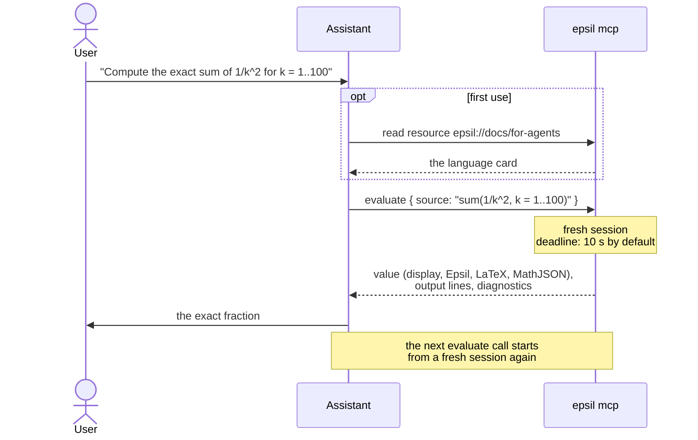

## Good to Know

- **Each `evaluate` call is independent.** A call runs a complete program in
  a fresh session; definitions do not carry over from one call to the next.
  The assistant knows this and writes self-contained programs.
- **Evaluations have a deadline.** By default a program is canceled after
  10 seconds. Start the server with `epsil mcp --time-limit <ms>` to change
  the server maximum (`0` disables it). The assistant can shorten that limit
  per `evaluate` or `compile` call, but cannot extend or disable it.
- **Numeric work can run on worker threads.** Start the server with
  `epsil mcp --workers <n>` to give the engines of the `evaluate` calls a
  pool of `<n>` worker threads; a `findFit` with a global search then scans
  on them. `--workers auto` uses the number of processor cores minus one,
  from 1 to 8. The values are the same with or without the pool.
- **The computation runs locally by default.** The server is part of the npm
  package, and programs evaluate in the Node.js process that runs
  `epsil mcp`. A ChatGPT connection still uses the configured Secure MCP
  Tunnel or HTTPS endpoint to reach that process.
- **The HTTP transport is local by default.** It binds to `127.0.0.1`, limits
  requests to 1 MiB, and rejects unapproved browser origins. Use `--host`,
  `--port`, and `--path` to configure the listener. Repeat
  `--allow-origin <origin>` for browser clients that run on another origin.
  A non-loopback bind requires `--auth-token-env <name>` and Bearer
  authentication using that environment variable's value. It does not add
  TLS; put a public endpoint behind HTTPS.

<ReadMore path="/cli/">
The same package also provides a **command-line interface and interactive
REPL** for using Epsil yourself.
</ReadMore>

---

# Epsil for AI Agents

Source: https://epsil.dev/for-agents/

# Epsil for AI Agents

A condensed reference for language models and coding agents writing Epsil.
Every code fence on this page is executed by the test suite and its `// ➔`
output verified — the examples cannot drift from the implementation. Epsil is
**experimental**: syntax and semantics may change between releases.

## What Epsil Is

Epsil is a programming language for scientific computing built on the Compute
Engine. It is **symbolic and exact by default**: `1/3` is the rational one
third, not `0.333…`, and `ln(2)` or `sqrt(2)` stay symbolic. Ask for a decimal
explicitly with `N(expr)`. A program is a sequence of statements (separated by
newlines or `;`); its result is the **value of the last statement**, so
produce the value you want as the final statement. `print(…)` writes to the
host console (the `evaluate` MCP tool returns those lines as `output`), and
evaluates to `nothing`. Runtime
problems (a `const` reassignment, a type mismatch) become ordinary
`Error(...)` **values**, not thrown exceptions; malformed source produces
**diagnostics** with source locations.

**Run it**: `npx epsil file.epsil`, `npx epsil --eval 'expr'`, stdin, or a REPL
(`npx epsil`). Diagnostics go to stderr; exit code 0 = success, 1 = error.
**Validate without evaluating**: `npx epsil check file.epsil --json` emits
structured diagnostics (positions, fix-its). **Look up the library**:
`npx epsil doc Mean`, or search by concept — `npx epsil doc "standard
deviation"`. Add `--diagnostics json` to a run for machine-readable runtime
diagnostics. Embed via `executeEpsil(ce, source)` from
`@cortex-js/compute-engine/epsil`. See [CLI](/cli/).

**Naming convention**: library operators are written in lowercase (`sin`,
`map`, `simplify`, `pi`) and also answer to their MathJSON names (`Sin`,
`Map`, `Simplify`, `Pi`). Your variables and functions are lowercase too and
shadow a library name by scope (`let sum = 0` makes `sum` a variable).
Operators with their own syntax have no lowercase spelling (`Add` is `+`,
`If` is `if`, `List` is `[…]`). Calling an unknown function is not an
error — the call stays symbolic (a warning diagnostic with a did-you-mean
suggestion fires when a close library name exists, e.g. `len` → `length`).

## Core Syntax

```epsil
let x = 5                 // mutable declaration
const tau = 6.28          // immutable; reassigning yields an Error value
x = x + 3                 // assignment: a bare `=` assigns only as a STATEMENT
f(x) = x^2                // function definition, math style
let square = x => x^2    // anonymous function ("=>" is the lambda arrow)
cube : (x: number) -> number = x^3   // a named function-type annotation binds x
function g(n) {           // function definition, block style
  let t = n + 1           // blocks are lexically scoped
  t * 2                   // a block's value is its last expression
}
hold h(e) = head(e)       // hold: arguments arrive UNEVALUATED (h(x + 1) ➔ Add)
hold mySum(body, bind i, n) = sum(body, (i, 1, n))  // bind: a bound-variable slot; mySum(k^2, k, 3) ➔ 14
function op(a, b) commutative associative -> number { a + b }  // algebraic words in the specifier slot
/// A doc comment right before a definition is its description (About, hover)
let parity = "even" if x % 2 == 0 else "odd"  // conditional expression; if is also an expression: if c { a } else { b }
g(x) + f(2)
// ➔ 22
```

- **Comments**: `// line` and `/* block */`. NOT `#` (that starts a pragma).
- **Statements**: one per line, or separated by `;`. Two expressions on one
  line with no separator is a diagnostic. A line ending in an infix operator
  continues onto the next line.
- **Whitespace rule**: an infix operator has spaces on both sides or neither
  (`a + b` or `a+b`; `a +b` is a diagnostic). Prefix `-x`/`!x` and postfix
  `n!` must touch their operand.
- **Types** (optional) use the Compute Engine type language:
  `let n: integer = 4`, `f(x: real) -> real = x^2`. Parameter types are
  enforced at call time.
- **Collections**: list `[1, 2, 3]`, set `{1, 2, 3}`, tuple `(1, 2)`,
  dictionary `{one -> 1, two -> 2}`, empty dictionary `{->}` (`{}` is the
  empty set). Access dictionaries with `d["key"]`; identifier-shaped keys also
  have the shorthand `d.key`. Tuples index like lists (`p[1]` is the first
  component); a matrix (list of lists)
  indexes as `m[2, 1]` or `m[2][1]`.
- **Spread**: in a call argument list, `...t` splices a **tuple**'s elements
  in as positional arguments (`f(...p)`, `max(...t)`, `g(1, ...p, ...q)`).
  Tuples only — spreading a list is an `incompatible-type` error — and `...`
  is valid nowhere else.
- **Destructuring**: `let (q, r) = divmod(17, 5)` binds a tuple's components
  (`const` makes them constants; `_` skips a position; patterns nest). Tuples
  only, ≥ 2 elements, initializer required; a shape mismatch is an Error
  value. For conditional destructuring use `match`. The same pattern assigns
  to EXISTING bindings with `:=`, evaluating the right side once before it
  writes anything, so `(a, b) := (b, a)` swaps. It must be `:=` — a
  statement-leading `(a, b) = …` is a comparison, and is diagnosed.
- **Block in expression position**: `do { … }` (a bare `{ … }` in expression
  position is always a set/dictionary literal).
- **LaTeX islands**: `$\frac{1}{2}$` splices parsed LaTeX into the expression
  (available in the CLI and any host that injects a LaTeX parser).

**Operator precedence**, loosest → tightest: `:=` · `=>` · `??` (coalesce) ·
`|>` (pipe) · `->` (key-value) · `a if c else b` (conditional) · `||` · `&&` ·
comparisons
`== != < <= > >= === in !in is` (chainable: `1 < 2 < 3`) · `..` (range) ·
`+ -` · `* / %` · unary `- !` · `^`/`**` (right-associative) · postfix `!`.
Calls `f(x)` and indexing `xs[i]` bind tightest of all. A bare `=` has no
fixed tier: it binds like `:=` when it assigns and like `==` when it compares.

## If You Know Python or JavaScript

Epsil deliberately diverges from these reflexes. **Wrong-by-instinct → what
actually happens → write instead:**

| Reflex | What happens in Epsil | Write instead |
|:--|:--|:--|
| `xs[0]` for first element | **Silently** yields `NaN` — indexing is **1-based** | `xs[1]`; negative indices work: `xs[-1]` is the last element |
| `7 // 2` floor division | **Silent wrong value**: `//` starts a comment, so this is just `7` | `floor(7 / 2)` |
| `7 / 2` integer division | Exact rational `7/2`, not `3` or `3.5` | `floor(7 / 2)` for `3`; `N(7 / 2)` for `3.5` |
| `range(1, 5)` excludes end | Inert call + did-you-mean; `Range(1, 5)` **includes** 5: `[1,2,3,4,5]` | `Range(1, n)` or `1..n` for 1…n inclusive |
| `x = 5` at top level | Assigns — `=` assigns only as a whole statement with a name on the left | `x == 5` for the equation |
| `# comment` | Diagnostic (`#` introduces pragmas) | `// comment` or `/* … */` |
| `def f(x):` / `(x) => …` / `lambda x: …` | Parse diagnostics; `(x) -> …` is recovered with a did-you-mean-`=>` fixit | `f(x) = expr`, `x => expr`, or `function f(x) { … }` |
| `cond ? a : b` | Parse diagnostic | `a if cond else b`, or `if cond { a } else { b }` — both are expressions |
| `elif` | Parse diagnostic | `else if` |
| `return` | Reserved word, **not implemented** | A block's value is its last expression |
| `break` / `continue` | Work as expected inside a `while`/`for` body; the loop context resets at every function and lambda boundary | *(nothing to change)* |
| `print(x)` | Inert unknown call; nothing prints | The program's value is its **last statement** |
| `len(xs)` | Inert + did-you-mean | `length(xs)` |
| `s[0]` / `len(s)` on a string | Works — a string is a collection of its characters (grapheme clusters), 1-based | `s[1]`, `length(s)` |
| `"a" + "b"` | Error values inside an `Add` | `"\(a) and \(b)"` interpolation, or `join(a, b)` |
| `xs[2] = 9` | Works, as a rebinding: `xs = replaceAt(xs, 2, 9)`. Collections are immutable values, so another name that holds the old list keeps it | *(nothing to change)* |
| `and` / `or` / `not` | Parse diagnostics (reserved words) | `&&`, `\|\|`, `!` |
| `x**0.5` habits: `x^1/2` | Parses as `(x^1)/2` — precedence, not a root | `sqrt(x)` or `x^(1/2)` |
| `math.floor`, `np.mean` | No modules/namespaces | Everything is global: `floor`, `mean`, `sin`, … |
| `for` loop building a value | Loops are for **effect**; their value is `nothing` | Accumulate into a `let`, or use `map`/`filter`/`reduce` |
| f-strings / template literals | Backtick is the verbatim-symbol quote; `${}` invalid | `"x is \(x)"` works in any string |

Comfortable habits that **do** transfer: `**` is an accepted alias of `^`
(both right-associative, `2^3^2` → `512`); `%` is `Mod` with the sign
convention of Python (`-7 % 3` → `2`); `xs[-1]` is the last element; `0.1 +
0.2 == 0.3` is `True` (decimal arithmetic); chained comparisons `1 < 2 < 3`
work; `2 in [1, 2, 3]` works; lowercase `true`/`false` are accepted
(canonically `True`/`False`).

## Verified Idioms

The [Style Guide](/style/) states each idiom with its reason; this
section is the short form.

Exactness and numeric approximation:

```epsil
let exact = 1/3 + 1/6      // stays the exact rational 1/2
let sym = sqrt(2) * sqrt(2) // symbolic radicals reduce exactly
"\(exact), \(sym), \(N(pi, 10))"
// ➔ "1/2, 2, 3.141592654"
```

Functions, recursion (self-reference works in a one-step definition, with
any number of recursive calls — `fib(n-1) + fib(n-2)` is fine), and closures:

```epsil
fact(n) = 1 if n <= 1 else n * fact(n - 1)
makeAdder(k) = x => x + k     // closures capture lexically
let add10 = makeAdder(10)
add10(fact(5))
// ➔ 130
```

Collections pipeline — `map`/`filter`/`reduce` for value-producing iteration,
`|>` to chain; `1..n` is an inclusive range:

```epsil
1..10 |> filter(_, k => k % 2 == 0) |> map(k => k^2, _)
// ➔ [4, 16, 36, 64, 100]
```

```epsil
reduce([1, 2, 3, 4], (acc, x) => acc + x, 0) + sum(1..100)
// ➔ 5060
```

Loops are for effect — accumulate into a variable declared outside:

```epsil
let a = 1071
let b = 462
while b != 0 {
  let t = a % b
  a = b
  b = t
}
a
// ➔ 21
```

Building a list in a loop — spread the old list into a new literal (each
literal snapshots the current value); never `join(xs, [k])` on every turn,
which nests a lazy recipe per turn and takes seconds by a thousand elements:

```epsil
let xs = []
for k in 1..3 { xs = [...xs, k * k] }
xs
// ➔ [1, 4, 9]
```

Structural `match` (an expression; `_` is the wildcard; a bare name **binds**
— use `== expr` to compare against a value):

```epsil
classify(n) = match n {
  0 => "zero"
  k if k > 0 => "positive"
  _ => "negative"
}
classify(-5)
// ➔ "negative"
```

Symbolic computation:

```epsil
let poly = simplify(2 + 3x^3 + 2x^2 + x^3 + 1)
let roots = solve(x^2 + x - 6 == 0, x)
let deriv = D(x^3 + x, x)
let area = integrate(sin(x), (x, 0, pi))
(poly, roots, deriv, area)
// ➔ (4x^3 + 2x^2 + 3, [2,-3], 3x^2 + 1, 2)
```

Lists, slices, and common operators (all indexing is 1-based):

```epsil
let xs = [10, 20, 30, 40]
(xs[1..2], first(xs), last(xs), sort([3, 1, 2]), indexOf(xs, 30))
// ➔ ([10,20], 10, 40, [1,2,3], 3)
```

Dictionaries (string keys; dot access is shorthand for identifier-shaped
keys):

```epsil
let d = {one -> 1, two -> 2}
(d.two, d["two"], isMissing(d.missing), Coalesce(d.missing, 0))
// ➔ (2, 2, true, 0)
```

An absent numeric field evaluates to `NaN`; an absent nonnumeric field remains
`missing`. `isMissing` recognizes both forms.

## Library Quick Roster

Verified operator names, so you don't have to guess. The complete index, by
category with signatures, is the [Standard Library](/library/) page;
search by concept with `epsil doc <keywords>`.

- **Numbers**: `abs`, `floor`, `ceil` (not `Ceiling`), `round`, `sqrt`,
  `max`, `min` (each takes a list or varargs), `Mod`, `gcd`, `lcm`,
  `isPrime`, `random(a..b)`.
- **Lists**: `length`, `first`, `last`, `rest`, `take`, `drop`, `reverse`,
  `sort` (optional comparator — see below), `indexOf`, `join`, `append`,
  `sum`, `mean`, `standardDeviation` (sample, n−1), `map`, `filter`,
  `count(xs)` / `count(xs, v)` / `count(xs, pred)`,
  `reduce(list, f, init)`, `Range(a, b)` inclusive, `Range(a, b, step)`.
- **Strings**: `characters`, `stringSplit(s)` (splits on whitespace by
  default), `String(x)`, `join(a, b)` to concatenate strings,
  `StringJoin(xs, sep?)` to join ONE collection with an optional separator
  (a string subject means its characters, so `stringJoin("ab", "cd")` is
  `"acdb"`, not `"abcd"` — use `join` or `"\(a)\(b)"` to concatenate).
  Substring search is `rangeOf(s, needle)` (a span, or `missing`),
  `containsSequence`, `startsWith`, `endsWith` — `c in s` is *character*
  membership. Also `StringReplace(s, target, replacement, count?)`,
  `trim`/`trimStart`/`trimEnd`, `stringRepeat`, `padStart`/`padEnd`,
  `toUpperCase`/`toLowerCase`/`caseFold`, `stringCompare(a, b)` (`-1/0/1`,
  code-point order) and `NumberFrom(s, base?)`. `s[i]` is a character; every
  string operation, and a dictionary lookup `d[c]`, accepts a character as the
  one-character string (`toUpperCase(s[1])`, no `String(c)` needed).
- **Dictionaries**: `keys`, `values`.
- **Absence**: `missing` preserves a missing position; `nothing` is the value
  of an empty block, kept as an element like any other value; `isMissing`,
  `Coalesce`.
- **Symbolic**: `simplify`, `HoldValues(body)` (evaluate `body` with its
  assigned symbols kept symbolic), `solve(eq == v, x)`, `D(expr, x)`,
  `derivative(f)`, `integrate`, `N`, `type`, `isError(x)` (true for an error
  value, or an expression carrying one).

Caution: `head` and `tail` exist but are **structural** operators
(`head([1,2,3])` is the *operator name* `"List"`, not the first element) —
for elements use `first`/`rest`.

```epsil
sort([3, 1, 4, 1, 5], (a, b) => a > b)
// ➔ [5,4,3,1,1]
```

## Watch Out For

- **Laziness**: `Range`, `map`, `filter`, `take`, `drop`, `join` are
  generators — they enumerate when materialized (indexed, aggregated, or
  iterated; e.g. a `take(xs, 3)` stored inside a tuple stays an unevaluated
  `Take(...)`), and a deferred mapping function reads variables **at
  materialization time**. Collection *literals* snapshot their element values
  immediately, and so does an **assignment**: `let ys = filter(xs, p)` and
  `xs = filter(xs, p)` store the list of the elements when the generator is
  finite and reads a variable. A generator with no last element
  (`filter(1..oo, p)`) stays lazy when it is assigned: a variable operand
  gives its value at the assignment, and the inline function reads its
  variables when an element is computed. List a finite part with `listFrom`
  to keep the elements of that time.
- **Output is the engine's textual form, with Epsil symbols**: a string
  prints in quotes (`"florb"`), a boolean as `true`/`false`, the absence
  markers as `nothing`/`missing`, and a symbol unquoted (`a1`). Derived
  collections (`Range`, `map`/`filter` results, loop-built lists)
  preview-elide above 10 elements (`[1,2,3,4,5,...,]`); the value is complete
  — the CLI's `--json` output materializes the full elements (up to 10,000).
  Literals print in full.
- **Arguments are evaluated before a call** — `f(a + 1)` receives the value
  — except for a `hold` function (`hold f(e) = …`), which receives the
  expression as written and evaluates it wherever the body reads it
  (call-by-name: `hold twice(e) = e + e` evaluates `e` twice; `let v = e`
  once). Every parameter of a hold function is held; there is no
  per-parameter form.
- **Binder variables stay symbolic**: `D(expr, x)` and `integrate(expr, x)`
  treat `x` symbolically even if `x` has an assigned value; the *result*
  then evaluates with the value. So `let x = 2` followed by
  `N(D(x^3 + x, x))` is `13` — the derivative is taken first.
- **Interpolating a collection broadcasts**: `"\(expr)"` with a list-valued
  `expr` maps the string over the elements, yielding a *list of strings*
  (`"n = \([1, 2])"` → `["n = 1", "n = 2"]`), not one string containing the
  list. Interpolate scalars only.
- **Only the last statement's value is returned.** An error value in an
  earlier statement also emits a `runtime-error` diagnostic so it can't vanish
  silently.
- **Boolean inference is sticky**: using a bare undeclared symbol as a
  boolean operand (`&&`/`||`/`!`) types it `boolean` for the engine's
  lifetime; a later numeric use of the same symbol errors.
- **`3!^2` is a diagnostic** — the lexer reads `!^` as one operator token.
  Space it: `3! ^ 2`.
- **`match` binds bare names**: `match x { Pi => … }` does not compare with π
  — it binds a new variable named `pi`. Pin values with `==`:
  `match x { == Pi => … }`.
- **The dot calls protocol functions only**: `c.area()` is `area(c)` when
  `area` is a `protocol` function the type of `c` conforms to. A library
  function is not reached that way — `xs.Sort()` is the error
  `dot-call-not-a-protocol-function`; write `sort(xs)` or `xs |> sort`.

For the full reference start at [Epsil](/introduction/), the complete grammar in
[Syntax](/syntax/), and ~70 more verified programs in
[Examples](/examples/).

---

# Epsil Source Code

Source: https://epsil.dev/source-code/

# Source Code

## Encoding

Epsil's JavaScript API accepts a string. A host reading an Epsil source file
should decode it as UTF-8 and should write identifiers in
[Unicode NFC form](https://www.unicode.org/reports/tr15/tr15-50.html), the form
symbol names are compared in (see [Symbols](/literals/#symbols)).

The Epsil parser does not decode files or strip a byte-order mark. File I/O
and decoding are the responsibility of the host. Inside a string literal,
Unicode code points can also be written with
[escape sequences](/literals/#escape-sequence).

## File Extension

The conventional file extension is `.epsil`.

## MIME-type

The project uses `text/epsil` as its media-type convention. It is not a
registered IANA media type.

## Command line

Installing `@cortex-js/compute-engine` provides the `epsil` command:

```shell
epsil --eval "1 + 2"
epsil program.epsil
epsil --json program.epsil
```

With no file or `--eval`, `epsil` starts an interactive REPL when standard
input is a terminal; otherwise it reads a program from standard input. The
command applies a 10-second evaluation limit by default. Use
`--time-limit <milliseconds>` to change it or `--time-limit 0` to disable it.
Run `epsil --help` for the complete option list.

See [Epsil CLI](/cli/) for installation, output modes, REPL commands,
diagnostics, and exit-status behavior.

## Hashbang Comment

A hashbang comment can appear at the absolute start of the source and is ignored
by the Epsil parser. It can be used to run an executable source file through
the installed command:

```epsil
#!/usr/bin/env epsil
```

---

# Inside Epsil

Source: https://epsil.dev/implementation/

# Inside Epsil

This page is about **how Epsil is implemented**. Nothing here is needed to
write Epsil — the rest of the documentation describes the language on its own
terms. Read this page if you are embedding Epsil in a host application,
building tooling over it, or curious about what a construct actually does
underneath.

Epsil is a surface syntax over [MathJSON](/math-json/), and its runtime is the
[Compute Engine](/compute-engine/). A program is parsed into a MathJSON
expression, and that expression is evaluated by the engine. There is no
separate Epsil interpreter, no Epsil-specific declaration logic, and no
Epsil-side type checker — each language form maps onto a primitive the engine
already has.

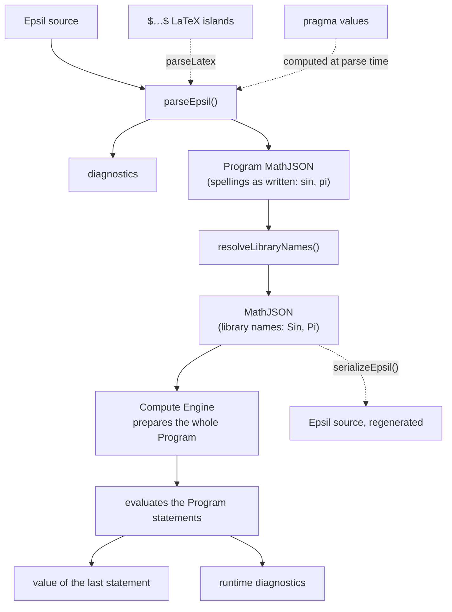

`executeEpsil()` runs the whole chain. `parseEpsil()`, `resolveLibraryNames()`
and `serializeEpsil()` expose the individual stages to a host that boxes or
evaluates the tree itself.

## The JavaScript API

The public language entry point exposes the three stages directly:

```js
import {
  ComputeEngine,
  executeEpsil,
  parseEpsil,
  serializeEpsil,
} from "@cortex-js/compute-engine/epsil";
```

### Parsing

`parseEpsil(source, url?, options?)` returns a MathJSON `Program` and an
array of diagnostics, including for empty or single-statement source:

```js
const [expression, diagnostics] = parseEpsil("2x + 1");
```

Ignoring source-location metadata, the expression is:

```json
["Program", ["Add", ["Multiply", 2, "x"], 1]]
```

Empty source gives `["Program"]`. The parser recovers from most syntax errors
and returns a partial expression alongside its diagnostics. Every parsed node also carries source offsets so a
host can associate a diagnostic or expression with the original text.

The tree is exactly what was written: the lowercase spelling of a library
name (`sin`, `pi`) is still `sin` and `pi` at this point. A host that boxes
or evaluates the tree itself must first run `resolveLibraryNames(expression,
source, ce)`, which rewrites every free occurrence of a spelling to the
library name it stands for (`Sin`, `Pi`) while leaving names the program or
the engine binds alone — `executeEpsil` does this itself. See
[Naming](/naming/).

### Variables of a call

`binderSitesOf(ce, node, source)` tells which names of a call to a library
operator are the call's own variables, and which ones the call reads from
outside. It gives one site per bound variable: the name, and the operands
that see it (`"all"`, or the zero-based indices of the arguments; the head is
not counted):

```js
import {
  ComputeEngine,
  binderSitesOf,
  parseEpsil,
} from "@cortex-js/compute-engine/epsil";
import { operand } from "@cortex-js/compute-engine/math-json";

const ce = new ComputeEngine();
const source = "sum(k^2, k, 1, n)";
const [program] = parseEpsil(source);
const call = operand(program, 1);
binderSitesOf(ce, call, source);
// ➔ [{ name: "k", operands: [0, 1, 2, 3] }]
```

Here `k` is bound and `n` is read. The result is `[]` for a library operator
that binds nothing in the call (`max(pi, pi)`), and `undefined` for a call of
a name that is not a library operator. The function does not see the
bindings of the program: call it only for a call whose callee the program
does not define. A `limit`, `nLimit`, `nd` or `nIntegrate` that does not
write its variable binds the variable that the engine chooses, in its first
operand only: `limit(sin(h)/h, 0)` gives `[{ name: "h", operands: [0] }]`.
The engine can read values already installed by an earlier program or the
host, so its choice can depend on that state. When `L` already holds
`[1, 2]`, the variable of `limit(total(L)*t, 0)` is `t`, because `L` is a
list. The engine does not choose a `const` name. A host that knows the names the program binds at the
call gives them as a fifth argument,
`binderSitesOf(ce, call, source, undefined, (name) => …)`: when such a name
comes first and other names follow, the result is `[]`. Without it, the
result for this call is `[{ name: "L", operands: [0] }]`. A host that also
knows how the program declares such a name gives a sixth argument, a
function that returns a `ProgramDeclaration` for the name, or `undefined`:
`{ constant, annotated, value, boxedEarly }`, for a `let` or `const` at the
top level of the program that no other statement writes. `constant` is
`true` for a `const`, `annotated` is `true` when the statement has a type
annotation, `value` is the raw initializer, and `boxedEarly` is `true` when
the call is boxed before value declarations have executed. Every occurrence
in a `Program` has this timing, including direct top-level statements and
function bodies: the whole program is prepared before its first statement
runs. Constness is already known, so the helper excludes a `const` name
without evaluating its initializer. A mutable variable's execution value is
unavailable during that preparation, even when its declaration appears
earlier in the text; an annotation does not supply that value. The helper
leaves a value-dependent choice undecided rather than predicting execution.
For a host that really boxes a call after the relevant declarations have
executed, `boxedEarly: false` allows the later-value evidence instead.

### Execution

`executeEpsil(ce, source, options?)` parses, resolves and boxes one `Program`,
then evaluates it in the current scope of `ce`. Boxing prepares every
statement before the first runs. The canonical order is types and protocols,
then function definitions with their paired signatures, then the other
statements in source order:

```js
const ce = new ComputeEngine();

const first = executeEpsil(ce, "let x = 5");
const second = executeEpsil(ce, "x = x + 1\nx");
// second.value.re === 6
```

Reusing the engine preserves declarations between calls, which is the
notebook/REPL execution model. A fresh `ComputeEngine` starts a fresh session.
The returned object contains the last statement's boxed value and all
diagnostics. Runtime failures are represented as error values rather than
escaping to the host as ordinary exceptions.

To enable `$…$` LaTeX islands, inject the engine's LaTeX parser:

```js
const parseLatex = (latex) => ce.parse(latex).json;
const result = executeEpsil(ce, "2 * $\\frac{1}{2}$", { parseLatex });
```

Host-state pragmas remain disabled unless
`allowHostPragmas: true` is explicitly supplied. Pragma values are computed by
the parser and inserted into the produced MathJSON before execution begins.

A host can give an evaluation an explicit time budget by wrapping it in the
engine's `withTimeLimit()` span:

```ts
const result = ce.withTimeLimit(
  { ms: 500, label: "epsil-cell" },
  () => executeEpsil(ce, source, { parseLatex })
);
```

When the budget expires the program stops: `result.value` is the
`Error("Timeout exceeded", "timeout")` of the statement that hit the deadline,
`result.valueRange` points at that statement, and no later statement runs.
See [Evaluation](/evaluation/#interruptibility) for the rest of the
cancellation model.

### Asynchronous execution

`executeEpsilAsync(ce, source, options?)` runs a program as `executeEpsil`
does and returns a promise of the same result. Each top-level statement is
evaluated with `evaluateAsync()`, so an operator that has an asynchronous
route takes it: a `findFit` whose global search runs on the engine's worker
pool (`ce.workers`), or an operator that a host declared with only an
`evaluateAsync` handler. This includes the value of a `let` or of an
assignment: `let fit = findFit(…)` runs the asynchronous `findFit`.

```ts
const controller = new AbortController();
const result = await executeEpsilAsync(ce, source, {
  parseLatex,
  signal: controller.signal,
});
```

An abort of `signal` stops the program: the promise rejects with a
`CancellationError` whose `cause` is the signal's reason, and no later
statement runs. A `withTimeLimit()` span around the call is one deadline for
the whole program, as with `executeEpsil`, although the span closes when the
call returns its promise:

```ts
let pending;
ce.withTimeLimit({ ms: 2000, label: "epsil-cell" }, () => {
  pending = executeEpsilAsync(ce, source);
});
const result = await pending;
```

The program runs in the current scope of `ce`, as with `executeEpsil`. Until
the promise settles, run no other evaluation, declaration or program on the
same engine: that work would run in the scope of the program and would be
taken as part of it (a declaration counted as a statement of the program, an
error reported in its diagnostics). Use another engine for work that must
run at the same time.

### Serialization

`serializeEpsil(expression, options?)` converts MathJSON back to Epsil:

```js
serializeEpsil(["Add", ["Multiply", 2, "x"], 1]);
// ➔ "2 * x + 1"
```

The serializer formats an expression; it does not execute it. Comments are
currently lossy on the parse side, so parsing and then serializing source code
does not preserve comments or the author's original whitespace. The serializer
can still *emit* a `/* … */` comment when an expression carries a `comment`
metadata field, but nothing on the parse side populates that field.

A standard-library name is written with its Epsil spelling (see
[Naming](/naming/)): `["Sin", "x"]` serializes to `sin(x)`, `"Pi"` to
`pi`, `["Map", "Sin", "xs"]` to `map(sin, xs)`. The MathJSON name is kept
where the spelling would read back as something else: when the expression
writes the spelling anywhere (a `let sin = 3`, a parameter or a pattern
named `sin` — every binding form writes the name it binds), and when the
`isBound` option reports the name bound outside the expression (the CLI
passes the session engine's `lookupDefinition`, so a result after
`let sin = 3` in an earlier cell prints `Sin(x)`, not a call of the local).
The `libraryNames: 'mathjson'` option writes the MathJSON names
throughout:

```js
serializeEpsil(["Sin", "x"]);
// ➔ "sin(x)"
serializeEpsil(["Sin", "x"], { libraryNames: "mathjson" });
// ➔ "Sin(x)"
```

## How Epsil lowers to MathJSON

The examples in this section omit the `sourceOffsets` metadata that every
parsed node carries. Except in [Blocks and programs](#blocks-and-programs),
they show individual statements or nested expressions inside the outer
`Program`, rather than the whole return value of `parseEpsil()`.

### Heads at a glance

| Epsil form | MathJSON |
| :--------- | :------- |
| `let x = 5`, `const c = 1`, `x: real = 5` | `Declare` |
| `x = 5`, `(a, b) := t` | `Assign` |
| `type p = …`, `type alias q = …` | `DeclareType` |
| `f(x) = …`, `function f(x) { … }` | `DefineFunction` + `Function` |
| `x => …` | `Function` |
| `x: real` (annotation on a parameter or body) | `Typed` |
| `if c { … } else { … }`, `a if c else b` | `If` |
| `match s { p => b }` | `Match` + `MatchCase` |
| `== e` in a pattern | `Pin` |
| `p₁ \| p₂` in a pattern | `Alternatives` |
| `while`, `for … in …` | `Loop` |
| `break`, `continue` | `Break()`, `Continue()` |
| A whole program, including empty or single-statement source | `Program` |
| `{ … }` after a keyword, `do { … }` | `Block` |
| `[a, b]` | `List` |
| `{a, b}` | `Set` |
| `(a, b)` | `Tuple` |
| `{k -> v}` | `Dictionary` + `KeyValuePair` |
| `a -> b` | `KeyValuePair` |
| `a..b` | `Range` |
| `f(x)` (bare symbol callee) | `["f", "x"]` |
| `(expr)(x)` (computed callee) | `Apply` |
| `xs[i]` | `At` |
| `p.x` | `Field` |
| `...p` | `Spread` |
| `a \|> b` | `Pipe` |
| `x in xs`, `x is real` | `Element` |
| `"a\(b)c"` | `String` |
| `Sequence(1, 2, 3)` | `Sequence` |

Note that `MapsTo` — the name the operator table uses for `=>` — is internal
to parsing. The resulting expression uses `Function`, not a `MapsTo` head.
Likewise, `is` and `in` produce the same `Element` expression, which is why a
serialized program spells both of them `in`.

### Declarations

Declarations lower to the engine's `Declare` operator — not an Epsil-specific
`Let`/`Const` head. `Declare` takes the declared symbol, an optional type
(positional, when present), and a trailing attributes `Dictionary` carrying
`value` and, for `const`, `constant: True`. `const` is a **binding attribute**
(`constant: True` → the engine's `isConstant`), not a type — the engine, not
Epsil, enforces it.

```epsil
let x = 5
```

```json
["Declare", "x", ["Dictionary", ["KeyValuePair", "value", 5]]]
```

For a mutable variable without an annotation, the initializer determines a
widened binding type (`number`, here). A function initializer or an alias
known to hold a function gives `function`; the value retains its own
annotations without making them a permanent variable contract. With an
annotation, that contract appears as a positional argument before the
attributes dictionary:

```epsil
let x: real = 5
```

```json
["Declare", "x", {"str": "real"},
  ["Dictionary", ["KeyValuePair", "value", 5]]]
```

A declaration with no initializer omits the attributes dictionary entirely:

```epsil
let x: real
```

```json
["Declare", "x", {"str": "real"}]
```

```epsil
let x
```

```json
["Declare", "x"]
```

`const` adds a `constant` key alongside `value`:

```epsil
const c = 6.28
```

```json
["Declare", "c",
  ["Dictionary", ["KeyValuePair", "value", 6.28],
    ["KeyValuePair", "constant", "True"]]]
```

A **named literal function-type annotation binds the initializer's
parameters** (the "lambda lift" — see
[Declarations](/declarations/#function-type-annotations-bind-their-parameter-names)):
before lowering, the parser wraps a non-lambda initializer in a `Function`
whose parameters come from the annotation, so the declared value is exactly
what the explicit `=>` spelling produces:

```epsil
const f : (x: number) -> number = x + 1
```

```json
["Declare", "f", {"str": "(x: number) -> number"},
  ["Dictionary",
    ["KeyValuePair", "value", ["Function", ["Add", "x", 1], "x"]],
    ["KeyValuePair", "constant", "True"]]]
```

Because declarations lower directly to the engine's own `Declare` primitive,
there is no separate Epsil-side declaration logic at execution time — the
program evaluates the `Declare` expression exactly like any other expression.

A destructuring declaration uses the same primitive with the pattern in the
name position:

```epsil
let (q, r) = divmod(17, 5)
```

```json
["Declare", ["Tuple", "q", "r"],
  ["Dictionary", ["KeyValuePair", "value", ["divmod", 17, 5]]]]
```

### Assignment

A bare `x = 5` — no `let`/`const` keyword, no type annotation — lowers to
`Assign`:

```epsil
x = 5
```

```json
["Assign", "x", 5]
```

The Compute Engine permits `Assign` to establish a value for a previously
unbound symbol, which is why a bare assignment to an undeclared name works at
all; `let` is nevertheless the explicit and idiomatic way to introduce a
mutable binding.

Reassigning a `const` still parses and lowers to `["Assign", "c", 2]`; it is
the engine, at evaluation time, that rejects the assignment and produces an
`["Error", …]` value.

Destructuring assignment puts the pattern in the target position:

```epsil
(a, b) := (b, a)
```

```json
["Assign", ["Tuple", "a", "b"], ["Tuple", "b", "a"]]
```

### Type annotations

The parser holds a type annotation as a MathJSON string, which the engine
parses with its own type language. Type checking is not a separate Epsil-side
pass — it happens at canonicalization/evaluation time, the same way it does for
any other declared symbol.

```epsil
xs: list<integer>
```

```json
["Declare", "xs", {"str": "list<integer>"}]
```

```epsil
f: (real) -> real
```

```json
["Declare", "f", {"str": "(real) -> real"}]
```

`<`, `>`, `|`, `&`, and `->` inside the annotation are consumed entirely by the
type subparser — `u: integer | boolean` holds the whole `"integer | boolean"`
string, and none of those tokens are visible to (or reinterpreted by) the
surrounding expression grammar.

Typed parameters and typed bodies are represented with `Typed` nodes:

```epsil
f(x: integer) -> real = x + 1
```

```json
["DefineFunction", "f",
  ["Function",
    ["Typed", ["Add", "x", 1], {"str": "real"}],
    ["Typed", "x", {"str": "integer"}]]]
```

### Type declarations

A `type` statement lowers to the engine's `DeclareType` operator — the
MathJSON mirror of `ce.declareType()`. Types are global, so the statement is
only legal at the top level of a program: the parser rejects a nested one
(`type-declaration-not-top-level`), and the engine's `DeclareType` handler
enforces the same rule for MathJSON built directly. The body is carried as
the source text of the type. The bare form has no attributes; the `alias`
form adds an attributes dictionary with `alias -> True`:

```epsil
type point = tuple<x: number, y: number>
```

```json
["DeclareType", "point", {"str": "tuple<x: number, y: number>"}]
```

```epsil
type alias pair = tuple<number, number>
```

```json
["DeclareType", "pair", {"str": "tuple<number, number>"},
  ["Dictionary", ["KeyValuePair", "alias", "True"]]]
```

A type-parameter clause rides the same dictionary, as the text of the
clause:

```epsil
type alias Pair<T> = tuple<T, T>
```

```json
["DeclareType", "Pair", {"str": "tuple<T, T>"},
  ["Dictionary", ["KeyValuePair", "alias", "True"],
    ["KeyValuePair", "typeParams", {"str": "T"}]]]
```

The clause is carried **without** its enclosing `<`/`>`, and a variance
marker is simply part of that text — the bare form needs no other change:

```epsil
type tree<out T> = tuple<value: T, children: list<tree<T>>>
```

```json
["DeclareType", "tree", {"str": "tuple<value: T, children: list<tree<T>>>"},
  ["Dictionary", ["KeyValuePair", "typeParams", {"str": "out T"}]]]
```

A type is registered when its statement is canonicalized, which is why the
statements after it — in the same program or in a later cell — can annotate
with it. A type declared by the host with `ce.declareType()` is visible to a
program the same way, constructor and all.

### Functions

Both definition forms lower to the same shape,
`["DefineFunction", name, ["Function", body, …params]]`. The math style has a
bare expression body:

```epsil
f(x) = x + 1
```

```json
["DefineFunction", "f", ["Function", ["Add", "x", 1], "x"]]
```

```epsil
f(x, y) = x + y
```

```json
["DefineFunction", "f", ["Function", ["Add", "x", "y"], "x", "y"]]
```

The block style wraps the body in a `Block`:

```epsil
function f(x) { x + 1 }
```

```json
["DefineFunction", "f", ["Function", ["Block", ["Add", "x", 1]], "x"]]
```

A parameter annotation becomes a `Typed` parameter:

```epsil
f(x: real) = x + 1
```

```json
["DefineFunction", "f",
  ["Function", ["Add", "x", 1], ["Typed", "x", {"str": "real"}]]]
```

An effect specifier is folded into a full function-type string carried by a
`Typed` node around the body:

```epsil
function roll(n) random -> integer { random(1..n) }
```

```json
["DefineFunction", "roll",
  ["Function",
    ["Typed", ["Block", ["Random", ["Range", 1, "n"]]],
      {"str": "(n: unknown) random -> integer"}],
    "n"]]
```

A [literal parameter](/control-flow/#multiple-clauses-literal-parameters)
becomes an anonymous parameter constrained to that exact value (a *value
type*):

```epsil
fib(0) = 0
```

```json
["DefineFunction", "fib",
  ["Function", 0, ["Typed", "literalParam_1", {"str": "0"}]]]
```

The type text is the literal as written, so the non-finite literals reach the
type as their own spellings: `f(NaN) = …` gives `{"str": "NaN"}`, `f(oo) = …`
gives `{"str": "oo"}`, and `f(-oo) = …` gives `{"str": "-oo"}`. The `Infinity`
spelling is normalized to `oo` on the way in — `f(Infinity) = …` also lowers to
`{"str": "oo"}` — so the two spellings produce the same clause.

### Anonymous functions

```epsil
x => x + 1
```

```json
["Function", ["Add", "x", 1], "x"]
```

```epsil
(x, y) => x + y
```

```json
["Function", ["Add", "x", "y"], "x", "y"]
```

Because a mapsto binds loosely enough to sit on the right-hand side of an
assignment, `f = x => x + 1` is an `Assign` of a `Function`, not a
`DefineFunction`:

```epsil
f = x => x + 1
```

```json
["Assign", "f", ["Function", ["Add", "x", 1], "x"]]
```

A zero-parameter lambda is a `Function` with only a body:

```epsil
() => 42
```

```json
["Function", 42]
```

### Conditionals

Both conditional spellings produce the same `If`. The block form wraps each
branch in a `Block`; the `a if c else b` form uses plain expressions, which is
exactly why it introduces no scope:

```epsil
if x > 0 { 1 } else { 2 }
```

```json
["If", ["Greater", "x", 0], ["Block", 1], ["Block", 2]]
```

```epsil
if x > 0 { 1 }
```

```json
["If", ["Greater", "x", 0], ["Block", 1]]
```

```epsil
10 if x > 3 else 20
```

```json
["If", ["Greater", "x", 3], 10, 20]
```

An `else if` chain — and, identically, a chained conditional expression —
nests into an `If` in `else` position:

```epsil
if x > 0 { 1 } else if x < 0 { 2 } else { 3 }
```

```json
[
  "If",
  ["Greater", "x", 0],
  ["Block", 1],
  ["If", ["Less", "x", 0], ["Block", 2], ["Block", 3]]
]
```

### `match`

A `match` is a `Match` head over the subject followed by one `MatchCase` per
case. A `MatchCase` holds a pattern, an optional guard, and a body:

```epsil
match x {
  0 => "zero"
  _ => "other"
}
```

```json
[
  "Match",
  "x",
  ["MatchCase", 0, {"str": "zero"}],
  ["MatchCase", "_", {"str": "other"}]
]
```

A binding is written as a wildcard-prefixed symbol (`_x`), which is the
engine's pattern-matcher spelling for a capture; a rest binding uses the
triple prefix (`___rest`):

```epsil
match p {
  (x, e) => x + e
}
```

```json
["Match", "p", ["MatchCase", ["Tuple", "_x", "_e"], ["Add", "x", "e"]]]
```

```epsil
match xs {
  [first, ...rest] => first
}
```

```json
["Match", "xs", ["MatchCase", ["List", "_first", "___rest"], "first"]]
```

```epsil
match p {
  {x -> px, y -> py} => px + py
}
```

```json
[
  "Match",
  "p",
  [
    "MatchCase",
    [
      "Dictionary",
      ["KeyValuePair", {"str": "x"}, "_px"],
      ["KeyValuePair", {"str": "y"}, "_py"]
    ],
    ["Add", "px", "py"]
  ]
]
```

A pin becomes a `Pin` node. The parser lowers **every** non-literal pinned
expression to `Pin`, whether it names a constant or a runtime variable — it
cannot tell the two apart lexically, and only `Pin` resolution looks up the
value at match time. A pin of a literal drops the `Pin` head and matches
structurally:

```epsil
match x {
  == pi => "is-pi"
  _ => "no"
}
```

```json
[
  "Match",
  "x",
  ["MatchCase", ["Pin", "Pi"], {"str": "is-pi"}],
  ["MatchCase", "_", {"str": "no"}]
]
```

Or-alternatives become `Alternatives`, and a range pattern reuses the ordinary
`Range` head — the pattern form keys on the operator, not on how it was
written, which is why `Range(lo, hi)` and `lo..hi` mean the same thing in
pattern position:

```epsil
match x {
  0..9 | 100..109 => "in"
  _ => "out"
}
```

```json
[
  "Match",
  "x",
  [
    "MatchCase",
    ["Alternatives", ["Range", 0, 9], ["Range", 100, 109]],
    {"str": "in"}
  ],
  ["MatchCase", "_", {"str": "out"}]
]
```

`Infinity` and `-Infinity` bounds lower to the engine's infinity symbols:

```epsil
match x {
  0..Infinity => "nonnegative"
  _ => "negative"
}
```

```json
[
  "Match",
  "x",
  ["MatchCase", ["Range", 0, "PositiveInfinity"], {"str": "nonnegative"}],
  ["MatchCase", "_", {"str": "negative"}]
]
```

A guard occupies the optional middle slot of a `MatchCase`:

```epsil
match n {
  n if n > 3 => "big"
  _ => "small"
}
```

```json
[
  "Match",
  "n",
  ["MatchCase", "_n", ["Greater", "n", 3], {"str": "big"}],
  ["MatchCase", "_", {"str": "small"}]
]
```

A typed binding compiles its type test into that same guard slot, conjoined
with any explicit guard:

```epsil
match n {
  n: integer if n > 0 => "positive integer"
  _ => "other"
}
```

```json
[
  "Match",
  "n",
  [
    "MatchCase",
    "_n",
    ["And", ["Element", "n", "integer"], ["Greater", "n", 0]],
    {"str": "positive integer"}
  ],
  ["MatchCase", "_", {"str": "other"}]
]
```

Because a pattern is parsed as an ordinary expression, an algebraic pattern is
just the corresponding operator with captures as operands, matched by the
engine's general pattern matcher (with the commutative matching it already uses
for `Add`/`Multiply`):

```epsil
match z {
  a + b if a > 0 => a
  _ => 0
}
```

```json
[
  "Match",
  "z",
  ["MatchCase", ["Add", "_a", "_b"], ["Greater", "a", 0], "a"],
  ["MatchCase", "_", 0]
]
```

Such patterns work when evaluating a `match`, but are not supported by
`compile()`; compiling a `match` with an operator pattern fails closed, naming
the offending pattern in the error.

Two other constructs fail closed the same way, both because the JavaScript
target cannot represent a distinction the interpreter makes. A multi-clause
function with a clause typed `infinity` or `nan` declines as a WHOLE and runs
interpreted — `g(a: infinity) = 1` beside `g(x: number) = 0` compiles to no
code at all — because complex infinity has no JavaScript value of its own to
test for, so no emitted guard could agree with the interpreter on every
argument.

Compiled arithmetic also projects a pole differently from the interpreter. At a
pole the interpreter answers the unsigned `~oo`, but compiled code answers the
IEEE `Infinity`: `x => 1/x` compiles to `(x) => 1 / x`, which at `x = 0` gives
`Infinity`, where the interpreter's `1/0` is `~oo`. The magnitude survives the
projection and the missing direction does not, so a program that distinguishes
the two must not rely on `compile()` to preserve it.

When no case matches, evaluation produces `Error("match-no-case", subject)`.

### Loops and control transfer

Both loop forms lower to the engine's imperative `Loop`. `while` becomes a
`Loop` over a `Block` whose first statement breaks out when the condition
becomes false:

```epsil
while x > 0 { x }
```

```json
[
  "Loop",
  ["Block", ["If", ["Not", ["Greater", "x", 0]], ["Break"]], ["Block", "x"]]
]
```

`for x in xs { … }` puts the iteration clause in a second operand, using the
engine's `Element` operator as the iterator clause:

```epsil
for x in xs { x }
```

```json
["Loop", ["Block", "x"], ["Element", "x", "xs"]]
```

Only the loop-variable `in` introduces that clause. A second, later `in` in the
collection expression is still the ordinary `Element` infix operator:

```epsil
for x in a in b { x }
```

```json
["Loop", ["Block", "x"], ["Element", "x", ["Element", "a", "b"]]]
```

`break` and `continue` lower to the engine's `Break()` / `Continue()`
primitives, and serialize back in that call form. The rule that a `break` may
not cross a function or lambda boundary is not a style choice: the engine's
`Block` short-circuits on `Break`/`Continue` structurally, so a `Break`
returned out of a lambda body would otherwise transfer control to whatever loop
happened to be running. The engine's `Break(v)` — which makes the loop evaluate
to `v` — has no Epsil spelling yet.

### Blocks and programs

A whole source file is always a `Program`. It has no scope of its own: its
declarations stay in the caller's scope. A statement block is a nested
`Block`, with its own lexical scope. These examples show the complete parser
result, omitting source metadata:

```epsil
a
2
```

```json
["Program", "a", 2]
```

```epsil
a; 2
```

```json
["Program", "a", 2]
```

A `{ … }` that follows a keyword is a `Block`, while a bare `{ … }` is the
collection grammar:

```epsil
{ 1, 2 }
```

```json
["Program", ["Set", 1, 2]]
```

```epsil
if a { }
```

```json
["Program", ["If", "a", ["Block"]]]
```

```epsil
if a { if b { 1 } }
```

```json
["Program", ["If", "a", ["Block", ["If", "b", ["Block", 1]]]]]
```

`do { … }` produces the same `Block` in expression position, so a `let` bound
to a `do` block nests a `Block` inside the declaration's `value`:

```epsil
let y = do { let t = 3; t + 1 }
```

```json
["Program", ["Declare", "y", ["Dictionary", ["KeyValuePair", "value",
  ["Block", ["Declare", "t", ["Dictionary", ["KeyValuePair", "value", 3]]],
    ["Add", "t", 1]]]]]]
```

### Collections, calls, indexing and field access

```epsil
[a, b]          // ["List", "a", "b"]      — [] → ["List"]
{a, b}          // ["Set", "a", "b"]       — {} → ["Set"]
(a, b)          // ["Tuple", "a", "b"]
a..b            // ["Range", "a", "b"]
```

A dictionary is a `Dictionary` of `KeyValuePair`s, and an unquoted key becomes
a string key. The empty dictionary, `{->}`, lowers to `["Dictionary"]`:

```epsil
{ one -> 1, two -> 2 }
```

```json
["Dictionary",
  ["KeyValuePair", {"str": "one"}, 1],
  ["KeyValuePair", {"str": "two"}, 2]]
```

A call whose callee is a bare symbol uses that symbol as the head; any other
callee goes through `Apply`. Indexing lowers to `At`, field access to `Field`,
and a spread argument to `Spread`:

```epsil
f(x, y)       // ["f", "x", "y"]
f()           // ["f"]
f(1, ...p)    // ["f", 1, ["Spread", "p"]]
(getF())(x)   // ["Apply", ["getF"], "x"]
(a + b)(2+1)  // ["Apply", ["Add", "a", "b"], ["Add", 2, 1]]
xs[i]         // ["At", "xs", "i"]
f(x)[0]       // ["At", ["f", "x"], 0]
p.x           // ["Field", "p", "x"]
a.b.c         // ["Field", ["Field", "a", "b"], "c"]
p.x(2)        // ["Apply", ["Field", "p", "x"], 2]
```

A bare, top-level comma-separated sequence with no enclosing delimiter is a
diagnostic, not a `Sequence` literal. `Sequence` is available only as an
explicit call: `Sequence(1, 2, 3)` → `["Sequence", 1, 2, 3]`.

### Strings and LaTeX islands

An interpolated string is a `String` whose operands alternate between literal
text and the interpolated expressions:

```epsil
"The solution is \(x)"
```

```json
["String", {"str": "The solution is "}, "x"]
```

The text between `$…$` delimiters is handed to an **injected** LaTeX parser,
and the expression it returns is spliced into the Epsil syntax tree at that
point, composing with its surroundings like any other primary:

```epsil
2 * $\frac{1}{2}$
```

```json
["Multiply", 2, ["Divide", 1, 2]]
```

Epsil's parser has no static dependency on the LaTeX parser: it is passed in by
the caller, the same way the engine itself injects `LatexSyntax` rather than
importing it directly. Without an injected parser, an island produces a
`latex-parsing-unavailable` diagnostic instead of a spliced expression.

### Symbol names and normalization

A symbol name must be a valid [MathJSON symbol](/math-json/#symbols). When
expressions are boxed for execution, symbol bindings are normalized to
[Unicode Normalization Form Canonical Composition (NFC)](http://www.macchiato.com/unicode/nfc-faq)
and stored and compared in that form. So `Å` written as **U+00C5 LATIN CAPITAL
LETTER A WITH RING ABOVE** and as **U+0041 LATIN CAPITAL LETTER A** followed by
**U+030A COMBINING RING ABOVE** are the same symbol.

The glyph aliases listed in [Naming](/naming/#glyph-aliases) are
canonicalized at the lexer, so `π` and `Pi` are indistinguishable by the time
an expression exists.

### Comparison chains

A run of the *same* relational operator lowers to a single n-ary node:

```epsil
a < b < c     // ["Less", "a", "b", "c"]
```

A *mix* of relational operators lowers to the conjunction of its links,
where adjacent links share their boundary term:

```epsil
a < b <= c    // ["And", ["Less", "a", "b"], ["LessEqual", "b", "c"]]
```

A parenthesized comparison is an operand, not a link. The engine reads a
comparison nested in another as a comparison of truth values:

```epsil
(a < b) <= c          // ["LessEqual", ["Less", "a", "b"], "c"]
(a <= 0) == (b <= 0)  // True when both conditions are true or both false
```

### Errors

A runtime problem — a type error, an out-of-domain argument, reassigning a
`const` — flows as an embedded `["Error", …]` value rather than a thrown
exception. `executeEpsil` never throws for a runtime problem; it catches the
underlying engine exception (for the handful of paths, like a `const`
reassignment, that still throw internally) and returns an `Error` value in its
place. See [Errors are values](/evaluation/#errors-are-values).

## Round-trip and serialization normalizations

`serializeEpsil` and `parseEpsil` are inverses over the MathJSON the grammar
can produce, up to a small set of documented normalizations.
A parser-produced `Program` keeps its outer `Program` when serialized and
parsed again. Serializing a standalone expression instead gives source whose
parsed result wraps that expression in `Program`; compare its first operand
when checking an expression-only round trip. Within that outer form, the
round trip is **structurally** equal after applying:

- **Number formatting** — `2`, `{num: "2"}` and `"2"` are the same number;
  the serializer emits a single canonical spelling (with `_` digit grouping),
  which re-parses to a `{num}` object.
- **`Negate` of a literal** — `["Negate", 3]` serializes to `-3` and
  `["Negate", -1]` to `1`; both re-parse as a signed `num` literal rather than
  a `Negate` node (the sign is folded into the number).
- **`Rational` → `Divide`** — `["Rational", 1, 2]` serializes to `1 / 2`.
  There is no rational literal in the grammar, so it re-parses as
  `["Divide", 1, 2]`.
- **Invisible multiply** — a binary `["Multiply", {num}, {sym}]` serializes to
  the juxtaposed form `2x` (only when the two abut and re-lex unambiguously as
  a number followed by a symbol). All other products — n-ary, number×group
  (`2(x+1)`), group×group — stay explicit `*`, because `(x+y)(3+4)` would
  otherwise re-parse as `Apply`, not `Multiply`.
- **Associativity** — the left-associative operators
  (`Add`/`Subtract`/`Multiply`/`Divide`/`And`/`Or`) re-parse into
  left-nested binary trees; a flat n-ary form and its left-nested spelling are
  the same expression.
- **`Element` spellings** — `is` and `in` produce the same `Element`
  expression, so a serialized program spells both of them `in`.
- **Library spellings** — a library name is written with its Epsil spelling
  (`sin(x)` for `["Sin", "x"]`), which `parseEpsil` alone reads as the raw
  head `sin`; the resolution pass (`resolveLibraryNames`, run by
  `executeEpsil` and the CLI) reads it back to `Sin`. A round trip through
  the parser alone is exact with `serializeEpsil(e, { libraryNames:
  "mathjson" })`.

Comments are **not** preserved by a round-trip — see
[Comments](/comments/).

`If` and `Match` have dedicated expression spellings. Other MathJSON heads that
do not have a special surface form serialize as ordinary function calls.

## Relationship to the loose math parser

Epsil is a **programming-language** syntax. The Compute Engine also ships a
*loose math parser* (`ce.parse(src, { canonical: false })`) that reads
LaTeX/ASCII-math notation. The two share a few surface forms but are **not** the
same language, and they overlap only partially. The Epsil column below shows
the statement inside its outer `Program`:

| Source     | Epsil `parseEpsil`                | Loose `ce.parse` (non-canonical)              | Agree? |
| ---------- | ----------------------------------- | --------------------------------------------- | ------ |
| `[1, 2, 3]` | `["List", 1, 2, 3]`                | `["List", 1, 2, 3]`                           | ✅ same |
| `x^2`      | `["Power", "x", 2]`                  | `["Power", "x", 2]`                            | ✅ same |
| `2**3`     | `["Power", 2, 3]`                   | math-parser artifact (`**` is not an operator) | ❌ diverge |
| `a \|> b`   | `["Pipe", "a", "b"]`               | `["Pipe", "a", "b"]`                           | ✅ same |
| `f(x, y)`  | `["f", "x", "y"]` (call)            | `["InvisibleOperator", "f", ["Delimiter", …]]` | ❌ diverge |
| `sin`      | `"sin"` (a symbol)                  | `["InvisibleOperator", "s", "i", "n"]`         | ❌ diverge |
| `2x`       | `["Multiply", 2, "x"]`             | `["InvisibleOperator", 2, "x"]`               | ❌ diverge |

The remaining divergences are intentional: in Epsil a juxtaposed name is a
single identifier (`sin` is one symbol, not `s·i·n`), `f(x, y)` is a function
call, and `**` is exponentiation. The two parsers do agree that `|>` produces
`Pipe`. Do not rely on them agreeing except on the rows marked *same*.

---

# Extended Rules — Symbolic Integration

Source: https://epsil.dev/compute-engine/guides/integration-rules/

The **Integration Rules** library is an optional add-on that extends the
Compute Engine's symbolic integration with a large rule set ported from
[Rubi](https://rulebasedintegration.org/), the Rule-Based Integration project.
It currently covers **Chapter 1 — algebraic functions** (rational functions,
radicals, and binomial forms $(a + b x^n)^p$), some 2,600 rules.

It is an opt-in module: if you don't import it, it adds **zero bytes** to your
bundle and the engine's integration behavior is unchanged.

```js
import { ComputeEngine } from "@cortex-js/compute-engine";
import { loadIntegrationRules } from "@cortex-js/compute-engine/integration-rules";

const ce = new ComputeEngine();
loadIntegrationRules(ce);

console.log(ce.parse("\\int \\frac{1}{\\sqrt{x}(1+x)}\\,dx").evaluate().latex);
// ➔ "2\arctan(\sqrt{x})"
```

Without the library, the same integral is returned unevaluated. The built-in
antiderivative handles many common integrands on its own; the rule set
broadens coverage to the harder algebraic cases.

## What's Included

The rules close algebraic integrands that the built-in antiderivative leaves
unevaluated, including ones with **symbolic parameters**:

```js
ce.parse("\\int \\frac{x^2}{\\sqrt{a+b x^3}}\\,dx").evaluate().latex;
// ➔ "\frac{2\sqrt{bx^3+a}}{3b}"

ce.parse("\\int \\frac{\\sqrt{1+x}}{x}\\,dx").evaluate().latex;
// ➔ "2\sqrt{x+1}-2\mathrm{artanh}(\sqrt{x+1})"
```

The current corpus is Rubi's **Chapter 1** (algebraic functions): polynomial
and rational integrands, integrands involving $\sqrt{a+bx}$ and other
radicals, and binomial/trinomial powers. Transcendental and special-function
chapters are not yet ported.

## How It Works

`loadIntegrationRules(ce)` registers the rule set as the engine's symbolic
**integration provider**. When you evaluate an `Integrate` expression, the
provider is **consulted first**; if it cannot close the integrand (it returns
an unevaluated integral) the engine **falls back** to its built-in
antiderivative. With no provider registered — the default — behavior is
exactly as before.

This applies to both indefinite and definite integrals, since a definite
integral is evaluated from its antiderivative.

```js
ce.parse("\\int_0^1 \\frac{x^2}{\\sqrt{1+x^3}}\\,dx").evaluate();
```

## Step-by-Step Explanations

With the rules loaded, `expr.explain('Integrate')` traces the integration
as textbook steps — term-by-term splits, constant factors moved out, and
each corpus rule application — each step a whole-expression state with a
stable machine id and an English description:

```js
const expr = ce.parse("\\int x\\sqrt{1+x}\\,dx");
for (const step of expr.explain("Integrate").steps)
  console.log(step.value.latex, "—", step.description);
// ➔ \int\!\sqrt{x+1}^{3}-\sqrt{x+1}\,\mathrm{d}x — Apply integration rule 1.1.1.2#19 (Rubi)
// ➔ … — Integrate term by term: ∫(u+v) dx = ∫u dx + ∫v dx
// ➔ … — Move the constant factor out of the integral
// ➔ \frac{1}{5}(2\sqrt{x+1}^{5})-\frac{1}{3}(2\sqrt{x+1}^{3}) — Apply integration rule 1.1.1.1#17 (Rubi)
```

The explanation's `result` is the same value evaluating the integral
returns. A definite integral is presented via the Fundamental Theorem of
Calculus (antiderivative, then the bracket $F\big|_a^b$ and the bounds).
Without the rules loaded, or when the rules cannot close the integral,
`explain('Integrate')` throws a precise error.

<ReadMore path="/compute-engine/guides/simplify/" > See
<strong>Step-by-Step Explanations</strong> in the Simplify guide for the
full <code>Explanation</code> API <Icon name="chevron-right-bold" /></ReadMore>

## Options and the Load Report

`loadIntegrationRules()` returns a report and accepts two limits for each
integral: a step budget and a wall-clock limit.

```js
const report = loadIntegrationRules(ce, {
  stepBudget: 300000, // steps of the rule driver per integral (default 300000)
  timeLimitMs: 120000, // wall-clock guard per integral (default 120000)
});

console.log(report.ruleCount); // number of compiled rules registered (~2600)
console.log(report.skipped);   // corpus rules skipped at compile time
```

The **step budget** decides when the rule driver gives up on an integrand.
Because it counts steps and not time, the same integral gives the same answer
on a fast machine, a slow one and a loaded one: an integral that needs more
steps stays unevaluated everywhere, and the built-in antiderivative is used
instead. The built-in antiderivative has its own fixed budget of 100,000
steps, which does not depend on `stepBudget`; when it is spent too, the
result is the unevaluated `Integrate` expression.

The **wall-clock limit** is only a guard against a hang in code that does not
count steps. The default (120 s) is about 8 times what the step budget allows
on an idle machine, so on a machine up to about 8 times slower the step budget,
not the clock, decides the result. On a slower or more loaded machine, raise
`timeLimitMs`: when the clock stops a search that the step budget allows, the
integral can stay unevaluated on that machine and close on a faster one.

## Performance

Compiling the rule set costs roughly 300ms on the first call; the compiled
rules are cached per engine, so `loadIntegrationRules()` is **idempotent** —
calling it again re-registers the provider without recompiling and does not
duplicate rules. The library only participates in `Integrate`; it has no effect
on `simplify()`, `evaluate()` of non-integral expressions, or parsing.

## Attribution

The rules are derived from [Rubi](https://rulebasedintegration.org/), the
Rule-Based Integration project created by Albert D. Rich, used under the MIT
license (© 2018 Rule-based Integration Organization). The corpus is ported
from Rubi release 4.17.3.0.

---

# Sequences

Source: https://epsil.dev/compute-engine/guides/sequences/

<Intro>
Mathematical sequences like the Fibonacci numbers, arithmetic progressions, or
Pascal's triangle can be defined declaratively using recurrence relations.
The Compute Engine provides tools to define, evaluate, and analyze sequences.
</Intro>

Sequences are defined by specifying:
- **Base cases**: Initial values that anchor the sequence
- **Recurrence relation**: A formula expressing each term in terms of previous terms

Once defined, sequences can be evaluated at any index, used in summations and
products, and even compared against the Online Encyclopedia of Integer Sequences (OEIS).

## Defining Sequences

There are two ways to define sequences: using the `declareSequence()` method
or using LaTeX assignment notation.

### Using declareSequence()

The `declareSequence()` method provides a structured way to define sequences:

```javascript
// Fibonacci sequence: F_n = F_{n-1} + F_{n-2}
ce.declareSequence('F', {
  base: { 0: 0, 1: 1 },
  recurrence: 'F_{n-1} + F_{n-2}',
});

ce.parse('F_{10}').evaluate();
// ➔ 55

ce.parse('F_{20}').evaluate();
// ➔ 6765
```

#### Options

The `declareSequence()` method accepts the following options:

| Option | Type | Description |
|:-------|:-----|:------------|
| `base` | `Record<number, number>` | Initial values as index → value pairs |
| `recurrence` | `string \| Expression` | The recurrence formula |
| `variable` | `string` | Index variable name (default: `'n'`) |
| `memoize` | `boolean` | Enable caching of computed values (default: `true`) |
| `domain` | `{ min?: number, max?: number }` | Valid index range |

#### Examples

**Arithmetic sequence** (adding a constant):

```javascript
ce.declareSequence('A', {
  base: { 0: 1 },
  recurrence: 'A_{n-1} + 2',
});

ce.parse('A_{5}').evaluate();
// ➔ 11  (1, 3, 5, 7, 9, 11)
```

**Geometric sequence** (multiplying by a constant):

```javascript
ce.declareSequence('G', {
  base: { 0: 1 },
  recurrence: '2 \\cdot G_{n-1}',
});

ce.parse('G_{5}').evaluate();
// ➔ 32  (1, 2, 4, 8, 16, 32)
```

**Factorial via recurrence**:

```javascript
ce.declareSequence('H', {
  base: { 0: 1 },
  recurrence: 'n \\cdot H_{n-1}',
});

ce.parse('H_{5}').evaluate();
// ➔ 120
```

### Using LaTeX Assignment Notation

Sequences can also be defined naturally using LaTeX assignment syntax:

```javascript
// Define base cases
ce.parse('F_0 := 0').evaluate();
ce.parse('F_1 := 1').evaluate();

// Define recurrence
ce.parse('F_n := F_{n-1} + F_{n-2}').evaluate();

// Use the sequence
ce.parse('F_{10}').evaluate();
// ➔ 55
```

Base cases and the recurrence can be defined in any order. The sequence becomes
usable once all necessary components are present.

```javascript
// Define recurrence first
ce.parse('L_n := L_{n-1} + 2').evaluate();

// Then add base case
ce.parse('L_0 := 1').evaluate();

// Now it works
ce.parse('L_{5}').evaluate();
// ➔ 11
```

## Using Sequences

### Evaluation

Subscripted sequence symbols evaluate to their computed values:

```javascript
ce.declareSequence('F', {
  base: { 0: 0, 1: 1 },
  recurrence: 'F_{n-1} + F_{n-2}',
});

// Single value
ce.parse('F_{10}').evaluate();
// ➔ 55

// In expressions
ce.parse('F_{10} + F_{5}').evaluate();
// ➔ 60

// Symbolic subscripts stay symbolic
ce.parse('F_k').evaluate();
// ➔ F_k (unevaluated)
```

A term is returned also when it is not a single number: an exact expression,
or a term with a free symbol. `.N()` gives a float.

```javascript
ce.declareSequence('B', {
  base: { 0: 1 },
  recurrence: '\\pi B_{n-1} / n',
});
ce.parse('B_{10}').evaluate();
// ➔ 1/3628800 · π^10
ce.parse('B_{10}').N();
// ➔ 0.0258068913900140600126

ce.declareSequence('a', {
  base: { 0: 1 },
  recurrence: 'a_{n-1} + \\sqrt{2}',
});
ce.parse('a_{10}').evaluate();
// ➔ 1 + 10√2

ce.declareSequence('c', {
  base: { 0: 1 },
  recurrence: 'x c_{n-1} + 1',
});
ce.parse('c_{3}').evaluate();
// ➔ x(x(x + 1) + 1) + 1
```

A term with more than 250 nodes, or whose type is not a number, stays
unevaluated. A memoized term is computed again when a symbol that the
recurrence or a base case reads changes: after `ce.assign('x', 2)`, `c_3` is
`15`, and after `ce.assign('x', 3)` it is `40`.

A large index is computed without a deep recursion: the lower terms are
computed on demand, so `F_{2000}` of the Fibonacci recurrence gives its 418
digits on a new engine. A read that needs more than 100,000 new terms is
declined and the subscript stays unevaluated. The terms that earlier reads
computed are kept, so a read of a lower index first makes a later read of a
higher index possible. An index that is not a safe integer (`F_{10^{20}}`)
stays unevaluated.

### Sum and Product

Sequences work with `Sum` and `Product`:

```javascript
// Sum of first 11 Fibonacci numbers
ce.parse('\\sum_{k=0}^{10} F_k').evaluate();
// ➔ 143

// Product of sequence terms
ce.parse('\\prod_{k=1}^{5} A_k').evaluate();
```

### Generating Terms

Use `getSequenceTerms()` to generate a list of terms:

```javascript
ce.declareSequence('F', {
  base: { 0: 0, 1: 1 },
  recurrence: 'F_{n-1} + F_{n-2}',
});

ce.getSequenceTerms('F', 0, 10);
// ➔ [0, 1, 1, 2, 3, 5, 8, 13, 21, 34, 55]

// With step parameter (every other term)
ce.getSequenceTerms('F', 0, 10, 2);
// ➔ [0, 1, 3, 8, 21, 55]
```

`getSequenceTerms()` returns the exact terms, also when they are not single
numbers. It returns `undefined` when a term in the range has no value, or when
a term is not a number.

```javascript
ce.declareSequence('a', {
  base: { 0: 1 },
  recurrence: 'a_{n-1} + \\sqrt{2}',
});

ce.getSequenceTerms('a', 0, 3);
// ➔ [1, 1 + √2, 1 + 2√2, 1 + 3√2]
```

## Custom Evaluation with subscriptEvaluate

For sequences that don't fit a simple recurrence pattern, use `subscriptEvaluate`
to define a custom evaluation function:

```javascript
// Define a sequence with custom evaluation logic
ce.declare('P', {
  subscriptEvaluate: (subscript, { engine }) => {
    const n = subscript.re;
    if (!Number.isInteger(n) || n < 0) return undefined;

    // Return nth prime number
    return engine.number(getNthPrime(n));
  },
});

ce.parse('P_{5}').evaluate();
// ➔ 11 (the 5th prime)

ce.parse('P_k').evaluate();
// ➔ P_k (stays symbolic when subscript is not numeric)
```

When `subscriptEvaluate` returns `undefined`, the expression stays symbolic.

Subscripted expressions with `subscriptEvaluate` have type `number` and can
participate in arithmetic:

```javascript
ce.parse('P_{5} + P_{3}').evaluate();
// ➔ 16 (11 + 5)
```

## Multi-Index Sequences

Sequences can have multiple indices, useful for structures like Pascal's triangle
or grid-based recurrences:

```javascript
// Pascal's Triangle: P_{n,k} = P_{n-1,k-1} + P_{n-1,k}
ce.declareSequence('P', {
  variables: ['n', 'k'],
  base: { 'n,0': 1, 'n,n': 1 },  // Pattern-based base cases
  recurrence: 'P_{n-1,k-1} + P_{n-1,k}',
  domain: { n: { min: 0 }, k: { min: 0 } },
  constraints: 'k <= n',
});

ce.parse('P_{5,2}').evaluate();
// ➔ 10

ce.parse('P_{10,5}').evaluate();
// ➔ 252
```

### Multi-Index Options

| Option | Type | Description |
|:-------|:-----|:------------|
| `variables` | `string[]` | Names of index variables (e.g., `['n', 'k']`) |
| `base` | `Record<string, number>` | Pattern-based base cases |
| `constraints` | `string` | Constraint expression (e.g., `'k <= n'`) |

### Pattern-Based Base Cases

Base case keys support patterns:

| Pattern | Matches |
|:--------|:--------|
| `'0,0'` | Only (0, 0) |
| `'n,0'` | Any (n, 0) - first column |
| `'n,n'` | Any (n, n) - diagonal |
| `'0,k'` | Any (0, k) - first row |

Exact matches take priority over patterns.

## Sequence Introspection

### Checking Sequence Status

Use `getSequenceStatus()` to check if a sequence definition is complete:

```javascript
ce.parse('F_0 := 0').evaluate();
ce.getSequenceStatus('F');
// ➔ { status: 'pending', hasBase: true, hasRecurrence: false, baseIndices: [0] }

ce.parse('F_n := F_{n-1} + F_{n-2}').evaluate();
ce.getSequenceStatus('F');
// ➔ { status: 'complete', hasBase: true, hasRecurrence: true, baseIndices: [0] }

ce.getSequenceStatus('x');
// ➔ { status: 'not-a-sequence', hasBase: false, hasRecurrence: false }
```

### Sequence Information

```javascript
// Get sequence details
ce.getSequence('F');
// ➔ { name: 'F', variable: 'n', baseIndices: [0, 1], memoize: true, cacheSize: 5 }

// List all defined sequences
ce.listSequences();
// ➔ ['F', 'A', 'H']

// Check if a symbol is a sequence
ce.isSequence('F');
// ➔ true

ce.isSequence('x');
// ➔ false
```

### Cache Management

Sequences with `memoize: true` (the default) cache computed values:

```javascript
// View cached values
ce.getSequenceCache('F');
// ➔ Map { 2 => 1, 3 => 2, 4 => 3, ... }

// Clear cache for a specific sequence
ce.clearSequenceCache('F');

// Clear all sequence caches
ce.clearSequenceCache();
```

`getSequenceCache()` returns the exact terms only, with the index as the key.
The terms that `.N()` computes are kept apart, one set for each precision, and
`clearSequenceCache()` clears them too. On a new engine, `F_6.N()` leaves the
exact cache empty, and `F_6.evaluate()` fills it with the terms `F_2` … `F_6`.

## Interpreting Elliptical Notation

Mathematical writing routinely uses an ellipsis to abbreviate a sum or product:
$$1 + 2 + \dots + n$$ or $$2 \cdot 4 \cdot \dots \cdot 2n$$. The Compute Engine
parses such expressions faithfully but does **not** guess what they mean: a
sum or product containing an ellipsis is an inert notational object (see
[Elliptical Notation](/compute-engine/guides/latex-syntax/#elliptical-notation)),
returned unchanged by `evaluate()`.

The `Interpret` operator turns that notation into a formal `Sum` or `Product`:

```javascript
ce.parse('\\operatorname{Interpret}(1 + 2 + \\dots + n)').evaluate();
// ➔ \sum_{k=1}^{n} k

ce.parse('\\operatorname{Interpret}(2 \\cdot 4 \\cdot \\dots \\cdot 2n)').evaluate();
// ➔ \prod_{k=1}^{n} 2k

// A numeric anchor resolves to a concrete bound
ce.parse('\\operatorname{Interpret}(1 + 2 + \\dots + 100)').evaluate().N();
// ➔ 5050
```

Interpretation is an explicit **opt-in**: a plain `evaluate()` never guesses. The
gate is deliberately strict — an ambiguous or unproven pattern is returned
unchanged rather than interpreted incorrectly.

### Recognizers

`Interpret` tries a series of recognizers, in order, against the sample terms
before the ellipsis and the single anchor after it:

- **Arithmetic progression** — the samples share a constant difference
  $d \neq 0$. The general term is $t(k) = s_1 + (k-1)d$. The anchor must place
  the upper bound on an integer, so `1 + 3 + \dots + 2n` (whose even anchor does
  not belong to the odd progression) stays inert.
- **Polynomial** — successive finite differences identify a polynomial general
  term:

  ```javascript
  ce.parse('\\operatorname{Interpret}(1 + 4 + 9 + 16 + \\dots + n^2)').evaluate();
  // ➔ \sum_{k=1}^{n} k^2

  ce.parse('\\operatorname{Interpret}(1 + 4 + 9 + \\dots + 100)').evaluate().N();
  // ➔ 385
  ```

- **Geometric** — the samples share a constant exact ratio $r$:

  ```javascript
  ce.parse('\\operatorname{Interpret}(1 + 2 + 4 + \\dots + 2^n)').evaluate();
  // ➔ \sum_{k=1}^{n+1} 2^{k-1}
  ```

- **Linear recurrence** — a Berlekamp–Massey pass finds the minimal
  constant-coefficient recurrence (order $\geq 2$) behind the samples, obtains a
  verified closed form through `RSolve`, and resolves a numeric anchor by
  iterating the recurrence exactly:

  ```javascript
  ce.parse('\\operatorname{Interpret}(1 + 1 + 2 + 3 + 5 + 8 + \\dots + 55)').evaluate();
  // ➔ \sum_{k=1}^{10} \operatorname{Fibonacci}(k)   (evaluates to 143)
  ```

Each recognizer applies an **evidence discipline** that guards against
overfitting: a degree-$g$ polynomial needs its constant difference row witnessed
twice (or one fewer sample when the anchor structurally confirms the term), and
an order-$L$ recurrence needs $2L+1$ samples (or $2L$ with a confirming anchor).
Because three samples fit *any* quadratic, `1 + 2 + 4 + \dots + m` stays
untouched; primes and factorials likewise. A candidate closed form is verified
against every sample before it is trusted. Anything the gate cannot prove is
returned unchanged.

## OEIS Integration

The Compute Engine can look up sequences in the
[Online Encyclopedia of Integer Sequences (OEIS)](https://oeis.org/).

### Looking Up Sequences

```javascript
// Look up a sequence by its terms
const results = await ce.lookupOEIS([0, 1, 1, 2, 3, 5, 8, 13]);
// ➔ [{ id: 'A000045', name: 'Fibonacci numbers', terms: [...], url: '...' }]
```

### Verifying Your Sequences

Check if your defined sequence matches a known OEIS sequence:

```javascript
ce.declareSequence('F', {
  base: { 0: 0, 1: 1 },
  recurrence: 'F_{n-1} + F_{n-2}',
});

const result = await ce.checkSequenceOEIS('F', 10);
// ➔ {
//     matches: [{ id: 'A000045', name: 'Fibonacci numbers', ... }],
//     terms: [0, 1, 1, 2, 3, 5, 8, 13, 21, 34, 55]
//   }
```

:::info[Note]
OEIS lookups require network access to oeis.org.
:::

## Text Subscripts

For descriptive subscript names, use `\text{}` in LaTeX:

```javascript
ce.parse('x_{\\text{max}}');
// ➔ symbol "x_max"

ce.parse('v_{\\text{initial}}');
// ➔ symbol "v_initial"
```

This creates a single symbol with the text as part of its name.

## Type-Aware Subscripts

When a symbol is declared as a collection type, subscripts automatically
convert to `At()` indexing operations:

```javascript
ce.declare('v', 'list<number>');
ce.parse('v_n');
// ➔ ["At", "v", "n"]

ce.parse('v_{n+1}');
// ➔ ["At", "v", ["Add", "n", 1]]

ce.parse('v_{i,j}');
// ➔ ["At", "v", ["Tuple", "i", "j"]]
```

The type of the resulting expression is inferred from the collection's element
type, allowing subscripted elements to be used in arithmetic.

<ReadMore path="/compute-engine/reference/collections/" >
Read more about **Collections** and the `At` function <Icon name="chevron-right-bold" />
</ReadMore>

---

# The Structural Tier

Source: https://epsil.dev/compute-engine/guides/structural-tier/

<Intro>
The **structural tier** is the middle ground between a raw parse and a
canonical expression: the tree keeps the shape it was parsed with, but its
operator definitions are resolved, so it has a type and can be transformed.
This page collects the contracts a pipeline built on that tier can rely on.
</Intro>

Most applications never need this page: parse, canonicalize, evaluate. It is
written for consumers that carry an expression through several
transformation passes — an expansion fixpoint, a classifier tuned on parse
shape, an incremental editor — and need to know exactly what survives each
pass and what the engine may change underneath them.

## The Three Tiers

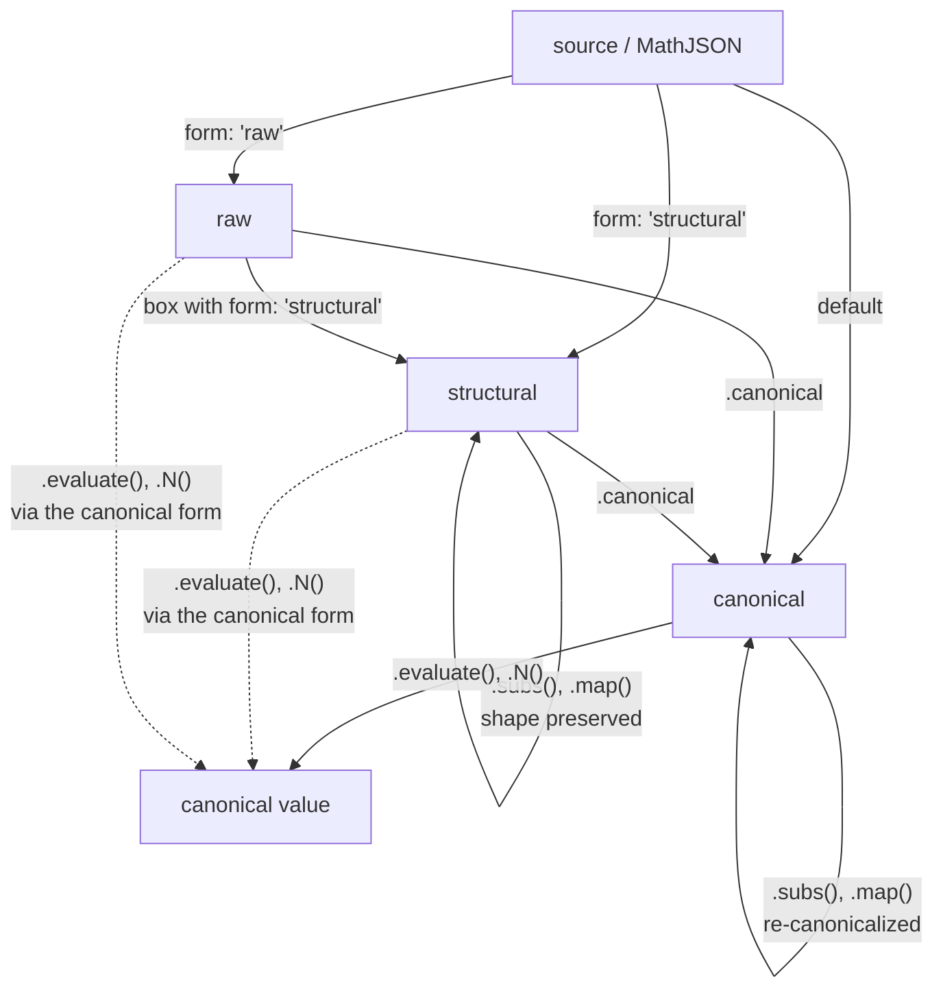

Nothing leads back from `canonical` to a parse shape: a tree that must stay
in parse vocabulary has to be raw or structural from the parse onward.

<div className="symbols-table first-column-header" style={{"--first-col-width":"22ch"}}>

|  | raw <br/>`{ form: 'raw' }` | **structural** <br/>`{ form: 'structural' }` | canonical <br/>(default) |
| :--- | :---: | :---: | :---: |
| Parse vocabulary preserved | yes | **yes** | no (rewritten) |
| Operator definitions resolved (bound) | no | **yes** | yes |
| `expr.type` answers | `unknown` | **yes** | yes |
| Usable in `.add()`, `.mul()`, … | no | **yes** | yes |
| `.subs()` / `.map()` shape-preserving | yes | **yes** | no (result re-canonicalizes) |
| Arity and type errors checked | no | **no** | yes |
| Scope processing, binder shadowing | no | **no** | yes |

</div>

**To create a structural expression** use `ce.parse(s, { form: 'structural' })`,
`ce.expr(json, { form: 'structural' })` or
`ce.function(op, ops, { form: 'structural' })`. Note that `ce._fn()` does
**not** accept the option. The legacy spellings `{ canonical: false }` (raw)
and `{ structural: true }` still work at runtime, but are no longer part of
the typed API surface — new code should use `form`.

```ts
const expr = ce.parse('2x - (a+b)', { form: 'structural' });
console.log(expr.json);
// ➔ ["Subtract", ["InvisibleOperator", 2, "x"], ["Delimiter", ["Add", "a", "b"]]]

console.log(expr.isStructural, expr.isCanonical);
// ➔ true false

console.log(expr.type.toString());
// ➔ "broadcastable<number>"

console.log(expr.subs({ a: ce.expr(3) }).json);
// ➔ ["Subtract", ["InvisibleOperator", 2, "x"], ["Delimiter", ["Add", 3, "b"]]]
// still structural: the sugar survived the substitution
```

Structural boxing **preserves** the shape it is given; it does not recover
one. A structural box of an already-canonical tree leaves it canonical
(`Add(a, Negate(b))` stays `Add(a, Negate(b))`) — there is no projection back
from canonical to parse shape. A tree that must stay in parse vocabulary has
to be non-canonical from the parse onward.

:::warning[`.evaluate()` leaves the tier]
`.evaluate()` and `.N()` always answer with a **canonical** value. On a
structural or raw tree they evaluate the expression's canonical form, so
every tier agrees on the value — including binders (`Sum`, `Integrate`, `D`,
a function literal), whose bound variables are declared by canonicalization
and would otherwise be evaluated unbound:

```ts
console.log(ce.parse('\\sum_{n=1}^{3} n', { form: 'structural' }).evaluate());
// ➔ 6        (same as the canonical tree)

console.log(ce.parse('\\sum_{n=1}^{3} n', { form: 'raw' }).evaluate());
// ➔ 6

console.log(ce.parse('\\sum_{n=1}^{3} n').evaluate());
// ➔ 6
```

A bare symbol behaves the same way. A structural or raw symbol is not bound
to a definition, so it is resolved in the current scope before being
evaluated: it answers with its assigned value, not with itself. A symbol with
no value evaluates to itself (as a canonical symbol).

```ts
ce.assign('x', 5);

console.log(ce.box('x', { form: 'raw' }).evaluate());
// ➔ 5       (same as the canonical symbol)

console.log(ce.box('zzz', { form: 'raw' }).evaluate());
// ➔ zzz     (no value: the symbol itself)
```

The receiver itself is not changed — it stays on its tier — but the
**result** is canonical: it is in canonical vocabulary, and it is not a
structural expression. A pipeline that must stay on the structural tier
should not route through `.evaluate()`.
:::

Also note that `.subs()` avoids variable capture on every tier. When a
replacement contains a name that a binder binds, the binder renames that name
first: `\sum_{k=1}^{3} (j+k)`, parsed in the structural form, with `j`
replaced by `k` gives `["Sum", ["Delimiter", ["Add", "k", "k_1"]], ["Tuple",
"k_1", 1, 3]]`, which evaluates to `3k + 6`. The target of an `Assign` in a
held `Block`, and a `Declare` or an `Assign` in a branch of an `If` of a held
`Block`, are not renamed: see the documentation of `subs()`.

## Parse Vocabulary vs Canonical Vocabulary

The vocabulary a fresh parse produces and the vocabulary canonicalization
produces differ in a bounded set of ways, listed below.

:::info[Notice guarantee]
The raw parse vocabulary is a **documented interchange vocabulary**, not an
implementation detail: consumers pattern-match these spellings and we will
not respell them silently. Any change to a spelling on this page lands as a
called-out **BREAKING** entry in the CHANGELOG — never slipped into a release
unannounced. Build on the current spellings; watch the changelog line, not
the trees.

The vocabulary is *versioned*, not *frozen*: this is a notice guarantee, not
a promise that it never changes.
:::

### What Differs

1. **Sugar heads are rewritten.** `InvisibleOperator` becomes `Multiply`, a
   function application or `At`, depending on context; `Delimiter` is erased;
   `Subtract` becomes `Add(…, Negate(…))`; `Sequence` is spliced.

   ```ts
   ce.parse('2x', { form: 'raw' }).json;   // ➔ ["InvisibleOperator", 2, "x"]
   ce.parse('2x').json;                         // ➔ ["Multiply", 2, "x"]

   ce.parse('a - b', { form: 'raw' }).json; // ➔ ["Subtract", "a", "b"]
   ce.parse('a - b').json;                       // ➔ ["Add", "a", ["Negate", "b"]]

   ce.parse('(a+b)', { form: 'raw' }).json; // ➔ ["Delimiter", ["Add", "a", "b"]]
   ce.parse('(a+b)').json;                       // ➔ ["Add", "a", "b"]

   ce.parse('f(1,2)', { form: 'raw' }).json;
   // ➔ ["InvisibleOperator", "f", ["Delimiter", ["Sequence", 1, 2], "'(,)'"]]
   ce.parse('f(1,2)').json;                      // ➔ ["f", 1, 2]
   ```

2. **Operand order.** `Add` and `Multiply` sort their operands canonically.

   ```ts
   ce.parse('-2+x', { form: 'raw' }).json;  // ➔ ["Add", ["Negate", 2], "x"]
   ce.parse('-2+x').json;                        // ➔ ["Add", "x", -2]

   ce.parse('\\pi x 2', { form: 'raw' }).json;
   // ➔ ["InvisibleOperator", "Pi", "x", 2]
   ce.parse('\\pi x 2').json;                    // ➔ ["Multiply", 2, "Pi", "x"]
   ```

3. **Flattening.** Associative operators flatten, and the fence goes with
   them.

   ```ts
   ce.parse('(a+b)+c', { form: 'raw' }).json;
   // ➔ ["Add", ["Delimiter", ["Add", "a", "b"]], "c"]
   ce.parse('(a+b)+c').json;                     // ➔ ["Add", "a", "b", "c"]
   ```

4. **Exact literal folding.** Integers, rationals and radicals fold in `Add`
   and `Multiply`. Machine floats, infinities and `NaN` deliberately do not.

   ```ts
   ce.parse('2+x+5', { form: 'raw' }).json; // ➔ ["Add", 2, "x", 5]
   ce.parse('2+x+5').json;                       // ➔ ["Add", "x", 7]
   ```

5. **Generic-symbol folds.** `x/x` becomes `1` and `1^x` becomes `1` at
   canonicalization. This is a documented engine convention, not a bug: the
   operands are gone entirely.

   ```ts
   ce.parse('\\frac{x}{x}', { form: 'raw' }).json; // ➔ ["Divide", "x", "x"]
   ce.parse('\\frac{x}{x}').json;                       // ➔ 1
   ce.parse('1^x').json;                                // ➔ 1
   ```

6. **Literal normalization.** `Negate(2)` becomes `-2`; a literal
   a literal `a + bi` becomes `Complex(a, b)`. The `Complex` fold
   requires **both** parts to be literal — a symbolic imaginary term stays a
   product.

   ```ts
   ce.parse('-2', { form: 'raw' }).json;    // ➔ ["Negate", 2]
   ce.parse('-2').json;                          // ➔ -2

   ce.parse('2+3\\imaginaryI').json;             // ➔ ["Complex", 2, 3]
   ce.parse('\\imaginaryI b').json;              // ➔ ["Multiply", "ImaginaryUnit", "b"]
   ```

7. **Symbol resolution.** Constant symbols resolve at canonicalization, not
   at parse time: on a raw or structural tree `e` is still the symbol `e`.

   ```ts
   ce.parse('e', { form: 'raw' }).json;     // ➔ "e"
   ce.parse('e').json;                           // ➔ "ExponentialE"
   ```

   To ask whether a name *would* resolve to a constant — and to get the
   answer for the current scope chain, so a user redeclaration is respected —
   use `ce.lookupDefinition(name)`. It returns `undefined` for an undeclared
   name and declares nothing, so it is safe to call speculatively:

   ```ts
   const v = ce.lookupDefinition('i')?.value;
   const isImaginaryUnit = v?.isConstant === true && v.value?.im === 1;
   ```

   Two traps. A symbol-level query cannot see **binder** shadowing (a `\sum`
   over `i` rebinds `i` inside its body), so mask binder-bound names first.
   And the query key is the *post-parse* symbol name: the LaTeX→symbol
   mapping is a parse step, so `\pi` is already the symbol `Pi` on a raw
   tree — `lookupDefinition('pi')` finds nothing.

8. **Binder rewrites.** Scoped operators normalize their bound variables and
   canonicalize their bodies. See [below](#binder-spellings).

### What Does Not Differ

These constructs read the same on both routes, so a walk tuned on parse trees
needs no defensive re-parse for them:

```ts
ce.parse('\\frac{x}{y}', { form: 'raw' }).json; // ➔ ["Divide", "x", "y"]
ce.parse('\\frac{x}{y}').json;                       // ➔ ["Divide", "x", "y"]

ce.parse('a<b<c', { form: 'raw' }).json;        // ➔ ["Less", "a", "b", "c"]
ce.parse('a<b<c').json;                              // ➔ ["Less", "a", "b", "c"]

ce.parse('\\sqrt{x}', { form: 'raw' }).json;    // ➔ ["Sqrt", "x"]
ce.parse('\\sqrt{x}').json;                          // ➔ ["Sqrt", "x"]

ce.parse('x_1', { form: 'raw' }).json;          // ➔ "x_1"
ce.parse('x_1').json;                                // ➔ "x_1"
```

One case to keep in mind rather than delete: the `v_1` → `At(v, 1)`
projection over a declared list happens at **parse** time, so both routes
agree — but that means parse shape is **declaration-sensitive**. The same
source parses differently depending on what is in scope:

```ts
ce.parse('v_1', { form: 'raw' }).json;  // ➔ "v_1"
ce.declare('v', 'list<number>');
ce.parse('v_1', { form: 'raw' }).json;  // ➔ ["At", "v", 1]
```

A walk tuned on parse trees inherits that sensitivity whether or not it ever
touches a canonical tree.

### Binder Spellings

Binder limits are carried as a `Tuple` on the raw and structural routes and
as `Limits` on the canonical route:

```ts
ce.parse('\\sum_{n=1}^{10} n^2', { form: 'structural' }).json;
// ➔ ["Sum", ["Power", "n", 2], ["Tuple", "n", 1, 10]]
ce.parse('\\sum_{n=1}^{10} n^2').json;
// ➔ ["Sum", ["Power", "n", 2], ["Limits", "n", 1, 10]]

ce.parse('\\prod_{k=1}^{5} k', { form: 'structural' }).json;
// ➔ ["Product", "k", ["Tuple", "k", 1, 5]]
ce.parse('\\prod_{k=1}^{5} k').json;
// ➔ ["Product", "k", ["Limits", "k", 1, 5]]
```

A structural `Function` body carries **no `Block` wrapper**; the canonical
form adds one:

```ts
ce.parse('x \\mapsto x^2 + 1', { form: 'structural' }).json;
// ➔ ["Function", ["Add", ["Power", "x", 2], 1], "x"]
ce.parse('x \\mapsto x^2 + 1').json;
// ➔ ["Function", ["Block", ["Add", ["Power", "x", 2], 1]], "x"]
```

`D` **retains** its `Delimiter`; canonicalization erases it:

```ts
ce.parse('\\frac{d}{dx}(x^2+1)', { form: 'structural' }).json;
// ➔ ["D", ["Delimiter", ["Add", ["Power", "x", 2], 1]], "x"]
ce.parse('\\frac{d}{dx}(x^2+1)').json;
// ➔ ["D", ["Add", ["Power", "x", 2], 1], "x"]
```

`Integrate` combines both rewrites — the `Tuple` becomes `Limits` *and* the
integrand is lifted into a `Function`/`Block`:

```ts
ce.parse('\\int_0^1 x^2 dx', { form: 'structural' }).json;
// ➔ ["Integrate", ["Power", "x", 2], ["Tuple", "x", 0, 1]]
ce.parse('\\int_0^1 x^2 dx').json;
// ➔ ["Integrate", ["Function", ["Block", ["Power", "x", 2]], "x"],
//                 ["Limits", "x", 0, 1]]
```

## Undeclared Call Heads Bind Vacuously

A structural box of a function expression whose head is **undeclared**
succeeds. There is no error, no declaration, and no operator definition:

```ts
const expr = ce.expr(['myHead', 1, 2], { form: 'structural' });

console.log(expr.isValid);              // ➔ true
console.log(expr.errors);               // ➔ []
console.log(expr.operatorDefinition);   // ➔ undefined
console.log(ce.lookupDefinition('myHead')); // ➔ undefined
```

The head is simply not bound — the node is inert. This is the intended
behavior, and it is covered by the notice guarantee above.

The **canonical** route declares nothing either: the node is a call of
`myHead`, and the head is resolved when the call is evaluated. The type that
the call requires of the head (`function`) is kept with the expression;
`ce.infer()` declares it:

```ts
const ce2 = new ComputeEngine();
const call = ce2.expr(['myHead', 1, 2]);   // canonical
console.log(ce2.lookupDefinition('myHead')); // ➔ undefined

ce2.infer([call]);
const def = ce2.lookupDefinition('myHead');
console.log(def.value.type.toString());   // ➔ "function"
console.log(def.value.inferredType);      // ➔ true
```

If the head *is* declared as an operator, the structural box binds it
normally:

```ts
ce.expr(['Sin', 1], { form: 'structural' }).operatorDefinition?.name;
// ➔ "Sin"
```

## Bound-Symbol Equality

This section describes the **Structural** tier of comparison — `Same` and
`expr.isSame()`. See
[Comparing Expressions](/compute-engine/guides/symbolic-computing/#comparing-expressions)
for the three tiers and how they differ. This contract is a property of
binder identity, not of value following, so it is **unchanged** by the
equality-tier semantics: the arithmetic and prover tiers do not enter into
it.

**Bound-symbol equality is per-binder-instance.** Each canonicalization of a
binder mints fresh bindings, so the `n` of one `Sum` and the `n` of a
separately built `Sum` are *different variables*, deliberately.

**Compare at, or below, a common root.** Whole-tree comparison handles the
bound occurrences correctly:

```ts
const a = ce.parse('\\sum_{n=1}^{10} n^2');
const b = ce.parse('\\sum_{n=1}^{10} n^2');

console.log(a.isSame(b));          // ➔ true
```

**Detached cross-tree leaf comparison is out of contract.** A bound leaf
lifted out of its tree carries no binder context to be equivalent *under*, so
comparing it against the same-position leaf of another tree is not a
meaningful question — and answers `false`:

```ts
console.log(a.op1.op1.isSame(b.op1.op1));   // ➔ false — out of contract
```

Comparing roots first is not a workaround; it is the sanctioned pattern.

**Reflexivity is guaranteed.** The identical object always compares equal to
itself, bound or not:

```ts
const leaf = a.op1.op1;
console.log(leaf.isSame(leaf));    // ➔ true
```

:::info[Not full alpha-equivalence]
`isSame()` compares occurrences under a common binder by *name*, so it is
alpha-*aware* — fresh binding identity does not defeat it. It is not
alpha-*equivalent*: renaming a bound variable changes the answer.

```ts
ce.parse('\\sum_{n=1}^{10} n^2').isSame(ce.parse('\\sum_{m=1}^{10} m^2'));
// ➔ false
```
:::

## Error Attachment and Incremental Validity

A pipeline that edits a tree in place wants to re-check only what it changed.
Two properties bound what that is allowed to mean.

### An Error Attaches at the Nearest Constraining Ancestor

An `incompatible-type` error attaches at the nearest ancestor whose signature
or canonical handler actually **constrains** the propagated type. That is not
"the immediate parent": broadcasting and type-transparent operators pass the
change through without erroring, so the attachment point can be arbitrarily
far above the edit.

```ts
const mk = (leaf) =>
  ce.expr(['Sum', ['Power', 'n', 2], ['Limits', 'n', 1, ['Sin', ['Sqrt', leaf]]]]);

console.log(mk(4).isValid);              // ➔ true

console.log(mk(['List', 1, 2]).isValid); // ➔ false
console.log(mk(['List', 1, 2]).json);
// ➔ ["Sum", ["Power", "n", 2],
//     ["Limits", "n", 1,
//       ["Error", ["ErrorCode", "'incompatible-type'", "'number'", "'vector<2>'"]]]]
```

The edit is at the operand of `Sqrt`, three levels down. Both the edited
subtree and its parent probe as valid on their own —

```ts
console.log(ce.expr(['Sqrt', ['List', 1, 2]]).isValid);          // ➔ true
console.log(ce.expr(['Sin', ['Sqrt', ['List', 1, 2]]]).isValid); // ➔ true
```

— and the error materializes only at the `Sum` bound, the first ancestor that
requires a `number`.

### `isValid` Is Not a Complete Oracle

A scalar→collection change frequently produces **no box-time error at all**.
Broadcastable lift at applications defers collection mismatches to runtime by
design:

```ts
ce.declare('g', '(string) -> number');

console.log(ce.expr(['g', 42]).isValid);
// ➔ false  — ["g", ["Error", ["ErrorCode", "'incompatible-type'", "'string'", "'42'"], 42]]
//            the offending type is reported as the literal type `42`, not as `integer`

console.log(ce.expr(['g', ['List', 1, 2]]).isValid);
// ➔ true   — the lift makes it a broadcast application
console.log(ce.expr(['g', ['List', 1, 2]]).type.toString());
// ➔ "vector<2>"
```

Only operators that constrain collections inside their canonical handlers —
`Sum` bounds, above — fire at box time. Part of this class surfaces only at
evaluate or compile time. Do not treat `.isValid` as a complete validity
oracle for a type-changing edit.

### The Sound Incremental Rule

Compare the changed subtree's **type** before and after the edit.

- **Type unchanged** ⇒ no ancestor's validity can change. Probing the subtree
  alone suffices.
- **Type changed** ⇒ re-probe from the root, or walk upward re-boxing one
  ancestor at a time and stop as soon as a node's recomputed type equals its
  pre-edit type.

```ts
ce.declare('k', '(number) -> number');

ce.expr(['k', 'x']).type.toString();            // ➔ "number"
ce.expr(['k', ['List', 1, 2]]).type.toString(); // ➔ "vector<2>"
// type changed ⇒ ancestors must be re-probed
```

Validity itself is compositional, and `Error` nodes attach at the offending
operator, so a subtree probe (`ce.expr(changedSubtreeJson).isValid`, then
discard the tree) costs work proportional to the change rather than to the
whole expression. A canonical probe declares no symbol and no head, so it
does not change the types that another expression reads.

## Per-Call Scope Control

:::warning[Unreleased]
The API described in this section is **not yet released**. It is documented
here as a contract; the spellings are subject to the notice guarantee only
once it ships. Check the CHANGELOG for the release that carries it.
:::

Canonical parsing and boxing read the engine's current lexical scope: the
subscript fold resolves names, and each symbol is bound to the definition that
its name has there. They declare nothing: a symbol with no definition keeps
its name and the scope it was boxed in, and `ce.infer()` declares it there. A
consumer parsing untrusted or out-of-order input chooses the scope that both
read.

### The `scope` Option

```ts
ce.parse(latex, { scope });
ce.expr(json,   { scope });
```

When a `scope` is supplied, the parse or box runs with it as the current
lexical scope. Lookups walk `scope → parents`, and a symbol with no
definition belongs to the supplied scope: `ce.infer()` declares it there,
when that scope is current (`ce.pushScope(scope)`). Discarding the scope
discards those declarations.

### `ce.createScope()`

There is deliberately no separate `bindings` option: the declarations table
is the *scope's initializer*, so `scope` stays the single per-call option and
no option-interaction rules exist.

```ts
ce.createScope(
  bindings?: Record<string, Type | TypeString | BoxedDefinition>,
  parent?: Scope
): InspectableScope;

const scope = ce.createScope({ h: 'function', p: 'tuple<3>' });
const expr = ce.parse(row, { scope });
```

`parent` defaults to the engine's current lexical scope **at call time**;
callers with ordering discipline should pass their document scope explicitly.
Each entry is declared into the fresh scope, shadowing outer declarations
innermost-wins. Reusing one scope across several calls is supported and
useful — parsing every row of a document into the same scope accumulates the
harvest across rows.

With the caller supplying every free name, a parse becomes a function of
(latex, dictionary, declarations) plus the engine's standard library.

**`BoxedDefinition` initializer values.** A harvested definition re-installs
the **same definition object**, not a fresh holder: binding identity and
write-version continuity are preserved, so seeding pass *N+1* from pass *N*'s
harvest keeps write-version-keyed caches warm by construction. Two
constraints: definitions are engine-bound, so this works within one engine
only; and installing one definition in two live scopes makes it **shared
mutable state** — a type narrowing through either scope is visible in both.
That aliasing is the intended semantics for sequential pass-seeding, and is
documented rather than prevented.

### Rebinding a Boxed Expression in Another Scope

The `scope` option steers a **construction**. On an expression that is
already boxed it changes nothing:

```ts
const a = ce.parse("x + 1", { scope: outer }); // `x` resolved in `outer`
ce.expr(a, { scope: inner }); // returns `a` — the bindings stay `outer`'s
```

`ce.expr` on a boxed input returns its canonical form and never re-resolves
a symbol. Until now, an expression that had to be read under other
declarations was serialized and boxed again:

```ts
ce.expr(a.json, { scope: inner }); // works, but serializes `a`
```

`.json` writes a **tree**. An expression is a DAG — one sub-expression
object can be an operand of many parents — and a value with substituted
helper bodies can hold a few hundred thousand distinct nodes that a tree
walk visits billions of times. `ce.rebind` is the operation that re-resolves
without the serialization:

```ts
ce.rebind(a, { scope: inner }); // a fresh box of `a`, bound in `inner`
ce.rebind(a, { form: "structural", scope: inner });
ce.rebind(a, { form: "raw" });
```

The result is what `ce.expr(a.json, { form, scope })` would have returned.
For the canonical form (and a partial form such as `["Flatten", "Order"]`),
`rebind` builds the MathJSON as a DAG — one array per distinct node, shared
by every parent that reads it, with operands taken from the node's
structural form as `.json` takes them — and boxes that by the ordinary
route. The match with the MathJSON route therefore holds by construction,
including for an expression that already holds an `Error` node. Canonical
boxing still visits every path, as it does for any MathJSON — what `rebind`
removes is the tree-sized serialization. The raw and structural forms
canonicalize nothing, so there each distinct node is rebuilt once and a
shared sub-expression stays shared in the result too. Verbatim LaTeX and source positions are dropped, as the
MathJSON route drops them; a mutable object is rebuilt as the record
snapshot that route boxes as data.

### Reading Back What a Parse Declared

`createScope()` returns an `InspectableScope` — structurally a `Scope`,
assignable anywhere a `Scope` is accepted, plus a read surface. A scope's
content is opaque by design (`Scope.bindings` is publicly
`Map<string, unknown>`, holding internal records whose shape is not API), so
these methods are the supported decode.

```ts
interface InspectableScope extends Scope {
  declarations(): ReadonlyArray<{
    name: string;
    type: BoxedType;
    inferred: boolean;
    def: BoxedDefinition;
  }>;

  narrowings(): ReadonlyArray<{
    name: string;
    from: BoxedType;
    to: BoxedType;
    def: BoxedDefinition;
  }>;

  dispose(): void;
}
```

`declarations()` reports the scope's own bindings — the initializer's entries
with their post-inference types, alongside the declarations that `ce.infer()`
made in the scope. `inferred` is true when the type was inferred from usage
rather than stated by the caller; an initializer entry declared with an
explicit type reports `false` even if inference later narrowed it. For an
operator definition, `type` is its signature. Types are answered as
`BoxedType` — the same boxed form as `expr.type` — so `entry.type.toString()`
is the canonical type spelling and `entry.type.matches(…)` works directly.
Both listings are sorted **lexicographically by name**, deterministically and
independently of the order in which declares interleaved; a fingerprint over
`[name, type.toString()]` pairs is stable.

```ts
const scope = ce.createScope(heads);
const expr = ce.parse(row, { scope });
ce.pushScope(scope);
ce.infer([expr]);
ce.popScope();
const harvested = scope.declarations();
// … read inferred parameter types; drop `scope` when done
```

One known boundary: the engine's interned common symbols (`Pi`, `e`, `i`,
`True`, …) resolve ahead of the lexical scope chain, so a binding for one of
those names is recorded in `declarations()` but does not shadow the constant
during boxing — the same behavior as `ce.declare` of the same name.

Callers that want no harvest simply drop the scope reference; there is no
separate discard path. A caller-owned scope is never pushed through the
engine's scope-discard path, so its definitions are **not** auto-disposed:
holding a harvested definition after the parse, or after dropping the scope,
is supported.

`dispose()` is a deterministic release of the event subscriptions held by
constant- and dynamic-valued definitions. It is idempotent, and definitions
stay data-readable afterwards; re-installing a **disposed** definition is out
of contract.

:::warning[Dispose between passes, not mid-pass]
`dispose()` bumps each definition's write version once. Consumers whose
caches are keyed on write version must call it *between* passes.
:::

A hand-rolled `{ parent, bindings }` object literal still satisfies `Scope`
and works as the `scope` option, but only `createScope()` products are
inspectable.

### Outer-Scope Declarations

A contained parse does not narrow a symbol declared in an **outer** scope:
parsing and boxing change no definition, also an inferred one. So
`narrowings()` has nothing to report after a parse. The type that the parse
requires of such a symbol is kept with the expression.

---

# Arithmetic

Source: https://epsil.dev/compute-engine/reference/arithmetic/

<!--
The entries of this page moved to the Epsil library reference: their text is
in reference-details/ (arithmetic.md, polynomials.md, core.md, relop.md,
statistics.md). This stub keeps the old anchors and sends each one to its new
place: see reference-details/README.md.
-->

<ReferenceMoved
  to="/reference/arithmetic/"
  names={[
    "AlgebraicGenerator", "Apart", "Cancel", "Clamp", "CoefficientList",
    "Congruent", "Denominator", "Discriminant", "Distribute", "Expand",
    "ExpandAll", "Factor", "GCD", "Interpret", "Max", "Min", "Mod",
    "Numerator", "NumeratorDenominator", "PartialFraction", "Polynomial",
    "PolynomialDegree", "PolynomialGCD", "PolynomialQuotient",
    "PolynomialRemainder", "PolynomialRoots", "Product", "Random",
    "RandomChoice", "RandomSample", "RandomShuffle", "Rational", "Smoothstep",
    "Sum", "Together", "WithRandomSeed",
  ]}
  anchors={{
    "constants": "/reference/arithmetic/#constants",
    "functions": "/reference/arithmetic/#operators-and-precedence",
    "arithmetic-functions": "/reference/arithmetic/#operators-and-precedence",
    "non-finite-results": "/reference/arithmetic/#infinity-and-nan",
    "powers": "/reference/arithmetic/#power",
    "sums-and-products": "/reference/arithmetic/#sums-and-products",
    "multiple-indexing-sets": "/reference/arithmetic/#multiple-indexing-sets",
    "condition-filtering": "/reference/arithmetic/#multiple-indexing-sets",
    "simplification": "/reference/arithmetic/#closed-forms",
    "infinite-series": "/reference/arithmetic/#infinite-series",
    "simplification-1": "/reference/arithmetic/#closed-forms-1",
    "infinite-products": "/reference/arithmetic/#infinite-products",
    "interpreting-elliptical-notation": "/reference/arithmetic/#interpret",
    "interpret": "/reference/arithmetic/#interpret",
    "transcendental-functions": "/reference/arithmetic/#exp",
    "rounding": "/reference/arithmetic/#rounding-and-remainders",
    "other-functions": "/reference/arithmetic/#definitions",
    "other-relational-operators": "/reference/relop/#congruent",
    "congruent": "/reference/relop/#congruent",
    "relational-operators": "/reference/relop/#order-and-absent-values",
    "random-numbers": "/reference/core/#random-numbers",
    "withrandomseed": "/reference/core/#withrandomseed",
    "randomchoice": "/reference/core/#randomchoice",
    "migrating-from-the-previous-random-operators": "/reference/core/#migrating-from-the-previous-random-operators",
    "polynomial-arithmetic": "/reference/polynomials/",
    "factor": "/reference/polynomials/#factor",
    "factoring-over-a-number-field": "/reference/polynomials/#factoring-over-a-number-field",
    "algebraicgenerator": "/reference/polynomials/#algebraicgenerator",
    "polynomialroots": "/reference/polynomials/#polynomialroots",
  }}
/>

---

# Calculus

Source: https://epsil.dev/compute-engine/reference/calculus/

<!--
The entries of this page moved to the Epsil library reference: their text is
in reference-details/calculus.md. This stub keeps the old anchors and sends
each one to its new place: see reference-details/README.md.
-->

<ReferenceMoved
  to="/reference/calculus/"
  names={[
    "BigO", "D", "DSolve", "Derivative", "Integrate", "InterpolatingFunction",
    "Limit", "ND", "NDSolve", "NDSolveFunction", "NIntegrate", "NLimit",
    "Normal", "Series",
  ]}
  anchors={{
    "supported-derivative-formulas": "/reference/calculus/#supported-derivative-formulas",
    "integral": "/reference/calculus/#integrate",
    "supported-integral-formulas": "/reference/calculus/#supported-integral-formulas",
    "logarithmic-patterns": "/reference/calculus/#supported-integral-formulas",
    "exponential-trigonometric-products": "/reference/calculus/#supported-integral-formulas",
    "powers-of-sine-and-cosine": "/reference/calculus/#supported-integral-formulas",
    "piecewise-integrands": "/reference/calculus/#supported-integral-formulas",
    "special-function-primitives": "/reference/calculus/#supported-integral-formulas",
    "integrals-by-residues": "/reference/calculus/#supported-integral-formulas",
    "series-expansion": "/reference/calculus/#series",
    "differential-equations": "/reference/calculus/#dsolve",
  }}
/>

---

# Collections

Source: https://epsil.dev/compute-engine/reference/collections/

<!--
The entries of this page moved to the Epsil library reference: their text is
in reference-details/collections.md, and in the detail file of the library
of each entry that belongs to another library. This stub keeps the old
anchors and sends each one to its new place: see reference-details/README.md.
-->

<ReferenceMoved
  to="/reference/collections/"
  names={[
    "All", "Any", "Append", "ArgMax", "ArgMin", "At", "Chunk", "ChunkBy",
    "Comprehension", "Contains", "ContainsSequence", "Count", "CountIf",
    "Cycle", "Dedup", "DeleteAt", "Differences", "Drop", "DropWhile",
    "Exists", "Field", "Fill", "Filter", "Find", "First", "FlatMap", "Fold",
    "ForAll", "GroupBy", "IndexOf", "IndexWhere", "IndexedSequence", "Insert",
    "IsEmpty", "Iterate", "Join", "Keys", "Last", "Length", "Linspace",
    "List", "Map", "MaxBy", "MinBy", "Most", "Ordering", "Partition",
    "Position", "RandomShuffle", "Range", "RangeOf", "Reduce", "Repeat",
    "ReplaceAt", "Rest", "Reverse", "RotateLeft", "RotateRight", "Scan",
    "Second", "Sequence", "Set", "Slice", "Sort", "StartsWith", "Table",
    "Tabulate", "Take", "TakeWhile", "Tally", "Third", "Unique", "Values",
    "Zip", "ListFrom", "SetFrom", "TupleFrom", "DictionaryFrom", "EndsWith",
  ]}
  anchors={{
    "introduction": "/reference/collections/",
    "core-properties-of-collections": "/reference/collections/#kinds-of-collection",
    "indexed-collections-and-non-indexed-collections": "/reference/collections/#indexed-and-non-indexed-collections",
    "nested-collections": "/reference/collections/#nested-collections",
    "finite-and-infinite-collections": "/reference/collections/#finite-and-infinite-collections",
    "lazy-collections-and-eager-collections": "/reference/collections/#lazy-and-eager-collections",
    "eager-collections": "/reference/collections/#lazy-and-eager-collections",
    "lazy-collections": "/reference/collections/#lazy-and-eager-collections",
    "materialization-cap": "/reference/collections/#the-materialization-cap",
    "types": "/reference/collections/#element-types",
    "the-shape-of-an-expression-before-evaluation": "/compute-engine/guides/expressions/#the-shape-of-an-expression-before-evaluation",
    "operations-on-collections": "/reference/collections/#definitions",
    "creating-eager-collections": "/reference/collections/#list",
    "creating-lazy-collections": "/reference/collections/#range",
    "latex-syntax": "/reference/collections/#range",
    "accessing-elements-of-collections": "/reference/collections/#at",
    "out-of-range-index": "/reference/collections/#out-of-range-index",
    "filtering-with-a-condition": "/reference/collections/#filtering-with-a-condition",
    "subscript-notation": "/reference/collections/#at",
    "changing-the-order-of-elements": "/reference/collections/#reverse",
    "operating-on-collections": "/reference/collections/#length",
    "transforming-collections": "/reference/collections/#join",
    "materializing-collections": "/reference/collections/#listfrom",
  }}
/>

---

# Colors

Source: https://epsil.dev/compute-engine/reference/colors/

<!--
The entries of this page moved to the Epsil library reference: their text is
in reference-details/colors.md. This stub keeps the old anchors and sends each
one to its new place: see reference-details/README.md.
-->

<ReferenceMoved
  to="/reference/colors/"
  names={[
    "Color", "ColorFromColorspace", "ColorToColorspace", "Colormap",
  ]}
  anchors={{
    "named-colors": "/reference/colors/#named-colors",
    "available-palettes": "/reference/colors/#available-palettes",
    "sequential": "/reference/colors/#sequential",
    "diverging": "/reference/colors/#diverging",
    "categorical": "/reference/colors/#categorical",
    "functions": "/reference/colors/#definitions",
  }}
/>

---

# Combinatorics

Source: https://epsil.dev/compute-engine/reference/combinatorics/

<!--
The entries of this page moved to the Epsil library reference: their text is
in reference-details/combinatorics.md. This stub keeps the old anchors and
sends each one to its new place: see reference-details/README.md.
-->

<ReferenceMoved
  to="/reference/combinatorics/"
  names={[
    "BellNumber", "Binomial", "CartesianProduct", "Choose", "Combinations",
    "Fibonacci", "IntegerPartitions", "Multinomial", "Permutations",
    "PowerSet", "Subfactorial",
  ]}
  anchors={{
    "functions": "/reference/combinatorics/#definitions",
  }}
/>

---

# Complex

Source: https://epsil.dev/compute-engine/reference/complex/

<!--
The entries of this page moved to the Epsil library reference: their text is
in reference-details/arithmetic.md, under the overview section "Complex
numbers". This stub keeps the old anchors and sends each one to its new place:
see reference-details/README.md. Arg is documented under Argument.
-->

<ReferenceMoved
  to="/reference/arithmetic/#complex-numbers"
  names={[
    "Abs", "AbsArg", "ComplexRoots", "Conjugate", "Imaginary", "Real",
  ]}
  anchors={{
    "constants": "/reference/arithmetic/#imaginaryunit",
    "functions": "/reference/arithmetic/#complex-numbers",
    "Arg": "/reference/arithmetic/#argument",
    "arg": "/reference/arithmetic/#argument",
  }}
/>

---

# Control Structures

Source: https://epsil.dev/compute-engine/reference/control-structures/

<!--
The entries of this page moved to the Epsil library reference. Their text is
in reference-details/control-structures.md, and Program and Block in core.md.
This stub keeps the old anchors and sends each one to its new place: see
reference-details/README.md. Return has no entry in the library reference;
its anchor goes to the language page.
-->

<ReferenceMoved
  to="/reference/control-structures/"
  names={[
    "AddTo", "Block", "Break", "Continue", "FixedPoint", "If", "Loop",
    "Match", "ParallelComprehension", "ParallelLoop", "Program", "Which",
  ]}
  anchors={{
    "overview": "/reference/control-structures/#overview",
    "sequential-control-structure": "/reference/control-structures/#sequential-control-structure",
    "conditional-control-structure": "/reference/control-structures/#conditional-control-structure",
    "loops": "/reference/control-structures/#loops",
    "controlling-the-flow-of-execution": "/reference/control-structures/#controlling-the-flow-of-execution",
    "restriction": "/reference/control-structures/#restriction",
    "a-restriction-of-a-collection": "/reference/control-structures/#a-restriction-of-a-collection",
    "latex-syntax-for-control-structures": "/reference/control-structures/#latex-syntax-for-control-structures",
    "element-wise-selection": "/reference/control-structures/#element-wise-selection",
    "semicolon-blocks": "/reference/core/#block",
    "where-bindings": "/reference/core/#block",
    "translating-simultaneous-assignments": "/reference/core/#translating-simultaneous-assignments",
    "inline-if": "/reference/control-structures/#if",
    "restriction-braces": "/reference/control-structures/#if",
    "for-loops": "/reference/control-structures/#loop",
    "for-comprehensions": "/reference/control-structures/#comprehension",
    "Return": "/control-flow/#return",
    "return": "/control-flow/#return",
  }}
/>

---

# Core

Source: https://epsil.dev/compute-engine/reference/core/

<!--
The entries of this page moved to the Epsil library reference: their text is
in reference-details/ (core.md, polynomials.md, relop.md, trigonometry.md).
The subscript rules moved to the LaTeX syntax guide
(07-guide-latex-syntax.md). This stub keeps the old anchors and sends each
one to its new place: see reference-details/README.md.
-->

<ReferenceMoved
  to="/reference/core/"
  names={[
    "About", "ArbitraryConstant", "Assign", "Assume", "CanonicalForm",
    "Declare", "DeclareType", "Error", "Evaluate", "Expand", "ExpandAll",
    "Factor", "Head", "Hold", "HoldValues", "IdenticallyEqual", "Identity",
    "InverseFunction", "IsError", "IsSame", "Latex", "LatexString", "Module",
    "N", "Parse", "Same", "Simplify", "Solve", "String", "Symbol", "Tail",
    "Together", "Type", "Typed",
  ]}
  anchors={{
    "constants": "/reference/core/#nothing",
    "declaring-assigning-and-assuming": "/declarations/",
    "structural-operations": "/reference/core/#head",
    "inspecting-an-expression": "/reference/core/#type",
    "transforming-an-expression": "/reference/core/#evaluate",
    "core-functions": "/reference/core/#definitions",
    "the-errortrace-breadcrumb": "/reference/core/#error",
    "parsing-and-serializing-latex": "/reference/core/#parse",
    "superscripts-and-subscripts": "/compute-engine/guides/latex-syntax/#subscripts-and-superscripts",
    "subscript-handling": "/compute-engine/guides/latex-syntax/#subscript-handling",
    "subscripts-on-regular-symbols": "/compute-engine/guides/latex-syntax/#subscripts-on-regular-symbols",
    "subscripts-on-collection-typed-symbols": "/compute-engine/guides/latex-syntax/#subscripts-on-collection-typed-symbols",
    "custom-subscript-evaluation": "/compute-engine/guides/latex-syntax/#custom-subscript-evaluation",
    "styled-subscripts": "/compute-engine/guides/latex-syntax/#styled-subscripts",
    "bracket-notation-for-indexing": "/compute-engine/guides/latex-syntax/#bracket-notation-for-indexing",
  }}
/>

---

# Functions

Source: https://epsil.dev/compute-engine/reference/functions/

<!--
The entries of this page moved to the Epsil library reference: their text is
in reference-details/core.md, under the overview section "Functions". This
stub keeps the old anchors and sends each one to its new place: see
reference-details/README.md.
-->

<ReferenceMoved
  to="/reference/core/#functions"
  names={[
    "Apply", "Assign", "EvaluateAt", "Function",
  ]}
  anchors={{
    "function-literals": "/reference/core/#function-literals",
    "shorthand-function-literals": "/reference/core/#shorthand-function-literals",
    "anonymous-functions": "/reference/core/#anonymous-functions",
    "evaluating-a-function-literal": "/reference/core/#evaluating-a-function-literal",
    "closures": "/reference/core/#closures",
    "broadcasting-over-collections": "/reference/core/#broadcasting-over-collections",
    "tuple-arguments": "/reference/core/#tuple-arguments",
    "opting-out": "/reference/core/#opting-out",
    "operating-on-functions": "/reference/core/#apply",
  }}
/>

---

# Fungrim Identities — Bessel and hypergeometric functions

Source: https://epsil.dev/compute-engine/reference/fungrim-bessel-hypergeometric/

# Bessel and hypergeometric functions

Part of the [Fungrim Identities](/compute-engine/reference/fungrim/) reference — **115 identities** for bessel and hypergeometric functions.

:::info[Generated reference]
This page is generated from the compiled Fungrim artifact by `scripts/fungrim/gen-reference-doc.ts` (upstream snapshot `9ac399f742e3`, translator `grim2mathjson 0.1.0`). Do not edit it by hand. The corpus is MIT-licensed; see `data/fungrim/LICENSE`.
:::

## Contents

- [Airy functions](#airy-functions) (9)
- [Bessel functions](#bessel-functions) (57)
- [Confluent hypergeometric functions](#confluent-hypergeometric-functions) (11)
- [Coulomb wave functions](#coulomb-wave-functions) (10)
- [Error functions](#error-functions) (12)
- [Gauss hypergeometric function](#gauss-hypergeometric-function) (16)

## Airy functions

$$\operatorname{Ai}(z)=\operatorname{Ai}(0)\mathrm{Hypergeometric0F1}(\frac{2}{3}, \frac{z^3}{9})+zz\mapsto\operatorname{Ai}(z)^{\prime}(0)\mathrm{Hypergeometric0F1}(\frac{4}{3}, \frac{z^3}{9})$$

**Holds when** $z\in\C$.
**Symbols:** **Hypergeometric0F1** — Confluent hypergeometric limit function.
Used by the Compute Engine for simplification.
[`01bbb6` · Fungrim entry ↗](https://fungrim.org/entry/01bbb6)

---

$$z\mapsto\operatorname{Ai}(z)^{\prime}(z)=z\mapsto\operatorname{Ai}(z)^{\prime}(0)\mathrm{Hypergeometric0F1}(\frac{1}{3}, \frac{z^3}{9})+\frac{1}{2}(z^2\operatorname{Ai}(0)\mathrm{Hypergeometric0F1}(\frac{5}{3}, \frac{z^3}{9}))$$

**Holds when** $z\in\C$.
**Symbols:** **Hypergeometric0F1** — Confluent hypergeometric limit function.
Used by the Compute Engine for simplification.
[`20e530` · Fungrim entry ↗](https://fungrim.org/entry/20e530)

---

$$z\mapsto\operatorname{Bi}(z)^{\prime}(z)=z\mapsto\operatorname{Bi}(z)^{\prime}(0)\mathrm{Hypergeometric0F1}(\frac{1}{3}, \frac{z^3}{9})+\frac{1}{2}(z^2\operatorname{Bi}(0)\mathrm{Hypergeometric0F1}(\frac{5}{3}, \frac{z^3}{9}))$$

**Holds when** $z\in\C$.
**Symbols:** **Hypergeometric0F1** — Confluent hypergeometric limit function.
Used by the Compute Engine for simplification.
[`4d65e5` · Fungrim entry ↗](https://fungrim.org/entry/4d65e5)

---

$$z\mapsto C\operatorname{Ai}(z)+D_{var}\operatorname{Bi}(z)^{\doubleprime}(z)-z\times(C\operatorname{Ai}(z)+D_{var}\operatorname{Bi}(z))=0$$

**Holds when** $z\in\C\land C\in\C\land D_{var}\in\C$.
Used by the Compute Engine for simplification.
[`51b241` · Fungrim entry ↗](https://fungrim.org/entry/51b241)

---

$$z\mapsto\operatorname{Bi}(z)^{\doubleprime}(z)=z\operatorname{Bi}(z)$$

**Holds when** $z\in\C$.
Used by the Compute Engine for simplification.
[`70ec9f` · Fungrim entry ↗](https://fungrim.org/entry/70ec9f)

---

$$z\mapsto\operatorname{Ai}(z)^{\doubleprime}(z)=z\operatorname{Ai}(z)$$

**Holds when** $z\in\C$.
Used by the Compute Engine for simplification.
[`b2e9d0` · Fungrim entry ↗](https://fungrim.org/entry/b2e9d0)

---

$$\operatorname{Bi}(z)=\operatorname{Bi}(0)\mathrm{Hypergeometric0F1}(\frac{2}{3}, \frac{z^3}{9})+zz\mapsto\operatorname{Bi}(z)^{\prime}(0)\mathrm{Hypergeometric0F1}(\frac{4}{3}, \frac{z^3}{9})$$

**Holds when** $z\in\C$.
**Symbols:** **Hypergeometric0F1** — Confluent hypergeometric limit function.
Used by the Compute Engine for simplification.
[`bd319e` · Fungrim entry ↗](https://fungrim.org/entry/bd319e)

---

$$\operatorname{Ai}(z)z\mapsto\operatorname{Bi}(z)^{\prime}(z)-z\mapsto\operatorname{Ai}(z)^{\prime}(z)\operatorname{Bi}(z)=\frac{1}{\pi}$$

Used by the Compute Engine for simplification.
[`de9800` · Fungrim entry ↗](https://fungrim.org/entry/de9800)

---

$$z\mapsto C\operatorname{Ai}(z)+D_{var}\operatorname{Bi}(z)^{\prime}(z)=zz\mapsto C\operatorname{Ai}(z)+D_{var}\operatorname{Bi}(z)^{\prime}(z)+(n-2)z\mapsto C\operatorname{Ai}(z)+D_{var}\operatorname{Bi}(z)^{\prime}(z)$$

**Holds when** $z\in\C\land n\in3..\infty\land C\in\C\land D_{var}\in\C$.
Used by the Compute Engine for simplification.
[`eadca2` · Fungrim entry ↗](https://fungrim.org/entry/eadca2)

---

## Bessel functions

$$\operatorname{K}_{\frac{3}{2}}(z)=\sqrt{\frac{\pi z}{2}}\exp(-z)(\frac{1}{z}+\frac{1}{z^2})$$

**Holds when** $z\in\C\setminus\lbrace0\rbrace$.
Used by the Compute Engine for simplification.
[`0c09cc` · Fungrim entry ↗](https://fungrim.org/entry/0c09cc)

---

$$\operatorname{J}_{\frac{1}{2}}(z)=\frac{1}{z}(\sqrt{\frac{2z}{\pi}}\sin(z))$$

**Holds when** $z\in\C\setminus\lbrace0\rbrace$.
Used by the Compute Engine for simplification.
[`121b21` · Fungrim entry ↗](https://fungrim.org/entry/121b21)

---

$$\operatorname{J}_{\nu}(z)=\frac{\exp(-(\imaginaryI((\pi(2\nu+1))/4-z)))\mathrm{HypergeometricUStar}(\nu+\frac{1}{2}, 2\nu+1, -(2\imaginaryI z))+\exp(\imaginaryI((\pi(2\nu+1))/4-z))\mathrm{HypergeometricUStar}(\nu+\frac{1}{2}, 2\nu+1, 2\imaginaryI z)}{\sqrt{2\pi z}}$$

**Holds when** $\nu\in\C\land z\in\C\land\Re(z)\gt0$.
**Symbols:** **HypergeometricUStar** — Scaled Tricomi confluent hypergeometric function.
Used by the Compute Engine for simplification.
[`127f05` · Fungrim entry ↗](https://fungrim.org/entry/127f05)

---

$$((r^2+4r)-n^2+4)z\mapsto\operatorname{J}_{n}(z)^{\prime}(0)+(r+1)(r+2)z\mapsto\operatorname{J}_{n}(z)^{\prime}(0)=0$$

**Holds when** $n\in\Z\land r\in\N$.
Used by the Compute Engine for simplification.
[`15ac84` · Fungrim entry ↗](https://fungrim.org/entry/15ac84)

---

$$\operatorname{I}_{n}(z)=\frac{\operatorname{J}_{n}(\imaginaryI z)}{\imaginaryI^{n}}$$

**Holds when** $n\in\Z\land z\in\C$.
Used by the Compute Engine for simplification.
[`15bbb1` · Fungrim entry ↗](https://fungrim.org/entry/15bbb1)

---

$$\mathrm{HankelH2}(\nu, z)=\operatorname{J}_{\nu}(z)-\imaginaryI\operatorname{Y}_{\nu}(z)$$

**Holds when** $\nu\in\C\land z\in\C\setminus\lbrace0\rbrace$.
**Symbols:** **HankelH2** — Hankel function of the second kind.
Used by the Compute Engine for simplification.
[`1dce21` · Fungrim entry ↗](https://fungrim.org/entry/1dce21)

---

$$\operatorname{Y}_{\nu}(z)=\frac{\cos(\pi\nu)\operatorname{J}_{\nu}(z)-\operatorname{J}_{-\nu}(z)}{\sin(\pi\nu)}$$

**Holds when** $\nu\in\C\setminus\Z\land z\in\C\setminus\lbrace0\rbrace$.
Used by the Compute Engine for simplification.
[`2a4195` · Fungrim entry ↗](https://fungrim.org/entry/2a4195)

---

$$\operatorname{J}_{\nu}(z)=\frac{z^{\nu}((\imaginaryI z)^{-(1/2)-\nu}\exp(\imaginaryI z)\mathrm{HypergeometricUStar}(\nu+\frac{1}{2}, 2\nu+1, -(2\imaginaryI z))+(-(\imaginaryI z))^{-(1/2)-\nu}\exp(-(\imaginaryI z))\mathrm{HypergeometricUStar}(\nu+\frac{1}{2}, 2\nu+1, 2\imaginaryI z))}{\sqrt{2\pi}}$$

**Holds when** $\nu\in\C\land z\in\C\setminus\lbrace0\rbrace$.
**Symbols:** **HypergeometricUStar** — Scaled Tricomi confluent hypergeometric function.
Used by the Compute Engine for simplification.
[`32e162` · Fungrim entry ↗](https://fungrim.org/entry/32e162)

---

$$z\mapsto\operatorname{Y}_{\nu}(z)^{\prime}(z)=\frac{1}{2}(\operatorname{Y}_{\nu-1}(z)-\operatorname{Y}_{\nu+1}(z))$$

**Holds when** $\nu\in\C\land z\in\C\setminus\lbrace0\rbrace$.
Used by the Compute Engine for simplification.
[`40aeb6` · Fungrim entry ↗](https://fungrim.org/entry/40aeb6)

---

$$\operatorname{K}_{\frac{1}{3}}(z)=\frac{\sqrt{3}\pi\operatorname{Ai}({(3z)/2^{1/3}}^2)}{\sqrt[3]{\frac{3z}{2}}}$$

**Holds when** $z\in\C\setminus\lbrace0\rbrace$.
Used by the Compute Engine for simplification.
[`49d754` · Fungrim entry ↗](https://fungrim.org/entry/49d754)

---

$$\operatorname{Y}_{\frac{1}{2}}(z)=-(\frac{1}{z}(\sqrt{\frac{2z}{\pi}}\cos(z)))$$

**Holds when** $z\in\C\setminus\lbrace0\rbrace$.
Used by the Compute Engine for simplification.
[`4dfd41` · Fungrim entry ↗](https://fungrim.org/entry/4dfd41)

---

$$\operatorname{I}_{\nu}(z)=\frac{z\times(\operatorname{I}_{\nu-1}(z)-\operatorname{I}_{\nu+1}(z))}{2\nu}$$

**Holds when** $\nu\in\Z\setminus\lbrace0\rbrace\land z\in\C$ &nbsp;_or_&nbsp; $\nu\in\C\setminus\lbrace0\rbrace\land z\in\C\setminus\lbrace0\rbrace$.
Used by the Compute Engine for simplification.
[`4fb391` · Fungrim entry ↗](https://fungrim.org/entry/4fb391)

---

$$\operatorname{J}_{-n}(z)=(-1)^{n}\operatorname{J}_{n}(z)$$

**Holds when** $n\in\Z\land z\in\C$.
Used by the Compute Engine for simplification.
[`54bce2` · Fungrim entry ↗](https://fungrim.org/entry/54bce2)

---

$$\operatorname{Y}_{-(\frac{1}{2})}(z)=\frac{1}{z}(\sqrt{\frac{2z}{\pi}}\sin(z))$$

**Holds when** $z\in\C\setminus\lbrace0\rbrace$.
Used by the Compute Engine for simplification.
[`5679f2` · Fungrim entry ↗](https://fungrim.org/entry/5679f2)

---

$$z\mapsto\operatorname{I}_{\nu}(z)^{\prime}(z)=\frac{1}{2}(\operatorname{I}_{\nu-1}(z)+\operatorname{I}_{\nu+1}(z))$$

**Holds when** $\nu\in\Z\land z\in\C$ &nbsp;_or_&nbsp; $\nu\in\C\land z\in\C\setminus\lbrace0\rbrace$.
Used by the Compute Engine for simplification.
[`58d91f` · Fungrim entry ↗](https://fungrim.org/entry/58d91f)

---

$$z\mapsto\operatorname{J}_{\nu}(z)^{\prime}(z)=\frac{1}{2}(\operatorname{J}_{\nu-1}(z)-\operatorname{J}_{\nu+1}(z))$$

**Holds when** $\nu\in\Z\land z\in\C$ &nbsp;_or_&nbsp; $\nu\in\C\land z\in\C\setminus\lbrace0\rbrace$.
Used by the Compute Engine for simplification.
[`5aceb9` · Fungrim entry ↗](https://fungrim.org/entry/5aceb9)

---

$$\operatorname{I}_{-(\frac{1}{2})}(z)=\frac{1}{z}(\sqrt{\frac{2z}{\pi}}\cosh(z))$$

**Holds when** $z\in\C\setminus\lbrace0\rbrace$.
Used by the Compute Engine for simplification.
[`5d9c43` · Fungrim entry ↗](https://fungrim.org/entry/5d9c43)

---

$$\operatorname{J}_{-(\frac{1}{2})}(z)=\frac{1}{z}(\sqrt{\frac{2z}{\pi}}\cos(z))$$

**Holds when** $z\in\C\setminus\lbrace0\rbrace$.
Used by the Compute Engine for simplification.
[`621a9b` · Fungrim entry ↗](https://fungrim.org/entry/621a9b)

---

$$z^2z\mapsto\operatorname{Y}_{\nu}(z)^{\doubleprime}(z)+zz\mapsto\operatorname{Y}_{\nu}(z)^{\prime}(z)+(z^2-\nu^2)\operatorname{Y}_{\nu}(z)=0$$

**Holds when** $\nu\in\C\land z\in\C\setminus\lbrace0\rbrace$.
Used by the Compute Engine for simplification.
[`62f23c` · Fungrim entry ↗](https://fungrim.org/entry/62f23c)

---

$$\operatorname{I}_{\frac{3}{2}}(z)=\sqrt{\frac{2z}{\pi}}(\frac{\cosh(z)}{z}-\frac{\sinh(z)}{z^2})$$

**Holds when** $z\in\C\setminus\lbrace0\rbrace$.
Used by the Compute Engine for simplification.
[`65647f` · Fungrim entry ↗](https://fungrim.org/entry/65647f)

---

$$\operatorname{J}_{-(\frac{1}{3})}(z)=\frac{3\operatorname{Ai}(-{(3z)/2^{1/3}}^2)+\sqrt{3}\operatorname{Bi}(-{(3z)/2^{1/3}}^2)}{2\sqrt[3]{\frac{3z}{2}}}$$

**Holds when** $z\in\C\setminus\lbrace0\rbrace$.
Used by the Compute Engine for simplification.
[`685892` · Fungrim entry ↗](https://fungrim.org/entry/685892)

---

$$\mathrm{HankelH1}(\nu, z)=\operatorname{J}_{\nu}(z)+\imaginaryI\operatorname{Y}_{\nu}(z)$$

**Holds when** $\nu\in\C\land z\in\C\setminus\lbrace0\rbrace$.
**Symbols:** **HankelH1** — Hankel function of the first kind.
Used by the Compute Engine for simplification.
[`6a6a09` · Fungrim entry ↗](https://fungrim.org/entry/6a6a09)

---

$$(\frac{z^2(r^2+7r+12)z\mapsto\operatorname{K}_{\nu}(z)^{\prime}(z)}{(r+4)!}+\frac{z\times(2r^2+11r+15)z\mapsto\operatorname{K}_{\nu}(z)^{\prime}(z)}{(r+3)!}+\frac{(r\times(r+4)-z^2-\nu^2+4)z\mapsto\operatorname{K}_{\nu}(z)^{\prime}(z)}{(r+2)!})-\frac{2zz\mapsto\operatorname{K}_{\nu}(z)^{\prime}(z)}{(r+1)!}-\frac{1}{r!}(z\mapsto\operatorname{K}_{\nu}(z)^{\prime}(z))=0$$

**Holds when** $\nu\in\C\land z\in\C\setminus\lbrace0\rbrace\land r\in\N$.
Used by the Compute Engine for simplification.
[`7377c8` · Fungrim entry ↗](https://fungrim.org/entry/7377c8)

---

$$\operatorname{K}_{-(\frac{1}{2})}(z)=\frac{1}{z}(\sqrt{\frac{\pi z}{2}}\exp(-z))$$

**Holds when** $z\in\C\setminus\lbrace0\rbrace$.
Used by the Compute Engine for simplification.
[`7ac286` · Fungrim entry ↗](https://fungrim.org/entry/7ac286)

---

$$\operatorname{I}_{\nu}(z)=\frac{1}{\pi}(\int_{0}^{\pi}\!\exp(z\cos(t))\cos(\nu t)\, \mathrm{d}t)-\frac{1}{\pi}(\sin(\pi\nu)\int_{0}^{\infty}\!\exp(-(z\cosh(t))-\nu t)\, \mathrm{d}t)$$

**Holds when** $\nu\in\C\land z\in\C\land\Re(z)\gt0$.
Used by the Compute Engine for simplification.
[`7ae3ed` · Fungrim entry ↗](https://fungrim.org/entry/7ae3ed)

---

$$\operatorname{K}_{\nu}(z)=\frac{\exp(-z)\mathrm{HypergeometricUStar}(\nu+\frac{1}{2}, 2\nu+1, 2z)}{\sqrt{\frac{2z}{\pi}}}$$

**Holds when** $\nu\in\C\land z\in\C\setminus\lbrace0\rbrace$.
**Symbols:** **HypergeometricUStar** — Scaled Tricomi confluent hypergeometric function.
Used by the Compute Engine for simplification.
[`7efe21` · Fungrim entry ↗](https://fungrim.org/entry/7efe21)

---

$$\operatorname{I}_{\nu}(z)=\frac{z}{2}^{\nu}\mathrm{Hypergeometric0F1Regularized}(\nu+1, \frac{z^2}{4})$$

**Holds when** $\nu\in\N\land z\in\C$ &nbsp;_or_&nbsp; $\nu\in\C\land z\in\C\setminus\lbrace0\rbrace$.
**Symbols:** **Hypergeometric0F1Regularized** — Regularized confluent hypergeometric limit function.
Used by the Compute Engine for simplification.
[`81eec6` · Fungrim entry ↗](https://fungrim.org/entry/81eec6)

---

$$z\mapsto\operatorname{K}_{0}(z)^{\prime}(z)=-\operatorname{K}_{1}(z)$$

**Holds when** $z\in\C\setminus\lbrace0\rbrace$.
Used by the Compute Engine for simplification.
[`81ffcd` · Fungrim entry ↗](https://fungrim.org/entry/81ffcd)

---

$$\operatorname{Y}_{\frac{3}{2}}(z)=-(\sqrt{\frac{2z}{\pi}}(\frac{\cos(z)}{z^2}+\frac{\sin(z)}{z}))$$

**Holds when** $z\in\C\setminus\lbrace0\rbrace$.
Used by the Compute Engine for simplification.
[`8472cc` · Fungrim entry ↗](https://fungrim.org/entry/8472cc)

---

$$z\mapsto\operatorname{Y}_{0}(z)^{\prime}(z)=-\operatorname{Y}_{1}(z)$$

**Holds when** $z\in\C\setminus\lbrace0\rbrace$.
Used by the Compute Engine for simplification.
[`8b6264` · Fungrim entry ↗](https://fungrim.org/entry/8b6264)

---

$$(z^2z\mapsto\operatorname{I}_{\nu}(z)^{\doubleprime}(z)+zz\mapsto\operatorname{I}_{\nu}(z)^{\prime}(z))-(z^2+\nu^2)\operatorname{I}_{\nu}(z)=0$$

**Holds when** $\nu\in\Z\land z\in\C$ &nbsp;_or_&nbsp; $\nu\in\C\land z\in\C\setminus\lbrace0\rbrace$.
Used by the Compute Engine for simplification.
[`95e561` · Fungrim entry ↗](https://fungrim.org/entry/95e561)

---

$$\operatorname{K}_{\nu}(z)=\frac{\pi(\frac{\mathrm{Hypergeometric0F1Regularized}(1-\nu, z^2/4)}{z/2^{\nu}}-z/2^{\nu}\mathrm{Hypergeometric0F1Regularized}(1+\nu, z^2/4))}{2\sin(\pi\nu)}$$

**Holds when** $\nu\in\C\setminus\Z\land z\in\C\setminus\lbrace0\rbrace$.
**Symbols:** **Hypergeometric0F1Regularized** — Regularized confluent hypergeometric limit function.
Used by the Compute Engine for simplification.
[`98703d` · Fungrim entry ↗](https://fungrim.org/entry/98703d)

---

$$\operatorname{J}_{\nu}(z)=\frac{\frac{z}{2}^{\nu}\exp(-(\imaginaryI z))\mathrm{Hypergeometric1F1}(\nu+\frac{1}{2}, 2\nu+1, 2\imaginaryI z)}{\Gamma(\nu+1)}$$

**Holds when** $\nu\in\N\land z\in\C$ &nbsp;_or_&nbsp; $\nu\in\C\land\nu\notin-\infty..(-1)\land z\in\C\setminus\lbrace0\rbrace$.
Used by the Compute Engine for simplification.
[`9ad254` · Fungrim entry ↗](https://fungrim.org/entry/9ad254)

---

$$\frac{z^2(r^2+7r+12)z\mapsto\operatorname{J}_{\nu}(z)^{\prime}(z)}{(r+4)!}+\frac{z\times(2r^2+11r+15)z\mapsto\operatorname{J}_{\nu}(z)^{\prime}(z)}{(r+3)!}+\frac{((r\times(r+4)+z^2)-\nu^2+4)z\mapsto\operatorname{J}_{\nu}(z)^{\prime}(z)}{(r+2)!}+\frac{2zz\mapsto\operatorname{J}_{\nu}(z)^{\prime}(z)}{(r+1)!}+\frac{1}{r!}(z\mapsto\operatorname{J}_{\nu}(z)^{\prime}(z))=0$$

**Holds when** $\nu\in\Z\land z\in\C\land r\in\N$ &nbsp;_or_&nbsp; $\nu\in\C\land z\in\C\setminus\lbrace0\rbrace\land r\in\N$.
Used by the Compute Engine for simplification.
[`9b2f38` · Fungrim entry ↗](https://fungrim.org/entry/9b2f38)

---

$$\operatorname{K}_{\nu}(z)=-(\frac{z\times(\operatorname{K}_{\nu-1}(z)-\operatorname{K}_{\nu+1}(z))}{2\nu})$$

**Holds when** $\nu\in\Z\setminus\lbrace0\rbrace\land z\in\C$ &nbsp;_or_&nbsp; $\nu\in\C\setminus\lbrace0\rbrace\land z\in\C\setminus\lbrace0\rbrace$.
Used by the Compute Engine for simplification.
[`9d98f8` · Fungrim entry ↗](https://fungrim.org/entry/9d98f8)

---

$$z\mapsto\operatorname{K}_{\nu}(z)^{\prime}(z)=-(\frac{1}{2}(\operatorname{K}_{\nu-1}(z)+\operatorname{K}_{\nu+1}(z)))$$

**Holds when** $\nu\in\C\land z\in\C\setminus\lbrace0\rbrace$.
Used by the Compute Engine for simplification.
[`a0ff0b` · Fungrim entry ↗](https://fungrim.org/entry/a0ff0b)

---

$$\operatorname{J}_{\frac{3}{2}}(z)=\sqrt{\frac{2z}{\pi}}(\frac{\sin(z)}{z^2}-\frac{\cos(z)}{z})$$

**Holds when** $z\in\C\setminus\lbrace0\rbrace$.
Used by the Compute Engine for simplification.
[`a2a294` · Fungrim entry ↗](https://fungrim.org/entry/a2a294)

---

$$\operatorname{I}_{\frac{1}{2}}(z)=\frac{1}{z}(\sqrt{\frac{2z}{\pi}}\sinh(z))$$

**Holds when** $z\in\C\setminus\lbrace0\rbrace$.
Used by the Compute Engine for simplification.
[`a59981` · Fungrim entry ↗](https://fungrim.org/entry/a59981)

---

$$z^2z\mapsto\operatorname{J}_{\nu}(z)^{\doubleprime}(z)+zz\mapsto\operatorname{J}_{\nu}(z)^{\prime}(z)+(z^2-\nu^2)\operatorname{J}_{\nu}(z)=0$$

**Holds when** $\nu\in\Z\land z\in\C$ &nbsp;_or_&nbsp; $\nu\in\C\land z\in\C\setminus\lbrace0\rbrace$.
Used by the Compute Engine for simplification.
[`ad9caa` · Fungrim entry ↗](https://fungrim.org/entry/ad9caa)

---

$$\operatorname{I}_{-n}(z)=\operatorname{I}_{n}(z)$$

**Holds when** $n\in\Z\land z\in\C$.
Used by the Compute Engine for expansion.
[`afbd22` · Fungrim entry ↗](https://fungrim.org/entry/afbd22)

---

$$\operatorname{Y}_{\nu}(z)=\frac{\cos(\pi\nu)z/2^{\nu}\mathrm{Hypergeometric0F1Regularized}(\nu+1, -(z^2/4))-\frac{\mathrm{Hypergeometric0F1Regularized}(1-\nu, -(z^2/4))}{z/2^{\nu}}}{\sin(\pi\nu)}$$

**Holds when** $\nu\in\C\setminus\Z\land z\in\C\setminus\lbrace0\rbrace$.
**Symbols:** **Hypergeometric0F1Regularized** — Regularized confluent hypergeometric limit function.
Used by the Compute Engine for simplification.
[`b049dc` · Fungrim entry ↗](https://fungrim.org/entry/b049dc)

---

$$\operatorname{Y}_{\nu}(z)=\frac{z\times(\operatorname{Y}_{\nu-1}(z)+\operatorname{Y}_{\nu+1}(z))}{2\nu}$$

**Holds when** $\nu\in\Z\setminus\lbrace0\rbrace\land z\in\C$ &nbsp;_or_&nbsp; $\nu\in\C\setminus\lbrace0\rbrace\land z\in\C\setminus\lbrace0\rbrace$.
Used by the Compute Engine for simplification.
[`b6d600` · Fungrim entry ↗](https://fungrim.org/entry/b6d600)

---

$$z\mapsto\operatorname{I}_{0}(z)^{\prime}(z)=\operatorname{I}_{1}(z)$$

**Holds when** $z\in\C$.
Used by the Compute Engine for simplification.
[`c0247f` · Fungrim entry ↗](https://fungrim.org/entry/c0247f)

---

$$\operatorname{K}_{\frac{2}{3}}(z)=-(\frac{\sqrt{3}\pi w\mapsto\operatorname{Ai}(w)^{\prime}({(3z)/2^{1/3}}^2)}{{(3z)/2^{1/3}}^2})$$

**Holds when** $z\in\C\setminus\lbrace0\rbrace$.
Used by the Compute Engine for simplification.
[`c362e8` · Fungrim entry ↗](https://fungrim.org/entry/c362e8)

---

$$\operatorname{J}_{\nu}(z)=\frac{1}{\pi}(\int_{0}^{\pi}\!\cos(\nu t-z\sin(t))\, \mathrm{d}t)-\frac{1}{\pi}(\sin(\pi\nu)\int_{0}^{\infty}\!\exp(-(z\sinh(t))-\nu t)\, \mathrm{d}t)$$

**Holds when** $\nu\in\C\land z\in\C\land\Re(z)\gt0$.
Used by the Compute Engine for simplification.
[`cac83e` · Fungrim entry ↗](https://fungrim.org/entry/cac83e)

---

$$\operatorname{K}_{\frac{1}{2}}(z)=\frac{1}{z}(\sqrt{\frac{\pi z}{2}}\exp(-z))$$

**Holds when** $z\in\C\setminus\lbrace0\rbrace$.
Used by the Compute Engine for simplification.
[`d1f5c5` · Fungrim entry ↗](https://fungrim.org/entry/d1f5c5)

---

$$\operatorname{J}_{\frac{1}{3}}(z)=\frac{3\operatorname{Ai}(-{(3z)/2^{1/3}}^2)-\sqrt{3}\operatorname{Bi}(-{(3z)/2^{1/3}}^2)}{2\sqrt[3]{\frac{3z}{2}}}$$

**Holds when** $z\in\C\setminus\lbrace0\rbrace$.
Used by the Compute Engine for simplification.
[`d39c46` · Fungrim entry ↗](https://fungrim.org/entry/d39c46)

---

$$\operatorname{J}_{\nu}(z)=\frac{z\times(\operatorname{J}_{\nu-1}(z)+\operatorname{J}_{\nu+1}(z))}{2\nu}$$

**Holds when** $\nu\in\Z\setminus\lbrace0\rbrace\land z\in\C$ &nbsp;_or_&nbsp; $\nu\in\C\setminus\lbrace0\rbrace\land z\in\C\setminus\lbrace0\rbrace$.
Used by the Compute Engine for simplification.
[`d56914` · Fungrim entry ↗](https://fungrim.org/entry/d56914)

---

$$\operatorname{Y}_{n}(z)=-\frac{2}{\pi}(\imaginaryI^{n}\operatorname{K}_{n}(\imaginaryI z)+(\ln(\imaginaryI z)-\ln(z))\operatorname{J}_{n}(z))$$

**Holds when** $n\in\Z\land z\in\C\setminus\lbrace0\rbrace$.
Used by the Compute Engine for simplification.
[`d5b7e8` · Fungrim entry ↗](https://fungrim.org/entry/d5b7e8)

---

$$(\frac{z^2(r^2+7r+12)z\mapsto\operatorname{I}_{\nu}(z)^{\prime}(z)}{(r+4)!}+\frac{z\times(2r^2+11r+15)z\mapsto\operatorname{I}_{\nu}(z)^{\prime}(z)}{(r+3)!}+\frac{(r\times(r+4)-z^2-\nu^2+4)z\mapsto\operatorname{I}_{\nu}(z)^{\prime}(z)}{(r+2)!})-\frac{2zz\mapsto\operatorname{I}_{\nu}(z)^{\prime}(z)}{(r+1)!}-\frac{1}{r!}(z\mapsto\operatorname{I}_{\nu}(z)^{\prime}(z))=0$$

**Holds when** $\nu\in\Z\land z\in\C\land r\in\N$ &nbsp;_or_&nbsp; $\nu\in\C\land z\in\C\setminus\lbrace0\rbrace\land r\in\N$.
Used by the Compute Engine for simplification.
[`e233b0` · Fungrim entry ↗](https://fungrim.org/entry/e233b0)

---

$$\operatorname{J}_{\frac{2}{3}}(z)=\frac{3w\mapsto\operatorname{Ai}(w)^{\prime}(-{(3z)/2^{1/3}}^2)+\sqrt{3}w\mapsto\operatorname{Bi}(w)^{\prime}(-{(3z)/2^{1/3}}^2)}{2{(3z)/2^{1/3}}^2}$$

**Holds when** $z\in\C\setminus\lbrace0\rbrace$.
Used by the Compute Engine for simplification.
[`e72e96` · Fungrim entry ↗](https://fungrim.org/entry/e72e96)

---

$$\frac{z^2(r^2+7r+12)z\mapsto\operatorname{Y}_{\nu}(z)^{\prime}(z)}{(r+4)!}+\frac{z\times(2r^2+11r+15)z\mapsto\operatorname{Y}_{\nu}(z)^{\prime}(z)}{(r+3)!}+\frac{((r\times(r+4)+z^2)-\nu^2+4)z\mapsto\operatorname{Y}_{\nu}(z)^{\prime}(z)}{(r+2)!}+\frac{2zz\mapsto\operatorname{Y}_{\nu}(z)^{\prime}(z)}{(r+1)!}+\frac{1}{r!}(z\mapsto\operatorname{Y}_{\nu}(z)^{\prime}(z))=0$$

**Holds when** $\nu\in\C\land z\in\C\setminus\lbrace0\rbrace\land r\in\N$.
Used by the Compute Engine for simplification.
[`e85dee` · Fungrim entry ↗](https://fungrim.org/entry/e85dee)

---

$$\operatorname{J}_{\nu}(z)=\frac{z}{2}^{\nu}\mathrm{Hypergeometric0F1Regularized}(\nu+1, -(\frac{z^2}{4}))$$

**Holds when** $\nu\in\N\land z\in\C$ &nbsp;_or_&nbsp; $\nu\in\C\land z\in\C\setminus\lbrace0\rbrace$.
**Symbols:** **Hypergeometric0F1Regularized** — Regularized confluent hypergeometric limit function.
Used by the Compute Engine for simplification.
[`ecd36f` · Fungrim entry ↗](https://fungrim.org/entry/ecd36f)

---

$$z\mapsto\operatorname{J}_{0}(z)^{\prime}(z)=-\operatorname{J}_{1}(z)$$

**Holds when** $z\in\C$.
Used by the Compute Engine for simplification.
[`f1afc0` · Fungrim entry ↗](https://fungrim.org/entry/f1afc0)

---

$$((r^2+4r)-n^2+4)z\mapsto\operatorname{I}_{n}(z)^{\prime}(0)-(r+1)(r+2)z\mapsto\operatorname{I}_{n}(z)^{\prime}(0)=0$$

**Holds when** $n\in\Z\land r\in\N$.
Used by the Compute Engine for simplification.
[`f303c9` · Fungrim entry ↗](https://fungrim.org/entry/f303c9)

---

$$(z^2z\mapsto\operatorname{K}_{\nu}(z)^{\doubleprime}(z)+zz\mapsto\operatorname{K}_{\nu}(z)^{\prime}(z))-(z^2+\nu^2)\operatorname{K}_{\nu}(z)=0$$

**Holds when** $\nu\in\C\land z\in\C\setminus\lbrace0\rbrace$.
Used by the Compute Engine for simplification.
[`fd9add` · Fungrim entry ↗](https://fungrim.org/entry/fd9add)

---

$$\operatorname{K}_{-(\frac{1}{3})}(z)=\frac{\sqrt{3}\pi\operatorname{Ai}({(3z)/2^{1/3}}^2)}{\sqrt[3]{\frac{3z}{2}}}$$

**Holds when** $z\in\C\setminus\lbrace0\rbrace$.
Used by the Compute Engine for simplification.
[`fda595` · Fungrim entry ↗](https://fungrim.org/entry/fda595)

---

## Confluent hypergeometric functions

$$\mathrm{Hypergeometric0F1Regularized}(a, z)=\sqrt{z}^{1-a}\operatorname{I}_{a-1}(2\sqrt{z})$$

**Holds when** $a\in\C\land z\in\C\land z\ne0$.
**Symbols:** **Hypergeometric0F1Regularized** — Regularized confluent hypergeometric limit function.
Used by the Compute Engine for simplification.
[`00dfd1` · Fungrim entry ↗](https://fungrim.org/entry/00dfd1)

---

$$\mathrm{Hypergeometric0F1}(a, z)=\exp(-(2\sqrt{z}))\mathrm{Hypergeometric1F1}(a-\frac{1}{2}, 2a-1, 4\sqrt{z})$$

**Holds when** $a\in\C\land z\in\C\land2a\notin-\infty..1$.
**Symbols:** **Hypergeometric0F1** — Confluent hypergeometric limit function.
Used by the Compute Engine for simplification.
[`2df3e3` · Fungrim entry ↗](https://fungrim.org/entry/2df3e3)

---

$$\mathrm{Hypergeometric0F1Regularized}(a, z)=\sqrt{-z}^{1-a}\operatorname{J}_{a-1}(2\sqrt{-z})$$

**Holds when** $a\in\C\land z\in\C\land z\ne0$.
**Symbols:** **Hypergeometric0F1Regularized** — Regularized confluent hypergeometric limit function.
Used by the Compute Engine for simplification.
[`325a0e` · Fungrim entry ↗](https://fungrim.org/entry/325a0e)

---

$$\mathrm{HypergeometricUStar}(a, b, z)=\mathrm{Hypergeometric2F0}(a, a-b+1, -(\frac{1}{z}))$$

**Holds when** $a\in\C\land b\in\C\land z\in\C\land z\ne0$.
**Symbols:** **Hypergeometric2F0** — Tricomi confluent hypergeometric function, alternative notation; **HypergeometricUStar** — Scaled Tricomi confluent hypergeometric function.
Used by the Compute Engine for simplification.
[`4cf1e9` · Fungrim entry ↗](https://fungrim.org/entry/4cf1e9)

---

$$\mathrm{HypergeometricU}(a, b, z)=\frac{\Gamma(1-b)\mathrm{Hypergeometric1F1}(a, b, z)}{\Gamma(a-b+1)}+\frac{1}{\Gamma(a)}(\Gamma(b-1)z^{1-b}\mathrm{Hypergeometric1F1}(a-b+1, 2-b, z))$$

**Holds when** $a\in\C\land b\in\C\land z\in\C\land z\ne0\land b\notin\Z$.
**Symbols:** **HypergeometricU** — Tricomi confluent hypergeometric function.
Used by the Compute Engine for simplification.
[`6cf802` · Fungrim entry ↗](https://fungrim.org/entry/6cf802)

---

$$\mathrm{HypergeometricU}(a, b, z)=z^{1-b}\mathrm{HypergeometricU}((1+a)-b, 2-b, z)$$

**Holds when** $a\in\C\land b\in\C\land z\in\C\land z\ne0$.
**Symbols:** **HypergeometricU** — Tricomi confluent hypergeometric function.
Used by the Compute Engine for simplification.
[`9d3147` · Fungrim entry ↗](https://fungrim.org/entry/9d3147)

---

$$\mathrm{Hypergeometric1F1Regularized}(a, b, z)=\exponentialE^{z}\mathrm{Hypergeometric1F1Regularized}(b-a, b, -z)$$

**Holds when** $a\in\C\land b\in\C\land z\in\C$.
**Symbols:** **Hypergeometric1F1Regularized** — Regularized Kummer confluent hypergeometric function.
Used by the Compute Engine for simplification.
[`a047eb` · Fungrim entry ↗](https://fungrim.org/entry/a047eb)

---

$$\mathrm{Hypergeometric1F1}(a, b, z)=\exponentialE^{z}\mathrm{Hypergeometric1F1}(b-a, b, -z)$$

**Holds when** $a\in\C\land b\in\C\setminus\Z_{\le0}\land z\in\C$.
Used by the Compute Engine for simplification.
[`be533c` · Fungrim entry ↗](https://fungrim.org/entry/be533c)

---

$$\mathrm{HypergeometricUStar}(a, b, z)=z^{a}\mathrm{HypergeometricU}(a, b, z)$$

**Holds when** $a\in\C\land b\in\C\land z\in\C\land z\ne0$.
**Symbols:** **HypergeometricU** — Tricomi confluent hypergeometric function; **HypergeometricUStar** — Scaled Tricomi confluent hypergeometric function.
Used by the Compute Engine for simplification.
[`c8fcc7` · Fungrim entry ↗](https://fungrim.org/entry/c8fcc7)

---

$$\mathrm{HypergeometricUStar}(a, b, z)=\sum_{k=0}^{n-1}\frac{\mathrm{RisingFactorial}(a, k)\mathrm{RisingFactorial}(a-b+1, k)}{k!(-z)^{k}}+\mathrm{HypergeometricUStarRemainder}(n, a, b, z)$$

**Holds when** $a\in\C\land b\in\C\land z\in\C\land z\ne0\land n\in\N$.
**Symbols:** **HypergeometricUStar** — Scaled Tricomi confluent hypergeometric function; **HypergeometricUStarRemainder** — Error term in asymptotic expansion of Tricomi confluent hypergeometric function; **RisingFactorial** — Rising factorial.
Used by the Compute Engine for simplification.
[`d1b3b5` · Fungrim entry ↗](https://fungrim.org/entry/d1b3b5)

---

$$\mathrm{Hypergeometric1F1Regularized}(a, b, z)=\frac{\frac{\mathrm{HypergeometricUStar}(a, b, z)}{(-z)^{a}}}{\Gamma(b-a)}+\frac{1}{\Gamma(a)}(z^{a-b}\exponentialE^{z}\mathrm{HypergeometricUStar}(b-a, b, -z))$$

**Holds when** $a\in\C\land b\in\C\land z\in\C\land z\ne0$.
**Symbols:** **Hypergeometric1F1Regularized** — Regularized Kummer confluent hypergeometric function; **HypergeometricUStar** — Scaled Tricomi confluent hypergeometric function.
Used by the Compute Engine for simplification.
[`f7f84e` · Fungrim entry ↗](https://fungrim.org/entry/f7f84e)

---

## Coulomb wave functions

$$\mathrm{CoulombF}(\ell, \eta, z)=\frac{\mathrm{CoulombH}(1, \ell, \eta, z)-\mathrm{CoulombH}(-1, \ell, \eta, z)}{2\imaginaryI}$$

**Holds when** $\ell\in\C\land\eta\in\C\land(1+\ell+\imaginaryI\eta\notin\Z_{\le0}\land(1+\ell)-\imaginaryI\eta\notin\Z_{\le0})\land z\in\C\setminus\lbrace0\rbrace$.
**Symbols:** **CoulombF** — Regular Coulomb wave function; **CoulombH** — Outgoing and ingoing Coulomb wave function.
Used by the Compute Engine for simplification.
[`192a3e` · Fungrim entry ↗](https://fungrim.org/entry/192a3e)

---

$$\mathrm{CoulombF}(\ell, \eta, z)=2^{\ell}z^{\ell+1}\exp(\frac{1}{2}((\mathrm{GammaLn}(1+\ell+\imaginaryI\eta)+\mathrm{GammaLn}((1+\ell)-\imaginaryI\eta))-\pi\eta))(\frac{\exp(\imaginaryI z)\mathrm{HypergeometricUStar}(1+\ell+\imaginaryI\eta, 2\ell+2, -(2\imaginaryI z))}{(2\imaginaryI z)^{1+\ell+\imaginaryI\eta}\Gamma((1+\ell)-\imaginaryI\eta)}+\frac{\exp(-\imaginaryI z)\mathrm{HypergeometricUStar}((1+\ell)-\imaginaryI\eta, 2\ell+2, 2\imaginaryI z)}{(-(2\imaginaryI z))^{(1+\ell)-\imaginaryI\eta}\Gamma(1+\ell+\imaginaryI\eta)})$$

**Holds when** $\ell\in\C\land\eta\in\C\land(1+\ell+\imaginaryI\eta\notin\Z_{\le0}\land(1+\ell)-\imaginaryI\eta\notin\Z_{\le0})\land z\in\C\setminus\lbrace0\rbrace$.
**Symbols:** **CoulombF** — Regular Coulomb wave function; **HypergeometricUStar** — Scaled Tricomi confluent hypergeometric function.
Used by the Compute Engine for simplification.
[`1976e1` · Fungrim entry ↗](https://fungrim.org/entry/1976e1)

---

$$z\mapsto\mathrm{CoulombG}(\ell, \eta, z)^{\prime}(z)=(\frac{\ell+1}{z}+\frac{\eta}{\ell+1})\mathrm{CoulombG}(\ell, \eta, z)-\frac{\sqrt{1+\ell+\imaginaryI\eta}\sqrt{(1+\ell)-\imaginaryI\eta}\mathrm{CoulombG}(\ell+1, \eta, z)}{\ell+1}$$

**Holds when** $\ell\in\C\land\ell\ne-1\land\eta\in\C\land(1+\ell+\imaginaryI\eta\notin\Z_{\le0}\land(1+\ell)-\imaginaryI\eta\notin\Z_{\le0})\land z\in\C\setminus\lparen-\infty, 0\rbrack$.
**Symbols:** **CoulombG** — Irregular Coulomb wave function.
Used by the Compute Engine for simplification.
[`2fec14` · Fungrim entry ↗](https://fungrim.org/entry/2fec14)

---

$$\mathrm{CoulombC}(\ell, \eta)=\frac{2^{\ell}\exp(\frac{1}{2}((\mathrm{GammaLn}(1+\ell+\imaginaryI\eta)+\mathrm{GammaLn}((1+\ell)-\imaginaryI\eta))-\pi\eta))}{\Gamma(2\ell+2)}$$

**Holds when** $\ell\in\C\land\eta\in\C\land(1+\ell+\imaginaryI\eta\notin\Z_{\le0}\land(1+\ell)-\imaginaryI\eta\notin\Z_{\le0})$.
**Symbols:** **CoulombC** — Coulomb wave function Gamow factor.
Used by the Compute Engine for simplification.
[`4a4739` · Fungrim entry ↗](https://fungrim.org/entry/4a4739)

---

$$\mathrm{CoulombG}(\ell, \eta, z)z\mapsto\mathrm{CoulombF}(\ell, \eta, z)^{\prime}(z)-z\mapsto\mathrm{CoulombG}(\ell, \eta, z)^{\prime}(z)\mathrm{CoulombF}(\ell, \eta, z)=1$$

**Holds when** $(1+\ell+\imaginaryI\eta\notin\Z_{\le0}\land(1+\ell)-\imaginaryI\eta\notin\Z_{\le0})\land z\in\C\setminus\lparen-\infty, 0\rbrack$.
**Symbols:** **CoulombF** — Regular Coulomb wave function; **CoulombG** — Irregular Coulomb wave function.
Used by the Compute Engine for simplification.
[`74274a` · Fungrim entry ↗](https://fungrim.org/entry/74274a)

---

$$\mathrm{CoulombG}(\ell, \eta, z)=\frac{1}{2}(\mathrm{CoulombH}(1, \ell, \eta, z)+\mathrm{CoulombH}(-1, \ell, \eta, z))$$

**Holds when** $\ell\in\C\land\eta\in\C\land(1+\ell+\imaginaryI\eta\notin\Z_{\le0}\land(1+\ell)-\imaginaryI\eta\notin\Z_{\le0})\land z\in\C\setminus\lbrace0\rbrace$.
**Symbols:** **CoulombG** — Irregular Coulomb wave function; **CoulombH** — Outgoing and ingoing Coulomb wave function.
Used by the Compute Engine for simplification.
[`8547ab` · Fungrim entry ↗](https://fungrim.org/entry/8547ab)

---

$$z\mapsto\mathrm{CoulombF}(\ell, \eta, z)^{\prime}(z)=(\frac{\ell+1}{z}+\frac{\eta}{\ell+1})\mathrm{CoulombF}(\ell, \eta, z)-\frac{\sqrt{1+\ell+\imaginaryI\eta}\sqrt{(1+\ell)-\imaginaryI\eta}\mathrm{CoulombF}(\ell+1, \eta, z)}{\ell+1}$$

**Holds when** $\ell\in\C\land\ell\ne-1\land\eta\in\C\land(1+\ell+\imaginaryI\eta\notin\Z_{\le0}\land(1+\ell)-\imaginaryI\eta\notin\Z_{\le0})\land z\in\C\setminus\lparen-\infty, 0\rbrack$.
**Symbols:** **CoulombF** — Regular Coulomb wave function.
Used by the Compute Engine for simplification.
[`a51a4b` · Fungrim entry ↗](https://fungrim.org/entry/a51a4b)

---

$$\mathrm{CoulombG}(\ell, \eta, z)=\frac{\mathrm{CoulombF}(\ell, \eta, z)\cos(\mathrm{CoulombSigma}(\ell, \eta)-\mathrm{CoulombSigma}(-\ell-1, \eta)-(\ell+1/2)\pi)-\mathrm{CoulombF}(-\ell-1, \eta, z)}{\sin(\mathrm{CoulombSigma}(\ell, \eta)-\mathrm{CoulombSigma}(-\ell-1, \eta)-(\ell+1/2)\pi)}$$

**Holds when** $\ell\in\C\land\eta\in\C\land2\ell\notin\Z\land1+\ell+\imaginaryI\eta\notin\Z_{\le0}\land(1+\ell)-\imaginaryI\eta\notin\Z_{\le0}\land\imaginaryI\eta-\ell\notin\Z_{\le0}\land-\ell-\imaginaryI\eta\notin\Z_{\le0}\land z\in\C\setminus\lbrace0\rbrace$.
**Symbols:** **CoulombF** — Regular Coulomb wave function; **CoulombG** — Irregular Coulomb wave function; **CoulombSigma** — Coulomb wave function phase shift.
Used by the Compute Engine for simplification.
[`e20938` · Fungrim entry ↗](https://fungrim.org/entry/e20938)

---

$$\mathrm{CoulombG}(\ell, \eta, z)=\frac{1}{2}(\frac{\exp(\imaginaryI(z-(\ell\pi)/2+\mathrm{CoulombSigma}(\ell, \eta)))\mathrm{HypergeometricUStar}(1+\ell+\imaginaryI\eta, 2\ell+2, -(2\imaginaryI z))}{(2z)^{\imaginaryI\eta}}+(2z)^{\imaginaryI\eta}\exp(-(\imaginaryI(z-(\ell\pi)/2+\mathrm{CoulombSigma}(\ell, \eta))))\mathrm{HypergeometricUStar}((1+\ell)-\imaginaryI\eta, 2\ell+2, 2\imaginaryI z))$$

**Holds when** $\ell\in\C\land\eta\in\C\land(1+\ell+\imaginaryI\eta\notin\Z_{\le0}\land(1+\ell)-\imaginaryI\eta\notin\Z_{\le0})\land z\in\C\setminus\lbrace0\rbrace\land\Re(z)\gt0$.
**Symbols:** **CoulombG** — Irregular Coulomb wave function; **CoulombSigma** — Coulomb wave function phase shift; **HypergeometricUStar** — Scaled Tricomi confluent hypergeometric function.
Used by the Compute Engine for simplification.
[`e2efbf` · Fungrim entry ↗](https://fungrim.org/entry/e2efbf)

---

$$\mathrm{CoulombSigma}(\ell, \eta)=\frac{\mathrm{GammaLn}(1+\ell+\imaginaryI\eta)-\mathrm{GammaLn}((1+\ell)-\imaginaryI\eta)}{2\imaginaryI}$$

**Holds when** $\ell\in\C\land\eta\in\C\land(1+\ell+\imaginaryI\eta\notin\Z_{\le0}\land(1+\ell)-\imaginaryI\eta\notin\Z_{\le0})$.
**Symbols:** **CoulombSigma** — Coulomb wave function phase shift.
Used by the Compute Engine for simplification.
[`ed2bf6` · Fungrim entry ↗](https://fungrim.org/entry/ed2bf6)

---

## Error functions

$$\mathrm{Erfi}(z)=-(\imaginaryI\mathrm{Erf}(\imaginaryI z))$$

**Holds when** $z\in\C$.
Used by the Compute Engine for simplification.
[`01440f` · Fungrim entry ↗](https://fungrim.org/entry/01440f)

---

$$\mathrm{Erfi}(-z)=-\mathrm{Erfi}(z)$$

**Holds when** $z\in\C$.
Used by the Compute Engine for expansion.
[`603a49` · Fungrim entry ↗](https://fungrim.org/entry/603a49)

---

$$\mathrm{Erf}(z)+\mathrm{Erfc}(z)=1$$

**Holds when** $z\in\C$.
Used by the Compute Engine for simplification.
[`7f355d` · Fungrim entry ↗](https://fungrim.org/entry/7f355d)

---

$$\mathrm{Erf}(-z)=-\mathrm{Erf}(z)$$

**Holds when** $z\in\C$.
Used by the Compute Engine for expansion.
[`94db18` · Fungrim entry ↗](https://fungrim.org/entry/94db18)

---

$$\mathrm{Erf}(z)=(2z\exp(-z^2)\mathrm{Hypergeometric1F1}(1, \frac{3}{2}, z^2))/\sqrt{\pi}$$

**Holds when** $z\in\C$.
Used by the Compute Engine for simplification.
[`98688d` · Fungrim entry ↗](https://fungrim.org/entry/98688d)

---

$$\mathrm{Erf}(z)=(2z\mathrm{Hypergeometric1F1}(\frac{1}{2}, \frac{3}{2}, -z^2))/\sqrt{\pi}$$

**Holds when** $z\in\C$.
Used by the Compute Engine for simplification.
[`abadc7` · Fungrim entry ↗](https://fungrim.org/entry/abadc7)

---

$$\mathrm{Erfc}(z)=\frac{\exp(-z^2)\mathrm{HypergeometricUStar}(\frac{1}{2}, \frac{1}{2}, z^2)}{z\sqrt{\pi}}$$

**Holds when** $z\in\C\land\Re(z)\gt0$.
**Symbols:** **HypergeometricUStar** — Scaled Tricomi confluent hypergeometric function.
Used by the Compute Engine for simplification.
[`ae3110` · Fungrim entry ↗](https://fungrim.org/entry/ae3110)

---

$$z\mapsto\mathrm{Erf}(z)^{\prime}(z)=(2\exp(-z^2))/\sqrt{\pi}$$

**Holds when** $z\in\C$.
Used by the Compute Engine for simplification.
[`b5bd5d` · Fungrim entry ↗](https://fungrim.org/entry/b5bd5d)

---

$$\mathrm{Erfc}(z)=1-\mathrm{Erf}(z)$$

**Holds when** $z\in\C$.
Used by the Compute Engine for simplification.
[`bfc86e` · Fungrim entry ↗](https://fungrim.org/entry/bfc86e)

---

$$\mathrm{Erf}(z)=\frac{z}{\sqrt{z^2}}-\frac{\exp(-z^2)\mathrm{HypergeometricUStar}(1/2, 1/2, z^2)}{z\sqrt{\pi}}$$

**Holds when** $z\in\C\land z\ne0$.
**Symbols:** **HypergeometricUStar** — Scaled Tricomi confluent hypergeometric function.
Used by the Compute Engine for simplification.
[`cb93ea` · Fungrim entry ↗](https://fungrim.org/entry/cb93ea)

---

$$\mathrm{Erfc}(-z)=2-\mathrm{Erfc}(z)$$

**Holds when** $z\in\C$.
Used by the Compute Engine for simplification.
[`ec0205` · Fungrim entry ↗](https://fungrim.org/entry/ec0205)

---

$$z\mapsto\mathrm{Erf}(z)^{\prime}(z)=(2\times(-1)^{n+1}\mathrm{HermitePolynomial}(n-1, z))/\sqrt{\pi}\exp(-z^2)$$

**Holds when** $z\in\C\land n\in\N^*$.
Used by the Compute Engine for simplification.
[`fae9d3` · Fungrim entry ↗](https://fungrim.org/entry/fae9d3)

---

## Gauss hypergeometric function

$$\mathrm{Hypergeometric2F1}(a, b, c, z)=\mathrm{Hypergeometric2F1}(b, a, c, z)$$

**Holds when** $a\in\C\land b\in\C\land c\in\C\setminus\Z_{\le0}\land z\in\C$.
Used by the Compute Engine for expansion.
[`0e0393` · Fungrim entry ↗](https://fungrim.org/entry/0e0393)

---

$$\mathrm{Hypergeometric2F1}(a, b, c, 0)=1$$

**Holds when** $a\in\C\land b\in\C\land c\in\C\setminus\Z_{\le0}$.
Used by the Compute Engine for simplification.
[`18d955` · Fungrim entry ↗](https://fungrim.org/entry/18d955)

---

$$\mathrm{Hypergeometric2F1}(a, b, b, z)=(1-z)^{-a}$$

**Holds when** $a\in\C\land b\in\C\setminus\Z_{\le0}\land z\in\C\setminus\lbrace0, 1\rbrace$.
Used by the Compute Engine for simplification.
[`20bf69` · Fungrim entry ↗](https://fungrim.org/entry/20bf69)

---

$$\frac{1}{\pi}(\sin(\pi(b-a))\mathrm{Hypergeometric2F1Regularized}(a, b, c, z))=\frac{\frac{\mathrm{Hypergeometric2F1Regularized}(a, c-b, a-b+1, 1/(1-z))}{(1-z)^{a}}}{\Gamma(b)\Gamma(c-a)}-\frac{\frac{\mathrm{Hypergeometric2F1Regularized}(b, c-a, b-a+1, 1/(1-z))}{(1-z)^{b}}}{\Gamma(a)\Gamma(c-b)}$$

**Holds when** $a\in\C\land b\in\C\land c\in\C\land z\in\C\land z\notin\lbrack0, \infty\rparen$.
**Symbols:** **Hypergeometric2F1Regularized** — Regularized Gauss hypergeometric function.
Used by the Compute Engine for simplification.
[`27bc34` · Fungrim entry ↗](https://fungrim.org/entry/27bc34)

---

$$\mathrm{Hypergeometric2F1}(a, b, c, z)=\overline{\mathrm{Hypergeometric2F1}(\overline{a}, \overline{b}, \overline{c}, \overline{z})}$$

**Holds when** $a\in\C\land b\in\C\land c\in\C\setminus\Z_{\le0}\land z\in\C\setminus\lbrack1, \infty\rparen$.
Used by the Compute Engine for simplification.
[`3d6d7e` · Fungrim entry ↗](https://fungrim.org/entry/3d6d7e)

---

$$\mathrm{Hypergeometric2F1Regularized}(a, b, c, z)=\frac{\mathrm{Hypergeometric2F1Regularized}(c-a, b, c, \frac{z}{z-1})}{(1-z)^{b}}$$

**Holds when** $a\in\C\land b\in\C\land c\in\C\land z\in\C\land z\notin\lbrack1, \infty\rparen$.
**Symbols:** **Hypergeometric2F1Regularized** — Regularized Gauss hypergeometric function.
Used by the Compute Engine for simplification.
[`504717` · Fungrim entry ↗](https://fungrim.org/entry/504717)

---

$$\mathrm{Hypergeometric2F1Regularized}(a, b, c, z)=(1-z)^{c-a-b}\mathrm{Hypergeometric2F1Regularized}(c-a, c-b, c, z)$$

**Holds when** $a\in\C\land b\in\C\land c\in\C\land z\in\C\land z\ne1$.
**Symbols:** **Hypergeometric2F1Regularized** — Regularized Gauss hypergeometric function.
Used by the Compute Engine for simplification.
[`651a4a` · Fungrim entry ↗](https://fungrim.org/entry/651a4a)

---

$$\mathrm{Hypergeometric2F1Regularized}(a, b, -n, z)=\frac{\mathrm{RisingFactorial}(a, n+1)\mathrm{RisingFactorial}(b, n+1)z^{n+1}\mathrm{Hypergeometric2F1}(a+n+1, b+n+1, n+2, z)}{(n+1)!}$$

**Holds when** $a\in\C\land b\in\C\land n\in\N\land z\in\C\setminus\lbrace1\rbrace$.
**Symbols:** **Hypergeometric2F1Regularized** — Regularized Gauss hypergeometric function; **RisingFactorial** — Rising factorial.
Used by the Compute Engine for simplification.
[`65693e` · Fungrim entry ↗](https://fungrim.org/entry/65693e)

---

$$\mathrm{Hypergeometric2F1}(a, b, c, 1)=\frac{\Gamma(c)\Gamma(c-a-b)}{\Gamma(c-a)\Gamma(c-b)}$$

**Holds when** $a\in\C\land b\in\C\land c\in\C\setminus\Z_{\le0}\land\Re(c-a-b)\gt0$.
Used by the Compute Engine for simplification.
[`659ce8` · Fungrim entry ↗](https://fungrim.org/entry/659ce8)

---

$$\frac{1}{\pi}(\sin(\pi(b-a))\mathrm{Hypergeometric2F1Regularized}(a, b, c, z))=\frac{\frac{\mathrm{Hypergeometric2F1Regularized}(a, a-c+1, a-b+1, 1/z)}{(-z)^{a}}}{\Gamma(b)\Gamma(c-a)}-\frac{\frac{\mathrm{Hypergeometric2F1Regularized}(b, b-c+1, b-a+1, 1/z)}{(-z)^{b}}}{\Gamma(a)\Gamma(c-b)}$$

**Holds when** $a\in\C\land b\in\C\land c\in\C\land z\in\C\land z\notin\lbrack0, \infty\rparen$.
**Symbols:** **Hypergeometric2F1Regularized** — Regularized Gauss hypergeometric function.
Used by the Compute Engine for simplification.
[`90ac58` · Fungrim entry ↗](https://fungrim.org/entry/90ac58)

---

$$\mathrm{Hypergeometric2F1}(1, 1, 2, z)=-(\frac{\ln(1-z)}{z})$$

**Holds when** $z\in\C\setminus\lbrace0, 1\rbrace$.
Used by the Compute Engine for simplification.
[`a85994` · Fungrim entry ↗](https://fungrim.org/entry/a85994)

---

$$\mathrm{Hypergeometric2F1Regularized}(a, b, c, z)=\frac{\mathrm{Hypergeometric2F1Regularized}(a, c-b, c, \frac{z}{z-1})}{(1-z)^{a}}$$

**Holds when** $a\in\C\land b\in\C\land c\in\C\land z\in\C\land z\notin\lbrack1, \infty\rparen$.
**Symbols:** **Hypergeometric2F1Regularized** — Regularized Gauss hypergeometric function.
Used by the Compute Engine for simplification.
[`b25089` · Fungrim entry ↗](https://fungrim.org/entry/b25089)

---

$$\frac{1}{\pi}(\sin(\pi(c-a-b))\mathrm{Hypergeometric2F1Regularized}(a, b, c, z))=\frac{\frac{\mathrm{Hypergeometric2F1Regularized}(a, a-c+1, (a+b)-c+1, 1-1/z)}{z^{a}}}{\Gamma(c-a)\Gamma(c-b)}-\frac{z^{a-c}(1-z)^{c-a-b}\mathrm{Hypergeometric2F1Regularized}(c-a, 1-a, c-a-b+1, 1-1/z)}{\Gamma(a)\Gamma(b)}$$

**Holds when** $a\in\C\land b\in\C\land c\in\C\land z\in\C\land z\notin\lparen-\infty, 0\rbrack\land z\notin\lbrack1, \infty\rparen$.
**Symbols:** **Hypergeometric2F1Regularized** — Regularized Gauss hypergeometric function.
Used by the Compute Engine for simplification.
[`ca9123` · Fungrim entry ↗](https://fungrim.org/entry/ca9123)

---

$$\frac{1}{\pi}(\sin(\pi(c-a-b))\mathrm{Hypergeometric2F1Regularized}(a, b, c, z))=\frac{\mathrm{Hypergeometric2F1Regularized}(a, b, (a+b)-c+1, 1-z)}{\Gamma(c-a)\Gamma(c-b)}-\frac{(1-z)^{c-a-b}\mathrm{Hypergeometric2F1Regularized}(c-a, c-b, c-a-b+1, 1-z)}{\Gamma(a)\Gamma(b)}$$

**Holds when** $a\in\C\land b\in\C\land c\in\C\land z\in\C\land z\notin\lparen-\infty, 0\rbrack\land z\notin\lbrack1, \infty\rparen$.
**Symbols:** **Hypergeometric2F1Regularized** — Regularized Gauss hypergeometric function.
Used by the Compute Engine for simplification.
[`db3eb9` · Fungrim entry ↗](https://fungrim.org/entry/db3eb9)

---

$$(z\times(1-z)z\mapsto\mathrm{Hypergeometric2F1}(a, b, c, z)^{\doubleprime}(z)+(c-(a+b+1)z)z\mapsto\mathrm{Hypergeometric2F1}(a, b, c, z)^{\prime}(z))-ab\mathrm{Hypergeometric2F1}(a, b, c, z)=0$$

**Holds when** $a\in\C\land b\in\C\land c\in\C\setminus\Z_{\le0}\land z\in\C\setminus\lbrack1, \infty\rparen$.
Used by the Compute Engine for simplification.
[`f1bd89` · Fungrim entry ↗](https://fungrim.org/entry/f1bd89)

---

$$\mathrm{Hypergeometric2F1Regularized}(a, b, c, z)=\frac{\mathrm{Hypergeometric2F1}(a, b, c, z)}{\Gamma(c)}$$

**Holds when** $a\in\C\land b\in\C\land c\in\C\setminus\Z_{\le0}\land z\in\C$.
**Symbols:** **Hypergeometric2F1Regularized** — Regularized Gauss hypergeometric function.
Used by the Compute Engine for simplification.
[`fe6e74` · Fungrim entry ↗](https://fungrim.org/entry/fe6e74)

---

---

# Fungrim Identities — Complex numbers

Source: https://epsil.dev/compute-engine/reference/fungrim-complex/

# Complex numbers

Part of the [Fungrim Identities](/compute-engine/reference/fungrim/) reference — **36 identities** for complex numbers.

:::info[Generated reference]
This page is generated from the compiled Fungrim artifact by `scripts/fungrim/gen-reference-doc.ts` (upstream snapshot `9ac399f742e3`, translator `grim2mathjson 0.1.0`). Do not edit it by hand. The corpus is MIT-licensed; see `data/fungrim/LICENSE`.
:::

## Contents

- [Complex parts](#complex-parts) (21)
- [Complex plane](#complex-plane) (3)
- [Imaginary unit](#imaginary-unit) (12)

## Complex parts

$$\arg(-\imaginaryI)=-(\frac{\pi}{2})$$

Used by the Compute Engine for simplification.
[`089f85` · Fungrim entry ↗](https://fungrim.org/entry/089f85)

---

$$\mathrm{sgn}(x)=\begin{cases}1&x\gt0\\-1&x\lt0\\0&x=0\end{cases}$$

**Holds when** $x\in\R$.
Used by the Compute Engine for simplification.
[`18d335` · Fungrim entry ↗](https://fungrim.org/entry/18d335)

---

$$\mathrm{sgn}(z)=\frac{z}{\vert z\vert}$$

**Holds when** $z\in\C\setminus\lbrace0\rbrace$.
Used by the Compute Engine for simplification.
[`26565c` · Fungrim entry ↗](https://fungrim.org/entry/26565c)

---

$$\Re(z)=\frac{z+\overline{z}}{2}$$

**Holds when** $z\in\C$.
Used by the Compute Engine for simplification.
[`3866dc` · Fungrim entry ↗](https://fungrim.org/entry/3866dc)

---

$$\vert x+y\imaginaryI\vert=\sqrt{x^2+y^2}$$

**Holds when** $x\in\R\land y\in\R$.
Used by the Compute Engine for simplification.
[`4f0049` · Fungrim entry ↗](https://fungrim.org/entry/4f0049)

---

$$\mathrm{sgn}(z)=\exp(\imaginaryI\arg(z))$$

**Holds when** $z\in\C\setminus\lbrace0\rbrace$.
Used by the Compute Engine for simplification.
[`54340e` · Fungrim entry ↗](https://fungrim.org/entry/54340e)

---

$$\mathrm{Csgn}(z)=\begin{cases}\mathrm{sgn}(\Im(z))&\Re(z)=0\\\mathrm{sgn}(\Re(z))&\top\end{cases}$$

**Holds when** $z\in\C$.
**Symbols:** **Csgn** — Real-valued sign function for complex numbers.
Used by the Compute Engine for simplification.
[`59a5d6` · Fungrim entry ↗](https://fungrim.org/entry/59a5d6)

---

$$\arg(z)=-(\imaginaryI\ln(\mathrm{sgn}(z)))$$

**Holds when** $z\in\C\setminus\lbrace0\rbrace$.
Used by the Compute Engine for simplification.
[`60772e` · Fungrim entry ↗](https://fungrim.org/entry/60772e)

---

$$\vert\overline{z}\vert=\vert z\vert$$

**Holds when** $z\in\C$.
Used by the Compute Engine for simplification.
[`6a894d` · Fungrim entry ↗](https://fungrim.org/entry/6a894d)

---

$$\arg(\imaginaryI)=\frac{\pi}{2}$$

Used by the Compute Engine for simplification.
[`735409` · Fungrim entry ↗](https://fungrim.org/entry/735409)

---

$$\arg(cz)=\arg(z)$$

**Holds when** $z\in\C\setminus\lbrace0\rbrace\land c\in\lparen0, \infty\rparen$.
Used by the Compute Engine for simplification.
[`8cac46` · Fungrim entry ↗](https://fungrim.org/entry/8cac46)

---

$$\Re(x+y\imaginaryI)=x$$

**Holds when** $x\in\R\land y\in\R$.
Used by the Compute Engine for simplification.
[`8e6867` · Fungrim entry ↗](https://fungrim.org/entry/8e6867)

---

$$\vert ab\vert=\vert a\vert\vert b\vert$$

**Holds when** $a\in\C\land b\in\C$.
Used by the Compute Engine for simplification.
[`98efc1` · Fungrim entry ↗](https://fungrim.org/entry/98efc1)

---

$$\arg(-1)=\pi$$

Used by the Compute Engine for simplification.
[`a8b41c` · Fungrim entry ↗](https://fungrim.org/entry/a8b41c)

---

$$\overline{x+y\imaginaryI}=x-y\imaginaryI$$

**Holds when** $x\in\R\land y\in\R$.
Used by the Compute Engine for simplification.
[`acda23` · Fungrim entry ↗](https://fungrim.org/entry/acda23)

---

$$\arg(x+y\imaginaryI)=\arctan(y, x)$$

**Holds when** $x\in\R\land y\in\R$.
Used by the Compute Engine for simplification.
[`b2a880` · Fungrim entry ↗](https://fungrim.org/entry/b2a880)

---

$$\Im(x+y\imaginaryI)=y$$

**Holds when** $x\in\R\land y\in\R$.
Used by the Compute Engine for simplification.
[`ba6d81` · Fungrim entry ↗](https://fungrim.org/entry/ba6d81)

---

$$z\overline{z}=\vert z\vert^2$$

**Holds when** $z\in\C$.
Used by the Compute Engine for simplification.
[`bcd22f` · Fungrim entry ↗](https://fungrim.org/entry/bcd22f)

---

$$\arg(1)=0$$

Used by the Compute Engine for simplification.
[`c423d2` · Fungrim entry ↗](https://fungrim.org/entry/c423d2)

---

$$\mathrm{Csgn}(z)=\frac{\sqrt{z^2}}{z}$$

**Holds when** $z\in\C\setminus\lbrace0\rbrace$.
**Symbols:** **Csgn** — Real-valued sign function for complex numbers.
Used by the Compute Engine for simplification.
[`e9465d` · Fungrim entry ↗](https://fungrim.org/entry/e9465d)

---

$$\Im(z)=\frac{z-\overline{z}}{2\imaginaryI}$$

**Holds when** $z\in\C$.
Used by the Compute Engine for simplification.
[`f1a29b` · Fungrim entry ↗](https://fungrim.org/entry/f1a29b)

---

## Complex plane

$$\mathrm{BernsteinEllipse}(\rho)=\mathrm{Map}(\theta\mapsto\frac{1}{2}(\rho\exp(\imaginaryI\theta)+\exp(-(\imaginaryI\theta))/\rho), \lbrack0, 2\pi\rparen)$$

**Holds when** $\rho\in\R\land\rho\gt1$.
Used by the Compute Engine for simplification.
[`40baa9` · Fungrim entry ↗](https://fungrim.org/entry/40baa9)

---

$$\mathrm{OpenDisk}(z, r)=\mathrm{Filter}(\C, t\mapsto\vert z-t\vert\lt r)$$

**Holds when** $z\in\C\land r\in\R\land r\gt0$.
Used by the Compute Engine for simplification.
[`c98bad` · Fungrim entry ↗](https://fungrim.org/entry/c98bad)

---

$$\mathrm{ClosedDisk}(z, r)=\mathrm{Filter}(\C, t\mapsto\vert z-t\vert\le r)$$

**Holds when** $z\in\C\land r\in\R\land r\ge0$.
Used by the Compute Engine for simplification.
[`d1cf0c` · Fungrim entry ↗](https://fungrim.org/entry/d1cf0c)

---

## Imaginary unit

$$\mathrm{sgn}(\imaginaryI)=\imaginaryI$$

Used by the Compute Engine for simplification.
[`09c107` · Fungrim entry ↗](https://fungrim.org/entry/09c107)

---

$$\imaginaryI^{z}=\cos(\frac{\pi z}{2})+\sin(\frac{\pi z}{2})\imaginaryI$$

**Holds when** $z\in\C$.
Used by the Compute Engine for simplification.
[`15f92d` · Fungrim entry ↗](https://fungrim.org/entry/15f92d)

---

$$\operatorname{Li}_{2}(\imaginaryI)=\operatorname{G}\imaginaryI-\frac{\pi^2}{48}$$

Used by the Compute Engine for simplification.
[`208da7` · Fungrim entry ↗](https://fungrim.org/entry/208da7)

---

$$\Re(\imaginaryI)=0$$

Used by the Compute Engine for simplification.
[`249fd6` · Fungrim entry ↗](https://fungrim.org/entry/249fd6)

---

$$\Im(\mathrm{Digamma}(\imaginaryI))=\frac{1}{2}(\pi\coth(\pi)+1)$$

Used by the Compute Engine for simplification.
[`3ac0ce` · Fungrim entry ↗](https://fungrim.org/entry/3ac0ce)

---

$$\overline{\imaginaryI}=-\imaginaryI$$

Used by the Compute Engine for simplification.
[`44ae4a` · Fungrim entry ↗](https://fungrim.org/entry/44ae4a)

---

$$\Im(\imaginaryI)=1$$

Used by the Compute Engine for simplification.
[`61784f` · Fungrim entry ↗](https://fungrim.org/entry/61784f)

---

$$\vert\imaginaryI\vert=1$$

Used by the Compute Engine for simplification.
[`65bbd6` · Fungrim entry ↗](https://fungrim.org/entry/65bbd6)

---

$$\vert\Gamma(\imaginaryI)\vert=\sqrt{\frac{\pi}{\sinh(\pi)}}$$

Used by the Compute Engine for simplification.
[`9c93bb` · Fungrim entry ↗](https://fungrim.org/entry/9c93bb)

---

$$\imaginaryI^{\imaginaryI}=\exp(-(\frac{\pi}{2}))$$

Used by the Compute Engine for simplification.
[`a39534` · Fungrim entry ↗](https://fungrim.org/entry/a39534)

---

$$\imaginaryI^{n}=\begin{cases}1&\mathrm{CongruentMod}(n, 0, 4)\\\imaginaryI&\mathrm{CongruentMod}(n, 1, 4)\\-1&\mathrm{CongruentMod}(n, 2, 4)\\-\imaginaryI&\mathrm{CongruentMod}(n, 3, 4)\end{cases}$$

**Holds when** $n\in\Z$.
Used by the Compute Engine for simplification.
[`c12a41` · Fungrim entry ↗](https://fungrim.org/entry/c12a41)

---

$$\imaginaryI^{z}=\exp(\frac{\pi\imaginaryI z}{2})$$

**Holds when** $z\in\C$.
Used by the Compute Engine for simplification.
[`f8a56f` · Fungrim entry ↗](https://fungrim.org/entry/f8a56f)

---

---

# Fungrim Identities — Elementary functions

Source: https://epsil.dev/compute-engine/reference/fungrim-elementary/

# Elementary functions

Part of the [Fungrim Identities](/compute-engine/reference/fungrim/) reference — **210 identities** for elementary functions.

:::info[Generated reference]
This page is generated from the compiled Fungrim artifact by `scripts/fungrim/gen-reference-doc.ts` (upstream snapshot `9ac399f742e3`, translator `grim2mathjson 0.1.0`). Do not edit it by hand. The corpus is MIT-licensed; see `data/fungrim/LICENSE`.
:::

## Contents

- [Exponential function](#exponential-function) (16)
- [Golden ratio](#golden-ratio) (5)
- [Inverse tangent](#inverse-tangent) (44)
- [Lambert W-function](#lambert-w-function) (15)
- [Natural logarithm](#natural-logarithm) (11)
- [Pi](#pi) (4)
- [Powers](#powers) (7)
- [Sinc function](#sinc-function) (24)
- [Sine](#sine) (59)
- [Square roots](#square-roots) (25)

## Exponential function

$$\exponentialE^{z}=\cosh(z)+\sinh(z)$$

**Holds when** $z\in\C$.
Used by the Compute Engine for simplification.
[`1568e1` · Fungrim entry ↗](https://fungrim.org/entry/1568e1)

---

$$\vert\exponentialE^{z}\vert=\exp(\Re(z))$$

**Holds when** $z\in\C$.
Used by the Compute Engine for simplification.
[`1b3014` · Fungrim entry ↗](https://fungrim.org/entry/1b3014)

---

$$\exp(z+2n\pi\imaginaryI)=\exponentialE^{z}$$

**Holds when** $z\in\C\land n\in\Z$.
Used by the Compute Engine for simplification.
[`1fa6b7` · Fungrim entry ↗](https://fungrim.org/entry/1fa6b7)

---

$$\exp(\ln(z))=z$$

**Holds when** $z\in\C$.
Used by the Compute Engine for simplification and equation solving.
[`296627` · Fungrim entry ↗](https://fungrim.org/entry/296627)

---

$$z\mapsto\exponentialE^{z}^{\prime}(z)=\exponentialE^{z}$$

**Holds when** $z\in\C\land n\in\N$.
Used by the Compute Engine for simplification.
[`4491b8` · Fungrim entry ↗](https://fungrim.org/entry/4491b8)

---

$$\exp(\overline{z})=\overline{\exponentialE^{z}}$$

**Holds when** $z\in\C$.
Used by the Compute Engine for expansion.
[`52d827` · Fungrim entry ↗](https://fungrim.org/entry/52d827)

---

$$\exp(\pi\imaginaryI)=-1$$

Used by the Compute Engine for simplification.
[`54aaf1` · Fungrim entry ↗](https://fungrim.org/entry/54aaf1)

---

$$\exp(a+b\imaginaryI)=\exponentialE^{a}(\cos(b)+\sin(b)\imaginaryI)$$

**Holds when** $a\in\C\land b\in\C$.
Used by the Compute Engine for simplification.
[`77d6bf` · Fungrim entry ↗](https://fungrim.org/entry/77d6bf)

---

$$\exp(a+b)=\exponentialE^{a}\exponentialE^{b}$$

**Holds when** $a\in\C\land b\in\C$.
Used by the Compute Engine for simplification.
[`812707` · Fungrim entry ↗](https://fungrim.org/entry/812707)

---

$$z\mapsto\exponentialE^{z}^{\prime}(z)=\exponentialE^{z}$$

**Holds when** $z\in\C$.
Used by the Compute Engine for simplification.
[`96af56` · Fungrim entry ↗](https://fungrim.org/entry/96af56)

---

$$\exp(z+n\pi\imaginaryI)=(-1)^{n}\exponentialE^{z}$$

**Holds when** $z\in\C\land n\in\Z$.
Used by the Compute Engine for simplification.
[`97ba8d` · Fungrim entry ↗](https://fungrim.org/entry/97ba8d)

---

$$\arg(\exponentialE^{z})=\Im(z)$$

**Holds when** $z\in\C\land\Im(z)\in\lparen-\pi, \pi\rbrack$.
Used by the Compute Engine for expansion.
[`a0d93c` · Fungrim entry ↗](https://fungrim.org/entry/a0d93c)

---

$$\exp(\frac{\pi\imaginaryI}{2})=\imaginaryI$$

Used by the Compute Engine for simplification.
[`a90f35` · Fungrim entry ↗](https://fungrim.org/entry/a90f35)

---

$$\Re(\exponentialE^{z})=\exp(\Re(z))\cos(\Im(z))$$

**Holds when** $z\in\C$.
Used by the Compute Engine for simplification.
[`b7d62b` · Fungrim entry ↗](https://fungrim.org/entry/b7d62b)

---

$$\mathrm{sgn}(\exponentialE^{z})=\exp(\Im(z)\imaginaryI)$$

**Holds when** $z\in\C$.
Used by the Compute Engine for simplification.
[`caf706` · Fungrim entry ↗](https://fungrim.org/entry/caf706)

---

$$\Im(\exponentialE^{z})=\exp(\Re(z))\sin(\Im(z))$$

**Holds when** $z\in\C$.
Used by the Compute Engine for simplification.
[`e2fac7` · Fungrim entry ↗](https://fungrim.org/entry/e2fac7)

---

## Golden ratio

$$\varphi^{n+1}=\varphi^{n}+\varphi^{n-1}$$

**Holds when** $n\in\C$.
Used by the Compute Engine for simplification.
[`0cd1a4` · Fungrim entry ↗](https://fungrim.org/entry/0cd1a4)

---

$$\frac{1}{\varphi}=\varphi-1$$

Used by the Compute Engine for simplification.
[`31f52c` · Fungrim entry ↗](https://fungrim.org/entry/31f52c)

---

$$\varphi^{n}=\mathrm{Fibonacci}(n)\varphi+\mathrm{Fibonacci}(n-1)$$

**Holds when** $n\in\Z$.
Used by the Compute Engine for simplification.
[`6a11ce` · Fungrim entry ↗](https://fungrim.org/entry/6a11ce)

---

$$\varphi^2-\varphi-1=0$$

Used by the Compute Engine for simplification.
[`b464d3` · Fungrim entry ↗](https://fungrim.org/entry/b464d3)

---

$$\mathrm{Spectrum}(\begin{pmatrix}1 & 1\\ 1 & 0\end{pmatrix})=\lbrace\varphi, 1-\varphi\rbrace$$

Used by the Compute Engine for simplification.
[`ebfcd8` · Fungrim entry ↗](https://fungrim.org/entry/ebfcd8)

---

## Inverse tangent

$$\arctan(x)-\arctan(y)=\arctan(x-y, 1+xy)$$

**Holds when** $x\in\R\land y\in\R$.
Used by the Compute Engine for expansion.
[`00e608` · Fungrim entry ↗](https://fungrim.org/entry/00e608)

---

$$\arctan(\imaginaryI z)=\imaginaryI\mathrm{artanh}(z)$$

**Holds when** $z\in\C$.
Used by the Compute Engine for expansion.
[`072166` · Fungrim entry ↗](https://fungrim.org/entry/072166)

---

$$\cos(\arctan(z))=\frac{1}{\sqrt{1+z^2}}$$

**Holds when** $z\in\C\setminus\lbrace-\imaginaryI, \imaginaryI\rbrace$.
Used by the Compute Engine for expansion.
[`0b829e` · Fungrim entry ↗](https://fungrim.org/entry/0b829e)

---

$$\arctan(-z)=-\arctan(z)$$

**Holds when** $z\in\C\cup\lbrace-\infty, \infty\rbrace$.
Used by the Compute Engine for expansion.
[`0ee626` · Fungrim entry ↗](https://fungrim.org/entry/0ee626)

---

$$\arctan(z)=-\frac{\imaginaryI}{2}\ln(\frac{1+\imaginaryI z}{1-\imaginaryI z})$$

**Holds when** $z\in\C\land z\imaginaryI\notin\lbrack1, \infty\rparen$.
Used by the Compute Engine for simplification.
[`12765e` · Fungrim entry ↗](https://fungrim.org/entry/12765e)

---

$$\arctan(1)=\frac{\pi}{4}$$

Used by the Compute Engine for simplification.
[`157c6c` · Fungrim entry ↗](https://fungrim.org/entry/157c6c)

---

$$\tan(\arctan(z))=z$$

**Holds when** $z\in\C$.
Used by the Compute Engine for simplification and equation solving.
[`1f026d` · Fungrim entry ↗](https://fungrim.org/entry/1f026d)

---

$$\arctan(y, x)=\begin{cases}0&x=y=0\\\arctan(\frac{y}{x})&x\gt0\\\frac{\pi\mathrm{sgn}(y)}{2}-\arctan(x/y)&y\ne0\\\pi&y=0\land x\lt0\end{cases}$$

**Holds when** $x\in\R\land y\in\R$.
Used by the Compute Engine for simplification.
[`22fb4a` · Fungrim entry ↗](https://fungrim.org/entry/22fb4a)

---

$$\arctan(x+y)=\arctan(x)+\arctan((y)(1+x\times(x+y))^{-1})$$

**Holds when** $x\in\C\land y\in\C\land\vert x+y\vert\lt1\land\vert x\vert\lt1$ &nbsp;_or_&nbsp; $x\in\R\land y\in\R\land x\times(x+y)\gt-1$.
Used by the Compute Engine for simplification.
[`268c9e` · Fungrim entry ↗](https://fungrim.org/entry/268c9e)

---

$$\arctan(z)=z\mathrm{Hypergeometric2F1}(1, \frac{1}{2}, \frac{3}{2}, -z^2)$$

**Holds when** $z\in\C\setminus\lbrace-\imaginaryI, \imaginaryI\rbrace$.
Used by the Compute Engine for simplification.
[`34ff28` · Fungrim entry ↗](https://fungrim.org/entry/34ff28)

---

$$z\mapsto\arctan(z)^{\prime}(z)=\frac{(-1)^{n}(n-1)!(\frac{1}{(z+\imaginaryI)^{n}}-\frac{1}{(z-\imaginaryI)^{n}})}{2\imaginaryI}$$

**Holds when** $n\in\N^*\land z\in\C\land\imaginaryI z\notin\lparen-\infty, -1\rbrack\cup\lbrack1, \infty\rparen$.
Used by the Compute Engine for expansion.
[`36171f` · Fungrim entry ↗](https://fungrim.org/entry/36171f)

---

$$\arctan(\frac{1}{\sqrt{3}})=\frac{\pi}{6}$$

Used by the Compute Engine for simplification.
[`3c1021` · Fungrim entry ↗](https://fungrim.org/entry/3c1021)

---

$$\arctan(x)+\arctan(y)=\arctan(\frac{x+y}{1-xy})$$

**Holds when** $x\in\C\land y\in\C\land\vert x\vert\lt1\land\vert y\vert\lt1$ &nbsp;_or_&nbsp; $x\in\R\land y\in\R\land xy\lt1$.
Used by the Compute Engine for simplification.
[`3ea11b` · Fungrim entry ↗](https://fungrim.org/entry/3ea11b)

---

$$\vert\arctan(x+y)-\arctan(x)\vert=\arctan(\vert y\vert, 1+x\times(x+y))$$

**Holds when** $x\in\R\land y\in\R$.
Used by the Compute Engine for expansion.
[`47331d` · Fungrim entry ↗](https://fungrim.org/entry/47331d)

---

$$\arctan(z)=\frac{1}{2}(\imaginaryI\ln(\frac{1-\imaginaryI z}{1+\imaginaryI z}))$$

**Holds when** $z\in\C\land-z\imaginaryI\notin\lbrack1, \infty\rparen$.
Used by the Compute Engine for simplification.
[`500c0a` · Fungrim entry ↗](https://fungrim.org/entry/500c0a)

---

$$\arctan(x)-\arctan(y)=\arctan(\frac{x-y}{1+xy})$$

**Holds when** $x\in\C\land y\in\C\land\vert x\vert\lt1\land\vert y\vert\lt1$ &nbsp;_or_&nbsp; $x\in\R\land y\in\R\land xy\gt-1$.
Used by the Compute Engine for simplification.
[`503d4d` · Fungrim entry ↗](https://fungrim.org/entry/503d4d)

---

$$\arctan(\overline{z})=\overline{\arctan(z)}$$

**Holds when** $z\in\C\land\imaginaryI z\notin\lparen-\infty, -1\rparen\cup\lparen1, \infty\rparen$.
Used by the Compute Engine for expansion.
[`632063` · Fungrim entry ↗](https://fungrim.org/entry/632063)

---

$$\arctan(0)=0$$

Used by the Compute Engine for simplification.
[`645e30` · Fungrim entry ↗](https://fungrim.org/entry/645e30)

---

$$\arctan(z)=2\arctan((z)(1+\sqrt{1+z^2})^{-1})$$

**Holds when** $z\in\C$.
Used by the Compute Engine for simplification.
[`67c0be` · Fungrim entry ↗](https://fungrim.org/entry/67c0be)

---

$$\arctan(\sqrt{3})=\frac{\pi}{3}$$

Used by the Compute Engine for simplification.
[`706783` · Fungrim entry ↗](https://fungrim.org/entry/706783)

---

$$\arctan(-\infty)=-(\frac{\pi}{2})$$

Used by the Compute Engine for simplification.
[`7295b5` · Fungrim entry ↗](https://fungrim.org/entry/7295b5)

---

$$\arctan(y, 0)=\frac{\pi\mathrm{sgn}(y)}{2}$$

**Holds when** $y\in\R$.
Used by the Compute Engine for simplification.
[`77e519` · Fungrim entry ↗](https://fungrim.org/entry/77e519)

---

$$\arctan(z)=\arcsin(\frac{z}{\sqrt{1+z^2}})$$

**Holds when** $z\in\C\land\imaginaryI z\notin\lparen-\infty, -1\rbrack\cup\lbrack1, \infty\rparen$.
Used by the Compute Engine for simplification.
[`7954ad` · Fungrim entry ↗](https://fungrim.org/entry/7954ad)

---

$$\arctan(2-\sqrt{3})=\frac{\pi}{12}$$

Used by the Compute Engine for simplification.
[`7dd050` · Fungrim entry ↗](https://fungrim.org/entry/7dd050)

---

$$z\mapsto\arctan(z)^{\prime}(z)=\frac{1}{1+z^2}$$

**Holds when** $z\in\C\land\imaginaryI z\notin\lparen-\infty, -1\rbrack\cup\lbrack1, \infty\rparen$.
Used by the Compute Engine for simplification.
[`8fbf69` · Fungrim entry ↗](https://fungrim.org/entry/8fbf69)

---

$$z\mapsto\arctan(z)^{\prime}(z)=\frac{(n-1)!\mathrm{ChebyshevU}(n-1, -(z/{(1+z^2)}^{1/2}))}{\sqrt{1+z^2}^{n+1}}$$

**Holds when** $n\in\N^*\land z\in\C\land\imaginaryI z\notin\lparen-\infty, -1\rbrack\cup\lbrack1, \infty\rparen$.
**Symbols:** **ChebyshevU** — Chebyshev polynomial of the second kind.
Used by the Compute Engine for simplification.
**Reference:** M. A. Boutiche and M. Rahmani (2017), On the higher derivatives of the inverse tangent function, [https://arxiv.org/abs/1712.03521,](https://arxiv.org/abs/1712.03521,) Theorem 9
[`90631b` · Fungrim entry ↗](https://fungrim.org/entry/90631b)

---

$$\arctan(-\imaginaryI)=-\imaginaryI\infty$$

Used by the Compute Engine for simplification.
[`9b0994` · Fungrim entry ↗](https://fungrim.org/entry/9b0994)

---

$$\arctan(y, x)=-\imaginaryI\ln(\mathrm{sgn}(x+y\imaginaryI))$$

**Holds when** $x\in\R\land y\in\R\land x+y\imaginaryI\ne0$.
Used by the Compute Engine for simplification.
[`9dec3e` · Fungrim entry ↗](https://fungrim.org/entry/9dec3e)

---

$$\arctan(z)=\frac{1}{2}(\imaginaryI(\ln(1-\imaginaryI z)-\ln(1+\imaginaryI z)))$$

**Holds when** $z\in\C$.
Used by the Compute Engine for simplification.
[`a18b77` · Fungrim entry ↗](https://fungrim.org/entry/a18b77)

---

$$\arctan(\imaginaryI)=\imaginaryI\infty$$

Used by the Compute Engine for simplification.
[`a2d208` · Fungrim entry ↗](https://fungrim.org/entry/a2d208)

---

$$z\mapsto\arctan(z)^{\doubleprime}(z)=-(\frac{2z}{(1+z^2)^2})$$

**Holds when** $z\in\C\land\imaginaryI z\notin\lparen-\infty, -1\rbrack\cup\lbrack1, \infty\rparen$.
Used by the Compute Engine for simplification.
[`a4eb86` · Fungrim entry ↗](https://fungrim.org/entry/a4eb86)

---

$$\arctan(0, x)=\begin{cases}0&x\ge0\\\pi&x\lt0\end{cases}$$

**Holds when** $x\in\R$.
Used by the Compute Engine for simplification.
[`a6776b` · Fungrim entry ↗](https://fungrim.org/entry/a6776b)

---

$$\arctan(\sqrt{2}-1)=\frac{\pi}{8}$$

Used by the Compute Engine for simplification.
[`a9ecff` · Fungrim entry ↗](https://fungrim.org/entry/a9ecff)

---

$$\arctan(2+\sqrt{3})=\frac{5\pi}{12}$$

Used by the Compute Engine for simplification.
[`b0049f` · Fungrim entry ↗](https://fungrim.org/entry/b0049f)

---

$$\Im(\arctan(x+y\imaginaryI))=\frac{1}{4}(\ln(\frac{x^2+(1+y)^2}{x^2+(1-y)^2}))$$

**Holds when** $x\in\R\land y\in\R\land x+y\imaginaryI\notin\lbrace-\imaginaryI, \imaginaryI\rbrace$.
Used by the Compute Engine for simplification.
[`b65d19` · Fungrim entry ↗](https://fungrim.org/entry/b65d19)

---

$$\arctan(\frac{1}{z})=\frac{1}{2}(\pi\mathrm{Csgn}(1/z))-\arctan(z)$$

**Holds when** $z\in\C\land\imaginaryI z\notin\lbrace0\rbrace\cup\lparen-\infty, -1\rbrack\cup\lbrack1, \infty\rparen$.
**Symbols:** **Csgn** — Real-valued sign function for complex numbers.
Used by the Compute Engine for simplification.
[`bfc13f` · Fungrim entry ↗](https://fungrim.org/entry/bfc13f)

---

$$\arctan(z)=\mathrm{arcctg}(\frac{1}{z})$$

**Holds when** $z\in\C$.
Used by the Compute Engine for simplification.
[`c580f4` · Fungrim entry ↗](https://fungrim.org/entry/c580f4)

---

$$\arctan(\sqrt{2}+1)=\frac{3\pi}{8}$$

Used by the Compute Engine for simplification.
[`c6c92a` · Fungrim entry ↗](https://fungrim.org/entry/c6c92a)

---

$$\arctan(x)+\arctan(y)=\arctan(x+y, 1-xy)$$

**Holds when** $x\in\R\land y\in\R$.
Used by the Compute Engine for simplification.
[`cf64b3` · Fungrim entry ↗](https://fungrim.org/entry/cf64b3)

---

$$\arctan(\infty)=\frac{\pi}{2}$$

Used by the Compute Engine for simplification.
[`d418d3` · Fungrim entry ↗](https://fungrim.org/entry/d418d3)

---

$$\sin(\arctan(z))=\frac{z}{\sqrt{1+z^2}}$$

**Holds when** $z\in\C\setminus\lbrace-\imaginaryI, \imaginaryI\rbrace$.
Used by the Compute Engine for expansion.
[`d4b0b6` · Fungrim entry ↗](https://fungrim.org/entry/d4b0b6)

---

$$\arctan(z)=\mathrm{Csgn}(z)\arccos(\frac{1}{\sqrt{1+z^2}})$$

**Holds when** $z\in\C\setminus\lbrace-\imaginaryI, \imaginaryI\rbrace$.
**Symbols:** **Csgn** — Real-valued sign function for complex numbers.
Used by the Compute Engine for simplification.
[`ec7f2d` · Fungrim entry ↗](https://fungrim.org/entry/ec7f2d)

---

$$\arctan(y, x)=\Im(\ln(x+y\imaginaryI))$$

**Holds when** $x\in\R\land y\in\R\land x+y\imaginaryI\ne0$.
Used by the Compute Engine for simplification.
[`eca4ce` · Fungrim entry ↗](https://fungrim.org/entry/eca4ce)

---

$$\arctan(\tan(\theta))=\theta$$

**Holds when** $\theta\in\C\land-(\frac{\pi}{2})\lt\Re(\theta)\lt\frac{\pi}{2}$.
Used by the Compute Engine for simplification and equation solving.
[`f516e3` · Fungrim entry ↗](https://fungrim.org/entry/f516e3)

---

## Lambert W-function

$$\operatorname{W}(0)=0$$

Used by the Compute Engine for simplification.
[`0be17d` · Fungrim entry ↗](https://fungrim.org/entry/0be17d)

---

$$\operatorname{W}(x\ln(x))=\ln(x)$$

**Holds when** $x\in\lbrack\frac{1}{\exponentialE}, \infty\rparen$.
Used by the Compute Engine for simplification.
[`30bd5b` · Fungrim entry ↗](https://fungrim.org/entry/30bd5b)

---

$$\mathrm{Map}(x\mapsto\operatorname{W}(x), \rbrack-\infty, -\exponentialE^{-1}\lbrack)=\mathrm{Map}(y\mapsto y\imaginaryI-y\cot(y), \rbrack0, \pi\lbrack)$$

Used by the Compute Engine for simplification.
[`44ad09` · Fungrim entry ↗](https://fungrim.org/entry/44ad09)

---

$$\mathrm{Map}(x\mapsto\operatorname{W}(x), \lbrace-\exponentialE^{-1}\rbrace)=\lbrace-1\rbrace$$

Used by the Compute Engine for simplification.
[`55498b` · Fungrim entry ↗](https://fungrim.org/entry/55498b)

---

$$\operatorname{W}(x\exponentialE^{x})=x$$

**Holds when** $x\in\lbrack-1, \infty\rparen$.
Used by the Compute Engine for simplification and equation solving.
[`8654a3` · Fungrim entry ↗](https://fungrim.org/entry/8654a3)

---

$$z\mapsto\operatorname{W}(z)^{\prime}(0)=(-r)^{r-1}$$

**Holds when** $r\in\N^*$.
Used by the Compute Engine for simplification.
[`8e8a59` · Fungrim entry ↗](https://fungrim.org/entry/8e8a59)

---

$$\operatorname{W}_{-1}(x\ln(x))=\ln(x)$$

**Holds when** $x\in\lparen0, \frac{1}{\exponentialE}\rbrack$.
Used by the Compute Engine for simplification.
[`a172c7` · Fungrim entry ↗](https://fungrim.org/entry/a172c7)

---

$$\operatorname{W}(-(\frac{1}{\exponentialE}))=-1$$

Used by the Compute Engine for simplification.
[`b93d09` · Fungrim entry ↗](https://fungrim.org/entry/b93d09)

---

$$\operatorname{W}(\exponentialE)=1$$

Used by the Compute Engine for simplification.
[`c95c4f` · Fungrim entry ↗](https://fungrim.org/entry/c95c4f)

---

$$\operatorname{W}_{-1}(-(\frac{1}{\exponentialE}))=-1$$

Used by the Compute Engine for simplification.
[`d09380` · Fungrim entry ↗](https://fungrim.org/entry/d09380)

---

$$\mathrm{LambertWPuiseuxCoefficient}(k)=\frac{(k-1)(\mathrm{LambertWPuiseuxCoefficient}(k-2)/2+\begin{cases}2&k-2=0\\-1&k-2=1\\\sum_{j=2}^{k-2-1}\mathrm{LambertWPuiseuxCoefficient}(j)\mathrm{LambertWPuiseuxCoefficient}((k-2+1)-j)&\top\end{cases}/4)}{k+1}-\frac{1}{2}(\begin{cases}2&k=0\\-1&k=1\\\sum_{j=2}^{k-1}\mathrm{LambertWPuiseuxCoefficient}(j)\mathrm{LambertWPuiseuxCoefficient}((k+1)-j)&\top\end{cases})-\frac{\mathrm{LambertWPuiseuxCoefficient}(k-1)}{k+1}$$

**Holds when** $k\in2..\infty$.
**Symbols:** **LambertWPuiseuxCoefficient** — Coefficient in scaled Puiseux expansion of Lambert W-function.
Used by the Compute Engine for simplification.
[`d37d0f` · Fungrim entry ↗](https://fungrim.org/entry/d37d0f)

---

$$\operatorname{W}(-(\frac{\pi}{2}))=\frac{\imaginaryI\pi}{2}$$

Used by the Compute Engine for simplification.
[`e1dd64` · Fungrim entry ↗](https://fungrim.org/entry/e1dd64)

---

$$\operatorname{W}_{-1}(x\exponentialE^{x})=x$$

**Holds when** $x\in\lparen-\infty, -1\rbrack$.
Used by the Compute Engine for simplification and equation solving.
[`ed7dac` · Fungrim entry ↗](https://fungrim.org/entry/ed7dac)

---

$$\mathrm{Map}(x\mapsto\operatorname{W}(x), \rbrack-\exponentialE^{-1}, \infty\lbrack)=\rbrack-1, \infty\lbrack$$

Used by the Compute Engine for simplification.
[`ee86fb` · Fungrim entry ↗](https://fungrim.org/entry/ee86fb)

---

$$\operatorname{W}_{k}(0)=-\infty$$

**Holds when** $k\in\Z\setminus\lbrace0\rbrace$.
Used by the Compute Engine for simplification.
[`f372e9` · Fungrim entry ↗](https://fungrim.org/entry/f372e9)

---

## Natural logarithm

$$\Re(\ln(z))=\ln(\vert z\vert)$$

**Holds when** $z\in\C\setminus\lbrace0\rbrace$.
Used by the Compute Engine for simplification.
[`099b19` · Fungrim entry ↗](https://fungrim.org/entry/099b19)

---

$$\ln(\overline{z})=\overline{\ln(z)}$$

**Holds when** $z\in\C\setminus\lparen-\infty, 0\rbrack$.
Used by the Compute Engine for expansion.
[`13895b` · Fungrim entry ↗](https://fungrim.org/entry/13895b)

---

$$\ln(-1)=\pi\imaginaryI$$

Used by the Compute Engine for simplification.
[`2f1f7b` · Fungrim entry ↗](https://fungrim.org/entry/2f1f7b)

---

$$\ln(\exponentialE^{z})=z$$

**Holds when** $z\in\C\land\Im(z)\in\lparen-\pi, \pi\rbrack$.
Used by the Compute Engine for simplification and equation solving.
[`4c1e1e` · Fungrim entry ↗](https://fungrim.org/entry/4c1e1e)

---

$$\ln(\exponentialE)=1$$

Used by the Compute Engine for simplification.
[`699c83` · Fungrim entry ↗](https://fungrim.org/entry/699c83)

---

$$\ln(\exponentialE^{z})=z-2\pi\imaginaryI\lceil\Im(z)/(2\pi)-1/2\rceil$$

**Holds when** $z\in\C$.
Used by the Compute Engine for simplification.
[`a3a253` · Fungrim entry ↗](https://fungrim.org/entry/a3a253)

---

$$\ln(\imaginaryI)=\frac{\pi\imaginaryI}{2}$$

Used by the Compute Engine for simplification.
[`c331da` · Fungrim entry ↗](https://fungrim.org/entry/c331da)

---

$$\ln(z)=\ln(\vert z\vert)+\arg(z)\imaginaryI$$

**Holds when** $z\in\C\setminus\lbrace0\rbrace$.
Used by the Compute Engine for simplification.
[`c43533` · Fungrim entry ↗](https://fungrim.org/entry/c43533)

---

$$\vert\ln(z)\vert=\sqrt{\ln(\vert z\vert)^2+\arg(z)^2}$$

**Holds when** $z\in\C\setminus\lbrace0\rbrace$.
Used by the Compute Engine for simplification.
[`dcc1e5` · Fungrim entry ↗](https://fungrim.org/entry/dcc1e5)

---

$$\ln(cz)=\ln(c)+\ln(z)$$

**Holds when** $c\in\lparen0, \infty\rparen\land z\in\C\setminus\lbrace0\rbrace$.
Used by the Compute Engine for simplification.
[`f67fa2` · Fungrim entry ↗](https://fungrim.org/entry/f67fa2)

---

$$\Im(\ln(z))=\arg(z)$$

**Holds when** $z\in\C\setminus\lbrace0\rbrace$.
Used by the Compute Engine for simplification.
[`fbfb81` · Fungrim entry ↗](https://fungrim.org/entry/fbfb81)

---

## Pi

$$\exp(\pi\imaginaryI)+1=0$$

Used by the Compute Engine for simplification.
[`271314` · Fungrim entry ↗](https://fungrim.org/entry/271314)

---

$$\frac{1}{\pi}=\frac{1}{9}(2\sqrt{3}\mathrm{Hypergeometric2F1}(-(1/3), \frac{1}{3}, 1, 1))$$

Used by the Compute Engine for simplification.
[`68b73d` · Fungrim entry ↗](https://fungrim.org/entry/68b73d)

---

$$\frac{1}{\pi}=\frac{1}{2}(\mathrm{Hypergeometric2F1}(\frac{1}{2}, -(1/2), 1, 1))$$

Used by the Compute Engine for simplification.
[`a7095f` · Fungrim entry ↗](https://fungrim.org/entry/a7095f)

---

$$\frac{1}{\pi}=\frac{1}{4}(\mathrm{Hypergeometric2F1}(-(1/2), -(1/2), 1, 1))$$

Used by the Compute Engine for simplification.
[`c6c108` · Fungrim entry ↗](https://fungrim.org/entry/c6c108)

---

## Powers

$$(a+b\imaginaryI)^{c+d\imaginaryI}=\vert a+b\imaginaryI\vert^{c}\exp(-(d\arg(a+b\imaginaryI)))(\cos(c\arg(a+b\imaginaryI)+d\ln(\vert a+b\imaginaryI\vert))+\imaginaryI\sin(c\arg(a+b\imaginaryI)+d\ln(\vert a+b\imaginaryI\vert)))$$

**Holds when** $a\in\R\land b\in\R\land c\in\R\land d\in\R\land a+b\imaginaryI\ne0$.
Used by the Compute Engine for simplification.
[`0aac97` · Fungrim entry ↗](https://fungrim.org/entry/0aac97)

---

$$\Im((a+b\imaginaryI)^{c+d\imaginaryI})=\vert a+b\imaginaryI\vert^{c}\exp(-(d\arg(a+b\imaginaryI)))\sin(c\arg(a+b\imaginaryI)+d\ln(\vert a+b\imaginaryI\vert))$$

**Holds when** $a\in\R\land b\in\R\land c\in\R\land d\in\R\land a+b\imaginaryI\ne0$.
Used by the Compute Engine for simplification.
[`18873d` · Fungrim entry ↗](https://fungrim.org/entry/18873d)

---

$$(xy)^{a}=x^{a}y^{a}\exp(2\pi\imaginaryI a\lfloor\frac{\pi-\arg(x)-\arg(y)}{2\pi}\rfloor)$$

**Holds when** $x\in\C\setminus\lbrace0\rbrace\land y\in\C\setminus\lbrace0\rbrace\land a\in\C$.
Used by the Compute Engine for simplification.
[`2090c3` · Fungrim entry ↗](https://fungrim.org/entry/2090c3)

---

$$a^{b}=\exp(b\ln(a))$$

**Holds when** $a\in\C\setminus\lbrace0\rbrace\land b\in\C$.
Used by the Compute Engine for simplification.
[`4d6416` · Fungrim entry ↗](https://fungrim.org/entry/4d6416)

---

$$z^{n+1}=z^{n}z$$

**Holds when** $z\in\C\land n\in\N$ &nbsp;_or_&nbsp; $z\in R\land R\in\mathrm{Rings}\land n\in\N$.
Used by the Compute Engine for simplification.
[`6c2b31` · Fungrim entry ↗](https://fungrim.org/entry/6c2b31)

---

$$\vert(a+b\imaginaryI)^{c+d\imaginaryI}\vert=\vert a+b\imaginaryI\vert^{c}\exp(-(d\arg(a+b\imaginaryI)))$$

**Holds when** $a\in\R\land b\in\R\land c\in\R\land d\in\R\land a+b\imaginaryI\ne0$.
Used by the Compute Engine for simplification.
[`bc4d0a` · Fungrim entry ↗](https://fungrim.org/entry/bc4d0a)

---

$$\Re((a+b\imaginaryI)^{c+d\imaginaryI})=\vert a+b\imaginaryI\vert^{c}\exp(-(d\arg(a+b\imaginaryI)))\cos(c\arg(a+b\imaginaryI)+d\ln(\vert a+b\imaginaryI\vert))$$

**Holds when** $a\in\R\land b\in\R\land c\in\R\land d\in\R\land a+b\imaginaryI\ne0$.
Used by the Compute Engine for simplification.
[`caf8cf` · Fungrim entry ↗](https://fungrim.org/entry/caf8cf)

---

## Sinc function

$$\mathrm{sinc}(z)=\begin{cases}\frac{\sin(z)}{z}&z\ne0\\1&z=0\end{cases}$$

**Holds when** $z\in\C$.
Used by the Compute Engine for simplification.
[`01422b` · Fungrim entry ↗](https://fungrim.org/entry/01422b)

---

$$\mathrm{sinc}(z)=\frac{\operatorname{J}_{\frac{1}{2}}(z)}{\sqrt{\frac{2z}{\pi}}}$$

**Holds when** $z\in\C\land z\ne0$.
Used by the Compute Engine for simplification.
[`19d7d9` · Fungrim entry ↗](https://fungrim.org/entry/19d7d9)

---

$$z\mapsto\mathrm{sinc}(z)^{\prime}(0)=\begin{cases}\frac{(-1)^{\lfloor n/2\rfloor}}{n+1}&\mathrm{IsEven}(n)\\0&\mathrm{IsOdd}(n)\end{cases}$$

**Holds when** $n\in\N$.
Used by the Compute Engine for simplification.
[`1c3766` · Fungrim entry ↗](https://fungrim.org/entry/1c3766)

---

$$\mathrm{ArgMin}(x\mapsto\mathrm{sinc}(x), \R)=\lbrace-\mathrm{BesselJZero}(3/2, 1), \mathrm{BesselJZero}(\frac{3}{2}, 1)\rbrace$$

**Symbols:** **ArgMin** — Locations of minimum value.
Used by the Compute Engine for simplification.
[`1e6344` · Fungrim entry ↗](https://fungrim.org/entry/1e6344)

---

$$\mathrm{sinc}(\frac{\pi}{3})=\frac{3\sqrt{3}}{2\pi}$$

Used by the Compute Engine for simplification.
[`340936` · Fungrim entry ↗](https://fungrim.org/entry/340936)

---

$$\mathrm{sinc}(\overline{z})=\overline{\mathrm{sinc}(z)}$$

**Holds when** $z\in\C$.
Used by the Compute Engine for expansion.
[`3a428f` · Fungrim entry ↗](https://fungrim.org/entry/3a428f)

---

$$\mathrm{sinc}(\frac{\pi}{6})=\frac{3}{\pi}$$

Used by the Compute Engine for simplification.
[`45740a` · Fungrim entry ↗](https://fungrim.org/entry/45740a)

---

$$z\mapsto\mathrm{sinc}(z)^{\prime}(z)=-(\frac{1}{3}(z\mathrm{Hypergeometric0F1}(5/2, -(z^2/4))))$$

**Holds when** $z\in\C$.
**Symbols:** **Hypergeometric0F1** — Confluent hypergeometric limit function.
Used by the Compute Engine for simplification.
[`50f72f` · Fungrim entry ↗](https://fungrim.org/entry/50f72f)

---

$$\mathrm{sinc}(\pi n)=\begin{cases}1&n=0\\0&n\ne0\end{cases}$$

**Holds when** $n\in\Z$.
Used by the Compute Engine for simplification.
[`593e63` · Fungrim entry ↗](https://fungrim.org/entry/593e63)

---

$$\max(\mathrm{Map}(x\mapsto\mathrm{sinc}(x), \R))=1$$

Used by the Compute Engine for simplification.
[`632d1c` · Fungrim entry ↗](https://fungrim.org/entry/632d1c)

---

$$z\mapsto\mathrm{sinc}(z)^{\prime}(z)=\begin{cases}\frac{\cos(z)}{z}-\frac{\sin(z)}{z^2}&z\ne0\\0&z=0\end{cases}$$

**Holds when** $z\in\C$.
Used by the Compute Engine for simplification.
[`768c77` · Fungrim entry ↗](https://fungrim.org/entry/768c77)

---

$$z\mapsto\mathrm{sinc}(z)^{\doubleprime}(z)=\begin{cases}(2/z^3-1/z)\sin(z)-\frac{2\cos(z)}{z^2}&z\ne0\\-(\frac{1}{3})&z=0\end{cases}$$

**Holds when** $z\in\C$.
Used by the Compute Engine for simplification.
[`90c66a` · Fungrim entry ↗](https://fungrim.org/entry/90c66a)

---

$$\mathrm{sinc}(0)=1$$

Used by the Compute Engine for simplification.
[`b18020` · Fungrim entry ↗](https://fungrim.org/entry/b18020)

---

$$\mathrm{ArgMaxUnique}(x\mapsto\mathrm{sinc}(x), \R)=0$$

**Symbols:** **ArgMaxUnique** — Unique location of maximum value.
Used by the Compute Engine for simplification.
[`b1a260` · Fungrim entry ↗](https://fungrim.org/entry/b1a260)

---

$$\mathrm{sinc}(\imaginaryI z)=\frac{\sinh(z)}{z}$$

**Holds when** $z\in\C\land z\ne0$.
Used by the Compute Engine for expansion.
[`b41d08` · Fungrim entry ↗](https://fungrim.org/entry/b41d08)

---

$$zz\mapsto\mathrm{sinc}(z)^{\doubleprime}(z)+2z\mapsto\mathrm{sinc}(z)^{\prime}(z)+z\mathrm{sinc}(z)=0$$

**Holds when** $z\in\C$.
Used by the Compute Engine for simplification.
[`c6e6b2` · Fungrim entry ↗](https://fungrim.org/entry/c6e6b2)

---

$$\mathrm{sinc}(\frac{\pi}{4})=\frac{2\sqrt{2}}{\pi}$$

Used by the Compute Engine for simplification.
[`c9ead2` · Fungrim entry ↗](https://fungrim.org/entry/c9ead2)

---

$$\mathrm{sinc}(2z)=\mathrm{sinc}(z)\cos(z)$$

**Holds when** $z\in\C$.
Used by the Compute Engine for simplification.
[`d5000a` · Fungrim entry ↗](https://fungrim.org/entry/d5000a)

---

$$\min(\mathrm{Map}(x\mapsto\mathrm{sinc}(x), \R))=\mathrm{sinc}(\mathrm{BesselJZero}(\frac{3}{2}, 1))$$

Used by the Compute Engine for simplification.
[`da7fb1` · Fungrim entry ↗](https://fungrim.org/entry/da7fb1)

---

$$\mathrm{sinc}(z)=\mathrm{Hypergeometric0F1}(\frac{3}{2}, -(\frac{z^2}{4}))$$

**Holds when** $z\in\C$.
**Symbols:** **Hypergeometric0F1** — Confluent hypergeometric limit function.
Used by the Compute Engine for simplification.
[`e2878f` · Fungrim entry ↗](https://fungrim.org/entry/e2878f)

---

$$\mathrm{sinc}(-z)=\mathrm{sinc}(z)$$

**Holds when** $z\in\C$.
Used by the Compute Engine for expansion.
[`f19e0a` · Fungrim entry ↗](https://fungrim.org/entry/f19e0a)

---

$$\mathrm{sinc}(z)=\frac{\sin(z)}{z}$$

**Holds when** $z\in\C\land z\ne0$.
Used by the Compute Engine for simplification.
[`fa9283` · Fungrim entry ↗](https://fungrim.org/entry/fa9283)

---

$$\mathrm{sinc}(\frac{\pi}{2})=\frac{2}{\pi}$$

Used by the Compute Engine for simplification.
[`fdc94c` · Fungrim entry ↗](https://fungrim.org/entry/fdc94c)

---

$$\frac{z\times(n^2+5n+6)z\mapsto\mathrm{sinc}(z)^{\prime}(z)}{(n+3)!}+\frac{(n^2+5n+6)z\mapsto\mathrm{sinc}(z)^{\prime}(z)}{(n+2)!}+\frac{zz\mapsto\mathrm{sinc}(z)^{\prime}(z)}{(n+1)!}+\frac{1}{n!}(z\mapsto\mathrm{sinc}(z)^{\prime}(z))=0$$

**Holds when** $z\in\C\land n\in\N$.
Used by the Compute Engine for simplification.
[`ff5e82` · Fungrim entry ↗](https://fungrim.org/entry/ff5e82)

---

## Sine

$$\sin(a)\cos(b)=\frac{1}{2}(\sin(a+b)+\sin(a-b))$$

**Holds when** $a\in\C\land b\in\C$.
Used by the Compute Engine for simplification.
[`012eba` · Fungrim entry ↗](https://fungrim.org/entry/012eba)

---

$$\Im(\sin(x+\imaginaryI y))=\cos(x)\sinh(y)$$

**Holds when** $x\in\R\land y\in\R$.
Used by the Compute Engine for simplification.
[`037a6e` · Fungrim entry ↗](https://fungrim.org/entry/037a6e)

---

$$\sin(z)=\sqrt{\frac{\pi z}{2}}\operatorname{J}_{\frac{1}{2}}(z)$$

**Holds when** $z\in\C$.
Used by the Compute Engine for simplification.
[`0fbd15` · Fungrim entry ↗](https://fungrim.org/entry/0fbd15)

---

$$\sin(z)=\frac{\exp(\imaginaryI z)-\exp(-\imaginaryI z)}{2\imaginaryI}$$

**Holds when** $z\in\C$.
Used by the Compute Engine for simplification.
[`18f40c` · Fungrim entry ↗](https://fungrim.org/entry/18f40c)

---

$$\sin(2z)=2\sin(z)\cos(z)$$

**Holds when** $z\in\C$.
Used by the Compute Engine for simplification.
[`1b11be` · Fungrim entry ↗](https://fungrim.org/entry/1b11be)

---

$$\sin(\pi+z)=-\sin(z)$$

**Holds when** $z\in\C$.
Used by the Compute Engine for simplification.
[`1c22f1` · Fungrim entry ↗](https://fungrim.org/entry/1c22f1)

---

$$z\mapsto\sin(z)^{\doubleprime}(z)+\sin(z)=0$$

**Holds when** $z\in\C$.
Used by the Compute Engine for simplification.
[`21f156` · Fungrim entry ↗](https://fungrim.org/entry/21f156)

---

$$\sin(a)^2-\sin(b)^2=\sin(a+b)\sin(a-b)$$

**Holds when** $a\in\C\land b\in\C$.
Used by the Compute Engine for simplification.
[`2392f5` · Fungrim entry ↗](https://fungrim.org/entry/2392f5)

---

$$\sin(z)^2=1-\cos(z)^2$$

**Holds when** $z\in\C$.
Used by the Compute Engine for simplification.
[`244127` · Fungrim entry ↗](https://fungrim.org/entry/244127)

---

$$\min(\mathrm{Map}(x\mapsto\sin(x), \R))=-1$$

Used by the Compute Engine for simplification.
[`27766c` · Fungrim entry ↗](https://fungrim.org/entry/27766c)

---

$$z\mapsto\sin(z)^{\doubleprime}(z)=-\sin(z)$$

**Holds when** $z\in\C$.
Used by the Compute Engine for simplification.
[`297b3c` · Fungrim entry ↗](https://fungrim.org/entry/297b3c)

---

$$\sin(x)=\Im(\exp(\imaginaryI x))$$

**Holds when** $x\in\R$.
Used by the Compute Engine for simplification.
[`299209` · Fungrim entry ↗](https://fungrim.org/entry/299209)

---

$$\sin(z)^3=\frac{1}{4}(3\sin(z)-\sin(3z))$$

**Holds when** $z\in\C$.
Used by the Compute Engine for simplification.
[`2a6702` · Fungrim entry ↗](https://fungrim.org/entry/2a6702)

---

$$\sin(z+\pi k)=(-1)^{k}\sin(z)$$

**Holds when** $z\in\C\land k\in\Z$.
Used by the Compute Engine for expansion.
[`393b62` · Fungrim entry ↗](https://fungrim.org/entry/393b62)

---

$$\sin(a+b\imaginaryI)=\sin(a)\cosh(b)+\imaginaryI\cos(a)\sinh(b)$$

**Holds when** $a\in\C\land b\in\C$.
Used by the Compute Engine for simplification.
[`3b839c` · Fungrim entry ↗](https://fungrim.org/entry/3b839c)

---

$$\sin(\frac{\pi}{3})=\frac{\sqrt{3}}{2}$$

Used by the Compute Engine for simplification.
[`3c833f` · Fungrim entry ↗](https://fungrim.org/entry/3c833f)

---

$$\sin(z)^2+\cos(z)^2=1$$

**Holds when** $z\in\C$.
Used by the Compute Engine for simplification.
[`4948ea` · Fungrim entry ↗](https://fungrim.org/entry/4948ea)

---

$$\sin(\frac{\pi}{2}+\pi k)=(-1)^{k}$$

**Holds when** $k\in\Z$.
Used by the Compute Engine for simplification.
[`506d0c` · Fungrim entry ↗](https://fungrim.org/entry/506d0c)

---

$$\sin(a-b)=\sin(a)\cos(b)-\cos(a)\sin(b)$$

**Holds when** $a\in\C\land b\in\C$.
Used by the Compute Engine for simplification.
[`508e2c` · Fungrim entry ↗](https://fungrim.org/entry/508e2c)

---

$$\sin(z)=z\mathrm{Hypergeometric0F1}(\frac{3}{2}, \frac{-z^2}{4})$$

**Holds when** $z\in\C$.
**Symbols:** **Hypergeometric0F1** — Confluent hypergeometric limit function.
Used by the Compute Engine for simplification.
[`54daa9` · Fungrim entry ↗](https://fungrim.org/entry/54daa9)

---

$$\sin(z)^{2n}=\frac{\binom{2n}{n}}{4^{n}}+\frac{2(\sum_{k=0}^{n-1}(-1)^{n+k}\binom{2n}{k}\cos(2(n-k)z))}{4^{n}}$$

**Holds when** $z\in\C\land n\in\N$.
Used by the Compute Engine for simplification.
[`54f420` · Fungrim entry ↗](https://fungrim.org/entry/54f420)

---

$$\sin(\frac{3\pi}{2})=-1$$

Used by the Compute Engine for simplification.
[`56667c` · Fungrim entry ↗](https://fungrim.org/entry/56667c)

---

$$\sin(\frac{\pi}{4})=\frac{\sqrt{2}}{2}$$

Used by the Compute Engine for simplification.
[`5fc688` · Fungrim entry ↗](https://fungrim.org/entry/5fc688)

---

$$z\mapsto\sin(z)^{\prime}(z)=\sin(z+\frac{\pi r}{2})$$

**Holds when** $z\in\C\land r\in\N$.
Used by the Compute Engine for simplification.
[`612b21` · Fungrim entry ↗](https://fungrim.org/entry/612b21)

---

$$\sin(\frac{\pi}{2})=1$$

Used by the Compute Engine for simplification.
[`69c5ef` · Fungrim entry ↗](https://fungrim.org/entry/69c5ef)

---

$$\sin(z+2\pi k)=\sin(z)$$

**Holds when** $z\in\C\land k\in\Z$.
Used by the Compute Engine for simplification.
[`6a8889` · Fungrim entry ↗](https://fungrim.org/entry/6a8889)

---

$$\sin(z)-\cos(z)=\sqrt{2}\sin(z-\frac{\pi}{4})$$

**Holds when** $z\in\C$.
Used by the Compute Engine for simplification.
[`6c3ba9` · Fungrim entry ↗](https://fungrim.org/entry/6c3ba9)

---

$$\sin(3z)=3\sin(z)-4\sin(z)^3$$

**Holds when** $z\in\C$.
Used by the Compute Engine for simplification.
[`729215` · Fungrim entry ↗](https://fungrim.org/entry/729215)

---

$$\Re(\sin(x+\imaginaryI y))=\sin(x)\cosh(y)$$

**Holds when** $x\in\R\land y\in\R$.
Used by the Compute Engine for simplification.
[`729b70` · Fungrim entry ↗](https://fungrim.org/entry/729b70)

---

$$\sin(a+b)=\sin(a)\cos(b)+\cos(a)\sin(b)$$

**Holds when** $a\in\C\land b\in\C$.
Used by the Compute Engine for simplification.
[`742943` · Fungrim entry ↗](https://fungrim.org/entry/742943)

---

$$\sin(\imaginaryI z)=\imaginaryI\sinh(z)$$

**Holds when** $z\in\C$.
Used by the Compute Engine for expansion.
[`755655` · Fungrim entry ↗](https://fungrim.org/entry/755655)

---

$$\sin(\overline{z})=\overline{\sin(z)}$$

**Holds when** $z\in\C$.
Used by the Compute Engine for expansion.
[`82c83f` · Fungrim entry ↗](https://fungrim.org/entry/82c83f)

---

$$\sin(z)=\cos(\frac{\pi}{2}-z)=\cos(z-\frac{\pi}{2})=-\cos(z+\frac{\pi}{2})$$

**Holds when** $z\in\C$.
Used by the Compute Engine for simplification.
[`925e5b` · Fungrim entry ↗](https://fungrim.org/entry/925e5b)

---

$$\sin(z)^2-\cos(z)^2=-\cos(2z)$$

**Holds when** $z\in\C$.
Used by the Compute Engine for simplification.
[`954066` · Fungrim entry ↗](https://fungrim.org/entry/954066)

---

$$\sin(\pi-z)=\sin(z)$$

**Holds when** $z\in\C$.
Used by the Compute Engine for simplification.
[`9cc0f2` · Fungrim entry ↗](https://fungrim.org/entry/9cc0f2)

---

$$\sin(-z)=-\sin(z)$$

**Holds when** $z\in\C$.
Used by the Compute Engine for expansion.
[`a2a30d` · Fungrim entry ↗](https://fungrim.org/entry/a2a30d)

---

$$z\mapsto\sin(z)^{\prime}(z)=-z\mapsto\sin(z)^{\prime}(z)$$

**Holds when** $z\in\C\land r\in\N$.
Used by the Compute Engine for expansion.
[`a6667d` · Fungrim entry ↗](https://fungrim.org/entry/a6667d)

---

$$\vert\sin(x+\imaginaryI y)\vert=\sqrt{\sin(x)^2+\sinh(y)^2}$$

**Holds when** $x\in\R\land y\in\R$.
Used by the Compute Engine for expansion.
[`abaf91` · Fungrim entry ↗](https://fungrim.org/entry/abaf91)

---

$$\mathrm{ArgMin}(x\mapsto\sin(x), \R)=\mathrm{Map}(n\mapsto\pi(2n-1/2), \Z)$$

**Symbols:** **ArgMin** — Locations of minimum value.
Used by the Compute Engine for simplification.
[`ad04bd` · Fungrim entry ↗](https://fungrim.org/entry/ad04bd)

---

$$\sin(\frac{\pi}{6})=\frac{1}{2}$$

Used by the Compute Engine for simplification.
[`ad6b74` · Fungrim entry ↗](https://fungrim.org/entry/ad6b74)

---

$$\sin(a)\sin(b)=\frac{1}{2}(\cos(a-b)-\cos(a+b))$$

**Holds when** $a\in\C\land b\in\C$.
Used by the Compute Engine for simplification.
[`ad6c1c` · Fungrim entry ↗](https://fungrim.org/entry/ad6c1c)

---

$$\cos(z)+\imaginaryI\sin(z)=\exp(\imaginaryI z)$$

**Holds when** $z\in\C$.
Used by the Compute Engine for simplification.
[`adbc1a` · Fungrim entry ↗](https://fungrim.org/entry/adbc1a)

---

$$\sin(\frac{\pi}{2}+z)=\cos(z)$$

**Holds when** $z\in\C$.
Used by the Compute Engine for simplification.
[`bae475` · Fungrim entry ↗](https://fungrim.org/entry/bae475)

---

$$\max(\mathrm{Map}(x\mapsto\sin(x), \R))=1$$

Used by the Compute Engine for simplification.
[`bfe28b` · Fungrim entry ↗](https://fungrim.org/entry/bfe28b)

---

$$\sin(0)=0$$

Used by the Compute Engine for simplification.
[`c52772` · Fungrim entry ↗](https://fungrim.org/entry/c52772)

---

$$\mathrm{ArgMax}(x\mapsto\sin(x), \R)=\mathrm{Map}(n\mapsto\pi(2n+\frac{1}{2}), \Z)$$

**Symbols:** **ArgMax** — Locations of maximum value.
Used by the Compute Engine for simplification.
[`c5bdcc` · Fungrim entry ↗](https://fungrim.org/entry/c5bdcc)

---

$$\sin(\pi k)=0$$

**Holds when** $k\in\Z$.
Used by the Compute Engine for simplification.
[`c62afa` · Fungrim entry ↗](https://fungrim.org/entry/c62afa)

---

$$\sin(z)^2=\frac{1}{2}(1-\cos(2z))$$

**Holds when** $z\in\C$.
Used by the Compute Engine for simplification.
[`cf6e35` · Fungrim entry ↗](https://fungrim.org/entry/cf6e35)

---

$$\sin(z)=-\imaginaryI\sinh(\imaginaryI z)$$

**Holds when** $z\in\C$.
Used by the Compute Engine for simplification.
[`cfc5c3` · Fungrim entry ↗](https://fungrim.org/entry/cfc5c3)

---

$$(\cos(z)+\imaginaryI\sin(z))^{n}=\cos(nz)+\imaginaryI\sin(nz)$$

**Holds when** $z\in\C\land n\in\Z$.
Used by the Compute Engine for simplification.
[`d0505f` · Fungrim entry ↗](https://fungrim.org/entry/d0505f)

---

$$\sin(\pi z)=(\pi)(\Gamma(z)\Gamma(1-z))^{-1}$$

**Holds when** $z\in\C$.
Used by the Compute Engine for simplification.
[`d38a03` · Fungrim entry ↗](https://fungrim.org/entry/d38a03)

---

$$\sin(a)+\sin(b)=2\sin(\frac{a+b}{2})\cos(\frac{a-b}{2})$$

**Holds when** $a\in\C\land b\in\C$.
Used by the Compute Engine for simplification.
[`d59bd9` · Fungrim entry ↗](https://fungrim.org/entry/d59bd9)

---

$$z\mapsto\sin(z)^{\prime}(z)=z\mapsto\sin(z)^{\prime}(z)$$

**Holds when** $z\in\C\land r\in\N$.
Used by the Compute Engine for expansion.
[`d81355` · Fungrim entry ↗](https://fungrim.org/entry/d81355)

---

$$\sin(\frac{\pi}{2}-z)=\cos(z)$$

**Holds when** $z\in\C$.
Used by the Compute Engine for simplification.
[`da58f7` · Fungrim entry ↗](https://fungrim.org/entry/da58f7)

---

$$\sin(\pi)=0$$

Used by the Compute Engine for simplification.
[`e2161b` · Fungrim entry ↗](https://fungrim.org/entry/e2161b)

---

$$\sin(a)-\sin(b)=2\cos(\frac{a+b}{2})\sin(\frac{a-b}{2})$$

**Holds when** $a\in\C\land b\in\C$.
Used by the Compute Engine for simplification.
[`e69cf6` · Fungrim entry ↗](https://fungrim.org/entry/e69cf6)

---

$$\sin(z)+\cos(z)=\sqrt{2}\sin(z+\frac{\pi}{4})$$

**Holds when** $z\in\C$.
Used by the Compute Engine for simplification.
[`f183d0` · Fungrim entry ↗](https://fungrim.org/entry/f183d0)

---

$$\sin(a)^2-\cos(b)^2=-\cos(a+b)\cos(a-b)$$

**Holds when** $a\in\C\land b\in\C$.
Used by the Compute Engine for simplification.
[`f6d0c6` · Fungrim entry ↗](https://fungrim.org/entry/f6d0c6)

---

$$z\mapsto\sin(z)^{\prime}(z)=\cos(z)$$

**Holds when** $z\in\C$.
Used by the Compute Engine for simplification.
[`f7ab32` · Fungrim entry ↗](https://fungrim.org/entry/f7ab32)

---

## Square roots

$$\sqrt{z}^2=z$$

**Holds when** $z\in\C$.
Used by the Compute Engine for simplification.
[`0984ef` · Fungrim entry ↗](https://fungrim.org/entry/0984ef)

---

$$\sqrt{\imaginaryI}=\frac{1+\imaginaryI}{\sqrt{2}}$$

Used by the Compute Engine for simplification.
[`0ad836` · Fungrim entry ↗](https://fungrim.org/entry/0ad836)

---

$$\sqrt{\frac{a}{b}}=\frac{\sqrt{a}}{\sqrt{b}}$$

**Holds when** $a\in\C\land b\in\lparen0, \infty\rparen$ &nbsp;_or_&nbsp; $a\in\lbrack0, \infty\rparen\land b\in\C\setminus\lparen-\infty, 0\rbrack$ &nbsp;_or_&nbsp; $a\in\C\land b\in\C\setminus\lbrace0\rbrace\land\arg(a)-\arg(b)\in\lparen-\pi, \pi\rbrack$.
Used by the Compute Engine for simplification.
[`0d8e03` · Fungrim entry ↗](https://fungrim.org/entry/0d8e03)

---

$$\sqrt{r\exp(\imaginaryI\theta)}=\sqrt{r}\exp(\frac{\imaginaryI\theta}{2})$$

**Holds when** $r\in\lbrack0, \infty\rparen\land\theta\in\lparen-\pi, \pi\rbrack$.
Used by the Compute Engine for expansion.
[`1232f7` · Fungrim entry ↗](https://fungrim.org/entry/1232f7)

---

$$\sqrt{\frac{z}{c-z}}=\sqrt{z}\sqrt{\frac{1}{c-z}}$$

**Holds when** $z\in\R\land c\in\lbrack0, \infty\rparen\land c-z\ne0$.
Used by the Compute Engine for simplification.
[`185efc` · Fungrim entry ↗](https://fungrim.org/entry/185efc)

---

$$\arg(\sqrt{z})=\frac{\arg(z)}{2}$$

**Holds when** $z\in\C$.
Used by the Compute Engine for expansion.
[`22e0be` · Fungrim entry ↗](https://fungrim.org/entry/22e0be)

---

$$z\mapsto\sqrt{z}^{\prime}(z)=\frac{1}{2\sqrt{z}}$$

**Holds when** $z\in\C\setminus\lparen-\infty, 0\rbrack$.
Used by the Compute Engine for simplification.
[`2a11ab` · Fungrim entry ↗](https://fungrim.org/entry/2a11ab)

---

$$\sqrt{\tilde\infty}=\tilde\infty$$

Used by the Compute Engine for simplification.
[`31a8ca` · Fungrim entry ↗](https://fungrim.org/entry/31a8ca)

---

$$\sqrt{x^2}=\vert x\vert$$

**Holds when** $x\in\R$.
Used by the Compute Engine for simplification.
[`3cc884` · Fungrim entry ↗](https://fungrim.org/entry/3cc884)

---

$$z\mapsto\sqrt{z}^{\doubleprime}(z)=-((4z^{1/2}^{3})^{-1})$$

**Holds when** $z\in\C\setminus\lparen-\infty, 0\rbrack$.
Used by the Compute Engine for simplification.
[`3e71f4` · Fungrim entry ↗](https://fungrim.org/entry/3e71f4)

---

$$\Re(\sqrt{z})=\sqrt{\frac{\vert z\vert+\Re(z)}{2}}$$

**Holds when** $z\in\C$.
Used by the Compute Engine for simplification.
[`4ed6a8` · Fungrim entry ↗](https://fungrim.org/entry/4ed6a8)

---

$$\sqrt{\frac{z}{2}}=\frac{\sqrt{z}}{\sqrt{2}}$$

**Holds when** $z\in\C$.
Used by the Compute Engine for simplification.
[`616bcb` · Fungrim entry ↗](https://fungrim.org/entry/616bcb)

---

$$\sqrt{z}=\exp(\frac{\ln(z)}{2})$$

**Holds when** $z\in\C\setminus\lbrace0\rbrace$.
Used by the Compute Engine for simplification.
[`627c9c` · Fungrim entry ↗](https://fungrim.org/entry/627c9c)

---

$$\sqrt{\frac{z}{z-c}}=\frac{\sqrt{-z}}{\sqrt{c-z}}$$

**Holds when** $z\in\C\land c\in\lbrack0, \infty\rparen\land z-c\ne0$.
Used by the Compute Engine for simplification.
[`6f63dd` · Fungrim entry ↗](https://fungrim.org/entry/6f63dd)

---

$$z\mapsto\sqrt{z}^{\prime}(z)=(-1)^{r}\mathrm{RisingFactorial}(-(\frac{1}{2}), r)z^{r-\frac{1}{2}}$$

**Holds when** $z\in\C\setminus\lparen-\infty, 0\rbrack\land r\in\N$.
**Symbols:** **RisingFactorial** — Rising factorial.
Used by the Compute Engine for simplification.
[`83abff` · Fungrim entry ↗](https://fungrim.org/entry/83abff)

---

$$\mathrm{sgn}(\sqrt{z})=\sqrt{\mathrm{sgn}(z)}$$

**Holds when** $z\in\C$.
Used by the Compute Engine for expansion.
[`8c1ee5` · Fungrim entry ↗](https://fungrim.org/entry/8c1ee5)

---

$$\sqrt{z-cz^2}=\sqrt{z}\sqrt{1-cz}$$

**Holds when** $z\in\C\land c\in\lbrack0, \infty\rparen$.
Used by the Compute Engine for simplification.
[`99c0b3` · Fungrim entry ↗](https://fungrim.org/entry/99c0b3)

---

$$\sqrt{\infty}=\infty$$

Used by the Compute Engine for simplification.
[`9dec73` · Fungrim entry ↗](https://fungrim.org/entry/9dec73)

---

$$\vert\sqrt{z}\vert=\sqrt{\vert z\vert}$$

**Holds when** $z\in\C$.
Used by the Compute Engine for expansion.
[`ac54c7` · Fungrim entry ↗](https://fungrim.org/entry/ac54c7)

---

$$\sqrt{\overline{z}}=\overline{\sqrt{z}}$$

**Holds when** $z\in\C\setminus\lparen-\infty, 0\rparen$.
Used by the Compute Engine for expansion.
[`c58f46` · Fungrim entry ↗](https://fungrim.org/entry/c58f46)

---

$$\sqrt{\frac{1}{z}}=\frac{1}{\sqrt{z}}$$

**Holds when** $z\in\C\setminus\lparen-\infty, 0\rbrack$.
Used by the Compute Engine for expansion.
[`d0a331` · Fungrim entry ↗](https://fungrim.org/entry/d0a331)

---

$$\sqrt{\frac{z}{z+c}}=\frac{\sqrt{z}}{\sqrt{z+c}}$$

**Holds when** $z\in\C\land c\in\lbrack0, \infty\rparen\land z+c\ne0$.
Used by the Compute Engine for simplification.
[`d40229` · Fungrim entry ↗](https://fungrim.org/entry/d40229)

---

$$\sqrt{z^2}=z$$

**Holds when** $z\in\C\land\arg(z)\in\lparen\frac{-\pi}{2}, \frac{\pi}{2}\rbrack$.
Used by the Compute Engine for simplification.
[`d8791e` · Fungrim entry ↗](https://fungrim.org/entry/d8791e)

---

$$\Im(\sqrt{z})=\mathrm{sgn}(\Im(z))\sqrt{\frac{\vert z\vert-\Re(z)}{2}}$$

**Holds when** $z\in\C\setminus\lparen-\infty, 0\rparen$.
Used by the Compute Engine for simplification.
[`e722ca` · Fungrim entry ↗](https://fungrim.org/entry/e722ca)

---

$$\sqrt{\exp(\imaginaryI\theta)\infty}=\exp(\frac{\imaginaryI\theta}{2})\infty$$

**Holds when** $\theta\in\lparen-\pi, \pi\rbrack$.
Used by the Compute Engine for simplification.
[`f9f31d` · Fungrim entry ↗](https://fungrim.org/entry/f9f31d)

---

---

# Fungrim Identities — Elliptic integrals

Source: https://epsil.dev/compute-engine/reference/fungrim-elliptic-integrals/

# Elliptic integrals

Part of the [Fungrim Identities](/compute-engine/reference/fungrim/) reference — **304 identities** for elliptic integrals.

:::info[Generated reference]
This page is generated from the compiled Fungrim artifact by `scripts/fungrim/gen-reference-doc.ts` (upstream snapshot `9ac399f742e3`, translator `grim2mathjson 0.1.0`). Do not edit it by hand. The corpus is MIT-licensed; see `data/fungrim/LICENSE`.
:::

## Contents

- [Arithmetic-geometric mean](#arithmetic-geometric-mean) (28)
- [Carlson symmetric elliptic integrals](#carlson-symmetric-elliptic-integrals) (183)
- [Legendre elliptic integrals](#legendre-elliptic-integrals) (80)
- [Weierstrass elliptic functions](#weierstrass-elliptic-functions) (13)

## Arithmetic-geometric mean

$$\mathrm{AGM}(0, b)=0$$

**Holds when** $b\in\C$.
Used by the Compute Engine for simplification.
[`08329d` · Fungrim entry ↗](https://fungrim.org/entry/08329d)

---

$$\mathrm{AGM}(1, \sqrt{2})=\frac{2\sqrt{2}\sqrt{\pi}^{3}}{\Gamma(1/4)^2}$$

Used by the Compute Engine for simplification.
[`0d9352` · Fungrim entry ↗](https://fungrim.org/entry/0d9352)

---

$$a\mapsto\mathrm{AGM}(a, b)^{\prime}(a)=\frac{\mathrm{AGM}(a, b)(\pi a-2\mathrm{AGM}(a, b)\mathrm{EllipticE}((a-b)/(a+b)^2))}{\pi a(a-b)}$$

**Holds when** $a\in\C\land b\in\C\land b\ne0\land a\ne b\land\frac{a}{b}\notin\lparen-\infty, 0\rbrack$.
Used by the Compute Engine for simplification.
**Reference:** [functions.wolfram.com](http://functions.wolfram.com/09.54.20.0001.01)
[`20828c` · Fungrim entry ↗](https://fungrim.org/entry/20828c)

---

$$\mathrm{AGM}(z)=\mathrm{AGM}(1, z)=\mathrm{AGM}(z, 1)$$

**Holds when** $z\in\C$.
Used by the Compute Engine for expansion.
[`21f412` · Fungrim entry ↗](https://fungrim.org/entry/21f412)

---

$$\ln(\frac{1}{q})=(\pi)(\mathrm{AGM}(\mathrm{JacobiThetaQ}(2, 0, q)^2, \mathrm{JacobiThetaQ}(3, 0, q)^2))^{-1}$$

**Holds when** $q\in\lparen0, 1\rparen$.
Used by the Compute Engine for simplification.
[`26fd1b` · Fungrim entry ↗](https://fungrim.org/entry/26fd1b)

---

$$\mathrm{AGM}(1, 3+2\sqrt{2})=\frac{2(2+\sqrt{2})\sqrt{\pi}^{3}}{\Gamma(1/4)^2}$$

Used by the Compute Engine for simplification.
[`361801` · Fungrim entry ↗](https://fungrim.org/entry/361801)

---

$$\mathrm{AGM}(a, -a)=0$$

**Holds when** $a\in\C$.
Used by the Compute Engine for simplification.
[`3e1398` · Fungrim entry ↗](https://fungrim.org/entry/3e1398)

---

$$x\mapsto\mathrm{AGM}(1, x)^{\prime}(1)=\frac{(-1)^{n}n!\mathrm{SloaneA}(60\,691, n)}{8^{n}}$$

**Holds when** $n\in\N$.
**Symbols:** **SloaneA** — Sequence X in Sloane's OEIS.
Used by the Compute Engine for expansion.
[`447541` · Fungrim entry ↗](https://fungrim.org/entry/447541)

---

$$\mathrm{AGM}(1, b)=\frac{1}{2}((b+1)\mathrm{AGM}(1, \frac{2b^{1/2}}{b+1}))$$

**Holds when** $b\in\C$.
Used by the Compute Engine for simplification.
[`46c021` · Fungrim entry ↗](https://fungrim.org/entry/46c021)

---

$$\mathrm{AGM}(1, -\imaginaryI)=\frac{\sqrt{2}(1-\imaginaryI)\sqrt{\pi}^{3}}{\Gamma(1/4)^2}$$

Used by the Compute Engine for simplification.
[`5174ea` · Fungrim entry ↗](https://fungrim.org/entry/5174ea)

---

$$\mathrm{AGM}(a, b)=\mathrm{AGM}(b, a)$$

**Holds when** $a\in\C\land b\in\C$.
Used by the Compute Engine for expansion.
[`59fab1` · Fungrim entry ↗](https://fungrim.org/entry/59fab1)

---

$$\mathrm{AGM}(1, \imaginaryI)=\frac{\sqrt{2}(1+\imaginaryI)\sqrt{\pi}^{3}}{\Gamma(1/4)^2}$$

Used by the Compute Engine for simplification.
[`69d0a3` · Fungrim entry ↗](https://fungrim.org/entry/69d0a3)

---

$$\mathrm{AGM}(a, b)=\frac{\pi(a+b)}{4\mathrm{EllipticK}((a-b)/(a+b)^2)}$$

**Holds when** $a\in\C\land b\in\C\land b\ne0\land\frac{a}{b}\notin\lparen-\infty, 0\rbrack$.
Used by the Compute Engine for simplification.
[`71a0ff` · Fungrim entry ↗](https://fungrim.org/entry/71a0ff)

---

$$\mathrm{AGM}(1, \sqrt{2})=(\mathrm{JacobiTheta}(4, 0, \imaginaryI)^2)^{-1}$$

Used by the Compute Engine for simplification.
[`7b362f` · Fungrim entry ↗](https://fungrim.org/entry/7b362f)

---

$$\mathrm{AGMSequence}(0, a, b)=(a,b)$$

**Holds when** $a\in\C\land b\in\C$.
**Symbols:** **AGMSequence** — Convergents in AGM iteration.
Used by the Compute Engine for expansion.
[`84b888` · Fungrim entry ↗](https://fungrim.org/entry/84b888)

---

$$\mathrm{AGM}(1, b)=b\mathrm{AGM}(1, \frac{1}{b})$$

**Holds when** $b\in\C\land b\notin\lparen-\infty, 0\rbrack$.
Used by the Compute Engine for simplification.
[`8e80c6` · Fungrim entry ↗](https://fungrim.org/entry/8e80c6)

---

$$\mathrm{AGM}(a, 0)=0$$

**Holds when** $a\in\C$.
Used by the Compute Engine for simplification.
[`8f176c` · Fungrim entry ↗](https://fungrim.org/entry/8f176c)

---

$$\mathrm{AGM}(1+b, 1-b)=\mathrm{AGM}(1, \sqrt{1-b^2})$$

**Holds when** $b\in\C$.
Used by the Compute Engine for expansion.
[`9d84d8` · Fungrim entry ↗](https://fungrim.org/entry/9d84d8)

---

$$2a(b^2-a^2)a\mapsto\mathrm{AGM}(a, b)^{\prime}(a)^2-a\mathrm{AGM}(a, b)^2+((3a^2-b^2)a\mapsto\mathrm{AGM}(a, b)^{\prime}(a)+a\times(a^2-b^2)a\mapsto\mathrm{AGM}(a, b)^{\doubleprime}(a))\mathrm{AGM}(a, b)=0$$

**Holds when** $a\in\C\land b\in\C\land b\ne0\land\frac{a}{b}\notin\lparen-\infty, 0\rbrack$.
Used by the Compute Engine for simplification.
**Reference:** [functions.wolfram.com](http://functions.wolfram.com/09.54.13.0001.01)
[`a4cc5a` · Fungrim entry ↗](https://fungrim.org/entry/a4cc5a)

---

$$\mathrm{AGM}(a, a)=a$$

**Holds when** $a\in\C$.
Used by the Compute Engine for simplification.
[`b41bdd` · Fungrim entry ↗](https://fungrim.org/entry/b41bdd)

---

$$\mathrm{AGM}(a, b)=a\mathrm{AGM}(1, \frac{b}{a})$$

**Holds when** $a\in\C\land b\in\C\land a\ne0\land\frac{b}{a}\notin\lparen-\infty, 0\rbrack$.
Used by the Compute Engine for simplification.
[`ce2395` · Fungrim entry ↗](https://fungrim.org/entry/ce2395)

---

$$\mathrm{AGM}(a, b)=\frac{a+b}{2\mathrm{Hypergeometric2F1}(\frac{1}{2}, \frac{1}{2}, 1, (a-b)/(a+b)^2)}$$

**Holds when** $a\in\C\land b\in\C\land b\ne0\land\frac{a}{b}\notin\lparen-\infty, 0\rbrack$.
Used by the Compute Engine for simplification.
[`d6d836` · Fungrim entry ↗](https://fungrim.org/entry/d6d836)

---

$$\mathrm{EllipticK}(m)=(\pi)(2\mathrm{AGM}(1, \sqrt{1-m}))^{-1}$$

**Holds when** $m\in\C$.
Used by the Compute Engine for simplification.
[`e15f43` · Fungrim entry ↗](https://fungrim.org/entry/e15f43)

---

$$\mathrm{AGM}(1, \frac{\sqrt{2}}{2})=\frac{2\sqrt{\pi}^{3}}{\Gamma(1/4)^2}$$

Used by the Compute Engine for simplification.
[`e3896e` · Fungrim entry ↗](https://fungrim.org/entry/e3896e)

---

$$\mathrm{AGM}(a, b)=b\mathrm{AGM}(1, \frac{a}{b})$$

**Holds when** $a\in\C\land b\in\C\land b\ne0\land\frac{a}{b}\notin\lparen-\infty, 0\rbrack$.
Used by the Compute Engine for simplification.
[`ea1d58` · Fungrim entry ↗](https://fungrim.org/entry/ea1d58)

---

$$\mathrm{AGM}(1, 1)=1$$

Used by the Compute Engine for simplification.
[`eb0661` · Fungrim entry ↗](https://fungrim.org/entry/eb0661)

---

$$\mathrm{AGM}(1, 3-2\sqrt{2})=\frac{2(2-\sqrt{2})\sqrt{\pi}^{3}}{\Gamma(1/4)^2}$$

Used by the Compute Engine for simplification.
[`f9190b` · Fungrim entry ↗](https://fungrim.org/entry/f9190b)

---

$$\mathrm{AGM}(a, b)=\mathrm{AGM}(\frac{a+b}{2}, \begin{cases}1&(ab)^{1/2}=0\lor\Re((a+b)/2/(ab)^{1/2})\ge0\\-1&\top\end{cases}\sqrt{ab})$$

**Holds when** $a\in\C\land b\in\C$.
Used by the Compute Engine for simplification.
[`fa6ff7` · Fungrim entry ↗](https://fungrim.org/entry/fa6ff7)

---

## Carlson symmetric elliptic integrals

$$\mathrm{CarlsonRD}(0, y, z)=\frac{1}{4}(3\pi\mathrm{CarlsonHypergeometricR}(-(3/2), \bigl\lbrack1/2, 3/2\bigr\rbrack, \bigl\lbrack y, z\bigr\rbrack))$$

**Holds when** $y\in\C\setminus\lparen-\infty, 0\rbrack\land z\in\C\setminus\lparen-\infty, 0\rbrack$.
**Symbols:** **CarlsonHypergeometricR** — Carlson multivariate hypergeometric function; **CarlsonRD** — Degenerate Carlson symmetric elliptic integral of the third kind.
Used by the Compute Engine for simplification.
[`00c331` · Fungrim entry ↗](https://fungrim.org/entry/00c331)

---

$$\mathrm{CarlsonRC}(x, -y)=\frac{\mathrm{artanh}(x/(x+y)^{1/2})-\frac{\pi\imaginaryI}{2}}{\sqrt{x+y}}$$

**Holds when** $x\in\lparen0, \infty\rparen\land y\in\lparen0, \infty\rparen$.
**Symbols:** **CarlsonRC** — Degenerate Carlson symmetric elliptic integral of the first kind.
Used by the Compute Engine for simplification.
[`00cdb7` · Fungrim entry ↗](https://fungrim.org/entry/00cdb7)

---

$$\mathrm{CarlsonRD}(0, 1, 2)=\frac{3\sqrt{2}\Gamma(1/4)^2}{16\sqrt{\pi}}-\frac{3\sqrt{2}\pi^{1/2}^{3}}{2\Gamma(1/4)^2}$$

**Symbols:** **CarlsonRD** — Degenerate Carlson symmetric elliptic integral of the third kind.
Used by the Compute Engine for simplification.
[`060366` · Fungrim entry ↗](https://fungrim.org/entry/060366)

---

$$\mathrm{CarlsonRG}(-x, -y, -z)=\imaginaryI\mathrm{CarlsonRG}(x, y, z)$$

**Holds when** $x\in\lbrack0, \infty\rparen\land y\in\lbrack0, \infty\rparen\land z\in\lbrack0, \infty\rparen$.
**Symbols:** **CarlsonRG** — Carlson symmetric elliptic integral of the second kind.
Used by the Compute Engine for simplification.
[`092716` · Fungrim entry ↗](https://fungrim.org/entry/092716)

---

$$\mathrm{CarlsonRC}(x, 2x)=\frac{\pi}{4\sqrt{x}}$$

**Holds when** $x\in\C$.
**Symbols:** **CarlsonRC** — Degenerate Carlson symmetric elliptic integral of the first kind.
Used by the Compute Engine for simplification.
[`09a494` · Fungrim entry ↗](https://fungrim.org/entry/09a494)

---

$$\mathrm{CarlsonRJ}(x, w, w, w)=\begin{cases}\frac{3(\mathrm{CarlsonRC}(x, w)-x^{1/2}/w)}{2(w-x)}&x\ne w\\x^{-(3/2)}&x=w\end{cases}$$

**Holds when** $x\in\C\land w\in\C$.
**Symbols:** **CarlsonRC** — Degenerate Carlson symmetric elliptic integral of the first kind; **CarlsonRJ** — Carlson symmetric elliptic integral of the third kind.
Used by the Compute Engine for simplification.
[`0aa9ac` · Fungrim entry ↗](https://fungrim.org/entry/0aa9ac)

---

$$\mathrm{CarlsonRF}(1, 2, 2)=\frac{\pi}{4}$$

**Symbols:** **CarlsonRF** — Carlson symmetric elliptic integral of the first kind.
Used by the Compute Engine for simplification.
[`0bf328` · Fungrim entry ↗](https://fungrim.org/entry/0bf328)

---

$$\mathrm{CarlsonRF}(0, x, 2x)=\frac{\Gamma(1/4)^2}{\sqrt{x}\times4\sqrt{2\pi}}$$

**Holds when** $x\in\C$.
**Symbols:** **CarlsonRF** — Carlson symmetric elliptic integral of the first kind.
Used by the Compute Engine for simplification.
[`0ed5e2` · Fungrim entry ↗](https://fungrim.org/entry/0ed5e2)

---

$$\mathrm{CarlsonRG}(x, x, y)=\frac{1}{2}(\begin{cases}x\mathrm{CarlsonRC}(y, x)+\sqrt{y}&x\ne0\\\sqrt{y}&x=0\end{cases})$$

**Holds when** $x\in\C\land y\in\C$.
**Symbols:** **CarlsonRC** — Degenerate Carlson symmetric elliptic integral of the first kind; **CarlsonRG** — Carlson symmetric elliptic integral of the second kind.
Used by the Compute Engine for simplification.
[`120284` · Fungrim entry ↗](https://fungrim.org/entry/120284)

---

$$\mathrm{WeierstrassP}(\mathrm{CarlsonRF}(z-\mathrm{EllipticRootE}(1, \tau), z-\mathrm{EllipticRootE}(2, \tau), z-\mathrm{EllipticRootE}(3, \tau)), \tau)=z$$

**Holds when** $z\in\C\land\Im(\tau)\gt0$.
**Symbols:** **CarlsonRF** — Carlson symmetric elliptic integral of the first kind; **WeierstrassP** — Weierstrass elliptic function.
Used by the Compute Engine for simplification.
[`124339` · Fungrim entry ↗](https://fungrim.org/entry/124339)

---

$$\mathrm{CarlsonRD}(-x, -y, z)=-\overline{\imaginaryI\mathrm{CarlsonRD}(x, y, -z)}$$

**Holds when** $x\in\lparen0, \infty\rbrack\land y\in\lparen0, \infty\rbrack\land z\in\lparen0, \infty\rbrack$.
**Symbols:** **CarlsonRD** — Degenerate Carlson symmetric elliptic integral of the third kind.
Used by the Compute Engine for simplification.
[`12b1d0` · Fungrim entry ↗](https://fungrim.org/entry/12b1d0)

---

$$\mathrm{CarlsonRF}(0, 0, x)=\begin{cases}\infty&x\ne0\\\tilde\infty&x=0\end{cases}$$

**Holds when** $x\in\C$.
**Symbols:** **CarlsonRF** — Carlson symmetric elliptic integral of the first kind.
Used by the Compute Engine for simplification.
[`13a092` · Fungrim entry ↗](https://fungrim.org/entry/13a092)

---

$$\mathrm{CarlsonRD}(0, 0, -1)=\imaginaryI\infty$$

**Symbols:** **CarlsonRD** — Degenerate Carlson symmetric elliptic integral of the third kind.
Used by the Compute Engine for simplification.
[`14a365` · Fungrim entry ↗](https://fungrim.org/entry/14a365)

---

$$\mathrm{CarlsonRC}(1, 1+y)=\mathrm{Hypergeometric2F1}(1, \frac{1}{2}, \frac{3}{2}, -y)$$

**Holds when** $y\in\C$.
**Symbols:** **CarlsonRC** — Degenerate Carlson symmetric elliptic integral of the first kind.
Used by the Compute Engine for expansion.
[`157ebb` · Fungrim entry ↗](https://fungrim.org/entry/157ebb)

---

$$\mathrm{CarlsonRD}(\mathrm{lamda}x, \mathrm{lamda}y, \mathrm{lamda}z)=\frac{\mathrm{CarlsonRD}(x, y, z)}{\sqrt{\mathrm{lamda}}^{3}}$$

**Holds when** $x\in\C\land y\in\C\land z\in\C\land\mathrm{lamda}\in\lparen0, \infty\rparen$.
**Symbols:** **CarlsonRD** — Degenerate Carlson symmetric elliptic integral of the third kind.
Used by the Compute Engine for simplification.
[`197a91` · Fungrim entry ↗](https://fungrim.org/entry/197a91)

---

$$\mathrm{CarlsonRC}(1, 0)=\infty$$

**Symbols:** **CarlsonRC** — Degenerate Carlson symmetric elliptic integral of the first kind.
Used by the Compute Engine for simplification.
[`1acb07` · Fungrim entry ↗](https://fungrim.org/entry/1acb07)

---

$$\mathrm{CarlsonRJ}(0, 0, 1, -1)=-\infty$$

**Symbols:** **CarlsonRJ** — Carlson symmetric elliptic integral of the third kind.
Used by the Compute Engine for simplification.
[`1b6362` · Fungrim entry ↗](https://fungrim.org/entry/1b6362)

---

$$\mathrm{CarlsonRD}(1, 1, 1)=1$$

**Symbols:** **CarlsonRD** — Degenerate Carlson symmetric elliptic integral of the third kind.
Used by the Compute Engine for simplification.
[`1c0fee` · Fungrim entry ↗](https://fungrim.org/entry/1c0fee)

---

$$\mathrm{CarlsonRD}(x, y, z)=\mathrm{CarlsonRD}(y, x, z)$$

**Holds when** $x\in\C\land y\in\C\land z\in\C$.
**Symbols:** **CarlsonRD** — Degenerate Carlson symmetric elliptic integral of the third kind.
Used by the Compute Engine for expansion.
[`1e8061` · Fungrim entry ↗](https://fungrim.org/entry/1e8061)

---

$$\mathrm{CarlsonRJ}(0, \imaginaryI, -\imaginaryI, 1)=\frac{3\Gamma(1/4)^2}{8\sqrt{\pi}}$$

**Symbols:** **CarlsonRJ** — Carlson symmetric elliptic integral of the third kind.
Used by the Compute Engine for simplification.
[`1eaaed` · Fungrim entry ↗](https://fungrim.org/entry/1eaaed)

---

$$\mathrm{CarlsonRJ}(x, x, x, w)=\begin{cases}\frac{3(\mathrm{CarlsonRC}(x, w)-1/x^{1/2})}{x-w}&x\ne w\\w^{-(3/2)}&x=w\end{cases}$$

**Holds when** $x\in\C\land w\in\C$.
**Symbols:** **CarlsonRC** — Degenerate Carlson symmetric elliptic integral of the first kind; **CarlsonRJ** — Carlson symmetric elliptic integral of the third kind.
Used by the Compute Engine for simplification.
[`1faf7a` · Fungrim entry ↗](https://fungrim.org/entry/1faf7a)

---

$$\mathrm{CarlsonRF}(-x, -y, z)=\overline{\imaginaryI\mathrm{CarlsonRF}(x, y, -z)}$$

**Holds when** $x\in\lbrack0, \infty\rparen\land y\in\lbrack0, \infty\rparen\land z\in\lbrack0, \infty\rparen$.
**Symbols:** **CarlsonRF** — Carlson symmetric elliptic integral of the first kind.
Used by the Compute Engine for simplification.
[`23e0a7` · Fungrim entry ↗](https://fungrim.org/entry/23e0a7)

---

$$\mathrm{CarlsonRF}(x, y, z)=2\mathrm{CarlsonRF}(x+\sqrt{x}\sqrt{y}+\sqrt{y}\sqrt{z}+\sqrt{x}\sqrt{z}, y+\sqrt{x}\sqrt{y}+\sqrt{y}\sqrt{z}+\sqrt{x}\sqrt{z}, z+\sqrt{x}\sqrt{y}+\sqrt{y}\sqrt{z}+\sqrt{x}\sqrt{z})$$

**Holds when** $x\in\C\land y\in\C\land z\in\C$.
**Symbols:** **CarlsonRF** — Carlson symmetric elliptic integral of the first kind.
Used by the Compute Engine for simplification.
[`2499cd` · Fungrim entry ↗](https://fungrim.org/entry/2499cd)

---

$$\mathrm{CarlsonRG}(1, 1, 1)=1$$

**Symbols:** **CarlsonRG** — Carlson symmetric elliptic integral of the second kind.
Used by the Compute Engine for simplification.
[`250ff1` · Fungrim entry ↗](https://fungrim.org/entry/250ff1)

---

$$\mathrm{CarlsonRC}(1, -1)=\frac{1}{2}(\sqrt{2}\ln(1+2^{1/2}))-\frac{1}{4}(\pi\sqrt{2}\imaginaryI)$$

**Symbols:** **CarlsonRC** — Degenerate Carlson symmetric elliptic integral of the first kind.
Used by the Compute Engine for simplification.
[`25435b` · Fungrim entry ↗](https://fungrim.org/entry/25435b)

---

$$\mathrm{CarlsonRF}(0, x, -(cx))=\begin{cases}\mathrm{EllipticK}(1+c)&\Im(x)\lt0\lor\Im(x)=0\land\Re(x)\ge0\\\mathrm{EllipticK}(1+c)+2\imaginaryI\mathrm{EllipticK}(-c)&\top\end{cases}/\sqrt{x}$$

**Holds when** $x\in\C\land c\in\lbrack0, \infty\rparen$.
**Symbols:** **CarlsonRF** — Carlson symmetric elliptic integral of the first kind.
Used by the Compute Engine for simplification.
[`271b73` · Fungrim entry ↗](https://fungrim.org/entry/271b73)

---

$$\mathrm{CarlsonRF}(0, 1, 2)=\frac{\Gamma(1/4)^2}{4\sqrt{2\pi}}$$

**Symbols:** **CarlsonRF** — Carlson symmetric elliptic integral of the first kind.
Used by the Compute Engine for simplification.
[`28237a` · Fungrim entry ↗](https://fungrim.org/entry/28237a)

---

$$\mathrm{artanh}(\frac{x}{y})=x\mathrm{CarlsonRC}(y^2, y^2-x^2)$$

**Holds when** $y\in\lparen0, \infty\rparen\land x\in\lparen-y, y\rparen$.
**Symbols:** **CarlsonRC** — Degenerate Carlson symmetric elliptic integral of the first kind.
Used by the Compute Engine for simplification.
[`2cdd2f` · Fungrim entry ↗](https://fungrim.org/entry/2cdd2f)

---

$$\mathrm{CarlsonRD}(0, -1, 1)=\frac{3\Gamma(1/4)^2(1-\imaginaryI)}{8\sqrt{2\pi}}-\frac{3\sqrt{2}\pi^{1/2}^{3}(1+\imaginaryI)}{2\Gamma(1/4)^2}$$

**Symbols:** **CarlsonRD** — Degenerate Carlson symmetric elliptic integral of the third kind.
Used by the Compute Engine for simplification.
[`2dcf0c` · Fungrim entry ↗](https://fungrim.org/entry/2dcf0c)

---

$$\mathrm{CarlsonRJ}(1, -1, -1, -1)=-(\frac{3}{4})-\frac{1}{8}(3\sqrt{2}\ln(1+2^{1/2}))+\frac{1}{16}(3\sqrt{2}\pi\imaginaryI)$$

**Symbols:** **CarlsonRJ** — Carlson symmetric elliptic integral of the third kind.
Used by the Compute Engine for simplification.
[`303827` · Fungrim entry ↗](https://fungrim.org/entry/303827)

---

$$\mathrm{CarlsonRD}(1, -1, -1)=-(\frac{3}{4})-\frac{1}{8}(3\sqrt{2}\ln(1+2^{1/2}))+\frac{1}{16}(3\sqrt{2}\pi\imaginaryI)$$

**Symbols:** **CarlsonRD** — Degenerate Carlson symmetric elliptic integral of the third kind.
Used by the Compute Engine for simplification.
[`3047b1` · Fungrim entry ↗](https://fungrim.org/entry/3047b1)

---

$$\mathrm{CarlsonRD}(x, y, z)=2\mathrm{CarlsonRD}(x+\sqrt{x}\sqrt{y}+\sqrt{y}\sqrt{z}+\sqrt{x}\sqrt{z}, y+\sqrt{x}\sqrt{y}+\sqrt{y}\sqrt{z}+\sqrt{x}\sqrt{z}, z+\sqrt{x}\sqrt{y}+\sqrt{y}\sqrt{z}+\sqrt{x}\sqrt{z})+(3)(\sqrt{z}(z+\sqrt{x}\sqrt{y}+\sqrt{y}\sqrt{z}+\sqrt{x}\sqrt{z}))^{-1}$$

**Holds when** $x\in\C\land y\in\C\land z\in\C\land z\ne0$.
**Symbols:** **CarlsonRD** — Degenerate Carlson symmetric elliptic integral of the third kind.
Used by the Compute Engine for simplification.
[`31a3ba` · Fungrim entry ↗](https://fungrim.org/entry/31a3ba)

---

$$\arccos(\frac{x}{y})=\sqrt{y^2-x^2}\mathrm{CarlsonRC}(x^2, y^2)$$

**Holds when** $y\in\lparen0, \infty\rparen\land x\in\lbrack0, y\rbrack$.
**Symbols:** **CarlsonRC** — Degenerate Carlson symmetric elliptic integral of the first kind.
Used by the Compute Engine for simplification.
[`33e034` · Fungrim entry ↗](https://fungrim.org/entry/33e034)

---

$$\mathrm{CarlsonRJ}(0, 0, -1, -1)=\imaginaryI\infty$$

**Symbols:** **CarlsonRJ** — Carlson symmetric elliptic integral of the third kind.
Used by the Compute Engine for simplification.
[`3567c5` · Fungrim entry ↗](https://fungrim.org/entry/3567c5)

---

$$\mathrm{CarlsonRC}(0, -1)=-(\frac{\pi\imaginaryI}{2})$$

**Symbols:** **CarlsonRC** — Degenerate Carlson symmetric elliptic integral of the first kind.
Used by the Compute Engine for simplification.
[`35cb93` · Fungrim entry ↗](https://fungrim.org/entry/35cb93)

---

$$\mathrm{CarlsonRD}(0, y, z)=\frac{1}{4}(3\pi\mathrm{CarlsonHypergeometricR}(-(3/2), \bigl\lbrack1/2, 1/2, 1/2, 1/2\bigr\rbrack, \bigl\lbrack y, z, z, z\bigr\rbrack))$$

**Holds when** $y\in\C\setminus\lparen-\infty, 0\rbrack\land z\in\C\setminus\lparen-\infty, 0\rbrack$.
**Symbols:** **CarlsonHypergeometricR** — Carlson multivariate hypergeometric function; **CarlsonRD** — Degenerate Carlson symmetric elliptic integral of the third kind.
Used by the Compute Engine for simplification.
[`37ffb7` · Fungrim entry ↗](https://fungrim.org/entry/37ffb7)

---

$$\mathrm{CarlsonRF}(x+\mathrm{lamda}, y+\mathrm{lamda}, \mathrm{lamda})+\mathrm{CarlsonRF}(x+\frac{xy}{\mathrm{lamda}}, y+\frac{xy}{\mathrm{lamda}}, \frac{xy}{\mathrm{lamda}})=\mathrm{CarlsonRF}(x, y, 0)$$

**Holds when** $x\in\lparen0, \infty\rparen\land y\in\lparen0, \infty\rparen\land\mathrm{lamda}\in\C\setminus\lparen-\infty, 0\rbrack$.
**Symbols:** **CarlsonRF** — Carlson symmetric elliptic integral of the first kind.
Used by the Compute Engine for simplification.
[`38fa65` · Fungrim entry ↗](https://fungrim.org/entry/38fa65)

---

$$\mathrm{CarlsonRJ}(1, 2, 2, 2)=\frac{3\pi}{8}-\frac{3}{4}$$

**Symbols:** **CarlsonRJ** — Carlson symmetric elliptic integral of the third kind.
Used by the Compute Engine for simplification.
[`397051` · Fungrim entry ↗](https://fungrim.org/entry/397051)

---

$$\ln(\frac{x}{y})=(x-y)\mathrm{CarlsonRC}(\frac{(x+y)^2}{4}, xy)$$

**Holds when** $y\in\lparen0, \infty\rparen\land x\in\lparen0, \infty\rparen$.
**Symbols:** **CarlsonRC** — Degenerate Carlson symmetric elliptic integral of the first kind.
Used by the Compute Engine for simplification.
[`398bb7` · Fungrim entry ↗](https://fungrim.org/entry/398bb7)

---

$$\mathrm{CarlsonRF}(0, -1, -1)=\frac{-(\pi\imaginaryI)}{2}$$

**Symbols:** **CarlsonRF** — Carlson symmetric elliptic integral of the first kind.
Used by the Compute Engine for simplification.
[`3a84d6` · Fungrim entry ↗](https://fungrim.org/entry/3a84d6)

---

$$\mathrm{CarlsonRJ}(0, y, z, \sqrt{y}\sqrt{z})=\frac{3\mathrm{CarlsonRF}(0, y, z)}{2\sqrt{y}\sqrt{z}}$$

**Holds when** $y\in\C\land z\in\C$.
**Symbols:** **CarlsonRF** — Carlson symmetric elliptic integral of the first kind; **CarlsonRJ** — Carlson symmetric elliptic integral of the third kind.
Used by the Compute Engine for simplification.
[`3b6175` · Fungrim entry ↗](https://fungrim.org/entry/3b6175)

---

$$\mathrm{CarlsonRJ}(x, y, z, z)=\mathrm{CarlsonRD}(x, y, z)$$

**Holds when** $x\in\C\land y\in\C\land z\in\C$.
**Symbols:** **CarlsonRD** — Degenerate Carlson symmetric elliptic integral of the third kind; **CarlsonRJ** — Carlson symmetric elliptic integral of the third kind.
Used by the Compute Engine for expansion.
[`3dd30a` · Fungrim entry ↗](https://fungrim.org/entry/3dd30a)

---

$$\mathrm{CarlsonRD}(0, y, 1)=\begin{cases}\frac{3(\mathrm{EllipticK}(1-y)-\mathrm{EllipticE}(1-y))}{1-y}&y\ne1\\\frac{3\pi}{4}&y=1\end{cases}$$

**Holds when** $y\in\C$.
**Symbols:** **CarlsonRD** — Degenerate Carlson symmetric elliptic integral of the third kind.
Used by the Compute Engine for simplification.
[`3e05c6` · Fungrim entry ↗](https://fungrim.org/entry/3e05c6)

---

$$\mathrm{CarlsonRG}(0, x, 2x)=\sqrt{x}(\frac{\Gamma(1/4)^2}{8\sqrt{2\pi}}+\frac{\sqrt{\pi}^{3}}{\sqrt{2}\Gamma(1/4)^2})$$

**Holds when** $x\in\C$.
**Symbols:** **CarlsonRG** — Carlson symmetric elliptic integral of the second kind.
Used by the Compute Engine for simplification.
[`3f1547` · Fungrim entry ↗](https://fungrim.org/entry/3f1547)

---

$$\mathrm{CarlsonRG}(0, 1, x)=\frac{\mathrm{EllipticE}(1-x)}{2}$$

**Holds when** $x\in\C$.
**Symbols:** **CarlsonRG** — Carlson symmetric elliptic integral of the second kind.
Used by the Compute Engine for simplification.
[`3f6d40` · Fungrim entry ↗](https://fungrim.org/entry/3f6d40)

---

$$\mathrm{CarlsonRG}(-x, -y, z)=-\overline{\imaginaryI\mathrm{CarlsonRG}(x, y, -z)}$$

**Holds when** $x\in\lbrack0, \infty\rparen\land y\in\lbrack0, \infty\rparen\land z\in\lbrack0, \infty\rparen$.
**Symbols:** **CarlsonRG** — Carlson symmetric elliptic integral of the second kind.
Used by the Compute Engine for simplification.
[`4091ad` · Fungrim entry ↗](https://fungrim.org/entry/4091ad)

---

$$\mathrm{CarlsonRF}(0, x, y)=\mathrm{EllipticK}(1-y/x)/\sqrt{x}$$

**Holds when** $x\in\C\land y\in\C\land\vert\arg(x)-\arg(y)\vert\lt\pi$.
**Symbols:** **CarlsonRF** — Carlson symmetric elliptic integral of the first kind.
Used by the Compute Engine for simplification.
[`415ff0` · Fungrim entry ↗](https://fungrim.org/entry/415ff0)

---

$$\mathrm{arsinh}(\frac{x}{y})=x\mathrm{CarlsonRC}(y^2+x^2, y^2)$$

**Holds when** $y\in\lparen0, \infty\rparen\land x\in\R$.
**Symbols:** **CarlsonRC** — Degenerate Carlson symmetric elliptic integral of the first kind.
Used by the Compute Engine for simplification.
[`423b36` · Fungrim entry ↗](https://fungrim.org/entry/423b36)

---

$$\mathrm{CarlsonRC}(x, y)=\mathrm{CarlsonHypergeometricR}(-(\frac{1}{2}), \bigl\lbrack\frac{1}{2}, \frac{1}{2}, \frac{1}{2}\bigr\rbrack, \bigl\lbrack x, y, y\bigr\rbrack)$$

**Holds when** $x\in\C\setminus\lparen-\infty, 0\rparen\land y\in\C\setminus\lparen-\infty, 0\rbrack$.
**Symbols:** **CarlsonHypergeometricR** — Carlson multivariate hypergeometric function; **CarlsonRC** — Degenerate Carlson symmetric elliptic integral of the first kind.
Used by the Compute Engine for simplification.
[`42c7f1` · Fungrim entry ↗](https://fungrim.org/entry/42c7f1)

---

$$\mathrm{CarlsonRJ}(1, 2, 2, 4)=\frac{1}{24}((9-4\sqrt{3})\pi)$$

**Symbols:** **CarlsonRJ** — Carlson symmetric elliptic integral of the third kind.
Used by the Compute Engine for simplification.
[`44d300` · Fungrim entry ↗](https://fungrim.org/entry/44d300)

---

$$\mathrm{CarlsonRG}(0, x, -(cx))=\frac{1}{2}(\sqrt{x}\begin{cases}\mathrm{EllipticE}(1+c)&\Im(x)\lt0\lor\Im(x)=0\land\Re(x)\ge0\\\mathrm{EllipticE}(1+c)+2\imaginaryI(\mathrm{EllipticK}(-c)-\mathrm{EllipticE}(-c))&\top\end{cases})$$

**Holds when** $x\in\C\land c\in\lbrack0, \infty\rparen$.
**Symbols:** **CarlsonRG** — Carlson symmetric elliptic integral of the second kind.
Used by the Compute Engine for simplification.
[`48333c` · Fungrim entry ↗](https://fungrim.org/entry/48333c)

---

$$\mathrm{CarlsonRD}(-1, -1, -1)=\imaginaryI$$

**Symbols:** **CarlsonRD** — Degenerate Carlson symmetric elliptic integral of the third kind.
Used by the Compute Engine for simplification.
[`4a2403` · Fungrim entry ↗](https://fungrim.org/entry/4a2403)

---

$$\mathrm{CarlsonRC}(-x, y)=\overline{\imaginaryI\mathrm{CarlsonRC}(x, -y)}$$

**Holds when** $x\in\lparen0, \infty\rparen\land y\in\lparen0, \infty\rparen$.
**Symbols:** **CarlsonRC** — Degenerate Carlson symmetric elliptic integral of the first kind.
Used by the Compute Engine for simplification.
[`4becdd` · Fungrim entry ↗](https://fungrim.org/entry/4becdd)

---

$$\mathrm{CarlsonRF}(0, 2, 4)=\frac{\Gamma(1/4)^2}{8\sqrt{\pi}}$$

**Symbols:** **CarlsonRF** — Carlson symmetric elliptic integral of the first kind.
Used by the Compute Engine for simplification.
[`4c1988` · Fungrim entry ↗](https://fungrim.org/entry/4c1988)

---

$$\mathrm{CarlsonRJ}(1, -1, -1, 1)=\frac{1}{4}(3\times2^{1/2}\ln(1+2^{1/2}))-\frac{3}{2}-\frac{1}{8}(3\sqrt{2}\pi\imaginaryI)$$

**Symbols:** **CarlsonRJ** — Carlson symmetric elliptic integral of the third kind.
Used by the Compute Engine for simplification.
[`4c1db8` · Fungrim entry ↗](https://fungrim.org/entry/4c1db8)

---

$$\mathrm{CarlsonRJ}(x, x, x, x)=x^{-(\frac{3}{2})}$$

**Holds when** $x\in\C$.
**Symbols:** **CarlsonRJ** — Carlson symmetric elliptic integral of the third kind.
Used by the Compute Engine for simplification.
[`4c882a` · Fungrim entry ↗](https://fungrim.org/entry/4c882a)

---

$$\mathrm{CarlsonRF}(1, 1, 2)=\ln(1+\sqrt{2})$$

**Symbols:** **CarlsonRF** — Carlson symmetric elliptic integral of the first kind.
Used by the Compute Engine for simplification.
[`4cd504` · Fungrim entry ↗](https://fungrim.org/entry/4cd504)

---

$$\mathrm{CarlsonRD}(1, 2, 2)=\frac{3\pi}{8}-\frac{3}{4}$$

**Symbols:** **CarlsonRD** — Degenerate Carlson symmetric elliptic integral of the third kind.
Used by the Compute Engine for simplification.
[`4d2c10` · Fungrim entry ↗](https://fungrim.org/entry/4d2c10)

---

$$\mathrm{CarlsonRG}(1, 1, 2)=\frac{\sqrt{2}}{2}+\frac{\ln(1+\sqrt{2})}{2}$$

**Symbols:** **CarlsonRG** — Carlson symmetric elliptic integral of the second kind.
Used by the Compute Engine for simplification.
[`4d7098` · Fungrim entry ↗](https://fungrim.org/entry/4d7098)

---

$$\mathrm{CarlsonRJ}(\mathrm{lamda}x, \mathrm{lamda}y, \mathrm{lamda}z, \mathrm{lamda}w)=\frac{\mathrm{CarlsonRJ}(x, y, z, w)}{\sqrt{\mathrm{lamda}}^{3}}$$

**Holds when** $x\in\C\land y\in\C\land z\in\C\land w\in\C\land\mathrm{lamda}\in\lparen0, \infty\rparen$.
**Symbols:** **CarlsonRJ** — Carlson symmetric elliptic integral of the third kind.
Used by the Compute Engine for simplification.
[`4e21c7` · Fungrim entry ↗](https://fungrim.org/entry/4e21c7)

---

$$\mathrm{CarlsonRD}(0, y, z)=\frac{\begin{cases}\frac{3(\mathrm{EllipticE}(1-z/y)-(z\mathrm{EllipticK}(1-z/y))/y)}{(z\times(1-z/y))/y}&z\ne0\land z\ne y\\\frac{3\pi}{4}&z=y\\\tilde\infty&z=0\end{cases}}{\sqrt{y}^{3}}$$

**Holds when** $y\in\C\setminus\lbrace0\rbrace\land z\in\C\land\vert\arg(y)-\arg(z)\vert\lt\pi$.
**Symbols:** **CarlsonRD** — Degenerate Carlson symmetric elliptic integral of the third kind.
Used by the Compute Engine for simplification.
[`4e4380` · Fungrim entry ↗](https://fungrim.org/entry/4e4380)

---

$$\mathrm{CarlsonRJ}(x+\mathrm{lamda}, y+\mathrm{lamda}, \mathrm{lamda}, w+\mathrm{lamda})+\mathrm{CarlsonRJ}(x+\frac{xy}{\mathrm{lamda}}, y+\frac{xy}{\mathrm{lamda}}, \frac{xy}{\mathrm{lamda}}, w+\frac{xy}{\mathrm{lamda}})=\mathrm{CarlsonRJ}(x, y, 0, w)-3\mathrm{CarlsonRC}(w^2(\mathrm{lamda}+\frac{xy}{\mathrm{lamda}}+x+y), w\times(w+\mathrm{lamda})(w+\frac{xy}{\mathrm{lamda}}))$$

**Holds when** $x\in\lparen0, \infty\rparen\land y\in\lparen0, \infty\rparen\land w\in\lparen0, \infty\rparen\land\mathrm{lamda}\in\C\setminus\lparen-\infty, 0\rbrack$.
**Symbols:** **CarlsonRC** — Degenerate Carlson symmetric elliptic integral of the first kind; **CarlsonRJ** — Carlson symmetric elliptic integral of the third kind.
Used by the Compute Engine for simplification.
[`4eac3f` · Fungrim entry ↗](https://fungrim.org/entry/4eac3f)

---

$$\mathrm{CarlsonRJ}(0, 1, 1, 2)=\frac{3\pi}{4+2\sqrt{2}}$$

**Symbols:** **CarlsonRJ** — Carlson symmetric elliptic integral of the third kind.
Used by the Compute Engine for simplification.
[`522f54` · Fungrim entry ↗](https://fungrim.org/entry/522f54)

---

$$\mathrm{CarlsonRJ}(1, 1, -1, -1)=(\frac{1}{4}(3\times2^{1/2}\ln(1+2^{1/2}))-\frac{3}{2})\imaginaryI-\frac{1}{8}(3\sqrt{2}\pi)$$

**Symbols:** **CarlsonRJ** — Carlson symmetric elliptic integral of the third kind.
Used by the Compute Engine for simplification.
[`534335` · Fungrim entry ↗](https://fungrim.org/entry/534335)

---

$$\mathrm{CarlsonRF}(0, x, cx)=\frac{\mathrm{EllipticK}(1-c)}{\sqrt{x}}$$

**Holds when** $x\in\C\land c\in\lbrack0, \infty\rparen$.
**Symbols:** **CarlsonRF** — Carlson symmetric elliptic integral of the first kind.
Used by the Compute Engine for simplification.
[`538c8c` · Fungrim entry ↗](https://fungrim.org/entry/538c8c)

---

$$\mathrm{CarlsonRF}(0, 1, x)=\mathrm{EllipticK}(1-x)$$

**Holds when** $x\in\C$.
**Symbols:** **CarlsonRF** — Carlson symmetric elliptic integral of the first kind.
Used by the Compute Engine for simplification.
[`53d869` · Fungrim entry ↗](https://fungrim.org/entry/53d869)

---

$$\mathrm{CarlsonRD}(1, 1, -1)=(\frac{1}{4}(3\times2^{1/2}\ln(1+2^{1/2}))-\frac{3}{2})\imaginaryI-\frac{1}{8}(3\sqrt{2}\pi)$$

**Symbols:** **CarlsonRD** — Degenerate Carlson symmetric elliptic integral of the third kind.
Used by the Compute Engine for simplification.
[`545e8b` · Fungrim entry ↗](https://fungrim.org/entry/545e8b)

---

$$\mathrm{CarlsonRJ}(0, 0, 0, 0)=\tilde\infty$$

**Symbols:** **CarlsonRJ** — Carlson symmetric elliptic integral of the third kind.
Used by the Compute Engine for simplification.
[`55cd70` · Fungrim entry ↗](https://fungrim.org/entry/55cd70)

---

$$\mathrm{CarlsonRC}(-1, 0)=-(\imaginaryI\infty)$$

**Symbols:** **CarlsonRC** — Degenerate Carlson symmetric elliptic integral of the first kind.
Used by the Compute Engine for simplification.
[`56d1bc` · Fungrim entry ↗](https://fungrim.org/entry/56d1bc)

---

$$\arcsin(\frac{x}{y})=x\mathrm{CarlsonRC}(y^2-x^2, y^2)$$

**Holds when** $y\in\lparen0, \infty\rparen\land x\in\lbrack-y, y\rbrack$.
**Symbols:** **CarlsonRC** — Degenerate Carlson symmetric elliptic integral of the first kind.
Used by the Compute Engine for simplification.
[`584a61` · Fungrim entry ↗](https://fungrim.org/entry/584a61)

---

$$\mathrm{CarlsonRJ}(0, y, z, w)=\frac{1}{4}(3\pi\mathrm{CarlsonHypergeometricR}(-(3/2), \bigl\lbrack1/2, 1/2, 1\bigr\rbrack, \bigl\lbrack y, z, w\bigr\rbrack))$$

**Holds when** $y\in\C\setminus\lparen-\infty, 0\rbrack\land z\in\C\setminus\lparen-\infty, 0\rbrack\land w\in\C\setminus\lparen-\infty, 0\rbrack$.
**Symbols:** **CarlsonHypergeometricR** — Carlson multivariate hypergeometric function; **CarlsonRJ** — Carlson symmetric elliptic integral of the third kind.
Used by the Compute Engine for simplification.
[`5a8f57` · Fungrim entry ↗](https://fungrim.org/entry/5a8f57)

---

$$\mathrm{CarlsonRF}(-x, -y, -z)=-(\imaginaryI\mathrm{CarlsonRF}(x, y, z))$$

**Holds when** $x\in\lbrack0, \infty\rparen\land y\in\lbrack0, \infty\rparen\land z\in\lbrack0, \infty\rparen$.
**Symbols:** **CarlsonRF** — Carlson symmetric elliptic integral of the first kind.
Used by the Compute Engine for simplification.
[`5ab6bf` · Fungrim entry ↗](https://fungrim.org/entry/5ab6bf)

---

$$\mathrm{CarlsonRC}(x, y)=\begin{cases}\frac{\arctan((y/x-1)^{1/2})}{\sqrt{y-x}}&x\lt y\\\frac{1}{\sqrt{x}}&x=y\\\frac{\mathrm{artanh}((1-y/x)^{1/2})}{\sqrt{x-y}}&x\gt y\end{cases}$$

**Holds when** $x\in\lparen0, \infty\rparen\land y\in\lparen0, \infty\rparen$.
**Symbols:** **CarlsonRC** — Degenerate Carlson symmetric elliptic integral of the first kind.
Used by the Compute Engine for simplification.
[`5ada5f` · Fungrim entry ↗](https://fungrim.org/entry/5ada5f)

---

$$\mathrm{CarlsonRF}(0, -1, -2)=-(\frac{\Gamma(1/4)^2\imaginaryI}{4\sqrt{2\pi}})$$

**Symbols:** **CarlsonRF** — Carlson symmetric elliptic integral of the first kind.
Used by the Compute Engine for simplification.
[`5c178f` · Fungrim entry ↗](https://fungrim.org/entry/5c178f)

---

$$\mathrm{CarlsonRC}(0, 0)=\tilde\infty$$

**Symbols:** **CarlsonRC** — Degenerate Carlson symmetric elliptic integral of the first kind.
Used by the Compute Engine for simplification.
[`5c2b08` · Fungrim entry ↗](https://fungrim.org/entry/5c2b08)

---

$$\mathrm{CarlsonRJ}(x, x, x, w)=\mathrm{CarlsonRD}(w, w, x)$$

**Holds when** $x\in\C\land w\in\C$.
**Symbols:** **CarlsonRD** — Degenerate Carlson symmetric elliptic integral of the third kind; **CarlsonRJ** — Carlson symmetric elliptic integral of the third kind.
Used by the Compute Engine for expansion.
[`5c6f10` · Fungrim entry ↗](https://fungrim.org/entry/5c6f10)

---

$$\mathrm{CarlsonRG}(x, y, y)=\frac{1}{2}(\begin{cases}y\mathrm{CarlsonRC}(x, y)+\sqrt{x}&y\ne0\\\sqrt{x}&y=0\end{cases})$$

**Holds when** $x\in\C\land y\in\C$.
**Symbols:** **CarlsonRC** — Degenerate Carlson symmetric elliptic integral of the first kind; **CarlsonRG** — Carlson symmetric elliptic integral of the second kind.
Used by the Compute Engine for simplification.
[`5d0c95` · Fungrim entry ↗](https://fungrim.org/entry/5d0c95)

---

$$\mathrm{CarlsonRD}(0, 1, z)=\begin{cases}\frac{3(\mathrm{EllipticE}(1-z)-z\mathrm{EllipticK}(1-z))}{z\times(1-z)}&z\ne0\land z\ne1\\\frac{3\pi}{4}&z=1\\\tilde\infty&z=0\end{cases}$$

**Holds when** $z\in\C$.
**Symbols:** **CarlsonRD** — Degenerate Carlson symmetric elliptic integral of the third kind.
Used by the Compute Engine for simplification.
[`61c002` · Fungrim entry ↗](https://fungrim.org/entry/61c002)

---

$$\mathrm{CarlsonRC}(x, y)=\mathrm{CarlsonRF}(x, y, y)$$

**Holds when** $x\in\C\land y\in\C$.
**Symbols:** **CarlsonRC** — Degenerate Carlson symmetric elliptic integral of the first kind; **CarlsonRF** — Carlson symmetric elliptic integral of the first kind.
Used by the Compute Engine for expansion.
[`61f98d` · Fungrim entry ↗](https://fungrim.org/entry/61f98d)

---

$$\mathrm{CarlsonRJ}(0, -1, 1, 1)=\frac{3\Gamma(1/4)^2(1-\imaginaryI)}{8\sqrt{2\pi}}-\frac{3\sqrt{2}\pi^{1/2}^{3}(1+\imaginaryI)}{2\Gamma(1/4)^2}$$

**Symbols:** **CarlsonRJ** — Carlson symmetric elliptic integral of the third kind.
Used by the Compute Engine for simplification.
[`62b0c4` · Fungrim entry ↗](https://fungrim.org/entry/62b0c4)

---

$$\mathrm{CarlsonRD}(0, 2, 1)=\frac{3\sqrt{2}\sqrt{\pi}^{3}}{\Gamma(1/4)^2}$$

**Symbols:** **CarlsonRD** — Degenerate Carlson symmetric elliptic integral of the third kind.
Used by the Compute Engine for simplification.
[`63644d` · Fungrim entry ↗](https://fungrim.org/entry/63644d)

---

$$\mathrm{CarlsonRJ}(0, 1, 1, 1)=\frac{3\pi}{4}$$

**Symbols:** **CarlsonRJ** — Carlson symmetric elliptic integral of the third kind.
Used by the Compute Engine for simplification.
[`64a808` · Fungrim entry ↗](https://fungrim.org/entry/64a808)

---

$$\mathrm{CarlsonRJ}(-x, -y, -z, -w)=\imaginaryI\mathrm{CarlsonRJ}(x, y, z, w)$$

**Holds when** $x\in\lparen0, \infty\rbrack\land y\in\lparen0, \infty\rbrack\land z\in\lparen0, \infty\rbrack\land w\in\lparen0, \infty\rbrack$.
**Symbols:** **CarlsonRJ** — Carlson symmetric elliptic integral of the third kind.
Used by the Compute Engine for simplification.
[`64d87a` · Fungrim entry ↗](https://fungrim.org/entry/64d87a)

---

$$\mathrm{CarlsonRJ}(x, y, z, w)=\mathrm{CarlsonRJ}(x, z, y, w)=\mathrm{CarlsonRJ}(y, x, z, w)=\mathrm{CarlsonRJ}(y, z, x, w)=\mathrm{CarlsonRJ}(z, x, y, w)=\mathrm{CarlsonRJ}(z, y, x, w)$$

**Holds when** $x\in\C\land y\in\C\land z\in\C\land w\in\C$.
**Symbols:** **CarlsonRJ** — Carlson symmetric elliptic integral of the third kind.
Used by the Compute Engine for expansion.
[`655a2b` · Fungrim entry ↗](https://fungrim.org/entry/655a2b)

---

$$\mathrm{CarlsonRF}(-1, -1, -1)=-\imaginaryI$$

**Symbols:** **CarlsonRF** — Carlson symmetric elliptic integral of the first kind.
Used by the Compute Engine for simplification.
[`6674bb` · Fungrim entry ↗](https://fungrim.org/entry/6674bb)

---

$$\mathrm{CarlsonRF}(0, \frac{\Gamma(1/4)^4}{16\pi}, \frac{\Gamma(1/4)^4}{32\pi})=1$$

**Symbols:** **CarlsonRF** — Carlson symmetric elliptic integral of the first kind.
Used by the Compute Engine for simplification.
[`67e015` · Fungrim entry ↗](https://fungrim.org/entry/67e015)

---

$$\mathrm{CarlsonRF}(0, \frac{1}{2}, 1)=\frac{\Gamma(1/4)^2}{4\sqrt{\pi}}$$

**Symbols:** **CarlsonRF** — Carlson symmetric elliptic integral of the first kind.
Used by the Compute Engine for simplification.
[`6c4567` · Fungrim entry ↗](https://fungrim.org/entry/6c4567)

---

$$\mathrm{CarlsonRD}(x, y, z)+\mathrm{CarlsonRD}(y, z, x)+\mathrm{CarlsonRD}(z, x, y)=(3)(\sqrt{x}\sqrt{y}\sqrt{z})^{-1}$$

**Holds when** $x\in\C\land y\in\C\land z\in\C\land x\ne0\land y\ne0$ &nbsp;_or_&nbsp; $z\ne0$.
**Symbols:** **CarlsonRD** — Degenerate Carlson symmetric elliptic integral of the third kind.
Used by the Compute Engine for simplification.
[`6dda7a` · Fungrim entry ↗](https://fungrim.org/entry/6dda7a)

---

$$\mathrm{CarlsonRJ}(1, 1, 2, 4)=\ln(1+\sqrt{2})-\frac{\sqrt{2}\pi}{8}$$

**Symbols:** **CarlsonRJ** — Carlson symmetric elliptic integral of the third kind.
Used by the Compute Engine for simplification.
[`6e9544` · Fungrim entry ↗](https://fungrim.org/entry/6e9544)

---

$$\mathrm{CarlsonRC}(x, y)=\begin{cases}\frac{\arccos(x/y^{1/2})}{\sqrt{y-x}}&x\lt y\\\frac{1}{\sqrt{x}}&x=y\\\frac{\mathrm{arcosh}(x/y^{1/2})}{\sqrt{x-y}}&x\gt y\end{cases}$$

**Holds when** $x\in\lparen0, \infty\rparen\land y\in\lparen0, \infty\rparen$.
**Symbols:** **CarlsonRC** — Degenerate Carlson symmetric elliptic integral of the first kind.
Used by the Compute Engine for simplification.
[`718f3a` · Fungrim entry ↗](https://fungrim.org/entry/718f3a)

---

$$\mathrm{CarlsonRC}(1, x)=\mathrm{Hypergeometric2F1}(1, \frac{1}{2}, \frac{3}{2}, 1-x)$$

**Holds when** $x\in\C$.
**Symbols:** **CarlsonRC** — Degenerate Carlson symmetric elliptic integral of the first kind.
Used by the Compute Engine for simplification.
[`72b5bd` · Fungrim entry ↗](https://fungrim.org/entry/72b5bd)

---

$$\mathrm{CarlsonRJ}(0, y, z, w)=\frac{1}{4}(3\pi\mathrm{CarlsonHypergeometricR}(-(3/2), \bigl\lbrack1/2, 1/2, 1/2, 1/2\bigr\rbrack, \bigl\lbrack y, z, w, w\bigr\rbrack))$$

**Holds when** $y\in\C\setminus\lparen-\infty, 0\rbrack\land z\in\C\setminus\lparen-\infty, 0\rbrack\land w\in\C\setminus\lparen-\infty, 0\rbrack$.
**Symbols:** **CarlsonHypergeometricR** — Carlson multivariate hypergeometric function; **CarlsonRJ** — Carlson symmetric elliptic integral of the third kind.
Used by the Compute Engine for simplification.
[`7314c4` · Fungrim entry ↗](https://fungrim.org/entry/7314c4)

---

$$\mathrm{CarlsonRC}(x, -(cx))=\frac{\begin{cases}\mathrm{artanh}((c+1)^{1/2})&\Im(x)\lt0\lor\Im(x)=0\land\Re(x)\ge0\\\mathrm{artanh}((c+1)^{1/2})+\pi\imaginaryI&\top\end{cases}}{\sqrt{(c+1)x}}$$

**Holds when** $x\in\C\land c\in\lparen0, \infty\rparen$.
**Symbols:** **CarlsonRC** — Degenerate Carlson symmetric elliptic integral of the first kind.
Used by the Compute Engine for simplification.
[`7348e3` · Fungrim entry ↗](https://fungrim.org/entry/7348e3)

---

$$\mathrm{CarlsonRD}(0, 0, 1)=\infty$$

**Symbols:** **CarlsonRD** — Degenerate Carlson symmetric elliptic integral of the third kind.
Used by the Compute Engine for simplification.
[`748131` · Fungrim entry ↗](https://fungrim.org/entry/748131)

---

$$\mathrm{CarlsonRD}(x, x, y)=\begin{cases}\frac{3(\mathrm{CarlsonRC}(y, x)-1/y^{1/2})}{y-x}&x\ne y\\x^{-(3/2)}&x=y\end{cases}$$

**Holds when** $x\in\C\land y\in\C$.
**Symbols:** **CarlsonRC** — Degenerate Carlson symmetric elliptic integral of the first kind; **CarlsonRD** — Degenerate Carlson symmetric elliptic integral of the third kind.
Used by the Compute Engine for simplification.
[`771801` · Fungrim entry ↗](https://fungrim.org/entry/771801)

---

$$\mathrm{CarlsonRJ}(0, -1, -1, 1)=-(\frac{1}{4}(3\pi(1+\imaginaryI)))$$

**Symbols:** **CarlsonRJ** — Carlson symmetric elliptic integral of the third kind.
Used by the Compute Engine for simplification.
[`78131f` · Fungrim entry ↗](https://fungrim.org/entry/78131f)

---

$$\mathrm{CarlsonRF}(\mathrm{lamda}x, \mathrm{lamda}y, \mathrm{lamda}z)=\frac{\mathrm{CarlsonRF}(x, y, z)}{\sqrt{\mathrm{lamda}}}$$

**Holds when** $x\in\C\land y\in\C\land z\in\C\land\mathrm{lamda}\in\lparen0, \infty\rparen$.
**Symbols:** **CarlsonRF** — Carlson symmetric elliptic integral of the first kind.
Used by the Compute Engine for expansion.
[`7a168a` · Fungrim entry ↗](https://fungrim.org/entry/7a168a)

---

$$\arctan(\frac{x}{y})=x\mathrm{CarlsonRC}(y^2, y^2+x^2)$$

**Holds when** $y\in\lparen0, \infty\rparen\land x\in\R$.
**Symbols:** **CarlsonRC** — Degenerate Carlson symmetric elliptic integral of the first kind.
Used by the Compute Engine for simplification.
[`7a9dad` · Fungrim entry ↗](https://fungrim.org/entry/7a9dad)

---

$$\mathrm{CarlsonRG}(0, x, -x)=\frac{\sqrt{x}\sqrt{2}\sqrt{\pi}^{3}\begin{cases}1+\imaginaryI&\Im(x)\lt0\lor\Im(x)=0\land\Re(x)\ge0\\1-\imaginaryI&\top\end{cases}}{2\Gamma(1/4)^2}$$

**Holds when** $x\in\C$.
**Symbols:** **CarlsonRG** — Carlson symmetric elliptic integral of the second kind.
Used by the Compute Engine for simplification.
[`7c50d1` · Fungrim entry ↗](https://fungrim.org/entry/7c50d1)

---

$$\mathrm{CarlsonRC}(x, 0)=\begin{cases}\mathrm{sgn}(\frac{1}{x^{1/2}})\infty&x\ne0\\\tilde\infty&x=0\end{cases}$$

**Holds when** $x\in\C$.
**Symbols:** **CarlsonRC** — Degenerate Carlson symmetric elliptic integral of the first kind.
Used by the Compute Engine for simplification.
[`7cbe17` · Fungrim entry ↗](https://fungrim.org/entry/7cbe17)

---

$$\mathrm{CarlsonRG}(0, x, y)=\frac{1}{2}(\sqrt{x}\mathrm{EllipticE}(1-y/x))$$

**Holds when** $x\in\C\land y\in\C\land\vert\arg(x)-\arg(y)\vert\lt\pi$.
**Symbols:** **CarlsonRG** — Carlson symmetric elliptic integral of the second kind.
Used by the Compute Engine for simplification.
[`7cddc6` · Fungrim entry ↗](https://fungrim.org/entry/7cddc6)

---

$$\mathrm{CarlsonRC}(x, y)=\mathrm{CarlsonHypergeometricR}(-(\frac{1}{2}), \bigl\lbrack\frac{1}{2}, 1\bigr\rbrack, \bigl\lbrack x, y\bigr\rbrack)$$

**Holds when** $x\in\C\setminus\lparen-\infty, 0\rparen\land y\in\C\setminus\lparen-\infty, 0\rbrack$.
**Symbols:** **CarlsonHypergeometricR** — Carlson multivariate hypergeometric function; **CarlsonRC** — Degenerate Carlson symmetric elliptic integral of the first kind.
Used by the Compute Engine for simplification.
[`7ded8f` · Fungrim entry ↗](https://fungrim.org/entry/7ded8f)

---

$$\mathrm{CarlsonRC}(-1, 1)=\frac{\pi\sqrt{2}}{4}-\frac{1}{2}(\sqrt{2}\ln(1+2^{1/2})\imaginaryI)$$

**Symbols:** **CarlsonRC** — Degenerate Carlson symmetric elliptic integral of the first kind.
Used by the Compute Engine for simplification.
[`7ea1ad` · Fungrim entry ↗](https://fungrim.org/entry/7ea1ad)

---

$$\mathrm{CarlsonRJ}(0, 1, 2, \sqrt{2})=\frac{3\Gamma(1/4)^2}{16\sqrt{\pi}}$$

**Symbols:** **CarlsonRJ** — Carlson symmetric elliptic integral of the third kind.
Used by the Compute Engine for simplification.
[`7f8a58` · Fungrim entry ↗](https://fungrim.org/entry/7f8a58)

---

$$\mathrm{CarlsonRJ}(-x, -y, -z, w)=-\overline{\imaginaryI\mathrm{CarlsonRJ}(x, y, z, -w)}$$

**Holds when** $x\in\lparen0, \infty\rbrack\land y\in\lparen0, \infty\rbrack\land z\in\lparen0, \infty\rbrack\land w\in\lparen0, \infty\rbrack$.
**Symbols:** **CarlsonRJ** — Carlson symmetric elliptic integral of the third kind.
Used by the Compute Engine for simplification.
[`849751` · Fungrim entry ↗](https://fungrim.org/entry/849751)

---

$$\mathrm{CarlsonRD}(0, 1, 1)=\frac{3\pi}{4}$$

**Symbols:** **CarlsonRD** — Degenerate Carlson symmetric elliptic integral of the third kind.
Used by the Compute Engine for simplification.
[`84ea08` · Fungrim entry ↗](https://fungrim.org/entry/84ea08)

---

$$\mathrm{CarlsonRG}(0, 1, 2)=\frac{\Gamma(1/4)^2}{8\sqrt{2\pi}}+\frac{\sqrt{\pi}^{3}}{\sqrt{2}\Gamma(1/4)^2}$$

**Symbols:** **CarlsonRG** — Carlson symmetric elliptic integral of the second kind.
Used by the Compute Engine for simplification.
[`84f403` · Fungrim entry ↗](https://fungrim.org/entry/84f403)

---

$$\mathrm{CarlsonRF}(0, \frac{\Gamma(1/4)^4}{32\pi}, \frac{-\Gamma(1/4)^4}{32\pi})=1-\imaginaryI$$

**Symbols:** **CarlsonRF** — Carlson symmetric elliptic integral of the first kind.
Used by the Compute Engine for simplification.
[`8519dd` · Fungrim entry ↗](https://fungrim.org/entry/8519dd)

---

$$\mathrm{CarlsonRF}(0, 1, 1)=\frac{\pi}{2}$$

**Symbols:** **CarlsonRF** — Carlson symmetric elliptic integral of the first kind.
Used by the Compute Engine for simplification.
[`8bb972` · Fungrim entry ↗](https://fungrim.org/entry/8bb972)

---

$$\mathrm{CarlsonRC}(x, cx)=\begin{cases}\frac{\arctan((c-1)^{1/2})}{\sqrt{(c-1)x}}&c\gt1\\\frac{1}{\sqrt{x}}&c=1\\\frac{\mathrm{artanh}((1-c)^{1/2})}{\sqrt{(1-c)x}}&c\lt1\end{cases}$$

**Holds when** $x\in\C\land c\in\lparen0, \infty\rparen$.
**Symbols:** **CarlsonRC** — Degenerate Carlson symmetric elliptic integral of the first kind.
Used by the Compute Engine for simplification.
[`8c9ba1` · Fungrim entry ↗](https://fungrim.org/entry/8c9ba1)

---

$$\mathrm{CarlsonRD}(0, y, z)=\frac{\begin{cases}\frac{3(\mathrm{EllipticK}(1-y/z)-\mathrm{EllipticE}(1-y/z))}{1-y/z}&y\ne z\\\frac{3\pi}{4}&y=z\end{cases}}{\sqrt{z}^{3}}$$

**Holds when** $z\in\C\setminus\lbrace0\rbrace\land y\in\C\land\vert\arg(y)-\arg(z)\vert\lt\pi$.
**Symbols:** **CarlsonRD** — Degenerate Carlson symmetric elliptic integral of the third kind.
Used by the Compute Engine for simplification.
[`8d0629` · Fungrim entry ↗](https://fungrim.org/entry/8d0629)

---

$$\mathrm{CarlsonRF}(x, y, z)=\mathrm{CarlsonRF}(\frac{1}{4}(x+\sqrt{x}\sqrt{y}+\sqrt{y}\sqrt{z}+\sqrt{x}\sqrt{z}), \frac{1}{4}(y+\sqrt{x}\sqrt{y}+\sqrt{y}\sqrt{z}+\sqrt{x}\sqrt{z}), \frac{1}{4}(z+\sqrt{x}\sqrt{y}+\sqrt{y}\sqrt{z}+\sqrt{x}\sqrt{z}))$$

**Holds when** $x\in\C\land y\in\C\land z\in\C$.
**Symbols:** **CarlsonRF** — Carlson symmetric elliptic integral of the first kind.
Used by the Compute Engine for simplification.
[`8e6189` · Fungrim entry ↗](https://fungrim.org/entry/8e6189)

---

$$\mathrm{CarlsonRC}(x, y)=2\mathrm{CarlsonRC}(x+y+2\sqrt{x}\sqrt{y}, y+y+2\sqrt{x}\sqrt{y})$$

**Holds when** $x\in\C\land y\in\C$.
**Symbols:** **CarlsonRC** — Degenerate Carlson symmetric elliptic integral of the first kind.
Used by the Compute Engine for simplification.
[`8f5d76` · Fungrim entry ↗](https://fungrim.org/entry/8f5d76)

---

$$\mathrm{CarlsonRF}(0, 0, -1)=-(\imaginaryI\infty)$$

**Symbols:** **CarlsonRF** — Carlson symmetric elliptic integral of the first kind.
Used by the Compute Engine for simplification.
[`90af98` · Fungrim entry ↗](https://fungrim.org/entry/90af98)

---

$$\mathrm{CarlsonRD}(0, 0, 0)=\tilde\infty$$

**Symbols:** **CarlsonRD** — Degenerate Carlson symmetric elliptic integral of the third kind.
Used by the Compute Engine for simplification.
[`980014` · Fungrim entry ↗](https://fungrim.org/entry/980014)

---

$$\mathrm{CarlsonRG}(x, x, x)=\sqrt{x}$$

**Holds when** $x\in\C$.
**Symbols:** **CarlsonRG** — Carlson symmetric elliptic integral of the second kind.
Used by the Compute Engine for simplification.
[`990145` · Fungrim entry ↗](https://fungrim.org/entry/990145)

---

$$\mathrm{CarlsonRF}(0, 0, 1)=\infty$$

**Symbols:** **CarlsonRF** — Carlson symmetric elliptic integral of the first kind.
Used by the Compute Engine for simplification.
[`9a95a5` · Fungrim entry ↗](https://fungrim.org/entry/9a95a5)

---

$$\mathrm{CarlsonRF}(x, x, x)=\frac{1}{\sqrt{x}}$$

**Holds when** $x\in\C$.
**Symbols:** **CarlsonRF** — Carlson symmetric elliptic integral of the first kind.
Used by the Compute Engine for expansion.
[`9b0388` · Fungrim entry ↗](https://fungrim.org/entry/9b0388)

---

$$\mathrm{CarlsonRD}(0, x, 1)=\frac{1}{4}(3\pi\mathrm{Hypergeometric2F1}(\frac{1}{2}, \frac{3}{2}, 2, 1-x))$$

**Holds when** $x\in\C$.
**Symbols:** **CarlsonRD** — Degenerate Carlson symmetric elliptic integral of the third kind.
Used by the Compute Engine for simplification.
[`9bfd88` · Fungrim entry ↗](https://fungrim.org/entry/9bfd88)

---

$$\mathrm{CarlsonRG}(0, 1, -1)=\frac{\sqrt{2}\sqrt{\pi}^{3}(1+\imaginaryI)}{2\Gamma(1/4)^2}$$

**Symbols:** **CarlsonRG** — Carlson symmetric elliptic integral of the second kind.
Used by the Compute Engine for simplification.
[`9e30e7` · Fungrim entry ↗](https://fungrim.org/entry/9e30e7)

---

$$\mathrm{CarlsonRJ}(0, 1, 2, 1)=\frac{3\sqrt{2}\sqrt{\pi}^{3}}{\Gamma(1/4)^2}$$

**Symbols:** **CarlsonRJ** — Carlson symmetric elliptic integral of the third kind.
Used by the Compute Engine for simplification.
[`9f2b18` · Fungrim entry ↗](https://fungrim.org/entry/9f2b18)

---

$$\mathrm{CarlsonRJ}(-1, -1, -1, -1)=\imaginaryI$$

**Symbols:** **CarlsonRJ** — Carlson symmetric elliptic integral of the third kind.
Used by the Compute Engine for simplification.
[`a091d1` · Fungrim entry ↗](https://fungrim.org/entry/a091d1)

---

$$\mathrm{CarlsonRJ}(1, 2, 2, 1)=3-\frac{3\pi}{4}$$

**Symbols:** **CarlsonRJ** — Carlson symmetric elliptic integral of the third kind.
Used by the Compute Engine for simplification.
[`a1414f` · Fungrim entry ↗](https://fungrim.org/entry/a1414f)

---

$$\mathrm{CarlsonRC}(2, 1)=\ln(1+\sqrt{2})$$

**Symbols:** **CarlsonRC** — Degenerate Carlson symmetric elliptic integral of the first kind.
Used by the Compute Engine for simplification.
[`a15c03` · Fungrim entry ↗](https://fungrim.org/entry/a15c03)

---

$$\mathrm{CarlsonRD}(\mathrm{lamda}, x+\mathrm{lamda}, y+\mathrm{lamda})+\mathrm{CarlsonRD}(\frac{xy}{\mathrm{lamda}}, x+\frac{xy}{\mathrm{lamda}}, y+\frac{xy}{\mathrm{lamda}})=\mathrm{CarlsonRD}(0, x, y)-(3)(y\sqrt{x+y+\mathrm{lamda}+(xy)/\mathrm{lamda}})^{-1}$$

**Holds when** $x\in\lparen0, \infty\rparen\land y\in\lparen0, \infty\rparen\land\mathrm{lamda}\in\C\setminus\lparen-\infty, 0\rbrack$.
**Symbols:** **CarlsonRD** — Degenerate Carlson symmetric elliptic integral of the third kind.
Used by the Compute Engine for simplification.
[`a203e9` · Fungrim entry ↗](https://fungrim.org/entry/a203e9)

---

$$\mathrm{CarlsonRG}(0, x, cx)=\frac{1}{2}(\sqrt{x}\mathrm{EllipticE}(1-c))$$

**Holds when** $x\in\C\land c\in\lbrack0, \infty\rparen$.
**Symbols:** **CarlsonRG** — Carlson symmetric elliptic integral of the second kind.
Used by the Compute Engine for simplification.
[`a2e9dd` · Fungrim entry ↗](https://fungrim.org/entry/a2e9dd)

---

$$\mathrm{CarlsonRC}(\mathrm{lamda}x, \mathrm{lamda}y)=\frac{\mathrm{CarlsonRC}(x, y)}{\sqrt{\mathrm{lamda}}}$$

**Holds when** $x\in\C\land y\in\C\land\mathrm{lamda}\in\lparen0, \infty\rparen$.
**Symbols:** **CarlsonRC** — Degenerate Carlson symmetric elliptic integral of the first kind.
Used by the Compute Engine for simplification.
[`a839d5` · Fungrim entry ↗](https://fungrim.org/entry/a839d5)

---

$$\mathrm{CarlsonRJ}(1, 1, 2, 2)=3\ln(1+\sqrt{2})-\frac{3\sqrt{2}}{2}$$

**Symbols:** **CarlsonRJ** — Carlson symmetric elliptic integral of the third kind.
Used by the Compute Engine for simplification.
[`a9f190` · Fungrim entry ↗](https://fungrim.org/entry/a9f190)

---

$$\mathrm{CarlsonRF}(0, x, x)=\frac{\pi}{2\sqrt{x}}$$

**Holds when** $x\in\C$.
**Symbols:** **CarlsonRF** — Carlson symmetric elliptic integral of the first kind.
Used by the Compute Engine for simplification.
[`ab5af3` · Fungrim entry ↗](https://fungrim.org/entry/ab5af3)

---

$$\mathrm{CarlsonRC}(x, x)=\frac{1}{\sqrt{x}}$$

**Holds when** $x\in\C$.
**Symbols:** **CarlsonRC** — Degenerate Carlson symmetric elliptic integral of the first kind.
Used by the Compute Engine for simplification.
[`ad96f4` · Fungrim entry ↗](https://fungrim.org/entry/ad96f4)

---

$$\mathrm{CarlsonRJ}(1, 1, 1, 0)=\infty$$

**Symbols:** **CarlsonRJ** — Carlson symmetric elliptic integral of the third kind.
Used by the Compute Engine for simplification.
[`b07652` · Fungrim entry ↗](https://fungrim.org/entry/b07652)

---

$$\mathrm{CarlsonRC}(2x, x)=\frac{\ln(1+\sqrt{2})}{\sqrt{x}}$$

**Holds when** $x\in\C$.
**Symbols:** **CarlsonRC** — Degenerate Carlson symmetric elliptic integral of the first kind.
Used by the Compute Engine for simplification.
[`b136bd` · Fungrim entry ↗](https://fungrim.org/entry/b136bd)

---

$$\mathrm{CarlsonRJ}(1, 1, 1, 2)=3-\frac{3\pi}{4}$$

**Symbols:** **CarlsonRJ** — Carlson symmetric elliptic integral of the third kind.
Used by the Compute Engine for simplification.
[`b1c84e` · Fungrim entry ↗](https://fungrim.org/entry/b1c84e)

---

$$\mathrm{CarlsonRF}(0, x, 1)=\frac{1}{2}(\pi\mathrm{Hypergeometric2F1}(\frac{1}{2}, \frac{1}{2}, 1, 1-x))$$

**Holds when** $x\in\C$.
**Symbols:** **CarlsonRF** — Carlson symmetric elliptic integral of the first kind.
Used by the Compute Engine for simplification.
[`b2fdfe` · Fungrim entry ↗](https://fungrim.org/entry/b2fdfe)

---

$$\mathrm{CarlsonRJ}(0, 1, 1, -1)=-(\frac{1}{4}(3\pi(1+\imaginaryI)))$$

**Symbols:** **CarlsonRJ** — Carlson symmetric elliptic integral of the third kind.
Used by the Compute Engine for simplification.
[`b468f3` · Fungrim entry ↗](https://fungrim.org/entry/b468f3)

---

$$\mathrm{CarlsonRG}(x, y, z)=\mathrm{CarlsonRG}(x, z, y)=\mathrm{CarlsonRG}(y, x, z)=\mathrm{CarlsonRG}(y, z, x)=\mathrm{CarlsonRG}(z, x, y)=\mathrm{CarlsonRG}(z, y, x)$$

**Holds when** $x\in\C\land y\in\C\land z\in\C$.
**Symbols:** **CarlsonRG** — Carlson symmetric elliptic integral of the second kind.
Used by the Compute Engine for expansion.
[`b478a1` · Fungrim entry ↗](https://fungrim.org/entry/b478a1)

---

$$\mathrm{CarlsonRG}(0, y, z)=\frac{1}{4}(\pi\mathrm{CarlsonHypergeometricR}(\frac{1}{2}, \bigl\lbrack1/2, 1/2\bigr\rbrack, \bigl\lbrack y, z\bigr\rbrack))$$

**Holds when** $y\in\C\setminus\lparen-\infty, 0\rbrack\land z\in\C\setminus\lparen-\infty, 0\rbrack$.
**Symbols:** **CarlsonHypergeometricR** — Carlson multivariate hypergeometric function; **CarlsonRG** — Carlson symmetric elliptic integral of the second kind.
Used by the Compute Engine for simplification.
[`b4a735` · Fungrim entry ↗](https://fungrim.org/entry/b4a735)

---

$$\mathrm{CarlsonRJ}(0, 0, 1, 1)=\infty$$

**Symbols:** **CarlsonRJ** — Carlson symmetric elliptic integral of the third kind.
Used by the Compute Engine for simplification.
[`b891d1` · Fungrim entry ↗](https://fungrim.org/entry/b891d1)

---

$$\mathrm{CarlsonRD}(0, 1, x)=\frac{3\pi\mathrm{Hypergeometric2F1}(\frac{1}{2}, \frac{1}{2}, 2, 1-x)}{4x}$$

**Holds when** $x\in\C$.
**Symbols:** **CarlsonRD** — Degenerate Carlson symmetric elliptic integral of the third kind.
Used by the Compute Engine for simplification.
[`bbf003` · Fungrim entry ↗](https://fungrim.org/entry/bbf003)

---

$$\mathrm{CarlsonRC}(-x, y)=\frac{\frac{\pi}{2}-\mathrm{artanh}(x/(x+y)^{1/2})\imaginaryI}{\sqrt{x+y}}$$

**Holds when** $x\in\lparen0, \infty\rparen\land y\in\lparen0, \infty\rparen$.
**Symbols:** **CarlsonRC** — Degenerate Carlson symmetric elliptic integral of the first kind.
Used by the Compute Engine for simplification.
[`bc2f88` · Fungrim entry ↗](https://fungrim.org/entry/bc2f88)

---

$$\mathrm{CarlsonRG}(0, 0, 0)=0$$

**Symbols:** **CarlsonRG** — Carlson symmetric elliptic integral of the second kind.
Used by the Compute Engine for simplification.
[`bcc121` · Fungrim entry ↗](https://fungrim.org/entry/bcc121)

---

$$\mathrm{CarlsonRJ}(0, 1, 2, 2)=\frac{3\sqrt{2}\Gamma(1/4)^2}{16\sqrt{\pi}}-\frac{3\sqrt{2}\pi^{1/2}^{3}}{2\Gamma(1/4)^2}$$

**Symbols:** **CarlsonRJ** — Carlson symmetric elliptic integral of the third kind.
Used by the Compute Engine for simplification.
[`c05ed8` · Fungrim entry ↗](https://fungrim.org/entry/c05ed8)

---

$$\mathrm{CarlsonRF}(1, 1, 1)=1$$

**Symbols:** **CarlsonRF** — Carlson symmetric elliptic integral of the first kind.
Used by the Compute Engine for simplification.
[`c166ca` · Fungrim entry ↗](https://fungrim.org/entry/c166ca)

---

$$\mathrm{CarlsonRG}(0, 16, 16)=\pi$$

**Symbols:** **CarlsonRG** — Carlson symmetric elliptic integral of the second kind.
Used by the Compute Engine for simplification.
[`c5a9cf` · Fungrim entry ↗](https://fungrim.org/entry/c5a9cf)

---

$$\mathrm{CarlsonRD}(x, y, y)=\begin{cases}\frac{3(\mathrm{CarlsonRC}(x, y)-x^{1/2}/y)}{2(y-x)}&x\ne y\\x^{-(3/2)}&x=y\end{cases}$$

**Holds when** $x\in\C\land y\in\C$.
**Symbols:** **CarlsonRC** — Degenerate Carlson symmetric elliptic integral of the first kind; **CarlsonRD** — Degenerate Carlson symmetric elliptic integral of the third kind.
Used by the Compute Engine for simplification.
[`c85c2f` · Fungrim entry ↗](https://fungrim.org/entry/c85c2f)

---

$$\mathrm{CarlsonRD}(x, x, x)=x^{-(\frac{3}{2})}$$

**Holds when** $x\in\C$.
**Symbols:** **CarlsonRD** — Degenerate Carlson symmetric elliptic integral of the third kind.
Used by the Compute Engine for simplification.
[`ccb4d1` · Fungrim entry ↗](https://fungrim.org/entry/ccb4d1)

---

$$\mathrm{CarlsonRG}(0, 1, 1)=\frac{\pi}{4}$$

**Symbols:** **CarlsonRG** — Carlson symmetric elliptic integral of the second kind.
Used by the Compute Engine for simplification.
[`cd55cf` · Fungrim entry ↗](https://fungrim.org/entry/cd55cf)

---

$$\mathrm{CarlsonRG}(0, x, x)=\frac{\pi\sqrt{x}}{4}$$

**Holds when** $x\in\C$.
**Symbols:** **CarlsonRG** — Carlson symmetric elliptic integral of the second kind.
Used by the Compute Engine for simplification.
[`cdb587` · Fungrim entry ↗](https://fungrim.org/entry/cdb587)

---

$$\mathrm{CarlsonRJ}(0, -1, -1, -1)=\frac{3\pi\imaginaryI}{4}$$

**Symbols:** **CarlsonRJ** — Carlson symmetric elliptic integral of the third kind.
Used by the Compute Engine for simplification.
[`cdee01` · Fungrim entry ↗](https://fungrim.org/entry/cdee01)

---

$$\mathrm{CarlsonRF}(0, \imaginaryI, -\imaginaryI)=\frac{\Gamma(1/4)^2}{4\sqrt{\pi}}$$

**Symbols:** **CarlsonRF** — Carlson symmetric elliptic integral of the first kind.
Used by the Compute Engine for simplification.
[`cf5caa` · Fungrim entry ↗](https://fungrim.org/entry/cf5caa)

---

$$\mathrm{CarlsonRF}(0, y, z)=\frac{1}{2}(\pi\mathrm{CarlsonHypergeometricR}(-(1/2), \bigl\lbrack1/2, 1/2\bigr\rbrack, \bigl\lbrack y, z\bigr\rbrack))$$

**Holds when** $y\in\C\setminus\lparen-\infty, 0\rbrack\land z\in\C\setminus\lparen-\infty, 0\rbrack$.
**Symbols:** **CarlsonHypergeometricR** — Carlson multivariate hypergeometric function; **CarlsonRF** — Carlson symmetric elliptic integral of the first kind.
Used by the Compute Engine for simplification.
[`d0c9ff` · Fungrim entry ↗](https://fungrim.org/entry/d0c9ff)

---

$$\mathrm{CarlsonRC}(1, 1)=1$$

**Symbols:** **CarlsonRC** — Degenerate Carlson symmetric elliptic integral of the first kind.
Used by the Compute Engine for simplification.
[`d38c27` · Fungrim entry ↗](https://fungrim.org/entry/d38c27)

---

$$\mathrm{CarlsonRJ}(x, y, y, w)=\begin{cases}\frac{3(\mathrm{CarlsonRC}(x, y)-\mathrm{CarlsonRC}(x, w))}{w-y}&y\ne w\\\frac{3(\mathrm{CarlsonRC}(x, y)-x^{1/2}/y)}{2(y-x)}&y=w\land x\ne y\\x^{-(3/2)}&x=y=w\end{cases}$$

**Holds when** $x\in\C\land y\in\C\land w\in\C$.
**Symbols:** **CarlsonRC** — Degenerate Carlson symmetric elliptic integral of the first kind; **CarlsonRJ** — Carlson symmetric elliptic integral of the third kind.
Used by the Compute Engine for simplification.
[`d4b12e` · Fungrim entry ↗](https://fungrim.org/entry/d4b12e)

---

$$\mathrm{CarlsonRG}(1, 2, 2)=\frac{\pi}{4}+\frac{1}{2}$$

**Symbols:** **CarlsonRG** — Carlson symmetric elliptic integral of the second kind.
Used by the Compute Engine for simplification.
[`d51efc` · Fungrim entry ↗](https://fungrim.org/entry/d51efc)

---

$$\mathrm{CarlsonRD}(0, -1, -1)=\frac{3\pi\imaginaryI}{4}$$

**Symbols:** **CarlsonRD** — Degenerate Carlson symmetric elliptic integral of the third kind.
Used by the Compute Engine for simplification.
[`d52bda` · Fungrim entry ↗](https://fungrim.org/entry/d52bda)

---

$$\mathrm{CarlsonRG}(0, 0, 1)=\frac{1}{2}$$

**Symbols:** **CarlsonRG** — Carlson symmetric elliptic integral of the second kind.
Used by the Compute Engine for simplification.
[`d5ff09` · Fungrim entry ↗](https://fungrim.org/entry/d5ff09)

---

$$\mathrm{CarlsonRG}(0, 0, x)=\frac{\sqrt{x}}{2}$$

**Holds when** $x\in\C$.
**Symbols:** **CarlsonRG** — Carlson symmetric elliptic integral of the second kind.
Used by the Compute Engine for simplification.
[`d829be` · Fungrim entry ↗](https://fungrim.org/entry/d829be)

---

$$\mathrm{arcosh}(\frac{x}{y})=\sqrt{x^2-y^2}\mathrm{CarlsonRC}(x^2, y^2)$$

**Holds when** $y\in\lparen0, \infty\rparen\land x\in\lbrack y, \infty\rparen$.
**Symbols:** **CarlsonRC** — Degenerate Carlson symmetric elliptic integral of the first kind.
Used by the Compute Engine for simplification.
[`d9765b` · Fungrim entry ↗](https://fungrim.org/entry/d9765b)

---

$$\mathrm{CarlsonRD}(0, 1, 0)=\tilde\infty$$

**Symbols:** **CarlsonRD** — Degenerate Carlson symmetric elliptic integral of the third kind.
Used by the Compute Engine for simplification.
[`dbe634` · Fungrim entry ↗](https://fungrim.org/entry/dbe634)

---

$$\mathrm{CarlsonRC}(-x, -y)=-(\imaginaryI\mathrm{CarlsonRC}(x, y))$$

**Holds when** $x\in\lparen0, \infty\rparen\land y\in\lparen0, \infty\rparen$.
**Symbols:** **CarlsonRC** — Degenerate Carlson symmetric elliptic integral of the first kind.
Used by the Compute Engine for simplification.
[`de0638` · Fungrim entry ↗](https://fungrim.org/entry/de0638)

---

$$\mathrm{CarlsonRJ}(1, 1, 1, -1)=\frac{1}{4}(3\times2^{1/2}\ln(1+2^{1/2}))-\frac{3}{2}-\frac{1}{8}(3\sqrt{2}\pi\imaginaryI)$$

**Symbols:** **CarlsonRJ** — Carlson symmetric elliptic integral of the third kind.
Used by the Compute Engine for simplification.
[`e04867` · Fungrim entry ↗](https://fungrim.org/entry/e04867)

---

$$\mathrm{CarlsonRJ}(0, 0, z, w)=\begin{cases}\mathrm{sgn}(\frac{1}{z^{1/2}w})\infty&z\ne0\land w\ne0\\\tilde\infty&\top\end{cases}$$

**Holds when** $z\in\C\land w\in\C$.
**Symbols:** **CarlsonRJ** — Carlson symmetric elliptic integral of the third kind.
Used by the Compute Engine for simplification.
[`e1a3cb` · Fungrim entry ↗](https://fungrim.org/entry/e1a3cb)

---

$$\mathrm{CarlsonRF}(0, 1, 12\sqrt{2}-16)=\frac{(2+\sqrt{2})\Gamma(1/4)^2}{16\sqrt{\pi}}$$

**Symbols:** **CarlsonRF** — Carlson symmetric elliptic integral of the first kind.
Used by the Compute Engine for simplification.
[`e30d7e` · Fungrim entry ↗](https://fungrim.org/entry/e30d7e)

---

$$\mathrm{CarlsonRF}(0, 0, 0)=\tilde\infty$$

**Symbols:** **CarlsonRF** — Carlson symmetric elliptic integral of the first kind.
Used by the Compute Engine for simplification.
[`e39456` · Fungrim entry ↗](https://fungrim.org/entry/e39456)

---

$$\mathrm{CarlsonRC}(0, 1)=\frac{\pi}{2}$$

**Symbols:** **CarlsonRC** — Degenerate Carlson symmetric elliptic integral of the first kind.
Used by the Compute Engine for simplification.
[`e464ec` · Fungrim entry ↗](https://fungrim.org/entry/e464ec)

---

$$\mathrm{CarlsonRF}(0, x, -x)=\frac{\Gamma(1/4)^2\begin{cases}1-\imaginaryI&\Im(x)\lt0\lor\Im(x)=0\land\Re(x)\ge0\\1+\imaginaryI&\top\end{cases}}{\sqrt{x}\times4\sqrt{2\pi}}$$

**Holds when** $x\in\C$.
**Symbols:** **CarlsonRF** — Carlson symmetric elliptic integral of the first kind.
Used by the Compute Engine for simplification.
[`e54e61` · Fungrim entry ↗](https://fungrim.org/entry/e54e61)

---

$$\mathrm{CarlsonRJ}(0, 1, 1, 0)=\tilde\infty$$

**Symbols:** **CarlsonRJ** — Carlson symmetric elliptic integral of the third kind.
Used by the Compute Engine for simplification.
[`e60205` · Fungrim entry ↗](https://fungrim.org/entry/e60205)

---

$$\mathrm{CarlsonRG}(0, x, 1)=\frac{1}{4}(\pi\mathrm{Hypergeometric2F1}(-(1/2), \frac{1}{2}, 1, 1-x))$$

**Holds when** $x\in\C$.
**Symbols:** **CarlsonRG** — Carlson symmetric elliptic integral of the second kind.
Used by the Compute Engine for simplification.
[`e98dd0` · Fungrim entry ↗](https://fungrim.org/entry/e98dd0)

---

$$\mathrm{CarlsonRJ}(1, 1, 1, 1)=1$$

**Symbols:** **CarlsonRJ** — Carlson symmetric elliptic integral of the third kind.
Used by the Compute Engine for simplification.
[`e9d5a9` · Fungrim entry ↗](https://fungrim.org/entry/e9d5a9)

---

$$\mathrm{CarlsonRC}(1, 2)=\frac{\pi}{4}$$

**Symbols:** **CarlsonRC** — Degenerate Carlson symmetric elliptic integral of the first kind.
Used by the Compute Engine for simplification.
[`eac389` · Fungrim entry ↗](https://fungrim.org/entry/eac389)

---

$$\mathrm{CarlsonRC}(1, 1+y)=\begin{cases}\frac{\arctan(y^{1/2})}{\sqrt{y}}&y\ne0\\1&y=0\end{cases}$$

**Holds when** $y\in\C$.
**Symbols:** **CarlsonRC** — Degenerate Carlson symmetric elliptic integral of the first kind.
Used by the Compute Engine for simplification.
[`eb1d4f` · Fungrim entry ↗](https://fungrim.org/entry/eb1d4f)

---

$$\mathrm{CarlsonRF}(x, x, y)=\mathrm{CarlsonRC}(y, x)$$

**Holds when** $x\in\C\land y\in\C$.
**Symbols:** **CarlsonRC** — Degenerate Carlson symmetric elliptic integral of the first kind; **CarlsonRF** — Carlson symmetric elliptic integral of the first kind.
Used by the Compute Engine for expansion.
[`ebaa1a` · Fungrim entry ↗](https://fungrim.org/entry/ebaa1a)

---

$$\mathrm{CarlsonRD}(2, 2, 1)=3-\frac{3\pi}{4}$$

**Symbols:** **CarlsonRD** — Degenerate Carlson symmetric elliptic integral of the third kind.
Used by the Compute Engine for simplification.
[`eda57d` · Fungrim entry ↗](https://fungrim.org/entry/eda57d)

---

$$\mathrm{CarlsonRD}(0, 0, z)=\begin{cases}\mathrm{sgn}(\frac{1}{z^{1/2}^{3}})\infty&z\ne0\\\tilde\infty&\top\end{cases}$$

**Holds when** $z\in\C$.
**Symbols:** **CarlsonRD** — Degenerate Carlson symmetric elliptic integral of the third kind.
Used by the Compute Engine for simplification.
[`f07e9d` · Fungrim entry ↗](https://fungrim.org/entry/f07e9d)

---

$$\mathrm{CarlsonRF}(0, 1, -1)=\frac{\Gamma(1/4)^2(1-\imaginaryI)}{4\sqrt{2\pi}}$$

**Symbols:** **CarlsonRF** — Carlson symmetric elliptic integral of the first kind.
Used by the Compute Engine for simplification.
[`f1dd8a` · Fungrim entry ↗](https://fungrim.org/entry/f1dd8a)

---

$$\mathrm{CarlsonRJ}(0, 0, 0, 1)=\tilde\infty$$

**Symbols:** **CarlsonRJ** — Carlson symmetric elliptic integral of the third kind.
Used by the Compute Engine for simplification.
[`f1fd51` · Fungrim entry ↗](https://fungrim.org/entry/f1fd51)

---

$$\mathrm{CarlsonRF}(x, y, z)=\mathrm{CarlsonRF}(x, z, y)=\mathrm{CarlsonRF}(y, x, z)=\mathrm{CarlsonRF}(y, z, x)=\mathrm{CarlsonRF}(z, x, y)=\mathrm{CarlsonRF}(z, y, x)$$

**Holds when** $x\in\C\land y\in\C\land z\in\C$.
**Symbols:** **CarlsonRF** — Carlson symmetric elliptic integral of the first kind.
Used by the Compute Engine for expansion.
[`f29729` · Fungrim entry ↗](https://fungrim.org/entry/f29729)

---

$$\mathrm{CarlsonRD}(1, 1, 2)=3\ln(1+\sqrt{2})-\frac{3\sqrt{2}}{2}$$

**Symbols:** **CarlsonRD** — Degenerate Carlson symmetric elliptic integral of the third kind.
Used by the Compute Engine for simplification.
[`f47947` · Fungrim entry ↗](https://fungrim.org/entry/f47947)

---

$$\mathrm{CarlsonRD}(-x, -y, -z)=\imaginaryI\mathrm{CarlsonRD}(x, y, z)$$

**Holds when** $x\in\lparen0, \infty\rbrack\land y\in\lparen0, \infty\rbrack\land z\in\lparen0, \infty\rbrack$.
**Symbols:** **CarlsonRD** — Degenerate Carlson symmetric elliptic integral of the third kind.
Used by the Compute Engine for simplification.
[`f68409` · Fungrim entry ↗](https://fungrim.org/entry/f68409)

---

$$\mathrm{CarlsonRG}(\mathrm{lamda}x, \mathrm{lamda}y, \mathrm{lamda}z)=\sqrt{\mathrm{lamda}}\mathrm{CarlsonRG}(x, y, z)$$

**Holds when** $x\in\C\land y\in\C\land z\in\C\land\mathrm{lamda}\in\lparen0, \infty\rparen$.
**Symbols:** **CarlsonRG** — Carlson symmetric elliptic integral of the second kind.
Used by the Compute Engine for simplification.
[`f9ca94` · Fungrim entry ↗](https://fungrim.org/entry/f9ca94)

---

$$\mathrm{CarlsonRJ}(0, 0, -1, 1)=-(\imaginaryI\infty)$$

**Symbols:** **CarlsonRJ** — Carlson symmetric elliptic integral of the third kind.
Used by the Compute Engine for simplification.
[`fd3017` · Fungrim entry ↗](https://fungrim.org/entry/fd3017)

---

$$\mathrm{CarlsonRG}(x, y, z)=\mathrm{CarlsonHypergeometricR}(\frac{1}{2}, \bigl\lbrack\frac{1}{2}, \frac{1}{2}, \frac{1}{2}\bigr\rbrack, \bigl\lbrack x, y, z\bigr\rbrack)$$

**Holds when** $x\in\C\setminus\lparen-\infty, 0\rparen\land y\in\C\setminus\lparen-\infty, 0\rparen\land z\in\C\setminus\lparen-\infty, 0\rparen$.
**Symbols:** **CarlsonHypergeometricR** — Carlson multivariate hypergeometric function; **CarlsonRG** — Carlson symmetric elliptic integral of the second kind.
Used by the Compute Engine for simplification.
[`fda084` · Fungrim entry ↗](https://fungrim.org/entry/fda084)

---

$$\mathrm{CarlsonRC}(0, y)=\begin{cases}\frac{\pi}{2\sqrt{y}}&y\ne0\\\tilde\infty&y=0\end{cases}$$

**Holds when** $y\in\C$.
**Symbols:** **CarlsonRC** — Degenerate Carlson symmetric elliptic integral of the first kind.
Used by the Compute Engine for simplification.
[`ff58cf` · Fungrim entry ↗](https://fungrim.org/entry/ff58cf)

---

## Legendre elliptic integrals

$$\mathrm{IncompleteEllipticF}(\frac{-\pi}{2}, 1)=-\infty$$

**Symbols:** **IncompleteEllipticF** — Legendre incomplete elliptic integral of the first kind.
Used by the Compute Engine for simplification.
[`04c829` · Fungrim entry ↗](https://fungrim.org/entry/04c829)

---

$$\mathrm{EllipticPi}(1, 0)=\tilde\infty$$

Used by the Compute Engine for simplification.
[`061c49` · Fungrim entry ↗](https://fungrim.org/entry/061c49)

---

$$\mathrm{IncompleteEllipticF}(\arcsin(\frac{1}{m^{1/2}}), m)=\frac{\mathrm{EllipticK}(\frac{1}{m})}{\sqrt{m}}$$

**Holds when** $m\in\C\setminus\lbrace0\rbrace$.
**Symbols:** **IncompleteEllipticF** — Legendre incomplete elliptic integral of the first kind.
Used by the Compute Engine for expansion.
[`087a7c` · Fungrim entry ↗](https://fungrim.org/entry/087a7c)

---

$$\mathrm{EllipticK}(\frac{1}{2}(1+\sqrt{3}\imaginaryI))=\frac{\exp(\frac{\imaginaryI\pi}{12})\sqrt[4]{3}\Gamma(1/3)^3}{2^{\frac{7}{3}}\pi}$$

Used by the Compute Engine for simplification.
[`0abbe1` · Fungrim entry ↗](https://fungrim.org/entry/0abbe1)

---

$$\mathrm{IncompleteEllipticF}(\frac{\pi}{2}, m)=\mathrm{EllipticK}(m)$$

**Holds when** $m\in\C$.
**Symbols:** **IncompleteEllipticF** — Legendre incomplete elliptic integral of the first kind.
Used by the Compute Engine for simplification.
[`0b8fd6` · Fungrim entry ↗](https://fungrim.org/entry/0b8fd6)

---

$$\mathrm{EllipticK}(m)=\mathrm{CarlsonRF}(0, 1-m, 1)$$

**Holds when** $m\in\C$.
**Symbols:** **CarlsonRF** — Carlson symmetric elliptic integral of the first kind.
Used by the Compute Engine for simplification.
[`0cc11f` · Fungrim entry ↗](https://fungrim.org/entry/0cc11f)

---

$$\mathrm{EllipticPi}(\frac{1}{2}, 0)=\frac{\pi\sqrt{2}}{2}$$

Used by the Compute Engine for simplification.
[`124d02` · Fungrim entry ↗](https://fungrim.org/entry/124d02)

---

$$\mathrm{IncompleteEllipticF}(\frac{\pi}{2}, 1)=\infty$$

**Symbols:** **IncompleteEllipticF** — Legendre incomplete elliptic integral of the first kind.
Used by the Compute Engine for simplification.
[`16612f` · Fungrim entry ↗](https://fungrim.org/entry/16612f)

---

$$\mathrm{EllipticE}(m)=\frac{1}{2}(\pi\mathrm{Hypergeometric2F1}(-(1/2), \frac{1}{2}, 1, m))$$

**Holds when** $m\in\C$.
Used by the Compute Engine for simplification.
[`16d2e1` · Fungrim entry ↗](https://fungrim.org/entry/16d2e1)

---

$$\mathrm{EllipticK}(\frac{1}{2}(1-3^{1/2}\imaginaryI))=\frac{\exp(-((\imaginaryI\pi)/12))\sqrt[4]{3}\Gamma(1/3)^3}{2^{\frac{7}{3}}\pi}$$

Used by the Compute Engine for simplification.
[`175b7a` · Fungrim entry ↗](https://fungrim.org/entry/175b7a)

---

$$\mathrm{EllipticPi}(0, 1)=\infty$$

Used by the Compute Engine for simplification.
[`18e226` · Fungrim entry ↗](https://fungrim.org/entry/18e226)

---

$$\mathrm{IncompleteEllipticE}(\frac{\pi}{2}, m)=\mathrm{EllipticE}(m)$$

**Holds when** $m\in\C$.
**Symbols:** **IncompleteEllipticE** — Legendre incomplete elliptic integral of the second kind.
Used by the Compute Engine for simplification.
[`1b881e` · Fungrim entry ↗](https://fungrim.org/entry/1b881e)

---

$$\mathrm{EllipticE}(0)=\frac{\pi}{2}$$

Used by the Compute Engine for simplification.
[`1d62a7` · Fungrim entry ↗](https://fungrim.org/entry/1d62a7)

---

$$\mathrm{IncompleteEllipticE}(\frac{\pi k}{2}, 1)=k$$

**Holds when** $k\in\Z$.
**Symbols:** **IncompleteEllipticE** — Legendre incomplete elliptic integral of the second kind.
Used by the Compute Engine for simplification.
[`2245df` · Fungrim entry ↗](https://fungrim.org/entry/2245df)

---

$$\mathrm{IncompleteEllipticPi}(n, -\phi, m)=-\mathrm{IncompleteEllipticPi}(n, \phi, m)$$

**Holds when** $n\in\C\land\phi\in\C\land m\in\C$.
**Symbols:** **IncompleteEllipticPi** — Legendre incomplete elliptic integral of the third kind.
Used by the Compute Engine for expansion.
[`255d81` · Fungrim entry ↗](https://fungrim.org/entry/255d81)

---

$$\mathrm{IncompleteEllipticE}(\frac{\pi}{2}, -1)=\sqrt{2}(\frac{\Gamma(1/4)^2}{8\sqrt{\pi}}+\frac{\sqrt{\pi}^{3}}{\Gamma(1/4)^2})$$

**Symbols:** **IncompleteEllipticE** — Legendre incomplete elliptic integral of the second kind.
Used by the Compute Engine for simplification.
[`2573ba` · Fungrim entry ↗](https://fungrim.org/entry/2573ba)

---

$$\mathrm{EllipticK}((3-2\times2^{1/2})^2)=\frac{(2+\sqrt{2})\Gamma(1/4)^2}{16\sqrt{\pi}}$$

Used by the Compute Engine for simplification.
[`2991b5` · Fungrim entry ↗](https://fungrim.org/entry/2991b5)

---

$$\mathrm{IncompleteEllipticE}(\frac{-\pi}{2}, m)=-\mathrm{EllipticE}(m)$$

**Holds when** $m\in\C$.
**Symbols:** **IncompleteEllipticE** — Legendre incomplete elliptic integral of the second kind.
Used by the Compute Engine for simplification.
[`2ef763` · Fungrim entry ↗](https://fungrim.org/entry/2ef763)

---

$$\mathrm{IncompleteEllipticE}(\frac{\pi}{3}, 1)=\frac{\sqrt{3}}{2}$$

**Symbols:** **IncompleteEllipticE** — Legendre incomplete elliptic integral of the second kind.
Used by the Compute Engine for simplification.
[`3aed02` · Fungrim entry ↗](https://fungrim.org/entry/3aed02)

---

$$\mathrm{EllipticE}(\frac{1}{2})=\frac{\Gamma(1/4)^2}{8\sqrt{\pi}}+\frac{\sqrt{\pi}^{3}}{\Gamma(1/4)^2}$$

Used by the Compute Engine for simplification.
[`3b272e` · Fungrim entry ↗](https://fungrim.org/entry/3b272e)

---

$$\mathrm{EllipticPi}(0, \frac{1}{2})=\frac{\Gamma(1/4)^2}{4\sqrt{\pi}}$$

Used by the Compute Engine for simplification.
[`3c4979` · Fungrim entry ↗](https://fungrim.org/entry/3c4979)

---

$$\mathrm{EllipticK}(\frac{1}{2}-\frac{3^{1/2}}{4})=\frac{\sqrt[4]{3}\Gamma(1/3)^3}{4\sqrt[3]{2}\pi}$$

Used by the Compute Engine for simplification.
[`40a376` · Fungrim entry ↗](https://fungrim.org/entry/40a376)

---

$$\mathrm{EllipticE}(m)=\frac{1}{3}((1-m)(\mathrm{CarlsonRD}(0, 1-m, 1)+\mathrm{CarlsonRD}(0, 1, 1-m)))$$

**Holds when** $m\in\C\land m\ne1$.
**Symbols:** **CarlsonRD** — Degenerate Carlson symmetric elliptic integral of the third kind.
Used by the Compute Engine for simplification.
[`41cf8e` · Fungrim entry ↗](https://fungrim.org/entry/41cf8e)

---

$$\mathrm{IncompleteEllipticF}(0, m)=0$$

**Holds when** $m\in\C$.
**Symbols:** **IncompleteEllipticF** — Legendre incomplete elliptic integral of the first kind.
Used by the Compute Engine for simplification.
[`4268fc` · Fungrim entry ↗](https://fungrim.org/entry/4268fc)

---

$$\mathrm{EllipticK}(1)=\infty$$

Used by the Compute Engine for simplification.
[`45b157` · Fungrim entry ↗](https://fungrim.org/entry/45b157)

---

$$\mathrm{EllipticK}(\frac{1}{8}(4-3\times2^{1/2}))=\frac{\Gamma(1/4)^2}{4\sqrt[4]{2}\sqrt{\pi}}$$

Used by the Compute Engine for simplification.
[`4b040d` · Fungrim entry ↗](https://fungrim.org/entry/4b040d)

---

$$\mathrm{IncompleteEllipticE}(\frac{\pi}{4}, 2)=\frac{\sqrt{2}\sqrt{\pi}^{3}}{\Gamma(1/4)^2}$$

**Symbols:** **IncompleteEllipticE** — Legendre incomplete elliptic integral of the second kind.
Used by the Compute Engine for simplification.
[`4dabda` · Fungrim entry ↗](https://fungrim.org/entry/4dabda)

---

$$\mathrm{IncompleteEllipticE}(\frac{\pi}{2}, 0)=\frac{\pi}{2}$$

**Symbols:** **IncompleteEllipticE** — Legendre incomplete elliptic integral of the second kind.
Used by the Compute Engine for simplification.
[`51a946` · Fungrim entry ↗](https://fungrim.org/entry/51a946)

---

$$\mathrm{EllipticE}(m)-(1-m)\mathrm{EllipticK}(m)=\frac{1}{3}(m\times(1-m)\mathrm{CarlsonRD}(0, 1, 1-m))$$

**Holds when** $m\in\C$.
**Symbols:** **CarlsonRD** — Degenerate Carlson symmetric elliptic integral of the third kind.
Used by the Compute Engine for simplification.
[`55d23d` · Fungrim entry ↗](https://fungrim.org/entry/55d23d)

---

$$\mathrm{EllipticE}(2)=\frac{\sqrt{2}\sqrt{\pi}^{3}(1+\imaginaryI)}{\Gamma(1/4)^2}$$

Used by the Compute Engine for simplification.
[`5d2c01` · Fungrim entry ↗](https://fungrim.org/entry/5d2c01)

---

$$\mathrm{EllipticPi}(n, 0)=(\pi)(2\sqrt{1-n})^{-1}$$

**Holds when** $n\in\C$.
Used by the Compute Engine for simplification.
[`5d8804` · Fungrim entry ↗](https://fungrim.org/entry/5d8804)

---

$$\mathrm{IncompleteEllipticPi}(n, \phi+k\pi, m)=\mathrm{IncompleteEllipticPi}(n, \phi, m)+2k\mathrm{EllipticPi}(n, m)$$

**Holds when** $n\in\C\land\phi\in\C\land m\in\C\land k\in\Z\land n\ne1\land m\ne1$.
**Symbols:** **IncompleteEllipticPi** — Legendre incomplete elliptic integral of the third kind.
Used by the Compute Engine for simplification.
[`5f84d9` · Fungrim entry ↗](https://fungrim.org/entry/5f84d9)

---

$$\mathrm{EllipticPi}(0, 0)=\frac{\pi}{2}$$

Used by the Compute Engine for simplification.
[`618a54` · Fungrim entry ↗](https://fungrim.org/entry/618a54)

---

$$\mathrm{EllipticK}(2)=\frac{\Gamma(1/4)^2(1-\imaginaryI)}{4\sqrt{2\pi}}$$

Used by the Compute Engine for simplification.
[`630eca` · Fungrim entry ↗](https://fungrim.org/entry/630eca)

---

$$\mathrm{EllipticE}(m)=2\mathrm{CarlsonRG}(0, 1-m, 1)$$

**Holds when** $m\in\C$.
**Symbols:** **CarlsonRG** — Carlson symmetric elliptic integral of the second kind.
Used by the Compute Engine for simplification.
[`6520e7` · Fungrim entry ↗](https://fungrim.org/entry/6520e7)

---

$$\mathrm{IncompleteEllipticF}(\phi+k\pi, m)=\mathrm{IncompleteEllipticF}(\phi, m)+2k\mathrm{EllipticK}(m)$$

**Holds when** $\phi\in\C\land m\in\C\land k\in\Z\land m\ne1$.
**Symbols:** **IncompleteEllipticF** — Legendre incomplete elliptic integral of the first kind.
Used by the Compute Engine for simplification.
[`685126` · Fungrim entry ↗](https://fungrim.org/entry/685126)

---

$$\mathrm{EllipticK}(\overline{m})=\overline{\mathrm{EllipticK}(m)}$$

**Holds when** $m\in\C\setminus\lparen1, \infty\rparen$.
Used by the Compute Engine for expansion.
[`713966` · Fungrim entry ↗](https://fungrim.org/entry/713966)

---

$$2\mathrm{EllipticE}(m)-\mathrm{EllipticK}(m)=\frac{1}{2}(\pi\mathrm{Hypergeometric2F1}(-(1/2), \frac{3}{2}, 1, m))$$

**Holds when** $m\in\C$.
Used by the Compute Engine for simplification.
[`752619` · Fungrim entry ↗](https://fungrim.org/entry/752619)

---

$$\mathrm{IncompleteEllipticF}(\frac{-\pi}{2}, m)=-\mathrm{EllipticK}(m)$$

**Holds when** $m\in\C$.
**Symbols:** **IncompleteEllipticF** — Legendre incomplete elliptic integral of the first kind.
Used by the Compute Engine for simplification.
[`81f7db` · Fungrim entry ↗](https://fungrim.org/entry/81f7db)

---

$$\mathrm{IncompleteEllipticF}(\frac{\pi}{4}, 2)=\frac{\sqrt{2}\Gamma(1/4)^2}{8\sqrt{\pi}}$$

**Symbols:** **IncompleteEllipticF** — Legendre incomplete elliptic integral of the first kind.
Used by the Compute Engine for simplification.
[`8b4be6` · Fungrim entry ↗](https://fungrim.org/entry/8b4be6)

---

$$\mathrm{EllipticE}(\overline{m})=\overline{\mathrm{EllipticE}(m)}$$

**Holds when** $m\in\C\setminus\lparen1, \infty\rparen$.
Used by the Compute Engine for expansion.
[`8e5c81` · Fungrim entry ↗](https://fungrim.org/entry/8e5c81)

---

$$\mathrm{IncompleteEllipticPi}(n, \phi, m)=\sin(\phi)\mathrm{CarlsonRF}(\cos(\phi)^2, 1-m\sin(\phi)^2, 1)+\frac{1}{3}(n\sin(\phi)^3)\mathrm{CarlsonRJ}(\cos(\phi)^2, 1-m\sin(\phi)^2, 1, 1-n\sin(\phi)^2)$$

**Holds when** $n\in\C\land\phi\in\C\land m\in\C\land\frac{-\pi}{2}\le\Re(\phi)\le\frac{\pi}{2}$.
**Symbols:** **CarlsonRF** — Carlson symmetric elliptic integral of the first kind; **CarlsonRJ** — Carlson symmetric elliptic integral of the third kind; **IncompleteEllipticPi** — Legendre incomplete elliptic integral of the third kind.
Used by the Compute Engine for simplification.
[`8f4e31` · Fungrim entry ↗](https://fungrim.org/entry/8f4e31)

---

$$\mathrm{EllipticPi}(m, m)=\frac{\mathrm{EllipticE}(m)}{1-m}$$

**Holds when** $m\in\C$.
Used by the Compute Engine for simplification.
[`9227bf` · Fungrim entry ↗](https://fungrim.org/entry/9227bf)

---

$$\mathrm{EllipticK}(m)-\mathrm{EllipticE}(m)=\frac{1}{3}(m\mathrm{CarlsonRD}(0, 1-m, 1))$$

**Holds when** $m\in\C$.
**Symbols:** **CarlsonRD** — Degenerate Carlson symmetric elliptic integral of the third kind.
Used by the Compute Engine for expansion.
[`94f646` · Fungrim entry ↗](https://fungrim.org/entry/94f646)

---

$$\mathrm{EllipticE}(1)=1$$

Used by the Compute Engine for simplification.
[`958a3f` · Fungrim entry ↗](https://fungrim.org/entry/958a3f)

---

$$\mathrm{EllipticPi}(\frac{1}{2}, \frac{1}{2})=\frac{\Gamma(1/4)^2}{4\sqrt{\pi}}+\frac{2\sqrt{\pi}^{3}}{\Gamma(1/4)^2}$$

Used by the Compute Engine for simplification.
[`9b0385` · Fungrim entry ↗](https://fungrim.org/entry/9b0385)

---

$$\mathrm{EllipticPi}(n, m)=\mathrm{CarlsonRF}(0, 1-m, 1)+\frac{1}{3}(n\mathrm{CarlsonRJ}(0, 1-m, 1, 1-n))$$

**Holds when** $n\in\C\land m\in\C\land m\ne1$.
**Symbols:** **CarlsonRF** — Carlson symmetric elliptic integral of the first kind; **CarlsonRJ** — Carlson symmetric elliptic integral of the third kind.
Used by the Compute Engine for simplification.
[`9ccaef` · Fungrim entry ↗](https://fungrim.org/entry/9ccaef)

---

$$\mathrm{EllipticE}(-1)=\sqrt{2}(\frac{\Gamma(1/4)^2}{8\sqrt{\pi}}+\frac{\sqrt{\pi}^{3}}{\Gamma(1/4)^2})$$

Used by the Compute Engine for simplification.
[`9f3474` · Fungrim entry ↗](https://fungrim.org/entry/9f3474)

---

$$\mathrm{IncompleteEllipticE}(\frac{\pi k}{2}, m)=k\mathrm{EllipticE}(m)$$

**Holds when** $m\in\C\land k\in\Z$.
**Symbols:** **IncompleteEllipticE** — Legendre incomplete elliptic integral of the second kind.
Used by the Compute Engine for simplification.
[`a14442` · Fungrim entry ↗](https://fungrim.org/entry/a14442)

---

$$\mathrm{IncompleteEllipticE}(0, 0)=0$$

**Symbols:** **IncompleteEllipticE** — Legendre incomplete elliptic integral of the second kind.
Used by the Compute Engine for simplification.
[`a6c07e` · Fungrim entry ↗](https://fungrim.org/entry/a6c07e)

---

$$\mathrm{IncompleteEllipticF}(\frac{\pi}{6}, 1)=\frac{\ln(3)}{2}$$

**Symbols:** **IncompleteEllipticF** — Legendre incomplete elliptic integral of the first kind.
Used by the Compute Engine for simplification.
[`a91f8d` · Fungrim entry ↗](https://fungrim.org/entry/a91f8d)

---

$$\mathrm{IncompleteEllipticE}(-\phi, m)=-\mathrm{IncompleteEllipticE}(\phi, m)$$

**Holds when** $\phi\in\C\land m\in\C$.
**Symbols:** **IncompleteEllipticE** — Legendre incomplete elliptic integral of the second kind.
Used by the Compute Engine for expansion.
[`aa1b8e` · Fungrim entry ↗](https://fungrim.org/entry/aa1b8e)

---

$$\mathrm{IncompleteEllipticF}(\frac{\pi}{6}, 4)=\frac{\mathrm{EllipticK}(\frac{1}{4})}{2}$$

**Symbols:** **IncompleteEllipticF** — Legendre incomplete elliptic integral of the first kind.
Used by the Compute Engine for simplification.
[`aac129` · Fungrim entry ↗](https://fungrim.org/entry/aac129)

---

$$\mathrm{IncompleteEllipticF}(\frac{\pi}{2}, -1)=\frac{\Gamma(1/4)^2}{4\sqrt{2\pi}}$$

**Symbols:** **IncompleteEllipticF** — Legendre incomplete elliptic integral of the first kind.
Used by the Compute Engine for simplification.
[`ace837` · Fungrim entry ↗](https://fungrim.org/entry/ace837)

---

$$\mathrm{EllipticK}(-1)=\frac{\Gamma(1/4)^2}{4\sqrt{2\pi}}$$

Used by the Compute Engine for simplification.
[`afb22a` · Fungrim entry ↗](https://fungrim.org/entry/afb22a)

---

$$\mathrm{IncompleteEllipticF}(-\phi, m)=-\mathrm{IncompleteEllipticF}(\phi, m)$$

**Holds when** $\phi\in\C\land m\in\C$.
**Symbols:** **IncompleteEllipticF** — Legendre incomplete elliptic integral of the first kind.
Used by the Compute Engine for expansion.
[`b0eb37` · Fungrim entry ↗](https://fungrim.org/entry/b0eb37)

---

$$\mathrm{IncompleteEllipticE}(\frac{\pi}{2}, 1)=1$$

**Symbols:** **IncompleteEllipticE** — Legendre incomplete elliptic integral of the second kind.
Used by the Compute Engine for simplification.
[`b62aae` · Fungrim entry ↗](https://fungrim.org/entry/b62aae)

---

$$\mathrm{EllipticK}(m)=\frac{1}{2}(\pi\mathrm{Hypergeometric2F1}(\frac{1}{2}, \frac{1}{2}, 1, m))$$

**Holds when** $m\in\C$.
Used by the Compute Engine for simplification.
[`b760d1` · Fungrim entry ↗](https://fungrim.org/entry/b760d1)

---

$$\mathrm{IncompleteEllipticF}(\phi, 1)=\begin{cases}\ln(\frac{1+\sin(\phi)}{\cos(\phi)})&(-\pi)/2\le\Re(\phi)\le\pi/2\land\phi\notin\lbrace(-\pi)/2, \pi/2\rbrace\\\mathrm{sgn}(\phi)\infty&\phi\in\lbrace(-\pi)/2, \pi/2\rbrace\\\tilde\infty&\top\end{cases}$$

**Holds when** $\phi\in\C$.
**Symbols:** **IncompleteEllipticF** — Legendre incomplete elliptic integral of the first kind.
Used by the Compute Engine for simplification.
[`b7cfb3` · Fungrim entry ↗](https://fungrim.org/entry/b7cfb3)

---

$$\mathrm{EllipticK}(4\sqrt{3}-7)=\frac{\sqrt{3+2\sqrt{3}}\Gamma(1/3)^3}{2^{\frac{10}{3}}\pi}$$

Used by the Compute Engine for simplification.
[`b95ffa` · Fungrim entry ↗](https://fungrim.org/entry/b95ffa)

---

$$\mathrm{IncompleteEllipticF}(0, 0)=0$$

**Symbols:** **IncompleteEllipticF** — Legendre incomplete elliptic integral of the first kind.
Used by the Compute Engine for simplification.
[`ba1965` · Fungrim entry ↗](https://fungrim.org/entry/ba1965)

---

$$\mathrm{EllipticK}(0)=\frac{\pi}{2}$$

Used by the Compute Engine for simplification.
[`bb4501` · Fungrim entry ↗](https://fungrim.org/entry/bb4501)

---

$$\mathrm{IncompleteEllipticE}(0, m)=0$$

**Symbols:** **IncompleteEllipticE** — Legendre incomplete elliptic integral of the second kind.
Used by the Compute Engine for simplification.
[`be3e09` · Fungrim entry ↗](https://fungrim.org/entry/be3e09)

---

$$\mathrm{IncompleteEllipticF}(\frac{\pi}{2}, 0)=\frac{\pi}{2}$$

**Symbols:** **IncompleteEllipticF** — Legendre incomplete elliptic integral of the first kind.
Used by the Compute Engine for simplification.
[`c0ad12` · Fungrim entry ↗](https://fungrim.org/entry/c0ad12)

---

$$\mathrm{IncompleteEllipticE}(\phi+k\pi, m)=\mathrm{IncompleteEllipticE}(\phi, m)+2k\mathrm{EllipticE}(m)$$

**Holds when** $\phi\in\C\land m\in\C\land k\in\Z$.
**Symbols:** **IncompleteEllipticE** — Legendre incomplete elliptic integral of the second kind.
Used by the Compute Engine for simplification.
[`c28288` · Fungrim entry ↗](https://fungrim.org/entry/c28288)

---

$$\mathrm{IncompleteEllipticF}(\frac{\pi}{3}, 1)=\ln(2+\sqrt{3})$$

**Symbols:** **IncompleteEllipticF** — Legendre incomplete elliptic integral of the first kind.
Used by the Compute Engine for simplification.
[`c584c3` · Fungrim entry ↗](https://fungrim.org/entry/c584c3)

---

$$\mathrm{EllipticK}(\frac{1}{2})=\frac{\Gamma(1/4)^2}{4\sqrt{\pi}}$$

Used by the Compute Engine for simplification.
[`cc22bf` · Fungrim entry ↗](https://fungrim.org/entry/cc22bf)

---

$$\mathrm{EllipticPi}(1, m)=\tilde\infty$$

**Holds when** $m\in\C$.
Used by the Compute Engine for simplification.
[`ce4df4` · Fungrim entry ↗](https://fungrim.org/entry/ce4df4)

---

$$\mathrm{IncompleteEllipticF}(\phi, 0)=\phi$$

**Holds when** $\phi\in\C$.
**Symbols:** **IncompleteEllipticF** — Legendre incomplete elliptic integral of the first kind.
Used by the Compute Engine for simplification.
[`d2adb6` · Fungrim entry ↗](https://fungrim.org/entry/d2adb6)

---

$$\mathrm{IncompleteEllipticE}(\frac{\pi}{6}, 1)=\frac{1}{2}$$

**Symbols:** **IncompleteEllipticE** — Legendre incomplete elliptic integral of the second kind.
Used by the Compute Engine for simplification.
[`d88dd1` · Fungrim entry ↗](https://fungrim.org/entry/d88dd1)

---

$$\mathrm{EllipticPi}(0, m)=\mathrm{EllipticK}(m)$$

**Holds when** $m\in\C$.
Used by the Compute Engine for expansion.
[`dd67fb` · Fungrim entry ↗](https://fungrim.org/entry/dd67fb)

---

$$\mathrm{IncompleteEllipticE}(\frac{-\pi}{2}, 1)=-1$$

**Symbols:** **IncompleteEllipticE** — Legendre incomplete elliptic integral of the second kind.
Used by the Compute Engine for simplification.
[`dec0d2` · Fungrim entry ↗](https://fungrim.org/entry/dec0d2)

---

$$\mathrm{IncompleteEllipticF}(\phi, m)=\sin(\phi)\mathrm{CarlsonRF}(\cos(\phi)^2, 1-m\sin(\phi)^2, 1)$$

**Holds when** $\phi\in\C\land m\in\C\land\frac{-\pi}{2}\le\Re(\phi)\le\frac{\pi}{2}$.
**Symbols:** **CarlsonRF** — Carlson symmetric elliptic integral of the first kind; **IncompleteEllipticF** — Legendre incomplete elliptic integral of the first kind.
Used by the Compute Engine for simplification.
[`e2445d` · Fungrim entry ↗](https://fungrim.org/entry/e2445d)

---

$$\mathrm{EllipticPi}(n, 1)=\begin{cases}\frac{\infty}{1-n}&n\ne1\\\tilde\infty&n=1\end{cases}$$

**Holds when** $n\in\C$.
Used by the Compute Engine for simplification.
[`e9c797` · Fungrim entry ↗](https://fungrim.org/entry/e9c797)

---

$$\mathrm{IncompleteEllipticE}(\frac{\pi}{6}, 4)=2\mathrm{EllipticE}(\frac{1}{4})-\frac{1}{2}(3\mathrm{EllipticK}(1/4))$$

**Symbols:** **IncompleteEllipticE** — Legendre incomplete elliptic integral of the second kind.
Used by the Compute Engine for simplification.
[`eba27c` · Fungrim entry ↗](https://fungrim.org/entry/eba27c)

---

$$\mathrm{IncompleteEllipticE}(\phi, 0)=\phi$$

**Holds when** $\phi\in\C$.
**Symbols:** **IncompleteEllipticE** — Legendre incomplete elliptic integral of the second kind.
Used by the Compute Engine for simplification.
[`efc7a4` · Fungrim entry ↗](https://fungrim.org/entry/efc7a4)

---

$$\mathrm{IncompleteEllipticE}(\arcsin(\frac{1}{m^{1/2}}), m)=\sqrt{m}(\mathrm{EllipticE}(\frac{1}{m})-(1-\frac{1}{m})\mathrm{EllipticK}(\frac{1}{m}))$$

**Holds when** $m\in\C\setminus\lbrace0, 1\rbrace$.
**Symbols:** **IncompleteEllipticE** — Legendre incomplete elliptic integral of the second kind.
Used by the Compute Engine for simplification.
[`f0bcb5` · Fungrim entry ↗](https://fungrim.org/entry/f0bcb5)

---

$$\mathrm{IncompleteEllipticE}(\phi, 1)=(-1)^{\lfloor\frac{\Re(\phi)}{\pi}+\frac{1}{2}\rfloor}\sin(\phi)+2\lfloor\frac{\Re(\phi)}{\pi}+\frac{1}{2}\rfloor$$

**Holds when** $\phi\in\C$.
**Symbols:** **IncompleteEllipticE** — Legendre incomplete elliptic integral of the second kind.
Used by the Compute Engine for simplification.
[`f35a37` · Fungrim entry ↗](https://fungrim.org/entry/f35a37)

---

$$\mathrm{IncompleteEllipticE}(\phi, m)=\sin(\phi)\mathrm{CarlsonRF}(\cos(\phi)^2, 1-m\sin(\phi)^2, 1)-\frac{1}{3}(m\sin(\phi)^3)\mathrm{CarlsonRD}(\cos(\phi)^2, 1-m\sin(\phi)^2, 1)$$

**Holds when** $\phi\in\C\land m\in\C\land\frac{-\pi}{2}\le\Re(\phi)\le\frac{\pi}{2}$.
**Symbols:** **CarlsonRD** — Degenerate Carlson symmetric elliptic integral of the third kind; **CarlsonRF** — Carlson symmetric elliptic integral of the first kind; **IncompleteEllipticE** — Legendre incomplete elliptic integral of the second kind.
Used by the Compute Engine for simplification.
[`f48f54` · Fungrim entry ↗](https://fungrim.org/entry/f48f54)

---

$$\mathrm{IncompleteEllipticF}(\frac{\pi}{4}, 1)=\ln(1+\sqrt{2})$$

**Symbols:** **IncompleteEllipticF** — Legendre incomplete elliptic integral of the first kind.
Used by the Compute Engine for simplification.
[`f5d489` · Fungrim entry ↗](https://fungrim.org/entry/f5d489)

---

## Weierstrass elliptic functions

$$\mathrm{WeierstrassZeta}(z, \tau)=\frac{\mathrm{JacobiTheta}(1, z, \tau, 1)}{\mathrm{JacobiTheta}(1, z, \tau)}-\frac{\frac{1}{3}(z\mathrm{JacobiTheta}(1, 0, \tau, 3))}{\mathrm{JacobiTheta}(1, 0, \tau, 1)}$$

**Holds when** $z\in\C\land\Im(\tau)\gt0\land z\notin\mathrm{Lattice}(1, \tau)$.
**Symbols:** **WeierstrassZeta** — Weierstrass zeta function.
Used by the Compute Engine for simplification.
[`0207dc` · Fungrim entry ↗](https://fungrim.org/entry/0207dc)

---

$$z\mapsto\mathrm{WeierstrassSigma}(z, \tau)^{\prime}(z)=\mathrm{WeierstrassZeta}(z, \tau)\mathrm{WeierstrassSigma}(z, \tau)$$

**Holds when** $z\in\C\land\Im(\tau)\gt0\land z\notin\mathrm{Lattice}(1, \tau)$.
**Symbols:** **WeierstrassSigma** — Weierstrass sigma function; **WeierstrassZeta** — Weierstrass zeta function.
Used by the Compute Engine for simplification.
[`0e649f` · Fungrim entry ↗](https://fungrim.org/entry/0e649f)

---

$$\mathrm{WeierstrassP}(-z, \tau)=\mathrm{WeierstrassP}(z, \tau)$$

**Holds when** $z\in\C\land\Im(\tau)\gt0\land z\notin\mathrm{Lattice}(1, \tau)$.
**Symbols:** **WeierstrassP** — Weierstrass elliptic function.
Used by the Compute Engine for expansion.
[`12a9e8` · Fungrim entry ↗](https://fungrim.org/entry/12a9e8)

---

$$\mathrm{WeierstrassSigma}(-z, \tau)=-\mathrm{WeierstrassSigma}(z, \tau)$$

**Holds when** $z\in\C\land\Im(\tau)\gt0$.
**Symbols:** **WeierstrassSigma** — Weierstrass sigma function.
Used by the Compute Engine for expansion.
[`23beb5` · Fungrim entry ↗](https://fungrim.org/entry/23beb5)

---

$$\mathrm{WeierstrassSigma}(z+1, \tau)=-(\exp(2(z+\frac{1}{2})\mathrm{WeierstrassZeta}(1/2, \tau))\mathrm{WeierstrassSigma}(z, \tau))$$

**Holds when** $z\in\C\land\Im(\tau)\gt0$.
**Symbols:** **WeierstrassSigma** — Weierstrass sigma function; **WeierstrassZeta** — Weierstrass zeta function.
Used by the Compute Engine for simplification.
[`35403b` · Fungrim entry ↗](https://fungrim.org/entry/35403b)

---

$$\mathrm{WeierstrassZeta}(-z, \tau)=-\mathrm{WeierstrassZeta}(z, \tau)$$

**Holds when** $z\in\C\land\Im(\tau)\gt0\land z\notin\mathrm{Lattice}(1, \tau)$.
**Symbols:** **WeierstrassZeta** — Weierstrass zeta function.
Used by the Compute Engine for expansion.
[`72eb69` · Fungrim entry ↗](https://fungrim.org/entry/72eb69)

---

$$\mathrm{WeierstrassZeta}(z+\tau, \tau)=\mathrm{WeierstrassZeta}(z, \tau)+\mathrm{WeierstrassZeta}(\frac{\tau}{2}, \tau)$$

**Holds when** $z\in\C\land\Im(\tau)\gt0\land z\notin\mathrm{Lattice}(1, \tau)$.
**Symbols:** **WeierstrassZeta** — Weierstrass zeta function.
Used by the Compute Engine for simplification.
[`a0c85d` · Fungrim entry ↗](https://fungrim.org/entry/a0c85d)

---

$$\mathrm{WeierstrassP}(z+m+n\tau, \tau)=\mathrm{WeierstrassP}(z, \tau)$$

**Holds when** $z\in\C\land\Im(\tau)\gt0\land z\notin\mathrm{Lattice}(1, \tau)\land m\in\Z\land n\in\Z$.
**Symbols:** **WeierstrassP** — Weierstrass elliptic function.
Used by the Compute Engine for simplification.
[`a95b7e` · Fungrim entry ↗](https://fungrim.org/entry/a95b7e)

---

$$\mathrm{WeierstrassP}(z, \tau)=\frac{\pi\mathrm{JacobiTheta}(2, 0, \tau)\mathrm{JacobiTheta}(3, 0, \tau)\mathrm{JacobiTheta}(4, z, \tau)}{\mathrm{JacobiTheta}(1, z, \tau)}^2-\frac{1}{3}(\pi^2(\mathrm{JacobiTheta}(2, 0, \tau)^4+\mathrm{JacobiTheta}(3, 0, \tau)^4))$$

**Holds when** $z\in\C\land\Im(\tau)\gt0\land z\notin\mathrm{Lattice}(1, \tau)$.
**Symbols:** **WeierstrassP** — Weierstrass elliptic function.
Used by the Compute Engine for simplification.
[`af0dfc` · Fungrim entry ↗](https://fungrim.org/entry/af0dfc)

---

$$\mathrm{WeierstrassSigma}(z, \tau)=\frac{\exp(\frac{-z^2/6\mathrm{JacobiTheta}(1, 0, \tau, 3)}{\mathrm{JacobiTheta}(1, 0, \tau, 1)})\mathrm{JacobiTheta}(1, z, \tau)}{\mathrm{JacobiTheta}(1, 0, \tau, 1)}$$

**Holds when** $z\in\C\land\Im(\tau)\gt0$.
**Symbols:** **WeierstrassSigma** — Weierstrass sigma function.
Used by the Compute Engine for simplification.
[`b96c9d` · Fungrim entry ↗](https://fungrim.org/entry/b96c9d)

---

$$\mathrm{WeierstrassSigma}(z+\tau, \tau)=-(\exp(2(z+\frac{\tau}{2})\mathrm{WeierstrassZeta}(\tau/2, \tau))\mathrm{WeierstrassSigma}(z, \tau))$$

**Holds when** $z\in\C\land\Im(\tau)\gt0$.
**Symbols:** **WeierstrassSigma** — Weierstrass sigma function; **WeierstrassZeta** — Weierstrass zeta function.
Used by the Compute Engine for simplification.
[`de9f42` · Fungrim entry ↗](https://fungrim.org/entry/de9f42)

---

$$z\mapsto\mathrm{WeierstrassZeta}(z, \tau)^{\prime}(z)=-\mathrm{WeierstrassP}(z, \tau)$$

**Holds when** $z\in\C\land\Im(\tau)\gt0\land z\notin\mathrm{Lattice}(1, \tau)$.
**Symbols:** **WeierstrassP** — Weierstrass elliptic function; **WeierstrassZeta** — Weierstrass zeta function.
Used by the Compute Engine for simplification.
[`e677fb` · Fungrim entry ↗](https://fungrim.org/entry/e677fb)

---

$$\mathrm{WeierstrassZeta}(z+1, \tau)=\mathrm{WeierstrassZeta}(z, \tau)+\mathrm{WeierstrassZeta}(\frac{1}{2}, \tau)$$

**Holds when** $z\in\C\land\Im(\tau)\gt0\land z\notin\mathrm{Lattice}(1, \tau)$.
**Symbols:** **WeierstrassZeta** — Weierstrass zeta function.
Used by the Compute Engine for simplification.
[`ffcc0f` · Fungrim entry ↗](https://fungrim.org/entry/ffcc0f)

---

---

# Fungrim Identities — Gamma and related functions

Source: https://epsil.dev/compute-engine/reference/fungrim-gamma/

# Gamma and related functions

Part of the [Fungrim Identities](/compute-engine/reference/fungrim/) reference — **162 identities** for gamma and related functions.

:::info[Generated reference]
This page is generated from the compiled Fungrim artifact by `scripts/fungrim/gen-reference-doc.ts` (upstream snapshot `9ac399f742e3`, translator `grim2mathjson 0.1.0`). Do not edit it by hand. The corpus is MIT-licensed; see `data/fungrim/LICENSE`.
:::

## Contents

- [Barnes G-function](#barnes-g-function) (27)
- [Beta function](#beta-function) (13)
- [Digamma function](#digamma-function) (66)
- [Factorials and binomial coefficients](#factorials-and-binomial-coefficients) (32)
- [Gamma function](#gamma-function) (24)

## Barnes G-function

$$\mathrm{LogBarnesG}(1+z)=\frac{1}{2}((\ln(2\pi)-1)z)-\frac{1}{2}((1+\operatorname{EulerGamma})z^2)+\sum_{n=3}^{\infty}\frac{1}{n}((-1)^{n+1}\Zeta(n-1)z^{n})$$

**Holds when** $z\in\C\land\vert z\vert\lt1$.
**Symbols:** **LogBarnesG** — Logarithmic Barnes G-function.
Used by the Compute Engine for simplification.
[`0ad263` · Fungrim entry ↗](https://fungrim.org/entry/0ad263)

---

$$\mathrm{BarnesG}(\overline{z})=\overline{\mathrm{BarnesG}(z)}$$

**Holds when** $z\in\C$.
**Symbols:** **BarnesG** — Barnes G-function.
Used by the Compute Engine for expansion.
[`147db6` · Fungrim entry ↗](https://fungrim.org/entry/147db6)

---

$$\mathrm{LogBarnesG}(1-z)=\mathrm{LogBarnesG}(1+z)-\ln(2\pi)z+\begin{cases}\int_{0}^{\imaginaryI}\!\pi x\cot(\pi x)\, \mathrm{d}x+\int_{\imaginaryI}^{z}\!\pi x\cot(\pi x)\, \mathrm{d}x&-1\lt\Re(z)\lt1\lor\Im(z)\gt0\lor\Im(z)=0\land\Re(z)\lt1\\\int_{0}^{-\imaginaryI}\!\pi x\cot(\pi x)\, \mathrm{d}x+\int_{-\imaginaryI}^{z}\!\pi x\cot(\pi x)\, \mathrm{d}x&-1\lt\Re(z)\lt1\lor\Im(z)\lt0\lor\Im(z)=0\land\Re(z)\gt-1\end{cases}$$

**Holds when** $z\in\C\land z\notin\Z$.
**Symbols:** **LogBarnesG** — Logarithmic Barnes G-function.
Used by the Compute Engine for simplification.
[`23ed69` · Fungrim entry ↗](https://fungrim.org/entry/23ed69)

---

$$\mathrm{BarnesG}(n)=\begin{cases}\prod_{k=1}^{n-2}k!&n\ge1\\0&n\le0\end{cases}$$

**Holds when** $n\in\Z$.
**Symbols:** **BarnesG** — Barnes G-function.
Used by the Compute Engine for simplification.
[`33f13a` · Fungrim entry ↗](https://fungrim.org/entry/33f13a)

---

$$\mathrm{LogBarnesG}(z+1)=\mathrm{GammaLn}(z)+\mathrm{LogBarnesG}(z)$$

**Holds when** $z\in\C\land z\notin\Z_{\le0}$.
**Symbols:** **LogBarnesG** — Logarithmic Barnes G-function.
Used by the Compute Engine for simplification.
[`5261e3` · Fungrim entry ↗](https://fungrim.org/entry/5261e3)

---

$$\mathrm{BarnesG}(1-x)=(-1)^{\lfloor\frac{x-1}{2}\rfloor+1}\mathrm{BarnesG}(1+x)\frac{\vert\sin(\pi x)\vert}{\pi}^{x}\exp(\frac{\Im(\operatorname{Li}_{2}(\exp(2\pi\imaginaryI x)))}{2\pi})$$

**Holds when** $x\in\R\land x\notin-\infty..(-1)$.
**Symbols:** **BarnesG** — Barnes G-function.
Used by the Compute Engine for simplification.
**Reference:** [doi.org](https://doi.org/10.1145/384101.384104)
[`541e2e` · Fungrim entry ↗](https://fungrim.org/entry/541e2e)

---

$$\mathrm{LogBarnesG}(x)=\begin{cases}\ln(\mathrm{BarnesG}(x))&x\gt0\\\ln(\vert\mathrm{BarnesG}(x)\vert)+\frac{1}{2}(\lfloor x\rfloor(\lfloor x\rfloor-1))\pi\imaginaryI&\top\end{cases}$$

**Holds when** $x\in\R\land x\notin\Z_{\le0}$.
**Symbols:** **BarnesG** — Barnes G-function; **LogBarnesG** — Logarithmic Barnes G-function.
Used by the Compute Engine for simplification.
[`5a11eb` · Fungrim entry ↗](https://fungrim.org/entry/5a11eb)

---

$$z\mapsto\mathrm{BarnesG}(z)^{\prime}(z)=\mathrm{BarnesG}(z)((z-1)\mathrm{Digamma}(z)-z+\frac{1}{2}(\ln(2\pi)+1))$$

**Holds when** $z\in\C\land z\notin\Z_{\le0}$.
**Symbols:** **BarnesG** — Barnes G-function.
Used by the Compute Engine for simplification.
[`5babc2` · Fungrim entry ↗](https://fungrim.org/entry/5babc2)

---

$$\mathrm{LogBarnesG}(z+1)=(z\mathrm{GammaLn}(z)+z^2/4)-(\ln(z)\mathrm{BernoulliPolynomial}(2, z))/2-\ln(\mathrm{ConstGlaisher})-\int_{0}^{\infty}\!(\exp(-zx)(1/(1-\exp(-x))-1/x-1/2-x/12))/x^2\, \mathrm{d}x$$

**Holds when** $z\in\C\land\Re(z)\gt0$.
**Symbols:** **BernoulliPolynomial** — Bernoulli polynomial; **LogBarnesG** — Logarithmic Barnes G-function.
Used by the Compute Engine for simplification.
**Reference:** [arxiv.org](https://arxiv.org/abs/math/0308086)
[`6395ee` · Fungrim entry ↗](https://fungrim.org/entry/6395ee)

---

$$\mathrm{LogBarnesG}(\overline{z})=\begin{cases}\mathrm{LogBarnesG}(z)&z\in\lparen-\infty, 0\rbrack\\\overline{\mathrm{LogBarnesG}(z)}&\top\end{cases}$$

**Holds when** $z\in\C$.
**Symbols:** **LogBarnesG** — Logarithmic Barnes G-function.
Used by the Compute Engine for simplification.
[`6c6d3e` · Fungrim entry ↗](https://fungrim.org/entry/6c6d3e)

---

$$\mathrm{LogBarnesG}(z+1)=(\frac{z^2}{4}+z\mathrm{GammaLn}(z+1))-(\frac{z\times(z+1)}{2}+\frac{1}{12})\ln(z)-\ln(\mathrm{ConstGlaisher})+\sum_{n=1}^{N_{var}-1}\frac{\mathrm{BernoulliB}(2n+2)}{2n(2n+1)(2n+2)z^{2n}}+\mathrm{LogBarnesGRemainder}(N_{var}, z)$$

**Holds when** $z\in\C\land z\notin\lparen-\infty, 0\rbrack\land N_{var}\in\N^*$.
**Symbols:** **LogBarnesG** — Logarithmic Barnes G-function; **LogBarnesGRemainder** — Remainder term in asymptotic expansion of logarithmic Barnes G-function.
Used by the Compute Engine for simplification.
**Reference:** [dx.doi.org](https://dx.doi.org/10.1098/rspa.2014.0534)
[`6f8e14` · Fungrim entry ↗](https://fungrim.org/entry/6f8e14)

---

$$\mathrm{LogBarnesG}(1-z)=\mathrm{LogBarnesG}(1+z)+\begin{cases}(\pi\imaginaryI(z^2-z+1/6))/2-z\times(\mathrm{GammaLn}(z)+\mathrm{GammaLn}(1-z))-\frac{\imaginaryI\operatorname{Li}_{2}(\exp(2\pi\imaginaryI z))}{2\pi}&0\lt\Re(z)\lt1\lor\Im(z)\gt0\lor\Im(z)=0\land\Re(z)\lt1\\-((\pi\imaginaryI((-z)^2-(-z)+1/6))/2-(-z\times(\mathrm{GammaLn}(-z)+\mathrm{GammaLn}(1-(-z))))-(\imaginaryI\operatorname{Li}_{2}(\exp(-2\pi\imaginaryI z)))/(2\pi))&-1\lt\Re(z)\lt0\lor\Im(z)\lt0\lor\Im(z)=0\land\Re(z)\gt-1\end{cases}$$

**Holds when** $z\in\C\land z\notin\Z$.
**Symbols:** **LogBarnesG** — Logarithmic Barnes G-function.
Used by the Compute Engine for simplification.
[`82b410` · Fungrim entry ↗](https://fungrim.org/entry/82b410)

---

$$\mathrm{BarnesG}(z+1)=\Gamma(z)\mathrm{BarnesG}(z)$$

**Holds when** $z\in\C\land z\notin\Z_{\le0}$.
**Symbols:** **BarnesG** — Barnes G-function.
Used by the Compute Engine for simplification.
[`86b3ec` · Fungrim entry ↗](https://fungrim.org/entry/86b3ec)

---

$$\mathrm{BarnesG}(\frac{1}{2})=\frac{\sqrt[24]{2}\exp(\frac{1}{8})}{\sqrt[4]{\pi}\sqrt{\mathrm{ConstGlaisher}}^{3}}$$

**Symbols:** **BarnesG** — Barnes G-function.
Used by the Compute Engine for simplification.
[`8b7991` · Fungrim entry ↗](https://fungrim.org/entry/8b7991)

---

$$\mathrm{LogBarnesG}(z+1)=(\frac{z\times(1-z)}{2}+\frac{1}{2}(z\ln(2\pi))+z\mathrm{GammaLn}(z))-\int_{0}^{z}\!\mathrm{GammaLn}(x)\, \mathrm{d}x$$

**Holds when** $z\in\C\land z\notin\lparen-\infty, -1\rbrack$.
**Symbols:** **LogBarnesG** — Logarithmic Barnes G-function.
Used by the Compute Engine for simplification.
**Reference:** [arxiv.org](https://arxiv.org/abs/math/0308086)
[`8c96a5` · Fungrim entry ↗](https://fungrim.org/entry/8c96a5)

---

$$\mathrm{LogBarnesG}(z+1)=\frac{z\times(1-z)}{2}+\frac{1}{2}(z\ln(2\pi))+\int_{0}^{z}\!x\mathrm{Digamma}(x)\, \mathrm{d}x$$

**Holds when** $z\in\C\land z\notin\lparen-\infty, -1\rbrack$.
**Symbols:** **LogBarnesG** — Logarithmic Barnes G-function.
Used by the Compute Engine for simplification.
**Reference:** [arxiv.org](https://arxiv.org/abs/math/0308086)
[`95f771` · Fungrim entry ↗](https://fungrim.org/entry/95f771)

---

$$\Im(\mathrm{LogBarnesG}(x))=\frac{1}{2}(\lfloor x\rfloor(\lfloor x\rfloor-1)\pi)$$

**Holds when** $x\in\R\land x\lt0\land x\notin\Z$.
**Symbols:** **LogBarnesG** — Logarithmic Barnes G-function.
Used by the Compute Engine for simplification.
[`a044e1` · Fungrim entry ↗](https://fungrim.org/entry/a044e1)

---

$$z\mapsto\mathrm{LogBarnesG}(z)^{\prime}(z)=(z-1)\mathrm{Digamma}(z)-z+\frac{1}{2}(\ln(2\pi)+1)$$

**Holds when** $z\in\C\land z\notin\Z_{\le0}$.
**Symbols:** **LogBarnesG** — Logarithmic Barnes G-function.
Used by the Compute Engine for simplification.
[`af31ae` · Fungrim entry ↗](https://fungrim.org/entry/af31ae)

---

$$\mathrm{BarnesG}(z)=\exp(\mathrm{LogBarnesG}(z))$$

**Holds when** $z\in\C$.
**Symbols:** **BarnesG** — Barnes G-function; **LogBarnesG** — Logarithmic Barnes G-function.
Used by the Compute Engine for expansion.
[`b4355e` · Fungrim entry ↗](https://fungrim.org/entry/b4355e)

---

$$\mathrm{LogBarnesG}(1-z)=\mathrm{LogBarnesG}(1+z)-\ln(2\pi)z+\int_{0}^{z}\!\pi x\cot(\pi x)\, \mathrm{d}x$$

**Holds when** $z\in\C\land z\notin\lparen-\infty, -1\rbrack\cup\lbrack1, \infty\rparen$.
**Symbols:** **LogBarnesG** — Logarithmic Barnes G-function.
Used by the Compute Engine for simplification.
[`b6017f` · Fungrim entry ↗](https://fungrim.org/entry/b6017f)

---

$$\mathrm{LogBarnesG}(z+1)=(\frac{1}{4}(z^2(2\ln(z)-3))+\frac{1}{2}(z\ln(2\pi))+\frac{1}{12})-\ln(\mathrm{ConstGlaisher})-\int_{0}^{\infty}\!\frac{x\ln(x^2+z^2)}{\exp(2\pi x)-1}\, \mathrm{d}x$$

**Holds when** $z\in\C\land\Re(z)\gt0$.
**Symbols:** **LogBarnesG** — Logarithmic Barnes G-function.
Used by the Compute Engine for simplification.
**Reference:** [arxiv.org](https://arxiv.org/abs/math/0308086)
[`b64782` · Fungrim entry ↗](https://fungrim.org/entry/b64782)

---

$$\mathrm{BarnesG}(\frac{1}{4})=\frac{\exp(3/32-\operatorname{G}/(4\pi))}{\mathrm{ConstGlaisher}^{\frac{9}{8}}\Gamma(1/4)^{\frac{3}{4}}}$$

**Symbols:** **BarnesG** — Barnes G-function.
Used by the Compute Engine for simplification.
[`ce66a9` · Fungrim entry ↗](https://fungrim.org/entry/ce66a9)

---

$$\mathrm{LogBarnesG}(1-x)=\mathrm{LogBarnesG}(1+x)+x\ln(\frac{\vert\sin(\pi x)\vert}{\pi})+\frac{\Im(\operatorname{Li}_{2}(\exp(2\pi\imaginaryI x)))}{2\pi}+\frac{1}{2}(\mathrm{sgn}(x)\lfloor x\rfloor(\lfloor x\rfloor+1)\pi\imaginaryI)$$

**Holds when** $x\in\R\land x\notin\Z$.
**Symbols:** **LogBarnesG** — Logarithmic Barnes G-function.
Used by the Compute Engine for simplification.
[`d1a0ec` · Fungrim entry ↗](https://fungrim.org/entry/d1a0ec)

---

$$\mathrm{LogBarnesG}(n)=\begin{cases}\ln(\mathrm{BarnesG}(n))&n\ge1\\-\infty&n\le0\end{cases}$$

**Holds when** $n\in\Z$.
**Symbols:** **BarnesG** — Barnes G-function; **LogBarnesG** — Logarithmic Barnes G-function.
Used by the Compute Engine for simplification.
[`daef08` · Fungrim entry ↗](https://fungrim.org/entry/daef08)

---

$$\mathrm{BarnesG}(\frac{3}{4})=\frac{\exp(\frac{3}{32}+\frac{\operatorname{G}}{4\pi})\sqrt[4]{\Gamma(\frac{1}{4})}}{\sqrt[8]{2}\sqrt[4]{\pi}\mathrm{ConstGlaisher}^{\frac{9}{8}}}$$

**Symbols:** **BarnesG** — Barnes G-function.
Used by the Compute Engine for simplification.
[`dc507f` · Fungrim entry ↗](https://fungrim.org/entry/dc507f)

---

$$\mathrm{LogBarnesG}(z)=(z-1)\mathrm{GammaLn}(z)-\mathrm{HurwitzZeta}(-1, z, 1)+s\mapsto\Zeta(s)^{\prime}(-1)$$

**Holds when** $z\in\C\land z\notin\Z_{\le0}$.
**Symbols:** **HurwitzZeta** — Hurwitz zeta function; **LogBarnesG** — Logarithmic Barnes G-function.
Used by the Compute Engine for simplification.
[`e05807` · Fungrim entry ↗](https://fungrim.org/entry/e05807)

---

$$z\mapsto\mathrm{BarnesG}(z)^{\prime}(n)=\begin{cases}0&n\lt0\\1&n=0\\\frac{1}{2}(\ln(2\pi)-1)&n=1\\\mathrm{BarnesG}(n)(\frac{\ln(2\pi)}{2}+(n-1)(\mathrm{HarmonicNumber}(n-2)-\operatorname{EulerGamma}-1)+\frac{1}{2})&n\ge2\end{cases}$$

**Holds when** $n\in\Z$.
**Symbols:** **BarnesG** — Barnes G-function.
Used by the Compute Engine for simplification.
[`f50c74` · Fungrim entry ↗](https://fungrim.org/entry/f50c74)

---

## Beta function

$$\Beta(m, n)=\frac{(m-1)!(n-1)!}{((m+n)-1)!}$$

**Holds when** $m\in\N^*\land n\in\N^*$.
Used by the Compute Engine for simplification.
[`082a69` · Fungrim entry ↗](https://fungrim.org/entry/082a69)

---

$$\mathrm{IncompleteBeta}(1, a, b)=\Beta(a, b)$$

**Holds when** $a\in\C\setminus\Z_{\le0}\land b\in\C\setminus\Z_{\le0}$.
**Symbols:** **IncompleteBeta** — Incomplete beta function.
Used by the Compute Engine for expansion.
[`3141e4` · Fungrim entry ↗](https://fungrim.org/entry/3141e4)

---

$$\mathrm{IncompleteBetaRegularized}(x, a, b)=1-\mathrm{IncompleteBetaRegularized}(1-x, b, a)$$

**Holds when** $x\in\C\land a\in\C\setminus\Z_{\le0}\land b\in\C\setminus\Z_{\le0}\land a+b\notin\Z_{\le0}$.
**Symbols:** **IncompleteBetaRegularized** — Regularized incomplete beta function.
Used by the Compute Engine for simplification.
[`315b3d` · Fungrim entry ↗](https://fungrim.org/entry/315b3d)

---

$$\Beta(n, b)=\begin{cases}\tilde\infty&-b\in0..(n-1)\\(n\binom{(n+b)-1}{n})^{-1}&\top\end{cases}$$

**Holds when** $n\in\N^*\land b\in\C$.
Used by the Compute Engine for simplification.
[`72db94` · Fungrim entry ↗](https://fungrim.org/entry/72db94)

---

$$\Beta(a, b)=\frac{\Gamma(a)\Gamma(b)}{\Gamma(a+b)}$$

**Holds when** $a\in\C\setminus\Z_{\le0}\land b\in\C\setminus\Z_{\le0}$.
Used by the Compute Engine for simplification.
[`888581` · Fungrim entry ↗](https://fungrim.org/entry/888581)

---

$$\Beta(-n, b)=\begin{cases}\frac{(-1)^{b}}{b\binom{n}{b}}&b\in1..n\\\tilde\infty&\top\end{cases}$$

**Holds when** $n\in\N\land b\in\C$.
Used by the Compute Engine for simplification.
[`a7dbf6` · Fungrim entry ↗](https://fungrim.org/entry/a7dbf6)

---

$$\mathrm{IncompleteBeta}(0, a, b)=0$$

**Holds when** $a\in\C\setminus\Z_{\le0}\land b\in\C\setminus\Z_{\le0}$.
**Symbols:** **IncompleteBeta** — Incomplete beta function.
Used by the Compute Engine for simplification.
[`ba7baf` · Fungrim entry ↗](https://fungrim.org/entry/ba7baf)

---

$$\Beta(m, n)=(m\binom{(m+n)-1}{m})^{-1}$$

**Holds when** $m\in\N^*\land n\in\N^*$.
Used by the Compute Engine for simplification.
[`bb4f41` · Fungrim entry ↗](https://fungrim.org/entry/bb4f41)

---

$$(a+b)\Beta(a+1, b)=a\Beta(a, b)$$

**Holds when** $a\in\C\setminus\Z_{\le0}\land b\in\C\setminus\Z_{\le0}$.
Used by the Compute Engine for simplification.
[`bdea17` · Fungrim entry ↗](https://fungrim.org/entry/bdea17)

---

$$\mathrm{IncompleteBetaRegularized}(x, a, b)=\frac{\mathrm{IncompleteBeta}(x, a, b)}{\Beta(a, b)}$$

**Holds when** $x\in\C\land a\in\C\setminus\Z_{\le0}\land b\in\C\setminus\Z_{\le0}\land a+b\notin\Z_{\le0}$.
**Symbols:** **IncompleteBeta** — Incomplete beta function; **IncompleteBetaRegularized** — Regularized incomplete beta function.
Used by the Compute Engine for simplification.
[`c92da4` · Fungrim entry ↗](https://fungrim.org/entry/c92da4)

---

$$\Beta(a, b)=\Beta(b, a)$$

**Holds when** $a\in\C\setminus\Z_{\le0}\land b\in\C\setminus\Z_{\le0}$.
Used by the Compute Engine for expansion.
[`cc2ebb` · Fungrim entry ↗](https://fungrim.org/entry/cc2ebb)

---

$$\Beta(a, b)=\Beta(a+1, b)+\Beta(a, b+1)$$

**Holds when** $a\in\C\setminus\Z_{\le0}\land b\in\C\setminus\Z_{\le0}$.
Used by the Compute Engine for simplification.
[`e9f966` · Fungrim entry ↗](https://fungrim.org/entry/e9f966)

---

$$\Beta(a, b)\Beta(a+b, c)=\Beta(b, c)\Beta(a, b+c)$$

**Holds when** $a\in\C\setminus\Z_{\le0}\land b\in\C\setminus\Z_{\le0}\land c\in\C\setminus\Z_{\le0}\land a+b\notin\Z_{\le0}\land b+c\notin\Z_{\le0}$.
Used by the Compute Engine for expansion.
[`fd0e48` · Fungrim entry ↗](https://fungrim.org/entry/fd0e48)

---

## Digamma function

$$\mathrm{Digamma}(n)=\mathrm{HarmonicNumber}(n-1)-\operatorname{EulerGamma}$$

**Holds when** $n\in\N^*$.
Used by the Compute Engine for simplification.
[`00c02a` · Fungrim entry ↗](https://fungrim.org/entry/00c02a)

---

$$\mathrm{PolyGamma}(m, z+1)=\mathrm{PolyGamma}(m, z)+\frac{(-1)^{m}m!}{z^{m+1}}$$

**Holds when** $m\in\N\land z\in\C\land z\notin\Z_{\le0}$.
Used by the Compute Engine for simplification.
[`039051` · Fungrim entry ↗](https://fungrim.org/entry/039051)

---

$$\mathrm{PolyGamma}(2, \frac{1}{4})=-(2\pi^3)-56\Zeta(3)$$

Used by the Compute Engine for simplification.
[`03aca0` · Fungrim entry ↗](https://fungrim.org/entry/03aca0)

---

$$\Im(\mathrm{Digamma}(\imaginaryI y))=\frac{1}{2}(\pi\coth(\pi y))+\frac{1}{2y}$$

**Holds when** $y\in\R\land y\ne0$.
Used by the Compute Engine for simplification.
[`03e2a6` · Fungrim entry ↗](https://fungrim.org/entry/03e2a6)

---

$$\mathrm{Digamma}(z+1)=\mathrm{Digamma}(z)+\frac{1}{z}$$

**Holds when** $z\in\C\land z\notin\Z_{\le0}$.
Used by the Compute Engine for simplification.
[`11dfd2` · Fungrim entry ↗](https://fungrim.org/entry/11dfd2)

---

$$\mathrm{Digamma}(\frac{1}{6})=-((3^{1/2}\pi)/2)-\operatorname{EulerGamma}-2\ln(2)-\frac{3\ln(3)}{2}$$

[`177de7` · Fungrim entry ↗](https://fungrim.org/entry/177de7)

---

$$z\mapsto\mathrm{PolyGamma}(m, z)^{\prime}(z)=\mathrm{PolyGamma}(m+n, z)$$

**Holds when** $n\in\N\land m\in\N\land z\in\C\land z\notin\Z_{\le0}$.
Used by the Compute Engine for simplification.
[`21f4f9` · Fungrim entry ↗](https://fungrim.org/entry/21f4f9)

---

$$\mathrm{PolyGamma}(3, \frac{1}{2})=\pi^4$$

Used by the Compute Engine for simplification.
[`2251c6` · Fungrim entry ↗](https://fungrim.org/entry/2251c6)

---

$$\Im(\mathrm{Digamma}(1+\imaginaryI y))=\frac{1}{2}(\pi\coth(\pi y))-\frac{1}{2y}$$

**Holds when** $y\in\R\land y\ne0$.
Used by the Compute Engine for simplification.
[`22a9cd` · Fungrim entry ↗](https://fungrim.org/entry/22a9cd)

---

$$\mathrm{DigammaFunctionZero}(n)=\mathrm{UniqueZero}(x\mapsto\mathrm{Digamma}(x), \begin{cases}\rbrack0, \infty\lbrack&n=0\\\rbrack-n, 1-n\lbrack&n\lt0\end{cases})$$

**Holds when** $n\in\N$.
**Symbols:** **DigammaFunctionZero** — Zero of the digamma function; **UniqueZero** — Unique zero (root) of function.
Used by the Compute Engine for simplification.
[`233814` · Fungrim entry ↗](https://fungrim.org/entry/233814)

---

$$\mathrm{PolyGamma}(m, z)=\frac{1}{m!}((-1)^{m+1}(\frac{1}{mz^{m}}+(2z^{m+1})^{-1}+\sum_{n=1}^{N_{var}-1}\frac{\mathrm{RisingFactorial}(m+1, 2n-1)\mathrm{BernoulliB}(2n)}{(2n)!z^{m+2n}}))+z\mapsto\mathrm{StirlingSeriesRemainder}(N_{var}, z)^{\prime}(z)$$

**Holds when** $m\in\N^*\land z\in\C\setminus\lparen-\infty, 0\rbrack\land N_{var}\in\N$.
**Symbols:** **RisingFactorial** — Rising factorial; **StirlingSeriesRemainder** — Remainder term in the Stirling series for the logarithmic gamma function.
Used by the Compute Engine for simplification.
[`24c9e9` · Fungrim entry ↗](https://fungrim.org/entry/24c9e9)

---

$$\mathrm{PolyGamma}(m, z+n)=\mathrm{PolyGamma}(m, z)+(-1)^{m}m!(\sum_{k=0}^{n-1}((z+k)^{m+1})^{-1})$$

**Holds when** $m\in\N\land z\in\C\land z\notin\Z_{\le0}\land n\in\N$.
Used by the Compute Engine for simplification.
[`34fafa` · Fungrim entry ↗](https://fungrim.org/entry/34fafa)

---

$$\mathrm{PolyGamma}(m, 1-z)=(-1)^{m}(\mathrm{PolyGamma}(m, z)+\pi z\mapsto\cot(\pi z)^{\prime}(z))$$

**Holds when** $m\in\N\land z\in\C\land z\notin\Z$.
Used by the Compute Engine for simplification.
[`361f61` · Fungrim entry ↗](https://fungrim.org/entry/361f61)

---

$$\mathrm{Digamma}(\mathrm{DigammaFunctionZero}(n))=0$$

**Holds when** $n\in\N$.
**Symbols:** **DigammaFunctionZero** — Zero of the digamma function.
Used by the Compute Engine for simplification.
[`3f15eb` · Fungrim entry ↗](https://fungrim.org/entry/3f15eb)

---

$$\mathrm{Digamma}(\frac{p}{q})=-\operatorname{EulerGamma}-\ln(2q)-\frac{1}{2}(\pi\cot((\pi p)/q))+2(\sum_{k=1}^{\lfloor\frac{q-1}{2}\rfloor}\cos(\frac{1}{q}(2\pi kp))\ln(\sin((\pi k)/q)))$$

**Holds when** $q\in2..\infty\land p\in1..(q-1)$.
Used by the Compute Engine for simplification.
[`3fe553` · Fungrim entry ↗](https://fungrim.org/entry/3fe553)

---

$$\mathrm{Digamma}(-n)=\tilde\infty$$

**Holds when** $n\in\N$.
Used by the Compute Engine for simplification.
[`42c1f5` · Fungrim entry ↗](https://fungrim.org/entry/42c1f5)

---

$$\mathrm{Digamma}(\frac{2}{3})=\frac{3^{1/2}\pi}{6}-\operatorname{EulerGamma}-\frac{3\ln(3)}{2}$$

[`45a969` · Fungrim entry ↗](https://fungrim.org/entry/45a969)

---

$$\mathrm{PolyGamma}(2, 1)=-(2\Zeta(3))$$

Used by the Compute Engine for simplification.
[`4a30f1` · Fungrim entry ↗](https://fungrim.org/entry/4a30f1)

---

$$\mathrm{Digamma}(z)=z\mapsto\mathrm{GammaLn}(z)^{\prime}(z)$$

**Holds when** $z\in\C\land z\notin\Z_{\le0}$.
Used by the Compute Engine for simplification.
[`4b6ccb` · Fungrim entry ↗](https://fungrim.org/entry/4b6ccb)

---

$$\mathrm{Digamma}(z)=\ln(z)-\frac{1}{2z}-\int_{0}^{\infty}\!\exp(-(zt))(1/2-1/t+\frac{1}{\exponentialE^{t}-1})\, \mathrm{d}t$$

**Holds when** $z\in\C\land\Re(z)\gt0$.
Used by the Compute Engine for simplification.
[`4f5575` · Fungrim entry ↗](https://fungrim.org/entry/4f5575)

---

$$\mathrm{Digamma}(z-n)=\mathrm{Digamma}(z)-(\sum_{k=1}^{n}\frac{1}{z-k})$$

**Holds when** $z\in\C\land n\in\N\land z-n\notin\Z_{\le0}$.
Used by the Compute Engine for simplification.
[`554ac2` · Fungrim entry ↗](https://fungrim.org/entry/554ac2)

---

$$\mathrm{PolyGamma}(1, \frac{1}{2})=\frac{\pi^2}{2}$$

Used by the Compute Engine for simplification.
[`595f46` · Fungrim entry ↗](https://fungrim.org/entry/595f46)

---

$$\mathrm{PolyGamma}(m, \frac{1}{2})=(-1)^{m+1}(2^{m+1}-1)m!\Zeta(m+1)$$

**Holds when** $m\in\N^*$.
Used by the Compute Engine for simplification.
[`5ce30b` · Fungrim entry ↗](https://fungrim.org/entry/5ce30b)

---

$$\mathrm{PolyGamma}(m, \overline{z})=\overline{\mathrm{PolyGamma}(m, z)}$$

**Holds when** $m\in\N\land z\in\C$.
Used by the Compute Engine for expansion.
[`5db5f2` · Fungrim entry ↗](https://fungrim.org/entry/5db5f2)

---

$$\mathrm{Digamma}(z)=(\sum_{n=0}^{\infty}(1/(n+1)-1/(n+z)))-\operatorname{EulerGamma}$$

**Holds when** $z\in\C\land z\notin\Z_{\le0}$.
Used by the Compute Engine for simplification.
[`686524` · Fungrim entry ↗](https://fungrim.org/entry/686524)

---

$$z\mapsto\mathrm{Digamma}(z)^{\prime}(z)=\mathrm{PolyGamma}(n, z)$$

**Holds when** $n\in\N\land z\in\C\land z\notin\Z_{\le0}$.
Used by the Compute Engine for simplification.
[`6db9fc` · Fungrim entry ↗](https://fungrim.org/entry/6db9fc)

---

$$\Im(\mathrm{Digamma}(\frac{1}{2}+\imaginaryI y))=\frac{1}{2}(\pi\tanh(\pi y))$$

**Holds when** $y\in\R\land y\ne0$.
Used by the Compute Engine for simplification.
[`6f3fec` · Fungrim entry ↗](https://fungrim.org/entry/6f3fec)

---

$$\mathrm{Digamma}(3)=\frac{3}{2}-\operatorname{EulerGamma}$$

Used by the Compute Engine for simplification.
[`75f9bf` · Fungrim entry ↗](https://fungrim.org/entry/75f9bf)

---

$$\mathrm{PolyGamma}(m, -n)=\tilde\infty$$

**Holds when** $n\in\N\land m\in\N$.
Used by the Compute Engine for simplification.
[`78c19c` · Fungrim entry ↗](https://fungrim.org/entry/78c19c)

---

$$\mathrm{Digamma}(\frac{1}{4})=-(\pi/2)-\operatorname{EulerGamma}-3\ln(2)$$

[`7ec4f0` · Fungrim entry ↗](https://fungrim.org/entry/7ec4f0)

---

$$\mathrm{PolyGamma}(1, \frac{1}{4})=\pi^2+8\operatorname{G}$$

Used by the Compute Engine for simplification.
[`807c7d` · Fungrim entry ↗](https://fungrim.org/entry/807c7d)

---

$$\mathrm{Digamma}(z)=\frac{1}{\Gamma(z)}(z\mapsto\Gamma(z)^{\prime}(z))$$

**Holds when** $z\in\C\land z\notin\Z_{\le0}$.
Used by the Compute Engine for simplification.
[`8415c7` · Fungrim entry ↗](https://fungrim.org/entry/8415c7)

---

$$\mathrm{Digamma}(\frac{1}{2})=-(2\ln(2))-\operatorname{EulerGamma}$$

[`89bed3` · Fungrim entry ↗](https://fungrim.org/entry/89bed3)

---

$$\mathrm{Digamma}(\frac{1}{8})=-((\pi(2^{1/2}+1))/2)-\operatorname{EulerGamma}-4\ln(2)-(\ln(2+2^{1/2})-\ln(2-2^{1/2}))/\sqrt{2}$$

[`8c368f` · Fungrim entry ↗](https://fungrim.org/entry/8c368f)

---

$$\mathrm{PolyGamma}(m, n)=(-1)^{m+1}m!\mathrm{HurwitzZeta}(m+1, n)$$

**Holds when** $n\in\N^*\land m\in\N^*$.
**Symbols:** **HurwitzZeta** — Hurwitz zeta function.
Used by the Compute Engine for simplification.
[`90b26f` · Fungrim entry ↗](https://fungrim.org/entry/90b26f)

---

$$\mathrm{PolyGamma}(2, \frac{5}{6})=4\sqrt{3}\pi^3-182\Zeta(3)$$

Used by the Compute Engine for simplification.
[`921d61` · Fungrim entry ↗](https://fungrim.org/entry/921d61)

---

$$\mathrm{Digamma}(\frac{5}{6})=(3^{1/2}\pi)/2-\operatorname{EulerGamma}-2\ln(2)-\frac{3\ln(3)}{2}$$

[`967bbb` · Fungrim entry ↗](https://fungrim.org/entry/967bbb)

---

$$\mathrm{Digamma}(\frac{1}{3})=-((3^{1/2}\pi)/6)-\operatorname{EulerGamma}-\frac{3\ln(3)}{2}$$

[`98f642` · Fungrim entry ↗](https://fungrim.org/entry/98f642)

---

$$\mathrm{Digamma}(z+n)=\mathrm{Digamma}(z)+\sum_{k=0}^{n-1}\frac{1}{z+k}$$

**Holds when** $z\in\C\land z\notin\Z_{\le0}\land n\in\N$.
Used by the Compute Engine for simplification.
[`9f32fe` · Fungrim entry ↗](https://fungrim.org/entry/9f32fe)

---

$$\mathrm{Digamma}(z)=-(\frac{1}{z})-\operatorname{EulerGamma}+\sum_{n=1}^{\infty}(-1)^{n+1}\Zeta(n+1)z^{n}$$

**Holds when** $z\in\C\land\vert z\vert\lt1$.
Used by the Compute Engine for simplification.
[`a2675b` · Fungrim entry ↗](https://fungrim.org/entry/a2675b)

---

$$\mathrm{Digamma}(z)=\int_{0}^{1}\!\frac{1-t^{z-1}}{1-t}\, \mathrm{d}t-\operatorname{EulerGamma}$$

**Holds when** $z\in\C\land\Re(z)\gt0$.
Used by the Compute Engine for simplification.
[`a4cc3b` · Fungrim entry ↗](https://fungrim.org/entry/a4cc3b)

---

$$\mathrm{PolyGamma}(m, 1)=(-1)^{m+1}m!\Zeta(m+1)$$

**Holds when** $m\in\N^*$.
Used by the Compute Engine for simplification.
[`a62320` · Fungrim entry ↗](https://fungrim.org/entry/a62320)

---

$$\mathrm{Digamma}(z)=-\mathrm{StieltjesGamma}(0, z)$$

**Holds when** $z\in\C\land z\notin\Z_{\le0}$.
**Symbols:** **StieltjesGamma** — Stieltjes constant.
Used by the Compute Engine for simplification.
[`a6bdf5` · Fungrim entry ↗](https://fungrim.org/entry/a6bdf5)

---

$$\mathrm{Digamma}(\overline{z})=\overline{\mathrm{Digamma}(z)}$$

**Holds when** $z\in\C$.
Used by the Compute Engine for expansion.
[`aa47cd` · Fungrim entry ↗](https://fungrim.org/entry/aa47cd)

---

$$\mathrm{Digamma}(2)=1-\operatorname{EulerGamma}$$

Used by the Compute Engine for simplification.
[`ada157` · Fungrim entry ↗](https://fungrim.org/entry/ada157)

---

$$\mathrm{Digamma}(1-z)=\mathrm{Digamma}(z)+\pi\cot(\pi z)$$

**Holds when** $z\in\C\land z\notin\Z$.
Used by the Compute Engine for simplification.
[`adf5e2` · Fungrim entry ↗](https://fungrim.org/entry/adf5e2)

---

$$\mathrm{PolyGamma}(2, \frac{1}{2})=-(14\Zeta(3))$$

Used by the Compute Engine for simplification.
[`b31fd2` · Fungrim entry ↗](https://fungrim.org/entry/b31fd2)

---

$$\mathrm{Digamma}(z-n)=\mathrm{Digamma}(n+1)-\frac{1}{z}+\sum_{k=1}^{\infty}((-1)^{k+1}\Zeta(k+1)+\sum_{j=1}^{n}\frac{1}{j^{k+1}})z^{k}$$

**Holds when** $n\in\N\land z\in\C\land\vert z\vert\lt1$.
Used by the Compute Engine for simplification.
[`b4825b` · Fungrim entry ↗](https://fungrim.org/entry/b4825b)

---

$$\mathrm{PolyGamma}(1, 1)=\frac{\pi^2}{6}$$

Used by the Compute Engine for simplification.
[`babd3c` · Fungrim entry ↗](https://fungrim.org/entry/babd3c)

---

$$\mathrm{PolyGamma}(2, \frac{1}{6})=-(182\Zeta(3))-4\sqrt{3}\pi^3$$

Used by the Compute Engine for simplification.
[`bb88c8` · Fungrim entry ↗](https://fungrim.org/entry/bb88c8)

---

$$\mathrm{PolyGamma}(m, z-n)=\mathrm{PolyGamma}(m, z)-(-1)^{m}m!(\sum_{k=1}^{n}((z-k)^{m+1})^{-1})$$

**Holds when** $m\in\N\land z\in\C\land n\in\N\land z-n\notin\Z_{\le0}$.
Used by the Compute Engine for simplification.
[`c687d6` · Fungrim entry ↗](https://fungrim.org/entry/c687d6)

---

$$\mathrm{Digamma}(1+z)=(\sum_{n=1}^{\infty}(-1)^{n+1}\Zeta(n+1)z^{n})-\operatorname{EulerGamma}$$

**Holds when** $z\in\C\land\vert z\vert\lt1$.
Used by the Compute Engine for simplification.
[`c76eaf` · Fungrim entry ↗](https://fungrim.org/entry/c76eaf)

---

$$\mathrm{Digamma}(z)=\ln(z)-\frac{1}{2z}-(\sum_{n=1}^{N_{var}-1}\frac{\mathrm{BernoulliB}(2n)}{2nz^{2n}})+z\mapsto\mathrm{StirlingSeriesRemainder}(N_{var}, z)^{\prime}(z)$$

**Holds when** $z\in\C\setminus\lparen-\infty, 0\rbrack\land N_{var}\in\N$.
**Symbols:** **StirlingSeriesRemainder** — Remainder term in the Stirling series for the logarithmic gamma function.
Used by the Compute Engine for simplification.
[`cf5355` · Fungrim entry ↗](https://fungrim.org/entry/cf5355)

---

$$\mathrm{Digamma}(z)=\ln(z)+\int_{0}^{\infty}\!\exp(-(zt))(\frac{1}{t}-\frac{1}{1-\exp(-t)})\, \mathrm{d}t$$

**Holds when** $z\in\C\land\Re(z)\gt0$.
Used by the Compute Engine for simplification.
[`cfb999` · Fungrim entry ↗](https://fungrim.org/entry/cfb999)

---

$$\mathrm{PolyGamma}(1, \frac{3}{4})=\pi^2-8\operatorname{G}$$

Used by the Compute Engine for simplification.
[`d2f9fb` · Fungrim entry ↗](https://fungrim.org/entry/d2f9fb)

---

$$\mathrm{PolyGamma}(m, z)=(-1)^{m+1}m!\mathrm{LerchPhi}(1, m+1, z)$$

**Holds when** $m\in\N^*\land z\in\C\land z\notin\Z_{\le0}$.
Used by the Compute Engine for simplification.
[`d6fbc8` · Fungrim entry ↗](https://fungrim.org/entry/d6fbc8)

---

$$\mathrm{Digamma}(z)=\ln(z)-\frac{1}{2z}-2\int_{0}^{\infty}\!(t)((t^2+z^2)(\exp(2\pi t)-1))^{-1}\, \mathrm{d}t$$

**Holds when** $z\in\C\land\Re(z)\gt0$.
Used by the Compute Engine for simplification.
[`d9c818` · Fungrim entry ↗](https://fungrim.org/entry/d9c818)

---

$$\mathrm{PolyGamma}(m, z-n)=\frac{(-1)^{m+1}m!}{z^{m+1}}+\sum_{k=0}^{\infty}\mathrm{RisingFactorial}(k+1, m)((-1)^{m+k+1}\Zeta(m+k+1)+\sum_{j=1}^{n}(j^{k+m+1})^{-1})z^{k}$$

**Holds when** $n\in\N\land m\in\N^*\land z\in\C\land\vert z\vert\lt1$.
**Symbols:** **RisingFactorial** — Rising factorial.
Used by the Compute Engine for simplification.
[`ddc7e1` · Fungrim entry ↗](https://fungrim.org/entry/ddc7e1)

---

$$\mathrm{PolyGamma}(2, \frac{3}{4})=2\pi^3-56\Zeta(3)$$

Used by the Compute Engine for simplification.
[`e83059` · Fungrim entry ↗](https://fungrim.org/entry/e83059)

---

$$\mathrm{Digamma}(1)=-\operatorname{EulerGamma}$$

Used by the Compute Engine for simplification.
[`ea2482` · Fungrim entry ↗](https://fungrim.org/entry/ea2482)

---

$$\mathrm{Digamma}(z)=(z-1)\mathrm{Hypergeometric3F2}(1, 1, 2-z, 2, 2, 1)-\operatorname{EulerGamma}$$

**Holds when** $z\in\C\land\Re(z)\gt0$.
Used by the Compute Engine for simplification.
**Reference:** [functions.wolfram.com](http://functions.wolfram.com/GammaBetaErf/PolyGamma/26/01/01/0001/)
[`ee3dc5` · Fungrim entry ↗](https://fungrim.org/entry/ee3dc5)

---

$$\mathrm{Digamma}(nz)=\ln(n)+\frac{1}{n}(\sum_{k=0}^{n-1}\mathrm{Digamma}(z+k/n))$$

**Holds when** $n\in\N^*\land z\in\C\land nz\notin\Z_{\le0}$.
Used by the Compute Engine for simplification.
[`eec21a` · Fungrim entry ↗](https://fungrim.org/entry/eec21a)

---

$$\mathrm{PolyGamma}(m, z)=z\mapsto\mathrm{GammaLn}(z)^{\prime}(z)$$

**Holds when** $m\in\N\land z\in\C\land z\notin\Z_{\le0}$.
Used by the Compute Engine for simplification.
[`f1e02b` · Fungrim entry ↗](https://fungrim.org/entry/f1e02b)

---

$$\mathrm{Digamma}(\frac{3}{4})=\frac{\pi}{2}-\operatorname{EulerGamma}-3\ln(2)$$

[`f93bae` · Fungrim entry ↗](https://fungrim.org/entry/f93bae)

---

$$\mathrm{Digamma}(z)=\int_{0}^{\infty}\!\frac{\exp(-t)-\exp(-(zt))}{1-\exp(-t)}\, \mathrm{d}t-\operatorname{EulerGamma}$$

**Holds when** $z\in\C\land\Re(z)\gt0$.
Used by the Compute Engine for simplification.
[`f946a5` · Fungrim entry ↗](https://fungrim.org/entry/f946a5)

---

$$\mathrm{PolyGamma}(1, 2)=\frac{\pi^2}{6}-1$$

Used by the Compute Engine for simplification.
[`fa0292` · Fungrim entry ↗](https://fungrim.org/entry/fa0292)

---

## Factorials and binomial coefficients

$$\mathrm{RisingFactorial}(z, k+m)=\mathrm{RisingFactorial}(z, k)\mathrm{RisingFactorial}(z+k, m)$$

**Holds when** $z\in\C\land k\in\N\land m\in\N$.
**Symbols:** **RisingFactorial** — Rising factorial.
Used by the Compute Engine for simplification.
[`02ee06` · Fungrim entry ↗](https://fungrim.org/entry/02ee06)

---

$$\binom{z+1}{k+1}=\binom{z}{k}+\binom{z}{k+1}$$

**Holds when** $z\in\C\land k\in\N$.
Used by the Compute Engine for simplification.
[`081188` · Fungrim entry ↗](https://fungrim.org/entry/081188)

---

$$\binom{2n}{n}=\frac{(2n)!}{n!^2}$$

**Holds when** $n\in\N$.
Used by the Compute Engine for simplification.
[`0d92f6` · Fungrim entry ↗](https://fungrim.org/entry/0d92f6)

---

$$\mathrm{RisingFactorial}(1, k)=k!$$

**Holds when** $k\in\N$.
**Symbols:** **RisingFactorial** — Rising factorial.
Used by the Compute Engine for expansion.
[`0feb19` · Fungrim entry ↗](https://fungrim.org/entry/0feb19)

---

$$\binom{z}{k}=\frac{\mathrm{FallingFactorial}(z, k)}{k!}$$

**Holds when** $z\in\C\land k\in\N$.
**Symbols:** **FallingFactorial** — Falling factorial.
Used by the Compute Engine for simplification.
[`1d5e92` · Fungrim entry ↗](https://fungrim.org/entry/1d5e92)

---

$$\binom{z}{2}=\frac{z\times(z-1)}{2}$$

**Holds when** $z\in\C$.
Used by the Compute Engine for simplification.
[`1df686` · Fungrim entry ↗](https://fungrim.org/entry/1df686)

---

$$\binom{z}{k+1}=\frac{(z-k)\binom{z}{k}}{k+1}$$

**Holds when** $z\in\C\land k\in\N$.
Used by the Compute Engine for simplification.
[`209fc8` · Fungrim entry ↗](https://fungrim.org/entry/209fc8)

---

$$\binom{z}{k}=\frac{1}{k!}(\mathrm{RisingFactorial}(z-k+1, k))$$

**Holds when** $z\in\C\land k\in\N$.
**Symbols:** **RisingFactorial** — Rising factorial.
Used by the Compute Engine for simplification.
[`22ee07` · Fungrim entry ↗](https://fungrim.org/entry/22ee07)

---

$$\binom{n}{k}=\binom{n}{n-k}$$

**Holds when** $n\in\N\land k\in0..n$.
Used by the Compute Engine for simplification.
[`2362af` · Fungrim entry ↗](https://fungrim.org/entry/2362af)

---

$$\mathrm{RisingFactorial}(n, k)=\frac{((n+k)-1)!}{(n-1)!}$$

**Holds when** $n\in\N^*\land k\in\N$.
**Symbols:** **RisingFactorial** — Rising factorial.
Used by the Compute Engine for simplification.
[`30652c` · Fungrim entry ↗](https://fungrim.org/entry/30652c)

---

$$\binom{n}{k}=(n!)(k!(n-k)!)^{-1}$$

**Holds when** $n\in\N\land k\in\N$.
Used by the Compute Engine for simplification.
[`332721` · Fungrim entry ↗](https://fungrim.org/entry/332721)

---

$$\mathrm{FallingFactorial}(k, k)=k!$$

**Holds when** $k\in\N$.
**Symbols:** **FallingFactorial** — Falling factorial.
Used by the Compute Engine for expansion.
[`355c22` · Fungrim entry ↗](https://fungrim.org/entry/355c22)

---

$$\mathrm{RisingFactorial}(z+1, k)=\frac{1}{z}((z+k)\mathrm{RisingFactorial}(z, k))$$

**Holds when** $z\in\C\setminus\lbrace0\rbrace\land k\in\N$.
**Symbols:** **RisingFactorial** — Rising factorial.
Used by the Compute Engine for simplification.
[`41f950` · Fungrim entry ↗](https://fungrim.org/entry/41f950)

---

$$\binom{n}{n+m}=0$$

**Holds when** $n\in\N\land m\in\N^*$.
Used by the Compute Engine for simplification.
[`471485` · Fungrim entry ↗](https://fungrim.org/entry/471485)

---

$$n!=n\times(n-1)!$$

**Holds when** $n\in\N^*$.
Used by the Compute Engine for simplification.
[`4f20ff` · Fungrim entry ↗](https://fungrim.org/entry/4f20ff)

---

$$\binom{z}{k}=(-1)^{k}\binom{k-z-1}{k}$$

**Holds when** $z\in\C\land k\in\N$.
Used by the Compute Engine for simplification.
[`56d4ff` · Fungrim entry ↗](https://fungrim.org/entry/56d4ff)

---

$$\mathrm{FallingFactorial}(z, 0)=1$$

**Holds when** $z\in\C$.
**Symbols:** **FallingFactorial** — Falling factorial.
Used by the Compute Engine for simplification.
[`5b414d` · Fungrim entry ↗](https://fungrim.org/entry/5b414d)

---

$$\binom{z}{1}=z$$

**Holds when** $z\in\C$.
Used by the Compute Engine for simplification.
[`5b85bf` · Fungrim entry ↗](https://fungrim.org/entry/5b85bf)

---

$$n!=\Gamma(n+1)$$

**Holds when** $n\in\N$.
Used by the Compute Engine for simplification.
[`62c6c9` · Fungrim entry ↗](https://fungrim.org/entry/62c6c9)

---

$$\binom{z+1}{k+1}=\frac{(z+1)\binom{z}{k}}{k+1}$$

**Holds when** $z\in\C\land k\in\N$.
Used by the Compute Engine for simplification.
[`6e1f13` · Fungrim entry ↗](https://fungrim.org/entry/6e1f13)

---

$$\binom{n}{n}=1$$

**Holds when** $n\in\N$.
Used by the Compute Engine for simplification.
[`8c21f5` · Fungrim entry ↗](https://fungrim.org/entry/8c21f5)

---

$$\mathrm{RisingFactorial}(z, 1)=z$$

**Holds when** $z\in\C$.
**Symbols:** **RisingFactorial** — Rising factorial.
Used by the Compute Engine for simplification.
[`973b2c` · Fungrim entry ↗](https://fungrim.org/entry/973b2c)

---

$$\binom{n}{0}=1$$

**Holds when** $n\in\C$.
Used by the Compute Engine for simplification.
[`988310` · Fungrim entry ↗](https://fungrim.org/entry/988310)

---

$$\mathrm{FallingFactorial}(z, 1)=z$$

**Holds when** $z\in\C$.
**Symbols:** **FallingFactorial** — Falling factorial.
Used by the Compute Engine for simplification.
[`a7b330` · Fungrim entry ↗](https://fungrim.org/entry/a7b330)

---

$$\mathrm{RisingFactorial}(-z, k)=(-1)^{k}\mathrm{RisingFactorial}(z-k+1, k)$$

**Holds when** $z\in\C\land k\in\N$.
**Symbols:** **RisingFactorial** — Rising factorial.
Used by the Compute Engine for simplification.
[`c640bf` · Fungrim entry ↗](https://fungrim.org/entry/c640bf)

---

$$\mathrm{RisingFactorial}(z, k)=\frac{\Gamma(z+k)}{\Gamma(z)}$$

**Holds when** $z\in\C\land k\in\N\land z+k\notin\Z_{\le0}$.
**Symbols:** **RisingFactorial** — Rising factorial.
Used by the Compute Engine for simplification.
[`c733f7` · Fungrim entry ↗](https://fungrim.org/entry/c733f7)

---

$$\mathrm{RisingFactorial}(z, 2k)=4^{k}\mathrm{RisingFactorial}(\frac{z}{2}, k)\mathrm{RisingFactorial}(\frac{z+1}{2}, k)$$

**Holds when** $z\in\C\land k\in\N$.
**Symbols:** **RisingFactorial** — Rising factorial.
Used by the Compute Engine for simplification.
[`d651d1` · Fungrim entry ↗](https://fungrim.org/entry/d651d1)

---

$$0!=1$$

Used by the Compute Engine for simplification.
[`d8c274` · Fungrim entry ↗](https://fungrim.org/entry/d8c274)

---

$$\mathrm{RisingFactorial}(z, 0)=1$$

**Holds when** $z\in\C$.
**Symbols:** **RisingFactorial** — Rising factorial.
Used by the Compute Engine for simplification.
[`e78084` · Fungrim entry ↗](https://fungrim.org/entry/e78084)

---

$$\mathrm{RisingFactorial}(z, k)=\mathrm{FallingFactorial}((z+k)-1, k)$$

**Holds when** $z\in\C\land k\in\N$.
**Symbols:** **FallingFactorial** — Falling factorial; **RisingFactorial** — Rising factorial.
Used by the Compute Engine for simplification.
[`e78989` · Fungrim entry ↗](https://fungrim.org/entry/e78989)

---

$$\binom{z}{k}=\frac{\Gamma(z+1)}{\Gamma(k+1)\Gamma(z-k+1)}$$

**Holds when** $z\in\C\land k\in\N\land z-k\notin-\infty..(-1)$.
Used by the Compute Engine for simplification.
[`e87c43` · Fungrim entry ↗](https://fungrim.org/entry/e87c43)

---

$$\mathrm{RisingFactorial}(z, k+1)=(z+k)\mathrm{RisingFactorial}(z, k)$$

**Holds when** $z\in\C\land k\in\N$.
**Symbols:** **RisingFactorial** — Rising factorial.
Used by the Compute Engine for simplification.
[`fe9fb7` · Fungrim entry ↗](https://fungrim.org/entry/fe9fb7)

---

## Gamma function

$$\Gamma(z-1)=\frac{\Gamma(z)}{z-1}$$

**Holds when** $z\in\C\setminus(-\infty..1)$.
Used by the Compute Engine for simplification.
[`14af98` · Fungrim entry ↗](https://fungrim.org/entry/14af98)

---

$$\vert\Gamma(y\imaginaryI)\vert=\sqrt{(\pi)(y\sinh(\pi y))^{-1}}$$

**Holds when** $y\in\R\setminus\lbrace0\rbrace$.
Used by the Compute Engine for simplification.
[`1976db` · Fungrim entry ↗](https://fungrim.org/entry/1976db)

---

$$\Gamma(2)=1$$

Used by the Compute Engine for simplification.
[`19d480` · Fungrim entry ↗](https://fungrim.org/entry/19d480)

---

$$\mathrm{GammaLn}(z)=(z-\frac{1}{2})\ln(z)-z+\frac{\ln(2\pi)}{2}+\sum_{k=1}^{n-1}\frac{\mathrm{BernoulliB}(2k)}{2k(2k-1)z^{2k-1}}+\mathrm{StirlingSeriesRemainder}(n, z)$$

**Holds when** $z\in\C\land z\notin\lparen-\infty, 0\rbrack\land n\in\N^*$.
**Symbols:** **StirlingSeriesRemainder** — Remainder term in the Stirling series for the logarithmic gamma function.
Used by the Compute Engine for simplification.
[`37a95a` · Fungrim entry ↗](https://fungrim.org/entry/37a95a)

---

$$\Gamma(\frac{3}{2})=\frac{\sqrt{\pi}}{2}$$

Used by the Compute Engine for simplification.
[`48ac55` · Fungrim entry ↗](https://fungrim.org/entry/48ac55)

---

$$\Gamma(z+n)=\mathrm{RisingFactorial}(z, n)\Gamma(z)$$

**Holds when** $z\in\C\setminus\Z_{\le0}\land n\in\N$.
**Symbols:** **RisingFactorial** — Rising factorial.
Used by the Compute Engine for simplification.
[`56d710` · Fungrim entry ↗](https://fungrim.org/entry/56d710)

---

$$\Gamma(z)=(z-1)\Gamma(z-1)$$

**Holds when** $z\in\C\setminus(-\infty..1)$.
Used by the Compute Engine for simplification.
[`639d91` · Fungrim entry ↗](https://fungrim.org/entry/639d91)

---

$$\exp(\pi z)=\pi((\Gamma(\frac{1}{2}+\imaginaryI z)\Gamma(1/2-\imaginaryI z))^{-1}+(z)(\Gamma(1+\imaginaryI z)\Gamma(1-\imaginaryI z))^{-1})$$

**Holds when** $z\in\C$.
Used by the Compute Engine for simplification.
[`6430cc` · Fungrim entry ↗](https://fungrim.org/entry/6430cc)

---

$$\mathrm{GammaLn}(1+z)=(\sum_{k=2}^{\infty}\frac{1}{k}(\Zeta(k)(-z)^{k}))-\operatorname{EulerGamma}z$$

**Holds when** $z\in\C\land\vert z\vert\lt1$.
Used by the Compute Engine for simplification.
[`661054` · Fungrim entry ↗](https://fungrim.org/entry/661054)

---

$$\Gamma(z)=\sqrt{2\pi}z^{z-\frac{1}{2}}\exp(-z)\exp(\sum_{n=1}^{\infty}(((z+n)-1/2)\ln((z+n)/((z+n)-1))-1))$$

**Holds when** $z\in\C\land z\notin\lparen-\infty, 0\rbrack$.
Used by the Compute Engine for simplification.
**Reference:** B. C. Carlson (1977), Special functions of applied mathematics, Academic Press. Proposition 3.8-1.
[`6d0a95` · Fungrim entry ↗](https://fungrim.org/entry/6d0a95)

---

$$\mathrm{GammaLn}(z+1)=\mathrm{GammaLn}(z)+\ln(z)$$

**Holds when** $z\in\C\setminus\Z_{\le0}$.
Used by the Compute Engine for simplification.
[`774d37` · Fungrim entry ↗](https://fungrim.org/entry/774d37)

---

$$\Gamma(z+1)=z\Gamma(z)$$

**Holds when** $z\in\C\setminus\Z_{\le0}$.
Used by the Compute Engine for simplification.
[`78f1f4` · Fungrim entry ↗](https://fungrim.org/entry/78f1f4)

---

$$\vert\Gamma(1+y\imaginaryI)\vert=\sqrt{\frac{\pi y}{\sinh(\pi y)}}$$

**Holds when** $y\in\R\setminus\lbrace0\rbrace$.
Used by the Compute Engine for simplification.
[`94db60` · Fungrim entry ↗](https://fungrim.org/entry/94db60)

---

$$\Gamma(z)=\exp(\mathrm{GammaLn}(z))$$

**Holds when** $z\in\C\setminus\Z_{\le0}$.
Used by the Compute Engine for expansion.
[`a26ac7` · Fungrim entry ↗](https://fungrim.org/entry/a26ac7)

---

$$\Gamma(z)\Gamma(z+\frac{1}{2})=2^{1-2z}\sqrt{\pi}\Gamma(2z)$$

**Holds when** $z\in\C\land2z\notin\Z_{\le0}$.
Used by the Compute Engine for expansion.
[`a787eb` · Fungrim entry ↗](https://fungrim.org/entry/a787eb)

---

$$\Gamma(z)=(\pi)(\sin(\pi z)\Gamma(1-z))^{-1}$$

**Holds when** $z\in\C\setminus\Z$.
Used by the Compute Engine for simplification.
[`b510b6` · Fungrim entry ↗](https://fungrim.org/entry/b510b6)

---

$$\cos(\pi z)=(\pi)(\Gamma(\frac{1}{2}+z)\Gamma(1/2-z))^{-1}$$

**Holds when** $z\in\C$.
Used by the Compute Engine for simplification.
[`b7a578` · Fungrim entry ↗](https://fungrim.org/entry/b7a578)

---

$$\vert\Gamma(\frac{1}{2}+y\imaginaryI)\vert=\sqrt{\frac{\pi}{\cosh(\pi y)}}$$

**Holds when** $y\in\R$.
Used by the Compute Engine for expansion.
[`c7b921` · Fungrim entry ↗](https://fungrim.org/entry/c7b921)

---

$$\mathrm{sinc}(\pi z)=(\Gamma(1+z)\Gamma(1-z))^{-1}$$

**Holds when** $z\in\C$.
Used by the Compute Engine for simplification.
[`d16cb4` · Fungrim entry ↗](https://fungrim.org/entry/d16cb4)

---

$$\Gamma(\overline{z})=\overline{\Gamma(z)}$$

**Holds when** $z\in\C\setminus\Z_{\le0}$.
Used by the Compute Engine for expansion.
[`d7d2a0` · Fungrim entry ↗](https://fungrim.org/entry/d7d2a0)

---

$$\Gamma(1)=1$$

Used by the Compute Engine for simplification.
[`e68d11` · Fungrim entry ↗](https://fungrim.org/entry/e68d11)

---

$$\tan(\pi z)=\frac{\Gamma(\frac{1}{2}+z)\Gamma(1/2-z)}{\Gamma(z)\Gamma(1-z)}$$

**Holds when** $z\in\C$.
Used by the Compute Engine for simplification.
[`ee56b9` · Fungrim entry ↗](https://fungrim.org/entry/ee56b9)

---

$$\Gamma(n)=(n-1)!$$

**Holds when** $n\in\C\setminus\Z_{\le0}$.
Used by the Compute Engine for simplification.
[`f1d31a` · Fungrim entry ↗](https://fungrim.org/entry/f1d31a)

---

$$\Gamma(\frac{1}{2})=\sqrt{\pi}$$

Used by the Compute Engine for simplification.
[`f826a6` · Fungrim entry ↗](https://fungrim.org/entry/f826a6)

---

---

# Fungrim Identities — Modular forms and theta functions

Source: https://epsil.dev/compute-engine/reference/fungrim-modular-theta/

# Modular forms and theta functions

Part of the [Fungrim Identities](/compute-engine/reference/fungrim/) reference — **318 identities** for modular forms and theta functions.

:::info[Generated reference]
This page is generated from the compiled Fungrim artifact by `scripts/fungrim/gen-reference-doc.ts` (upstream snapshot `9ac399f742e3`, translator `grim2mathjson 0.1.0`). Do not edit it by hand. The corpus is MIT-licensed; see `data/fungrim/LICENSE`.
:::

## Contents

- [Dedekind eta function](#dedekind-eta-function) (23)
- [Illustrations of Eisenstein series](#illustrations-of-eisenstein-series) (41)
- [Jacobi theta functions](#jacobi-theta-functions) (206)
- [Modular j-invariant](#modular-j-invariant) (21)
- [Modular lambda function](#modular-lambda-function) (27)

## Dedekind eta function

$$36\tau\mapsto\tau\mapsto\mathrm{DedekindEta}(\tau)^{\prime}(\tau)/\mathrm{DedekindEta}(\tau)^{\prime}(\tau)^2-\frac{1}{\mathrm{DedekindEta}(\tau)}(24\tau\mapsto\tau\mapsto\mathrm{DedekindEta}(\tau)^{\prime}(\tau)/\mathrm{DedekindEta}(\tau)^{\doubleprime}(\tau)\tau\mapsto\mathrm{DedekindEta}(\tau)^{\prime}(\tau))+\tau\mapsto\frac{1}{\mathrm{DedekindEta}(\tau)}(\tau\mapsto\mathrm{DedekindEta}(\tau)^{\prime}(\tau))^{\tripleprime}(\tau)=0$$

**Holds when** $\Im(\tau)\gt0$.
Used by the Compute Engine for simplification.
**Reference:** [functions.wolfram.com](http://functions.wolfram.com/EllipticFunctions/DedekindEta/13/01/0002/)
[`02d14f` · Fungrim entry ↗](https://fungrim.org/entry/02d14f)

---

$$\mathrm{DedekindEta}(16\imaginaryI)=\frac{\sqrt[4]{2^{1/4}-1}\sqrt{\sqrt{1+2^{1/2}}-2^{5/8}}}{2^{\frac{113}{64}}\sqrt[16]{1+\sqrt{2}}}\mathrm{DedekindEta}(\imaginaryI)$$

Used by the Compute Engine for simplification.
**Reference:** [math.stackexchange.com](https://math.stackexchange.com/questions/1334684/what-is-the-exact-value-of-eta6i/1334940)
[`0701dc` · Fungrim entry ↗](https://fungrim.org/entry/0701dc)

---

$$\mathrm{DedekindEta}(\tau+1)=\exp(\frac{\pi\imaginaryI}{12})\mathrm{DedekindEta}(\tau)$$

**Holds when** $\Im(\tau)\gt0$.
Used by the Compute Engine for simplification.
[`1bae52` · Fungrim entry ↗](https://fungrim.org/entry/1bae52)

---

$$\tau\mapsto\mathrm{DedekindEta}(\tau)^{\prime}(\tau)=\frac{\imaginaryI\mathrm{DedekindEta}(\tau)\mathrm{WeierstrassZeta}(\frac{1}{2}, \tau)}{2\pi}$$

**Holds when** $\Im(\tau)\gt0$.
**Symbols:** **WeierstrassZeta** — Weierstrass zeta function.
Used by the Compute Engine for simplification.
[`1c25d3` · Fungrim entry ↗](https://fungrim.org/entry/1c25d3)

---

$$\mathrm{DedekindEta}(\exp(\frac{2\pi\imaginaryI}{3}))=\frac{\exp(-((\pi\imaginaryI)/24))\sqrt[8]{3}\sqrt{\Gamma(1/3)}^{3}}{2\pi}$$

Used by the Compute Engine for simplification.
[`204acd` · Fungrim entry ↗](https://fungrim.org/entry/204acd)

---

$$\mathrm{DedekindEta}(4\imaginaryI)=(\mathrm{DedekindEta}(\imaginaryI))(2^{\frac{13}{16}}\sqrt[4]{1+\sqrt{2}})^{-1}$$

Used by the Compute Engine for simplification.
[`3a56d8` · Fungrim entry ↗](https://fungrim.org/entry/3a56d8)

---

$$\mathrm{DedekindEta}(-(\frac{1}{\tau}))=\sqrt{-(\imaginaryI\tau)}\mathrm{DedekindEta}(\tau)$$

**Holds when** $\Im(\tau)\gt0$.
Used by the Compute Engine for simplification.
[`3b806f` · Fungrim entry ↗](https://fungrim.org/entry/3b806f)

---

$$\mathrm{DedekindEta}(6\imaginaryI)=\frac{\sqrt[6]{\frac{5-3^{1/2}}{2}-\frac{3^{3/4}}{2^{1/2}}}\mathrm{DedekindEta}(\imaginaryI)}{6^{\frac{3}{8}}}$$

Used by the Compute Engine for simplification.
**Reference:** [math.stackexchange.com](https://math.stackexchange.com/questions/1334684/what-is-the-exact-value-of-eta6i/1334940)
[`62ffb3` · Fungrim entry ↗](https://fungrim.org/entry/62ffb3)

---

$$\mathrm{DedekindEta}(\tau)=\exp(\frac{\pi\imaginaryI\tau}{12})\mathrm{JacobiTheta}(3, \frac{\tau+1}{2}, 3\tau)$$

**Holds when** $\Im(\tau)\gt0$.
Used by the Compute Engine for simplification.
[`737805` · Fungrim entry ↗](https://fungrim.org/entry/737805)

---

$$\mathrm{DedekindEta}(7\imaginaryI)=(\sqrt[4]{\sqrt{7}-\frac{7}{2}+\frac{1}{2}(\sqrt{4\times7^{1/2}-7})}\mathrm{DedekindEta}(\imaginaryI))/\sqrt{7}$$

Used by the Compute Engine for simplification.
**Reference:** [math.stackexchange.com](https://math.stackexchange.com/questions/1334684/what-is-the-exact-value-of-eta6i/1334940)
[`7cc3d3` · Fungrim entry ↗](https://fungrim.org/entry/7cc3d3)

---

$$\tau\mapsto\mathrm{DedekindEta}(\tau)^{\prime}(\tau)=\frac{1}{12}(\imaginaryI\pi\mathrm{DedekindEta}(\tau)\mathrm{EisensteinE}(2, \tau))$$

**Holds when** $\Im(\tau)\gt0$.
Used by the Compute Engine for simplification.
[`871996` · Fungrim entry ↗](https://fungrim.org/entry/871996)

---

$$\mathrm{DedekindEta}(2\imaginaryI)=\frac{\mathrm{DedekindEta}(\imaginaryI)}{2^{\frac{3}{8}}}$$

Used by the Compute Engine for simplification.
[`87e9ed` · Fungrim entry ↗](https://fungrim.org/entry/87e9ed)

---

$$\mathrm{DedekindEtaEpsilon}(a, b, c, d)=\exp(\pi\imaginaryI((a+d)/(12c)-\mathrm{DedekindSum}(d, c)-\frac{1}{4}))$$

**Holds when** $a\in\Z\land b\in\Z\land c\in\Z\land d\in\Z\land ad-bc=1\land c\gt0$.
**Symbols:** **DedekindEtaEpsilon** — Root of unity in the functional equation of the Dedekind eta function; **DedekindSum** — Dedekind sum.
Used by the Compute Engine for expansion.
[`921ef0` · Fungrim entry ↗](https://fungrim.org/entry/921ef0)

---

$$\mathrm{DedekindEta}(\imaginaryI)=\frac{\Gamma(\frac{1}{4})}{2\pi^{\frac{3}{4}}}$$

Used by the Compute Engine for simplification.
[`9b8c9f` · Fungrim entry ↗](https://fungrim.org/entry/9b8c9f)

---

$$\mathrm{DedekindEta}(3\imaginaryI)=(\mathrm{DedekindEta}(\imaginaryI))(3^{\frac{3}{8}}\sqrt[12]{2+\sqrt{3}})^{-1}$$

Used by the Compute Engine for simplification.
[`9ce413` · Fungrim entry ↗](https://fungrim.org/entry/9ce413)

---

$$\mathrm{DedekindEta}(\tau+\frac{1}{2})=\frac{\exp(\frac{\pi\imaginaryI}{24})\mathrm{DedekindEta}(2\tau)^3}{\mathrm{DedekindEta}(\tau)\mathrm{DedekindEta}(4\tau)}$$

**Holds when** $\Im(\tau)\gt0$.
Used by the Compute Engine for simplification.
[`a1a3d4` · Fungrim entry ↗](https://fungrim.org/entry/a1a3d4)

---

$$\mathrm{DedekindEta}(\tau+24)=\mathrm{DedekindEta}(\tau)$$

**Holds when** $\Im(\tau)\gt0$.
Used by the Compute Engine for simplification.
[`acee1a` · Fungrim entry ↗](https://fungrim.org/entry/acee1a)

---

$$\mathrm{DedekindEta}(8\imaginaryI)=\frac{\sqrt{2^{1/4}-1}\mathrm{DedekindEta}(\imaginaryI)}{2^{\frac{41}{32}}\sqrt[8]{1+\sqrt{2}}}$$

Used by the Compute Engine for simplification.
**Reference:** [math.stackexchange.com](https://math.stackexchange.com/questions/1334684/what-is-the-exact-value-of-eta6i/1334940)
[`be2f32` · Fungrim entry ↗](https://fungrim.org/entry/be2f32)

---

$$\mathrm{DedekindEta}(5\imaginaryI)=\frac{\mathrm{DedekindEta}(\imaginaryI)}{\sqrt{5\varphi}}$$

Used by the Compute Engine for simplification.
**Reference:** [math.stackexchange.com](https://math.stackexchange.com/questions/1334684/what-is-the-exact-value-of-eta6i/1334940)
[`d2900f` · Fungrim entry ↗](https://fungrim.org/entry/d2900f)

---

$$(\mathrm{DedekindEta}(\tau)^2(33\tau\mapsto\mathrm{DedekindEta}(\tau)^{\doubleprime}(\tau)^2+\mathrm{DedekindEta}(\tau)\tau\mapsto\mathrm{DedekindEta}(\tau)^{(4)}(\tau))-18{\tau\mapsto\mathrm{DedekindEta}(\tau)^{\prime}(\tau)}^4+12\mathrm{DedekindEta}(\tau)\tau\mapsto\mathrm{DedekindEta}(\tau)^{\doubleprime}(\tau)\tau\mapsto\mathrm{DedekindEta}(\tau)^{\prime}(\tau)^2)-28\mathrm{DedekindEta}(\tau)^2\tau\mapsto\mathrm{DedekindEta}(\tau)^{\tripleprime}(\tau)\tau\mapsto\mathrm{DedekindEta}(\tau)^{\prime}(\tau)=0$$

**Holds when** $\Im(\tau)\gt0$.
Used by the Compute Engine for simplification.
**Reference:** [functions.wolfram.com](http://functions.wolfram.com/EllipticFunctions/DedekindEta/13/01/0001/)
[`df5f38` · Fungrim entry ↗](https://fungrim.org/entry/df5f38)

---

$$\mathrm{DedekindEta}(\sqrt{3}\imaginaryI)=\frac{\sqrt[8]{3}\sqrt{\Gamma(1/3)}^{3}}{2^{\frac{4}{3}}\pi}$$

Used by the Compute Engine for simplification.
**Reference:** [math.stackexchange.com](https://math.stackexchange.com/questions/1334684/what-is-the-exact-value-of-eta6i/1334940)
[`e3e4c5` · Fungrim entry ↗](https://fungrim.org/entry/e3e4c5)

---

$$\mathrm{DedekindEtaEpsilon}(1, b, 0, 1)=\exp(\frac{\pi\imaginaryI b}{12})$$

**Symbols:** **DedekindEtaEpsilon** — Root of unity in the functional equation of the Dedekind eta function.
Used by the Compute Engine for expansion.
[`f04e01` · Fungrim entry ↗](https://fungrim.org/entry/f04e01)

---

$$\mathrm{DedekindEta}(\tau)=\exp(\frac{\pi\imaginaryI\tau}{12})\mathrm{EulerQSeries}(\exp(2\pi\imaginaryI\tau))$$

**Holds when** $\Im(\tau)\gt0$.
**Symbols:** **EulerQSeries** — Euler's q-series.
Used by the Compute Engine for simplification.
[`ff587a` · Fungrim entry ↗](https://fungrim.org/entry/ff587a)

---

## Illustrations of Eisenstein series

$$\mathrm{EisensteinE}(2, \tau)=-(\frac{12\imaginaryI\tau\mapsto\mathrm{DedekindEta}(\tau)^{\prime}(\tau)}{\pi\mathrm{DedekindEta}(\tau)})$$

**Holds when** $\Im(\tau)\gt0$.
Used by the Compute Engine for simplification.
[`03ad5a` · Fungrim entry ↗](https://fungrim.org/entry/03ad5a)

---

$$\mathrm{EisensteinE}(8, \tau)=\mathrm{EisensteinE}(4, \tau)^2$$

**Holds when** $\Im(\tau)\gt0$.
Used by the Compute Engine for expansion.
[`044128` · Fungrim entry ↗](https://fungrim.org/entry/044128)

---

$$\mathrm{EisensteinE}(2k, \tau)=\frac{\mathrm{EisensteinG}(2k, \tau)}{2\Zeta(2k)}$$

**Holds when** $k\in\N^*\land\Im(\tau)\gt0$.
**Symbols:** **EisensteinG** — Eisenstein series.
Used by the Compute Engine for simplification.
[`0a2120` · Fungrim entry ↗](https://fungrim.org/entry/0a2120)

---

$$\mathrm{EisensteinE}(6, \tau)=\frac{\mathrm{DedekindEta}(\tau)^{24}}{\mathrm{DedekindEta}(2\tau)^{12}}-480\mathrm{DedekindEta}(2\tau)^{12}-(16\,896\mathrm{DedekindEta}(2\tau)^{12}\mathrm{DedekindEta}(4\tau)^8)/\mathrm{DedekindEta}(\tau)^8+\frac{8\,192\mathrm{DedekindEta}(4\tau)^{24}}{\mathrm{DedekindEta}(2\tau)^{12}}$$

**Holds when** $\Im(\tau)\gt0$.
Used by the Compute Engine for simplification.
**Reference:** K. Ono (2004), Web of Modularity: Arithmetic of the Coefficients of Modular Forms and q-series, American Mathematical Society. Theorem 1.67.
[`0a5ef4` · Fungrim entry ↗](https://fungrim.org/entry/0a5ef4)

---

$$\mathrm{EisensteinG}(6, \exp(\frac{2\pi\imaginaryI}{3}))=\frac{\Gamma(1/3)^{18}}{8\,960\pi^6}$$

**Symbols:** **EisensteinG** — Eisenstein series.
Used by the Compute Engine for simplification.
[`0fda1b` · Fungrim entry ↗](https://fungrim.org/entry/0fda1b)

---

$$\mathrm{EisensteinE}(6, \tau)=\frac{1}{2}((\mathrm{JacobiTheta}(3, 0, \tau)^{12}+\mathrm{JacobiTheta}(4, 0, \tau)^{12})-3\mathrm{JacobiTheta}(2, 0, \tau)^8(\mathrm{JacobiTheta}(3, 0, \tau)^4+\mathrm{JacobiTheta}(4, 0, \tau)^4))$$

**Holds when** $\Im(\tau)\gt0$.
Used by the Compute Engine for simplification.
[`10f3b2` · Fungrim entry ↗](https://fungrim.org/entry/10f3b2)

---

$$\mathrm{EisensteinE}(2k, \tau)=1-\frac{4k(\sum_{n=1}^{\infty}(\sum_{m=1}^{\infty}n^{2k-1}\exp(2\pi\imaginaryI\tau)^{mn}))}{\mathrm{BernoulliB}(2k)}$$

**Holds when** $k\in\N^*\land\Im(\tau)\gt0$.
Used by the Compute Engine for simplification.
[`15b347` · Fungrim entry ↗](https://fungrim.org/entry/15b347)

---

$$\mathrm{EisensteinE}(6, \tau)=1+63(\sum_{m=1}^{\infty}\frac{2\cos(\pi m\tau)^4+11\cos(\pi m\tau)^2+2}{\sin(\pi m\tau)^6})$$

**Holds when** $\Im(\tau)\gt0$.
Used by the Compute Engine for simplification.
[`171724` · Fungrim entry ↗](https://fungrim.org/entry/171724)

---

$$\mathrm{EisensteinE}(2, \tau)=1+6(\sum_{m=1}^{\infty}(\sin(\pi m\tau)^2)^{-1})$$

**Holds when** $\Im(\tau)\gt0$.
Used by the Compute Engine for simplification.
[`18a4d1` · Fungrim entry ↗](https://fungrim.org/entry/18a4d1)

---

$$\mathrm{EisensteinG}(2k, \tau+n)=\mathrm{EisensteinG}(2k, \tau)$$

**Holds when** $k\in\N^*\land\Im(\tau)\gt0\land n\in\Z$.
**Symbols:** **EisensteinG** — Eisenstein series.
Used by the Compute Engine for simplification.
[`23a5e0` · Fungrim entry ↗](https://fungrim.org/entry/23a5e0)

---

$$\mathrm{EisensteinE}(2, \exp(\frac{2\pi\imaginaryI}{3}))=\frac{2\sqrt{3}}{\pi}$$

Used by the Compute Engine for simplification.
[`30a054` · Fungrim entry ↗](https://fungrim.org/entry/30a054)

---

$$\mathrm{EisensteinG}(4, \exp(\frac{2\pi\imaginaryI}{3}))=\mathrm{EisensteinE}(4, \exp(\frac{2\pi\imaginaryI}{3}))=0$$

**Symbols:** **EisensteinG** — Eisenstein series.
Used by the Compute Engine for simplification.
[`3102a7` · Fungrim entry ↗](https://fungrim.org/entry/3102a7)

---

$$\mathrm{EisensteinE}(12, \tau)=\frac{1}{691}(441\mathrm{EisensteinE}(4, \tau)^3+250\mathrm{EisensteinE}(6, \tau)^2)$$

**Holds when** $\Im(\tau)\gt0$.
Used by the Compute Engine for simplification.
[`36fff2` · Fungrim entry ↗](https://fungrim.org/entry/36fff2)

---

$$\mathrm{EisensteinE}(2, \tau)=(6\mathrm{WeierstrassZeta}(\frac{1}{2}, \tau))/\pi^2$$

**Holds when** $\Im(\tau)\gt0$.
**Symbols:** **WeierstrassZeta** — Weierstrass zeta function.
Used by the Compute Engine for simplification.
[`3bf702` · Fungrim entry ↗](https://fungrim.org/entry/3bf702)

---

$$\tau\mapsto\mathrm{EisensteinE}(6, \tau)^{\prime}(\tau)=\frac{1}{2}(2\pi\imaginaryI(\mathrm{EisensteinE}(2, \tau)\mathrm{EisensteinE}(6, \tau)-\mathrm{EisensteinE}(4, \tau)^2))$$

**Holds when** $\Im(\tau)\gt0$.
Used by the Compute Engine for expansion.
**Reference:** B. C. Berndt and A. J. Yee (2002) Ramanujan's Contributions to Eisenstein Series, Especially in His Lost Notebook. In: Kanemitsu S., Jia C. (eds) Number Theoretic Methods. Developments in Mathematics, vol 8. Springer, Boston, MA. [https://doi.org/10.1007/978-1-4757-3675-5_3](https://doi.org/10.1007/978-1-4757-3675-5_3)
[`3bfced` · Fungrim entry ↗](https://fungrim.org/entry/3bfced)

---

$$\mathrm{EisensteinE}(4, \tau)=\frac{\mathrm{DedekindEta}(\tau)^{16}}{\mathrm{DedekindEta}(2\tau)^8}+(256\mathrm{DedekindEta}(2\tau)^{16})/\mathrm{DedekindEta}(\tau)^8$$

**Holds when** $\Im(\tau)\gt0$.
Used by the Compute Engine for simplification.
**Reference:** K. Ono (2004), Web of Modularity: Arithmetic of the Coefficients of Modular Forms and q-series, American Mathematical Society. Theorem 1.67.
[`4da2cd` · Fungrim entry ↗](https://fungrim.org/entry/4da2cd)

---

$$\mathrm{EisensteinE}(4, \imaginaryI)=\frac{3\Gamma(1/4)^8}{64\pi^6}$$

Used by the Compute Engine for simplification.
[`53fcdd` · Fungrim entry ↗](https://fungrim.org/entry/53fcdd)

---

$$\mathrm{EisensteinG}(2, \imaginaryI)=\pi$$

**Symbols:** **EisensteinG** — Eisenstein series.
Used by the Compute Engine for simplification.
[`570399` · Fungrim entry ↗](https://fungrim.org/entry/570399)

---

$$\mathrm{EisensteinE}(6, \exp(\frac{2\pi\imaginaryI}{3}))=\frac{27\Gamma(1/3)^{18}}{512\pi^{12}}$$

Used by the Compute Engine for simplification.
[`6c71c0` · Fungrim entry ↗](https://fungrim.org/entry/6c71c0)

---

$$\mathrm{EisensteinE}(8, \tau)=\frac{1}{2}(\mathrm{JacobiTheta}(2, 0, \tau)^{16}+\mathrm{JacobiTheta}(3, 0, \tau)^{16}+\mathrm{JacobiTheta}(4, 0, \tau)^{16})$$

**Holds when** $\Im(\tau)\gt0$.
Used by the Compute Engine for simplification.
[`6d2880` · Fungrim entry ↗](https://fungrim.org/entry/6d2880)

---

$$\mathrm{EisensteinE}(2, \tau)=1-12(\sum_{m=1}^{\infty}(\cos(2\pi m\tau)-1)^{-1})$$

**Holds when** $\Im(\tau)\gt0$.
Used by the Compute Engine for simplification.
[`7b62e4` · Fungrim entry ↗](https://fungrim.org/entry/7b62e4)

---

$$\mathrm{EisensteinE}(2k, \tau)=1-\frac{4k(\sum_{n=1}^{\infty}\mathrm{DivisorSigma}(2k-1, n)\exp(2\pi\imaginaryI\tau)^{n})}{\mathrm{BernoulliB}(2k)}$$

**Holds when** $k\in\N^*\land\Im(\tau)\gt0$.
Used by the Compute Engine for simplification.
[`7c00e6` · Fungrim entry ↗](https://fungrim.org/entry/7c00e6)

---

$$\tau\mapsto\mathrm{EisensteinE}(2, \tau)^{\prime}(\tau)=\frac{1}{12}(2\pi\imaginaryI(\mathrm{EisensteinE}(2, \tau)^2-\mathrm{EisensteinE}(4, \tau)))$$

**Holds when** $\Im(\tau)\gt0$.
Used by the Compute Engine for simplification.
**Reference:** B. C. Berndt and A. J. Yee (2002) Ramanujan's Contributions to Eisenstein Series, Especially in His Lost Notebook. In: Kanemitsu S., Jia C. (eds) Number Theoretic Methods. Developments in Mathematics, vol 8. Springer, Boston, MA. [https://doi.org/10.1007/978-1-4757-3675-5_3](https://doi.org/10.1007/978-1-4757-3675-5_3)
[`7cda09` · Fungrim entry ↗](https://fungrim.org/entry/7cda09)

---

$$\mathrm{EisensteinE}(2k, \tau)=1-\frac{4k(\sum_{n=1}^{\infty}(n^{2k-1}\exp(2\pi\imaginaryI\tau)^{n})/(1-\exp(2\pi\imaginaryI\tau)^{n}))}{\mathrm{BernoulliB}(2k)}$$

**Holds when** $k\in\N^*\land\Im(\tau)\gt0$.
Used by the Compute Engine for simplification.
[`848d97` · Fungrim entry ↗](https://fungrim.org/entry/848d97)

---

$$\mathrm{EisensteinE}(14, \tau)=\mathrm{EisensteinE}(4, \tau)\mathrm{EisensteinE}(10, \tau)$$

**Holds when** $\Im(\tau)\gt0$.
Used by the Compute Engine for simplification.
[`9e1f83` · Fungrim entry ↗](https://fungrim.org/entry/9e1f83)

---

$$\mathrm{EisensteinG}(2, \exp(\frac{2\pi\imaginaryI}{3}))=\frac{2\pi}{\sqrt{3}}$$

**Symbols:** **EisensteinG** — Eisenstein series.
Used by the Compute Engine for simplification.
[`9ea739` · Fungrim entry ↗](https://fungrim.org/entry/9ea739)

---

$$\mathrm{EisensteinE}(6, \tau)^2=\frac{1}{8}({(\mathrm{JacobiTheta}(2, 0, \tau)^8+\mathrm{JacobiTheta}(3, 0, \tau)^8+\mathrm{JacobiTheta}(4, 0, \tau)^8)}^3-54(\mathrm{JacobiTheta}(2, 0, \tau)\mathrm{JacobiTheta}(3, 0, \tau)\mathrm{JacobiTheta}(4, 0, \tau))^8)$$

**Holds when** $\Im(\tau)\gt0$.
Used by the Compute Engine for simplification.
[`a0dff6` · Fungrim entry ↗](https://fungrim.org/entry/a0dff6)

---

$$\mathrm{EisensteinG}(6, \imaginaryI)=\mathrm{EisensteinE}(6, \imaginaryI)=0$$

**Symbols:** **EisensteinG** — Eisenstein series.
Used by the Compute Engine for simplification.
[`a4109c` · Fungrim entry ↗](https://fungrim.org/entry/a4109c)

---

$$\mathrm{EisensteinE}(2, \imaginaryI)=\frac{3}{\pi}$$

Used by the Compute Engine for simplification.
[`a691b3` · Fungrim entry ↗](https://fungrim.org/entry/a691b3)

---

$$\mathrm{EisensteinE}(4, \tau)=1+30(\sum_{m=1}^{\infty}\frac{\cos(\pi m\tau)^2+1}{\sin(\pi m\tau)^4})$$

**Holds when** $\Im(\tau)\gt0$.
Used by the Compute Engine for simplification.
[`a92c1a` · Fungrim entry ↗](https://fungrim.org/entry/a92c1a)

---

$$\mathrm{EisensteinE}(10, \tau)=\mathrm{EisensteinE}(4, \tau)\mathrm{EisensteinE}(6, \tau)$$

**Holds when** $\Im(\tau)\gt0$.
Used by the Compute Engine for simplification.
[`adaf5a` · Fungrim entry ↗](https://fungrim.org/entry/adaf5a)

---

$$\tau\mapsto\mathrm{EisensteinE}(4, \tau)^{\prime}(\tau)=\frac{1}{3}(2\pi\imaginaryI(\mathrm{EisensteinE}(2, \tau)\mathrm{EisensteinE}(4, \tau)-\mathrm{EisensteinE}(6, \tau)))$$

**Holds when** $\Im(\tau)\gt0$.
Used by the Compute Engine for expansion.
**Reference:** B. C. Berndt and A. J. Yee (2002) Ramanujan's Contributions to Eisenstein Series, Especially in His Lost Notebook. In: Kanemitsu S., Jia C. (eds) Number Theoretic Methods. Developments in Mathematics, vol 8. Springer, Boston, MA. [https://doi.org/10.1007/978-1-4757-3675-5_3](https://doi.org/10.1007/978-1-4757-3675-5_3)
[`af2ea9` · Fungrim entry ↗](https://fungrim.org/entry/af2ea9)

---

$$\mathrm{EisensteinG}(2k, \tau)=2\Zeta(2k)+2(\sum_{m=1}^{\infty}(\sum_{n\in \Z}((m\tau+n)^{2k})^{-1}))$$

**Holds when** $k\in\N^*\land\Im(\tau)\gt0$.
**Symbols:** **EisensteinG** — Eisenstein series.
Used by the Compute Engine for simplification.
[`b07750` · Fungrim entry ↗](https://fungrim.org/entry/b07750)

---

$$\mathrm{EisensteinG}(2, \tau)=2\mathrm{WeierstrassZeta}(\frac{1}{2}, \tau)$$

**Holds when** $\Im(\tau)\gt0$.
**Symbols:** **EisensteinG** — Eisenstein series; **WeierstrassZeta** — Weierstrass zeta function.
Used by the Compute Engine for simplification.
[`b52b6f` · Fungrim entry ↗](https://fungrim.org/entry/b52b6f)

---

$$\mathrm{EisensteinE}(4, \tau)^3-\mathrm{EisensteinE}(6, \tau)^2=\frac{1}{4}(27(\mathrm{JacobiTheta}(2, 0, \tau)\mathrm{JacobiTheta}(3, 0, \tau)\mathrm{JacobiTheta}(4, 0, \tau))^8)$$

**Holds when** $\Im(\tau)\gt0$.
Used by the Compute Engine for simplification.
[`bd7d8e` · Fungrim entry ↗](https://fungrim.org/entry/bd7d8e)

---

$$\mathrm{EisensteinE}(4, \tau)=\frac{1}{2}(\mathrm{JacobiTheta}(2, 0, \tau)^8+\mathrm{JacobiTheta}(3, 0, \tau)^8+\mathrm{JacobiTheta}(4, 0, \tau)^8)$$

**Holds when** $\Im(\tau)\gt0$.
Used by the Compute Engine for simplification.
[`cc579c` · Fungrim entry ↗](https://fungrim.org/entry/cc579c)

---

$$\mathrm{EisensteinE}(2k, \tau+n)=\mathrm{EisensteinE}(2k, \tau)$$

**Holds when** $k\in\N^*\land\Im(\tau)\gt0\land n\in\Z$.
Used by the Compute Engine for simplification.
[`d56eb6` · Fungrim entry ↗](https://fungrim.org/entry/d56eb6)

---

$$\mathrm{EisensteinG}(2, \tau)=-(\frac{1}{\mathrm{DedekindEta}(\tau)}(4\pi\imaginaryI\tau\mapsto\mathrm{DedekindEta}(\tau)^{\prime}(\tau)))$$

**Holds when** $\Im(\tau)\gt0$.
**Symbols:** **EisensteinG** — Eisenstein series.
Used by the Compute Engine for simplification.
[`dbf388` · Fungrim entry ↗](https://fungrim.org/entry/dbf388)

---

$$\mathrm{EisensteinG}(4, \imaginaryI)=\frac{\Gamma(1/4)^8}{960\pi^2}$$

**Symbols:** **EisensteinG** — Eisenstein series.
Used by the Compute Engine for simplification.
[`e03b7c` · Fungrim entry ↗](https://fungrim.org/entry/e03b7c)

---

$$\mathrm{EisensteinE}(14, \tau)=\mathrm{EisensteinE}(4, \tau)^2\mathrm{EisensteinE}(6, \tau)$$

**Holds when** $\Im(\tau)\gt0$.
Used by the Compute Engine for simplification.
[`e60fd4` · Fungrim entry ↗](https://fungrim.org/entry/e60fd4)

---

$$\mathrm{EisensteinE}(14, \tau)=\mathrm{EisensteinE}(6, \tau)\mathrm{EisensteinE}(8, \tau)$$

**Holds when** $\Im(\tau)\gt0$.
Used by the Compute Engine for simplification.
[`feb95e` · Fungrim entry ↗](https://fungrim.org/entry/feb95e)

---

## Jacobi theta functions

$$\mathrm{JacobiTheta}(3, 4z, 4\tau)=\frac{\mathrm{JacobiTheta}(3, 1/8-z, \tau)\mathrm{JacobiTheta}(3, \frac{1}{8}+z, \tau)\mathrm{JacobiTheta}(3, 3/8-z, \tau)\mathrm{JacobiTheta}(3, \frac{3}{8}+z, \tau)}{\mathrm{JacobiTheta}(3, 0, \tau)\mathrm{JacobiTheta}(4, 0, \tau)\mathrm{JacobiTheta}(3, \frac{1}{4}, \tau)}$$

**Holds when** $z\in\C\land\Im(\tau)\gt0$.
Used by the Compute Engine for simplification.
[`0096a8` · Fungrim entry ↗](https://fungrim.org/entry/0096a8)

---

$$z\mapsto\frac{\mathrm{JacobiTheta}(3, z, \tau)}{\mathrm{JacobiTheta}(1, z, \tau)}^{\prime}(z)=-(\frac{\pi\mathrm{JacobiTheta}(3, 0, \tau)^2\mathrm{JacobiTheta}(2, z, \tau)\mathrm{JacobiTheta}(4, z, \tau)}{\mathrm{JacobiTheta}(1, z, \tau)^2})$$

**Holds when** $z\in\C\land\Im(\tau)\gt0$.
Used by the Compute Engine for expansion.
[`0373dc` · Fungrim entry ↗](https://fungrim.org/entry/0373dc)

---

$$\mathrm{JacobiTheta}(4, 0, \tau, 2r+1)=0$$

**Holds when** $\Im(\tau)\gt0\land r\in\N$.
Used by the Compute Engine for simplification.
[`055b0a` · Fungrim entry ↗](https://fungrim.org/entry/055b0a)

---

$$\mathrm{JacobiTheta}(2, z, \frac{-1}{\tau})=\sqrt{\frac{\tau}{\imaginaryI}}\exp(\pi\imaginaryI\tau z^2)\mathrm{JacobiTheta}(4, \tau z, \tau)$$

**Holds when** $z\in\C\land\Im(\tau)\gt0$.
Used by the Compute Engine for simplification.
[`06319a` · Fungrim entry ↗](https://fungrim.org/entry/06319a)

---

$$\mathrm{JacobiTheta}(3, 0, \tau)^2=1+4(\sum_{n=1}^{\infty}\frac{\exp(\pi\imaginaryI\tau)^{n}}{1+\exp(\pi\imaginaryI\tau)^{2n}})$$

**Holds when** $\Im(\tau)\gt0$.
Used by the Compute Engine for simplification.
[`0650f8` · Fungrim entry ↗](https://fungrim.org/entry/0650f8)

---

$$\mathrm{JacobiTheta}(3, 0, \tau)\mathrm{JacobiTheta}(4, 0, \tau)\mathrm{JacobiTheta}(3, z+w, \tau)\mathrm{JacobiTheta}(4, z-w, \tau)=\mathrm{JacobiTheta}(3, z, \tau)\mathrm{JacobiTheta}(4, z, \tau)\mathrm{JacobiTheta}(3, w, \tau)\mathrm{JacobiTheta}(4, w, \tau)-\mathrm{JacobiTheta}(1, z, \tau)\mathrm{JacobiTheta}(2, z, \tau)\mathrm{JacobiTheta}(1, w, \tau)\mathrm{JacobiTheta}(2, w, \tau)$$

**Holds when** $z\in\C\land w\in\C\land\Im(\tau)\gt0$.
Used by the Compute Engine for simplification.
[`077394` · Fungrim entry ↗](https://fungrim.org/entry/077394)

---

$$\mathrm{JacobiTheta}(2, z, \tau)=\exp(\pi\imaginaryI(z+\frac{\tau}{4}))\mathrm{JacobiTheta}(3, z+\frac{\tau}{2}, \tau)$$

**Holds when** $z\in\C\land\Im(\tau)\gt0$.
Used by the Compute Engine for simplification.
[`0878a4` · Fungrim entry ↗](https://fungrim.org/entry/0878a4)

---

$$\mathrm{JacobiTheta}(1, z, \tau)^4+\mathrm{JacobiTheta}(3, z, \tau)^4=\mathrm{JacobiTheta}(2, z, \tau)^4+\mathrm{JacobiTheta}(4, z, \tau)^4$$

**Holds when** $z\in\C\land\Im(\tau)\gt0$.
Used by the Compute Engine for expansion.
[`08822c` · Fungrim entry ↗](https://fungrim.org/entry/08822c)

---

$$\mathrm{JacobiTheta}(3, 2z, 2\tau)=\frac{\mathrm{JacobiTheta}(3, 1/4-z, \tau)\mathrm{JacobiTheta}(3, \frac{1}{4}+z, \tau)}{\mathrm{JacobiTheta}(4, 0, 2\tau)}$$

**Holds when** $z\in\C\land\Im(\tau)\gt0$.
Used by the Compute Engine for simplification.
[`0a9ec2` · Fungrim entry ↗](https://fungrim.org/entry/0a9ec2)

---

$$\mathrm{JacobiTheta}(3, 0, \tau)^2\mathrm{JacobiTheta}(2, z, \tau)^2=\mathrm{JacobiTheta}(2, 0, \tau)^2\mathrm{JacobiTheta}(3, z, \tau)^2-\mathrm{JacobiTheta}(4, 0, \tau)^2\mathrm{JacobiTheta}(1, z, \tau)^2$$

**Holds when** $z\in\C\land\Im(\tau)\gt0$.
Used by the Compute Engine for simplification.
[`0e2635` · Fungrim entry ↗](https://fungrim.org/entry/0e2635)

---

$$\mathrm{JacobiTheta}(3, z+\tau, \tau)=\exp(-(\pi\imaginaryI(2z+\tau)))\mathrm{JacobiTheta}(3, z, \tau)$$

**Holds when** $z\in\C\land\Im(\tau)\gt0$.
Used by the Compute Engine for simplification.
[`103bfb` · Fungrim entry ↗](https://fungrim.org/entry/103bfb)

---

$$\mathrm{JacobiTheta}(4, z, \tau)=\imaginaryI\exp(\pi\imaginaryI(z+\frac{\tau}{4}))\mathrm{JacobiTheta}(2, z+\frac{1}{2}+\frac{\tau}{2}, \tau)$$

**Holds when** $z\in\C\land\Im(\tau)\gt0$.
Used by the Compute Engine for simplification.
[`10ca40` · Fungrim entry ↗](https://fungrim.org/entry/10ca40)

---

$$\mathrm{JacobiTheta}(3, 0, \imaginaryI)=\frac{\Gamma(\frac{1}{4})}{\sqrt{2}\pi^{\frac{3}{4}}}$$

Used by the Compute Engine for simplification.
[`1403b5` · Fungrim entry ↗](https://fungrim.org/entry/1403b5)

---

$$\mathrm{JacobiTheta}(1, z, \tau)\mathrm{JacobiTheta}(1, w, \tau)=\mathrm{JacobiTheta}(3, z+w, 2\tau)\mathrm{JacobiTheta}(2, z-w, 2\tau)-\mathrm{JacobiTheta}(2, z+w, 2\tau)\mathrm{JacobiTheta}(3, z-w, 2\tau)$$

**Holds when** $z\in\C\land w\in\C\land\Im(\tau)\gt0$.
Used by the Compute Engine for simplification.
[`1792a9` · Fungrim entry ↗](https://fungrim.org/entry/1792a9)

---

$$\mathrm{JacobiTheta}(4, z, \tau+2n)=\mathrm{JacobiTheta}(4, z, \tau)$$

**Holds when** $z\in\C\land\Im(\tau)\gt0\land n\in\Z$.
Used by the Compute Engine for simplification.
[`19acd8` · Fungrim entry ↗](https://fungrim.org/entry/19acd8)

---

$$\mathrm{JacobiTheta}(2, 0, 2\tau)(\mathrm{JacobiTheta}(1, z, \tau)^2-\mathrm{JacobiTheta}(2, z, \tau)^2)=\mathrm{JacobiTheta}(3, 0, 2\tau)(\mathrm{JacobiTheta}(4, z, \tau)^2-\mathrm{JacobiTheta}(3, z, \tau)^2)$$

**Holds when** $z\in\C\land\Im(\tau)\gt0$.
Used by the Compute Engine for expansion.
[`1c67c8` · Fungrim entry ↗](https://fungrim.org/entry/1c67c8)

---

$$\mathrm{JacobiTheta}(4, 0, \tau)^4-\mathrm{JacobiTheta}(2, 0, \tau)^4=1-24(\sum_{n=0}^{\infty}\frac{(2n+1)\exp(\pi\imaginaryI\tau)^{2n+1}}{1+\exp(\pi\imaginaryI\tau)^{2n+1}})$$

**Holds when** $\Im(\tau)\gt0$.
Used by the Compute Engine for simplification.
[`1cec67` · Fungrim entry ↗](https://fungrim.org/entry/1cec67)

---

$$\mathrm{JacobiTheta}(1, z, \tau+n)=\exp(\frac{\pi\imaginaryI n}{4})\mathrm{JacobiTheta}(1, z, \tau)$$

**Holds when** $z\in\C\land\Im(\tau)\gt0\land n\in\Z$.
Used by the Compute Engine for simplification.
[`1fa8e7` · Fungrim entry ↗](https://fungrim.org/entry/1fa8e7)

---

$$\mathrm{JacobiTheta}(3, 0, \tau)^4=\mathrm{JacobiTheta}(2, 0, \tau)^4+\mathrm{JacobiTheta}(4, 0, \tau)^4$$

**Holds when** $\Im(\tau)\gt0$.
Used by the Compute Engine for simplification.
[`1fbc09` · Fungrim entry ↗](https://fungrim.org/entry/1fbc09)

---

$$\mathrm{JacobiTheta}(2, z+w, \tau)\mathrm{JacobiTheta}(2, z-w, \tau)\mathrm{JacobiTheta}(2, 0, \tau)^2=\mathrm{JacobiTheta}(2, z, \tau)^2\mathrm{JacobiTheta}(2, w, \tau)^2-\mathrm{JacobiTheta}(1, z, \tau)^2\mathrm{JacobiTheta}(1, w, \tau)^2=\mathrm{JacobiTheta}(3, z, \tau)^2\mathrm{JacobiTheta}(3, w, \tau)^2-\mathrm{JacobiTheta}(4, z, \tau)^2\mathrm{JacobiTheta}(4, w, \tau)^2$$

**Holds when** $z\in\C\land w\in\C\land\Im(\tau)\gt0$.
Used by the Compute Engine for simplification.
[`1feda6` · Fungrim entry ↗](https://fungrim.org/entry/1feda6)

---

$$\mathrm{JacobiTheta}(3, 2z, \tau)=\frac{\mathrm{JacobiTheta}(1, z, \tau)^4+\mathrm{JacobiTheta}(3, z, \tau)^4}{\mathrm{JacobiTheta}(3, 0, \tau)^3}$$

**Holds when** $z\in\C\land\Im(\tau)\gt0$.
Used by the Compute Engine for simplification.
[`20d581` · Fungrim entry ↗](https://fungrim.org/entry/20d581)

---

$$2\mathrm{JacobiTheta}(2, 0, 2\tau)^2=\mathrm{JacobiTheta}(3, 0, \tau)^2-\mathrm{JacobiTheta}(4, 0, \tau)^2$$

**Holds when** $\Im(\tau)\gt0$.
Used by the Compute Engine for simplification.
[`21c2f7` · Fungrim entry ↗](https://fungrim.org/entry/21c2f7)

---

$$\mathrm{JacobiTheta}(4, 2z, \tau)=\frac{\mathrm{JacobiTheta}(1, z, \tau)^2\mathrm{JacobiTheta}(2, z, \tau)^2+\mathrm{JacobiTheta}(3, z, \tau)^2\mathrm{JacobiTheta}(4, z, \tau)^2}{\mathrm{JacobiTheta}(4, 0, \tau)\mathrm{JacobiTheta}(3, 0, \tau)^2}$$

**Holds when** $z\in\C\land\Im(\tau)\gt0$.
Used by the Compute Engine for simplification.
[`21dc98` · Fungrim entry ↗](https://fungrim.org/entry/21dc98)

---

$$z\mapsto\frac{\mathrm{JacobiTheta}(4, z, \tau)}{\mathrm{JacobiTheta}(3, z, \tau)}^{\prime}(z)=\frac{\pi\mathrm{JacobiTheta}(2, 0, \tau)^2\mathrm{JacobiTheta}(1, z, \tau)\mathrm{JacobiTheta}(2, z, \tau)}{\mathrm{JacobiTheta}(3, z, \tau)^2}$$

**Holds when** $z\in\C\land\Im(\tau)\gt0$.
Used by the Compute Engine for expansion.
[`23077c` · Fungrim entry ↗](https://fungrim.org/entry/23077c)

---

$$\mathrm{JacobiTheta}(3, z, \tau)=\exp(\pi\imaginaryI(z+\frac{\tau}{4}))\mathrm{JacobiTheta}(1, z+\frac{1}{2}+\frac{\tau}{2}, \tau)$$

**Holds when** $z\in\C\land\Im(\tau)\gt0$.
Used by the Compute Engine for simplification.
[`235d0d` · Fungrim entry ↗](https://fungrim.org/entry/235d0d)

---

$$\mathrm{JacobiTheta}(2, 0, \tau)^2\mathrm{JacobiTheta}(4, z, \tau)^2=\mathrm{JacobiTheta}(3, 0, \tau)^2\mathrm{JacobiTheta}(1, z, \tau)^2+\mathrm{JacobiTheta}(4, 0, \tau)^2\mathrm{JacobiTheta}(2, z, \tau)^2$$

**Holds when** $z\in\C\land\Im(\tau)\gt0$.
Used by the Compute Engine for simplification.
[`265d9c` · Fungrim entry ↗](https://fungrim.org/entry/265d9c)

---

$$\frac{\mathrm{JacobiTheta}(1, 0, \tau, 3)}{\mathrm{JacobiTheta}(1, 0, \tau, 1)}=\frac{\mathrm{JacobiTheta}(2, 0, \tau, 2)}{\mathrm{JacobiTheta}(2, 0, \tau)}+\frac{\mathrm{JacobiTheta}(3, 0, \tau, 2)}{\mathrm{JacobiTheta}(3, 0, \tau)}+\frac{\mathrm{JacobiTheta}(4, 0, \tau, 2)}{\mathrm{JacobiTheta}(4, 0, \tau)}$$

**Holds when** $\Im(\tau)\gt0$.
Used by the Compute Engine for simplification.
[`278274` · Fungrim entry ↗](https://fungrim.org/entry/278274)

---

$$\mathrm{JacobiTheta}(1, 4z, 4\tau)=\frac{\mathrm{JacobiTheta}(1, z, \tau)\mathrm{JacobiTheta}(1, 1/4-z, \tau)\mathrm{JacobiTheta}(1, \frac{1}{4}+z, \tau)\mathrm{JacobiTheta}(2, z, \tau)}{\mathrm{JacobiTheta}(3, 0, \tau)\mathrm{JacobiTheta}(4, 0, \tau)\mathrm{JacobiTheta}(3, \frac{1}{4}, \tau)}$$

**Holds when** $z\in\C\land\Im(\tau)\gt0$.
Used by the Compute Engine for simplification.
[`27b169` · Fungrim entry ↗](https://fungrim.org/entry/27b169)

---

$$z\mapsto\frac{\mathrm{JacobiTheta}(3, z, \tau)}{\mathrm{JacobiTheta}(2, z, \tau)}^{\prime}(z)=\frac{\pi\mathrm{JacobiTheta}(4, 0, \tau)^2\mathrm{JacobiTheta}(1, z, \tau)\mathrm{JacobiTheta}(4, z, \tau)}{\mathrm{JacobiTheta}(2, z, \tau)^2}$$

**Holds when** $z\in\C\land\Im(\tau)\gt0$.
Used by the Compute Engine for expansion.
[`2853d4` · Fungrim entry ↗](https://fungrim.org/entry/2853d4)

---

$$\mathrm{JacobiTheta}(3, z, \tau+n)=\begin{cases}\mathrm{JacobiTheta}(3, z, \tau)&\mathrm{IsEven}(n)\\\mathrm{JacobiTheta}(4, z, \tau)&\mathrm{IsOdd}(n)\end{cases}$$

**Holds when** $z\in\C\land\Im(\tau)\gt0\land n\in\Z$.
Used by the Compute Engine for simplification.
[`28b4c3` · Fungrim entry ↗](https://fungrim.org/entry/28b4c3)

---

$$\mathrm{JacobiTheta}(3, z+\frac{\tau}{2}, \tau)=\exp(-(\pi\imaginaryI(z+\frac{\tau}{4})))\mathrm{JacobiTheta}(2, z, \tau)$$

**Holds when** $z\in\C\land\Im(\tau)\gt0$.
Used by the Compute Engine for simplification.
[`2d2dde` · Fungrim entry ↗](https://fungrim.org/entry/2d2dde)

---

$$\mathrm{JacobiTheta}(3, z+m+n\tau, \tau)=\exp(-(\pi\imaginaryI(\tau n^2+2nz)))\mathrm{JacobiTheta}(3, z, \tau)$$

**Holds when** $z\in\C\land\Im(\tau)\gt0\land m\in\Z\land n\in\Z$.
Used by the Compute Engine for expansion.
[`2e4da0` · Fungrim entry ↗](https://fungrim.org/entry/2e4da0)

---

$$\mathrm{JacobiTheta}(1, \frac{n}{4}, \imaginaryI)=\begin{cases}0&\mathrm{CongruentMod}(n, 0, 4)\\(-1)^{\lfloor n/4\rfloor}\mathrm{JacobiTheta}(4, 0, \imaginaryI)&\mathrm{CongruentMod}(n, 2, 4)\\(-1)^{\lfloor n/4\rfloor}\frac{\sqrt{2^{1/2}-1}\sqrt[4]{\sqrt{2}+1}}{2^{7/16}}\mathrm{JacobiTheta}(3, 0, \imaginaryI)&\top\end{cases}$$

**Holds when** $n\in\Z$.
Used by the Compute Engine for simplification.
[`2f3ed3` · Fungrim entry ↗](https://fungrim.org/entry/2f3ed3)

---

$$\mathrm{JacobiTheta}(1, z+2n, \tau)=\mathrm{JacobiTheta}(1, z, \tau)$$

**Holds when** $z\in\C\land\Im(\tau)\gt0\land n\in\Z$.
Used by the Compute Engine for simplification.
[`2faeb9` · Fungrim entry ↗](https://fungrim.org/entry/2faeb9)

---

$$\mathrm{JacobiTheta}(3, 0, 1+\frac{\imaginaryI}{2})=\frac{{(2^{1/2}-1)}^{\frac{2}{3}}\sqrt[12]{4+3\sqrt{2}}\mathrm{JacobiTheta}(3, 0, \imaginaryI)}{2^{\frac{7}{24}}}$$

Used by the Compute Engine for simplification.
**Reference:** [doi.org](https://doi.org/10.1016/j.jmaa.2003.12.009)
[`324483` · Fungrim entry ↗](https://fungrim.org/entry/324483)

---

$$\mathrm{JacobiTheta}(3, 2z, 2\tau)=\frac{\mathrm{JacobiTheta}(1, z, \tau)^2+\mathrm{JacobiTheta}(2, z, \tau)^2}{2\mathrm{JacobiTheta}(2, 0, 2\tau)}$$

**Holds when** $z\in\C\land\Im(\tau)\gt0$.
Used by the Compute Engine for simplification.
[`3479be` · Fungrim entry ↗](https://fungrim.org/entry/3479be)

---

$$\mathrm{JacobiTheta}(3, 0, \tau)\mathrm{JacobiTheta}(4, 0, \tau)\mathrm{JacobiTheta}(1, z+w, \tau)\mathrm{JacobiTheta}(2, z-w, \tau)=\mathrm{JacobiTheta}(1, z, \tau)\mathrm{JacobiTheta}(2, z, \tau)\mathrm{JacobiTheta}(3, w, \tau)\mathrm{JacobiTheta}(4, w, \tau)+\mathrm{JacobiTheta}(3, z, \tau)\mathrm{JacobiTheta}(4, z, \tau)\mathrm{JacobiTheta}(1, w, \tau)\mathrm{JacobiTheta}(2, w, \tau)$$

**Holds when** $z\in\C\land w\in\C\land\Im(\tau)\gt0$.
Used by the Compute Engine for simplification.
[`34d1c6` · Fungrim entry ↗](https://fungrim.org/entry/34d1c6)

---

$$z\mapsto\frac{\mathrm{JacobiTheta}(3, z, \tau)}{\mathrm{JacobiTheta}(4, z, \tau)}^{\prime}(z)=-(\frac{\pi\mathrm{JacobiTheta}(2, 0, \tau)^2\mathrm{JacobiTheta}(1, z, \tau)\mathrm{JacobiTheta}(2, z, \tau)}{\mathrm{JacobiTheta}(4, z, \tau)^2})$$

**Holds when** $z\in\C\land\Im(\tau)\gt0$.
Used by the Compute Engine for expansion.
[`378949` · Fungrim entry ↗](https://fungrim.org/entry/378949)

---

$$\tau\mapsto\mathrm{JacobiTheta}(j, z, \tau, s)^{\prime}(\tau)=\frac{\mathrm{JacobiTheta}(j, z, \tau, 2r+s)}{(4\pi\imaginaryI)^{r}}$$

**Holds when** $j\in\lbrace1, 2, 3, 4\rbrace\land z\in\C\land\Im(\tau)\gt0\land r\in\N\land s\in\N$.
Used by the Compute Engine for simplification.
[`37e644` · Fungrim entry ↗](https://fungrim.org/entry/37e644)

---

$$\mathrm{JacobiTheta}(3, -z, \tau)=\mathrm{JacobiTheta}(3, z, \tau)$$

**Holds when** $z\in\C\land\Im(\tau)\gt0$.
Used by the Compute Engine for expansion.
[`380076` · Fungrim entry ↗](https://fungrim.org/entry/380076)

---

$$\mathrm{JacobiTheta}(3, 0, 1+10\imaginaryI)=\frac{2^{\frac{7}{8}}\mathrm{JacobiTheta}(3, 0, \imaginaryI)}{(5^{1/4}-1)\sqrt{5\sqrt{5}+5}}$$

Used by the Compute Engine for simplification.
**Reference:** [doi.org](https://doi.org/10.1016/j.jmaa.2003.12.009)
[`390158` · Fungrim entry ↗](https://fungrim.org/entry/390158)

---

$$\mathrm{JacobiTheta}(2, 2z, \tau)=\frac{\mathrm{JacobiTheta}(2, z, \tau)^4-\mathrm{JacobiTheta}(1, z, \tau)^4}{\mathrm{JacobiTheta}(2, 0, \tau)^3}$$

**Holds when** $z\in\C\land\Im(\tau)\gt0$.
Used by the Compute Engine for simplification.
[`3a77e0` · Fungrim entry ↗](https://fungrim.org/entry/3a77e0)

---

$$\mathrm{JacobiTheta}(4, z+w, \tau)\mathrm{JacobiTheta}(4, z-w, \tau)\mathrm{JacobiTheta}(3, 0, \tau)^2=\mathrm{JacobiTheta}(1, z, \tau)^2\mathrm{JacobiTheta}(2, w, \tau)^2+\mathrm{JacobiTheta}(3, z, \tau)^2\mathrm{JacobiTheta}(4, w, \tau)^2=\mathrm{JacobiTheta}(2, z, \tau)^2\mathrm{JacobiTheta}(1, w, \tau)^2+\mathrm{JacobiTheta}(4, z, \tau)^2\mathrm{JacobiTheta}(3, w, \tau)^2$$

**Holds when** $z\in\C\land w\in\C\land\Im(\tau)\gt0$.
Used by the Compute Engine for simplification.
[`3cac28` · Fungrim entry ↗](https://fungrim.org/entry/3cac28)

---

$$\mathrm{JacobiTheta}(3, \frac{n}{4}, \imaginaryI)=\begin{cases}\mathrm{JacobiTheta}(3, 0, \imaginaryI)&\mathrm{CongruentMod}(n, 0, 4)\\\mathrm{JacobiTheta}(4, 0, \imaginaryI)&\mathrm{CongruentMod}(n, 2, 4)\\\frac{\sqrt[4]{\sqrt{2}+1}\mathrm{JacobiTheta}(3, 0, \imaginaryI)}{2^{7/16}}&\top\end{cases}$$

**Holds when** $n\in\Z$.
Used by the Compute Engine for simplification.
[`3fb309` · Fungrim entry ↗](https://fungrim.org/entry/3fb309)

---

$$\mathrm{JacobiTheta}(3, 0, \frac{\imaginaryI}{2})=\sqrt{\frac{\sqrt{2}+1}{2}}\sqrt[4]{2}\mathrm{JacobiTheta}(3, 0, \imaginaryI)$$

Used by the Compute Engine for simplification.
**Reference:** [doi.org](https://doi.org/10.1016/j.jmaa.2003.12.009)
[`4256f0` · Fungrim entry ↗](https://fungrim.org/entry/4256f0)

---

$$\mathrm{JacobiTheta}(4, z+\frac{\tau}{2}, \tau)=\exp(-(\pi\imaginaryI(z+\frac{\tau}{4})))\imaginaryI\mathrm{JacobiTheta}(1, z, \tau)$$

**Holds when** $z\in\C\land\Im(\tau)\gt0$.
Used by the Compute Engine for simplification.
[`429093` · Fungrim entry ↗](https://fungrim.org/entry/429093)

---

$$\mathrm{JacobiTheta}(1, z+m+n\tau, \tau)=(-1)^{m+n}\exp(-(\pi\imaginaryI(\tau n^2+2nz)))\mathrm{JacobiTheta}(1, z, \tau)$$

**Holds when** $z\in\C\land\Im(\tau)\gt0\land m\in\Z\land n\in\Z$.
Used by the Compute Engine for simplification.
[`43fa0e` · Fungrim entry ↗](https://fungrim.org/entry/43fa0e)

---

$$\mathrm{JacobiTheta}(4, z+n, \tau)=\mathrm{JacobiTheta}(4, z, \tau)$$

**Holds when** $z\in\C\land\Im(\tau)\gt0\land n\in\Z$.
Used by the Compute Engine for simplification.
[`4448f1` · Fungrim entry ↗](https://fungrim.org/entry/4448f1)

---

$$\mathrm{JacobiTheta}(1, z+w, \tau)\mathrm{JacobiTheta}(1, z-w, \tau)\mathrm{JacobiTheta}(2, 0, \tau)^2=\mathrm{JacobiTheta}(1, z, \tau)^2\mathrm{JacobiTheta}(2, w, \tau)^2-\mathrm{JacobiTheta}(2, z, \tau)^2\mathrm{JacobiTheta}(1, w, \tau)^2=\mathrm{JacobiTheta}(4, z, \tau)^2\mathrm{JacobiTheta}(3, w, \tau)^2-\mathrm{JacobiTheta}(3, z, \tau)^2\mathrm{JacobiTheta}(4, w, \tau)^2$$

**Holds when** $z\in\C\land w\in\C\land\Im(\tau)\gt0$.
Used by the Compute Engine for simplification.
[`45165c` · Fungrim entry ↗](https://fungrim.org/entry/45165c)

---

$$\mathrm{JacobiTheta}(4, z+w, \tau)\mathrm{JacobiTheta}(4, z-w, \tau)\mathrm{JacobiTheta}(4, 0, \tau)^2=\mathrm{JacobiTheta}(3, z, \tau)^2\mathrm{JacobiTheta}(3, w, \tau)^2-\mathrm{JacobiTheta}(2, z, \tau)^2\mathrm{JacobiTheta}(2, w, \tau)^2=\mathrm{JacobiTheta}(4, z, \tau)^2\mathrm{JacobiTheta}(4, w, \tau)^2-\mathrm{JacobiTheta}(1, z, \tau)^2\mathrm{JacobiTheta}(1, w, \tau)^2$$

**Holds when** $z\in\C\land w\in\C\land\Im(\tau)\gt0$.
Used by the Compute Engine for simplification.
[`45a130` · Fungrim entry ↗](https://fungrim.org/entry/45a130)

---

$$2\mathrm{JacobiTheta}(1, 0, 2\tau, 1)\mathrm{JacobiTheta}(4, 0, 2\tau)=\mathrm{JacobiTheta}(1, 0, \tau, 1)\mathrm{JacobiTheta}(2, 0, \tau)$$

**Holds when** $\Im(\tau)\gt0$.
Used by the Compute Engine for simplification.
[`46f244` · Fungrim entry ↗](https://fungrim.org/entry/46f244)

---

$$\mathrm{JacobiTheta}(2, 0, \tau, 2r+1)=0$$

**Holds when** $\Im(\tau)\gt0\land r\in\N$.
Used by the Compute Engine for simplification.
[`474c51` · Fungrim entry ↗](https://fungrim.org/entry/474c51)

---

$$\mathrm{JacobiTheta}(3, 0, \frac{\tau}{2})\mathrm{JacobiTheta}(4, 0, \frac{\tau}{2})=\mathrm{JacobiTheta}(4, 0, \tau)^2$$

**Holds when** $\Im(\tau)\gt0$.
Used by the Compute Engine for simplification.
[`476642` · Fungrim entry ↗](https://fungrim.org/entry/476642)

---

$$\mathrm{JacobiTheta}(2, 0, \tau)\mathrm{JacobiTheta}(4, 0, \tau)\mathrm{JacobiTheta}(1, z+w, \tau)\mathrm{JacobiTheta}(3, z-w, \tau)=\mathrm{JacobiTheta}(1, z, \tau)\mathrm{JacobiTheta}(3, z, \tau)\mathrm{JacobiTheta}(2, w, \tau)\mathrm{JacobiTheta}(4, w, \tau)+\mathrm{JacobiTheta}(2, z, \tau)\mathrm{JacobiTheta}(4, z, \tau)\mathrm{JacobiTheta}(1, w, \tau)\mathrm{JacobiTheta}(3, w, \tau)$$

**Holds when** $z\in\C\land w\in\C\land\Im(\tau)\gt0$.
Used by the Compute Engine for simplification.
[`47e587` · Fungrim entry ↗](https://fungrim.org/entry/47e587)

---

$$\mathrm{JacobiTheta}(2, 0, y\imaginaryI)=\mathrm{JacobiTheta}(3, 0, 1+\frac{\imaginaryI}{y})/\sqrt{y}$$

**Holds when** $y\in\lparen0, \infty\rparen$.
Used by the Compute Engine for simplification.
[`47f4ba` · Fungrim entry ↗](https://fungrim.org/entry/47f4ba)

---

$$\mathrm{JacobiTheta}(2, z+\frac{1}{2}, \tau)=-\mathrm{JacobiTheta}(1, z, \tau)$$

**Holds when** $z\in\C\land\Im(\tau)\gt0$.
Used by the Compute Engine for simplification.
[`47f6dd` · Fungrim entry ↗](https://fungrim.org/entry/47f6dd)

---

$$\mathrm{JacobiTheta}(3, 0, 5\imaginaryI)=\frac{\mathrm{JacobiTheta}(3, 0, \imaginaryI)}{\sqrt{5\times5^{1/2}-10}}$$

Used by the Compute Engine for simplification.
**Reference:** [doi.org](https://doi.org/10.1016/j.jmaa.2003.12.009)
[`483e7e` · Fungrim entry ↗](https://fungrim.org/entry/483e7e)

---

$$\mathrm{JacobiTheta}(2, z+w, \tau)\mathrm{JacobiTheta}(2, z-w, \tau)\mathrm{JacobiTheta}(4, 0, \tau)^2=\mathrm{JacobiTheta}(4, z, \tau)^2\mathrm{JacobiTheta}(2, w, \tau)^2-\mathrm{JacobiTheta}(1, z, \tau)^2\mathrm{JacobiTheta}(3, w, \tau)^2=\mathrm{JacobiTheta}(2, z, \tau)^2\mathrm{JacobiTheta}(4, w, \tau)^2-\mathrm{JacobiTheta}(3, z, \tau)^2\mathrm{JacobiTheta}(1, w, \tau)^2$$

**Holds when** $z\in\C\land w\in\C\land\Im(\tau)\gt0$.
Used by the Compute Engine for simplification.
[`48a1c6` · Fungrim entry ↗](https://fungrim.org/entry/48a1c6)

---

$$\mathrm{JacobiTheta}(1, z, \tau)=-\imaginaryI\exp(\pi\imaginaryI(z+\frac{\tau}{4}))\mathrm{JacobiTheta}(4, z+\frac{\tau}{2}, \tau)$$

**Holds when** $z\in\C\land\Im(\tau)\gt0$.
Used by the Compute Engine for simplification.
[`4c462b` · Fungrim entry ↗](https://fungrim.org/entry/4c462b)

---

$$\mathrm{JacobiTheta}(3, 0, 1+\imaginaryI)=\frac{\mathrm{JacobiTheta}(3, 0, \imaginaryI)}{\sqrt[4]{2}}$$

Used by the Compute Engine for simplification.
**Reference:** [doi.org](https://doi.org/10.1016/j.jmaa.2003.12.009)
[`4c8873` · Fungrim entry ↗](https://fungrim.org/entry/4c8873)

---

$$\mathrm{JacobiTheta}(2, z, \tau+4n)=(-1)^{n}\mathrm{JacobiTheta}(2, z, \tau)$$

**Holds when** $z\in\C\land\Im(\tau)\gt0\land n\in\Z$.
Used by the Compute Engine for simplification.
[`4cf228` · Fungrim entry ↗](https://fungrim.org/entry/4cf228)

---

$$\mathrm{JacobiTheta}(4, 0, \tau)^8=1+16(\sum_{n=1}^{\infty}\frac{(-1)^{n}n^3\exp(\pi\imaginaryI\tau)^{n}}{1-\exp(\pi\imaginaryI\tau)^{n}})$$

**Holds when** $\Im(\tau)\gt0$.
Used by the Compute Engine for simplification.
[`4d26ec` · Fungrim entry ↗](https://fungrim.org/entry/4d26ec)

---

$$\mathrm{JacobiTheta}(4, -z, \tau)=\mathrm{JacobiTheta}(4, z, \tau)$$

**Holds when** $z\in\C\land\Im(\tau)\gt0$.
Used by the Compute Engine for expansion.
[`4f939e` · Fungrim entry ↗](https://fungrim.org/entry/4f939e)

---

$$\mathrm{JacobiTheta}(3, 0, \frac{\imaginaryI}{3})=\sqrt[4]{2\sqrt{3}+3}\mathrm{JacobiTheta}(3, 0, \imaginaryI)$$

Used by the Compute Engine for simplification.
**Reference:** [doi.org](https://doi.org/10.1016/j.jmaa.2003.12.009)
[`52302f` · Fungrim entry ↗](https://fungrim.org/entry/52302f)

---

$$\mathrm{JacobiTheta}(3, 0, 1+6\imaginaryI)=\frac{\sqrt[3]{1+\sqrt{3}+\sqrt{2}\sqrt[4]{27}}\mathrm{JacobiTheta}(3, 0, \imaginaryI)}{2^{\frac{11}{24}}\times3^{\frac{3}{8}}\sqrt[6]{\sqrt{3}-1}}$$

Used by the Compute Engine for simplification.
**Reference:** [doi.org](https://doi.org/10.1016/j.jmaa.2003.12.009)
[`5384f3` · Fungrim entry ↗](https://fungrim.org/entry/5384f3)

---

$$\mathrm{JacobiTheta}(3, 2z, 4\tau)=\frac{1}{2}(\mathrm{JacobiTheta}(3, z, \tau)+\mathrm{JacobiTheta}(4, z, \tau))$$

**Holds when** $z\in\C\land\Im(\tau)\gt0$.
Used by the Compute Engine for simplification.
[`53fef4` · Fungrim entry ↗](https://fungrim.org/entry/53fef4)

---

$$\mathrm{JacobiTheta}(2, 0, \tau)\mathrm{JacobiTheta}(3, 0, \tau)\mathrm{JacobiTheta}(4, 0, \tau)=2\mathrm{DedekindEta}(\tau)^3$$

**Holds when** $\Im(\tau)\gt0$.
Used by the Compute Engine for simplification.
[`557b19` · Fungrim entry ↗](https://fungrim.org/entry/557b19)

---

$$\mathrm{JacobiTheta}(1, z+\frac{1}{2}, \tau)=\mathrm{JacobiTheta}(2, z, \tau)$$

**Holds when** $z\in\C\land\Im(\tau)\gt0$.
Used by the Compute Engine for simplification.
[`563d18` · Fungrim entry ↗](https://fungrim.org/entry/563d18)

---

$$\mathrm{JacobiTheta}(3, z+w, \tau)\mathrm{JacobiTheta}(3, z-w, \tau)\mathrm{JacobiTheta}(4, 0, \tau)^2=\mathrm{JacobiTheta}(4, z, \tau)^2\mathrm{JacobiTheta}(3, w, \tau)^2-\mathrm{JacobiTheta}(1, z, \tau)^2\mathrm{JacobiTheta}(2, w, \tau)^2=\mathrm{JacobiTheta}(3, z, \tau)^2\mathrm{JacobiTheta}(4, w, \tau)^2-\mathrm{JacobiTheta}(2, z, \tau)^2\mathrm{JacobiTheta}(1, w, \tau)^2$$

**Holds when** $z\in\C\land w\in\C\land\Im(\tau)\gt0$.
Used by the Compute Engine for simplification.
[`5752b8` · Fungrim entry ↗](https://fungrim.org/entry/5752b8)

---

$$\mathrm{JacobiTheta}(1, 0, \frac{\tau}{2}, 1)\mathrm{JacobiTheta}(2, 0, \frac{\tau}{2})=2\mathrm{JacobiTheta}(1, 0, \tau, 1)\mathrm{JacobiTheta}(4, 0, \tau)$$

**Holds when** $\Im(\tau)\gt0$.
Used by the Compute Engine for simplification.
[`59184e` · Fungrim entry ↗](https://fungrim.org/entry/59184e)

---

$$\mathrm{JacobiTheta}(1, -z, \tau)=-\mathrm{JacobiTheta}(1, z, \tau)$$

**Holds when** $z\in\C\land\Im(\tau)\gt0$.
Used by the Compute Engine for expansion.
[`59f8e1` · Fungrim entry ↗](https://fungrim.org/entry/59f8e1)

---

$$\mathrm{JacobiTheta}(2, 0, \frac{\tau}{2})^2=2\mathrm{JacobiTheta}(2, 0, \tau)\mathrm{JacobiTheta}(3, 0, \tau)$$

**Holds when** $\Im(\tau)\gt0$.
Used by the Compute Engine for simplification.
[`59fd23` · Fungrim entry ↗](https://fungrim.org/entry/59fd23)

---

$$\mathrm{JacobiTheta}(1, z, \tau)^4-\mathrm{JacobiTheta}(2, z, \tau)^4=\mathrm{JacobiTheta}(4, z, \tau)^4-\mathrm{JacobiTheta}(3, z, \tau)^4$$

**Holds when** $z\in\C\land\Im(\tau)\gt0$.
Used by the Compute Engine for expansion.
[`5a3ebf` · Fungrim entry ↗](https://fungrim.org/entry/5a3ebf)

---

$$\mathrm{JacobiTheta}(1, z+n, \tau)=(-1)^{n}\mathrm{JacobiTheta}(1, z, \tau)$$

**Holds when** $z\in\C\land\Im(\tau)\gt0\land n\in\Z$.
Used by the Compute Engine for simplification.
[`5cdae6` · Fungrim entry ↗](https://fungrim.org/entry/5cdae6)

---

$$\mathrm{JacobiTheta}(4, z, \tau)=\mathrm{JacobiTheta}(3, z+\frac{1}{2}, \tau)$$

**Holds when** $z\in\C\land\Im(\tau)\gt0$.
Used by the Compute Engine for simplification.
[`5d41b1` · Fungrim entry ↗](https://fungrim.org/entry/5d41b1)

---

$$\mathrm{JacobiTheta}(1, z, \tau)\mathrm{JacobiTheta}(2, w, \tau)=\mathrm{JacobiTheta}(1, z+w, 2\tau)\mathrm{JacobiTheta}(4, z-w, 2\tau)+\mathrm{JacobiTheta}(4, z+w, 2\tau)\mathrm{JacobiTheta}(1, z-w, 2\tau)$$

**Holds when** $z\in\C\land w\in\C\land\Im(\tau)\gt0$.
Used by the Compute Engine for simplification.
[`5f9e54` · Fungrim entry ↗](https://fungrim.org/entry/5f9e54)

---

$$\mathrm{JacobiTheta}(1, 2z, \tau)=\frac{2\mathrm{JacobiTheta}(1, z, \tau)\mathrm{JacobiTheta}(2, z, \tau)\mathrm{JacobiTheta}(3, z, \tau)\mathrm{JacobiTheta}(4, z, \tau)}{\mathrm{JacobiTheta}(2, 0, \tau)\mathrm{JacobiTheta}(3, 0, \tau)\mathrm{JacobiTheta}(4, 0, \tau)}$$

**Holds when** $z\in\C\land\Im(\tau)\gt0$.
Used by the Compute Engine for simplification.
[`5fe58d` · Fungrim entry ↗](https://fungrim.org/entry/5fe58d)

---

$$z\mapsto\frac{\mathrm{JacobiTheta}(2, z, \tau)}{\mathrm{JacobiTheta}(3, z, \tau)}^{\prime}(z)=-(\frac{\pi\mathrm{JacobiTheta}(4, 0, \tau)^2\mathrm{JacobiTheta}(1, z, \tau)\mathrm{JacobiTheta}(4, z, \tau)}{\mathrm{JacobiTheta}(3, z, \tau)^2})$$

**Holds when** $z\in\C\land\Im(\tau)\gt0$.
Used by the Compute Engine for expansion.
[`64b65d` · Fungrim entry ↗](https://fungrim.org/entry/64b65d)

---

$$\mathrm{JacobiTheta}(4, z, \tau+n)=\begin{cases}\mathrm{JacobiTheta}(4, z, \tau)&\mathrm{IsEven}(n)\\\mathrm{JacobiTheta}(3, z, \tau)&\mathrm{IsOdd}(n)\end{cases}$$

**Holds when** $z\in\C\land\Im(\tau)\gt0\land n\in\Z$.
Used by the Compute Engine for simplification.
[`64f0a5` · Fungrim entry ↗](https://fungrim.org/entry/64f0a5)

---

$$\mathrm{JacobiTheta}(1, z+w, \tau)\mathrm{JacobiTheta}(1, z-w, \tau)\mathrm{JacobiTheta}(4, 0, \tau)^2=\mathrm{JacobiTheta}(3, z, \tau)^2\mathrm{JacobiTheta}(2, w, \tau)^2-\mathrm{JacobiTheta}(2, z, \tau)^2\mathrm{JacobiTheta}(3, w, \tau)^2=\mathrm{JacobiTheta}(1, z, \tau)^2\mathrm{JacobiTheta}(4, w, \tau)^2-\mathrm{JacobiTheta}(4, z, \tau)^2\mathrm{JacobiTheta}(1, w, \tau)^2$$

**Holds when** $z\in\C\land w\in\C\land\Im(\tau)\gt0$.
Used by the Compute Engine for simplification.
[`663a02` · Fungrim entry ↗](https://fungrim.org/entry/663a02)

---

$$\mathrm{JacobiTheta}(3, 0, 6\imaginaryI)=\frac{\sqrt[3]{(3\times2^{1/2}-4+3^{5/4}+2\sqrt{3})-3^{3/4}+2\sqrt{2}\times3^{\frac{3}{4}}}\mathrm{JacobiTheta}(3, 0, \imaginaryI)}{2\times3^{\frac{3}{8}}\sqrt[6]{(\sqrt{2}-1)(\sqrt{3}-1)}}$$

Used by the Compute Engine for simplification.
**Reference:** [doi.org](https://doi.org/10.1016/j.jmaa.2003.12.009)
[`669765` · Fungrim entry ↗](https://fungrim.org/entry/669765)

---

$$\mathrm{JacobiTheta}(1, z, \frac{\tau}{2})=\frac{2\mathrm{JacobiTheta}(1, z, \tau)\mathrm{JacobiTheta}(4, z, \tau)}{\mathrm{JacobiTheta}(2, 0, \frac{\tau}{2})}$$

**Holds when** $z\in\C\land\Im(\tau)\gt0$.
Used by the Compute Engine for simplification.
[`66eb8b` · Fungrim entry ↗](https://fungrim.org/entry/66eb8b)

---

$$\mathrm{JacobiTheta}(3, z+w, \tau)\mathrm{JacobiTheta}(3, z-w, \tau)\mathrm{JacobiTheta}(2, 0, \tau)^2=\mathrm{JacobiTheta}(3, z, \tau)^2\mathrm{JacobiTheta}(2, w, \tau)^2+\mathrm{JacobiTheta}(4, z, \tau)^2\mathrm{JacobiTheta}(1, w, \tau)^2=\mathrm{JacobiTheta}(2, z, \tau)^2\mathrm{JacobiTheta}(3, w, \tau)^2+\mathrm{JacobiTheta}(1, z, \tau)^2\mathrm{JacobiTheta}(4, w, \tau)^2$$

**Holds when** $z\in\C\land w\in\C\land\Im(\tau)\gt0$.
Used by the Compute Engine for simplification.
[`66efb8` · Fungrim entry ↗](https://fungrim.org/entry/66efb8)

---

$$\mathrm{JacobiTheta}(3, 0, 1+12\imaginaryI)=\frac{\frac{{(2-3\times2^{1/2}+3^{5/4}+3^{3/4})}^{1/3}}{2^{19/48}\times3^{3/8}}\mathrm{JacobiTheta}(3, 0, \imaginaryI)}{\sqrt[12]{\sqrt{2}-1}\sqrt[6]{\sqrt{3}+1}\sqrt[3]{(-1)-\sqrt{3}+\sqrt{2}\times3^{\frac{3}{4}}}}$$

Used by the Compute Engine for simplification.
**Reference:** [doi.org](https://doi.org/10.1016/j.jmaa.2003.12.009)
[`675f23` · Fungrim entry ↗](https://fungrim.org/entry/675f23)

---

$$\mathrm{JacobiTheta}(4, 2z, 2\tau)=\frac{\mathrm{JacobiTheta}(3, z, \tau)\mathrm{JacobiTheta}(4, z, \tau)}{\mathrm{JacobiTheta}(4, 0, 2\tau)}$$

**Holds when** $z\in\C\land\Im(\tau)\gt0$.
Used by the Compute Engine for simplification.
[`686ce0` · Fungrim entry ↗](https://fungrim.org/entry/686ce0)

---

$$\mathrm{JacobiTheta}(3, z, \frac{\tau}{2})=\frac{\mathrm{JacobiTheta}(2, z, \tau)^2+\mathrm{JacobiTheta}(3, z, \tau)^2}{\mathrm{JacobiTheta}(3, 0, \frac{\tau}{2})}$$

**Holds when** $z\in\C\land\Im(\tau)\gt0$.
Used by the Compute Engine for simplification.
[`69b32e` · Fungrim entry ↗](https://fungrim.org/entry/69b32e)

---

$$\mathrm{JacobiTheta}(2, z, \tau)=\exp(\pi\imaginaryI(z+\frac{\tau}{4}))\mathrm{JacobiTheta}(4, z+\frac{1}{2}+\frac{\tau}{2}, \tau)$$

**Holds when** $z\in\C\land\Im(\tau)\gt0$.
Used by the Compute Engine for simplification.
[`6a7704` · Fungrim entry ↗](https://fungrim.org/entry/6a7704)

---

$$\mathrm{JacobiTheta}(3, 0, 45\imaginaryI)=\frac{(3+\sqrt{5}+(\sqrt{3}+\sqrt{5}+\sqrt[4]{60})\sqrt[3]{2+\sqrt{3}})\mathrm{JacobiTheta}(3, 0, \imaginaryI)}{3\sqrt{10+10\sqrt{5}}}$$

Used by the Compute Engine for simplification.
**Reference:** [doi.org](https://doi.org/10.1016/j.jmaa.2003.12.009)
[`6ade92` · Fungrim entry ↗](https://fungrim.org/entry/6ade92)

---

$$\mathrm{JacobiTheta}(1, z, \tau+1)=\exp(\frac{\pi\imaginaryI}{4})\mathrm{JacobiTheta}(1, z, \tau)$$

**Holds when** $z\in\C\land\Im(\tau)\gt0$.
Used by the Compute Engine for simplification.
[`6b2078` · Fungrim entry ↗](https://fungrim.org/entry/6b2078)

---

$$\mathrm{JacobiTheta}(3, 0, 1+4\imaginaryI)=\frac{\sqrt[4]{\sqrt{2}+1}\mathrm{JacobiTheta}(3, 0, \imaginaryI)}{2^{\frac{7}{16}}}$$

Used by the Compute Engine for simplification.
**Reference:** [doi.org](https://doi.org/10.1016/j.jmaa.2003.12.009)
[`6cbce8` · Fungrim entry ↗](https://fungrim.org/entry/6cbce8)

---

$$\mathrm{JacobiTheta}(4, z, \tau)=-\imaginaryI\exp(\pi\imaginaryI(z+\frac{\tau}{4}))\mathrm{JacobiTheta}(1, z+\frac{\tau}{2}, \tau)$$

**Holds when** $z\in\C\land\Im(\tau)\gt0$.
Used by the Compute Engine for simplification.
[`6d918c` · Fungrim entry ↗](https://fungrim.org/entry/6d918c)

---

$$\mathrm{JacobiTheta}(3, 0, \tau)^2\mathrm{JacobiTheta}(3, z, \tau)^2=\mathrm{JacobiTheta}(4, 0, \tau)^2\mathrm{JacobiTheta}(4, z, \tau)^2+\mathrm{JacobiTheta}(2, 0, \tau)^2\mathrm{JacobiTheta}(2, z, \tau)^2$$

**Holds when** $z\in\C\land\Im(\tau)\gt0$.
Used by the Compute Engine for simplification.
[`6fad93` · Fungrim entry ↗](https://fungrim.org/entry/6fad93)

---

$$\mathrm{JacobiTheta}(4, 2z, \tau)=\frac{\mathrm{JacobiTheta}(3, z, \tau)^4-\mathrm{JacobiTheta}(2, z, \tau)^4}{\mathrm{JacobiTheta}(4, 0, \tau)^3}$$

**Holds when** $z\in\C\land\Im(\tau)\gt0$.
Used by the Compute Engine for simplification.
[`7131cd` · Fungrim entry ↗](https://fungrim.org/entry/7131cd)

---

$$\mathrm{JacobiTheta}(2, 2z, 2\tau)=\frac{\mathrm{JacobiTheta}(2, z, \tau)^2-\mathrm{JacobiTheta}(1, z, \tau)^2}{2\mathrm{JacobiTheta}(3, 0, 2\tau)}$$

**Holds when** $z\in\C\land\Im(\tau)\gt0$.
Used by the Compute Engine for simplification.
[`7137a2` · Fungrim entry ↗](https://fungrim.org/entry/7137a2)

---

$$z\mapsto\frac{\mathrm{JacobiTheta}(2, z, \tau)}{\mathrm{JacobiTheta}(1, z, \tau)}^{\prime}(z)=-(\frac{\pi\mathrm{JacobiTheta}(2, 0, \tau)^2\mathrm{JacobiTheta}(3, z, \tau)\mathrm{JacobiTheta}(4, z, \tau)}{\mathrm{JacobiTheta}(1, z, \tau)^2})$$

**Holds when** $z\in\C\land\Im(\tau)\gt0$.
Used by the Compute Engine for expansion.
[`713b6b` · Fungrim entry ↗](https://fungrim.org/entry/713b6b)

---

$$\mathrm{JacobiTheta}(3, z, \tau)=\exp(\pi\imaginaryI(z+\frac{\tau}{4}))\mathrm{JacobiTheta}(2, z+\frac{\tau}{2}, \tau)$$

**Holds when** $z\in\C\land\Im(\tau)\gt0$.
Used by the Compute Engine for simplification.
[`71d5ee` · Fungrim entry ↗](https://fungrim.org/entry/71d5ee)

---

$$\mathrm{JacobiTheta}(3, 0, 7\imaginaryI)=\sqrt{\frac{1}{14}((\sqrt{13+7^{1/2}}+\sqrt{7+3\times7^{1/2}})\sqrt[8]{28})}\mathrm{JacobiTheta}(3, 0, \imaginaryI)$$

Used by the Compute Engine for simplification.
**Reference:** [doi.org](https://doi.org/10.1016/j.jmaa.2003.12.009)
[`72f583` · Fungrim entry ↗](https://fungrim.org/entry/72f583)

---

$$\mathrm{JacobiTheta}(4, z, \tau)\mathrm{JacobiTheta}(4, w, \tau)=\mathrm{JacobiTheta}(3, z+w, 2\tau)\mathrm{JacobiTheta}(3, z-w, 2\tau)-\mathrm{JacobiTheta}(2, z+w, 2\tau)\mathrm{JacobiTheta}(2, z-w, 2\tau)$$

**Holds when** $z\in\C\land w\in\C\land\Im(\tau)\gt0$.
Used by the Compute Engine for simplification.
[`73eb5d` · Fungrim entry ↗](https://fungrim.org/entry/73eb5d)

---

$$\mathrm{JacobiTheta}(4, 0, \frac{\tau}{2})^2=\mathrm{JacobiTheta}(3, 0, \tau)^2-\mathrm{JacobiTheta}(2, 0, \tau)^2$$

**Holds when** $\Im(\tau)\gt0$.
Used by the Compute Engine for simplification.
[`7527f1` · Fungrim entry ↗](https://fungrim.org/entry/7527f1)

---

$$\mathrm{JacobiTheta}(1, z+w, \tau)\mathrm{JacobiTheta}(1, z-w, \tau)\mathrm{JacobiTheta}(3, 0, \tau)^2=\mathrm{JacobiTheta}(1, z, \tau)^2\mathrm{JacobiTheta}(3, w, \tau)^2-\mathrm{JacobiTheta}(3, z, \tau)^2\mathrm{JacobiTheta}(1, w, \tau)^2=\mathrm{JacobiTheta}(4, z, \tau)^2\mathrm{JacobiTheta}(2, w, \tau)^2-\mathrm{JacobiTheta}(2, z, \tau)^2\mathrm{JacobiTheta}(4, w, \tau)^2$$

**Holds when** $z\in\C\land w\in\C\land\Im(\tau)\gt0$.
Used by the Compute Engine for simplification.
[`75cb8c` · Fungrim entry ↗](https://fungrim.org/entry/75cb8c)

---

$$\mathrm{JacobiTheta}(3, z, \tau+2n)=\mathrm{JacobiTheta}(3, z, \tau)$$

**Holds when** $z\in\C\land\Im(\tau)\gt0\land n\in\Z$.
Used by the Compute Engine for simplification.
[`772c88` · Fungrim entry ↗](https://fungrim.org/entry/772c88)

---

$$z\mapsto\frac{\mathrm{JacobiTheta}(4, z, \tau)}{\mathrm{JacobiTheta}(2, z, \tau)}^{\prime}(z)=\frac{\pi\mathrm{JacobiTheta}(3, 0, \tau)^2\mathrm{JacobiTheta}(1, z, \tau)\mathrm{JacobiTheta}(3, z, \tau)}{\mathrm{JacobiTheta}(2, z, \tau)^2}$$

**Holds when** $z\in\C\land\Im(\tau)\gt0$.
Used by the Compute Engine for expansion.
[`775637` · Fungrim entry ↗](https://fungrim.org/entry/775637)

---

$$\mathrm{JacobiTheta}(3, 2z, \tau)=\frac{\mathrm{JacobiTheta}(2, z, \tau)^2\mathrm{JacobiTheta}(3, z, \tau)^2+\mathrm{JacobiTheta}(1, z, \tau)^2\mathrm{JacobiTheta}(4, z, \tau)^2}{\mathrm{JacobiTheta}(3, 0, \tau)\mathrm{JacobiTheta}(2, 0, \tau)^2}$$

**Holds when** $z\in\C\land\Im(\tau)\gt0$.
Used by the Compute Engine for simplification.
[`794106` · Fungrim entry ↗](https://fungrim.org/entry/794106)

---

$$\mathrm{JacobiTheta}(3, 0, \sqrt{6}\imaginaryI)=\sqrt{\frac{1}{\pi}(2\mathrm{EllipticK}((2-3^{1/2})^2(2^{1/2}-3^{1/2})^2))}$$

Used by the Compute Engine for simplification.
**Reference:** [mathworld.wolfram.com](http://mathworld.wolfram.com/PolyasRandomWalkConstants.html)
[`799b5e` · Fungrim entry ↗](https://fungrim.org/entry/799b5e)

---

$$\mathrm{JacobiTheta}(2, 0, \imaginaryI)=\mathrm{JacobiTheta}(4, 0, \imaginaryI)=\frac{\mathrm{JacobiTheta}(3, 0, \imaginaryI)}{\sqrt[4]{2}}$$

Used by the Compute Engine for simplification.
[`7d7c65` · Fungrim entry ↗](https://fungrim.org/entry/7d7c65)

---

$$\mathrm{JacobiTheta}(3, 2z, 2\tau)=\frac{\mathrm{JacobiTheta}(3, z, \tau)^2+\mathrm{JacobiTheta}(4, z, \tau)^2}{2\mathrm{JacobiTheta}(3, 0, 2\tau)}$$

**Holds when** $z\in\C\land\Im(\tau)\gt0$.
Used by the Compute Engine for simplification.
[`7e0002` · Fungrim entry ↗](https://fungrim.org/entry/7e0002)

---

$$\mathrm{JacobiTheta}(3, 0, \frac{\imaginaryI}{4})=\frac{(1+2^{-(1/4)})\sqrt{\frac{2^{1/2}+1}{2}}\sqrt{2}}{\sqrt{1+\sqrt{2}}}\mathrm{JacobiTheta}(3, 0, \imaginaryI)$$

Used by the Compute Engine for simplification.
**Reference:** [doi.org](https://doi.org/10.1016/j.jmaa.2003.12.009)
[`7f9273` · Fungrim entry ↗](https://fungrim.org/entry/7f9273)

---

$$\mathrm{JacobiTheta}(4, 0, 1+y\imaginaryI)=\mathrm{JacobiTheta}(3, 0, y\imaginaryI)$$

**Holds when** $y\in\lparen0, \infty\rparen$.
Used by the Compute Engine for simplification.
[`81550a` · Fungrim entry ↗](https://fungrim.org/entry/81550a)

---

$$\mathrm{JacobiTheta}(3, 0, 9\imaginaryI)=\frac{1}{3}((1+\sqrt[3]{2(\sqrt{3}+1)})\mathrm{JacobiTheta}(3, 0, \imaginaryI))$$

Used by the Compute Engine for simplification.
**Reference:** [doi.org](https://doi.org/10.1016/j.jmaa.2003.12.009)
[`8356db` · Fungrim entry ↗](https://fungrim.org/entry/8356db)

---

$$\mathrm{JacobiTheta}(3, 0, \tau)=\frac{\mathrm{DedekindEta}((\tau+1)/2)^2}{\mathrm{DedekindEta}(\tau+1)}$$

**Holds when** $\Im(\tau)\gt0$.
Used by the Compute Engine for simplification.
[`85b2ff` · Fungrim entry ↗](https://fungrim.org/entry/85b2ff)

---

$$z\mapsto\frac{\mathrm{JacobiTheta}(2, z, \tau)}{\mathrm{JacobiTheta}(4, z, \tau)}^{\prime}(z)=-(\frac{\pi\mathrm{JacobiTheta}(3, 0, \tau)^2\mathrm{JacobiTheta}(1, z, \tau)\mathrm{JacobiTheta}(3, z, \tau)}{\mathrm{JacobiTheta}(4, z, \tau)^2})$$

**Holds when** $z\in\C\land\Im(\tau)\gt0$.
Used by the Compute Engine for expansion.
[`89985a` · Fungrim entry ↗](https://fungrim.org/entry/89985a)

---

$$\mathrm{JacobiTheta}(2, z+w, \tau)\mathrm{JacobiTheta}(2, z-w, \tau)\mathrm{JacobiTheta}(3, 0, \tau)^2=\mathrm{JacobiTheta}(2, z, \tau)^2\mathrm{JacobiTheta}(3, w, \tau)^2-\mathrm{JacobiTheta}(4, z, \tau)^2\mathrm{JacobiTheta}(1, w, \tau)^2=\mathrm{JacobiTheta}(3, z, \tau)^2\mathrm{JacobiTheta}(2, w, \tau)^2-\mathrm{JacobiTheta}(1, z, \tau)^2\mathrm{JacobiTheta}(4, w, \tau)^2$$

**Holds when** $z\in\C\land w\in\C\land\Im(\tau)\gt0$.
Used by the Compute Engine for simplification.
[`89c9e4` · Fungrim entry ↗](https://fungrim.org/entry/89c9e4)

---

$$\mathrm{JacobiTheta}(3, 0, \tau)^4=1+8(\sum_{n=0}^{\infty}\frac{2n\exp(\pi\imaginaryI\tau)^{2n}}{1+\exp(\pi\imaginaryI\tau)^{2n}})+8(\sum_{n=0}^{\infty}\frac{(2n+1)\exp(\pi\imaginaryI\tau)^{2n+1}}{1-\exp(\pi\imaginaryI\tau)^{2n+1}})$$

**Holds when** $\Im(\tau)\gt0$.
Used by the Compute Engine for simplification.
[`8a316c` · Fungrim entry ↗](https://fungrim.org/entry/8a316c)

---

$$\mathrm{JacobiTheta}(4, z, \tau)=1+2(\sum_{n=1}^{\infty}(-1)^{n}\exp(\pi\imaginaryI\tau)^{n^2}\cos(2n\pi z))$$

**Holds when** $z\in\C\land\Im(\tau)\gt0$.
Used by the Compute Engine for simplification.
[`8a34d1` · Fungrim entry ↗](https://fungrim.org/entry/8a34d1)

---

$$\mathrm{JacobiTheta}(4, 2z, \tau)=\frac{\mathrm{JacobiTheta}(4, z, \tau)^4-\mathrm{JacobiTheta}(1, z, \tau)^4}{\mathrm{JacobiTheta}(4, 0, \tau)^3}$$

**Holds when** $z\in\C\land\Im(\tau)\gt0$.
Used by the Compute Engine for simplification.
[`8b825c` · Fungrim entry ↗](https://fungrim.org/entry/8b825c)

---

$$\mathrm{JacobiTheta}(4, \frac{n}{4}, \imaginaryI)=\begin{cases}\mathrm{JacobiTheta}(4, 0, \imaginaryI)&\mathrm{CongruentMod}(n, 0, 4)\\\mathrm{JacobiTheta}(3, 0, \imaginaryI)&\mathrm{CongruentMod}(n, 2, 4)\\\frac{\sqrt[4]{\sqrt{2}+1}\mathrm{JacobiTheta}(3, 0, \imaginaryI)}{2^{7/16}}&\top\end{cases}$$

**Holds when** $n\in\Z$.
Used by the Compute Engine for simplification.
[`8c4ab4` · Fungrim entry ↗](https://fungrim.org/entry/8c4ab4)

---

$$\mathrm{JacobiTheta}(4, z+m+n\tau, \tau)=(-1)^{n}\exp(-(\pi\imaginaryI(\tau n^2+2nz)))\mathrm{JacobiTheta}(4, z, \tau)$$

**Holds when** $z\in\C\land\Im(\tau)\gt0\land m\in\Z\land n\in\Z$.
Used by the Compute Engine for expansion.
[`8d6a1d` · Fungrim entry ↗](https://fungrim.org/entry/8d6a1d)

---

$$\mathrm{JacobiTheta}(1, 0, \tau)=0$$

**Holds when** $\Im(\tau)\gt0$.
Used by the Compute Engine for simplification.
[`8f43ab` · Fungrim entry ↗](https://fungrim.org/entry/8f43ab)

---

$$\mathrm{JacobiTheta}(4, 2z, \tau)=\frac{\mathrm{JacobiTheta}(1, z, \tau)^2\mathrm{JacobiTheta}(3, z, \tau)^2+\mathrm{JacobiTheta}(2, z, \tau)^2\mathrm{JacobiTheta}(4, z, \tau)^2}{\mathrm{JacobiTheta}(4, 0, \tau)\mathrm{JacobiTheta}(2, 0, \tau)^2}$$

**Holds when** $z\in\C\land\Im(\tau)\gt0$.
Used by the Compute Engine for simplification.
[`931201` · Fungrim entry ↗](https://fungrim.org/entry/931201)

---

$$(30{\tau\mapsto\mathrm{JacobiTheta}(j, 0, \tau)^{\prime}(\tau)}^3-15\tau\mapsto\mathrm{JacobiTheta}(j, 0, \tau)^{(0)}(\tau)\tau\mapsto\mathrm{JacobiTheta}(j, 0, \tau)^{\prime}(\tau)\tau\mapsto\mathrm{JacobiTheta}(j, 0, \tau)^{\doubleprime}(\tau)+\tau\mapsto\mathrm{JacobiTheta}(j, 0, \tau)^{(0)}(\tau)^2\tau\mapsto\mathrm{JacobiTheta}(j, 0, \tau)^{\tripleprime}(\tau))^2+32{(\tau\mapsto\mathrm{JacobiTheta}(j, 0, \tau)^{(0)}(\tau)\tau\mapsto\mathrm{JacobiTheta}(j, 0, \tau)^{\doubleprime}(\tau)-3\tau\mapsto\mathrm{JacobiTheta}(j, 0, \tau)^{\prime}(\tau)^2)}^3+\pi^2(\tau\mapsto\mathrm{JacobiTheta}(j, 0, \tau)^{(0)}(\tau)\tau\mapsto\mathrm{JacobiTheta}(j, 0, \tau)^{\doubleprime}(\tau)-3\tau\mapsto\mathrm{JacobiTheta}(j, 0, \tau)^{\prime}(\tau)^2)^2{\tau\mapsto\mathrm{JacobiTheta}(j, 0, \tau)^{(0)}(\tau)}^{10}=0$$

**Holds when** $j\in\lbrace1, 2, 3, 4\rbrace\land\Im(\tau)\gt0$.
Used by the Compute Engine for simplification.
[`936694` · Fungrim entry ↗](https://fungrim.org/entry/936694)

---

$$\mathrm{JacobiTheta}(4, 0, \tau)=\frac{1}{\mathrm{DedekindEta}(\tau)}(\mathrm{DedekindEta}(\tau/2)^2)$$

**Holds when** $\Im(\tau)\gt0$.
Used by the Compute Engine for simplification.
[`9448f2` · Fungrim entry ↗](https://fungrim.org/entry/9448f2)

---

$$\mathrm{JacobiTheta}(1, z, \tau)=-\mathrm{JacobiTheta}(2, z+\frac{1}{2}, \tau)$$

**Holds when** $z\in\C\land\Im(\tau)\gt0$.
Used by the Compute Engine for simplification.
[`95988c` · Fungrim entry ↗](https://fungrim.org/entry/95988c)

---

$$\mathrm{JacobiTheta}(4, z, \frac{\tau}{2})=\frac{\mathrm{JacobiTheta}(3, z, \tau)^2-\mathrm{JacobiTheta}(2, z, \tau)^2}{\mathrm{JacobiTheta}(4, 0, \frac{\tau}{2})}$$

**Holds when** $z\in\C\land\Im(\tau)\gt0$.
Used by the Compute Engine for simplification.
[`95e508` · Fungrim entry ↗](https://fungrim.org/entry/95e508)

---

$$\mathrm{JacobiTheta}(3, 0, 4\imaginaryI)=\frac{1}{2}((1+2^{-(1/4)})\mathrm{JacobiTheta}(3, 0, \imaginaryI))$$

Used by the Compute Engine for simplification.
**Reference:** [doi.org](https://doi.org/10.1016/j.jmaa.2003.12.009)
[`95e9e4` · Fungrim entry ↗](https://fungrim.org/entry/95e9e4)

---

$$\mathrm{JacobiTheta}(2, 0, \tau)\mathrm{JacobiTheta}(4, 0, \tau)\mathrm{JacobiTheta}(2, z+w, \tau)\mathrm{JacobiTheta}(4, z-w, \tau)=\mathrm{JacobiTheta}(2, z, \tau)\mathrm{JacobiTheta}(4, z, \tau)\mathrm{JacobiTheta}(2, w, \tau)\mathrm{JacobiTheta}(4, w, \tau)-\mathrm{JacobiTheta}(1, z, \tau)\mathrm{JacobiTheta}(3, z, \tau)\mathrm{JacobiTheta}(1, w, \tau)\mathrm{JacobiTheta}(3, w, \tau)$$

**Holds when** $z\in\C\land w\in\C\land\Im(\tau)\gt0$.
Used by the Compute Engine for simplification.
[`9973ef` · Fungrim entry ↗](https://fungrim.org/entry/9973ef)

---

$$2\mathrm{JacobiTheta}(2, 0, 2\tau)\mathrm{JacobiTheta}(3, 0, 2\tau)=\mathrm{JacobiTheta}(2, 0, \tau)^2$$

**Holds when** $\Im(\tau)\gt0$.
Used by the Compute Engine for simplification.
[`9a2054` · Fungrim entry ↗](https://fungrim.org/entry/9a2054)

---

$$\mathrm{JacobiTheta}(2, z, \tau)\mathrm{JacobiTheta}(2, w, \tau)=\mathrm{JacobiTheta}(2, z+w, 2\tau)\mathrm{JacobiTheta}(3, z-w, 2\tau)+\mathrm{JacobiTheta}(3, z+w, 2\tau)\mathrm{JacobiTheta}(2, z-w, 2\tau)$$

**Holds when** $z\in\C\land w\in\C\land\Im(\tau)\gt0$.
Used by the Compute Engine for simplification.
[`9a9487` · Fungrim entry ↗](https://fungrim.org/entry/9a9487)

---

$$\mathrm{JacobiTheta}(3, z+w, \tau)\mathrm{JacobiTheta}(3, z-w, \tau)\mathrm{JacobiTheta}(3, 0, \tau)^2=\mathrm{JacobiTheta}(1, z, \tau)^2\mathrm{JacobiTheta}(1, w, \tau)^2+\mathrm{JacobiTheta}(3, z, \tau)^2\mathrm{JacobiTheta}(3, w, \tau)^2=\mathrm{JacobiTheta}(2, z, \tau)^2\mathrm{JacobiTheta}(2, w, \tau)^2+\mathrm{JacobiTheta}(4, z, \tau)^2\mathrm{JacobiTheta}(4, w, \tau)^2$$

**Holds when** $z\in\C\land w\in\C\land\Im(\tau)\gt0$.
Used by the Compute Engine for simplification.
[`9aa437` · Fungrim entry ↗](https://fungrim.org/entry/9aa437)

---

$$\mathrm{JacobiTheta}(3, z, \tau+1)=\mathrm{JacobiTheta}(4, z, \tau)$$

**Holds when** $z\in\C\land\Im(\tau)\gt0$.
Used by the Compute Engine for simplification.
[`9c1e9a` · Fungrim entry ↗](https://fungrim.org/entry/9c1e9a)

---

$$z\mapsto\frac{\mathrm{JacobiTheta}(4, z, \tau)}{\mathrm{JacobiTheta}(1, z, \tau)}^{\prime}(z)=-(\frac{\pi\mathrm{JacobiTheta}(4, 0, \tau)^2\mathrm{JacobiTheta}(2, z, \tau)\mathrm{JacobiTheta}(3, z, \tau)}{\mathrm{JacobiTheta}(1, z, \tau)^2})$$

**Holds when** $z\in\C\land\Im(\tau)\gt0$.
Used by the Compute Engine for expansion.
[`a0552b` · Fungrim entry ↗](https://fungrim.org/entry/a0552b)

---

$$\mathrm{JacobiTheta}(2, 2z, 4\tau)=\frac{1}{2}(\mathrm{JacobiTheta}(3, z, \tau)-\mathrm{JacobiTheta}(4, z, \tau))$$

**Holds when** $z\in\C\land\Im(\tau)\gt0$.
Used by the Compute Engine for simplification.
[`a0a1ee` · Fungrim entry ↗](https://fungrim.org/entry/a0a1ee)

---

$$\mathrm{JacobiTheta}(3, 0, \tau, 2r+1)=0$$

**Holds when** $\Im(\tau)\gt0\land r\in\N$.
Used by the Compute Engine for simplification.
[`a19141` · Fungrim entry ↗](https://fungrim.org/entry/a19141)

---

$$z\mapsto\mathrm{JacobiTheta}(j, z, \tau)^{\prime}(z)=\mathrm{JacobiTheta}(j, z, \tau, r)$$

**Holds when** $j\in\lbrace1, 2, 3, 4\rbrace\land z\in\C\land\Im(\tau)\gt0\land r\in\N$.
Used by the Compute Engine for simplification.
[`a222ed` · Fungrim entry ↗](https://fungrim.org/entry/a222ed)

---

$$\mathrm{JacobiTheta}(2, 4z, 4\tau)=\frac{\mathrm{JacobiTheta}(2, 1/8-z, \tau)\mathrm{JacobiTheta}(2, \frac{1}{8}+z, \tau)\mathrm{JacobiTheta}(2, 3/8-z, \tau)\mathrm{JacobiTheta}(2, \frac{3}{8}+z, \tau)}{\mathrm{JacobiTheta}(3, 0, \tau)\mathrm{JacobiTheta}(4, 0, \tau)\mathrm{JacobiTheta}(3, \frac{1}{4}, \tau)}$$

**Holds when** $z\in\C\land\Im(\tau)\gt0$.
Used by the Compute Engine for simplification.
[`a255e1` · Fungrim entry ↗](https://fungrim.org/entry/a255e1)

---

$$z\mapsto\frac{\mathrm{JacobiTheta}(1, z, \tau)}{\mathrm{JacobiTheta}(4, z, \tau)}^{\prime}(z)=\frac{\pi\mathrm{JacobiTheta}(4, 0, \tau)^2\mathrm{JacobiTheta}(2, z, \tau)\mathrm{JacobiTheta}(3, z, \tau)}{\mathrm{JacobiTheta}(4, z, \tau)^2}$$

**Holds when** $z\in\C\land\Im(\tau)\gt0$.
Used by the Compute Engine for expansion.
[`a4eecf` · Fungrim entry ↗](https://fungrim.org/entry/a4eecf)

---

$$\mathrm{JacobiTheta}(4, z, \tau+1)=\mathrm{JacobiTheta}(3, z, \tau)$$

**Holds when** $z\in\C\land\Im(\tau)\gt0$.
Used by the Compute Engine for simplification.
[`a5c258` · Fungrim entry ↗](https://fungrim.org/entry/a5c258)

---

$$\mathrm{JacobiTheta}(j, \overline{z}, \tau)=\overline{\mathrm{JacobiTheta}(j, z, -\overline{\tau})}$$

**Holds when** $j\in\lbrace1, 2, 3, 4\rbrace\land z\in\C\land\Im(\tau)\gt0$.
Used by the Compute Engine for simplification.
[`a891da` · Fungrim entry ↗](https://fungrim.org/entry/a891da)

---

$$\mathrm{JacobiTheta}(3, 2z, \tau)=\frac{\mathrm{JacobiTheta}(3, z, \tau)^2\mathrm{JacobiTheta}(4, z, \tau)^2-\mathrm{JacobiTheta}(1, z, \tau)^2\mathrm{JacobiTheta}(2, z, \tau)^2}{\mathrm{JacobiTheta}(3, 0, \tau)\mathrm{JacobiTheta}(4, 0, \tau)^2}$$

**Holds when** $z\in\C\land\Im(\tau)\gt0$.
Used by the Compute Engine for simplification.
[`a94b43` · Fungrim entry ↗](https://fungrim.org/entry/a94b43)

---

$$\mathrm{JacobiTheta}(2, 0, \tau)=\frac{1}{\mathrm{DedekindEta}(\tau)}(2\mathrm{DedekindEta}(2\tau)^2)$$

**Holds when** $\Im(\tau)\gt0$.
Used by the Compute Engine for simplification.
[`a9c825` · Fungrim entry ↗](https://fungrim.org/entry/a9c825)

---

$$\mathrm{JacobiTheta}(2, z, \frac{\tau}{2})=\frac{2\mathrm{JacobiTheta}(2, z, \tau)\mathrm{JacobiTheta}(3, z, \tau)}{\mathrm{JacobiTheta}(2, 0, \frac{\tau}{2})}$$

**Holds when** $z\in\C\land\Im(\tau)\gt0$.
Used by the Compute Engine for simplification.
[`a9cdda` · Fungrim entry ↗](https://fungrim.org/entry/a9cdda)

---

$$\mathrm{JacobiTheta}(2, 2z, \tau)=\frac{\mathrm{JacobiTheta}(2, z, \tau)^2\mathrm{JacobiTheta}(3, z, \tau)^2-\mathrm{JacobiTheta}(1, z, \tau)^2\mathrm{JacobiTheta}(4, z, \tau)^2}{\mathrm{JacobiTheta}(2, 0, \tau)\mathrm{JacobiTheta}(3, 0, \tau)^2}$$

**Holds when** $z\in\C\land\Im(\tau)\gt0$.
Used by the Compute Engine for simplification.
[`aaa582` · Fungrim entry ↗](https://fungrim.org/entry/aaa582)

---

$$\mathrm{JacobiTheta}(3, 0, \tau)^2\mathrm{JacobiTheta}(4, z, \tau)^2=\mathrm{JacobiTheta}(2, 0, \tau)^2\mathrm{JacobiTheta}(1, z, \tau)^2+\mathrm{JacobiTheta}(4, 0, \tau)^2\mathrm{JacobiTheta}(3, z, \tau)^2$$

**Holds when** $z\in\C\land\Im(\tau)\gt0$.
Used by the Compute Engine for simplification.
[`abbe42` · Fungrim entry ↗](https://fungrim.org/entry/abbe42)

---

$$\mathrm{JacobiTheta}(1, z, \tau+8n)=\mathrm{JacobiTheta}(1, z, \tau)$$

**Holds when** $z\in\C\land\Im(\tau)\gt0\land n\in\Z$.
Used by the Compute Engine for simplification.
[`abc1e7` · Fungrim entry ↗](https://fungrim.org/entry/abc1e7)

---

$$\mathrm{JacobiTheta}(2, 2z, \tau)=\frac{\mathrm{JacobiTheta}(2, z, \tau)^2\mathrm{JacobiTheta}(4, z, \tau)^2-\mathrm{JacobiTheta}(1, z, \tau)^2\mathrm{JacobiTheta}(3, z, \tau)^2}{\mathrm{JacobiTheta}(2, 0, \tau)\mathrm{JacobiTheta}(4, 0, \tau)^2}$$

**Holds when** $z\in\C\land\Im(\tau)\gt0$.
Used by the Compute Engine for simplification.
[`b1d07b` · Fungrim entry ↗](https://fungrim.org/entry/b1d07b)

---

$$\mathrm{JacobiTheta}(1, 0, \tau, 2r)=0$$

**Holds when** $\Im(\tau)\gt0\land r\in\N$.
Used by the Compute Engine for simplification.
[`b3c440` · Fungrim entry ↗](https://fungrim.org/entry/b3c440)

---

$$\mathrm{JacobiTheta}(3, z, \tau)=\mathrm{JacobiTheta}(4, z+\frac{1}{2}, \tau)$$

**Holds when** $z\in\C\land\Im(\tau)\gt0$.
Used by the Compute Engine for simplification.
[`b3fc6d` · Fungrim entry ↗](https://fungrim.org/entry/b3fc6d)

---

$$\mathrm{JacobiTheta}(2, z+2n, \tau)=\mathrm{JacobiTheta}(2, z, \tau)$$

**Holds when** $z\in\C\land\Im(\tau)\gt0\land n\in\Z$.
Used by the Compute Engine for simplification.
[`b46534` · Fungrim entry ↗](https://fungrim.org/entry/b46534)

---

$$\mathrm{JacobiTheta}(3, 0, 1+2\imaginaryI)=\frac{\mathrm{JacobiTheta}(3, 0, \imaginaryI)}{\sqrt[8]{2}}$$

Used by the Compute Engine for simplification.
**Reference:** [doi.org](https://doi.org/10.1016/j.jmaa.2003.12.009)
[`b58070` · Fungrim entry ↗](https://fungrim.org/entry/b58070)

---

$$\mathrm{JacobiTheta}(4, z+\tau, \tau)=-\exp(-(\pi\imaginaryI(2z+\tau)))\mathrm{JacobiTheta}(4, z, \tau)$$

**Holds when** $z\in\C\land\Im(\tau)\gt0$.
Used by the Compute Engine for simplification.
[`b83f63` · Fungrim entry ↗](https://fungrim.org/entry/b83f63)

---

$$\mathrm{JacobiTheta}(1, z, \tau+2n)=\imaginaryI^{n}\mathrm{JacobiTheta}(1, z, \tau)$$

**Holds when** $z\in\C\land\Im(\tau)\gt0\land n\in\Z$.
Used by the Compute Engine for simplification.
[`b978f0` · Fungrim entry ↗](https://fungrim.org/entry/b978f0)

---

$$\mathrm{JacobiTheta}(1, z, \tau+4n)=(-1)^{n}\mathrm{JacobiTheta}(1, z, \tau)$$

**Holds when** $z\in\C\land\Im(\tau)\gt0\land n\in\Z$.
Used by the Compute Engine for simplification.
[`b9c650` · Fungrim entry ↗](https://fungrim.org/entry/b9c650)

---

$$2\mathrm{JacobiTheta}(3, 0, 2\tau)^2=\mathrm{JacobiTheta}(3, 0, \tau)^2+\mathrm{JacobiTheta}(4, 0, \tau)^2$$

**Holds when** $\Im(\tau)\gt0$.
Used by the Compute Engine for simplification.
[`c3d8c2` · Fungrim entry ↗](https://fungrim.org/entry/c3d8c2)

---

$$\mathrm{JacobiTheta}(3, z, \frac{-1}{\tau})=\sqrt{\frac{\tau}{\imaginaryI}}\exp(\pi\imaginaryI\tau z^2)\mathrm{JacobiTheta}(3, \tau z, \tau)$$

**Holds when** $z\in\C\land\Im(\tau)\gt0$.
Used by the Compute Engine for simplification.
[`c4b16c` · Fungrim entry ↗](https://fungrim.org/entry/c4b16c)

---

$$\mathrm{JacobiTheta}(3, 0, \sqrt{6}\imaginaryI)=\sqrt[4]{\frac{\sqrt{6}\Gamma(1/24)\Gamma(5/24)\Gamma(7/24)\Gamma(11/24)}{96\pi^3((18+12\times2^{1/2})-10\times3^{1/2}-7\times6^{1/2})}}$$

Used by the Compute Engine for simplification.
**Reference:** [mathworld.wolfram.com](http://mathworld.wolfram.com/PolyasRandomWalkConstants.html)
[`c60033` · Fungrim entry ↗](https://fungrim.org/entry/c60033)

---

$$\mathrm{JacobiTheta}(2, 0, \tau)^4=8(\sum_{n=0}^{\infty}\frac{(2n+1)\exp(\pi\imaginaryI\tau)^{2n+1}}{1+\exp(\pi\imaginaryI\tau)^{2n+1}})+8(\sum_{n=0}^{\infty}\frac{(2n+1)\exp(\pi\imaginaryI\tau)^{2n+1}}{1-\exp(\pi\imaginaryI\tau)^{2n+1}})$$

**Holds when** $\Im(\tau)\gt0$.
Used by the Compute Engine for simplification.
[`c743eb` · Fungrim entry ↗](https://fungrim.org/entry/c743eb)

---

$$\frac{\mathrm{JacobiTheta}(2, z, \tau, 1)}{\pi\mathrm{JacobiTheta}(2, z, \tau)}=4(\sum_{n=1}^{\infty}\frac{(-1)^{n}\exp(\pi\imaginaryI\tau)^{2n}\sin(2\pi nz)}{1-\exp(\pi\imaginaryI\tau)^{2n}})-\tan(\pi z)$$

**Holds when** $z\in\C\land\Im(\tau)\gt0\land\vert\Im(z)\vert\lt\vert\Im(\tau)\vert\land\cos(\pi z)\ne0$.
Used by the Compute Engine for simplification.
[`c7f7a5` · Fungrim entry ↗](https://fungrim.org/entry/c7f7a5)

---

$$\mathrm{JacobiTheta}(4, z+w, \tau)\mathrm{JacobiTheta}(4, z-w, \tau)\mathrm{JacobiTheta}(2, 0, \tau)^2=\mathrm{JacobiTheta}(4, z, \tau)^2\mathrm{JacobiTheta}(2, w, \tau)^2+\mathrm{JacobiTheta}(3, z, \tau)^2\mathrm{JacobiTheta}(1, w, \tau)^2=\mathrm{JacobiTheta}(1, z, \tau)^2\mathrm{JacobiTheta}(3, w, \tau)^2+\mathrm{JacobiTheta}(2, z, \tau)^2\mathrm{JacobiTheta}(4, w, \tau)^2$$

**Holds when** $z\in\C\land w\in\C\land\Im(\tau)\gt0$.
Used by the Compute Engine for simplification.
[`c891a1` · Fungrim entry ↗](https://fungrim.org/entry/c891a1)

---

$$\mathrm{JacobiTheta}(4, z, \frac{\tau}{2})=\frac{\mathrm{JacobiTheta}(4, z, \tau)^2+\mathrm{JacobiTheta}(1, z, \tau)^2}{\mathrm{JacobiTheta}(3, 0, \frac{\tau}{2})}$$

**Holds when** $z\in\C\land\Im(\tau)\gt0$.
Used by the Compute Engine for simplification.
[`c92a6f` · Fungrim entry ↗](https://fungrim.org/entry/c92a6f)

---

$$z\mapsto\frac{\mathrm{JacobiTheta}(1, z, \tau)}{\mathrm{JacobiTheta}(2, z, \tau)}^{\prime}(z)=\frac{\pi\mathrm{JacobiTheta}(2, 0, \tau)^2\mathrm{JacobiTheta}(3, z, \tau)\mathrm{JacobiTheta}(4, z, \tau)}{\mathrm{JacobiTheta}(2, z, \tau)^2}$$

**Holds when** $z\in\C\land\Im(\tau)\gt0$.
Used by the Compute Engine for expansion.
[`cb493d` · Fungrim entry ↗](https://fungrim.org/entry/cb493d)

---

$$\mathrm{JacobiTheta}(3, 0, 5\imaginaryI)=\frac{\sqrt{5+2\sqrt{5}}\mathrm{JacobiTheta}(3, 0, \imaginaryI)}{5^{\frac{3}{4}}}$$

Used by the Compute Engine for simplification.
**Reference:** [doi.org](https://doi.org/10.1016/j.jmaa.2003.12.009)
[`cb6c9c` · Fungrim entry ↗](https://fungrim.org/entry/cb6c9c)

---

$$\mathrm{JacobiTheta}(2, z+\frac{\tau}{2}, \tau)=\exp(-(\pi\imaginaryI(z+\frac{\tau}{4})))\mathrm{JacobiTheta}(3, z, \tau)$$

**Holds when** $z\in\C\land\Im(\tau)\gt0$.
Used by the Compute Engine for simplification.
[`cc6d21` · Fungrim entry ↗](https://fungrim.org/entry/cc6d21)

---

$$\mathrm{JacobiTheta}(2, z+\tau, \tau)=\exp(-(\pi\imaginaryI(2z+\tau)))\mathrm{JacobiTheta}(2, z, \tau)$$

**Holds when** $z\in\C\land\Im(\tau)\gt0$.
Used by the Compute Engine for simplification.
[`cd5f45` · Fungrim entry ↗](https://fungrim.org/entry/cd5f45)

---

$$\mathrm{JacobiTheta}(2, z, \tau+1)=\exp(\frac{\pi\imaginaryI}{4})\mathrm{JacobiTheta}(2, z, \tau)$$

**Holds when** $z\in\C\land\Im(\tau)\gt0$.
Used by the Compute Engine for simplification.
[`cde93e` · Fungrim entry ↗](https://fungrim.org/entry/cde93e)

---

$$\mathrm{JacobiTheta}(3, 0, 2\imaginaryI)=\frac{1}{2}(\sqrt{\sqrt{2}+2}\mathrm{JacobiTheta}(3, 0, \imaginaryI))$$

Used by the Compute Engine for simplification.
**Reference:** [doi.org](https://doi.org/10.1016/j.jmaa.2003.12.009)
[`cf3c8e` · Fungrim entry ↗](https://fungrim.org/entry/cf3c8e)

---

$$\mathrm{JacobiTheta}(4, 0, y\imaginaryI)=\mathrm{JacobiTheta}(3, 0, 1+y\imaginaryI)$$

**Holds when** $y\in\lparen0, \infty\rparen$.
Used by the Compute Engine for simplification.
[`cf7ee3` · Fungrim entry ↗](https://fungrim.org/entry/cf7ee3)

---

$$\mathrm{JacobiTheta}(2, z, \tau+n)=\exp(\frac{\pi\imaginaryI n}{4})\mathrm{JacobiTheta}(2, z, \tau)$$

**Holds when** $z\in\C\land\Im(\tau)\gt0\land n\in\Z$.
Used by the Compute Engine for simplification.
[`d0dfba` · Fungrim entry ↗](https://fungrim.org/entry/d0dfba)

---

$$\mathrm{JacobiTheta}(2, z, \tau+2n)=\imaginaryI^{n}\mathrm{JacobiTheta}(2, z, \tau)$$

**Holds when** $z\in\C\land\Im(\tau)\gt0\land n\in\Z$.
Used by the Compute Engine for simplification.
[`d11b7f` · Fungrim entry ↗](https://fungrim.org/entry/d11b7f)

---

$$\mathrm{JacobiTheta}(3, 0, \imaginaryI)=\frac{\sqrt[4]{\pi}}{\Gamma(\frac{3}{4})}$$

Used by the Compute Engine for simplification.
[`d15f11` · Fungrim entry ↗](https://fungrim.org/entry/d15f11)

---

$$\mathrm{JacobiTheta}(2, z+m+n\tau, \tau)=(-1)^{m}\exp(-(\pi\imaginaryI(\tau n^2+2nz)))\mathrm{JacobiTheta}(2, z, \tau)$$

**Holds when** $z\in\C\land\Im(\tau)\gt0\land m\in\Z\land n\in\Z$.
Used by the Compute Engine for simplification.
[`d29148` · Fungrim entry ↗](https://fungrim.org/entry/d29148)

---

$$\mathrm{JacobiTheta}(3, z, \tau)\mathrm{JacobiTheta}(4, w, \tau)=\mathrm{JacobiTheta}(4, z+w, 2\tau)\mathrm{JacobiTheta}(4, z-w, 2\tau)-\mathrm{JacobiTheta}(1, z+w, 2\tau)\mathrm{JacobiTheta}(1, z-w, 2\tau)$$

**Holds when** $z\in\C\land w\in\C\land\Im(\tau)\gt0$.
Used by the Compute Engine for simplification.
[`d36e97` · Fungrim entry ↗](https://fungrim.org/entry/d36e97)

---

$$z\mapsto\frac{\mathrm{JacobiTheta}(1, z, \tau)}{\mathrm{JacobiTheta}(3, z, \tau)}^{\prime}(z)=\frac{\pi\mathrm{JacobiTheta}(3, 0, \tau)^2\mathrm{JacobiTheta}(2, z, \tau)\mathrm{JacobiTheta}(4, z, \tau)}{\mathrm{JacobiTheta}(3, z, \tau)^2}$$

**Holds when** $z\in\C\land\Im(\tau)\gt0$.
Used by the Compute Engine for expansion.
[`d41a95` · Fungrim entry ↗](https://fungrim.org/entry/d41a95)

---

$$\mathrm{JacobiTheta}(1, z+\frac{\tau}{2}, \tau)=\exp(-(\pi\imaginaryI(z+\frac{\tau}{4})))\imaginaryI\mathrm{JacobiTheta}(4, z, \tau)$$

**Holds when** $z\in\C\land\Im(\tau)\gt0$.
Used by the Compute Engine for simplification.
[`d5a29e` · Fungrim entry ↗](https://fungrim.org/entry/d5a29e)

---

$$\mathrm{JacobiTheta}(1, z+\tau, \tau)=-\exp(-(\pi\imaginaryI(2z+\tau)))\mathrm{JacobiTheta}(1, z, \tau)$$

**Holds when** $z\in\C\land\Im(\tau)\gt0$.
Used by the Compute Engine for simplification.
[`d989cd` · Fungrim entry ↗](https://fungrim.org/entry/d989cd)

---

$$\mathrm{JacobiTheta}(2, 2z, 2\tau)=\frac{\mathrm{JacobiTheta}(3, z, \tau)^2-\mathrm{JacobiTheta}(4, z, \tau)^2}{2\mathrm{JacobiTheta}(2, 0, 2\tau)}$$

**Holds when** $z\in\C\land\Im(\tau)\gt0$.
Used by the Compute Engine for simplification.
[`db4e29` · Fungrim entry ↗](https://fungrim.org/entry/db4e29)

---

$$\mathrm{JacobiTheta}(4, 0, \tau)^4=(1+8(\sum_{n=0}^{\infty}\frac{2n\exp(\pi\imaginaryI\tau)^{2n}}{1+\exp(\pi\imaginaryI\tau)^{2n}}))-8(\sum_{n=0}^{\infty}\frac{(2n+1)\exp(\pi\imaginaryI\tau)^{2n+1}}{1+\exp(\pi\imaginaryI\tau)^{2n+1}})$$

**Holds when** $\Im(\tau)\gt0$.
Used by the Compute Engine for simplification.
[`dc7c83` · Fungrim entry ↗](https://fungrim.org/entry/dc7c83)

---

$$\mathrm{JacobiTheta}(2, \frac{n}{4}, \imaginaryI)=\begin{cases}(-1)^{\lfloor(n+1)/4\rfloor}\mathrm{JacobiTheta}(4, 0, \imaginaryI)&\mathrm{CongruentMod}(n, 0, 4)\\0&\mathrm{CongruentMod}(n, 2, 4)\\(-1)^{\lfloor(n+1)/4\rfloor}\frac{\sqrt{2^{1/2}-1}\sqrt[4]{\sqrt{2}+1}}{2^{7/16}}\mathrm{JacobiTheta}(3, 0, \imaginaryI)&\top\end{cases}$$

**Holds when** $n\in\Z$.
Used by the Compute Engine for simplification.
[`dd5f43` · Fungrim entry ↗](https://fungrim.org/entry/dd5f43)

---

$$\mathrm{JacobiTheta}(3, 0, \frac{\tau}{2})^2=\mathrm{JacobiTheta}(2, 0, \tau)^2+\mathrm{JacobiTheta}(3, 0, \tau)^2$$

**Holds when** $\Im(\tau)\gt0$.
Used by the Compute Engine for simplification.
[`de7918` · Fungrim entry ↗](https://fungrim.org/entry/de7918)

---

$$\frac{\mathrm{JacobiTheta}(1, z, \tau, 1)}{\pi\mathrm{JacobiTheta}(1, z, \tau)}=\cot(\pi z)+4(\sum_{n=1}^{\infty}\frac{\exp(\pi\imaginaryI\tau)^{2n}\sin(2\pi nz)}{1-\exp(\pi\imaginaryI\tau)^{2n}})$$

**Holds when** $z\in\C\land\Im(\tau)\gt0\land\vert\Im(z)\vert\lt\vert\Im(\tau)\vert\land\sin(\pi z)\ne0$.
Used by the Compute Engine for simplification.
[`dfbddd` · Fungrim entry ↗](https://fungrim.org/entry/dfbddd)

---

$$\mathrm{JacobiTheta}(2, 0, \tau)\mathrm{JacobiTheta}(3, 0, \tau)\mathrm{JacobiTheta}(2, z+w, \tau)\mathrm{JacobiTheta}(3, z-w, \tau)=\mathrm{JacobiTheta}(2, z, \tau)\mathrm{JacobiTheta}(3, z, \tau)\mathrm{JacobiTheta}(2, w, \tau)\mathrm{JacobiTheta}(3, w, \tau)-\mathrm{JacobiTheta}(1, z, \tau)\mathrm{JacobiTheta}(4, z, \tau)\mathrm{JacobiTheta}(1, w, \tau)\mathrm{JacobiTheta}(4, w, \tau)$$

**Holds when** $z\in\C\land w\in\C\land\Im(\tau)\gt0$.
Used by the Compute Engine for simplification.
[`dfea7d` · Fungrim entry ↗](https://fungrim.org/entry/dfea7d)

---

$$\mathrm{JacobiTheta}(1, z, \tau)^4-\mathrm{JacobiTheta}(4, z, \tau)^4=\mathrm{JacobiTheta}(2, z, \tau)^4-\mathrm{JacobiTheta}(3, z, \tau)^4$$

**Holds when** $z\in\C\land\Im(\tau)\gt0$.
Used by the Compute Engine for expansion.
[`e08bb4` · Fungrim entry ↗](https://fungrim.org/entry/e08bb4)

---

$$\mathrm{JacobiTheta}(1, 2z, 2\tau)=\frac{\mathrm{JacobiTheta}(1, z, \tau)\mathrm{JacobiTheta}(2, z, \tau)}{\mathrm{JacobiTheta}(4, 0, 2\tau)}$$

**Holds when** $z\in\C\land\Im(\tau)\gt0$.
Used by the Compute Engine for simplification.
[`e13fe9` · Fungrim entry ↗](https://fungrim.org/entry/e13fe9)

---

$$\mathrm{JacobiTheta}(2, 0, 1+y\imaginaryI)=\frac{(1+\imaginaryI)\mathrm{JacobiTheta}(3, 0, 1+\frac{\imaginaryI}{y})}{\sqrt{2y}}$$

**Holds when** $y\in\lparen0, \infty\rparen$.
Used by the Compute Engine for simplification.
[`e2288d` · Fungrim entry ↗](https://fungrim.org/entry/e2288d)

---

$$\mathrm{JacobiTheta}(3, 0, 1+8\imaginaryI)=\frac{\sqrt[8]{16+15\sqrt[4]{2}+12\sqrt{2}+9\sqrt[4]{8}}\mathrm{JacobiTheta}(3, 0, \imaginaryI)}{2^{\frac{7}{8}}}$$

Used by the Compute Engine for simplification.
**Reference:** [doi.org](https://doi.org/10.1016/j.jmaa.2003.12.009)
[`e2bc80` · Fungrim entry ↗](https://fungrim.org/entry/e2bc80)

---

$$\mathrm{JacobiTheta}(3, 0, \tau)=1+2(\sum_{n=1}^{\infty}\frac{\mathrm{LiouvilleLambda}(n)\exp(\pi\imaginaryI\tau)^{n}}{1-\exp(\pi\imaginaryI\tau)^{n}})$$

**Holds when** $\Im(\tau)\gt0$.
Used by the Compute Engine for simplification.
[`e4e707` · Fungrim entry ↗](https://fungrim.org/entry/e4e707)

---

$$\mathrm{JacobiTheta}(3, z+n, \tau)=\mathrm{JacobiTheta}(3, z, \tau)$$

**Holds when** $z\in\C\land\Im(\tau)\gt0\land n\in\Z$.
Used by the Compute Engine for simplification.
[`e56f77` · Fungrim entry ↗](https://fungrim.org/entry/e56f77)

---

$$\mathrm{JacobiTheta}(3, z, \frac{\tau}{2})=\frac{\mathrm{JacobiTheta}(4, z, \tau)^2-\mathrm{JacobiTheta}(1, z, \tau)^2}{\mathrm{JacobiTheta}(4, 0, \frac{\tau}{2})}$$

**Holds when** $z\in\C\land\Im(\tau)\gt0$.
Used by the Compute Engine for simplification.
[`e6d333` · Fungrim entry ↗](https://fungrim.org/entry/e6d333)

---

$$\mathrm{JacobiTheta}(2, 2z, \tau)=\frac{\mathrm{JacobiTheta}(3, z, \tau)^4-\mathrm{JacobiTheta}(4, z, \tau)^4}{\mathrm{JacobiTheta}(2, 0, \tau)^3}$$

**Holds when** $z\in\C\land\Im(\tau)\gt0$.
Used by the Compute Engine for simplification.
[`e6dc09` · Fungrim entry ↗](https://fungrim.org/entry/e6dc09)

---

$$\mathrm{JacobiTheta}(1, z, \frac{-1}{\tau})=-\imaginaryI\sqrt{\frac{\tau}{\imaginaryI}}\exp(\pi\imaginaryI\tau z^2)\mathrm{JacobiTheta}(1, \tau z, \tau)$$

**Holds when** $z\in\C\land\Im(\tau)\gt0$.
Used by the Compute Engine for simplification.
[`e8ce0b` · Fungrim entry ↗](https://fungrim.org/entry/e8ce0b)

---

$$\mathrm{JacobiTheta}(j, z, \tau, 2)-4\pi\imaginaryI\tau\mapsto\mathrm{JacobiTheta}(j, z, \tau)^{\prime}(\tau)=0$$

**Holds when** $j\in\lbrace1, 2, 3, 4\rbrace\land z\in\C\land\Im(\tau)\gt0$.
Used by the Compute Engine for simplification.
[`ebc673` · Fungrim entry ↗](https://fungrim.org/entry/ebc673)

---

$$\mathrm{JacobiTheta}(1, z, \tau)=-\imaginaryI\exp(\pi\imaginaryI(z+\frac{\tau}{4}))\mathrm{JacobiTheta}(3, z+\frac{1}{2}+\frac{\tau}{2}, \tau)$$

**Holds when** $z\in\C\land\Im(\tau)\gt0$.
Used by the Compute Engine for simplification.
[`ed0756` · Fungrim entry ↗](https://fungrim.org/entry/ed0756)

---

$$\mathrm{JacobiTheta}(3, 2z, \tau)=\frac{\mathrm{JacobiTheta}(2, z, \tau)^4+\mathrm{JacobiTheta}(4, z, \tau)^4}{\mathrm{JacobiTheta}(3, 0, \tau)^3}$$

**Holds when** $z\in\C\land\Im(\tau)\gt0$.
Used by the Compute Engine for simplification.
[`ed3ff9` · Fungrim entry ↗](https://fungrim.org/entry/ed3ff9)

---

$$\mathrm{JacobiTheta}(4, z, \frac{-1}{\tau})=\sqrt{\frac{\tau}{\imaginaryI}}\exp(\pi\imaginaryI\tau z^2)\mathrm{JacobiTheta}(2, \tau z, \tau)$$

**Holds when** $z\in\C\land\Im(\tau)\gt0$.
Used by the Compute Engine for simplification.
[`ed8ba7` · Fungrim entry ↗](https://fungrim.org/entry/ed8ba7)

---

$$\mathrm{JacobiTheta}(2, 0, \tau)\mathrm{JacobiTheta}(3, 0, \tau)\mathrm{JacobiTheta}(1, z+w, \tau)\mathrm{JacobiTheta}(4, z-w, \tau)=\mathrm{JacobiTheta}(1, z, \tau)\mathrm{JacobiTheta}(4, z, \tau)\mathrm{JacobiTheta}(2, w, \tau)\mathrm{JacobiTheta}(3, w, \tau)+\mathrm{JacobiTheta}(2, z, \tau)\mathrm{JacobiTheta}(3, z, \tau)\mathrm{JacobiTheta}(1, w, \tau)\mathrm{JacobiTheta}(4, w, \tau)$$

**Holds when** $z\in\C\land w\in\C\land\Im(\tau)\gt0$.
Used by the Compute Engine for simplification.
[`ee8617` · Fungrim entry ↗](https://fungrim.org/entry/ee8617)

---

$$\mathrm{JacobiTheta}(2, 2z, 2\tau)=\frac{\mathrm{JacobiTheta}(1, 1/4-z, \tau)\mathrm{JacobiTheta}(1, \frac{1}{4}+z, \tau)}{\mathrm{JacobiTheta}(4, 0, 2\tau)}$$

**Holds when** $z\in\C\land\Im(\tau)\gt0$.
Used by the Compute Engine for simplification.
[`f12569` · Fungrim entry ↗](https://fungrim.org/entry/f12569)

---

$$\mathrm{JacobiTheta}(3, 0, 3\imaginaryI)=\frac{\sqrt{\sqrt{3}+1}\mathrm{JacobiTheta}(3, 0, \imaginaryI)}{\sqrt[4]{2}\times3^{\frac{3}{8}}}$$

Used by the Compute Engine for simplification.
**Reference:** [doi.org](https://doi.org/10.1016/j.jmaa.2003.12.009)
[`f12e20` · Fungrim entry ↗](https://fungrim.org/entry/f12e20)

---

$$\mathrm{JacobiTheta}(4, 0, 2\tau)^2=\mathrm{JacobiTheta}(3, 0, \tau)\mathrm{JacobiTheta}(4, 0, \tau)$$

**Holds when** $\Im(\tau)\gt0$.
Used by the Compute Engine for simplification.
[`f14471` · Fungrim entry ↗](https://fungrim.org/entry/f14471)

---

$$\mathrm{JacobiTheta}(1, 0, \tau, 1)=\pi\mathrm{JacobiTheta}(2, 0, \tau)\mathrm{JacobiTheta}(3, 0, \tau)\mathrm{JacobiTheta}(4, 0, \tau)$$

**Holds when** $\Im(\tau)\gt0$.
Used by the Compute Engine for simplification.
[`f2e28a` · Fungrim entry ↗](https://fungrim.org/entry/f2e28a)

---

$$\mathrm{JacobiTheta}(3, z, \tau)=1+2(\sum_{n=1}^{\infty}\exp(\pi\imaginaryI\tau)^{n^2}\cos(2n\pi z))$$

**Holds when** $z\in\C\land\Im(\tau)\gt0$.
Used by the Compute Engine for simplification.
[`f3e75c` · Fungrim entry ↗](https://fungrim.org/entry/f3e75c)

---

$$\mathrm{JacobiTheta}(3, z, \tau)\mathrm{JacobiTheta}(3, w, \tau)=\mathrm{JacobiTheta}(3, z+w, 2\tau)\mathrm{JacobiTheta}(3, z-w, 2\tau)+\mathrm{JacobiTheta}(2, z+w, 2\tau)\mathrm{JacobiTheta}(2, z-w, 2\tau)$$

**Holds when** $z\in\C\land w\in\C\land\Im(\tau)\gt0$.
Used by the Compute Engine for simplification.
[`f4554f` · Fungrim entry ↗](https://fungrim.org/entry/f4554f)

---

$$\mathrm{JacobiTheta}(2, z+n, \tau)=(-1)^{n}\mathrm{JacobiTheta}(2, z, \tau)$$

**Holds when** $z\in\C\land\Im(\tau)\gt0\land n\in\Z$.
Used by the Compute Engine for simplification.
[`f697d5` · Fungrim entry ↗](https://fungrim.org/entry/f697d5)

---

$$\mathrm{JacobiTheta}(3, 0, \tau)^2=1+2(\sum_{n=1}^{\infty}(\cos(\pi\tau n))^{-1})$$

**Holds when** $\Im(\tau)\gt0$.
Used by the Compute Engine for simplification.
[`f8cd8f` · Fungrim entry ↗](https://fungrim.org/entry/f8cd8f)

---

$$\mathrm{JacobiTheta}(2, 0, \tau)^2\mathrm{JacobiTheta}(3, z, \tau)^2=\mathrm{JacobiTheta}(4, 0, \tau)^2\mathrm{JacobiTheta}(1, z, \tau)^2+\mathrm{JacobiTheta}(3, 0, \tau)^2\mathrm{JacobiTheta}(2, z, \tau)^2$$

**Holds when** $z\in\C\land\Im(\tau)\gt0$.
Used by the Compute Engine for simplification.
[`fa7251` · Fungrim entry ↗](https://fungrim.org/entry/fa7251)

---

$$\mathrm{JacobiTheta}(2, z, \tau+8n)=\mathrm{JacobiTheta}(2, z, \tau)$$

**Holds when** $z\in\C\land\Im(\tau)\gt0\land n\in\Z$.
Used by the Compute Engine for simplification.
[`fb4b1b` · Fungrim entry ↗](https://fungrim.org/entry/fb4b1b)

---

$$\mathrm{JacobiTheta}(2, -z, \tau)=\mathrm{JacobiTheta}(2, z, \tau)$$

**Holds when** $z\in\C\land\Im(\tau)\gt0$.
Used by the Compute Engine for expansion.
[`fb55cb` · Fungrim entry ↗](https://fungrim.org/entry/fb55cb)

---

$$\mathrm{JacobiTheta}(4, 4z, 4\tau)=\frac{\mathrm{JacobiTheta}(4, z, \tau)\mathrm{JacobiTheta}(4, 1/4-z, \tau)\mathrm{JacobiTheta}(4, \frac{1}{4}+z, \tau)\mathrm{JacobiTheta}(3, z, \tau)}{\mathrm{JacobiTheta}(3, 0, \tau)\mathrm{JacobiTheta}(4, 0, \tau)\mathrm{JacobiTheta}(3, \frac{1}{4}, \tau)}$$

**Holds when** $z\in\C\land\Im(\tau)\gt0$.
Used by the Compute Engine for simplification.
[`fc3c44` · Fungrim entry ↗](https://fungrim.org/entry/fc3c44)

---

$$\mathrm{JacobiTheta}(j, z, -\overline{\tau})=\overline{\mathrm{JacobiTheta}(j, \overline{z}, \tau)}$$

**Holds when** $j\in\lbrace1, 2, 3, 4\rbrace\land z\in\C\land\Im(\tau)\gt0$.
Used by the Compute Engine for simplification.
[`fe1b96` · Fungrim entry ↗](https://fungrim.org/entry/fe1b96)

---

## Modular j-invariant

$$\mathrm{ModularJ}(\sqrt{2}\imaginaryI)=20^3=8\,000$$

**Symbols:** **ModularJ** — Modular j-invariant.
Used by the Compute Engine for simplification.
[`1356e4` · Fungrim entry ↗](https://fungrim.org/entry/1356e4)

---

$$\mathrm{ModularJ}(\frac{1}{2}(1+\sqrt{163}\imaginaryI))=-640\,320^3$$

**Symbols:** **ModularJ** — Modular j-invariant.
Used by the Compute Engine for simplification.
[`1cb24e` · Fungrim entry ↗](https://fungrim.org/entry/1cb24e)

---

$$\mathrm{ModularJ}(2\imaginaryI)=66^3=287\,496$$

**Symbols:** **ModularJ** — Modular j-invariant.
Used by the Compute Engine for simplification.
[`229c97` · Fungrim entry ↗](https://fungrim.org/entry/229c97)

---

$$\mathrm{ModularJ}(\frac{1}{2}(1+\sqrt{7}\imaginaryI))=-15^3$$

**Symbols:** **ModularJ** — Modular j-invariant.
Used by the Compute Engine for simplification.
[`29c095` · Fungrim entry ↗](https://fungrim.org/entry/29c095)

---

$$\mathrm{ModularJ}(4\imaginaryI)=27(724+513\sqrt{2})^3$$

**Symbols:** **ModularJ** — Modular j-invariant.
Used by the Compute Engine for simplification.
[`3189b9` · Fungrim entry ↗](https://fungrim.org/entry/3189b9)

---

$$\tau\mapsto\mathrm{ModularJ}(\tau)^{\prime}(\tau)=\frac{-2\pi\imaginaryI\mathrm{EisensteinE}(6, \tau)\mathrm{ModularJ}(\tau)}{\mathrm{EisensteinE}(4, \tau)}$$

**Holds when** $\Im(\tau)\gt0\land\mathrm{EisensteinE}(4, \tau)\ne0$.
**Symbols:** **ModularJ** — Modular j-invariant.
Used by the Compute Engine for expansion.
[`348b26` · Fungrim entry ↗](https://fungrim.org/entry/348b26)

---

$$\mathrm{ModularJ}(\frac{1}{2}(1+\sqrt{19}\imaginaryI))=-96^3$$

**Symbols:** **ModularJ** — Modular j-invariant.
Used by the Compute Engine for simplification.
[`3ee358` · Fungrim entry ↗](https://fungrim.org/entry/3ee358)

---

$$\mathrm{ModularJ}(-(\frac{1}{\tau}))=\mathrm{ModularJ}(\tau)$$

**Holds when** $\Im(\tau)\gt0$.
**Symbols:** **ModularJ** — Modular j-invariant.
Used by the Compute Engine for simplification.
[`42a909` · Fungrim entry ↗](https://fungrim.org/entry/42a909)

---

$$\mathrm{Count}(\mathrm{Solutions}(\tau\mapsto\mathrm{ModularJ}(\tau)=z, \mathrm{ModularGroupFundamentalDomain}))=1$$

**Holds when** $z\in\C$.
**Symbols:** **ModularGroupFundamentalDomain** — Fundamental domain for action of the modular group; **ModularJ** — Modular j-invariant; **Solutions** — Solution set.
Used by the Compute Engine for simplification.
[`441301` · Fungrim entry ↗](https://fungrim.org/entry/441301)

---

$$\mathrm{ModularJ}(\frac{1}{2}(1+\sqrt{43}\imaginaryI))=-960^3$$

**Symbols:** **ModularJ** — Modular j-invariant.
Used by the Compute Engine for simplification.
[`5b108e` · Fungrim entry ↗](https://fungrim.org/entry/5b108e)

---

$$\mathrm{ModularJ}(\tau)={(\frac{\mathrm{DedekindEta}(\tau)}{\mathrm{DedekindEta}(2\tau)}^8+2^8\frac{\mathrm{DedekindEta}(2\tau)}{\mathrm{DedekindEta}(\tau)}^{16})}^3$$

**Holds when** $\Im(\tau)\gt0$.
**Symbols:** **ModularJ** — Modular j-invariant.
Used by the Compute Engine for simplification.
[`664b4c` · Fungrim entry ↗](https://fungrim.org/entry/664b4c)

---

$$\mathrm{ModularJ}(3\imaginaryI)=64(2+\sqrt{3})^2(21+20\sqrt{3})^3$$

**Symbols:** **ModularJ** — Modular j-invariant.
Used by the Compute Engine for simplification.
[`8be46c` · Fungrim entry ↗](https://fungrim.org/entry/8be46c)

---

$$\mathrm{ModularJ}(\frac{1}{2}(1+\sqrt{67}\imaginaryI))=-5\,280^3$$

**Symbols:** **ModularJ** — Modular j-invariant.
Used by the Compute Engine for simplification.
[`951017` · Fungrim entry ↗](https://fungrim.org/entry/951017)

---

$$\mathrm{ModularJ}(\exp(\frac{\pi\imaginaryI}{3}))=0$$

**Symbols:** **ModularJ** — Modular j-invariant.
Used by the Compute Engine for simplification.
[`9aa62c` · Fungrim entry ↗](https://fungrim.org/entry/9aa62c)

---

$$\mathrm{ModularJ}(\frac{1}{2}(1+\sqrt{11}\imaginaryI))=-32^3$$

**Symbols:** **ModularJ** — Modular j-invariant.
Used by the Compute Engine for simplification.
[`a498dd` · Fungrim entry ↗](https://fungrim.org/entry/a498dd)

---

$$\mathrm{ModularJ}(\tau+1)=\mathrm{ModularJ}(\tau)$$

**Holds when** $\Im(\tau)\gt0$.
**Symbols:** **ModularJ** — Modular j-invariant.
Used by the Compute Engine for simplification.
[`a997f2` · Fungrim entry ↗](https://fungrim.org/entry/a997f2)

---

$$\mathrm{ModularJ}(\imaginaryI)=1\,728$$

**Symbols:** **ModularJ** — Modular j-invariant.
Used by the Compute Engine for simplification.
[`ad228f` · Fungrim entry ↗](https://fungrim.org/entry/ad228f)

---

$$\mathrm{ModularJ}(\tau)=\frac{32{(\mathrm{JacobiTheta}(2, 0, \tau)^8+\mathrm{JacobiTheta}(3, 0, \tau)^8+\mathrm{JacobiTheta}(4, 0, \tau)^8)}^3}{(\mathrm{JacobiTheta}(2, 0, \tau)\mathrm{JacobiTheta}(3, 0, \tau)\mathrm{JacobiTheta}(4, 0, \tau))^8}$$

**Holds when** $\Im(\tau)\gt0$.
**Symbols:** **ModularJ** — Modular j-invariant.
Used by the Compute Engine for simplification.
[`cedcfc` · Fungrim entry ↗](https://fungrim.org/entry/cedcfc)

---

$$\mathrm{ModularJ}(\tau)=\frac{\mathrm{EisensteinE}(4, \tau)^3}{\mathrm{DedekindEta}(\tau)^{24}}$$

**Holds when** $\Im(\tau)\gt0$.
**Symbols:** **ModularJ** — Modular j-invariant.
Used by the Compute Engine for simplification.
[`dc8251` · Fungrim entry ↗](https://fungrim.org/entry/dc8251)

---

$$\mathrm{Map}(\tau\mapsto\mathrm{ModularJ}(\tau), \mathrm{ModularGroupFundamentalDomain})=\C$$

**Symbols:** **ModularGroupFundamentalDomain** — Fundamental domain for action of the modular group; **ModularJ** — Modular j-invariant.
Used by the Compute Engine for simplification.
[`dcc8b1` · Fungrim entry ↗](https://fungrim.org/entry/dcc8b1)

---

$$\tau\mapsto\mathrm{ModularJ}(\tau)^{\prime}(\tau)=(-2\pi\imaginaryI\mathrm{EisensteinE}(14, \tau))/\mathrm{DedekindEta}(\tau)^{24}$$

**Holds when** $\Im(\tau)\gt0$.
**Symbols:** **ModularJ** — Modular j-invariant.
Used by the Compute Engine for simplification.
[`f0f53b` · Fungrim entry ↗](https://fungrim.org/entry/f0f53b)

---

## Modular lambda function

$$\frac{1}{\mathrm{ModularLambda}(\tau)}=\frac{\mathrm{DedekindEta}(\tau/2)^8}{16\mathrm{DedekindEta}(2\tau)^8}+1$$

**Holds when** $\Im(\tau)\gt0$.
**Symbols:** **ModularLambda** — Modular lambda function.
Used by the Compute Engine for simplification.
[`033d39` · Fungrim entry ↗](https://fungrim.org/entry/033d39)

---

$$1-\mathrm{ModularLambda}(\tau)=\frac{\mathrm{JacobiTheta}(4, 0, \tau)^4}{\mathrm{JacobiTheta}(3, 0, \tau)^4}$$

**Holds when** $\Im(\tau)\gt0$.
**Symbols:** **ModularLambda** — Modular lambda function.
Used by the Compute Engine for simplification.
[`04d3a6` · Fungrim entry ↗](https://fungrim.org/entry/04d3a6)

---

$$\mathrm{ModularLambda}(\frac{1+\imaginaryI}{2})=2$$

**Symbols:** **ModularLambda** — Modular lambda function.
Used by the Compute Engine for simplification.
[`078869` · Fungrim entry ↗](https://fungrim.org/entry/078869)

---

$$\mathrm{ModularLambda}(-(\frac{1}{\tau}))=1-\mathrm{ModularLambda}(\tau)$$

**Holds when** $\Im(\tau)\gt0$.
**Symbols:** **ModularLambda** — Modular lambda function.
Used by the Compute Engine for simplification.
[`07bf27` · Fungrim entry ↗](https://fungrim.org/entry/07bf27)

---

$$\mathrm{ModularLambda}(\tau)=\frac{\mathrm{WeierstrassP}((1+\tau)/2, \tau)-\mathrm{WeierstrassP}(\tau/2, \tau)}{\mathrm{WeierstrassP}(1/2, \tau)-\mathrm{WeierstrassP}(\tau/2, \tau)}$$

**Holds when** $\Im(\tau)\gt0$.
**Symbols:** **ModularLambda** — Modular lambda function; **WeierstrassP** — Weierstrass elliptic function.
Used by the Compute Engine for simplification.
[`166402` · Fungrim entry ↗](https://fungrim.org/entry/166402)

---

$$\tau\mapsto\mathrm{ModularLambda}(\tau)^{\prime}(\tau)=\frac{1}{3}(\pi\imaginaryI((\mathrm{EisensteinE}(2, \tau/2)+8\mathrm{EisensteinE}(2, 2\tau))-6\mathrm{EisensteinE}(2, \tau))\mathrm{ModularLambda}(\tau))$$

**Holds when** $\Im(\tau)\gt0$.
**Symbols:** **ModularLambda** — Modular lambda function.
Used by the Compute Engine for simplification.
[`27b2c7` · Fungrim entry ↗](https://fungrim.org/entry/27b2c7)

---

$$\mathrm{ModularLambda}(\frac{1}{1-\tau})=\frac{1}{1-\mathrm{ModularLambda}(\tau)}$$

**Holds when** $\Im(\tau)\gt0$.
**Symbols:** **ModularLambda** — Modular lambda function.
Used by the Compute Engine for expansion.
[`2ba627` · Fungrim entry ↗](https://fungrim.org/entry/2ba627)

---

$$\mathrm{ModularLambda}(2\imaginaryI)=17-12\sqrt{2}$$

**Symbols:** **ModularLambda** — Modular lambda function.
Used by the Compute Engine for simplification.
[`35c85f` · Fungrim entry ↗](https://fungrim.org/entry/35c85f)

---

$$\mathrm{ModularLambda}(\frac{\tau-1}{\tau})=\frac{\mathrm{ModularLambda}(\tau)-1}{\mathrm{ModularLambda}(\tau)}$$

**Holds when** $\Im(\tau)\gt0$.
**Symbols:** **ModularLambda** — Modular lambda function.
Used by the Compute Engine for simplification.
[`3a7a0b` · Fungrim entry ↗](https://fungrim.org/entry/3a7a0b)

---

$$\mathrm{ModularJ}(\tau)=\frac{256{(1-\mathrm{ModularLambda}(\tau)+\mathrm{ModularLambda}(\tau)^2)}^3}{\mathrm{ModularLambda}(\tau)^2(1-\mathrm{ModularLambda}(\tau))^2}$$

**Holds when** $\Im(\tau)\gt0$.
**Symbols:** **ModularJ** — Modular j-invariant; **ModularLambda** — Modular lambda function.
Used by the Compute Engine for simplification.
[`44a529` · Fungrim entry ↗](https://fungrim.org/entry/44a529)

---

$$\mathrm{ModularLambda}(\frac{\imaginaryI}{2})=12\sqrt{2}-16$$

**Symbols:** **ModularLambda** — Modular lambda function.
Used by the Compute Engine for simplification.
[`4877f2` · Fungrim entry ↗](https://fungrim.org/entry/4877f2)

---

$$\mathrm{Map}(\tau\mapsto\mathrm{ModularLambda}(\tau), \mathrm{Filter}(\mathrm{HH}, \tau\mapsto\Re(\tau)=-1))=\rbrack-\infty, 0\lbrack$$

**Symbols:** **HH** — Upper complex half-plane; **ModularLambda** — Modular lambda function.
Used by the Compute Engine for simplification.
**Reference:** J. M. Borwein and P. B. Borwein. Pi and the AGM. Wiley, New York, 1987. p. 118.
[`4b20ab` · Fungrim entry ↗](https://fungrim.org/entry/4b20ab)

---

$$\mathrm{ModularLambda}(\tau)=\frac{\mathrm{JacobiTheta}(2, 0, \tau)^4}{\mathrm{JacobiTheta}(3, 0, \tau)^4}$$

**Holds when** $\Im(\tau)\gt0$.
**Symbols:** **ModularLambda** — Modular lambda function.
Used by the Compute Engine for simplification.
[`5b9c02` · Fungrim entry ↗](https://fungrim.org/entry/5b9c02)

---

$$\mathrm{ModularLambda}(\tau)=(16\mathrm{DedekindEta}(\tau/2)^8\mathrm{DedekindEta}(2\tau)^{16})/\mathrm{DedekindEta}(\tau)^{24}$$

**Holds when** $\Im(\tau)\gt0$.
**Symbols:** **ModularLambda** — Modular lambda function.
Used by the Compute Engine for simplification.
[`5dd24a` · Fungrim entry ↗](https://fungrim.org/entry/5dd24a)

---

$$\mathrm{ModularLambda}(\tau+2)=\mathrm{ModularLambda}(\tau)$$

**Holds when** $\Im(\tau)\gt0$.
**Symbols:** **ModularLambda** — Modular lambda function.
Used by the Compute Engine for simplification.
[`6678af` · Fungrim entry ↗](https://fungrim.org/entry/6678af)

---

$$\mathrm{ModularLambdaFundamentalDomain}=\mathrm{Filter}(\mathrm{HH}, \tau\mapsto\Re(\tau)\in\lparen-1, 1\rparen\land\min(\vert\tau-1/2\vert, \vert z+1/2\vert)\gt1/2\lor\Re(\tau)=-1\lor\vert\tau+1/2\vert=1/2)$$

**Symbols:** **HH** — Upper complex half-plane; **ModularLambdaFundamentalDomain** — Fundamental domain of the modular lambda function.
Used by the Compute Engine for simplification.
**Reference:** J. M. Borwein and P. B. Borwein. Pi and the AGM. Wiley, New York, 1987. p. 113.
[`737f2b` · Fungrim entry ↗](https://fungrim.org/entry/737f2b)

---

$$\mathrm{Map}(\tau\mapsto\mathrm{ModularLambda}(\tau), \mathrm{Interior}(\mathrm{ModularLambdaFundamentalDomain}))=\C\setminus(\lparen-\infty, 0\rbrack\cup\lbrack1, \infty\rparen)$$

**Symbols:** **ModularLambda** — Modular lambda function; **ModularLambdaFundamentalDomain** — Fundamental domain of the modular lambda function.
Used by the Compute Engine for simplification.
**Reference:** J. M. Borwein and P. B. Borwein. Pi and the AGM. Wiley, New York, 1987. p. 118.
[`830dd4` · Fungrim entry ↗](https://fungrim.org/entry/830dd4)

---

$$\frac{\mathrm{ModularLambda}(\tau)}{\mathrm{ModularLambda}(\tau)-1}=-(\frac{\mathrm{JacobiTheta}(2, 0, \tau)^4}{\mathrm{JacobiTheta}(4, 0, \tau)^4})$$

**Holds when** $\Im(\tau)\gt0$.
**Symbols:** **ModularLambda** — Modular lambda function.
Used by the Compute Engine for expansion.
[`903962` · Fungrim entry ↗](https://fungrim.org/entry/903962)

---

$$\mathrm{Map}(\tau\mapsto\mathrm{ModularLambda}(\tau), \mathrm{HH})=\mathrm{Map}(\tau\mapsto\mathrm{ModularLambda}(\tau), \mathrm{ModularLambdaFundamentalDomain})=\C\setminus\lbrace0, 1\rbrace$$

**Symbols:** **HH** — Upper complex half-plane; **ModularLambda** — Modular lambda function; **ModularLambdaFundamentalDomain** — Fundamental domain of the modular lambda function.
Used by the Compute Engine for simplification.
[`90b419` · Fungrim entry ↗](https://fungrim.org/entry/90b419)

---

$$\mathrm{ModularLambda}(\imaginaryI)=\frac{1}{2}$$

**Symbols:** **ModularLambda** — Modular lambda function.
Used by the Compute Engine for simplification.
[`a35b3c` · Fungrim entry ↗](https://fungrim.org/entry/a35b3c)

---

$$\mathrm{ModularLambda}(\exp(\frac{2\pi\imaginaryI}{3}))=-\exp(\frac{2\pi\imaginaryI}{3})$$

**Symbols:** **ModularLambda** — Modular lambda function.
Used by the Compute Engine for simplification.
[`b0e1cb` · Fungrim entry ↗](https://fungrim.org/entry/b0e1cb)

---

$$\mathrm{ModularLambda}(\tau+1)=\frac{\mathrm{ModularLambda}(\tau)}{\mathrm{ModularLambda}(\tau)-1}$$

**Holds when** $\Im(\tau)\gt0$.
**Symbols:** **ModularLambda** — Modular lambda function.
Used by the Compute Engine for simplification.
[`bbfb6c` · Fungrim entry ↗](https://fungrim.org/entry/bbfb6c)

---

$$\tau\mapsto\mathrm{ModularLambda}(\tau)^{\prime}(\tau)=\frac{1}{\pi}(2\imaginaryI((\mathrm{WeierstrassZeta}(1/2, \tau/2)+8\mathrm{WeierstrassZeta}(1/2, 2\tau))-6\mathrm{WeierstrassZeta}(1/2, \tau))\mathrm{ModularLambda}(\tau))$$

**Holds when** $\Im(\tau)\gt0$.
**Symbols:** **ModularLambda** — Modular lambda function; **WeierstrassZeta** — Weierstrass zeta function.
Used by the Compute Engine for simplification.
[`c18c95` · Fungrim entry ↗](https://fungrim.org/entry/c18c95)

---

$$\mathrm{Map}(\tau\mapsto\mathrm{ModularLambda}(\tau), \mathrm{Filter}(\mathrm{HH}, \tau\mapsto\vert\tau+1/2\vert=1/2))=\rbrack1, \infty\lbrack$$

**Symbols:** **HH** — Upper complex half-plane; **ModularLambda** — Modular lambda function.
Used by the Compute Engine for simplification.
**Reference:** J. M. Borwein and P. B. Borwein. Pi and the AGM. Wiley, New York, 1987. p. 118.
[`e4315f` · Fungrim entry ↗](https://fungrim.org/entry/e4315f)

---

$$\mathrm{ModularLambda}(\frac{\tau}{1-\tau})=\frac{1}{\mathrm{ModularLambda}(\tau)}$$

**Holds when** $\Im(\tau)\gt0$.
**Symbols:** **ModularLambda** — Modular lambda function.
Used by the Compute Engine for simplification.
[`e9f0c8` · Fungrim entry ↗](https://fungrim.org/entry/e9f0c8)

---

$$\mathrm{ModularLambda}(\frac{\tau}{2\tau+1})=\mathrm{ModularLambda}(\tau)$$

**Holds when** $\Im(\tau)\gt0$.
**Symbols:** **ModularLambda** — Modular lambda function.
Used by the Compute Engine for simplification.
[`ec5a44` · Fungrim entry ↗](https://fungrim.org/entry/ec5a44)

---

$$\mathrm{ModularLambda}(1+\imaginaryI)=-1$$

**Symbols:** **ModularLambda** — Modular lambda function.
Used by the Compute Engine for simplification.
[`fe2627` · Fungrim entry ↗](https://fungrim.org/entry/fe2627)

---

---

# Fungrim Identities — Number theory

Source: https://epsil.dev/compute-engine/reference/fungrim-number-theory/

# Number theory

Part of the [Fungrim Identities](/compute-engine/reference/fungrim/) reference — **70 identities** for number theory.

:::info[Generated reference]
This page is generated from the compiled Fungrim artifact by `scripts/fungrim/gen-reference-doc.ts` (upstream snapshot `9ac399f742e3`, translator `grim2mathjson 0.1.0`). Do not edit it by hand. The corpus is MIT-licensed; see `data/fungrim/LICENSE`.
:::

## Contents

- [Greatest common divisor](#greatest-common-divisor) (56)
- [Prime numbers](#prime-numbers) (1)
- [Totient function](#totient-function) (13)

## Greatest common divisor

$$\gcd(p, q)=1$$

**Holds when** $p\in\mathbb{P}\land q\in\mathbb{P}\land p\ne q$.
Used by the Compute Engine for simplification.
[`062423` · Fungrim entry ↗](https://fungrim.org/entry/062423)

---

$$\gcd(a+nb, b)=\gcd(a, b)$$

**Holds when** $a\in\Z\land b\in\Z\land n\in\Z$.
Used by the Compute Engine for simplification.
[`07ac4a` · Fungrim entry ↗](https://fungrim.org/entry/07ac4a)

---

$$\lcm(a, 0)=0$$

**Holds when** $a\in\Z$.
Used by the Compute Engine for simplification.
[`0a7aff` · Fungrim entry ↗](https://fungrim.org/entry/0a7aff)

---

$$\mathrm{XGCD}(a, -a)=(\vert a\vert,0,-\mathrm{sgn}(a))$$

**Holds when** $a\in\Z$.
**Symbols:** **XGCD** — Extended greatest common divisor.
Used by the Compute Engine for simplification.
[`0bb73e` · Fungrim entry ↗](https://fungrim.org/entry/0bb73e)

---

$$\gcd(a, a)=\vert a\vert$$

**Holds when** $a\in\Z$.
Used by the Compute Engine for simplification.
[`0f26cc` · Fungrim entry ↗](https://fungrim.org/entry/0f26cc)

---

$$\mathrm{XGCD}(a, 1)=(1,0,1)$$

**Holds when** $a\in\Z$.
**Symbols:** **XGCD** — Extended greatest common divisor.
Used by the Compute Engine for expansion.
[`13ed5e` · Fungrim entry ↗](https://fungrim.org/entry/13ed5e)

---

$$\lcm(a, b)=\lcm(b, a)$$

**Holds when** $a\in\Z\land b\in\Z$.
Used by the Compute Engine for expansion.
[`14b96c` · Fungrim entry ↗](https://fungrim.org/entry/14b96c)

---

$$\lcm(a, 2)=\vert a\vert(1+\frac{1-(-1)^{a}}{2})$$

**Holds when** $a\in\Z$.
Used by the Compute Engine for simplification.
[`157c33` · Fungrim entry ↗](https://fungrim.org/entry/157c33)

---

$$\gcd(0, 0)=0$$

Used by the Compute Engine for simplification.
[`19ceaa` · Fungrim entry ↗](https://fungrim.org/entry/19ceaa)

---

$$\mathrm{XGCD}(-1, b)=(1,-\vert\mathrm{sgn}((b-1)(b+1))\vert,\mathrm{sgn}(b)(\mathrm{sgn}(b+1)-\mathrm{sgn}(b-1)))$$

**Holds when** $b\in\Z$.
**Symbols:** **XGCD** — Extended greatest common divisor.
Used by the Compute Engine for simplification.
[`1b47db` · Fungrim entry ↗](https://fungrim.org/entry/1b47db)

---

$$\lcm(a+nb, b)=\frac{1}{\vert a\vert}(\vert a+nb\vert\lcm(a, b))$$

**Holds when** $a\in\Z\setminus\lbrace0\rbrace\land b\in\Z\land n\in\Z$.
Used by the Compute Engine for simplification.
[`1bbdaf` · Fungrim entry ↗](https://fungrim.org/entry/1bbdaf)

---

$$\lcm(a, \lcm(b, c))=\lcm(\lcm(a, b), c)$$

**Holds when** $a\in\Z\land b\in\Z\land c\in\Z$.
Used by the Compute Engine for expansion.
[`1cde02` · Fungrim entry ↗](https://fungrim.org/entry/1cde02)

---

$$\gcd(a, \lcm(a, b))=\vert a\vert$$

**Holds when** $a\in\Z\land b\in\Z$.
Used by the Compute Engine for simplification.
[`1d1653` · Fungrim entry ↗](https://fungrim.org/entry/1d1653)

---

$$\lcm(r, s)=\vert rs\vert$$

**Holds when** $r\in\Z\land s\in\Z\land\gcd(r, s)=1$.
Used by the Compute Engine for expansion.
[`250a45` · Fungrim entry ↗](https://fungrim.org/entry/250a45)

---

$$\gcd(a, b)=\gcd(b, a)$$

**Holds when** $a\in\Z\land b\in\Z$.
Used by the Compute Engine for expansion.
[`258fc7` · Fungrim entry ↗](https://fungrim.org/entry/258fc7)

---

$$\lcm(1, 1)=1$$

Used by the Compute Engine for simplification.
[`34378a` · Fungrim entry ↗](https://fungrim.org/entry/34378a)

---

$$\gcd(a, \gcd(b, c))=\gcd(\gcd(a, b), c)$$

**Holds when** $a\in\Z\land b\in\Z\land c\in\Z$.
Used by the Compute Engine for expansion.
[`4366b2` · Fungrim entry ↗](https://fungrim.org/entry/4366b2)

---

$$\gcd(p^{m}, q^{n})=1$$

**Holds when** $p\in\mathbb{P}\land q\in\mathbb{P}\land p\ne q\land m\in\N\land n\in\N$.
Used by the Compute Engine for simplification.
[`499cfc` · Fungrim entry ↗](https://fungrim.org/entry/499cfc)

---

$$\gcd(a, b)\lcm(a, b)=\vert ab\vert$$

**Holds when** $a\in\Z\land b\in\Z$.
Used by the Compute Engine for simplification.
[`4d3127` · Fungrim entry ↗](https://fungrim.org/entry/4d3127)

---

$$\gcd(1, 1)=1$$

Used by the Compute Engine for simplification.
[`554b2e` · Fungrim entry ↗](https://fungrim.org/entry/554b2e)

---

$$\lcm(a+b, b)=\frac{1}{\vert a\vert}(\vert a+b\vert\lcm(a, b))$$

**Holds when** $a\in\Z\setminus\lbrace0\rbrace\land b\in\Z$.
Used by the Compute Engine for simplification.
[`5781de` · Fungrim entry ↗](https://fungrim.org/entry/5781de)

---

$$\gcd(a, 2)=1+\frac{1+(-1)^{a}}{2}$$

**Holds when** $a\in\Z$.
Used by the Compute Engine for simplification.
[`5fb5e2` · Fungrim entry ↗](https://fungrim.org/entry/5fb5e2)

---

$$\gcd(\frac{a}{d}, \frac{b}{d})=\frac{\gcd(a, b)}{\vert d\vert}$$

**Holds when** $a\in\Z\land b\in\Z\land d\in\Z\land(d\mid a)\land(d\mid b)$.
Used by the Compute Engine for simplification.
[`646745` · Fungrim entry ↗](https://fungrim.org/entry/646745)

---

$$\gcd(a, b)=\frac{\vert ab\vert}{\lcm(a, b)}$$

**Holds when** $a\in\Z\land b\in\Z\land a\ne0\land b\ne0$.
Used by the Compute Engine for simplification.
[`6572c5` · Fungrim entry ↗](https://fungrim.org/entry/6572c5)

---

$$\mathrm{XGCD}(0, b)=(\vert b\vert,0,\mathrm{sgn}(b))$$

**Holds when** $b\in\Z$.
**Symbols:** **XGCD** — Extended greatest common divisor.
Used by the Compute Engine for simplification.
[`6fd925` · Fungrim entry ↗](https://fungrim.org/entry/6fd925)

---

$$\lcm(a, \gcd(a, b))=\vert a\vert$$

**Holds when** $a\in\Z\land b\in\Z$.
Used by the Compute Engine for simplification.
[`7009cc` · Fungrim entry ↗](https://fungrim.org/entry/7009cc)

---

$$\gcd(a, 1)=1$$

**Holds when** $a\in\Z$.
Used by the Compute Engine for simplification.
[`720766` · Fungrim entry ↗](https://fungrim.org/entry/720766)

---

$$\lcm(a, a-2)=\frac{1}{2}(\vert a\times(a-2)\vert(1+\frac{1-(-1)^{a}}{2}))$$

**Holds when** $a\in\Z$.
Used by the Compute Engine for simplification.
[`7a1799` · Fungrim entry ↗](https://fungrim.org/entry/7a1799)

---

$$\mathrm{Count}(\mathrm{Filter}(1..n, k\mapsto\gcd(n, k)=1))=\mathrm{Totient}(n)$$

**Holds when** $n\in\N^*$.
Used by the Compute Engine for simplification.
[`7b27cd` · Fungrim entry ↗](https://fungrim.org/entry/7b27cd)

---

$$\lcm(a, b)=\min(\mathrm{Filter}(\N^*, m\mapsto(a\mid m)\land(b\mid m)))$$

**Holds when** $a\in\Z\setminus\lbrace0\rbrace\land b\in\Z\setminus\lbrace0\rbrace$.
Used by the Compute Engine for simplification.
[`805c7a` · Fungrim entry ↗](https://fungrim.org/entry/805c7a)

---

$$\gcd(a, a-2)=1+\frac{1+(-1)^{a}}{2}$$

**Holds when** $a\in\Z$.
Used by the Compute Engine for simplification.
[`80f20f` · Fungrim entry ↗](https://fungrim.org/entry/80f20f)

---

$$\gcd(rs, c)=\gcd(r, c)\gcd(s, c)$$

**Holds when** $r\in\Z\land s\in\Z\land c\in\Z\land\gcd(r, s)=1$.
Used by the Compute Engine for simplification.
[`8621f6` · Fungrim entry ↗](https://fungrim.org/entry/8621f6)

---

$$\lcm(a, 1)=\vert a\vert$$

**Holds when** $a\in\Z$.
Used by the Compute Engine for simplification.
[`8d90e9` · Fungrim entry ↗](https://fungrim.org/entry/8d90e9)

---

$$\gcd(a, \lcm(b, c))=\lcm(\gcd(a, b), \gcd(a, c))$$

**Holds when** $a\in\Z\land b\in\Z\land c\in\Z$.
Used by the Compute Engine for simplification.
[`8dc1c9` · Fungrim entry ↗](https://fungrim.org/entry/8dc1c9)

---

$$\mathrm{XGCD}(a, a)=(\vert a\vert,0,\mathrm{sgn}(a))$$

**Holds when** $a\in\Z$.
**Symbols:** **XGCD** — Extended greatest common divisor.
Used by the Compute Engine for simplification.
[`945be9` · Fungrim entry ↗](https://fungrim.org/entry/945be9)

---

$$\lcm(na, nb)=\vert n\vert\lcm(a, b)$$

**Holds when** $a\in\Z\land b\in\Z\land n\in\Z$.
Used by the Compute Engine for simplification.
[`9500d3` · Fungrim entry ↗](https://fungrim.org/entry/9500d3)

---

$$\gcd(a\bmod b, b)=\gcd(a, b)$$

**Holds when** $a\in\Z\land b\in\Z\land b\ne0$.
Used by the Compute Engine for simplification.
[`959a25` · Fungrim entry ↗](https://fungrim.org/entry/959a25)

---

$$\lcm(0, 0)=0$$

Used by the Compute Engine for simplification.
[`af512f` · Fungrim entry ↗](https://fungrim.org/entry/af512f)

---

$$\gcd(a-b, b)=\gcd(a, b)$$

**Holds when** $a\in\Z\land b\in\Z$.
Used by the Compute Engine for simplification.
[`b36dba` · Fungrim entry ↗](https://fungrim.org/entry/b36dba)

---

$$\mathrm{XGCD}(a, -1)=(1,0,-1)$$

**Holds when** $a\in\Z$.
**Symbols:** **XGCD** — Extended greatest common divisor.
Used by the Compute Engine for expansion.
[`b66d1e` · Fungrim entry ↗](https://fungrim.org/entry/b66d1e)

---

$$\mathrm{XGCD}(1, b)=(1,\vert\mathrm{sgn}((b-1)(b+1))\vert,\mathrm{sgn}(b)(\mathrm{sgn}(b+1)-\mathrm{sgn}(b-1)))$$

**Holds when** $b\in\Z$.
**Symbols:** **XGCD** — Extended greatest common divisor.
Used by the Compute Engine for simplification.
[`bf877e` · Fungrim entry ↗](https://fungrim.org/entry/bf877e)

---

$$\gcd(a, 0)=\vert a\vert$$

**Holds when** $a\in\Z$.
Used by the Compute Engine for simplification.
[`c40be0` · Fungrim entry ↗](https://fungrim.org/entry/c40be0)

---

$$\lcm(a, \gcd(b, c))=\gcd(\lcm(a, b), \lcm(a, c))$$

**Holds when** $a\in\Z\land b\in\Z\land c\in\Z$.
Used by the Compute Engine for simplification.
[`c4a892` · Fungrim entry ↗](https://fungrim.org/entry/c4a892)

---

$$\lcm(a, a)=\vert a\vert$$

**Holds when** $a\in\Z$.
Used by the Compute Engine for simplification.
[`c6631e` · Fungrim entry ↗](https://fungrim.org/entry/c6631e)

---

$$\gcd(a, a-1)=1$$

**Holds when** $a\in\Z$.
Used by the Compute Engine for simplification.
[`c70178` · Fungrim entry ↗](https://fungrim.org/entry/c70178)

---

$$\lcm(\frac{a}{d}, \frac{b}{d})=\frac{\lcm(a, b)}{\vert d\vert}$$

**Holds when** $a\in\Z\land b\in\Z\land d\in\Z\land(d\mid a)\land(d\mid b)$.
Used by the Compute Engine for simplification.
[`cb9f61` · Fungrim entry ↗](https://fungrim.org/entry/cb9f61)

---

$$\gcd(na, nb)=\vert n\vert\gcd(a, b)$$

**Holds when** $a\in\Z\land b\in\Z\land n\in\Z$.
Used by the Compute Engine for simplification.
[`d4852c` · Fungrim entry ↗](https://fungrim.org/entry/d4852c)

---

$$\gcd(\mathrm{Fibonacci}(m), \mathrm{Fibonacci}(n))=\mathrm{Fibonacci}(\gcd(m, n))$$

**Holds when** $m\in\Z\land n\in\Z$.
Used by the Compute Engine for simplification.
[`da45c0` · Fungrim entry ↗](https://fungrim.org/entry/da45c0)

---

$$\lcm(a, b)=\lcm(-a, b)=\lcm(a, -b)=\lcm(-a, -b)$$

**Holds when** $a\in\Z\land b\in\Z$.
Used by the Compute Engine for simplification.
[`dc0823` · Fungrim entry ↗](https://fungrim.org/entry/dc0823)

---

$$\lcm(a, a-1)=a\times(a-1)$$

**Holds when** $a\in\Z$.
Used by the Compute Engine for simplification.
[`e19e40` · Fungrim entry ↗](https://fungrim.org/entry/e19e40)

---

$$\mathrm{XGCD}(a, 0)=(\vert a\vert,\mathrm{sgn}(a),0)$$

**Holds when** $a\in\Z$.
**Symbols:** **XGCD** — Extended greatest common divisor.
Used by the Compute Engine for simplification.
[`e352ca` · Fungrim entry ↗](https://fungrim.org/entry/e352ca)

---

$$\gcd(a+b, b)=\gcd(a, b)$$

**Holds when** $a\in\Z\land b\in\Z$.
Used by the Compute Engine for simplification.
[`e65763` · Fungrim entry ↗](https://fungrim.org/entry/e65763)

---

$$\lcm(a-b, b)=\frac{1}{\vert a\vert}(\vert a-b\vert\lcm(a, b))$$

**Holds when** $a\in\Z\setminus\lbrace0\rbrace\land b\in\Z$.
Used by the Compute Engine for simplification.
[`e74d86` · Fungrim entry ↗](https://fungrim.org/entry/e74d86)

---

$$\gcd(a, b)=\gcd(-a, b)=\gcd(a, -b)=\gcd(-a, -b)$$

**Holds when** $a\in\Z\land b\in\Z$.
Used by the Compute Engine for simplification.
[`f1817f` · Fungrim entry ↗](https://fungrim.org/entry/f1817f)

---

$$\lcm(rs, c)=\frac{1}{\vert c\vert}(\lcm(r, c)\lcm(s, c))$$

**Holds when** $r\in\Z\land s\in\Z\land c\in\Z\land\gcd(r, s)=1\land c\ne0$.
Used by the Compute Engine for simplification.
[`fbe121` · Fungrim entry ↗](https://fungrim.org/entry/fbe121)

---

$$\gcd(n^{a}-1, n^{b}-1)=n^{\gcd(a, b)}-1$$

**Holds when** $a\in\N\land b\in\N\land n\in\N^*$.
Used by the Compute Engine for simplification.
[`fdae67` · Fungrim entry ↗](https://fungrim.org/entry/fdae67)

---

## Prime numbers

$$\mathrm{PrimePi}(x)=\mathrm{Count}(\mathrm{Filter}(\mathbb{P}, p\mapsto p\le x))$$

**Holds when** $x\in\R$.
Used by the Compute Engine for simplification.
[`04427b` · Fungrim entry ↗](https://fungrim.org/entry/04427b)

---

## Totient function

$$\mathrm{Totient}(m^{n})=m^{n-1}\mathrm{Totient}(m)$$

**Holds when** $m\in\N\land n\in\N^*$.
Used by the Compute Engine for simplification.
[`05e9ae` · Fungrim entry ↗](https://fungrim.org/entry/05e9ae)

---

$$\mathrm{Totient}(2^{n})=2^{n-1}$$

**Holds when** $n\in\N^*$.
Used by the Compute Engine for simplification.
[`081abd` · Fungrim entry ↗](https://fungrim.org/entry/081abd)

---

$$\mathrm{Totient}(n)=n-(\sum_{d\in \mathrm{Divisors}(n)}\mathrm{Totient}(d))$$

**Holds when** $n\in\N$.
Used by the Compute Engine for simplification.
[`08ff0b` · Fungrim entry ↗](https://fungrim.org/entry/08ff0b)

---

$$\mathrm{Totient}(-n)=\mathrm{Totient}(n)$$

**Holds when** $n\in\Z$.
Used by the Compute Engine for expansion.
[`11a56b` · Fungrim entry ↗](https://fungrim.org/entry/11a56b)

---

$$\mathrm{Totient}(p^{k})=p^{k-1}(p-1)$$

**Holds when** $p\in\mathbb{P}\land k\in\N^*$.
Used by the Compute Engine for simplification.
[`1d731f` · Fungrim entry ↗](https://fungrim.org/entry/1d731f)

---

$$\mathrm{SequenceLimitInferior}(n\mapsto\frac{\mathrm{Totient}(n+1)}{\mathrm{Totient}(n)}, \infty)=0$$

**Symbols:** **SequenceLimitInferior** — Limit inferior of sequence.
Used by the Compute Engine for simplification.
[`33139b` · Fungrim entry ↗](https://fungrim.org/entry/33139b)

---

$$\mathrm{Totient}(mn)=\frac{\mathrm{Totient}(m)\mathrm{Totient}(n)\gcd(m, n)}{\mathrm{Totient}(\gcd(m, n))}$$

**Holds when** $m\in\N^*\land n\in\N^*$.
Used by the Compute Engine for simplification.
[`56d7fe` · Fungrim entry ↗](https://fungrim.org/entry/56d7fe)

---

$$\mathrm{SequenceLimitInferior}(n\mapsto\frac{1}{n}(\mathrm{Totient}(n)\ln(\ln(n))), \infty)=\exp(-\operatorname{EulerGamma})$$

**Symbols:** **SequenceLimitInferior** — Limit inferior of sequence.
Used by the Compute Engine for simplification.
[`acfc1f` · Fungrim entry ↗](https://fungrim.org/entry/acfc1f)

---

$$\mathrm{Totient}(2n)=\begin{cases}2\mathrm{Totient}(n)&\mathrm{IsEven}(n)\\\mathrm{Totient}(n)&\mathrm{IsOdd}(n)\end{cases}$$

**Holds when** $n\in\N$.
Used by the Compute Engine for simplification.
[`c0e088` · Fungrim entry ↗](https://fungrim.org/entry/c0e088)

---

$$\mathrm{Totient}(p)=p-1$$

**Holds when** $p\in\mathbb{P}$.
Used by the Compute Engine for simplification.
[`cb410e` · Fungrim entry ↗](https://fungrim.org/entry/cb410e)

---

$$\mathrm{SequenceLimitSuperior}(n\mapsto\frac{\mathrm{Totient}(n)}{n}, \infty)=1$$

**Symbols:** **SequenceLimitSuperior** — Limit superior of sequence.
Used by the Compute Engine for simplification.
[`cd7877` · Fungrim entry ↗](https://fungrim.org/entry/cd7877)

---

$$\mathrm{Totient}(\lcm(m, n))\mathrm{Totient}(\gcd(m, n))=\mathrm{Totient}(m)\mathrm{Totient}(n)$$

**Holds when** $m\in\N\land n\in\N$.
Used by the Compute Engine for simplification.
[`d1ea57` · Fungrim entry ↗](https://fungrim.org/entry/d1ea57)

---

$$\mathrm{SequenceLimitSuperior}(n\mapsto\frac{\mathrm{Totient}(n+1)}{\mathrm{Totient}(n)}, \infty)=\infty$$

**Symbols:** **SequenceLimitSuperior** — Limit superior of sequence.
Used by the Compute Engine for simplification.
[`feb1a0` · Fungrim entry ↗](https://fungrim.org/entry/feb1a0)

---

---

# Fungrim Identities — Orthogonal polynomials

Source: https://epsil.dev/compute-engine/reference/fungrim-orthogonal-polynomials/

# Orthogonal polynomials

Part of the [Fungrim Identities](/compute-engine/reference/fungrim/) reference — **74 identities** for orthogonal polynomials.

:::info[Generated reference]
This page is generated from the compiled Fungrim artifact by `scripts/fungrim/gen-reference-doc.ts` (upstream snapshot `9ac399f742e3`, translator `grim2mathjson 0.1.0`). Do not edit it by hand. The corpus is MIT-licensed; see `data/fungrim/LICENSE`.
:::

## Contents

- [Chebyshev polynomials](#chebyshev-polynomials) (51)
- [Gaussian quadrature](#gaussian-quadrature) (1)
- [Legendre polynomials](#legendre-polynomials) (22)

## Chebyshev polynomials

$$x\mapsto\mathrm{ChebyshevT}(n, x)^{\doubleprime}(x)=\frac{n\times(n\mathrm{ChebyshevT}(n, x)-x\mathrm{ChebyshevU}(n-1, x))}{x^2-1}$$

**Holds when** $n\in\Z\land x\in\C\setminus\lbrace-1, 1\rbrace$.
**Symbols:** **ChebyshevT** — Chebyshev polynomial of the first kind; **ChebyshevU** — Chebyshev polynomial of the second kind.
Used by the Compute Engine for simplification.
[`05fe07` · Fungrim entry ↗](https://fungrim.org/entry/05fe07)

---

$$\mathrm{ChebyshevT}(n, x)=\frac{1}{2}(\mathrm{ChebyshevU}(n, x)-\mathrm{ChebyshevU}(n-2, x))$$

**Holds when** $n\in\Z\land x\in\C$.
**Symbols:** **ChebyshevT** — Chebyshev polynomial of the first kind; **ChebyshevU** — Chebyshev polynomial of the second kind.
Used by the Compute Engine for simplification.
[`0649c9` · Fungrim entry ↗](https://fungrim.org/entry/0649c9)

---

$$\mathrm{ChebyshevT}(n, x)=\frac{1}{2}({(x+\sqrt{x^2-1})}^{n}+{(x-{(x^2-1)}^{1/2})}^{n})$$

**Holds when** $n\in\Z\land x\in\C$.
**Symbols:** **ChebyshevT** — Chebyshev polynomial of the first kind.
Used by the Compute Engine for simplification.
[`0cbe75` · Fungrim entry ↗](https://fungrim.org/entry/0cbe75)

---

$$x\mapsto\mathrm{ChebyshevT}(n, x)^{\prime}(x)=n\mathrm{ChebyshevU}(n-1, x)$$

**Holds when** $n\in\Z\land x\in\C$.
**Symbols:** **ChebyshevT** — Chebyshev polynomial of the first kind; **ChebyshevU** — Chebyshev polynomial of the second kind.
Used by the Compute Engine for simplification.
[`1a0d11` · Fungrim entry ↗](https://fungrim.org/entry/1a0d11)

---

$$\mathrm{ChebyshevT}(n, -1)=(-1)^{n}$$

**Holds when** $n\in\Z$.
**Symbols:** **ChebyshevT** — Chebyshev polynomial of the first kind.
Used by the Compute Engine for simplification.
[`2760e7` · Fungrim entry ↗](https://fungrim.org/entry/2760e7)

---

$$\mathrm{ChebyshevU}(2n, 0)=(-1)^{n}$$

**Holds when** $n\in\Z$.
**Symbols:** **ChebyshevU** — Chebyshev polynomial of the second kind.
Used by the Compute Engine for simplification.
[`2a5337` · Fungrim entry ↗](https://fungrim.org/entry/2a5337)

---

$$\mathrm{ChebyshevT}(n, x)=\cosh(n\mathrm{arcosh}(x))$$

**Holds when** $n\in\Z\land x\in\C$.
**Symbols:** **ChebyshevT** — Chebyshev polynomial of the first kind.
Used by the Compute Engine for simplification.
[`2fc479` · Fungrim entry ↗](https://fungrim.org/entry/2fc479)

---

$$\mathrm{ChebyshevU}(n, x)=2x\mathrm{ChebyshevU}(n+1, x)-\mathrm{ChebyshevU}(n+2, x)$$

**Holds when** $n\in\Z\land x\in\C$.
**Symbols:** **ChebyshevU** — Chebyshev polynomial of the second kind.
Used by the Compute Engine for simplification.
[`303204` · Fungrim entry ↗](https://fungrim.org/entry/303204)

---

$$x\mapsto\mathrm{ChebyshevU}(n, x)^{\prime}(x)=\frac{(n+1)\mathrm{ChebyshevT}(n+1, x)-x\mathrm{ChebyshevU}(n, x)}{x^2-1}$$

**Holds when** $n\in\Z\land x\in\C\setminus\lbrace-1, 1\rbrace$.
**Symbols:** **ChebyshevT** — Chebyshev polynomial of the first kind; **ChebyshevU** — Chebyshev polynomial of the second kind.
Used by the Compute Engine for simplification.
[`35e13b` · Fungrim entry ↗](https://fungrim.org/entry/35e13b)

---

$$\mathrm{ChebyshevT}(n, x)=\mathrm{Hypergeometric2F1}(-n, n, \frac{1}{2}, \frac{1-x}{2})$$

**Holds when** $n\in\Z\land x\in\C$.
**Symbols:** **ChebyshevT** — Chebyshev polynomial of the first kind.
Used by the Compute Engine for simplification.
[`382679` · Fungrim entry ↗](https://fungrim.org/entry/382679)

---

$$\mathrm{ChebyshevT}(2n+1, 0)=0$$

**Holds when** $n\in\Z$.
**Symbols:** **ChebyshevT** — Chebyshev polynomial of the first kind.
Used by the Compute Engine for simplification.
[`42102c` · Fungrim entry ↗](https://fungrim.org/entry/42102c)

---

$$\mathrm{ChebyshevT}(n, x)^2+(x^2-1)\mathrm{ChebyshevU}(n-1, x)^2=1$$

**Holds when** $n\in\Z\land x\in\C$.
**Symbols:** **ChebyshevT** — Chebyshev polynomial of the first kind; **ChebyshevU** — Chebyshev polynomial of the second kind.
Used by the Compute Engine for simplification.
[`42eb01` · Fungrim entry ↗](https://fungrim.org/entry/42eb01)

---

$$\mathrm{ChebyshevU}(0, x)=1$$

**Holds when** $x\in\C$.
**Symbols:** **ChebyshevU** — Chebyshev polynomial of the second kind.
Used by the Compute Engine for simplification.
[`48765b` · Fungrim entry ↗](https://fungrim.org/entry/48765b)

---

$$\mathrm{ChebyshevT}(2n, x)=2\mathrm{ChebyshevT}(n, x)^2-1$$

**Holds when** $n\in\Z\land x\in\C$.
**Symbols:** **ChebyshevT** — Chebyshev polynomial of the first kind.
Used by the Compute Engine for simplification.
[`4b83c6` · Fungrim entry ↗](https://fungrim.org/entry/4b83c6)

---

$$\mathrm{ChebyshevU}(n, \cos(x))\sin(x)=\sin(nx)$$

**Holds when** $n\in\Z\land x\in\C$.
**Symbols:** **ChebyshevU** — Chebyshev polynomial of the second kind.
Used by the Compute Engine for simplification.
[`4c7aeb` · Fungrim entry ↗](https://fungrim.org/entry/4c7aeb)

---

$$\mathrm{ChebyshevT}(n, \frac{x+\frac{1}{x}}{2})=\frac{1}{2}(x^{n}+x^{-n})$$

**Holds when** $n\in\Z\land x\in\C\setminus\lbrace0\rbrace$.
**Symbols:** **ChebyshevT** — Chebyshev polynomial of the first kind.
Used by the Compute Engine for expansion.
[`5bd0ec` · Fungrim entry ↗](https://fungrim.org/entry/5bd0ec)

---

$$\mathrm{ChebyshevU}(2n, x)=\mathrm{ChebyshevT}(n, 2x^2-1)+\mathrm{ChebyshevU}(n-1, 2x^2-1)$$

**Holds when** $n\in\Z\land x\in\C$.
**Symbols:** **ChebyshevT** — Chebyshev polynomial of the first kind; **ChebyshevU** — Chebyshev polynomial of the second kind.
Used by the Compute Engine for simplification.
[`5f09f4` · Fungrim entry ↗](https://fungrim.org/entry/5f09f4)

---

$$\mathrm{ChebyshevU}(n-1, x)\sqrt{x^2-1}=\frac{1}{2}({(x+{(x^2-1)}^{1/2})}^{n}-{(x-{(x^2-1)}^{1/2})}^{n})$$

**Holds when** $n\in\Z\land x\in\C$.
**Symbols:** **ChebyshevU** — Chebyshev polynomial of the second kind.
Used by the Compute Engine for simplification.
[`61375f` · Fungrim entry ↗](https://fungrim.org/entry/61375f)

---

$$x\mapsto\mathrm{ChebyshevT}(n, x)^{\prime}(x)=\frac{\sqrt{\pi}\mathrm{Hypergeometric3F2Regularized}(1, -n, n, \frac{1}{2}, 1-r, \frac{1-x}{2})}{(x-1)^{r}}$$

**Holds when** $n\in\Z\land r\in\N\land x\in\C\setminus\lbrace-1, 1\rbrace$.
**Symbols:** **ChebyshevT** — Chebyshev polynomial of the first kind.
Used by the Compute Engine for expansion.
**Reference:** [functions.wolfram.com](http://functions.wolfram.com/Polynomials/ChebyshevT/20/02/01/0002/)
[`6582c4` · Fungrim entry ↗](https://fungrim.org/entry/6582c4)

---

$$\mathrm{ChebyshevT}(n, -x)=(-1)^{n}\mathrm{ChebyshevT}(n, x)$$

**Holds when** $n\in\Z\land x\in\C$.
**Symbols:** **ChebyshevT** — Chebyshev polynomial of the first kind.
Used by the Compute Engine for simplification.
[`6a24ab` · Fungrim entry ↗](https://fungrim.org/entry/6a24ab)

---

$$\mathrm{ChebyshevU}(1, x)=2x$$

**Holds when** $x\in\C$.
**Symbols:** **ChebyshevU** — Chebyshev polynomial of the second kind.
Used by the Compute Engine for simplification.
[`75eacb` · Fungrim entry ↗](https://fungrim.org/entry/75eacb)

---

$$\mathrm{ChebyshevU}(-n, x)=-\mathrm{ChebyshevU}(n-2, x)$$

**Holds when** $n\in\Z\land x\in\C$.
**Symbols:** **ChebyshevU** — Chebyshev polynomial of the second kind.
Used by the Compute Engine for simplification.
[`78f5bb` · Fungrim entry ↗](https://fungrim.org/entry/78f5bb)

---

$$\mathrm{ChebyshevT}(n, x)=x\mathrm{ChebyshevT}(n-1, x)-(1-x^2)\mathrm{ChebyshevU}(n-2, x)$$

**Holds when** $n\in\Z\land x\in\C$.
**Symbols:** **ChebyshevT** — Chebyshev polynomial of the first kind; **ChebyshevU** — Chebyshev polynomial of the second kind.
Used by the Compute Engine for simplification.
[`7b2c26` · Fungrim entry ↗](https://fungrim.org/entry/7b2c26)

---

$$\mathrm{ChebyshevU}(2n+1, 0)=0$$

**Holds when** $n\in\Z$.
**Symbols:** **ChebyshevU** — Chebyshev polynomial of the second kind.
Used by the Compute Engine for simplification.
[`7d111e` · Fungrim entry ↗](https://fungrim.org/entry/7d111e)

---

$$\mathrm{ChebyshevT}(m, \mathrm{ChebyshevT}(n, x))=\mathrm{ChebyshevT}(mn, x)$$

**Holds when** $m\in\Z\land n\in\Z\land x\in\C$.
**Symbols:** **ChebyshevT** — Chebyshev polynomial of the first kind.
Used by the Compute Engine for simplification.
[`7e882c` · Fungrim entry ↗](https://fungrim.org/entry/7e882c)

---

$$\mathrm{ChebyshevT}(2n, x)=\mathrm{ChebyshevT}(n, 2x^2-1)$$

**Holds when** $n\in\Z\land x\in\C$.
**Symbols:** **ChebyshevT** — Chebyshev polynomial of the first kind.
Used by the Compute Engine for simplification.
[`82288c` · Fungrim entry ↗](https://fungrim.org/entry/82288c)

---

$$\mathrm{ChebyshevT}(n, x)=\mathrm{ChebyshevU}(n, x)-x\mathrm{ChebyshevU}(n-1, x)$$

**Holds when** $n\in\Z\land x\in\C$.
**Symbols:** **ChebyshevT** — Chebyshev polynomial of the first kind; **ChebyshevU** — Chebyshev polynomial of the second kind.
Used by the Compute Engine for simplification.
[`844561` · Fungrim entry ↗](https://fungrim.org/entry/844561)

---

$$\mathrm{ChebyshevU}(n, -x)=(-1)^{n}\mathrm{ChebyshevU}(n, x)$$

**Holds when** $n\in\Z\land x\in\C$.
**Symbols:** **ChebyshevU** — Chebyshev polynomial of the second kind.
Used by the Compute Engine for simplification.
[`88aeb6` · Fungrim entry ↗](https://fungrim.org/entry/88aeb6)

---

$$\mathrm{ChebyshevT}(n, x)=2x\mathrm{ChebyshevT}(n+1, x)-\mathrm{ChebyshevT}(n+2, x)$$

**Holds when** $n\in\Z\land x\in\C$.
**Symbols:** **ChebyshevT** — Chebyshev polynomial of the first kind.
Used by the Compute Engine for simplification.
[`8a785a` · Fungrim entry ↗](https://fungrim.org/entry/8a785a)

---

$$\mathrm{ChebyshevU}(-1, x)=0$$

**Holds when** $x\in\C$.
**Symbols:** **ChebyshevU** — Chebyshev polynomial of the second kind.
Used by the Compute Engine for simplification.
[`9001e6` · Fungrim entry ↗](https://fungrim.org/entry/9001e6)

---

$$\mathrm{ChebyshevT}(-n, x)=\mathrm{ChebyshevT}(n, x)$$

**Holds when** $n\in\Z\land x\in\C$.
**Symbols:** **ChebyshevT** — Chebyshev polynomial of the first kind.
Used by the Compute Engine for expansion.
[`9093a3` · Fungrim entry ↗](https://fungrim.org/entry/9093a3)

---

$$\mathrm{ChebyshevT}(2n+1, \sin(x))=(-1)^{n}\sin((2n+1)x)$$

**Holds when** $n\in\Z\land x\in\C$.
**Symbols:** **ChebyshevT** — Chebyshev polynomial of the first kind.
Used by the Compute Engine for simplification.
[`9789ee` · Fungrim entry ↗](https://fungrim.org/entry/9789ee)

---

$$\mathrm{ChebyshevT}(2n, 0)=(-1)^{n}$$

**Holds when** $n\in\Z$.
**Symbols:** **ChebyshevT** — Chebyshev polynomial of the first kind.
Used by the Compute Engine for simplification.
[`a46d91` · Fungrim entry ↗](https://fungrim.org/entry/a46d91)

---

$$x\mapsto\mathrm{ChebyshevT}(n, x)^{\prime}(1)=\frac{\mathrm{RisingFactorial}(n, r)\mathrm{RisingFactorial}(n-r+1, r)}{(2r-1)!!}$$

**Holds when** $n\in\Z\land r\in\N$.
**Symbols:** **ChebyshevT** — Chebyshev polynomial of the first kind; **RisingFactorial** — Rising factorial.
Used by the Compute Engine for simplification.
[`a68f0e` · Fungrim entry ↗](https://fungrim.org/entry/a68f0e)

---

$$x\mapsto\mathrm{ChebyshevU}(n, x)^{\prime}(1)=\frac{\mathrm{RisingFactorial}(n+1, r+1)\mathrm{RisingFactorial}(n-r+1, r)}{(2r+1)!!}$$

**Holds when** $n\in\Z\land r\in\N$.
**Symbols:** **ChebyshevU** — Chebyshev polynomial of the second kind; **RisingFactorial** — Rising factorial.
Used by the Compute Engine for simplification.
[`b6b014` · Fungrim entry ↗](https://fungrim.org/entry/b6b014)

---

$$\mathrm{ChebyshevU}(n-1, x)\sqrt{1-x^2}=\sin(n\arccos(x))$$

**Holds when** $n\in\Z\land x\in\C$.
**Symbols:** **ChebyshevU** — Chebyshev polynomial of the second kind.
Used by the Compute Engine for simplification.
[`b8fdcd` · Fungrim entry ↗](https://fungrim.org/entry/b8fdcd)

---

$$\mathrm{ChebyshevT}(1, x)=x$$

**Holds when** $x\in\C$.
**Symbols:** **ChebyshevT** — Chebyshev polynomial of the first kind.
Used by the Compute Engine for simplification.
[`be5652` · Fungrim entry ↗](https://fungrim.org/entry/be5652)

---

$$\mathrm{ChebyshevU}(n, -1)=(-1)^{n}(n+1)$$

**Holds when** $n\in\Z$.
**Symbols:** **ChebyshevU** — Chebyshev polynomial of the second kind.
Used by the Compute Engine for expansion.
[`be9a45` · Fungrim entry ↗](https://fungrim.org/entry/be9a45)

---

$$\mathrm{ChebyshevT}(0, x)=1$$

**Holds when** $x\in\C$.
**Symbols:** **ChebyshevT** — Chebyshev polynomial of the first kind.
Used by the Compute Engine for simplification.
[`c76e72` · Fungrim entry ↗](https://fungrim.org/entry/c76e72)

---

$$\mathrm{ChebyshevU}(n, x)=x\mathrm{ChebyshevU}(n-1, x)+\mathrm{ChebyshevT}(n, x)$$

**Holds when** $n\in\Z\land x\in\C$.
**Symbols:** **ChebyshevT** — Chebyshev polynomial of the first kind; **ChebyshevU** — Chebyshev polynomial of the second kind.
Used by the Compute Engine for simplification.
[`ce5e03` · Fungrim entry ↗](https://fungrim.org/entry/ce5e03)

---

$$\mathrm{ChebyshevU}(n, x)=(n+1)\mathrm{Hypergeometric2F1}(-n, n+2, \frac{3}{2}, \frac{1-x}{2})$$

**Holds when** $n\in\Z\land x\in\C$.
**Symbols:** **ChebyshevU** — Chebyshev polynomial of the second kind.
Used by the Compute Engine for simplification.
[`ce9a39` · Fungrim entry ↗](https://fungrim.org/entry/ce9a39)

---

$$\mathrm{ChebyshevU}(n, x)=2x\mathrm{ChebyshevU}(n-1, x)-\mathrm{ChebyshevU}(n-2, x)$$

**Holds when** $n\in\Z\land x\in\C$.
**Symbols:** **ChebyshevU** — Chebyshev polynomial of the second kind.
Used by the Compute Engine for simplification.
[`d1ef91` · Fungrim entry ↗](https://fungrim.org/entry/d1ef91)

---

$$\mathrm{ChebyshevT}(2n+1, x)=2\mathrm{ChebyshevT}(n+1, x)\mathrm{ChebyshevT}(n, x)-x$$

**Holds when** $n\in\Z\land x\in\C$.
**Symbols:** **ChebyshevT** — Chebyshev polynomial of the first kind.
Used by the Compute Engine for simplification.
[`de0968` · Fungrim entry ↗](https://fungrim.org/entry/de0968)

---

$$\mathrm{ChebyshevU}(n, 1)=n+1$$

**Holds when** $n\in\Z$.
**Symbols:** **ChebyshevU** — Chebyshev polynomial of the second kind.
Used by the Compute Engine for simplification.
[`e03fa4` · Fungrim entry ↗](https://fungrim.org/entry/e03fa4)

---

$$x\mapsto\mathrm{ChebyshevU}(n, x)^{\prime}(x)=\frac{\sqrt{\pi}(n+1)\mathrm{Hypergeometric3F2Regularized}(1, -n, n+2, \frac{3}{2}, 1-r, \frac{1-x}{2})}{2(x-1)^{r}}$$

**Holds when** $n\in\Z\land r\in\N\land x\in\C\setminus\lbrace-1, 1\rbrace$.
**Symbols:** **ChebyshevU** — Chebyshev polynomial of the second kind.
Used by the Compute Engine for simplification.
**Reference:** [functions.wolfram.com](http://functions.wolfram.com/Polynomials/ChebyshevU/20/02/01/0002/)
[`e1797b` · Fungrim entry ↗](https://fungrim.org/entry/e1797b)

---

$$\mathrm{ChebyshevT}(m, x)\mathrm{ChebyshevT}(n, x)=\frac{1}{2}(\mathrm{ChebyshevT}(m+n, x)+\mathrm{ChebyshevT}(\vert m-n\vert, x))$$

**Holds when** $m\in\Z\land n\in\Z\land x\in\C$.
**Symbols:** **ChebyshevT** — Chebyshev polynomial of the first kind.
Used by the Compute Engine for simplification.
[`ed5222` · Fungrim entry ↗](https://fungrim.org/entry/ed5222)

---

$$\mathrm{ChebyshevT}(n, \cos(x))=\cos(nx)$$

**Holds when** $n\in\Z\land x\in\C$.
**Symbols:** **ChebyshevT** — Chebyshev polynomial of the first kind.
Used by the Compute Engine for simplification.
[`f4b3fa` · Fungrim entry ↗](https://fungrim.org/entry/f4b3fa)

---

$$\mathrm{ChebyshevT}(n, x)=2x\mathrm{ChebyshevT}(n-1, x)-\mathrm{ChebyshevT}(n-2, x)$$

**Holds when** $n\in\Z\land x\in\C$.
**Symbols:** **ChebyshevT** — Chebyshev polynomial of the first kind.
Used by the Compute Engine for simplification.
[`faeed9` · Fungrim entry ↗](https://fungrim.org/entry/faeed9)

---

$$\mathrm{ChebyshevT}(n, 1)=1$$

**Holds when** $n\in\Z$.
**Symbols:** **ChebyshevT** — Chebyshev polynomial of the first kind.
Used by the Compute Engine for simplification.
[`fc5d42` · Fungrim entry ↗](https://fungrim.org/entry/fc5d42)

---

$$\mathrm{ChebyshevT}(n, x)=\cos(n\arccos(x))$$

**Holds when** $n\in\Z\land x\in\C$.
**Symbols:** **ChebyshevT** — Chebyshev polynomial of the first kind.
Used by the Compute Engine for simplification.
[`fda800` · Fungrim entry ↗](https://fungrim.org/entry/fda800)

---

$$\mathrm{ChebyshevT}(n, x)+\mathrm{ChebyshevU}(n-1, x)\sqrt{x^2-1}={(x+\sqrt{x^2-1})}^{n}$$

**Holds when** $n\in\Z\land x\in\C$.
**Symbols:** **ChebyshevT** — Chebyshev polynomial of the first kind; **ChebyshevU** — Chebyshev polynomial of the second kind.
Used by the Compute Engine for simplification.
[`fdf80d` · Fungrim entry ↗](https://fungrim.org/entry/fdf80d)

---

## Gaussian quadrature

$$\mathrm{GaussLegendreWeight}(n, k)=(2)((1-\mathrm{LegendrePolynomialZero}(n, k)^2)t\mapsto\mathrm{LegendrePolynomial}(n, t)^{\prime}(\mathrm{LegendrePolynomialZero}(n, k))^2)^{-1}$$

**Holds when** $n\in\N^*\land k\in1..n$.
Used by the Compute Engine for simplification.
[`ea4754` · Fungrim entry ↗](https://fungrim.org/entry/ea4754)

---

## Legendre polynomials

$$\mathrm{LegendrePolynomial}(n, -z)=(-1)^{n}\mathrm{LegendrePolynomial}(n, z)$$

**Holds when** $n\in\N\land z\in\C$.
Used by the Compute Engine for simplification.
[`0010f3` · Fungrim entry ↗](https://fungrim.org/entry/0010f3)

---

$$\mathrm{LegendrePolynomial}(5, z)=\frac{1}{8}(63z^5-70z^3+15z)$$

**Holds when** $z\in\C$.
Used by the Compute Engine for simplification.
[`13f971` · Fungrim entry ↗](https://fungrim.org/entry/13f971)

---

$$\mathrm{LegendrePolynomial}(1, z)=z$$

**Holds when** $z\in\C$.
Used by the Compute Engine for simplification.
[`217521` · Fungrim entry ↗](https://fungrim.org/entry/217521)

---

$$(1-z^2)z\mapsto\mathrm{LegendrePolynomial}(n, z)^{\doubleprime}(z)-2zz\mapsto\mathrm{LegendrePolynomial}(n, z)^{\prime}(z)+n\times(n+1)\mathrm{LegendrePolynomial}(n, z)=0$$

**Holds when** $n\in\N\land z\in\C$.
Used by the Compute Engine for simplification.
[`27688e` · Fungrim entry ↗](https://fungrim.org/entry/27688e)

---

$$(n+1)\mathrm{LegendrePolynomial}(n+1, z)-(2n+1)z\mathrm{LegendrePolynomial}(n, z)+n\mathrm{LegendrePolynomial}(n-1, z)=0$$

**Holds when** $n\in\N^*\land z\in\C$.
Used by the Compute Engine for simplification.
[`367ac2` · Fungrim entry ↗](https://fungrim.org/entry/367ac2)

---

$$\mathrm{LegendrePolynomial}(n, z)=\frac{z-1}{2}^{n}\mathrm{Hypergeometric2F1}(-n, -n, 1, \frac{z+1}{z-1})$$

**Holds when** $n\in\N\land z\in\C\setminus\lbrace1\rbrace$.
Used by the Compute Engine for simplification.
[`3c87b9` · Fungrim entry ↗](https://fungrim.org/entry/3c87b9)

---

$$\mathrm{LegendrePolynomial}(n, -1)=(-1)^{n}$$

**Holds when** $n\in\N$.
Used by the Compute Engine for simplification.
[`3df748` · Fungrim entry ↗](https://fungrim.org/entry/3df748)

---

$$\mathrm{Count}(\mathrm{Zeros}(z\mapsto\mathrm{LegendrePolynomial}(n, z), \C))=n$$

**Holds when** $n\in\N$.
**Symbols:** **Zeros** — Zeros (roots) of function.
Used by the Compute Engine for simplification.
[`415911` · Fungrim entry ↗](https://fungrim.org/entry/415911)

---

$$\mathrm{LegendrePolynomial}(n, z)=\frac{t\mapsto{(t^2-1)}^{n}^{\prime}(z)}{2^{n}n!}$$

**Holds when** $n\in\N$ &nbsp;_or_&nbsp; $z\in\C$.
Used by the Compute Engine for simplification.
[`4cfeac` · Fungrim entry ↗](https://fungrim.org/entry/4cfeac)

---

$$\mathrm{LegendrePolynomial}(2n, 0)=\frac{(-1)^{n}\binom{2n}{n}}{4^{n}}$$

**Holds when** $n\in\N$.
Used by the Compute Engine for simplification.
[`674afa` · Fungrim entry ↗](https://fungrim.org/entry/674afa)

---

$$\mathrm{LegendrePolynomial}(2n, z)=\frac{(-1)^{n}\binom{2n}{n}\mathrm{Hypergeometric2F1}(-n, n+\frac{1}{2}, \frac{1}{2}, z^2)}{4^{n}}$$

**Holds when** $n\in\N\land z\in\C$.
Used by the Compute Engine for simplification.
[`6cd4a1` · Fungrim entry ↗](https://fungrim.org/entry/6cd4a1)

---

$$\mathrm{LegendrePolynomial}(2n+1, z)=\frac{(-1)^{n}(2n+1)\binom{2n}{n}}{4^{n}}z\mathrm{Hypergeometric2F1}(-n, n+\frac{3}{2}, \frac{3}{2}, z^2)$$

**Holds when** $n\in\N\land z\in\C$.
Used by the Compute Engine for simplification.
[`859445` · Fungrim entry ↗](https://fungrim.org/entry/859445)

---

$$\mathrm{LegendrePolynomial}(2n+1, 0)=0$$

**Holds when** $n\in\N$.
Used by the Compute Engine for simplification.
[`85eebc` · Fungrim entry ↗](https://fungrim.org/entry/85eebc)

---

$$((1-z^2)z\mapsto\mathrm{LegendrePolynomial}(n, z)^{\prime}(z)+nz\mathrm{LegendrePolynomial}(n, z))-n\mathrm{LegendrePolynomial}(n-1, z)=0$$

**Holds when** $n\in\N^*\land z\in\C$.
Used by the Compute Engine for simplification.
[`925fdf` · Fungrim entry ↗](https://fungrim.org/entry/925fdf)

---

$$\mathrm{LegendrePolynomial}(n, z)=\mathrm{Hypergeometric2F1}(-n, n+1, 1, \frac{1-z}{2})$$

**Holds when** $n\in\N\land z\in\C$.
Used by the Compute Engine for simplification.
[`9395fc` · Fungrim entry ↗](https://fungrim.org/entry/9395fc)

---

$$\mathrm{LegendrePolynomial}(3, z)=\frac{1}{2}(5z^3-3z)$$

**Holds when** $z\in\C$.
Used by the Compute Engine for simplification.
[`9b7f05` · Fungrim entry ↗](https://fungrim.org/entry/9b7f05)

---

$$\mathrm{LegendrePolynomial}(0, z)=1$$

**Holds when** $z\in\C$.
Used by the Compute Engine for simplification.
[`9bdf22` · Fungrim entry ↗](https://fungrim.org/entry/9bdf22)

---

$$\mathrm{LegendrePolynomial}(4, z)=\frac{1}{8}(35z^4-30z^2+3)$$

**Holds when** $z\in\C$.
Used by the Compute Engine for simplification.
[`a17386` · Fungrim entry ↗](https://fungrim.org/entry/a17386)

---

$$\mathrm{LegendrePolynomial}(n, 1)=1$$

**Holds when** $n\in\N$.
Used by the Compute Engine for simplification.
[`a7ac51` · Fungrim entry ↗](https://fungrim.org/entry/a7ac51)

---

$$\mathrm{LegendrePolynomial}(n, \overline{z})=\overline{\mathrm{LegendrePolynomial}(n, z)}$$

**Holds when** $n\in\N\land z\in\C$.
Used by the Compute Engine for expansion.
[`b2d723` · Fungrim entry ↗](https://fungrim.org/entry/b2d723)

---

$$\mathrm{LegendrePolynomial}(2, z)=\frac{1}{2}(3z^2-1)$$

**Holds when** $z\in\C$.
Used by the Compute Engine for expansion.
[`d77f0a` · Fungrim entry ↗](https://fungrim.org/entry/d77f0a)

---

$$\mathrm{LegendrePolynomial}(n, z)=\binom{2n}{n}\frac{z}{2}^{n}\mathrm{Hypergeometric2F1}(-(\frac{n}{2}), \frac{1-n}{2}, \frac{1}{2}-n, \frac{1}{z^2})$$

**Holds when** $n\in\N\land z\in\C\setminus\lbrace0\rbrace$.
Used by the Compute Engine for simplification.
[`f55f0a` · Fungrim entry ↗](https://fungrim.org/entry/f55f0a)

---

---

# Fungrim Identities — Combinatorial and integer sequences

Source: https://epsil.dev/compute-engine/reference/fungrim-sequences/

# Combinatorial and integer sequences

Part of the [Fungrim Identities](/compute-engine/reference/fungrim/) reference — **65 identities** for combinatorial and integer sequences.

:::info[Generated reference]
This page is generated from the compiled Fungrim artifact by `scripts/fungrim/gen-reference-doc.ts` (upstream snapshot `9ac399f742e3`, translator `grim2mathjson 0.1.0`). Do not edit it by hand. The corpus is MIT-licensed; see `data/fungrim/LICENSE`.
:::

## Contents

- [Bell numbers](#bell-numbers) (1)
- [Bernoulli numbers and polynomials](#bernoulli-numbers-and-polynomials) (9)
- [Fibonacci numbers](#fibonacci-numbers) (37)
- [Integer sequences](#integer-sequences) (8)
- [Partition function](#partition-function) (6)
- [Stirling numbers](#stirling-numbers) (4)

## Bell numbers

$$\mathrm{BellNumber}(n)=\frac{2n!\Im(\int_{0}^{\pi}\!\exp(\exp(\exp(\imaginaryI x)))\sin(nx)\, \mathrm{d}x)}{\pi\exponentialE}$$

**Holds when** $n\in\N^*$.
Used by the Compute Engine for simplification.
**Reference:** [arxiv.org](https://arxiv.org/abs/0708.3301)
[`f4e249` · Fungrim entry ↗](https://fungrim.org/entry/f4e249)

---

## Bernoulli numbers and polynomials

$$\mathrm{BernoulliPolynomial}(n, \frac{1}{2})=(2^{1-n}-1)\mathrm{BernoulliB}(n)$$

**Holds when** $n\in\N$.
**Symbols:** **BernoulliPolynomial** — Bernoulli polynomial.
Used by the Compute Engine for simplification.
[`03ee0b` · Fungrim entry ↗](https://fungrim.org/entry/03ee0b)

---

$$\mathrm{BernoulliB}(2n)=\frac{(-1)^{n+1}\times2(2n)!\Zeta(2n)}{(2\pi)^{2n}}$$

**Holds when** $n\in\N^*$.
Used by the Compute Engine for simplification.
[`14ecc4` · Fungrim entry ↗](https://fungrim.org/entry/14ecc4)

---

$$\mathrm{BernoulliPolynomial}(n, 1)=(-1)^{n}\mathrm{BernoulliB}(n)$$

**Holds when** $n\in\N$.
**Symbols:** **BernoulliPolynomial** — Bernoulli polynomial.
Used by the Compute Engine for simplification.
[`829185` · Fungrim entry ↗](https://fungrim.org/entry/829185)

---

$$\mathrm{BernoulliPolynomial}(n, x+1)=\mathrm{BernoulliPolynomial}(n, x)+nx^{n-1}$$

**Holds when** $n\in\N\land x\in\C$.
**Symbols:** **BernoulliPolynomial** — Bernoulli polynomial.
Used by the Compute Engine for simplification.
[`8b4f7f` · Fungrim entry ↗](https://fungrim.org/entry/8b4f7f)

---

$$\mathrm{BernoulliPolynomial}(n, 0)=\mathrm{BernoulliB}(n)$$

**Holds when** $n\in\N$.
**Symbols:** **BernoulliPolynomial** — Bernoulli polynomial.
Used by the Compute Engine for expansion.
[`a1d2d7` · Fungrim entry ↗](https://fungrim.org/entry/a1d2d7)

---

$$\mathrm{BernoulliB}(2n+3)=0$$

**Holds when** $n\in\N$.
Used by the Compute Engine for simplification.
[`a98234` · Fungrim entry ↗](https://fungrim.org/entry/a98234)

---

$$\mathrm{BernoulliPolynomial}(n, 1-x)=(-1)^{n}\mathrm{BernoulliPolynomial}(n, x)$$

**Holds when** $n\in\N\land x\in\C$.
**Symbols:** **BernoulliPolynomial** — Bernoulli polynomial.
Used by the Compute Engine for simplification.
[`c2dcfa` · Fungrim entry ↗](https://fungrim.org/entry/c2dcfa)

---

$$x\mapsto\mathrm{BernoulliPolynomial}(n, x)^{\prime}(x)=n\mathrm{BernoulliPolynomial}(n-1, x)$$

**Holds when** $n\in\N^*\land x\in\C$.
**Symbols:** **BernoulliPolynomial** — Bernoulli polynomial.
Used by the Compute Engine for simplification.
[`e89eb5` · Fungrim entry ↗](https://fungrim.org/entry/e89eb5)

---

$$\mathrm{BernoulliPolynomial}(n, -x)=(-1)^{n}(\mathrm{BernoulliPolynomial}(n, x)+nx^{n-1})$$

**Holds when** $n\in\N\land x\in\C$.
**Symbols:** **BernoulliPolynomial** — Bernoulli polynomial.
Used by the Compute Engine for simplification.
[`f80439` · Fungrim entry ↗](https://fungrim.org/entry/f80439)

---

## Fibonacci numbers

$$\mathrm{Fibonacci}(n)=\lfloor\frac{\varphi^{n}}{\sqrt{5}}+\frac{1}{2}\rfloor$$

**Holds when** $n\in\N$.
Used by the Compute Engine for simplification.
[`050fdb` · Fungrim entry ↗](https://fungrim.org/entry/050fdb)

---

$$\mathrm{Fibonacci}(n)^2=\mathrm{Fibonacci}(n+1)\mathrm{Fibonacci}(n-1)-(-1)^{n}$$

**Holds when** $n\in\Z$.
Used by the Compute Engine for simplification.
[`073466` · Fungrim entry ↗](https://fungrim.org/entry/073466)

---

$$\begin{pmatrix}\mathrm{Fibonacci}(n+1)\\ \mathrm{Fibonacci}(n)\end{pmatrix}=\begin{pmatrix}1 & 1\\ 1 & 0\end{pmatrix}\begin{pmatrix}\mathrm{Fibonacci}(n)\\ \mathrm{Fibonacci}(n-1)\end{pmatrix}$$

**Holds when** $n\in\Z$.
Used by the Compute Engine for simplification.
[`0e2425` · Fungrim entry ↗](https://fungrim.org/entry/0e2425)

---

$$\mathrm{Fibonacci}(n+2)=\mathrm{Fibonacci}(n+1)+\mathrm{Fibonacci}(n)$$

**Holds when** $n\in\Z$.
Used by the Compute Engine for simplification.
[`10165f` · Fungrim entry ↗](https://fungrim.org/entry/10165f)

---

$$\mathrm{Fibonacci}(n)=(\exp(n\ln(\varphi))-\cos(\pi n)\exp(-n\ln(\varphi)))/\sqrt{5}$$

**Holds when** $n\in\Z$.
Used by the Compute Engine for simplification.
[`12b336` · Fungrim entry ↗](https://fungrim.org/entry/12b336)

---

$$\mathrm{Fibonacci}(n)=\frac{n\mathrm{Hypergeometric2F1}(\frac{1-n}{2}, \frac{2-n}{2}, \frac{3}{2}, 5)}{2^{n-1}}$$

**Holds when** $n\in\Z$.
Used by the Compute Engine for simplification.
**Reference:** [functions.wolfram.com](http://functions.wolfram.com/IntegerFunctions/Fibonacci/26/01/01/0007/)
[`1c90fb` · Fungrim entry ↗](https://fungrim.org/entry/1c90fb)

---

$$\mathrm{Fibonacci}(2n+1)=(2\mathrm{ChebyshevT}(2n+1, \frac{5^{1/2}}{2}))/\sqrt{5}$$

**Holds when** $n\in\Z$.
**Symbols:** **ChebyshevT** — Chebyshev polynomial of the first kind.
Used by the Compute Engine for simplification.
[`223ce1` · Fungrim entry ↗](https://fungrim.org/entry/223ce1)

---

$$\mathrm{Fibonacci}(n)=\mathrm{Fibonacci}(n-1)+\mathrm{Fibonacci}(n-2)$$

**Holds when** $n\in\Z$.
Used by the Compute Engine for simplification.
[`22dc6e` · Fungrim entry ↗](https://fungrim.org/entry/22dc6e)

---

$$\mathrm{Fibonacci}(n)=(\varphi^{n}-(-\varphi)^{-n})/\sqrt{5}$$

**Holds when** $n\in\Z$.
Used by the Compute Engine for simplification.
[`24107d` · Fungrim entry ↗](https://fungrim.org/entry/24107d)

---

$$\mathrm{Fibonacci}(2n)=(\mathrm{Fibonacci}(n+1)+\mathrm{Fibonacci}(n-1))\mathrm{Fibonacci}(n)$$

**Holds when** $n\in\Z$.
Used by the Compute Engine for simplification.
[`2ca869` · Fungrim entry ↗](https://fungrim.org/entry/2ca869)

---

$$\mathrm{Fibonacci}(m)\mathrm{Fibonacci}(n+1)-\mathrm{Fibonacci}(m+1)\mathrm{Fibonacci}(n)=(-1)^{n}\mathrm{Fibonacci}(m-n)$$

**Holds when** $n\in\Z\land m\in\Z$.
Used by the Compute Engine for simplification.
[`301081` · Fungrim entry ↗](https://fungrim.org/entry/301081)

---

$$\mathrm{Fibonacci}(2n)=\mathrm{Fibonacci}(n+1)^2-\mathrm{Fibonacci}(n-1)^2$$

**Holds when** $n\in\Z$.
Used by the Compute Engine for simplification.
[`35956b` · Fungrim entry ↗](https://fungrim.org/entry/35956b)

---

$$\begin{pmatrix}\mathrm{Fibonacci}(n+m)\\ \mathrm{Fibonacci}((n+m)-1)\end{pmatrix}=\begin{pmatrix}1 & 1\\ 1 & 0\end{pmatrix}^{m}\begin{pmatrix}\mathrm{Fibonacci}(n)\\ \mathrm{Fibonacci}(n-1)\end{pmatrix}$$

**Holds when** $n\in\Z\land m\in\Z$.
Used by the Compute Engine for simplification.
[`3a9c67` · Fungrim entry ↗](https://fungrim.org/entry/3a9c67)

---

$$\mathrm{Count}(\mathrm{Filter}(\Z, k\mapsto n\mid\mathrm{Fibonacci}(k)))=\mathrm{Count}(\Z)$$

**Holds when** $n\in\Z\setminus\lbrace0\rbrace$.
Used by the Compute Engine for simplification.
[`4ec333` · Fungrim entry ↗](https://fungrim.org/entry/4ec333)

---

$$\mathrm{Fibonacci}(2n)=\mathrm{Fibonacci}(n+2)^2-\mathrm{Fibonacci}(n+1)^2-2\mathrm{Fibonacci}(n)^2$$

**Holds when** $n\in\Z$.
Used by the Compute Engine for simplification.
[`5745bd` · Fungrim entry ↗](https://fungrim.org/entry/5745bd)

---

$$\mathrm{Fibonacci}(n)=\mathrm{Fibonacci}(m+1)\mathrm{Fibonacci}(n-m)+\mathrm{Fibonacci}(m)\mathrm{Fibonacci}(n-m-1)$$

**Holds when** $m\in\Z\land n\in\Z$.
Used by the Compute Engine for simplification.
[`5cb57e` · Fungrim entry ↗](https://fungrim.org/entry/5cb57e)

---

$$\mathrm{Fibonacci}(n)=\mathrm{Fibonacci}(n+2)-\mathrm{Fibonacci}(n+1)$$

**Holds when** $n\in\Z$.
Used by the Compute Engine for simplification.
[`6d437c` · Fungrim entry ↗](https://fungrim.org/entry/6d437c)

---

$$\mathrm{Fibonacci}((m+n)-1)=\mathrm{Fibonacci}(m)\mathrm{Fibonacci}(n)+\mathrm{Fibonacci}(m-1)\mathrm{Fibonacci}(n-1)$$

**Holds when** $m\in\Z\land n\in\Z$.
Used by the Compute Engine for simplification.
[`70878b` · Fungrim entry ↗](https://fungrim.org/entry/70878b)

---

$$\gcd(\mathrm{Fibonacci}(n), \mathrm{Fibonacci}(n+1))=1$$

**Holds when** $n\in\Z$.
Used by the Compute Engine for simplification.
[`7b0abf` · Fungrim entry ↗](https://fungrim.org/entry/7b0abf)

---

$$\mathrm{Fibonacci}(n)=2\mathrm{Fibonacci}(n-2)+\mathrm{Fibonacci}(n-3)$$

**Holds when** $n\in\Z$.
Used by the Compute Engine for simplification.
[`7ef2c7` · Fungrim entry ↗](https://fungrim.org/entry/7ef2c7)

---

$$\begin{pmatrix}1 & 1\\ 1 & 0\end{pmatrix}^{n}=\begin{pmatrix}\mathrm{Fibonacci}(n+1) & \mathrm{Fibonacci}(n)\\ \mathrm{Fibonacci}(n) & \mathrm{Fibonacci}(n-1)\end{pmatrix}$$

**Holds when** $n\in\Z$.
Used by the Compute Engine for simplification.
[`8a548e` · Fungrim entry ↗](https://fungrim.org/entry/8a548e)

---

$$\mathrm{Fibonacci}(n+i_{var})\mathrm{Fibonacci}(n+j)-\mathrm{Fibonacci}(n)\mathrm{Fibonacci}(n+i_{var}+j)=(-1)^{n}\mathrm{Fibonacci}(i_{var})\mathrm{Fibonacci}(j)$$

**Holds when** $n\in\Z\land i_{var}\in\Z\land j\in\Z$.
Used by the Compute Engine for simplification.
[`8db61e` · Fungrim entry ↗](https://fungrim.org/entry/8db61e)

---

$$\mathrm{Fibonacci}(n)=\mathrm{Hypergeometric2F1}(\frac{1-n}{2}, \frac{2-n}{2}, 1-n, -4)$$

**Holds when** $n\in\N^*$.
Used by the Compute Engine for simplification.
[`90c290` · Fungrim entry ↗](https://fungrim.org/entry/90c290)

---

$$\mathrm{Map}(n\mapsto\mathrm{Fibonacci}(n), \mathrm{Filter}(\N, n\mapsto\mathrm{Fibonacci}(n)^{1/2}\in\Z))=\lbrace\mathrm{Fibonacci}(0), \mathrm{Fibonacci}(1), \mathrm{Fibonacci}(2), \mathrm{Fibonacci}(12)\rbrace=\lbrace0, 1, 144\rbrace$$

Used by the Compute Engine for simplification.
[`9d26d2` · Fungrim entry ↗](https://fungrim.org/entry/9d26d2)

---

$$\mathrm{Fibonacci}(m+n)=\mathrm{Fibonacci}(m)\mathrm{Fibonacci}(n+1)+\mathrm{Fibonacci}(m-1)\mathrm{Fibonacci}(n)$$

**Holds when** $m\in\Z\land n\in\Z$.
Used by the Compute Engine for simplification.
[`a104b0` · Fungrim entry ↗](https://fungrim.org/entry/a104b0)

---

$$\mathrm{Fibonacci}(n+1)=\mathrm{Fibonacci}(n)+\mathrm{Fibonacci}(n-1)$$

**Holds when** $n\in\Z$.
Used by the Compute Engine for simplification.
[`a8f2ac` · Fungrim entry ↗](https://fungrim.org/entry/a8f2ac)

---

$$\gcd(\mathrm{Fibonacci}(n), \mathrm{Fibonacci}(n+2))=1$$

**Holds when** $n\in\Z$.
Used by the Compute Engine for simplification.
[`aaa244` · Fungrim entry ↗](https://fungrim.org/entry/aaa244)

---

$$\mathrm{Fibonacci}(2n)=\mathrm{ChebyshevU}(n-1, \frac{3}{2})$$

**Holds when** $n\in\Z$.
**Symbols:** **ChebyshevU** — Chebyshev polynomial of the second kind.
Used by the Compute Engine for simplification.
[`aadf90` · Fungrim entry ↗](https://fungrim.org/entry/aadf90)

---

$$\mathrm{Fibonacci}(n)^2=\mathrm{Fibonacci}(n+m)\mathrm{Fibonacci}(n-m)+(-1)^{n+m}\mathrm{Fibonacci}(m)^2$$

**Holds when** $n\in\Z\land m\in\Z$.
Used by the Compute Engine for simplification.
[`ab563e` · Fungrim entry ↗](https://fungrim.org/entry/ab563e)

---

$$\mathrm{Fibonacci}(n)=(\varphi^{n}-\frac{\cos(\pi n)}{\varphi^{n}})/\sqrt{5}$$

**Holds when** $n\in\Z$.
Used by the Compute Engine for simplification.
[`ad0d7a` · Fungrim entry ↗](https://fungrim.org/entry/ad0d7a)

---

$$\mathrm{Fibonacci}(n)=\imaginaryI^{n-1}\mathrm{ChebyshevU}(n-1, -(\frac{\imaginaryI}{2}))$$

**Holds when** $n\in\Z$.
**Symbols:** **ChebyshevU** — Chebyshev polynomial of the second kind.
Used by the Compute Engine for simplification.
[`ae76a3` · Fungrim entry ↗](https://fungrim.org/entry/ae76a3)

---

$$\mathrm{Fibonacci}(n)=((1+\cos(\pi n))\sinh(n\ln(\varphi))+(1-\cos(\pi n))\cosh(n\ln(\varphi)))/\sqrt{5}$$

**Holds when** $n\in\Z$.
Used by the Compute Engine for simplification.
[`bceed4` · Fungrim entry ↗](https://fungrim.org/entry/bceed4)

---

$$\mathrm{Fibonacci}(n)=(2(-\imaginaryI)^{n}\sinh(n\times(\ln(\varphi)+\frac{\pi\imaginaryI}{2})))/\sqrt{5}$$

**Holds when** $n\in\Z$.
Used by the Compute Engine for simplification.
[`c4d78a` · Fungrim entry ↗](https://fungrim.org/entry/c4d78a)

---

$$\mathrm{Fibonacci}(n)=3\mathrm{Fibonacci}(n-3)+2\mathrm{Fibonacci}(n-4)$$

**Holds when** $n\in\Z$.
Used by the Compute Engine for simplification.
[`cbfe21` · Fungrim entry ↗](https://fungrim.org/entry/cbfe21)

---

$$\mathrm{Fibonacci}(-n)=(-1)^{n+1}\mathrm{Fibonacci}(n)$$

**Holds when** $n\in\Z$.
Used by the Compute Engine for simplification.
[`ce6dd0` · Fungrim entry ↗](https://fungrim.org/entry/ce6dd0)

---

$$\mathrm{Fibonacci}(2n+1)=\mathrm{Fibonacci}(n+1)^2+\mathrm{Fibonacci}(n)^2$$

**Holds when** $n\in\Z$.
Used by the Compute Engine for simplification.
[`fc4fd1` · Fungrim entry ↗](https://fungrim.org/entry/fc4fd1)

---

$$\mathrm{Fibonacci}(n)=(2\begin{cases}\sinh(n\ln(\varphi))&\mathrm{IsEven}(n)\\\cosh(n\ln(\varphi))&\mathrm{IsOdd}(n)\end{cases})/\sqrt{5}$$

**Holds when** $n\in\Z$.
Used by the Compute Engine for simplification.
[`fd732d` · Fungrim entry ↗](https://fungrim.org/entry/fd732d)

---

## Integer sequences

$$\mathrm{Fibonacci}(n)=\mathrm{SloaneA}(\text{A000045}, n)$$

**Holds when** $n\in\N$.
**Symbols:** **SloaneA** — Sequence X in Sloane's OEIS.
Used by the Compute Engine for simplification.
[`373aa1` · Fungrim entry ↗](https://fungrim.org/entry/373aa1)

---

$$\mathrm{PrimePi}(n)=\mathrm{SloaneA}(\text{A000720}, n)$$

**Holds when** $n\in\N$.
**Symbols:** **SloaneA** — Sequence X in Sloane's OEIS.
Used by the Compute Engine for simplification.
[`4fa169` · Fungrim entry ↗](https://fungrim.org/entry/4fa169)

---

$$\mathrm{BellNumber}(n)=\mathrm{SloaneA}(\text{A000110}, n)$$

**Holds when** $n\in\N$.
**Symbols:** **SloaneA** — Sequence X in Sloane's OEIS.
Used by the Compute Engine for simplification.
[`60dc3e` · Fungrim entry ↗](https://fungrim.org/entry/60dc3e)

---

$$\mathrm{LandauG}(n)=\mathrm{SloaneA}(\text{A000793}, n)$$

**Holds when** $n\in\N$.
**Symbols:** **LandauG** — Landau's function; **SloaneA** — Sequence X in Sloane's OEIS.
Used by the Compute Engine for simplification.
[`6af603` · Fungrim entry ↗](https://fungrim.org/entry/6af603)

---

$$\mathrm{NPartition}(n)=\mathrm{SloaneA}(\text{A000041}, n)$$

**Holds when** $n\in\N$.
**Symbols:** **SloaneA** — Sequence X in Sloane's OEIS.
Used by the Compute Engine for simplification.
[`8eed2c` · Fungrim entry ↗](https://fungrim.org/entry/8eed2c)

---

$$\mathrm{PrimeNumber}(n)=\mathrm{SloaneA}(\text{A000040}, n)$$

**Holds when** $n\in\N^*$.
**Symbols:** **SloaneA** — Sequence X in Sloane's OEIS.
Used by the Compute Engine for simplification.
[`9d0839` · Fungrim entry ↗](https://fungrim.org/entry/9d0839)

---

$$\mathrm{BernoulliB}(n)=\frac{\mathrm{SloaneA}(\text{A027641}, n)}{\mathrm{SloaneA}(\text{A027642}, n)}$$

**Holds when** $n\in\N$.
**Symbols:** **SloaneA** — Sequence X in Sloane's OEIS.
Used by the Compute Engine for simplification.
[`b6111c` · Fungrim entry ↗](https://fungrim.org/entry/b6111c)

---

$$n!=\mathrm{SloaneA}(\text{A000142}, n)$$

**Holds when** $n\in\N$.
**Symbols:** **SloaneA** — Sequence X in Sloane's OEIS.
Used by the Compute Engine for simplification.
[`d12aa0` · Fungrim entry ↗](https://fungrim.org/entry/d12aa0)

---

## Partition function

$$\mathrm{NPartition}(4)=\mathrm{Count}(\lbrace\bigl\lbrack4\bigr\rbrack, \bigl\lbrack3, 1\bigr\rbrack, \bigl\lbrack2, 2\bigr\rbrack, \bigl\lbrack2, 1, 1\bigr\rbrack, \bigl\lbrack1, 1, 1, 1\bigr\rbrack\rbrace)=5$$

Used by the Compute Engine for simplification.
[`6018a4` · Fungrim entry ↗](https://fungrim.org/entry/6018a4)

---

$$\mathrm{NPartition}(3)=\mathrm{Count}(\lbrace\bigl\lbrack3\bigr\rbrack, \bigl\lbrack2, 1\bigr\rbrack, \bigl\lbrack1, 1, 1\bigr\rbrack\rbrace)=3$$

Used by the Compute Engine for simplification.
[`7ef291` · Fungrim entry ↗](https://fungrim.org/entry/7ef291)

---

$$\mathrm{NPartition}(2)=\mathrm{Count}(\lbrace\bigl\lbrack2\bigr\rbrack, \bigl\lbrack1, 1\bigr\rbrack\rbrace)=2$$

Used by the Compute Engine for simplification.
[`b2583f` · Fungrim entry ↗](https://fungrim.org/entry/b2583f)

---

$$\mathrm{NPartition}(-n)=0$$

**Holds when** $n\in\N^*$.
Used by the Compute Engine for simplification.
[`cd3013` · Fungrim entry ↗](https://fungrim.org/entry/cd3013)

---

$$\mathrm{NPartition}(0)=\mathrm{Count}(\lbrace\bigl\lbrack \bigr\rbrack\rbrace)=1$$

Used by the Compute Engine for simplification.
[`cebe1b` · Fungrim entry ↗](https://fungrim.org/entry/cebe1b)

---

$$\mathrm{NPartition}(1)=\mathrm{Count}(\lbrace\bigl\lbrack1\bigr\rbrack\rbrace)=1$$

Used by the Compute Engine for simplification.
[`e84642` · Fungrim entry ↗](https://fungrim.org/entry/e84642)

---

## Stirling numbers

$$\mathrm{StirlingS1}(n, k)=(-1)^{n+k}\mathrm{StirlingCycle}(n, k)$$

**Holds when** $n\in\N\land k\in\N$.
**Symbols:** **StirlingCycle** — Unsigned Stirling number of the first kind; **StirlingS1** — Signed Stirling number of the first kind.
Used by the Compute Engine for simplification.
[`071a94` · Fungrim entry ↗](https://fungrim.org/entry/071a94)

---

$$\mathrm{StirlingS1}(n+1, k)=\mathrm{StirlingS1}(n, k-1)-n\mathrm{StirlingS1}(n, k)$$

**Holds when** $n\in\N\land k\in\N^*$.
**Symbols:** **StirlingS1** — Signed Stirling number of the first kind.
Used by the Compute Engine for simplification.
[`18ec99` · Fungrim entry ↗](https://fungrim.org/entry/18ec99)

---

$$\mathrm{Stirling}(n+1, k)=k\mathrm{Stirling}(n, k)+\mathrm{Stirling}(n, k-1)$$

**Holds when** $n\in\N\land k\in\N^*$.
Used by the Compute Engine for simplification.
[`9fbe4f` · Fungrim entry ↗](https://fungrim.org/entry/9fbe4f)

---

$$\mathrm{StirlingCycle}(n+1, k)=n\mathrm{StirlingCycle}(n, k)+\mathrm{StirlingCycle}(n, k-1)$$

**Holds when** $n\in\N\land k\in\N^*$.
**Symbols:** **StirlingCycle** — Unsigned Stirling number of the first kind.
Used by the Compute Engine for simplification.
[`f0d72c` · Fungrim entry ↗](https://fungrim.org/entry/f0d72c)

---

---

# Fungrim Identities — Zeta and L-functions

Source: https://epsil.dev/compute-engine/reference/fungrim-zeta/

# Zeta and L-functions

Part of the [Fungrim Identities](/compute-engine/reference/fungrim/) reference — **80 identities** for zeta and l-functions.

:::info[Generated reference]
This page is generated from the compiled Fungrim artifact by `scripts/fungrim/gen-reference-doc.ts` (upstream snapshot `9ac399f742e3`, translator `grim2mathjson 0.1.0`). Do not edit it by hand. The corpus is MIT-licensed; see `data/fungrim/LICENSE`.
:::

## Contents

- [Dirichlet characters](#dirichlet-characters) (15)
- [Hurwitz zeta function](#hurwitz-zeta-function) (41)
- [Multiple zeta values](#multiple-zeta-values) (7)
- [Riemann zeta function](#riemann-zeta-function) (17)

## Dirichlet characters

$$\mathrm{DirichletL}(1, \mathrm{DirichletCharacter}(4, 3))=\frac{\pi}{4}$$

**Symbols:** **DirichletCharacter** — Dirichlet character; **DirichletL** — Dirichlet L-function.
Used by the Compute Engine for simplification.
[`3b8c97` · Fungrim entry ↗](https://fungrim.org/entry/3b8c97)

---

$$\mathrm{DirichletGroup}(q)=\mathrm{Map}(\ell\mapsto\mathrm{DirichletCharacter}(q, \ell), \mathrm{Filter}(1..(\max(q, 2)-1), \ell\mapsto\gcd(\ell, q)=1))$$

**Holds when** $q\in\N^*$.
**Symbols:** **DirichletCharacter** — Dirichlet character; **DirichletGroup** — Dirichlet characters with given modulus.
Used by the Compute Engine for simplification.
[`47d430` · Fungrim entry ↗](https://fungrim.org/entry/47d430)

---

$$\mathrm{DirichletCharacter}(p^{e_{var}}, \ell, n)=\exp(\frac{2\pi\imaginaryI\mathrm{DiscreteLog}(\ell, \mathrm{ConreyGenerator}(p), p^{e_{var}})\mathrm{DiscreteLog}(n, \mathrm{ConreyGenerator}(p), p^{e_{var}})}{\mathrm{Totient}(p^{e_{var}})})$$

**Holds when** $p\in\mathbb{P}\land p\ge3\land e_{var}\in\N^*\land\ell\in1..(p^{e_{var}}-1)\land n\in\Z\land\gcd(\ell, p^{e_{var}})=\gcd(n, p^{e_{var}})=1$.
**Symbols:** **ConreyGenerator** — Conrey generator; **DirichletCharacter** — Dirichlet character; **DiscreteLog** — Discrete logarithm.
Used by the Compute Engine for simplification.
[`4cf4e4` · Fungrim entry ↗](https://fungrim.org/entry/4cf4e4)

---

$$\mathrm{ConreyGenerator}(p)=\begin{cases}10&p=40\,487\\7&p=6\,692\,367\,337\\\min(\mathrm{Filter}(\N^*, a\mapsto\mathrm{Count}(\mathrm{Map}(k\mapsto a^{k}\bmod p, \N))=p-1))&\top\end{cases}$$

**Holds when** $p\in\mathbb{P}\land p\ge3\land p\lt10^{12}$.
**Symbols:** **ConreyGenerator** — Conrey generator.
Used by the Compute Engine for simplification.
[`540931` · Fungrim entry ↗](https://fungrim.org/entry/540931)

---

$$\mathrm{Count}(\mathrm{DirichletGroup}(q))=\mathrm{Totient}(q)$$

**Holds when** $q\in\N^*$.
**Symbols:** **DirichletGroup** — Dirichlet characters with given modulus.
Used by the Compute Engine for simplification.
[`62f7d5` · Fungrim entry ↗](https://fungrim.org/entry/62f7d5)

---

$$\mathrm{ConreyGenerator}(p)=\min(\mathrm{Filter}(\N^*, a\mapsto\mathrm{Count}(\mathrm{Map}(k\mapsto a^{k}\bmod p, \N))=p-1\land\mathrm{Count}(\mathrm{Map}(k\mapsto a^{k}\bmod p^2, \N))=p\times(p-1)))$$

**Holds when** $p\in\mathbb{P}\land p\ge3$.
**Symbols:** **ConreyGenerator** — Conrey generator.
Used by the Compute Engine for simplification.
[`75231e` · Fungrim entry ↗](https://fungrim.org/entry/75231e)

---

$$\mathrm{DirichletL}(0, \mathrm{DirichletCharacter}(q, 1))=\begin{cases}-(\frac{1}{2})&q=1\\0&\top\end{cases}$$

**Holds when** $q\in\N^*$.
**Symbols:** **DirichletCharacter** — Dirichlet character; **DirichletL** — Dirichlet L-function.
Used by the Compute Engine for simplification.
[`a07d28` · Fungrim entry ↗](https://fungrim.org/entry/a07d28)

---

$$\mathrm{DirichletL}(s, \mathrm{DirichletCharacter}(1, 1))=\Zeta(s)$$

**Holds when** $s\in\C$.
**Symbols:** **DirichletCharacter** — Dirichlet character; **DirichletL** — Dirichlet L-function.
Used by the Compute Engine for simplification.
[`a9337b` · Fungrim entry ↗](https://fungrim.org/entry/a9337b)

---

$$\mathrm{DirichletL}(1, \mathrm{DirichletCharacter}(5, 4))=\frac{2\ln(\varphi)}{\sqrt{5}}$$

**Symbols:** **DirichletCharacter** — Dirichlet character; **DirichletL** — Dirichlet L-function.
Used by the Compute Engine for simplification.
[`c9d117` · Fungrim entry ↗](https://fungrim.org/entry/c9d117)

---

$$\mathrm{DirichletL}(1, \mathrm{DirichletCharacter}(3, 2))=\frac{\pi}{\sqrt{27}}$$

**Symbols:** **DirichletCharacter** — Dirichlet character; **DirichletL** — Dirichlet L-function.
Used by the Compute Engine for simplification.
[`d83109` · Fungrim entry ↗](https://fungrim.org/entry/d83109)

---

$$\mathrm{DirichletCharacter}(q, 1, n)=\begin{cases}1&\gcd(n, q)=1\\0&\top\end{cases}$$

**Holds when** $q\in\N^*\land n\in\Z$.
**Symbols:** **DirichletCharacter** — Dirichlet character.
Used by the Compute Engine for simplification.
[`d8c6d1` · Fungrim entry ↗](https://fungrim.org/entry/d8c6d1)

---

$$\mathrm{DirichletCharacter}(q, \ell)\lhd n=\mathrm{DirichletCharacter}(q, \ell, n)$$

**Holds when** $q\in\N^*\land\ell\in1..(\max(q, 2)-1)\land\gcd(\ell, q)=1\land n\in\Z$.
**Symbols:** **DirichletCharacter** — Dirichlet character.
Used by the Compute Engine for simplification.
[`d9a187` · Fungrim entry ↗](https://fungrim.org/entry/d9a187)

---

$$\mathrm{PrimitiveDirichletCharacters}(q)=\mathrm{Filter}(\mathrm{DirichletGroup}(q), \chi\mapsto\forall d\in1..(q-1), ((d\mid q)\implies(\exists a\in0..(q-1), (\mathrm{CongruentMod}(a, 1, d)\land\gcd(a, q)=1\land\chi(a)\ne1))))$$

**Holds when** $q\in\N^*$.
**Symbols:** **DirichletGroup** — Dirichlet characters with given modulus; **PrimitiveDirichletCharacters** — Primitive Dirichlet characters with given modulus.
Used by the Compute Engine for simplification.
**Reference:** T. Apostol (1976), Introduction to Analytic Number Theory, Springer. Chapter 8.7.
[`ed65c8` · Fungrim entry ↗](https://fungrim.org/entry/ed65c8)

---

$$\mathrm{DirichletCharacter}(4, 3, n)=\begin{cases}1&\mathrm{CongruentMod}(n, 1, 4)\\-1&\mathrm{CongruentMod}(n, 3, 4)\\0&\top\end{cases}$$

**Holds when** $n\in\Z$.
**Symbols:** **DirichletCharacter** — Dirichlet character.
Used by the Compute Engine for simplification.
[`fc4f6a` · Fungrim entry ↗](https://fungrim.org/entry/fc4f6a)

---

$$\mathrm{DirichletL}(s, \mathrm{DirichletCharacter}(2^{n}, 1))=(1-2^{-s})\Zeta(s)$$

**Holds when** $n\in\N^*\land s\in\C$.
**Symbols:** **DirichletCharacter** — Dirichlet character; **DirichletL** — Dirichlet L-function.
Used by the Compute Engine for expansion.
[`ff8254` · Fungrim entry ↗](https://fungrim.org/entry/ff8254)

---

## Hurwitz zeta function

$$\mathrm{HurwitzZeta}(0, 0)=\frac{1}{2}$$

**Symbols:** **HurwitzZeta** — Hurwitz zeta function.
Used by the Compute Engine for simplification.
[`150b3e` · Fungrim entry ↗](https://fungrim.org/entry/150b3e)

---

$$\mathrm{HurwitzZeta}(4, 1)=\frac{\pi^4}{90}$$

**Symbols:** **HurwitzZeta** — Hurwitz zeta function.
Used by the Compute Engine for simplification.
[`2d4828` · Fungrim entry ↗](https://fungrim.org/entry/2d4828)

---

$$\mathrm{HurwitzZeta}(3, \frac{1}{6})=91\Zeta(3)+2\sqrt{3}\pi^3$$

**Symbols:** **HurwitzZeta** — Hurwitz zeta function.
Used by the Compute Engine for simplification.
[`2fabeb` · Fungrim entry ↗](https://fungrim.org/entry/2fabeb)

---

$$\mathrm{HurwitzZeta}(4, 2)=\frac{\pi^4}{90}-1$$

**Symbols:** **HurwitzZeta** — Hurwitz zeta function.
Used by the Compute Engine for simplification.
[`33690e` · Fungrim entry ↗](https://fungrim.org/entry/33690e)

---

$$s\mapsto\mathrm{HurwitzZeta}(s, a)^{\prime}(s)=\mathrm{HurwitzZeta}(s, a, 1)$$

**Holds when** $s\in\C\land s\ne1\land a\in\C\land\Re(a)\gt0$.
**Symbols:** **HurwitzZeta** — Hurwitz zeta function.
Used by the Compute Engine for simplification.
[`3ba544` · Fungrim entry ↗](https://fungrim.org/entry/3ba544)

---

$$\mathrm{HurwitzZeta}(0, \frac{1}{2})=0$$

**Symbols:** **HurwitzZeta** — Hurwitz zeta function.
Used by the Compute Engine for simplification.
[`3db90c` · Fungrim entry ↗](https://fungrim.org/entry/3db90c)

---

$$\mathrm{HurwitzZeta}(2, \frac{1}{4})=\pi^2+8\operatorname{G}$$

**Symbols:** **HurwitzZeta** — Hurwitz zeta function.
Used by the Compute Engine for simplification.
[`3e82c3` · Fungrim entry ↗](https://fungrim.org/entry/3e82c3)

---

$$\mathrm{HurwitzZeta}(4, \frac{1}{2})=\frac{\pi^4}{6}$$

**Symbols:** **HurwitzZeta** — Hurwitz zeta function.
Used by the Compute Engine for simplification.
[`4064f5` · Fungrim entry ↗](https://fungrim.org/entry/4064f5)

---

$$a\mapsto\mathrm{HurwitzZeta}(s, a)^{\prime}(a)=\mathrm{RisingFactorial}(1-s-r, r)\mathrm{HurwitzZeta}(s+r, a)$$

**Holds when** $s\in\C\land s\ne1\land s+r\ne1\land a\in\C\land\Re(a)\gt0\land r\in\N$.
**Symbols:** **HurwitzZeta** — Hurwitz zeta function; **RisingFactorial** — Rising factorial.
Used by the Compute Engine for simplification.
[`40c3e2` · Fungrim entry ↗](https://fungrim.org/entry/40c3e2)

---

$$\mathrm{BernoulliPolynomial}(n, z)=-(n\mathrm{HurwitzZeta}(1-n, z))$$

**Holds when** $n\in\N^*\land z\in\C$.
**Symbols:** **BernoulliPolynomial** — Bernoulli polynomial; **HurwitzZeta** — Hurwitz zeta function.
Used by the Compute Engine for simplification.
[`4228cd` · Fungrim entry ↗](https://fungrim.org/entry/4228cd)

---

$$\mathrm{HurwitzZeta}(s, \frac{1}{6})+\mathrm{HurwitzZeta}(s, \frac{5}{6})=(2^{s}-1)(3^{s}-1)\Zeta(s)$$

**Holds when** $s\in\C\land s\ne1$.
**Symbols:** **HurwitzZeta** — Hurwitz zeta function.
Used by the Compute Engine for expansion.
[`4d1f6b` · Fungrim entry ↗](https://fungrim.org/entry/4d1f6b)

---

$$\mathrm{HurwitzZeta}(3, 2)=\Zeta(3)-1$$

**Symbols:** **HurwitzZeta** — Hurwitz zeta function.
Used by the Compute Engine for simplification.
[`4dd87c` · Fungrim entry ↗](https://fungrim.org/entry/4dd87c)

---

$$\operatorname{Li}_{s}(z)=\frac{\Gamma(1-s)(\imaginaryI^{1-s}\mathrm{HurwitzZeta}(1-s, \frac{1}{2}+\frac{\ln(-z)}{2\pi\imaginaryI})+\imaginaryI^{s-1}\mathrm{HurwitzZeta}(1-s, 1/2-\ln(-z)/(2\pi\imaginaryI)))}{(2\pi)^{1-s}}$$

**Holds when** $s\in\C\land z\in\C\land z\notin\lbrace0, 1\rbrace\land s\notin\N$.
**Symbols:** **HurwitzZeta** — Hurwitz zeta function.
Used by the Compute Engine for simplification.
[`52ea5f` · Fungrim entry ↗](https://fungrim.org/entry/52ea5f)

---

$$\Gamma(z)=\sqrt{2\pi}\exp(\mathrm{HurwitzZeta}(0, z, 1))$$

**Holds when** $z\in\C\setminus\Z_{\le0}$.
**Symbols:** **HurwitzZeta** — Hurwitz zeta function.
Used by the Compute Engine for simplification.
[`53026a` · Fungrim entry ↗](https://fungrim.org/entry/53026a)

---

$$\mathrm{HurwitzZeta}(1, a)=\tilde\infty$$

**Holds when** $a\in\C\setminus\Z_{\le0}$.
**Symbols:** **HurwitzZeta** — Hurwitz zeta function.
Used by the Compute Engine for simplification.
[`532f31` · Fungrim entry ↗](https://fungrim.org/entry/532f31)

---

$$\mathrm{HurwitzZeta}(2, 1)=\frac{\pi^2}{6}$$

**Symbols:** **HurwitzZeta** — Hurwitz zeta function.
Used by the Compute Engine for simplification.
[`575b8f` · Fungrim entry ↗](https://fungrim.org/entry/575b8f)

---

$$\mathrm{HurwitzZeta}(-n, a)=-(\frac{\mathrm{BernoulliPolynomial}(n+1, a)}{n+1})$$

**Holds when** $n\in\N\land a\in\C$.
**Symbols:** **BernoulliPolynomial** — Bernoulli polynomial; **HurwitzZeta** — Hurwitz zeta function.
Used by the Compute Engine for simplification.
[`5bdba2` · Fungrim entry ↗](https://fungrim.org/entry/5bdba2)

---

$$\mathrm{HurwitzZeta}(2, a)=\mathrm{Hypergeometric3F2}(1, a, a, a+1, a+1, 1)/a^2$$

**Holds when** $a\in\C\setminus\Z_{\le0}$.
**Symbols:** **HurwitzZeta** — Hurwitz zeta function.
Used by the Compute Engine for simplification.
[`6419ac` · Fungrim entry ↗](https://fungrim.org/entry/6419ac)

---

$$\mathrm{HurwitzZeta}(s, \frac{1}{2}+n)=(2^{s}-1)\Zeta(s)-2^{s}(\sum_{k=0}^{n-1}((2k+1)^{s})^{-1})$$

**Holds when** $s\in\C\land n\in\N$.
**Symbols:** **HurwitzZeta** — Hurwitz zeta function.
Used by the Compute Engine for simplification.
[`6c3523` · Fungrim entry ↗](https://fungrim.org/entry/6c3523)

---

$$\mathrm{HurwitzZeta}(s, n)=\Zeta(s)-(\sum_{k=1}^{n-1}\frac{1}{k^{s}})$$

**Holds when** $s\in\C\land n\in\N^*$.
**Symbols:** **HurwitzZeta** — Hurwitz zeta function.
Used by the Compute Engine for simplification.
[`6e69fc` · Fungrim entry ↗](https://fungrim.org/entry/6e69fc)

---

$$\mathrm{HurwitzZeta}(-n, 0)=-(\frac{\mathrm{BernoulliB}(n+1)}{n+1})$$

**Holds when** $n\in\N$.
**Symbols:** **HurwitzZeta** — Hurwitz zeta function.
Used by the Compute Engine for simplification.
[`7dab87` · Fungrim entry ↗](https://fungrim.org/entry/7dab87)

---

$$a\mapsto\mathrm{HurwitzZeta}(s, a)^{\prime}(a)=-(s\mathrm{HurwitzZeta}(s+1, a))$$

**Holds when** $s\in\C\land s\notin\lbrace0, 1\rbrace\land a\in\C\land\Re(a)\gt0$.
**Symbols:** **HurwitzZeta** — Hurwitz zeta function.
Used by the Compute Engine for simplification.
[`83065e` · Fungrim entry ↗](https://fungrim.org/entry/83065e)

---

$$\mathrm{HurwitzZeta}(n, a)=\frac{(-1)^{n}\mathrm{PolyGamma}(n-1, a)}{(n-1)!}$$

**Holds when** $n\in2..\infty\land a\in\C$.
**Symbols:** **HurwitzZeta** — Hurwitz zeta function.
Used by the Compute Engine for simplification.
[`84196a` · Fungrim entry ↗](https://fungrim.org/entry/84196a)

---

$$\mathrm{HurwitzZeta}(2, \frac{1}{2})=\frac{\pi^2}{2}$$

**Symbols:** **HurwitzZeta** — Hurwitz zeta function.
Used by the Compute Engine for simplification.
[`868061` · Fungrim entry ↗](https://fungrim.org/entry/868061)

---

$$\mathrm{HurwitzZeta}(s, \frac{1}{4})+\mathrm{HurwitzZeta}(s, \frac{3}{4})=2^{s}(2^{s}-1)\Zeta(s)$$

**Holds when** $s\in\C\land s\ne1$.
**Symbols:** **HurwitzZeta** — Hurwitz zeta function.
Used by the Compute Engine for expansion.
[`8bbb6f` · Fungrim entry ↗](https://fungrim.org/entry/8bbb6f)

---

$$\mathrm{HurwitzZeta}(3, \frac{1}{2})=7\Zeta(3)$$

**Symbols:** **HurwitzZeta** — Hurwitz zeta function.
Used by the Compute Engine for simplification.
[`9417f4` · Fungrim entry ↗](https://fungrim.org/entry/9417f4)

---

$$\mathrm{HurwitzZeta}(2, \frac{3}{4})=\pi^2-8\operatorname{G}$$

**Symbols:** **HurwitzZeta** — Hurwitz zeta function.
Used by the Compute Engine for simplification.
[`951f86` · Fungrim entry ↗](https://fungrim.org/entry/951f86)

---

$$\mathrm{HurwitzZeta}(2, 2)=\frac{\pi^2}{6}-1$$

**Symbols:** **HurwitzZeta** — Hurwitz zeta function.
Used by the Compute Engine for simplification.
[`ac8d3c` · Fungrim entry ↗](https://fungrim.org/entry/ac8d3c)

---

$$\mathrm{HurwitzZeta}(s, 1)=\Zeta(s)$$

**Holds when** $s\in\C$.
**Symbols:** **HurwitzZeta** — Hurwitz zeta function.
Used by the Compute Engine for expansion.
[`af23f7` · Fungrim entry ↗](https://fungrim.org/entry/af23f7)

---

$$\mathrm{HurwitzZeta}(s, \frac{1}{2})=(2^{s}-1)\Zeta(s)$$

**Holds when** $s\in\C$.
**Symbols:** **HurwitzZeta** — Hurwitz zeta function.
Used by the Compute Engine for simplification.
[`af7d3d` · Fungrim entry ↗](https://fungrim.org/entry/af7d3d)

---

$$\mathrm{HurwitzZeta}(3, \frac{3}{4})=28\Zeta(3)-\pi^3$$

**Symbols:** **HurwitzZeta** — Hurwitz zeta function.
Used by the Compute Engine for simplification.
[`b347d3` · Fungrim entry ↗](https://fungrim.org/entry/b347d3)

---

$$\mathrm{HurwitzZeta}(3, 1)=\Zeta(3)$$

**Symbols:** **HurwitzZeta** — Hurwitz zeta function.
Used by the Compute Engine for simplification.
[`b4ed44` · Fungrim entry ↗](https://fungrim.org/entry/b4ed44)

---

$$\mathrm{HurwitzZeta}(s, 2)=\Zeta(s)-1$$

**Holds when** $s\in\C$.
**Symbols:** **HurwitzZeta** — Hurwitz zeta function.
Used by the Compute Engine for simplification.
[`b721b4` · Fungrim entry ↗](https://fungrim.org/entry/b721b4)

---

$$\mathrm{HurwitzZeta}(s, \frac{3}{2})=(2^{s}-1)\Zeta(s)-2^{s}$$

**Holds when** $s\in\C$.
**Symbols:** **HurwitzZeta** — Hurwitz zeta function.
Used by the Compute Engine for simplification.
[`c6d6e2` · Fungrim entry ↗](https://fungrim.org/entry/c6d6e2)

---

$$s\mapsto\mathrm{HurwitzZeta}(s, a)^{\prime}(s)=\mathrm{HurwitzZeta}(s, a, r)$$

**Holds when** $s\in\C\land s\ne1\land a\in\C\land\Re(a)\gt0\land r\in\N$.
**Symbols:** **HurwitzZeta** — Hurwitz zeta function.
Used by the Compute Engine for simplification.
[`d0d03b` · Fungrim entry ↗](https://fungrim.org/entry/d0d03b)

---

$$\mathrm{HurwitzZeta}(0, a)=\frac{1}{2}-a$$

**Holds when** $a\in\C$.
**Symbols:** **HurwitzZeta** — Hurwitz zeta function.
Used by the Compute Engine for simplification.
[`d99808` · Fungrim entry ↗](https://fungrim.org/entry/d99808)

---

$$\mathrm{HurwitzZeta}(s, a)=\frac{\mathrm{HurwitzZeta}(s, \frac{a}{2})+\mathrm{HurwitzZeta}(s, \frac{a+1}{2})}{2^{s}}$$

**Holds when** $s\in\C\land a\in\C\land s\ne1\land\Re(a)\gt0$.
**Symbols:** **HurwitzZeta** — Hurwitz zeta function.
Used by the Compute Engine for simplification.
[`ebc49c` · Fungrim entry ↗](https://fungrim.org/entry/ebc49c)

---

$$\mathrm{HurwitzZeta}(3, \frac{1}{4})=28\Zeta(3)+\pi^3$$

**Symbols:** **HurwitzZeta** — Hurwitz zeta function.
Used by the Compute Engine for simplification.
[`eda0f3` · Fungrim entry ↗](https://fungrim.org/entry/eda0f3)

---

$$\mathrm{HurwitzZeta}(3, \frac{5}{6})=91\Zeta(3)-2\sqrt{3}\pi^3$$

**Symbols:** **HurwitzZeta** — Hurwitz zeta function.
Used by the Compute Engine for simplification.
[`edad97` · Fungrim entry ↗](https://fungrim.org/entry/edad97)

---

$$\mathrm{GammaLn}(z)=\mathrm{HurwitzZeta}(0, z, 1)+\frac{\ln(2\pi)}{2}$$

**Holds when** $z\in\C\setminus\Z_{\le0}$.
**Symbols:** **HurwitzZeta** — Hurwitz zeta function.
Used by the Compute Engine for simplification.
[`f3b870` · Fungrim entry ↗](https://fungrim.org/entry/f3b870)

---

$$\mathrm{HurwitzZeta}(s, 3)=\Zeta(s)-1-\frac{1}{2^{s}}$$

**Holds when** $s\in\C$.
**Symbols:** **HurwitzZeta** — Hurwitz zeta function.
Used by the Compute Engine for simplification.
[`fc6fe0` · Fungrim entry ↗](https://fungrim.org/entry/fc6fe0)

---

## Multiple zeta values

$$\mathrm{MultiZetaValue}(3, 3)=\frac{1}{2}(\Zeta(3)^2-\Zeta(6))$$

**Symbols:** **MultiZetaValue** — Multiple zeta value (MZV).
Used by the Compute Engine for simplification.
[`3a5167` · Fungrim entry ↗](https://fungrim.org/entry/3a5167)

---

$$\mathrm{MultiZetaValue}(2, 2)=\frac{3\Zeta(4)}{4}$$

**Symbols:** **MultiZetaValue** — Multiple zeta value (MZV).
Used by the Compute Engine for simplification.
[`62de01` · Fungrim entry ↗](https://fungrim.org/entry/62de01)

---

$$\mathrm{MultiZetaValue}(2, 3)=\frac{9\Zeta(5)}{2}-2\Zeta(2)\Zeta(3)$$

**Symbols:** **MultiZetaValue** — Multiple zeta value (MZV).
Used by the Compute Engine for simplification.
[`856317` · Fungrim entry ↗](https://fungrim.org/entry/856317)

---

$$\mathrm{MultiZetaValue}(3, 2)=3\Zeta(2)\Zeta(3)-\frac{11\Zeta(5)}{2}$$

**Symbols:** **MultiZetaValue** — Multiple zeta value (MZV).
Used by the Compute Engine for simplification.
[`a5e52e` · Fungrim entry ↗](https://fungrim.org/entry/a5e52e)

---

$$\mathrm{MultiZetaValue}(a, b)+\mathrm{MultiZetaValue}(b, a)=\Zeta(a)\Zeta(b)-\Zeta(a+b)$$

**Holds when** $a\in2..\infty\land b\in2..\infty$.
**Symbols:** **MultiZetaValue** — Multiple zeta value (MZV).
Used by the Compute Engine for simplification.
[`da71d3` · Fungrim entry ↗](https://fungrim.org/entry/da71d3)

---

$$\mathrm{MultiZetaValue}(4, 2)=\Zeta(3)^2-\frac{4\Zeta(6)}{3}$$

**Symbols:** **MultiZetaValue** — Multiple zeta value (MZV).
Used by the Compute Engine for simplification.
[`ef2c71` · Fungrim entry ↗](https://fungrim.org/entry/ef2c71)

---

$$\mathrm{MultiZetaValue}(s, s)=\frac{1}{2}(\Zeta(s)^2-\Zeta(2s))$$

**Holds when** $s\in2..\infty$.
**Symbols:** **MultiZetaValue** — Multiple zeta value (MZV).
Used by the Compute Engine for simplification.
[`ef8b17` · Fungrim entry ↗](https://fungrim.org/entry/ef8b17)

---

## Riemann zeta function

$$\mathrm{KeiperLiLambda}(0)=0$$

**Symbols:** **KeiperLiLambda** — Keiper-Li coefficient.
Used by the Compute Engine for simplification.
[`081205` · Fungrim entry ↗](https://fungrim.org/entry/081205)

---

$$\mathrm{StieltjesGamma}(n, 1)=\mathrm{StieltjesGamma}(n)$$

**Holds when** $n\in\N$.
**Symbols:** **StieltjesGamma** — Stieltjes constant.
Used by the Compute Engine for expansion.
[`51206a` · Fungrim entry ↗](https://fungrim.org/entry/51206a)

---

$$\Zeta(-n)=\frac{(-1)^{n}\mathrm{BernoulliB}(n+1)}{n+1}$$

**Holds when** $n\in\Z\land n\ge0$.
Used by the Compute Engine for simplification.
[`51fd98` · Fungrim entry ↗](https://fungrim.org/entry/51fd98)

---

$$\mathrm{RiemannZetaZero}(-n)=\overline{\mathrm{RiemannZetaZero}(n)}$$

**Holds when** $n\in\Z\land n\ne0$.
**Symbols:** **RiemannZetaZero** — Nontrivial zero of the Riemann zeta function.
Used by the Compute Engine for simplification.
[`60c2ec` · Fungrim entry ↗](https://fungrim.org/entry/60c2ec)

---

$$\mathrm{HurwitzZeta}(s, a)=\frac{1}{s-1}+\sum_{n=0}^{\infty}\frac{1}{n!}((-1)^{n}\mathrm{StieltjesGamma}(n, a)(s-1)^{n})$$

**Holds when** $s\in\C\land a\in\C\land a\notin\Z_{\le0}$.
**Symbols:** **HurwitzZeta** — Hurwitz zeta function; **StieltjesGamma** — Stieltjes constant.
Used by the Compute Engine for simplification.
[`60c6da` · Fungrim entry ↗](https://fungrim.org/entry/60c6da)

---

$$\mathrm{StieltjesGamma}(n, a+1)=\mathrm{StieltjesGamma}(n, a)-\frac{\ln(a)^{n}}{a}$$

**Holds when** $n\in\N\land a\in\C\land a\notin\Z_{\le0}$.
**Symbols:** **StieltjesGamma** — Stieltjes constant.
Used by the Compute Engine for simplification.
[`687b4d` · Fungrim entry ↗](https://fungrim.org/entry/687b4d)

---

$$\Zeta(\overline{s})=\overline{\Zeta(s)}$$

**Holds when** $s\in\C\land s\ne1$.
Used by the Compute Engine for expansion.
[`69348a` · Fungrim entry ↗](https://fungrim.org/entry/69348a)

---

$$\mathrm{StieltjesGamma}(1, \frac{1}{2})=\mathrm{StieltjesGamma}(1)-2\operatorname{EulerGamma}\ln(2)-\ln(2)^2$$

**Symbols:** **StieltjesGamma** — Stieltjes constant.
Used by the Compute Engine for simplification.
[`70a705` · Fungrim entry ↗](https://fungrim.org/entry/70a705)

---

$$\Zeta(2n)=\frac{(-1)^{n+1}\mathrm{BernoulliB}(2n)(2\pi)^{2n}}{2(2n)!}$$

**Holds when** $n\in\Z\land n\ge1$.
Used by the Compute Engine for simplification.
[`72ccda` · Fungrim entry ↗](https://fungrim.org/entry/72ccda)

---

$$\Zeta(s)=(\sum_{k=1}^{N_{var}-1}\frac{1}{k^{s}}+\frac{N_{var}^{1-s}}{s-1}+\frac{\frac{1}{2}+\sum_{k=1}^{M}(\mathrm{BernoulliB}(2k)\mathrm{RisingFactorial}(s, 2k-1))/((2k)!N_{var}^{2k-1})}{N_{var}^{s}})-\int_{N_{var}}^{\infty}\!\frac{\mathrm{BernoulliPolynomial}(2M, t-\lfloor t\rfloor)\mathrm{RisingFactorial}(s, 2M)}{(2M)!t^{s+2M}}\, \mathrm{d}t$$

**Holds when** $s\in\C\land s\ne1\land N_{var}\in\Z\land M\in\Z\land\Re((s+2M)-1)\gt0\land N_{var}\ge1\land M\ge1$.
**Symbols:** **BernoulliPolynomial** — Bernoulli polynomial; **RisingFactorial** — Rising factorial.
Used by the Compute Engine for simplification.
**References:**
- F. Johansson (2015), Rigorous high-precision computation of the Hurwitz zeta function and its derivatives, Numerical Algorithms 69:253, DOI: 10.1007/s11075-014-9893-1
- F. W. J. Olver, Asymptotics and Special Functions, AK Peters, 1997. Chapter 8.
[`792f7b` · Fungrim entry ↗](https://fungrim.org/entry/792f7b)

---

$$\mathrm{StieltjesGamma}(0, 1)=\mathrm{StieltjesGamma}(0)=\operatorname{EulerGamma}$$

**Symbols:** **StieltjesGamma** — Stieltjes constant.
Used by the Compute Engine for simplification.
[`8ae153` · Fungrim entry ↗](https://fungrim.org/entry/8ae153)

---

$$\Zeta(2)=\frac{\pi^2}{6}$$

Used by the Compute Engine for simplification.
[`a01b6e` · Fungrim entry ↗](https://fungrim.org/entry/a01b6e)

---

$$\Zeta(s)=\frac{1}{s-1}+\sum_{n=0}^{\infty}\frac{1}{n!}((-1)^{n}\mathrm{StieltjesGamma}(n)(s-1)^{n})$$

**Holds when** $s\in\C$.
**Symbols:** **StieltjesGamma** — Stieltjes constant.
Used by the Compute Engine for simplification.
[`b1a2e1` · Fungrim entry ↗](https://fungrim.org/entry/b1a2e1)

---

$$\mathrm{StieltjesGamma}(0, a)=-\mathrm{Digamma}(a)$$

**Holds when** $a\in\C\land a\notin\Z_{\le0}$.
**Symbols:** **StieltjesGamma** — Stieltjes constant.
Used by the Compute Engine for expansion.
[`b6808d` · Fungrim entry ↗](https://fungrim.org/entry/b6808d)

---

$$\mathrm{KeiperLiLambda}(1)=(\frac{\operatorname{EulerGamma}}{2}+1)-\frac{\ln(4\pi)}{2}$$

**Symbols:** **KeiperLiLambda** — Keiper-Li coefficient.
Used by the Compute Engine for simplification.
[`d8d820` · Fungrim entry ↗](https://fungrim.org/entry/d8d820)

---

$$\mathrm{KeiperLiLambda}(n)=\frac{1}{n!}(s\mapsto\ln(2\mathrm{RiemannXi}(s/(s-1)))^{\prime}(0))$$

**Holds when** $n\in\N$.
**Symbols:** **KeiperLiLambda** — Keiper-Li coefficient.
Used by the Compute Engine for simplification.
[`fcab61` · Fungrim entry ↗](https://fungrim.org/entry/fcab61)

---

$$\Zeta(-2n)=0$$

**Holds when** $n\in\N^*$.
Used by the Compute Engine for simplification.
`zeta-trivial-zeros` · _curated identity (not in the upstream Fungrim corpus)_

---

---

# Fungrim Identities

Source: https://epsil.dev/compute-engine/reference/fungrim/

# Fungrim Identities

The Compute Engine ships a library of **special-function identities** derived from the [Fungrim](https://fungrim.org/) "Mathematical Functions Grimoire". These identities drive symbolic simplification, expansion, and equation solving for functions such as the elliptic integrals, Jacobi theta functions, Bessel functions, the Riemann zeta function, and many more.

This reference catalogues the **1434 identities** behind the engine's **1444 Fungrim rules** (a few identities back both a simplification and a solving rule), organized into the areas below. Each identity shows the formula, the conditions under which it holds, the symbols it involves, how the engine uses it, and a link to the authoritative upstream Fungrim entry (whose page carries the full prose description, proof sketch, and references).

:::info[Generated reference]
This page is generated from the compiled Fungrim artifact by `scripts/fungrim/gen-reference-doc.ts` (upstream snapshot `9ac399f742e3`, translator `grim2mathjson 0.1.0`). Do not edit it by hand. The corpus is MIT-licensed; see `data/fungrim/LICENSE`.
:::

## Areas

### [Elementary functions](/compute-engine/reference/fungrim-elementary/) (210)

Exponential function (16) · Golden ratio (5) · Inverse tangent (44) · Lambert W-function (15) · Natural logarithm (11) · Pi (4) · Powers (7) · Sinc function (24) · Sine (59) · Square roots (25)

### [Complex numbers](/compute-engine/reference/fungrim-complex/) (36)

Complex parts (21) · Complex plane (3) · Imaginary unit (12)

### [Gamma and related functions](/compute-engine/reference/fungrim-gamma/) (162)

Barnes G-function (27) · Beta function (13) · Digamma function (66) · Factorials and binomial coefficients (32) · Gamma function (24)

### [Orthogonal polynomials](/compute-engine/reference/fungrim-orthogonal-polynomials/) (74)

Chebyshev polynomials (51) · Gaussian quadrature (1) · Legendre polynomials (22)

### [Bessel and hypergeometric functions](/compute-engine/reference/fungrim-bessel-hypergeometric/) (115)

Airy functions (9) · Bessel functions (57) · Confluent hypergeometric functions (11) · Coulomb wave functions (10) · Error functions (12) · Gauss hypergeometric function (16)

### [Elliptic integrals](/compute-engine/reference/fungrim-elliptic-integrals/) (304)

Arithmetic-geometric mean (28) · Carlson symmetric elliptic integrals (183) · Legendre elliptic integrals (80) · Weierstrass elliptic functions (13)

### [Modular forms and theta functions](/compute-engine/reference/fungrim-modular-theta/) (318)

Dedekind eta function (23) · Illustrations of Eisenstein series (41) · Jacobi theta functions (206) · Modular j-invariant (21) · Modular lambda function (27)

### [Zeta and L-functions](/compute-engine/reference/fungrim-zeta/) (80)

Dirichlet characters (15) · Hurwitz zeta function (41) · Multiple zeta values (7) · Riemann zeta function (17)

### [Number theory](/compute-engine/reference/fungrim-number-theory/) (70)

Greatest common divisor (56) · Prime numbers (1) · Totient function (13)

### [Combinatorial and integer sequences](/compute-engine/reference/fungrim-sequences/) (65)

Bell numbers (1) · Bernoulli numbers and polynomials (9) · Fibonacci numbers (37) · Integer sequences (8) · Partition function (6) · Stirling numbers (4)

---

# Linear Algebra

Source: https://epsil.dev/compute-engine/reference/linear-algebra/

<!--
The entries of this page moved to the Epsil library reference: their text is
in reference-details/linear-algebra.md, and the text about At and Add in
collections.md and arithmetic.md. This stub keeps the old anchors and sends
each one to its new place: see reference-details/README.md.
-->

<ReferenceMoved
  to="/reference/linear-algebra/"
  names={[
    "Add", "AdjugateMatrix", "At", "CharacteristicPolynomial",
    "CholeskyDecomposition", "ConjugateTranspose", "Cross", "Degree",
    "Determinant", "Diagonal", "Dimension", "Dot", "Eigen", "Eigenvalues",
    "Eigenvectors", "Flatten", "HadamardProduct", "Hom", "IdentityMatrix",
    "Inverse", "IsDiagonal", "IsSquareMatrix", "IsSymmetric", "Kernel",
    "LUDecomposition", "LinearSolve", "Matrix", "MatrixMultiply",
    "MatrixPower", "MatrixRank", "Norm", "Ones", "OnesMatrix",
    "PseudoInverse", "QRDecomposition", "Rank", "Reshape", "RowReduce", "SVD",
    "Shape", "Trace", "Transpose", "Vector", "ZeroMatrix", "Zeros",
  ]}
  anchors={{
    "representing-matrices": "/reference/linear-algebra/#vectors-matrices-and-tensors",
    "basic-operations-quick-start": "/reference/linear-algebra/#arithmetic-and-broadcasting",
    "vector-addition": "/reference/arithmetic/#add",
    "matrix-addition": "/reference/arithmetic/#add",
    "matrix-addition-add": "/reference/arithmetic/#add",
    "scalar-multiplication": "/reference/linear-algebra/#arithmetic-and-broadcasting",
    "matrix-multiplication-and-the-hadamard-product": "/reference/linear-algebra/#products-and-powers",
    "latex-matrix-syntax": "/reference/linear-algebra/#matrix",
    "matrix-properties": "/reference/linear-algebra/#shape",
    "accessing-the-content-of-tensors": "/reference/collections/#indexing-a-matrix-or-a-tensor",
    "transforming-matrices": "/reference/linear-algebra/#transpose",
    "calculating-with-matrices": "/reference/linear-algebra/#determinant",
    "eigenvalues-and-eigenvectors": "/reference/linear-algebra/#eigenvalues",
    "matrix-decompositions": "/reference/linear-algebra/#matrix-decompositions",
    "svd-singular-value-decomposition": "/reference/linear-algebra/#svd",
  }}
/>

---

# Logic

Source: https://epsil.dev/compute-engine/reference/logic/

<!--
The entries of this page moved to the Epsil library reference: their text is
in reference-details/logic.md. This stub keeps the old anchors and sends each
one to its new place: see reference-details/README.md.
-->

<ReferenceMoved
  to="/reference/logic/"
  names={[
    "Exists", "ExistsUnique", "ForAll", "IsSatisfiable", "IsTautology",
    "MinimalCNF", "MinimalDNF", "Predicate", "PrimeImplicants",
    "PrimeImplicates", "ToCNF", "ToDNF", "TruthTable",
  ]}
  anchors={{
    "constants": "/reference/logic/#constants",
    "logical-operators": "/reference/logic/#logical-operators",
    "operator-precedence": "/reference/logic/#operator-precedence",
    "arrow-notation": "/reference/logic/#arrow-notation",
    "boolean-simplification": "/reference/logic/#boolean-simplification",
    "quantifiers": "/reference/logic/#quantifiers",
    "first-order-logic": "/reference/logic/#first-order-logic",
    "predicates": "/reference/logic/#predicates",
    "quantifier-scope": "/reference/logic/#quantifier-scope",
    "negated-quantifiers": "/reference/logic/#negated-quantifiers",
    "quantifier-evaluation": "/reference/logic/#quantifier-evaluation",
    "normal-forms": "/reference/logic/#normal-forms",
    "satisfiability-and-tautology": "/reference/logic/#satisfiability-and-tautology",
    "prime-implicants-and-minimal-normal-forms": "/reference/logic/#prime-implicants-and-minimal-normal-forms",
    "quantifier-scope-option": "/reference/logic/#quantifier-scope",
  }}
/>

---

# Number Theory

Source: https://epsil.dev/compute-engine/reference/number-theory/

<!--
The entries of this page moved to the Epsil library reference: their text is
in reference-details/number-theory.md, and ResidueClass in collections.md.
This stub keeps the old anchors and sends each one to its new place: see
reference-details/README.md. IsPentagonal has no definition in the engine.
-->

<ReferenceMoved
  to="/reference/number-theory/"
  names={[
    "BernoulliB", "CarmichaelLambda", "CatalanNumber", "ChineseRemainder",
    "ContinuedFraction", "DigitCount", "DigitSum", "Divides", "DivisorSigma",
    "Divisors", "EulerE", "Eulerian", "ExtendedGCD", "FactorInteger",
    "FromContinuedFraction", "FromDigits", "IntegerDigits", "IntegerSqrt",
    "IsAbundant", "IsCenteredSquare", "IsHappy", "IsOctahedral", "IsPerfect",
    "IsPerfectPower", "IsSquare", "IsSquareFree", "IsTriangular",
    "JacobiSymbol", "LegendreSymbol", "LucasL", "ModularInverse", "MoebiusMu",
    "MultiplicativeOrder", "NPartition", "NextPrime", "NthPrime",
    "PartitionsQ", "PowerMod", "PowerModList", "PrimeFactors", "PrimeNu",
    "PrimeOmega", "PrimePi", "PrimitiveRoot", "PrimitiveRootList", "Radical",
    "RandomPrime", "RationalReconstruction", "ResidueClass", "Sigma0",
    "Sigma1", "SigmaMinus1", "Stirling", "Totient",
  ]}
  anchors={{
    "finite-arguments": "/reference/number-theory/#finite-arguments",
    "function-definitions": "/reference/number-theory/#definitions",
    "congruence-notation": "/reference/number-theory/#congruences",
    "reduction-of-large-integers": "/reference/number-theory/#reduction-of-large-integers",
    "solving-congruences": "/reference/number-theory/#solving-congruences",
    "IsPentagonal": "/reference/number-theory/",
    "ispentagonal": "/reference/number-theory/",
  }}
/>

---

# Special Functions

Source: https://epsil.dev/compute-engine/reference/special-functions/

<!--
The entries of this page moved to the Epsil library reference. Their text is
in reference-details/: special-functions.md, and arithmetic.md, statistics.md,
number-theory.md and trigonometry.md for the entries of those libraries.
This stub keeps the old anchors and sends each one to its new place: see
reference-details/README.md.
-->

<ReferenceMoved
  to="/reference/special-functions/"
  names={[
    "AGM", "AiryAi", "AiryAiPrime", "AiryBi", "AiryBiPrime", "BarnesG",
    "BesselI", "BesselJ", "BesselK", "BesselY", "Beta", "BetaRegularized",
    "ClausenCl", "DedekindEta", "DirichletBeta", "DirichletCharacter",
    "DirichletEta", "DirichletL", "EllipticE", "EllipticK", "Erf", "ErfInv",
    "Erfc", "Factorial", "Factorial2", "FresnelC", "FresnelS", "Gamma",
    "GammaLn", "GammaRegularized", "HarmonicNumber", "Hypergeometric1F1",
    "Hypergeometric2F1", "JacobiTheta", "LambertW", "LogBarnesG", "LogGamma",
    "StieltjesGamma", "Zeta",
  ]}
  anchors={{
    "airy-functions": "/reference/arithmetic/#airy-functions",
    "bessel-functions": "/reference/arithmetic/#bessel-functions",
    "elliptic-integrals": "/reference/special-functions/#elliptic-integrals",
    "fresnel-integrals": "/reference/trigonometry/#fresnel-integrals",
    "hypergeometric-functions": "/reference/special-functions/#hypergeometric2f1",
    "theta-and-modular-functions": "/reference/special-functions/#jacobitheta",
  }}
/>

---

# Statistics

Source: https://epsil.dev/compute-engine/reference/statistics/

<!--
The entries of this page moved to the Epsil library reference: their text is
in reference-details/statistics.md. This stub keeps the old anchors and sends
each one to its new place: see reference-details/README.md.

Two old entries have no successor in the statistics library: `Rank` (the
rank of each element) was removed, and the MathJSON name `Rank` is now the
length of the shape of an expression; `Argsort` is `Ordering`, in the
collections library.
-->

<ReferenceMoved
  to="/reference/statistics/"
  names={[
    "BinCounts", "BinomialDistribution", "CDF", "Correlation", "Covariance",
    "ExponentialDistribution", "Histogram", "InterquartileRange", "Kurtosis",
    "LinearRegression", "Mean", "Median", "Mode", "NormalDistribution", "PDF",
    "PoissonDistribution", "PolynomialFit", "PopulationCovariance",
    "PopulationStandardDeviation", "PopulationVariance", "Quantile",
    "Quartiles", "RandomSample", "Skewness", "SlidingWindow",
    "StandardDeviation", "UniformDistribution", "Variance",
  ]}
  anchors={{
    "functions": "/reference/statistics/#definitions",
    "probability-distributions": "/reference/statistics/#probability-distributions",
    "Rank": "/reference/statistics/",
    "rank": "/reference/statistics/",
    "Argsort": "/reference/collections/#ordering",
    "argsort": "/reference/collections/#ordering",
  }}
/>

---

# Strings and Text

Source: https://epsil.dev/compute-engine/reference/strings/

<!--
The entries of this page moved to the Epsil library reference. Their text is
in reference-details/: core.md (the overview section "Working with strings"
and most entries), collections.md (Join, RangeOf, ContainsSequence,
StartsWith, EndsWith) and regexp.md. This stub keeps the old anchors and
sends each one to its new place: see reference-details/README.md. Spacing is
no longer defined; its anchor goes to HorizontalSpacing.
-->

<ReferenceMoved
  to="/reference/core/#working-with-strings"
  names={[
    "Annotated", "BaseForm", "CaseFold", "CharacterFrom", "Characters",
    "ContainsSequence", "Delimiter", "DigitsFrom", "EndsWith",
    "IntegerString", "IsMatch", "Join", "NumberFrom", "PadStart", "RangeOf",
    "RegExp", "StartsWith", "String", "StringCompare", "StringFrom",
    "StringJoin", "StringMatch", "StringMatchAll", "StringRepeat",
    "StringReplace", "StringSplit", "ToUpperCase", "Trim", "UnicodeScalars",
    "Utf16", "Utf8",
  ]}
  anchors={{
    "annotated-expressions": "/reference/core/#annotated-expressions",
    "case": "/reference/core/#case",
    "compiling-string-operations": "/reference/core/#compiling-string-operations",
    "searching-for-a-substring": "/reference/core/#searching-for-a-substring",
    "strings": "/reference/core/#strings",
    "strings-stay-whole-under-broadcast-and-flattening": "/reference/core/#strings-stay-whole-under-broadcast-and-flattening",
    "text-and-latex": "/reference/core/#text-and-latex",
    "text-expressions": "/reference/core/#text-expressions",
    "the-character-type": "/reference/core/#the-character-type",
    "the-re-segmentation-caveat": "/reference/core/#the-re-segmentation-caveat",
    "transforming-a-string": "/reference/core/#transforming-a-string",
    "unicode-version-stability": "/reference/core/#unicode-version-stability",
    "views-of-a-string": "/reference/core/#views-of-a-string",
    "which-operations-return-a-string": "/reference/core/#which-operations-return-a-string",
    "introduction": "/reference/core/#working-with-strings",
    "functions": "/reference/core/#definitions",
    "regular-expressions": "/reference/regexp/#regular-expressions",
    "patterns-with-stringsplit-and-stringreplace": "/reference/regexp/#patterns-with-stringsplit-and-stringreplace",
    "Spacing": "/reference/core/#horizontalspacing",
    "spacing": "/reference/core/#horizontalspacing",
  }}
/>

---

# Trigonometry

Source: https://epsil.dev/compute-engine/reference/trigonometry/

<!--
The entries of this page moved to the Epsil library reference: their text is
in reference-details/trigonometry.md. This stub keeps the old anchors and
sends each one to its new place: see reference-details/README.md.
-->

<ReferenceMoved
  to="/reference/trigonometry/"
  names={[
    "TrigExpand", "TrigReduce", "TrigToExp",
  ]}
  anchors={{
    "constants": "/reference/trigonometry/#pi",
    "trigonometric-functions": "/reference/trigonometry/#trigonometric-functions",
    "cardinal-sine-and-fresnel-functions": "/reference/trigonometry/#sinc",
    "trigonometric-transformations": "/reference/trigonometry/#trigonometric-transformations",
    "trigonometric-simplification": "/reference/trigonometry/#trigonometric-simplification",
    "supported-identities": "/reference/trigonometry/#supported-identities",
  }}
/>

---

# Units and Quantities

Source: https://epsil.dev/compute-engine/reference/units/

<!--
The entries of this page moved to the Epsil library reference: their text is
in reference-details/units.md. This stub keeps the old anchors and sends each
one to its new place: see reference-details/README.md.
-->

<ReferenceMoved
  to="/reference/units/"
  names={[
    "IsCompatibleUnit", "Quantity", "QuantityMagnitude", "QuantityUnit",
    "UnitConvert", "UnitDimension", "UnitSimplify",
  ]}
  anchors={{
    "supported-units": "/reference/units/#supported-units",
    "si-base-units": "/reference/units/#si-base-units",
    "named-derived-si-units": "/reference/units/#named-derived-si-units",
    "si-prefixes": "/reference/units/#si-prefixes",
    "non-si-units": "/reference/units/#non-si-units",
    "angular-units": "/reference/units/#angular-units",
    "dimensionless-units": "/reference/units/#dimensionless-units",
    "physics-constants": "/reference/units/#physics-constants",
    "latex-parsing": "/reference/units/#latex-parsing",
    "supported-input-forms": "/reference/units/#supported-input-forms",
    "unit-parsing-rules": "/reference/units/#unit-parsing-rules",
  }}
/>
